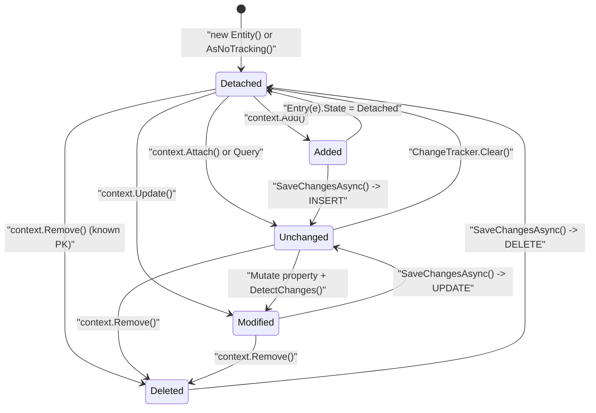
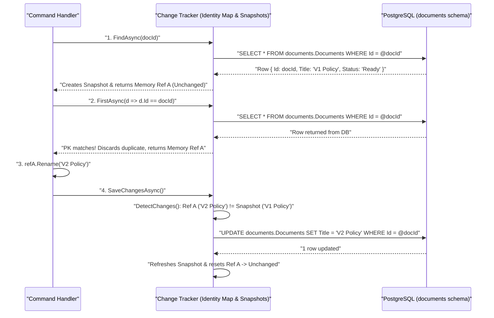
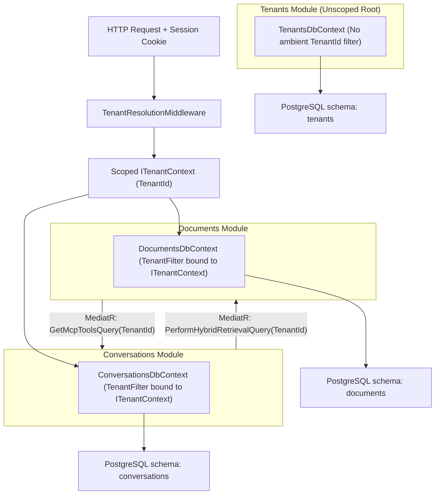
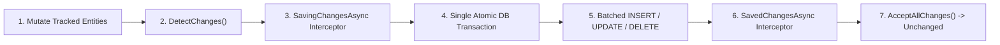

# Chapter 2: The DbContext and the Change Tracker

## 1. Learning Objectives

By the end of this chapter, you will be able to:
*   Deconstruct the internal architecture of the `DbContext` in **.NET 10 / EF Core 10** and explain how it acts as a Unit of Work.
*   Design modular `DbContext` boundaries using **C# Primary Constructors**, parameterless `IEntityTypeConfiguration<T>` classes, and **EF Core 10 Named Query Filters**.
*   Master the Entity State Machine (`Added`, `Unchanged`, `Modified`, `Deleted`, `Detached`) and understand exactly when `EntityState` transitions occur.
*   Analyze how the Change Tracker uses Snapshot Tracking, Identity Resolution, and Relationship Fixup to maintain memory consistency.
*   Directly manipulate entity states using `Entry()`, `Attach()`, `Add()`, `Update()`, `SetValues()`, and `TrackGraph()` to generate surgical PostgreSQL/SQL statements—and know when to bypass the Change Tracker entirely.
*   Choose correctly between `Scoped` `AddDbContext`, `AddDbContextPool`, and `IDbContextFactory<TContext>` for ASP.NET Core requests, SignalR streams, and Hangfire background workers.
*   Implement async `SaveChangesInterceptor` pipelines to automatically enforce timestamps, soft deletes, immutable audit logs, and the Transactional Outbox pattern.

## 2. Introduction

The defining feature of Entity Framework Core—the feature that separates it from **Micro-ORMs** (lightweight SQL-to-object mappers like Dapper that execute raw SQL and return plain objects without tracking changes)—is the **Change Tracker**.

When you query data using a Micro-ORM, you receive disconnected, plain C# objects. If you change a property on that object, the Micro-ORM has no idea that the change occurred. You must manually write an `UPDATE` statement and pass the new values back to the database.

Entity Framework Core operates differently. When you query data via the `DbContext`, EF Core keeps a hidden, internal dictionary in memory. It tracks the original state of every entity it returns. When you change a property on a C# object, EF Core's Change Tracker recognizes the mutation. When you call `SaveChangesAsync()`, EF Core analyzes all the tracked entities, calculates the exact differences, and automatically generates the optimized `INSERT`, `UPDATE`, and `DELETE` SQL statements (e.g., PostgreSQL SQL via Npgsql in Normora) required to synchronize the database with your C# memory state.

In a **Modular Monolith** like **Normora** (a multi-tenant SaaS platform split into isolated business modules: `Tenants`, `Documents`, and `Conversations`), the `DbContext` is also a strict **architectural boundary**. Each module owns its own private `DbContext` mapped to its own PostgreSQL schema (`tenants`, `documents`, `conversations`). Understanding how `DbContext` lifetimes, global query filters, and the Change Tracker interact is the absolute prerequisite to writing secure, zero-leak, high-performance EF Core 10 applications.

## 3. Core Concepts

### The Unit of Work
The `DbContext` implements the **Unit of Work** design pattern. A Unit of Work maintains a list of objects affected by a business transaction and coordinates the writing out of changes. You can modify fifty different entities in memory, but no database locks are held and no network traffic occurs until you call `SaveChangesAsync()`, at which point all fifty mutations are written within a single atomic database transaction (either all succeed or all roll back).

*When NOT to use it:* Do not treat a single `DbContext` as a long-lived session across multiple HTTP requests, SignalR lifetime events, or massive batch imports of 50,000+ rows without calling `ChangeTracker.Clear()` or bypassing the tracker via `ExecuteUpdateAsync` / `ExecuteDeleteAsync`.

### Entity States
Every entity known to a `DbContext` has an `EntityState` enum value managed inside an `EntityEntry` wrapper:
*   **Detached:** The entity exists in C# memory, but the `DbContext` doesn't know about it. Calling `SaveChangesAsync()` will ignore it.
*   **Unchanged:** The entity is tracked. Its property values match the original snapshot from the database.
*   **Modified:** The entity is tracked. At least one of its property values has been marked as modified (either automatically during `DetectChanges()` or explicitly via `Entry()`). `SaveChangesAsync()` will generate an `UPDATE` statement for only the changed columns.
*   **Added:** The entity is tracked, but does not yet exist in the database. `SaveChangesAsync()` will generate an `INSERT` statement.
*   **Deleted:** The entity is tracked, and has been marked for deletion. `SaveChangesAsync()` will generate a `DELETE` statement.

### Identity Resolution
If you execute a query that returns `DocumentId = docId`, and then execute another query on the same `DbContext` instance that also returns `DocumentId = docId`, EF Core will *not* instantiate two separate C# objects. The Change Tracker checks its internal identity map (keyed by entity type and Primary Key). If that `Document` is already being tracked, EF Core returns a reference to the exact same C# object in memory. This is **Identity Resolution**, and it guarantees that your object graph remains consistent—you never end up with two conflicting copies of the same row in the same Unit of Work.

### Snapshot Tracking & Relationship Fixup
How does EF Core know you changed `document.Title = "Q4 Security Policy"`? When an entity is loaded from the database, EF Core takes a **snapshot** (a copy of its original scalar property values) and stores it in the Change Tracker. When you call `SaveChangesAsync()`, EF Core runs `DetectChanges()`, comparing current C# property values against the snapshot.

At the same time, EF Core performs **Relationship Fixup**: if you load a `Document` and later load its `DocumentVersion` children (or set `chunk.Document = document` in memory), EF Core automatically synchronizes both sides of the navigation properties (`document.Versions` and `version.Document`) and populates the corresponding foreign keys (`version.DocumentId`).

### Modular Monolith `DbContext` Encapsulation & Global Tenant Query Filters
In a small CRUD app, developers often put every table into one giant `AppDbContext`. In Normora's **Modular Monolith** architecture, that is forbidden:
1. **One Private `DbContext` per Module:** `TenantsDbContext` (`tenants` schema), `DocumentsDbContext` (`documents` schema), and `ConversationsDbContext` (`conversations` schema) are strictly encapsulated inside their owning modules (`server/Modules/{Module}/Persistence/`). No controller, hub, or sibling module may inject another module's `DbContext`; cross-module data access uses MediatR contracts in `Normora.Shared.Contracts.*`.
2. **Primary Constructors (C# / .NET 10):** Instead of declaring private backing fields and verbose constructors, Normora injects dependencies directly in the class declaration: `public sealed class DocumentsDbContext(DbContextOptions<DocumentsDbContext> options, ITenantContext tenantContext) : DbContext(options)`.
3. **Global Tenant Query Filters & EF Core 10 Named Query Filters:** `DocumentsDbContext` and `ConversationsDbContext` bind global query filters dynamically to `tenantContext.TenantId` inside `OnModelCreating` (while entity column/index mappings live in parameterless `IEntityTypeConfiguration<T>` classes discovered via `ApplyConfigurationsFromAssembly`). With **EF Core 10 Named Query Filters**, an entity can carry independent named filters—such as `"TenantFilter"` and `"SoftDeleteFilter"`—so admin queries can selectively call `.IgnoreQueryFilters(["SoftDeleteFilter"])` without accidentally stripping tenant isolation.
4. **Unscoped Root (`TenantsDbContext`) vs Scoped DbContexts:** Because `TenantsDbContext` resolves workspaces before a tenant context is established (tenant bootstrap, cross-workspace memberships), it does *not* apply an ambient `TenantId` global filter. Any workspace-scoped query against `TenantsDbContext` (`TenantMemberships`, `Departments`, `UserGroups`, `AuditLogs`) must explicitly filter with `.Where(m => m.TenantId == request.TenantId)`.

### When NOT to Use the Change Tracker
The Change Tracker is designed for **OLTP business transactions** (mutating 1 to a few hundred entities with rich domain invariants). Do **not** rely on Change Tracking for:
*   **Read-only queries** powering UI tables, search results, or API responses -> Use `.AsNoTracking()` (or `.AsNoTrackingWithIdentityResolution()`) or direct `.Select(...)` DTO projections.
*   **Bulk / set-based updates or deletes** (e.g., archiving 10,000 expired `PendingApproval` rows or purging old `AuditLog` entries) -> Use EF Core 10's `ExecuteUpdateAsync()` / `ExecuteDeleteAsync()` (covered in depth in Chapter 6), which execute a single SQL statement directly in PostgreSQL without loading a single entity into RAM.

### Real-World Normora Examples: Core Concepts

#### Example 1: Atomic Unit of Work (`UploadDocumentCommandHandler`)
When a user uploads a company policy PDF, Normora must create a `Document`, an initial `DocumentVersion`, and a `DocumentProcessingOutboxMessage` (for the **Transactional Outbox Pattern**—storing background work in the same database transaction so it is never lost if a queue fails). All three `Add()` calls accumulate in `DocumentsDbContext` and commit in one PostgreSQL transaction:
```csharp
// server/Modules/Documents/Application/Documents/Commands/UploadDocument/UploadDocumentCommandHandler.cs
public sealed class UploadDocumentCommandHandler(
    DocumentsDbContext dbContext,
    ITenantContext tenantContext)
{
    public async Task<Guid> HandleAsync(UploadDocumentCommand cmd, CancellationToken ct)
    {
        var document = new Document(tenantContext.TenantId, cmd.Title, cmd.DepartmentId);
        var version = new DocumentVersion(document.Id, cmd.StorageKey, cmd.FileSizeBytes);
        var outbox = new DocumentProcessingOutboxMessage(document.Id, version.Id, tenantContext.TenantId);

        dbContext.Documents.Add(document);       // EntityState.Added
        dbContext.DocumentVersions.Add(version); // EntityState.Added
        dbContext.OutboxMessages.Add(outbox);    // EntityState.Added

        // Single atomic PostgreSQL transaction: all 3 INSERTs succeed or all roll back.
        await dbContext.SaveChangesAsync(ct);
        return document.Id;
    }
}
```

#### Example 2: Entity State Lifecycle on a `Department` Rename
When an HR administrator renames a department in the `Tenants` module, the entity moves through `Detached` -> `Unchanged` -> `Modified` -> `Unchanged`:
```csharp
// Explicit TenantId filter required on unscoped TenantsDbContext
var department = await tenantsDbContext.Departments
    .FirstOrDefaultAsync(d => d.Id == cmd.DepartmentId && d.TenantId == cmd.TenantId, ct)
    ?? throw new BolaException(); // Mapped globally to 404 Not Found

// State right after query: EntityState.Unchanged
department.Rename(cmd.NewName);
// Note: State stays Unchanged in memory until DetectChanges() runs inside SaveChangesAsync()!
await tenantsDbContext.SaveChangesAsync(ct);
// Inside SaveChangesAsync: DetectChanges() -> Modified -> UPDATE tenants."Departments" -> Unchanged
```

#### Example 3: Identity Resolution Preventing Stale Duplicates in `ConversationsDbContext`
Suppose two parts of a handler (e.g., `ConversationTurnPreparer` and a citation recorder) both query the same `Conversation` within one HTTP request scope:
```csharp
var convA = await conversationsDbContext.Conversations
    .FirstOrDefaultAsync(c => c.Id == conversationId, ct);

var convB = await conversationsDbContext.Conversations
    .Include(c => c.Messages)
    .FirstOrDefaultAsync(c => c.Id == conversationId, ct);

// Because Identity Resolution is active, ReferenceEquals(convA, convB) is TRUE.
// Setting convA.Title = "Expense Policy Q&A" is immediately visible on convB.Title.
```

#### Example 4: Snapshot Tracking on `TenantPlan` Currency Update
When a workspace updates its billing currency via `UpdateTenantCurrencyCommand`, EF Core compares the new `Currency` against the snapshot taken at load time and updates *only* the changed columns:
```csharp
var plan = await tenantsDbContext.TenantPlans
    .FirstOrDefaultAsync(p => p.TenantId == cmd.TenantId, ct)
    ?? throw new BolaException();

// Snapshot holds: { Currency = "USD", BillingCycle = Monthly, Tier = Pro }
plan.ChangeCurrency(cmd.Currency); // e.g., "EUR"

// DetectChanges() sees ONLY Currency changed.
// Generates: UPDATE tenants."TenantPlans" SET "Currency" = @p0 WHERE "Id" = @p1;
await tenantsDbContext.SaveChangesAsync(ct);
```

#### Example 5: EF Core 10 Named Query Filters in `DocumentsDbContext`
An administrator viewing soft-deleted documents in the recycle bin needs deleted rows *without* ever disabling multi-tenant isolation:
```csharp
// Soft-delete filter bypassed, TenantFilter REMAINS enforced!
var archivedDocs = await documentsDbContext.Documents
    .AsNoTracking()
    .IgnoreQueryFilters(["SoftDeleteFilter"])
    .Where(d => d.IsDeleted)
    .ToListAsync(ct);
```

## 4. Visual Diagrams

### The Entity State Machine


### Identity Resolution & Snapshot Tracking in `DocumentsDbContext`


### Normora Modular Monolith `DbContext` Encapsulation


### `SaveChangesAsync()` Execution Pipeline


## 5. API Deep Dive

### `context.Add(entity)` and `context.AddRange(entities)`
Transitions a `Detached` entity to the `Added` state. If the entity holds navigation properties pointing to other `Detached` entities (such as a `Document` referencing a new `DocumentVersion`), EF Core traverses the entire reachable graph and marks all `Detached` children as `Added` as well.

### `context.Attach(entity)` and `context.AttachRange(entities)`
Transitions a `Detached` entity to the `Unchanged` state. EF Core assumes the entity already exists in PostgreSQL and its current property values match the database. **Important nuance:** `Attach()` only marks *already-detached* entities as `Unchanged`; if an entity in the reachable graph lacks a primary key (default `Guid.Empty` or `0` for store-generated keys), EF Core marks that child as `Added` instead!

### `context.Update(entity)` and `context.UpdateRange(entities)`
Transitions a `Detached` entity (and reachable detached entities with keys) to the `Modified` state.
*   **When to use:** Almost never for partial API updates. Only safe when you have loaded *every* column or are intentionally replacing the entire row's values.
*   **When NOT to use:** Never call `Update()` on a disconnected DTO-constructed entity—it marks *every single property* on the entity as modified, overwriting unset columns with defaults (`null`, `0`, `DateTime.MinValue`).

### `context.Remove(entity)` and `context.RemoveRange(entities)`
Transitions a tracked entity (`Unchanged` or `Modified`) to the `Deleted` state. If the entity is `Detached`, `Remove()` first attaches it as `Unchanged` and immediately marks it `Deleted` (so you can delete by Primary Key stub without querying first, provided cascade/concurrency rules allow it).

### `context.Entry(entity)` — Surgical State Control
Provides explicit, low-level access to the `EntityEntry` wrapper for a specific entity. Notice carefully *when* state transitions occur:

```csharp
// Approach A: Attach + Property Mutation (Standard POCO entities)
var document = new Document { Id = docId }; // Detached stub with PK
documentsDbContext.Attach(document);       // State is Unchanged; Snapshot captures Status = default
document.Status = DocumentStatus.Ready;    // NOTE: On plain POCOs, State is STILL Unchanged right here!
// DetectChanges() inside SaveChangesAsync() compares CurrentValue to Snapshot and marks Status Modified.
await documentsDbContext.SaveChangesAsync(ct);

// Approach B: Explicit Property Flagging (Safest when stub default might equal new value!)
var document2 = new Document { Id = docId };
var entry = documentsDbContext.Entry(document2);
entry.Property(d => d.Status).CurrentValue = DocumentStatus.Ready;
entry.Property(d => d.Status).IsModified = true; // Immediately attaches as Modified for ONLY Status
await documentsDbContext.SaveChangesAsync(ct);
```

> [!NOTE]
> Why prefer Approach B when using stubs? If `DocumentStatus.Pending` is enum value `0` (the C# default) and you try to set `document.Status = DocumentStatus.Pending` after `Attach(new Document { Id = docId })`, the snapshot also captured `0`, so `DetectChanges()` sees zero difference and skips the `UPDATE`! Setting `entry.Property(...).IsModified = true` explicitly guarantees the column is updated.

### `entry.CurrentValues.SetValues(dto)`
Instead of writing dozens of manual assignment lines, `SetValues()` copies matching property names from a validated DTO (or anonymous object) into a *tracked* entity's `CurrentValues`. EF Core automatically compares against `OriginalValues` and updates *only* the properties that actually changed.

### `context.ChangeTracker.TrackGraph(rootEntity, callback)`
What if an incoming disconnected graph has a **mix** of existing (`Unchanged` or `Modified`) and brand-new (`Added`) entities—for example, updating a `UserGroup` while simultaneously adding a new `UserGroupMember`? Calling `Add()` fails on existing rows; calling `Update()` overwrites everything. `TrackGraph()` walks the graph and lets you decide each node's `EntityState` via a callback without forcing a single blunt state on the whole tree.
*   **When NOT to use `TrackGraph()`:** Do not use it on deep graphs with untrusted client-provided IDs without first validating tenant ownership (BOLA defense), and prefer simple `Attach()` or queried tracking when only one entity is changing.

### `ChangeTracker.Clear()` and `ChangeTracker.DebugView.LongView`
*   **`ChangeTracker.Clear()`:** Immediately detaches every entity tracked by the `DbContext` and frees all Snapshot dictionaries. Essential in long-running worker loops (such as `DocumentProcessingJob`).
*   **`ChangeTracker.DebugView.LongView`:** Returns a human-readable string listing every tracked entity, its `EntityState`, primary/foreign keys, and which exact properties are marked `Modified` (with Original vs Current values). Invaluable during debugging!

### Real-World Normora Examples: Change Tracker APIs

#### Example 1: `Add()` Graph Traversal on Document Upload (`Documents` Module)
```csharp
var document = new Document(tenantContext.TenantId, request.Title, request.DepartmentId);
document.Versions.Add(new DocumentVersion(document.Id, storageKey, request.SizeBytes));

// Calling Add() on the root Document automatically marks BOTH Document and its new DocumentVersion as Added.
documentsDbContext.Documents.Add(document);
await documentsDbContext.SaveChangesAsync(ct);
```

#### Example 2: Surgical `Entry()` Update in `DocumentProcessingJob` (`Normora.Worker`)
```csharp
// Worker marks processing failure using a generic ApiMessages constant (CWE-209 safe, no exception.Message leaked)
var versionStub = new DocumentVersion { Id = message.DocumentVersionId };
var entry = documentsDbContext.Entry(versionStub);
entry.Property(v => v.Status).CurrentValue = DocumentVersionStatus.Failed;
entry.Property(v => v.Status).IsModified = true;
entry.Property(v => v.FailureReason).CurrentValue = ApiMessages.DocumentProcessingFailed;
entry.Property(v => v.FailureReason).IsModified = true;

// Generates: UPDATE documents."DocumentVersions" SET "Status" = @p0, "FailureReason" = @p1 WHERE "Id" = @p2;
await documentsDbContext.SaveChangesAsync(ct);
```

#### Example 3: Safe DTO Mapping via `CurrentValues.SetValues()` on `TenantBranding`
```csharp
var branding = await tenantsDbContext.TenantBrandings
    .FirstOrDefaultAsync(b => b.TenantId == cmd.TenantId, ct)
    ?? throw new BolaException();

// Only properties matching TenantBranding (e.g., PrimaryColor, DisplayName) that actually differ become Modified.
tenantsDbContext.Entry(branding).CurrentValues.SetValues(cmd.ValidatedBrandingDto);
await tenantsDbContext.SaveChangesAsync(ct);
```

#### Example 4: `TrackGraph()` for Mixed-State `UserGroup` Sync (`Tenants` Module)
```csharp
tenantsDbContext.ChangeTracker.TrackGraph(updatedGroup, node =>
{
    if (node.Entry.Entity is UserGroup)
    {
        node.Entry.State = EntityState.Unchanged;
        node.Entry.Property(nameof(UserGroup.Name)).IsModified = true;
    }
    else if (node.Entry.Entity is UserGroupMember member)
    {
        // New members have not been persisted yet (CreatedAt == default); existing ones stay Unchanged.
        node.Entry.State = member.IsNew ? EntityState.Added : EntityState.Unchanged;
    }
});
await tenantsDbContext.SaveChangesAsync(ct);
```

#### Example 5: Inspecting Stuck States with `ChangeTracker.DebugView.LongView`
```csharp
// Useful in development diagnostics when PendingApproval state isn't updating as expected
#if DEBUG
var trackerSnapshot = conversationsDbContext.ChangeTracker.DebugView.LongView;
logger.LogDebug("ChangeTracker state before SaveChanges:\n{DebugView}", trackerSnapshot);
#endif
await conversationsDbContext.SaveChangesAsync(ct);
```

## 6. EF Core Internals: DetectChanges Algorithm

When you call `SaveChangesAsync()`, EF Core does not immediately send SQL to PostgreSQL. It first implicitly calls `context.ChangeTracker.DetectChanges()` (whenever `ChangeTracker.AutoDetectChangesEnabled` is `true`, which is the default).

**The `DetectChanges()` Algorithm:**
1.  Iterates over every entity currently tracked in the `Unchanged`, `Modified`, or `Added` state.
2.  For each tracked entity, retrieves its original **Snapshot** dictionary.
3.  Compares every scalar and complex property value on the current C# instance against the Snapshot value using configured **`ValueComparers`**.
4.  If a difference is found, transitions the entity to `Modified` and marks the specific property's `IsModified = true`.
5.  Inspects **Navigation Properties** and performs **Relationship Fixup**—if you assigned `chunk.Document = doc` or added an item to `conversation.Messages`, it updates Foreign Keys and marks newly discovered reachable entities as `Added`.
6.  Also synchronizes **Shadow Properties** (columns configured in EF Core's model—like `LastSyncedAt` or `TenantId`—that are stored inside the Change Tracker's internal dictionary rather than as C# properties on the domain entity).

**When does `DetectChanges()` run automatically?**
Beyond `SaveChanges()` / `SaveChangesAsync()`, EF Core automatically triggers `DetectChanges()` when you access `ChangeTracker.Entries()`, `ChangeTracker.HasChanges()`, `DbSet<T>.Local`, or `Entry(entity)`.

**`AutoDetectChangesEnabled` — When to Disable & When NOT To:**
If you insert 500 `DocumentChunk` entities in a tight loop using `DbSet.Add()` (`Add` calls `DetectChanges` internally unless batched via `AddRange`!), calling `DetectChanges` on every iteration turns an $O(n)$ loop into $O(n^2)$!
*   **How:** Prefer `AddRangeAsync(chunks, ct)` (which runs `DetectChanges` only once), or temporarily set `context.ChangeTracker.AutoDetectChangesEnabled = false` inside a `try/finally` block during bulk additions.
*   **When NOT to disable:** Never leave `AutoDetectChangesEnabled = false` globally on a standard write `DbContext` used by CQRS handlers; if you forget to call `DetectChanges()` manually before `SaveChangesAsync()`, property mutations on POCO entities will silently fail to persist!

*Architectural Implication:* If you execute a query that returns 10,000 entities without `AsNoTracking()`, `DetectChanges()` must loop 10,000 times and perform property-by-property comparisons during `SaveChangesAsync()`, causing a massive blocking CPU spike.

### Real-World Normora Examples: `DetectChanges()`, `ValueComparers` & Batch Reset

#### Example 1: Short-Circuiting No-Op Commits with `ChangeTracker.HasChanges()`
```csharp
// HasChanges() triggers DetectChanges() once and returns false if nothing actually mutated
var branding = await tenantsDbContext.TenantBrandings
    .FirstOrDefaultAsync(b => b.TenantId == cmd.TenantId, ct)
    ?? throw new BolaException();

tenantsDbContext.Entry(branding).CurrentValues.SetValues(cmd.Dto);

if (!tenantsDbContext.ChangeTracker.HasChanges())
{
    return Unit.Value; // Avoids unnecessary DB round-trip and audit log noise
}
await tenantsDbContext.SaveChangesAsync(ct);
```

#### Example 2: `AddRange()` + `ChangeTracker.Clear()` in `DocumentProcessingJob` (`Normora.Worker`)
```csharp
// Ingesting 1,500 markdown chunks in batches of 100 (matching Gemini batchEmbedContents limit)
foreach (var batch in allChunks.Chunk(100))
{
    await documentsDbContext.DocumentChunks.AddRangeAsync(batch, ct);
    await documentsDbContext.SaveChangesAsync(ct);

    // CRITICAL: Release snapshots & EntityEntry objects so DetectChanges() stays O(100), not O(1500)!
    documentsDbContext.ChangeTracker.Clear();
}
```

#### Example 3: Temporarily Disabling `AutoDetectChangesEnabled` for Graph Construction
```csharp
var originalAutoDetect = conversationsDbContext.ChangeTracker.AutoDetectChangesEnabled;
conversationsDbContext.ChangeTracker.AutoDetectChangesEnabled = false;
try
{
    foreach (var suggestion in generatedSuggestions)
    {
        conversationsDbContext.Suggestions.Add(suggestion);
    }
}
finally
{
    conversationsDbContext.ChangeTracker.AutoDetectChangesEnabled = originalAutoDetect;
}
await conversationsDbContext.SaveChangesAsync(ct); // Runs DetectChanges() once
```

#### Example 4: `ValueComparer` for Mutable Collection / `pgvector` Properties
```csharp
// Inside DocumentChunkConfiguration (parameterless IEntityTypeConfiguration<DocumentChunk>)
// Without a ValueComparer, mutating chunk.Tags.Add("hr-policy") in-place goes UNDETECTED by Snapshot comparison!
builder.Property(c => c.Tags)
    .HasColumnType("text[]")
    .Metadata.SetValueComparer(new ValueComparer<List<string>>(
        (c1, c2) => c1 != null && c2 != null && c1.SequenceEqual(c2),
        c => c.Aggregate(0, (a, v) => HashCode.Combine(a, v.GetHashCode())),
        c => c.ToList())); // Deep clone for Snapshot!
```

#### Example 5: Tracking & Reading a Shadow Property on `Document`
```csharp
// Shadow property configured in DocumentConfiguration: builder.Property<DateTimeOffset?>("LastIndexedAt");
var doc = await documentsDbContext.Documents.FirstOrDefaultAsync(d => d.Id == docId, ct)
    ?? throw new BolaException();

documentsDbContext.Entry(doc).Property("LastIndexedAt").CurrentValue = DateTimeOffset.UtcNow;
await documentsDbContext.SaveChangesAsync(ct);
```

## 7. Complete Examples: EV Platform & Normora Case Studies

### Part A: EV Platform Case Study (Telemetry Heartbeat)
We have an API endpoint that receives a telemetry heartbeat from an EV Charger. We need to update its `LastSeen` timestamp.

#### The Bad Way (The "Update" Anti-Pattern)
```csharp
public async Task HandleHeartbeatBadAsync(ChargerHeartbeatDto dto)
{
    // The developer creates a new object and calls Update()
    var charger = new Charger 
    { 
        Id = dto.ChargerId, 
        LastSeen = DateTime.UtcNow,
        // Because other properties aren't set, they default to null or 0
        Status = null,
        MaxKw = 0
    };

    _context.Chargers.Update(charger);
    
    // DISASTER: Generates UPDATE Chargers SET LastSeen = @p1, Status = NULL, MaxKw = 0 WHERE Id = @p2
    // We just corrupted the database because Update() marks ALL properties as modified.
    await _context.SaveChangesAsync();
}
```

#### The Inefficient Way (The "Select then Update" Pattern)
```csharp
public async Task HandleHeartbeatInefficientAsync(ChargerHeartbeatDto dto)
{
    // 1. Network round trip to fetch the whole row
    var charger = await _context.Chargers.FindAsync(dto.ChargerId);
    
    if (charger != null)
    {
        // 2. Mutate state
        charger.LastSeen = DateTime.UtcNow;
        
        // 3. Network round trip to update the row
        await _context.SaveChangesAsync();
    }
}
```

#### The Enterprise Way (Explicit State Manipulation)
```csharp
public async Task HandleHeartbeatEnterpriseAsync(ChargerHeartbeatDto dto)
{
    // 1. Create a detached stub with ONLY the Primary Key
    var charger = new Charger { Id = dto.ChargerId };
    
    // 2. Attach to context (State becomes Unchanged; snapshot captures default LastSeen)
    _context.Chargers.Attach(charger);
    
    // 3. Modify only the target property (DetectChanges() inside SaveChangesAsync marks it Modified)
    charger.LastSeen = DateTime.UtcNow;

    // 4. Single network round trip! 
    // Generates: UPDATE Chargers SET LastSeen = @p1 WHERE Id = @p2;
    await _context.SaveChangesAsync();
}
```
*(Note: In EF Core 7 through EF Core 10, a blind single-column update is often even cleaner with `ExecuteUpdateAsync`, which bypasses the Change Tracker completely—covered in Chapter 6).*

### Part B: Normora End-to-End Case Studies

#### Example 1: Atomic Document Upload & Outbox Dispatch (`UploadDocumentCommandHandler`)
```csharp
public sealed class UploadDocumentCommandHandler(
    DocumentsDbContext documentsDbContext,
    ITenantContext tenantContext,
    IDocumentProcessingWakeup wakeup) : IRequestHandler<UploadDocumentCommand, Guid>
{
    public async Task<Guid> Handle(UploadDocumentCommand request, CancellationToken ct)
    {
        var document = new Document(tenantContext.TenantId, request.Title, request.DepartmentId);
        var version = new DocumentVersion(document.Id, request.StorageKey, request.SizeBytes);
        var outbox = new DocumentProcessingOutboxMessage(document.Id, version.Id, tenantContext.TenantId);

        documentsDbContext.Documents.Add(document);
        documentsDbContext.DocumentVersions.Add(version);
        documentsDbContext.OutboxMessages.Add(outbox);

        // Single atomic PostgreSQL transaction across all 3 tables
        await documentsDbContext.SaveChangesAsync(ct);

        // Non-blocking wake-up after DB commit; Hangfire recurring job recovers if wakeup fails
        await wakeup.SignalAsync(ct);
        return document.Id;
    }
}
```

#### Example 2: BOLA/BFLA Guard + Tracked Mutation (`UpdateDepartmentCommandHandler`)
```csharp
public sealed class UpdateDepartmentCommandHandler(
    TenantsDbContext tenantsDbContext,
    ICurrentUser currentUser) : IRequestHandler<UpdateDepartmentCommand>
{
    public async Task Handle(UpdateDepartmentCommand request, CancellationToken ct)
    {
        if (!currentUser.HasPermission(Permissions.DepartmentsWrite))
            throw new BflaException(); // Mapped globally to 403 Forbidden

        // TenantsDbContext is unscoped: MUST filter explicitly by request.TenantId!
        var department = await tenantsDbContext.Departments
            .FirstOrDefaultAsync(d => d.Id == request.DepartmentId && d.TenantId == request.TenantId, ct)
            ?? throw new BolaException(); // Mapped globally to 404 Not Found (prevents ID enumeration)

        department.Rename(request.Name);
        await tenantsDbContext.SaveChangesAsync(ct);
    }
}
```

#### Example 3: Zero-Tracking Read Projection + `GroupBy` Rule (`GetDocumentMetricsQueryHandler`)
```csharp
public sealed class GetDocumentMetricsQueryHandler(
    DocumentsDbContext documentsDbContext) : IRequestHandler<GetDocumentMetricsQuery, IReadOnlyList<StatusMetricDto>>
{
    public async Task<IReadOnlyList<StatusMetricDto>> Handle(GetDocumentMetricsQuery request, CancellationToken ct)
    {
        // Normora GroupBy rule: project to anonymous type in SQL first, then to C# record in memory!
        var rawCounts = await documentsDbContext.Documents
            .AsNoTracking()
            .GroupBy(d => d.Status)
            .Select(g => new { Status = g.Key, Count = g.Count() })
            .ToListAsync(ct);

        return rawCounts.Select(x => new StatusMetricDto(x.Status, x.Count)).ToList();
    }
}
```

#### Example 4: HITL Tool Approval State Transition (`ApproveToolExecutionCommandHandler`)
```csharp
public sealed class ApproveToolExecutionCommandHandler(
    ConversationsDbContext conversationsDbContext,
    ICurrentUser currentUser) : IRequestHandler<ApproveToolExecutionCommand>
{
    public async Task Handle(ApproveToolExecutionCommand request, CancellationToken ct)
    {
        var approval = await conversationsDbContext.PendingApprovals
            .FirstOrDefaultAsync(a => a.Id == request.ApprovalId, ct)
            ?? throw new BolaException();

        if (approval.RequestedByExternalUserId != currentUser.ExternalUserId)
            throw new BolaException(); // Caller does not own this approval -> 404

        approval.MarkApproved(DateTimeOffset.UtcNow);
        await conversationsDbContext.SaveChangesAsync(ct); // Updates ONLY Status & ApprovedAt
    }
}
```

#### Example 5: Worker Batch Chunk Ingestion with `ChangeTracker.Clear()` (`DocumentProcessingJob`)
```csharp
public sealed class DocumentProcessingJob(
    IDbContextFactory<DocumentsDbContext> dbFactory,
    ILogger<DocumentProcessingJob> logger)
{
    public async Task ProcessChunksAsync(Guid tenantId, Guid versionId, IReadOnlyList<DocumentChunk> chunks, CancellationToken ct)
    {
        await using var db = await dbFactory.CreateDbContextAsync(ct);

        foreach (var batch in chunks.Chunk(100))
        {
            await db.DocumentChunks.AddRangeAsync(batch, ct);
            await db.SaveChangesAsync(ct);
            db.ChangeTracker.Clear(); // Keeps memory flat across large PDFs
        }

        logger.LogInformation("Persisted {Count} chunks for version {VersionId} (Tenant {TenantId})",
            chunks.Count, versionId, tenantId);
    }
}
```

## 8. Performance Implications

### Tracking Overhead
When EF Core tracks an entity, it allocates memory for:
1. The Entity instance itself.
2. The Snapshot dictionary (containing a copy of the original values).
3. The `EntityEntry` state tracking object.

Tracking a single entity takes roughly 3x the memory of the entity itself.

### `AsNoTracking()` vs `AsNoTrackingWithIdentityResolution()` vs Projections
| Query Mode | Snapshot Created? | Identity Resolution? | Best Used When |
|---|---|---|---|
| **Default (Tracked)** | Yes | Yes | Commands that mutate and call `SaveChangesAsync()`. |
| **`AsNoTrackingWithIdentityResolution()`** | No | Yes | Read-only graphs where many child rows share a parent (e.g., 50 `DocumentChunk`s referencing 5 `Document`s—instantiates 5 `Document` objects instead of 50!). |
| **`AsNoTracking()`** | No | No | Standard read-only lists/details with no shared graph deduplication needed. |
| **`.Select(...)` DTO Projection** | No | No | The fastest possible read path—EF Core doesn't even materialize entity classes; it maps selected columns directly into DTOs/records. |

**Enterprise Rule:** Every `SELECT` query in your CQRS Query stack MUST use `.AsNoTracking()`, `.AsNoTrackingWithIdentityResolution()`, or a `.Select(...)` DTO projection.
*   **When NOT to use `AsNoTracking()`:** Never attach `.AsNoTracking()` to a query in a Command Handler when you intend to mutate the returned entity and call `SaveChangesAsync()`—your mutations will silently be ignored unless you explicitly `Attach()` or `Update()` afterward.

```csharp
// The Change Tracker completely ignores these entities. 
// Identity Resolution is bypassed. Memory usage drops significantly.
var chargers = await _context.Chargers
    .AsNoTracking()
    .Where(c => c.SiteId == siteId)
    .ToListAsync();
```

### Real-World Normora Examples: Query Tracking & Projections

#### Example 1: `AsNoTracking()` for Paginated Document Search (`GetDocumentsQueryHandler`)
```csharp
var docs = await documentsDbContext.Documents
    .AsNoTracking()
    .OrderByDescending(d => d.CreatedAt)
    .Skip((query.Page - 1) * query.PageSize)
    .Take(query.PageSize)
    .ToListAsync(ct);
```

#### Example 2: `AsNoTrackingWithIdentityResolution()` for Shared-Parent Chunks
```csharp
// Many chunks belong to the same Document; deduplicate parent Document instances in RAM without Snapshot overhead
var chunks = await documentsDbContext.DocumentChunks
    .AsNoTrackingWithIdentityResolution()
    .Include(c => c.Document)
    .Where(c => candidateIds.Contains(c.Id))
    .ToListAsync(ct);
```

#### Example 3: Direct `.Select(...)` DTO Projection (Zero Entity Materialization)
```csharp
// Fastest path: selects only 3 columns from PostgreSQL, zero Change Tracker involvement
var summaries = await conversationsDbContext.Conversations
    .Where(c => c.OwnerExternalUserId == currentUser.ExternalUserId)
    .OrderByDescending(c => c.UpdatedAt)
    .Select(c => new ConversationSummaryDto(c.Id, c.Title, c.UpdatedAt))
    .ToListAsync(ct);
```

#### Example 4: Configuring Default `NoTracking` on a Read-Focused Path + `.AsTracking()` Override
```csharp
// If a module configures QueryTrackingBehavior.NoTracking by default, Commands opt in explicitly:
var savedAnswer = await conversationsDbContext.SavedAnswers
    .AsTracking()
    .FirstOrDefaultAsync(s => s.Id == cmd.SavedAnswerId, ct)
    ?? throw new BolaException();

savedAnswer.UpdateNote(cmd.Note);
await conversationsDbContext.SaveChangesAsync(ct);
```

#### Example 5: Unscoped `TenantsDbContext` Read Lookup (`GetUserMembershipsQueryHandler`)
```csharp
var memberships = await tenantsDbContext.TenantMemberships
    .AsNoTracking()
    .Where(m => m.ExternalUserId == currentUser.ExternalUserId && m.TenantId == request.TenantId)
    .Select(m => new MembershipDto(m.TenantId, m.Role, m.DepartmentId))
    .ToListAsync(ct);
```

## 9. ASP.NET Core Integration: Lifetimes, Pooling & Factories

### DbContext Lifetimes & Thread Safety
In ASP.NET Core, `AddDbContext` defaults to a **`Scoped`** lifetime. This aligns cleanly with the Unit of Work pattern:
1. An HTTP request begins. The DI container instantiates `DocumentsDbContext`.
2. Handlers or domain services within that request share the same DI scope and receive the exact same `DocumentsDbContext` instance.
3. Mutations accumulate in the shared Change Tracker and commit together via `SaveChangesAsync(ct)`.
4. The HTTP request ends. The DI container disposes `DocumentsDbContext`, wiping the Change Tracker clean.

> [!IMPORTANT]
> **`DbContext` is NOT thread-safe.** Never run concurrent queries or `Task.WhenAll(...)` against the same `DbContext` instance, and never register a `DbContext` as a `Singleton`. EF Core will throw `InvalidOperationException` ("A second operation was started on this context instance before a previous operation completed").

### `AddDbContext` vs `AddDbContextPool` vs `IDbContextFactory<T>`
*   **`AddDbContext<T>` (Scoped):** Creates a fresh `DbContext` instance per HTTP scope. **Required** when your `DbContext` constructor injects scoped dependencies such as `ITenantContext` (as Normora's `DocumentsDbContext` and `ConversationsDbContext` do).
*   **`AddDbContextPool<T>` (Pooled Scoped):** Reuses `DbContext` instances across requests by calling `ResetState()` / `ChangeTracker.Clear()` on return to the pool, reducing object allocation overhead in ultra-high-RPS stateless APIs.
    *   **When NOT to use `AddDbContextPool`:** Do **not** use `AddDbContextPool` if your `DbContext` constructor injects scoped services like `ITenantContext`! Pooled contexts act like singletons across requests—EF Core requires pooled `DbContext` constructors to accept *only* `DbContextOptions<T>` (any scoped state must be injected via an interceptor or `IHttpContextAccessor` and reset cleanly, or you risk cross-tenant state leaks!).
*   **`IDbContextFactory<T>` (Singleton Factory):** Lets you create short-lived, isolated `DbContext` instances on demand via `await using var db = await factory.CreateDbContextAsync(ct)`.
    *   **Use when:** Executing work in **Hangfire background workers** (`Normora.Worker`), **SignalR hubs** (long-lived WebSocket connections where a single `Scoped` context would never dispose during the connection), or **parallel `Task.WhenAll` fan-outs**.

### Real-World Normora Examples: Lifetimes, Pooling & Factories

#### Example 1: Standard Scoped Registration in `DocumentsModuleExtensions`
```csharp
// server/Modules/Documents/DocumentsModuleExtensions.cs
services.AddDbContext<DocumentsDbContext>((sp, options) =>
{
    var connectionString = configuration.GetConnectionString("DefaultConnection");
    options.UseNpgsql(connectionString, npgsql =>
        npgsql.MigrationsHistoryTable("__EFMigrationsHistory", "documents").UseVector());
    options.AddInterceptors(sp.GetRequiredService<AuditAndTimestampInterceptor>());
});
```

#### Example 2: `IDbContextFactory<T>` in `Normora.Worker` (`HangfireDocumentProcessingOutboxDispatcher`)
```csharp
public sealed class HangfireDocumentProcessingOutboxDispatcher(
    IDbContextFactory<DocumentsDbContext> dbFactory)
{
    public async Task ClaimPendingAsync(CancellationToken ct)
    {
        // Background jobs have no HTTP request scope; create and dispose an isolated context per run
        await using var db = await dbFactory.CreateDbContextAsync(ct);

        var pending = await db.OutboxMessages
            .IgnoreQueryFilters(["TenantFilter"]) // Worker claims across all tenants safely
            .Where(m => m.ProcessedAt == null)
            .OrderBy(m => m.CreatedAt)
            .Take(20)
            .ToListAsync(ct);
        // ... claim and commit
    }
}
```

#### Example 3: Parallel Queries Solved with `IDbContextFactory<TenantsDbContext>`
```csharp
// WRONG: Task.WhenAll on one scoped TenantsDbContext throws concurrency InvalidOperationException!
// RIGHT: Each concurrent task gets its own short-lived DbContext from the factory
public async Task<DashboardSummaryDto> LoadSummaryAsync(Guid tenantId, CancellationToken ct)
{
    var deptTask = Task.Run(async () =>
    {
        await using var db = await tenantsDbFactory.CreateDbContextAsync(ct);
        return await db.Departments.AsNoTracking().CountAsync(d => d.TenantId == tenantId, ct);
    }, ct);

    var memberTask = Task.Run(async () =>
    {
        await using var db = await tenantsDbFactory.CreateDbContextAsync(ct);
        return await db.TenantMemberships.AsNoTracking().CountAsync(m => m.TenantId == tenantId, ct);
    }, ct);

    await Task.WhenAll(deptTask, memberTask);
    return new DashboardSummaryDto(deptTask.Result, memberTask.Result);
}
```

#### Example 4: SignalR / Streaming Scope Safety in `Normora.Api`
```csharp
// Long-lived SignalR Hub methods or SSE streams should never hold a tracked DbContext open across slow AI streaming!
// Load/authorize first, dispose or use AsNoTracking(), stream Gemini tokens, then persist final message in a fresh scope/factory.
await using (var db = await conversationsDbFactory.CreateDbContextAsync(ct))
{
    var msg = new Message(conversationId, tenantId, assistantText);
    db.Messages.Add(msg);
    await db.SaveChangesAsync(ct);
}
```

#### Example 5: Why `AddDbContextPool` Fits Stateless `SessionDatabaseMigrator` / Read Contexts Only
```csharp
// Safe for pooling: constructor accepts ONLY DbContextOptions (no scoped ITenantContext field!)
public sealed class BffSessionDbContext(DbContextOptions<BffSessionDbContext> options)
    : DbContext(options);

// Registered with pooling in Normora.Api host for Duende BFF session storage:
services.AddDbContextPool<BffSessionDbContext>(options =>
    options.UseNpgsql(connectionString));
```

## 10. Clean Architecture & Modular Monolith Perspective

In classic Clean Architecture, the Application Layer orchestrates business logic without coupling directly to `Microsoft.EntityFrameworkCore` by hiding `SaveChangesAsync` behind an **`IUnitOfWork`** interface.

```csharp
// Domain/Interfaces/IUnitOfWork.cs
public interface IUnitOfWork
{
    Task<int> CommitAsync(CancellationToken cancellationToken = default);
}

// Infrastructure/Data/EvDbContext.cs (with .NET 10 Primary Constructor!)
public class EvDbContext(DbContextOptions<EvDbContext> options)
    : DbContext(options), IUnitOfWork
{
    public Task<int> CommitAsync(CancellationToken ct = default)
        => base.SaveChangesAsync(ct);
}

// Application/Handlers/UpdateChargerCommandHandler.cs
public class UpdateChargerCommandHandler(
    IChargerRepository repository,
    IUnitOfWork unitOfWork)
{
    public async Task Handle(UpdateChargerCommand request, CancellationToken ct)
    {
        var charger = await repository.GetByIdAsync(request.ChargerId, ct);
        charger.UpdateFirmware(request.NewVersion); // Domain logic

        // Commit via interface, decoupled from EF Core
        await unitOfWork.CommitAsync(ct);
    }
}
```

### Normora's Pragmatic Modular Monolith Persistence Rules
Normora balances Clean Architecture isolation with pragmatic EF Core power:
*   **100% `DbContext` Encapsulation Across Modules:** Within a module (`server/Modules/Documents/`), CQRS handlers may use `DocumentsDbContext` directly (or via module-internal repositories) to avoid redundant repository boilerplate—because EF Core's `DbContext` *already is* a Unit of Work and Repository! However, **no external module, controller in `Normora.Api`, or SignalR hub may ever inject `DocumentsDbContext`**.
*   **Cross-Module MediatR Contracts with Explicit `TenantId`:** When `Conversations` needs document chunks, it dispatches `PerformHybridRetrievalQuery(Guid TenantId, ...)` via MediatR (`Normora.Shared.Contracts.Documents`). Passing `Guid TenantId` explicitly guarantees identical tenant isolation in both HTTP requests and background Hangfire jobs.
*   **Lean `DbContext` + Parameterless `IEntityTypeConfiguration<T>`:** Entity mappings live in `Persistence/Configurations/{Entity}Configuration.cs` with parameterless public constructors so `modelBuilder.ApplyConfigurationsFromAssembly(...)` works reliably. Global tenant filters bind dynamically to `_tenantContext.TenantId` inside `OnModelCreating` on the `DbContext` itself—never passed into configuration constructors!

### Real-World Normora Examples: Modular Monolith Boundaries

#### Example 1: Lean `DocumentsDbContext` with Primary Constructor & EF Core 10 Named Query Filters
```csharp
public sealed class DocumentsDbContext(
    DbContextOptions<DocumentsDbContext> options,
    ITenantContext tenantContext) : DbContext(options)
{
    public DbSet<Document> Documents => Set<Document>();
    public DbSet<DocumentVersion> DocumentVersions => Set<DocumentVersion>();
    public DbSet<DocumentChunk> DocumentChunks => Set<DocumentChunk>();
    public DbSet<DocumentProcessingOutboxMessage> OutboxMessages => Set<DocumentProcessingOutboxMessage>();

    protected override void OnModelCreating(ModelBuilder modelBuilder)
    {
        modelBuilder.HasDefaultSchema("documents");
        modelBuilder.ApplyConfigurationsFromAssembly(typeof(DocumentsDbContext).Assembly);

        // Bind dynamically to tenantContext.TenantId per instance (never capture a fixed Guid!)
        modelBuilder.Entity<Document>()
            .HasQueryFilter("TenantFilter", d => d.TenantId == tenantContext.TenantId)
            .HasQueryFilter("SoftDeleteFilter", d => !d.IsDeleted);
    }
}
```

#### Example 2: Parameterless `IEntityTypeConfiguration<Document>`
```csharp
// server/Modules/Documents/Persistence/Configurations/DocumentConfiguration.cs
// Parameterless constructor required for ApplyConfigurationsFromAssembly!
public sealed class DocumentConfiguration : IEntityTypeConfiguration<Document>
{
    public void Configure(EntityTypeBuilder<Document> builder)
    {
        builder.ToTable("Documents");
        builder.HasKey(d => d.Id);
        builder.Property(d => d.Title).HasMaxLength(256).IsRequired();
        builder.HasIndex(d => new { d.TenantId, d.DepartmentId });
    }
}
```

#### Example 3: Unscoped Root `TenantsDbContext` Requiring Explicit `TenantId` Filtering
```csharp
// TenantsDbContext has NO global TenantId filter because it bootstraps tenant resolution
public sealed class GetUserGroupsQueryHandler(TenantsDbContext tenantsDbContext)
    : IRequestHandler<GetUserGroupsQuery, IReadOnlyList<UserGroupDto>>
{
    public async Task<IReadOnlyList<UserGroupDto>> Handle(GetUserGroupsQuery request, CancellationToken ct)
        => await tenantsDbContext.UserGroups
            .AsNoTracking()
            .Where(g => g.TenantId == request.TenantId) // Mandatory explicit isolation!
            .Select(g => new UserGroupDto(g.Id, g.Name))
            .ToListAsync(ct);
}
```

#### Example 4: Cross-Module Contract (`Conversations` -> `Documents`) Without `DbContext` Leakage
```csharp
// Inside Modules/Conversations/Application/ConversationTurnPreparer.cs
// NEVER inject DocumentsDbContext here! Dispatch MediatR contract with explicit TenantId:
var chunks = await mediator.Send(
    new PerformHybridRetrievalQuery(tenantContext.TenantId, userDepartmentIds, rewrittenQuery, TopK: 8),
    ct);
```

#### Example 5: Module-Scoped `IUnitOfWork` Adapter When Domain Purity Is Desired
```csharp
// Inside Modules/Tenants/Persistence/TenantsDbContext.cs
public sealed class TenantsDbContext(DbContextOptions<TenantsDbContext> options)
    : DbContext(options), ITenantsUnitOfWork
{
    public Task<int> CommitAsync(CancellationToken ct = default) => base.SaveChangesAsync(ct);
}
```

## 11. Enterprise SaaS Perspective: Interceptors, Audit Trails & Outbox

In enterprise SaaS, compliance (SOC2, HIPAA) requires knowing who changed what data and when. We can leverage EF Core's **`SaveChangesInterceptor`** to hook into the `SaveChangesAsync()` pipeline to automatically stamp timestamps, convert hard deletes into soft deletes, and emit immutable `AuditLog` entries without duplicating logic in every CQRS handler.

> [!IMPORTANT]
> Always override **`SavingChangesAsync`** (and `SavedChangesAsync`) in async ASP.NET Core applications! If you only override the synchronous `SavingChanges` method, calling `await dbContext.SaveChangesAsync(ct)` will **skip your interceptor completely**.

```csharp
// Normora.Infrastructure/Persistence/Interceptors/AuditAndTimestampInterceptor.cs
using Microsoft.EntityFrameworkCore.Diagnostics;

public sealed class AuditAndTimestampInterceptor(ICurrentUser currentUser) : SaveChangesInterceptor
{
    public override ValueTask<InterceptionResult<int>> SavingChangesAsync(
        DbContextEventData eventData,
        InterceptionResult<int> result,
        CancellationToken cancellationToken = default)
    {
        var context = eventData.Context;
        if (context is null) return ValueTask.FromResult(result);

        var now = DateTimeOffset.UtcNow;

        foreach (var entry in context.ChangeTracker.Entries<IAuditableEntity>())
        {
            if (entry.State == EntityState.Added)
            {
                entry.Entity.SetCreated(now, currentUser.ExternalUserId);
            }
            else if (entry.State == EntityState.Modified)
            {
                entry.Entity.SetUpdated(now, currentUser.ExternalUserId);
            }
            else if (entry.State == EntityState.Deleted && entry.Entity is ISoftDeletable softDeletable)
            {
                // Intercept hard DELETE and convert to Soft Delete
                entry.State = EntityState.Modified;
                softDeletable.MarkDeleted(now, currentUser.ExternalUserId);
            }
        }

        return ValueTask.FromResult(result);
    }

    public override InterceptionResult<int> SavingChanges(
        DbContextEventData eventData,
        InterceptionResult<int> result)
    {
        // Keep sync path aligned if synchronous SaveChanges() is ever called
        SavingChangesAsync(eventData, result).AsTask().GetAwaiter().GetResult();
        return result;
    }
}
```

*When NOT to put logic in `SaveChangesInterceptor`:* Never make network calls (Google Gemini, MinIO S3 upload, Resend email, or external webhooks) inside `SavingChangesAsync`! Doing I/O inside an open database transaction holds locks on PostgreSQL rows and can corrupt state if the transaction later rolls back. Instead, write a **Transactional Outbox** row inside the same `SaveChangesAsync` transaction and let `Normora.Worker` process external I/O asynchronously.

### Real-World Normora Examples: Interceptors & Cross-Cutting Persistence

#### Example 1: Automatic `UpdatedAt` & `ExternalUserId` Stamping
Whenever `UpdateDepartmentCommandHandler` calls `SaveChangesAsync`, `AuditAndTimestampInterceptor` stamps `UpdatedAt` and `UpdatedByExternalUserId` (never vendor-specific `KeycloakUserId`) automatically.

#### Example 2: Soft-Delete Interception on `Document`
Calling `documentsDbContext.Documents.Remove(document)` in `DeleteDocumentCommandHandler` is intercepted in `SavingChangesAsync`: `entry.State` flips from `Deleted` to `Modified`, `IsDeleted` becomes `true`, and EF Core emits `UPDATE documents."Documents" SET "IsDeleted" = true`—immediately hiding the row via `"SoftDeleteFilter"`.

#### Example 3: Generating Immutable `AuditLog` Diffs Without Infinite Loops
```csharp
// Snapshot original vs current values BEFORE adding AuditLog entries (avoid mutating the enumerated collection!)
var auditEntries = context.ChangeTracker.Entries()
    .Where(e => e.State == EntityState.Modified && e.Entity is TenantMembership or TenantPlan)
    .Select(e => new AuditLog(
        tenantId,
        currentUser.ExternalUserId,
        e.Metadata.ClrType.Name,
        e.Properties.Where(p => p.IsModified).ToDictionary(p => p.Metadata.Name, p => p.CurrentValue)))
    .ToList();

if (auditEntries.Count > 0)
{
    context.AddRange(auditEntries); // Safe: materialized list first, so no collection-modified exception
}
```

#### Example 4: Transactional Outbox Persistence (`DocumentProcessingOutboxMessage`)
In `UploadDocumentCommandHandler`, `Document`, `DocumentVersion`, and `DocumentProcessingOutboxMessage` are all added to `DocumentsDbContext` before `SaveChangesAsync`. Even if Hangfire or Redis is momentarily unavailable, the outbox message is durably persisted in PostgreSQL and recovered by the minutely Hangfire recovery job.

#### Example 5: `SaveChangesFailedAsync` Structured Telemetry (No Sensitive Data Leaks)
```csharp
public override Task SaveChangesFailedAsync(
    DbContextErrorEventData eventData,
    CancellationToken cancellationToken = default)
{
    // Log structured metadata internally; never forward raw exception.Message to end-user emails/UI (CWE-209)
    logger.LogError(eventData.Exception, "DbContext {ContextType} failed during SaveChangesAsync",
        eventData.Context?.GetType().Name);
    return Task.CompletedTask;
}
```

## 12. Real Production Case Study

### Case Study 1: EV Platform (`ChargingSession` Completion)
In our EV Platform, when a `ChargingSession` ends, we must update the `Session` entity with the `EndTime` and `TotalKwh`, and simultaneously update the parent `Charger` entity's `Status` to `"Available"`.

Because of the Change Tracker and Identity Resolution, we simply query the `Session` (which `Includes` the `Charger`), mutate the C# properties on both objects, and call `SaveChangesAsync()`. EF Core detects the changes on *both* distinct objects in the graph and wraps the two resulting `UPDATE` statements into a single, atomic SQL transaction automatically.

### Case Study 2: Normora (Multi-Tenant Document Upload -> Outbox -> Background Chunking)
When an employer uploads an HR Handbook PDF in Normora:
1.  **HTTP BFF Scope (`Normora.Api` + `Documents` Module):** `TenantResolutionMiddleware` resolves the caller's workspace slug into the scoped `ITenantContext`. `UploadDocumentCommandHandler` adds `Document`, `DocumentVersion`, and `DocumentProcessingOutboxMessage` into `DocumentsDbContext` and calls `SaveChangesAsync(ct)`. `AuditAndTimestampInterceptor.SavingChangesAsync` stamps `CreatedAt` and `ExternalUserId`, and PostgreSQL commits all three rows in a single atomic transaction.
2.  **Outbox Dispatch (`Normora.Infrastructure` -> `Normora.Worker`):** `HangfireDocumentProcessingOutboxDispatcher` runs in `Normora.Worker` (completely isolated from `Normora.Api`) using `IDbContextFactory<DocumentsDbContext>` with `.IgnoreQueryFilters(["TenantFilter"])` to claim pending work across tenants.
3.  **Chunk Ingestion & Memory Safety:** `DocumentProcessingJob` downloads the PDF from MinIO, extracts markdown, calls Gemini `batchEmbedContents` (up to 100 chunks/call), and inserts `DocumentChunk` rows (with `pgvector` embeddings) in batches of 100—calling `db.ChangeTracker.Clear()` after each batch so memory stays flat.
4.  **Reactive Client Sync:** Upon completion, `Normora.Worker` updates `DocumentVersion.Status = Ready` via an explicit `Entry()` or tracked update and broadcasts `dataVersion` over the Redis SignalR backplane to the Angular 22 SPA.

## 13. Common Mistakes & Anti-Patterns

> [!CAUTION]
> **1. Calling `SaveChangesAsync()` Inside a `foreach` Loop (Beginner)**
>
> **Wrong Code:**
> ```csharp
> foreach (var item in request.Items)
> {
>     documentsDbContext.DocumentChunks.Add(new DocumentChunk(item));
>     await documentsDbContext.SaveChangesAsync(ct); // Separate transaction per row!
> }
> ```
> **Why It's Wrong:** Every call opens a PostgreSQL transaction, executes `DetectChanges()` across all previously tracked entities ($O(n^2)$ total scans), and pays a full network round-trip. A 500-chunk document triggers 500 separate commits and leaves partial chunks committed if iteration 300 fails.
>
> **The Fix:** Add/mutate all items first (or in bounded batches of 100), then call `SaveChangesAsync(ct)` once—followed by `ChangeTracker.Clear()` for large worker batches:
> ```csharp
> await documentsDbContext.DocumentChunks.AddRangeAsync(chunks, ct);
> await documentsDbContext.SaveChangesAsync(ct);
> ```

> [!CAUTION]
> **2. Blindly Calling `.Update()` on a Disconnected Entity (Intermediate)**
>
> **Wrong Code:**
> ```csharp
> var doc = new Document { Id = request.DocumentId, Title = request.Title };
> documentsDbContext.Documents.Update(doc); // Marks ALL columns Modified!
> await documentsDbContext.SaveChangesAsync(ct);
> ```
> **Why It's Wrong:** `.Update()` forces every single scalar property into the `Modified` state. Any column omitted from the constructor/DTO (`TenantId`, `CreatedAt`, `StorageKey`, `DepartmentId`) is overwritten in PostgreSQL with `Guid.Empty`, `0001-01-01`, or `null`—causing silent data corruption or constraint crashes.
>
> **The Fix:** Either load the entity with tracking and call domain methods (`doc.Rename(request.Title)`), or use `.Entry()` to flag only the intended property:
> ```csharp
> var doc = await documentsDbContext.Documents
>     .FirstOrDefaultAsync(d => d.Id == request.DocumentId, ct)
>     ?? throw new BolaException();
> doc.Rename(request.Title);
> await documentsDbContext.SaveChangesAsync(ct);
> ```

> [!CAUTION]
> **3. Overriding Only Synchronous `SavingChanges()` in a `SaveChangesInterceptor` (Intermediate)**
>
> **Wrong Code:**
> ```csharp
> public sealed class BrokenAuditInterceptor : SaveChangesInterceptor
> {
>     public override InterceptionResult<int> SavingChanges(
>         DbContextEventData eventData, InterceptionResult<int> result)
>     {
>         // Stamp UpdatedAt & AuditLog...
>         return result;
>     }
> }
> ```
> **Why It's Wrong:** Every CQRS handler in Normora calls `await dbContext.SaveChangesAsync(ct)`. EF Core invokes `SavingChangesAsync` for async saves—it does **not** fall back to synchronous `SavingChanges`. Your audit logs and `UpdatedAt` stamps will silently never run!
>
> **The Fix:** Override `SavingChangesAsync` (and optionally forward `SavingChanges` if sync calls exist), as shown in Section 11.

> [!CAUTION]
> **4. Omitting `.AsNoTracking()` in CQRS Query Handlers (Intermediate)**
>
> **Wrong Code:**
> ```csharp
> public async Task<IReadOnlyList<DocumentDto>> Handle(GetDocumentsQuery query, CancellationToken ct)
> {
>     var docs = await documentsDbContext.Documents.ToListAsync(ct); // Tracked with Snapshots!
>     return docs.Select(d => new DocumentDto(d.Id, d.Title)).ToList();
> }
> ```
> **Why It's Wrong:** Query handlers never call `SaveChangesAsync()`, yet EF Core allocates an `EntityEntry` and a full Snapshot dictionary for every returned row (~3x memory overhead) and wastes CPU building identity maps.
>
> **The Fix:** Use `.AsNoTracking()`—or even better, project directly to DTOs with `.Select(...)`, which skips entity materialization and tracking altogether:
> ```csharp
> return await documentsDbContext.Documents
>     .AsNoTracking()
>     .Select(d => new DocumentDto(d.Id, d.Title))
>     .ToListAsync(ct);
> ```

> [!CAUTION]
> **5. Injecting Scoped Dependencies (`ITenantContext`) into `IEntityTypeConfiguration<T>` (Senior)**
>
> **Wrong Code:**
> ```csharp
> public sealed class DocumentConfiguration(ITenantContext tenantContext)
>     : IEntityTypeConfiguration<Document>
> {
>     public void Configure(EntityTypeBuilder<Document> builder)
>         => builder.HasQueryFilter(d => d.TenantId == tenantContext.TenantId);
> }
> ```
> **Why It's Wrong:** `modelBuilder.ApplyConfigurationsFromAssembly(...)` calls `Activator.CreateInstance` expecting a **parameterless public constructor**, so this throws `MissingMethodException` at startup. Worse, EF Core caches the compiled model once per `DbContext` type—capturing a specific tenant ID inside a configuration would freeze that first tenant's ID for every subsequent user!
>
> **The Fix:** Keep every `IEntityTypeConfiguration<T>` strictly parameterless, and bind global query filters inside `DbContext.OnModelCreating` referencing the `DbContext`'s instance dependency (`tenantContext.TenantId`).

> [!CAUTION]
> **6. Sharing One `DbContext` Across `Task.WhenAll` or Storing It in a Singleton (Senior)**
>
> **Wrong Code:**
> ```csharp
> // Inside a MediatR handler using the same scoped TenantsDbContext concurrently:
> var deptsTask = tenantsDbContext.Departments.CountAsync(d => d.TenantId == id, ct);
> var usersTask = tenantsDbContext.TenantMemberships.CountAsync(m => m.TenantId == id, ct);
> await Task.WhenAll(deptsTask, usersTask);
> ```
> **Why It's Wrong:** `DbContext` is not thread-safe. Running two concurrent async queries on the same instance throws `InvalidOperationException` ("A second operation was started on this context instance before a previous operation completed"). Storing a `DbContext` in a Singleton also leaks tracked entities infinitely until OOM.
>
> **The Fix:** Execute queries sequentially (`await` each one) on a scoped `DbContext`, or resolve `IDbContextFactory<TenantsDbContext>` so each parallel branch creates and disposes its own context.

> [!CAUTION]
> **7. Using `AddDbContextPool` on a `DbContext` That Injects Scoped Services (Senior)**
>
> **Wrong Code:**
> ```csharp
> // DocumentsDbContext injects scoped ITenantContext in its primary constructor!
> services.AddDbContextPool<DocumentsDbContext>(options => options.UseNpgsql(connStr));
> ```
> **Why It's Wrong:** Pooled `DbContext` instances outlive individual HTTP requests and are reused across users. EF Core explicitly forbids scoped services in a pooled `DbContext` constructor and throws an `InvalidOperationException` at DI validation (or risks leaking stale tenant context if hacked around without resetting).
>
> **The Fix:** Use standard scoped `AddDbContext<DocumentsDbContext>` when the context injects `ITenantContext`. Reserve `AddDbContextPool` strictly for stateless contexts whose constructor accepts only `DbContextOptions<T>` (like `BffSessionDbContext`).

> [!CAUTION]
> **8. Calling Bare `.IgnoreQueryFilters()` Instead of Named Filters—or Forgetting `TenantId` on `TenantsDbContext` (Architect)**
>
> **Wrong Code:**
> ```csharp
> // Strips BOTH SoftDeleteFilter AND TenantFilter!
> var deletedDocs = await documentsDbContext.Documents
>     .IgnoreQueryFilters()
>     .Where(d => d.IsDeleted)
>     .ToListAsync(ct);
> ```
> **Why It's Wrong:** Bare `.IgnoreQueryFilters()` disables *every* filter on the entity, silently exposing deleted documents belonging to **other tenants** (a critical cross-tenant data breach!). Similarly, querying `TenantsDbContext.Departments` without `.Where(d => d.TenantId == request.TenantId)` leaks rows because `TenantsDbContext` is an unscoped root.
>
> **The Fix:** Use EF Core 10 **Named Query Filters** to bypass *only* `"SoftDeleteFilter"`, and always add explicit `TenantId` predicates on `TenantsDbContext`:
> ```csharp
> var deletedDocs = await documentsDbContext.Documents
>     .AsNoTracking()
>     .IgnoreQueryFilters(["SoftDeleteFilter"]) // TenantFilter remains active!
>     .Where(d => d.IsDeleted)
>     .ToListAsync(ct);
> ```

> [!CAUTION]
> **9. Injecting Another Module's `DbContext` Across Modular Monolith Boundaries (Architect)**
>
> **Wrong Code:**
> ```csharp
> // Inside Modules/Conversations/Application/SearchCompanyDocumentsTool.cs
> public sealed class SearchCompanyDocumentsTool(DocumentsDbContext documentsDbContext) { ... }
> ```
> **Why It's Wrong:** Violates Normora's 100% `DbContext` encapsulation rule. Coupling `Conversations` directly to `DocumentsDbContext` turns the modular monolith into a big ball of mud, breaks independent schema evolution, and bypasses `Documents` authorization/retrieval invariants.
>
> **The Fix:** Communicate cross-module strictly via MediatR contracts in `Normora.Shared.Contracts.*` carrying an explicit `Guid TenantId`:
> ```csharp
> var results = await mediator.Send(
>     new PerformHybridRetrievalQuery(tenantId, departmentIds, query, TopK: 8), ct);
> ```

> [!CAUTION]
> **10. Blind `CurrentValues.SetValues()` on Unvalidated Payloads or Constructing Records Inside `GroupBy().Select()` (Senior / Architect)**
>
> **Wrong Code:**
> ```csharp
> // Anti-pattern A (Mass Assignment): Payload JSON contains IsAdmin/TenantId properties!
> tenantsDbContext.Entry(membership).CurrentValues.SetValues(rawRequestPayload);
>
> // Anti-pattern B (EF Core GroupBy translation failure):
> var stats = await documentsDbContext.Documents
>     .GroupBy(d => d.Status)
>     .Select(g => new StatusMetricDto(g.Key, g.Count())) // Throws InvalidOperationException -> 400!
>     .ToListAsync(ct);
> ```
> **Why It's Wrong:** `SetValues()` copies *every* matching property name—exposing `TenantId` or `Role` on a raw request payload allows privilege escalation. Meanwhile, instantiating a C# record with a parameterized constructor directly inside `GroupBy().Select(...)` cannot be translated by EF Core's relational SQL compiler.
>
> **The Fix:** Always pass a strictly scoped, FluentValidation-validated input DTO (containing only user-editable fields) to `SetValues()`. For `GroupBy`, always project to an **anonymous type** in SQL first, then map to the C# record in memory:
> ```csharp
> var raw = await documentsDbContext.Documents
>     .AsNoTracking()
>     .GroupBy(d => d.Status)
>     .Select(g => new { Status = g.Key, Count = g.Count() })
>     .ToListAsync(ct);
> var stats = raw.Select(x => new StatusMetricDto(x.Status, x.Count)).ToList();
> ```

## 14. Interview Questions

### Beginner (10)
1.  **What is the DbContext?**
    *Answer:* The primary class that coordinates Entity Framework functionality for a given data model, acting as a Unit of Work and a bridge to the database.
2.  **What does `SaveChanges()` / `SaveChangesAsync()` do?**
    *Answer:* It runs `DetectChanges()`, translates all tracked state changes (`Added`, `Modified`, `Deleted`) into SQL `INSERT`, `UPDATE`, or `DELETE` statements, and executes them within a single atomic database transaction.
3.  **Name the five Entity States.**
    *Answer:* Detached, Unchanged, Modified, Added, Deleted.
4.  **How do you tell EF Core not to track entities returned by a query?**
    *Answer:* By appending `.AsNoTracking()` to the LINQ query (or `.AsNoTrackingWithIdentityResolution()` when graph deduplication is needed). To stop tracking an entity that is *already* tracked, set `context.Entry(entity).State = EntityState.Detached` or call `context.ChangeTracker.Clear()`.
5.  **If an entity is in the `Detached` state, what happens when `SaveChanges` is called?**
    *Answer:* Nothing. EF Core ignores detached entities.
6.  **What does `context.Add(newTenant)` do?**
    *Answer:* It attaches the `newTenant` object (and any reachable detached children) to the Change Tracker in the `Added` state.
7.  **What is the difference between `Add` and `Attach`?**
    *Answer:* `Add` marks the entity as `Added` (will generate `INSERT`). `Attach` marks the entity as `Unchanged` (assumes it already exists in the database and generates no SQL until a property changes or is marked modified).
8.  **Why should you avoid registering `DbContext` as a Singleton?**
    *Answer:* `DbContext` is not thread-safe (concurrent requests will crash with `InvalidOperationException`), and its Change Tracker will accumulate tracked entities indefinitely across requests, causing a severe memory leak.
9.  **If you query `DbSet<Tenant>`, are the results tracked by default?**
    *Answer:* Yes, unless configured otherwise via `QueryTrackingBehavior.NoTracking` or `.AsNoTracking()`.
10. **What happens if you modify a property on a tracked entity but forget to call `SaveChangesAsync()`?**
    *Answer:* The changes remain only in server RAM. When the `DbContext` is disposed at the end of the request, the changes are lost permanently.

### Intermediate (10)
11. **Explain the `DetectChanges()` process.**
    *Answer:* EF Core compares the current property values of all tracked entities against the original Snapshot values stored in the Change Tracker using `ValueComparers`, and checks navigation properties for relationship fixup. If a difference is found, the entity state transitions to `Modified` and only the changed properties are flagged.
12. **What is Identity Resolution?**
    *Answer:* The process where EF Core ensures that if you query the same database record twice in the same `DbContext` instance, it returns the exact same C# object reference in memory, rather than instantiating a duplicate.
13. **Why is `context.Update(entity)` considered dangerous for disconnected entities?**
    *Answer:* It marks all properties as modified. If the disconnected entity is missing data (e.g., `null` or `0001-01-01` defaults), those defaults will overwrite the valid data in the database during `SaveChangesAsync()`.
14. **How can you update a single column without querying the database first?**
    *Answer:* Instantiate a stub entity with just the Primary Key, set `context.Entry(stub).Property(x => x.Prop).CurrentValue = newValue` and `.IsModified = true` (or `.Attach(stub)` then mutate, noting the stub-default edge case if `newValue` equals the CLR default), and call `SaveChangesAsync()`.
15. **What does `context.Entry(entity).State` return?**
    *Answer:* It returns the current `EntityState` enum value for that specific entity (triggering `DetectChanges()` first if `AutoDetectChangesEnabled` is `true`).
16. **If you have a tracked entity `User` with a navigation property `Company`, and you set `user.Company = newCompany`, what does the Change Tracker do?**
    *Answer:* During `DetectChanges()`, EF Core performs relationship fixup, sets the foreign key on `User`, and inspects `newCompany`'s primary key: if the key has its CLR default (for store-generated keys), it marks `newCompany` as `Added`; if `newCompany` uses client-generated keys (like a non-empty `Guid`) and isn't tracked yet, EF Core may assume it exists or throw unless you explicitly `Add()`/`Attach()` it first.
17. **What is a "Disconnected Entity"?**
    *Answer:* An entity that exists in C# memory (e.g., deserialized from an incoming JSON HTTP payload) that is not currently tracked by the active `DbContext`.
18. **How does `AsNoTracking()` improve performance?**
    *Answer:* It bypasses the creation of the Snapshot dictionary, `EntityEntry` wrappers, and Identity Resolution map, saving significant CPU cycles and memory allocations during object materialization.
19. **If you use `AsNoTracking()`, can you still call `SaveChanges()` to update the database?**
    *Answer:* No, not directly. Because the entity isn't tracked, modifying its properties does nothing. You must explicitly `.Attach()` + mark properties modified, query without `AsNoTracking()`, or use `ExecuteUpdateAsync()`.
20. **What is the `SaveChangesInterceptor` used for?**
    *Answer:* It allows you to hook into the EF Core persistence pipeline before, after, or upon failure of `SaveChanges` / `SaveChangesAsync`. It is commonly used for automated auditing, timestamps, and soft-delete flags.

### Senior (10)
21. **Analyze the memory overhead of the Change Tracker when executing a query returning 10,000 rows.**
    *Answer:* EF Core instantiates 10,000 Entity objects, 10,000 `EntityEntry` tracking objects, and a Snapshot copy of scalar values for all 10,000 entities (~3x memory). This causes heavy Gen 0/Gen 1/Gen 2 GC pressure and slows down `DetectChanges()`. For read-only operations, use `.AsNoTracking()` or `.Select(...)` DTO projections.
22. **Explain how `ValueComparers` work within the Change Tracker.**
    *Answer:* By default, EF Core compares properties by simple equality (`Equals`) and copies references for reference types. If you have a mutable collection or custom type (like `List<string>` or a JSON/vector object), mutating it in-place won't be detected. A `ValueComparer<T>` defines equality comparison, hashing, and how to deep-clone the value for the Snapshot.
23. **How do you perform a "Soft Delete" purely at the Change Tracker level without changing Domain logic?**
    *Answer:* Implement an async `SaveChangesInterceptor` overriding `SavingChangesAsync`. Iterate over `ChangeTracker.Entries<ISoftDeletable>().Where(e => e.State == EntityState.Deleted)`, flip `entry.State` to `EntityState.Modified`, and set `IsDeleted = true` (plus `DeletedAt`). Note that you should also review cascade-deleted dependents so child states aren't left accidentally marked `Deleted`.
24. **In a high-concurrency API, a developer uses `AddDbContextPool`. Explain how this interacts with the Change Tracker.**
    *Answer:* `AddDbContextPool` reuses `DbContext` instances instead of disposing them. When returned to the pool, EF Core resets internal state and runs `ChangeTracker.Clear()`, detaching all entities and clearing snapshots. However, pooled contexts cannot inject scoped services like `ITenantContext` in their constructor.
25. **What happens if you have an entity tracked as `Modified`, but before calling `SaveChanges`, you change the state to `Unchanged` via `context.Entry(entity).State = EntityState.Unchanged`?**
    *Answer:* Setting `State = EntityState.Unchanged` resets all `IsModified` property flags and updates the snapshot to match current values, so no `UPDATE` SQL will be generated for that entity.
26. **Evaluate the use of `context.ChangeTracker.HasChanges()`.**
    *Answer:* It returns `true` if any tracked entity is `Added`, `Modified`, or `Deleted`. Because it implicitly calls `DetectChanges()`, avoid calling it inside tight loops; use it once before `SaveChangesAsync()` when you want to short-circuit empty Unit of Work commits.
27. **Why might `DetectChanges()` cause a noticeable CPU spike in a long-running batch process?**
    *Answer:* `DetectChanges()` scans *all* tracked entities. If you insert or update 5,000 records in one `DbContext` without clearing it, calling `SaveChangesAsync()` per batch forces EF Core to scan every previously tracked entry again ($O(n^2)$). Calling `context.ChangeTracker.Clear()` after each batch keeps scans $O(\text{batchSize})$.
28. **Explain the behavior of `context.UpdateRange(IEnumerable<T>)` compared to `Update`.**
    *Answer:* It behaves identically to `Update`, iterating over the collection and marking all properties of all entities (and reachable detached entities with keys) as `Modified`. It carries the exact same overwrite risks for disconnected DTOs.
29. **How does EF Core handle `DetectChanges` for Shadow Properties?**
    *Answer:* Shadow properties (configured in Fluent API without a CLR property on the entity class) are stored directly inside the Change Tracker's internal dictionary on `EntityEntry`. `DetectChanges()` and `SaveChangesAsync()` track and persist changes to them seamlessly alongside regular properties.
30. **If you query an entity with `AsNoTracking()`, modify a property, and then call `context.Attach()`, what is the resulting Entity State?**
    *Answer:* `Unchanged`. Because it was untracked, EF Core has no prior Snapshot and assumes the current values match the database. Calling `SaveChangesAsync()` will generate no SQL unless you explicitly set `Entry(entity).Property(x => x.Prop).IsModified = true` after attaching.

### Staff Engineer (5)
31. **Architect a domain-event dispatching mechanism that guarantees events are only published to a message broker or background job queue if the EF Core `SaveChangesAsync` transaction commits successfully.**
    *Answer:* Never publish external messages before `SaveChangesAsync()` or directly inside `SavingChangesAsync` (the DB transaction might still fail). Use the **Transactional Outbox Pattern**: inside the same `DbContext` transaction (as Normora does with `DocumentProcessingOutboxMessage`), serialize pending events/jobs into an `OutboxMessages` table and commit atomically. A separate background dispatcher (`Normora.Worker` / Hangfire) reads uncommitted outbox rows and dispatches them safely with retries.
32. **A memory dump analysis shows that `Microsoft.EntityFrameworkCore.ChangeTracking.Internal.Snapshot` is consuming 2GB of RAM. The API is entirely read-only. What architectural failure occurred?**
    *Answer:* Queries are running with tracking enabled (missing `.AsNoTracking()` or `.Select()` projections), AND a `DbContext` is being held alive across long-lived scopes (such as a Singleton service or long-lived SignalR hub) without disposal or `ChangeTracker.Clear()`.
33. **Design a high-performance upsert (MERGE) operation for 10,000 telemetry records using EF Core 10 without relying on third-party libraries.**
    *Answer:* EF Core's Change Tracker is unsuitable for 10,000-row upserts. Bypass `SaveChangesAsync()`: serialize the payload (or pass arrays via `unnest` in PostgreSQL / JSON via `OPENJSON` in SQL Server) to a single set-based SQL command using `ExecuteSqlAsync`—executing `INSERT ... ON CONFLICT DO UPDATE` in PostgreSQL or `MERGE` in SQL Server in milliseconds. (For pure bulk updates/deletes on existing rows, EF Core 10's `ExecuteUpdateAsync` with standard C# `if`/`else` control flow and `ExecuteDeleteAsync` also bypass the Change Tracker completely.)
34. **Explain how EF Core's Identity Resolution can mask severe N+1 query problems in a poorly architected API.**
    *Answer:* If a loop executes 50 queries that happen to return overlapping records, all 50 SQL queries still hit the database over the network. When EF Core materializes the results, Identity Resolution sees the primary keys are already tracked, discards the duplicate row payloads, and returns existing C# references. The code appears functionally correct while hiding 50 round-trips.
35. **Evaluate the security implications of exposing a generic `PATCH` API endpoint that blindly applies a JSON Patch document to an entity and calls `context.Update()`.**
    *Answer:* This creates a **Mass Assignment** vulnerability. An attacker can include `TenantId`, `Role`, or `IsDeleted` in the patch payload, and blind `.Update()` will persist those unauthorized columns. Always apply patches to a strictly whitelisted input DTO validated by FluentValidation, and map only allowed fields onto a tracked entity (after BOLA/BFLA authorization checks).

### Architect (5)
36. **Architect a CQRS boundary where the Read stack and the Write stack share the exact same physical database, but utilize completely different EF Core configurations.**
    *Answer:* Define two separate `DbContext` classes: a Write context configuring relationships, concurrency tokens, and `SaveChangesInterceptor` pipelines; and a Read context configured with `QueryTrackingBehavior.NoTracking`, mapping denormalized read DTOs directly to database views (`ToView`) or read-optimized tables without complex navigation graphs.
37. **Defend the architectural decision to ban the use of `context.Update()` company-wide via Roslyn Analyzers.**
    *Answer:* `context.Update()` emits bloated `UPDATE` statements touching every column, inflates WAL/transaction logs, falsely triggers column-level audit/DB triggers, widens concurrency conflict windows, and causes silent data-loss bugs when disconnected DTOs leave fields defaulted. Requiring tracked mutations, explicit `Entry().Property().IsModified`, or `ExecuteUpdateAsync` enforces surgical SQL and explicit intent.
38. **In a highly concurrent distributed system, two pods attempt to modify the same tracked entity. Explain the interplay between the EF Core Change Tracker and the database's physical locks.**
    *Answer:* Each pod's Change Tracker lives solely in its own process memory; Pod A and Pod B have zero visibility into each other's Snapshots. When both call `SaveChangesAsync()`, the database serializes the `UPDATE` statements with row-level locks, causing a silent "Last Writer Wins" overwrite unless the EF Core model configures an **Optimistic Concurrency Token** (such as PostgreSQL `xmin` or a `RowVersion` column, covered in Chapter 8).
39. **Compare schema-per-tenant (`IModelCacheKeyFactory`) against shared-schema + global tenant query filters (`DocumentsDbContext` / `ConversationsDbContext`). When does `IModelCacheKeyFactory` fail?**
    *Answer:* Overriding `IModelCacheKeyFactory` to build a distinct EF Core `IModel` per `TenantId` works only for a tiny, bounded number of tenants (e.g., < 50). Because EF Core caches compiled `IModel` metadata in memory for the lifetime of the app, thousands of tenants cause **unbounded memory exhaustion (OOM)** and slow cold-starts per tenant. That is why Normora uses shared PostgreSQL module schemas (`tenants`, `documents`, `conversations`) with dynamic global query filters bound to `ITenantContext.TenantId`.
40. **Evaluate the long-term maintainability of using EF Core Change Tracking events (`ChangeTracker.Tracked`, `ChangeTracker.StateChanged`) versus `SaveChanges` Interceptors for cross-cutting concerns.**
    *Answer:* `ChangeTracker` events fire synchronously during *every* entity materialization (including queries!) and graph fixup. Performing side effects or lookups there creates hidden latency inside `SELECT` queries. `SaveChangesInterceptor` (`SavingChangesAsync` / `SavedChangesAsync`) executes strictly at the persistence boundary, giving a deterministic, async-capable hook for timestamps, soft deletes, and audit logging.

### Normora & EF Core 10 Architect Spotlight (8)
41. **(Junior) Why does Normora use primary constructors on `DbContext` classes (e.g., `DocumentsDbContext(DbContextOptions<DocumentsDbContext> options, ITenantContext tenantContext)`), and what happens if `tenantContext.TenantId` is captured into a local `Guid` variable inside `OnModelCreating`?**
    *Answer:* Primary constructors eliminate boilerplate private field declarations per `.NET 10` / Normora coding rules. If you copy `var id = tenantContext.TenantId;` into a local variable inside `OnModelCreating`, EF Core freezes the first tenant's `Guid` into the compiled model cache forever, leaking data to all future tenants. You must reference the `tenantContext.TenantId` property directly inside the filter lambda so EF Core evaluates it dynamically per query.
42. **(Junior) When reading 50 `DocumentChunk` records that all belong to 3 parent `Document` records for RAG citation rendering, should you use `.AsNoTracking()` or `.AsNoTrackingWithIdentityResolution()`?**
    *Answer:* `.AsNoTrackingWithIdentityResolution()`. Plain `.AsNoTracking()` instantiates 50 duplicate `Document` objects in RAM (one per chunk), whereas `.AsNoTrackingWithIdentityResolution()` keeps Snapshot tracking disabled while reusing the 3 `Document` instances across all 50 chunks.
43. **(Senior) Why must every `IEntityTypeConfiguration<T>` class in Normora have a public parameterless constructor?**
    *Answer:* Because each module's `DbContext` discovers mappings via `modelBuilder.ApplyConfigurationsFromAssembly(...)`, which instantiates configuration classes with `Activator.CreateInstance` (no DI container). Passing `ITenantContext` into a configuration constructor breaks startup and encourages unsafe model-level tenant caching.
44. **(Senior) How do you safely update a disconnected `UserGroup` and simultaneously insert new `UserGroupMember` children in one `SaveChangesAsync` call without using `.Update()`?**
    *Answer:* Use `ChangeTracker.TrackGraph(group, node => ...)` to explicitly assign `EntityState.Unchanged` + specific `IsModified` properties on the root `UserGroup`, and `EntityState.Added` for new `UserGroupMember` nodes (or better yet, load the tracked `UserGroup` with `.Include(g => g.Members)` after BOLA/BFLA checks and mutate the domain collection directly).
45. **(Senior) Why does `Normora.Worker` use `IDbContextFactory<DocumentsDbContext>` instead of injecting a scoped `DocumentsDbContext` into `DocumentProcessingJob`?**
    *Answer:* Hangfire background jobs run outside HTTP request scopes and often batch-process chunks across long-running I/O (MinIO downloads, Gemini OCR/embeddings). `IDbContextFactory<DocumentsDbContext>` lets each job step create a short-lived, isolated `DbContext` (`await using var db = ...`) and dispose it immediately, preventing stale Change Trackers and thread-safety violations.
46. **(Architect) How do EF Core 10 Named Query Filters eliminate a major multi-tenant security footgun in `DocumentsDbContext` and `ConversationsDbContext`?**
    *Answer:* Before EF Core 10, calling `.IgnoreQueryFilters()` to query soft-deleted items *also* stripped the `TenantId` filter, risking cross-tenant leaks. With EF Core 10 Named Query Filters (`.HasQueryFilter("TenantFilter", ...)` and `.HasQueryFilter("SoftDeleteFilter", ...)`), queries can pass `.IgnoreQueryFilters(["SoftDeleteFilter"])`—viewing deleted rows while keeping `"TenantFilter"` strictly enforced.
47. **(Architect) Why does `TenantsDbContext` omit an ambient `TenantId` global query filter while `DocumentsDbContext` enforces one, and what compensating rule must every `Tenants` query follow?**
    *Answer:* `TenantsDbContext` is the unscoped multi-tenancy root responsible for workspace slug resolution, cross-tenant user memberships, and onboarding before an `ITenantContext` exists. Consequently, every workspace-scoped query on `TenantsDbContext` (`Departments`, `UserGroups`, `TenantMemberships`, `AuditLogs`) must explicitly include `.Where(x => x.TenantId == request.TenantId)`—and missing items throw `BolaException()` (mapped to `404`).
48. **(Architect) Why does `UploadDocumentCommandHandler` write a `DocumentProcessingOutboxMessage` inside `DocumentsDbContext.SaveChangesAsync()` instead of calling Hangfire or Gemini inside a `SaveChangesInterceptor`?**
    *Answer:* Calling external services or queues inside `SavingChangesAsync` holds PostgreSQL locks across slow network I/O and causes irreversible split-brain inconsistency if the database transaction later rolls back. Writing `Document`, `DocumentVersion`, and `DocumentProcessingOutboxMessage` in the same `SaveChangesAsync()` unit of work guarantees atomic durability, and `HangfireDocumentProcessingOutboxDispatcher` recovers work even if the in-memory wakeup signal fails.

## 15. Exercises

### Easy
1.  **State Inspection:** Fetch a `Department` from `TenantsDbContext` (filtering explicitly by `TenantId`). Print `tenantsDbContext.Entry(dept).State`. Call `dept.Rename("People Ops")`. Print the state again (observe it is still `Unchanged` until `DetectChanges()`!). Call `tenantsDbContext.ChangeTracker.DetectChanges()` and print it, then call `SaveChangesAsync()` and print it a final time.

### Medium
1.  **Surgical Update:** Write a handler step that receives a `DocumentVersionId` and sets `Status = DocumentVersionStatus.Ready` using `Entry(stub).Property(...).IsModified = true` without querying the row first. Enable EF Core sensitive/command logging and verify that PostgreSQL receives `UPDATE documents."DocumentVersions" SET "Status" = @p0 WHERE "Id" = @p1;`.

### Hard
1.  **Async Audit Interceptor:** Create an `AuditAndTimestampInterceptor : SaveChangesInterceptor`. Override `SavingChangesAsync` (and `SavedChangesAsync`). Iterate through `Added`, `Modified`, and `Deleted` entries, convert `ISoftDeletable` deletions to `EntityState.Modified` with `IsDeleted = true`, and verify that calling `await dbContext.SaveChangesAsync(ct)` executes your async interceptor.

### Enterprise
1.  **Worker Batch Ingestion & Named Filters:** Implement a batch job using `IDbContextFactory<DocumentsDbContext>` that reads `DocumentProcessingOutboxMessage` rows via `.IgnoreQueryFilters(["TenantFilter"])`, inserts 500 `DocumentChunk` rows in batches of 100 calling `ChangeTracker.Clear()` after each commit, and verifies via `ChangeTracker.Entries().Count()` that tracked entity count never exceeds 100.

## 16. Production Checklist

- [ ] Are all CQRS Query Handlers strictly using `.AsNoTracking()`, `.AsNoTrackingWithIdentityResolution()`, or `.Select(...)` DTO projections?
- [ ] Are all `GroupBy` aggregations projected to an anonymous type in SQL before mapping to C# records in memory?
- [ ] Has `.Update()` been banned or isolated in favor of tracked domain mutations, explicit `Entry().Property().IsModified`, or `ExecuteUpdateAsync`?
- [ ] Is `ChangeTracker.Clear()` called after each batch during `Normora.Worker` ingestion loops to keep `DetectChanges()` $O(\text{batch})$?
- [ ] Are all `DbContext` classes using primary constructors, `ApplyConfigurationsFromAssembly`, and parameterless `IEntityTypeConfiguration<T>` classes?
- [ ] Are soft-delete bypasses using EF Core 10 Named Query Filters (`.IgnoreQueryFilters(["SoftDeleteFilter"])`) instead of bare `.IgnoreQueryFilters()`, and are `TenantsDbContext` queries explicitly filtered by `TenantId`?
- [ ] Do all `SaveChangesInterceptor` implementations override `SavingChangesAsync` (not only synchronous `SavingChanges`)?
- [ ] Do background Hangfire jobs and concurrent branches use `IDbContextFactory<TContext>` rather than sharing a single scoped `DbContext`?

## 17. Summary

The Change Tracker is the brain of Entity Framework Core. By maintaining a Snapshot dictionary, performing Identity Resolution and Relationship Fixup, and driving the Entity State Machine, it lets developers write clean, object-oriented domain logic while generating optimized PostgreSQL statements inside an atomic Unit of Work.

However, that power carries real memory, concurrency, and multi-tenant isolation responsibilities. An EF Core 10 Architect aggressively manages the Change Tracker—using `.AsNoTracking()` and projections for reads, banning blind `.Update()` calls, clearing trackers in worker batches, preferring `IDbContextFactory<T>` for background/parallel work, and enforcing strict module `DbContext` encapsulation with EF Core 10 Named Query Filters and async `SaveChangesInterceptor` pipelines.

With a firm grasp of `DbContext` mechanics and the Change Tracker, we are ready to explore how EF Core maps C# entities to PostgreSQL tables, indexes, and constraints. In the next chapter, we will master Entity Modeling and the Fluent API.
