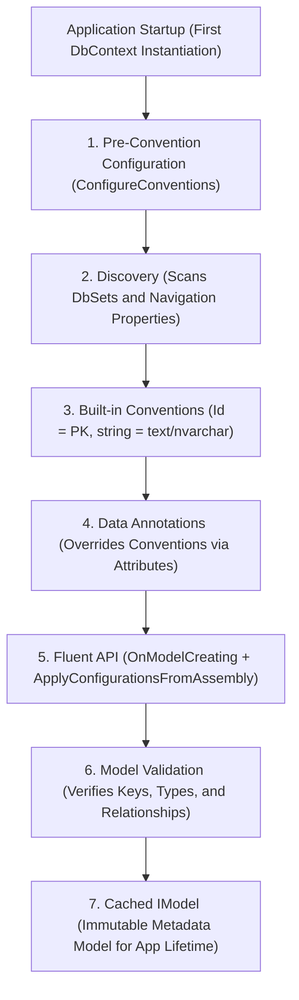
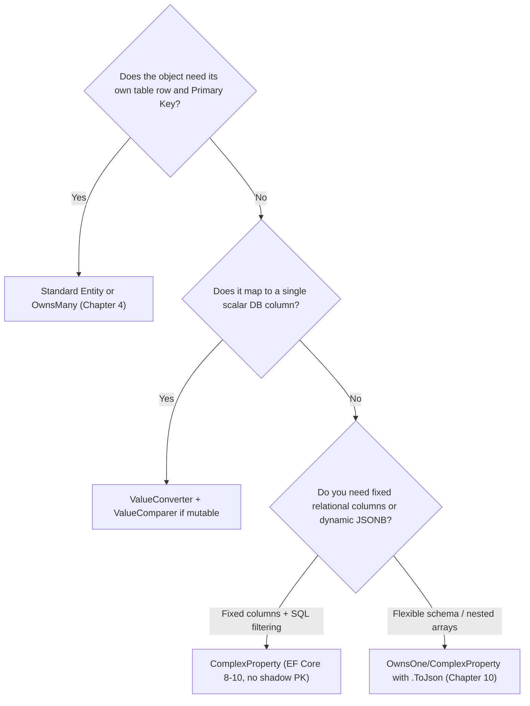
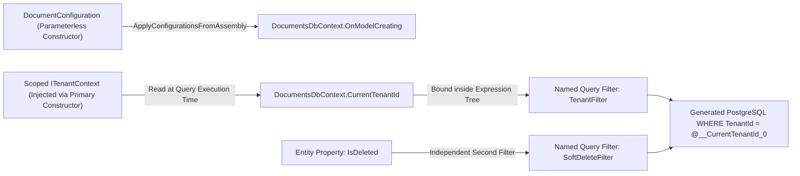

# Chapter 3: Advanced Entity Modeling and the Fluent API

## 1. Learning Objectives

By the end of this chapter, you will be able to:
*   Defend the architectural mandate of utilizing the Fluent API over Data Annotations to maintain a pristine Domain Layer.
*   Master the `OnModelCreating` and `ConfigureConventions` pipelines in EF Core 10 to configure constraints, precision, filtered indexes, check constraints, PostgreSQL/pgvector column types, and default values.
*   Choose accurately between **Value Converters** (with `ValueComparer<T>`), **Complex Types** (`ComplexProperty`), and **Owned Types** (`OwnsOne`) when modeling DDD Value Objects.
*   Implement **Global Query Filters** and **EF Core 10 Named Query Filters** safely using parameterless `IEntityTypeConfiguration<T>` classes and `DbContext`-bound tenant context properties.
*   Utilize **Shadow Properties** (including PostgreSQL `xmin` concurrency tokens) to inject infrastructure-level data without polluting domain entities.
*   Configure **Backing Fields** and `PropertyAccessMode` to strictly enforce encapsulation and Domain-Driven Design (DDD) invariants.
*   Map **Keyless Entities**, database views (`ToView`), and SQL queries (`ToSqlQuery`) for read-only projections.
*   Optimize application startup time using **Compiled Models** while understanding their runtime compatibility constraints.

## 2. Introduction

Entity Framework Core operates on convention by default. If you create a class named `Charger` with a property named `Id`, EF Core assumes it maps to a table named `Chargers` with a Primary Key column named `Id`.

However, enterprise databases rarely align perfectly with default conventions. Legacy databases have esoteric naming schemes. Modern SaaS platforms like **Normora**—a .NET 10 modular monolith built with PostgreSQL 15 + `pgvector` and strict per-module encapsulation (`TenantsDbContext`, `DocumentsDbContext`, `ConversationsDbContext`)—require mapping multi-column value objects, `vector(768)` HNSW indexes, schema-isolated tables (`tenants`, `documents`, `conversations`), partial unique indexes for soft deletes, and dynamic multi-tenant query filters.

To mold EF Core to fit the exact shape of your database, you must explicitly model it. Historically, developers used Data Annotations (`[Table]`, `[Column]`, `[Required]`). While convenient for simple CRUD apps, Data Annotations violate the core tenets of Clean Architecture by tightly coupling your Domain entities to the `System.ComponentModel.DataAnnotations` and EF Core namespaces.

This chapter explores the Architect's weapon of choice: **The Fluent API** in EF Core 10. We will dissect how EF Core builds its internal model, and how you can override that model to map complex value objects, enforce strict encapsulation, and bend relational schemas to your exact will.

## 3. Core Concepts

For every modeling tool in EF Core, an architect must know **what** it is, **why** it exists, **how** it works, and **when NOT to use it**.

### Data Annotations vs. The Fluent API
*   **What & Why:** **Data Annotations** are C# attributes (`[Table]`, `[Column]`, `[MaxLength]`) placed directly on entity classes. **The Fluent API** is a method-chaining API used inside `DbContext.OnModelCreating` (ideally delegated to `IEntityTypeConfiguration<T>` classes). The Fluent API keeps Domain entities as pure Plain Old CLR Objects (POCOs) and exposes 100% of EF Core's configuration surface (filtered indexes, check constraints, shadow properties, named query filters, value comparers, and backing fields).
*   **When NOT to use Data Annotations:** Never use persistence Data Annotations (`[Table]`, `[Column]`, `[ForeignKey]`, `[Index]`) on Domain entities in Clean Architecture or Modular Monoliths like Normora.
*   **When Data Annotations ARE acceptable:** On boundary **DTOs / Commands** for API request validation (alongside FluentValidation) or in tiny single-project prototypes where Domain and Persistence are intentionally merged.

### Pre-Convention Configuration (`ConfigureConventions`)
*   **What & Why:** Overriding `ConfigureConventions(ModelConfigurationBuilder configurationBuilder)` on your `DbContext` lets you set workspace-wide defaults *before* `OnModelCreating` runs (for example, capping all `string` columns at 256 chars, converting all `Enum` properties to `string`, or mapping a strongly-typed ID like `DocumentId` everywhere). It eliminates repetitive boilerplate across dozens of `IEntityTypeConfiguration<T>` classes.
*   **When NOT to use it:** Do not use `ConfigureConventions` for entity-specific constraints, indexes, or exceptions (such as `DocumentChunk.Content`, which needs unbounded `text`, or `DocumentChunk.Embedding`, which needs `vector(768)`). Use `IEntityTypeConfiguration<T>` to override individual properties when they diverge from the convention.

### Value Converters & Value Comparers (`ValueConverter` / `ValueComparer<T>`)
*   **What & Why:** A **Value Converter** translates a single C# property to a single database column type (e.g., `DocumentStatus` enum -> `varchar(32)`, or `ExternalUserId` record -> `varchar(128)`). A **Value Comparer** (`ValueComparer<T>`) teaches EF Core's Change Tracker how to snapshot, clone, and compare non-primitive or mutable types (like `List<string>` or custom classes) so dirty checking works accurately.
*   **When NOT to use it:** Never use a Value Converter when you need to query individual fields inside a composite structure (use `ComplexProperty` or `.ToJson()` instead), or when you want to filter a collection using relational joins/indexes (violates First Normal Form—use a child table or PostgreSQL `jsonb` with GIN indexing, covered in Chapter 10). Never use a Value Converter on a mutable reference type or collection *without* supplying a `ValueComparer<T>`.

### Complex Types (`ComplexProperty`) vs. Owned Types (`OwnsOne`)
*   **What & Why:** Introduced in EF Core 8 and expanded in EF Core 9/10 (including nullable complex properties and JSON mapping in EF Core 10), **`ComplexProperty`** maps a multi-property DDD Value Object (such as `Money` with `Amount` + `Currency`, or `StorageLocation` with `Bucket` + `ObjectKey`) directly into flat columns on the parent table. Unlike `OwnsOne`, a `ComplexProperty` has **no primary key** (not even a shadow key), enforces true value equality semantics, and can be shared across properties on the same entity without identity tracking overhead.
*   **When NOT to use `ComplexProperty`:** When the sub-object needs its own database identity/lifecycle, or represents a **collection** of child items (`1:N`) in separate relational tables—use `OwnsMany` or a standard navigation relationship (Chapter 4). For deep semi-structured JSON documents inside a single `jsonb` column, see `.ToJson()` (Chapter 10).

### Shadow Properties
*   **What & Why:** Properties that exist in the EF Core `IModel` and database table, but do *not* exist as C# properties on the Domain entity class. They are accessed via `EF.Property<T>(entity, "PropName")` in LINQ and `context.Entry(entity).Property("PropName")` in `ChangeTracker` / `SaveChangesInterceptor`. Ideal for infrastructure concerns (`CreatedAt`, `UpdatedBy`, or PostgreSQL's implicit `xmin` concurrency token via `UseXminAsConcurrencyToken()`).
*   **When NOT to use it:** Do not hide genuine business attributes as shadow properties. If domain rules, DTOs, or unit tests need to read or enforce a property (such as `Document.TenantId` or `Document.Status`), make it a real C# property on the entity.

### Backing Fields & `PropertyAccessMode`
*   **What & Why:** In DDD, aggregates protect invariants by exposing `IReadOnlyCollection<T>` instead of `List<T>`, or properties with `private set`. Configuring `.HasField("_fieldName")` and `.UsePropertyAccessMode(PropertyAccessMode.Field)` instructs EF Core to bypass validation setters during database materialization and hydrate the private field directly.
*   **When NOT to use it:** Avoid unnecessary backing field boilerplate for trivial anemic data structures or read-only projections/views where no domain invariant exists to protect.

### Keyless Entities, Views (`ToView`), & SQL Queries (`ToSqlQuery`)
*   **What & Why:** Read-only projections (`builder.HasNoKey()`) that map database views (`ToView`), inline SQL (`ToSqlQuery`), or raw query results (`SqlQuery`) without primary keys. Because they have no key, they completely bypass the Change Tracker.
*   **When NOT to use it:** Never use `HasNoKey()` if you intend to update, delete, or track entities via `SaveChangesAsync()`, or if you need EF Core Identity Resolution to deduplicate graph references.

### Global Query Filters & EF Core 10 Named Query Filters
*   **What & Why:** Predicates configured once in the model (`HasQueryFilter`) that EF Core automatically appends as `WHERE` clauses to every LINQ query—the backbone of soft-delete (`!IsDeleted`) and multi-tenant isolation (`TenantId == _tenantContext.TenantId`). In **EF Core 10**, **Named Query Filters** (`builder.HasQueryFilter("TenantFilter", ...)` and `builder.HasQueryFilter("SoftDeleteFilter", ...)`) allow multiple independent filters on the same entity and selective disabling via `.IgnoreQueryFilters(["SoftDeleteFilter"])`.
*   **When NOT to use it:** Do not put an ambient `TenantId` global filter on an unscoped cross-tenant root context like Normora's `TenantsDbContext` (which resolves workspace slugs and cross-tenant memberships before a tenant is chosen—always filter explicitly with `.Where(m => m.TenantId == request.TenantId)` there). And NEVER call parameterless `.IgnoreQueryFilters()` on multi-tenant entities, as it silently disables tenant isolation alongside soft-delete filters.

### Indexes, Check Constraints, & Precision
*   **What & Why:** Relational guardrails configured in Fluent API: **Filtered/Partial Indexes** (`HasFilter`), **pgvector HNSW Indexes** (`HasMethod("hnsw").HasOperators("vector_cosine_ops")`), **Check Constraints** (`ToTable(t => t.HasCheckConstraint(...))`), and **Decimal Precision** (`HasPrecision(18, 4)`). They enforce uniqueness, vector search speed, and numeric integrity inside PostgreSQL itself—not just in C# code.
*   **When NOT to use it:** Avoid creating speculative indexes on every column (indexes slow down `INSERT`/`UPDATE` throughput, especially during bulk `DocumentChunk` ingestion) and avoid duplicating heavy cross-row business workflows inside database check constraints.

## 4. Visual Diagrams

### EF Core 10 Model Building Pipeline



### Value Object Mapping Decision Tree



### Normora Parameterless Configuration & Named Query Filter Binding



## 5. API Deep Dive: The Fluent API

The Fluent API is accessed via the `ModelBuilder` inside the `OnModelCreating` method of your `DbContext` (and pre-convention via `ConfigureConventions`).

### 5.1 Basic Configuration (`EntityTypeBuilder`), Constraints, & PostgreSQL Indexes

```csharp
protected override void OnModelCreating(ModelBuilder modelBuilder)
{
    // Access the configuration builder for the 'Tenant' entity
    modelBuilder.Entity<Tenant>(builder =>
    {
        // Map to a specific schema and table name
        builder.ToTable("Tenants", "saas");

        // Override the Primary Key convention
        builder.HasKey(t => t.TenantCode);

        // Configure Property Constraints
        builder.Property(t => t.Name)
            .IsRequired()
            .HasMaxLength(255)
            .HasColumnName("TenantName")
            .HasColumnType("varchar(255)"); // Force non-unicode

        // Configure a Composite Index
        builder.HasIndex(t => new { t.Region, t.IsActive })
            .HasDatabaseName("IX_Tenants_Region_Active");
    });
}
```

Beyond table names and primary keys, enterprise schemas rely on the Fluent API for **column precision**, **partial/filtered unique indexes**, **database check constraints**, and provider-specific column types (such as PostgreSQL `vector(768)` and `HNSW` indexes in Normora).

> [!TIP]
> **EF Core 7–10 Check Constraint Syntax:** Always configure check constraints inside `ToTable(t => t.HasCheckConstraint(...))`. The older `builder.HasCheckConstraint(...)` directly on `EntityTypeBuilder` is obsolete.

#### 5 Real-World Normora Examples: Schemas, Constraints, & Indexes

1. **`TenantConfiguration` (`server/Modules/Tenants/Persistence/Configurations/TenantConfiguration.cs`)**: Maps the `Tenant` aggregate to the `"tenants"` schema with a unique slug index for `TenantResolutionMiddleware`.
```csharp
public class TenantConfiguration : IEntityTypeConfiguration<Tenant>
{
    public void Configure(EntityTypeBuilder<Tenant> builder)
    {
        builder.ToTable("tenants", "tenants");
        builder.HasKey(t => t.Id);

        builder.Property(t => t.Slug)
            .IsRequired()
            .HasMaxLength(100);

        builder.Property(t => t.DisplayName)
            .IsRequired()
            .HasMaxLength(200);

        builder.HasIndex(t => t.Slug)
            .IsUnique()
            .HasDatabaseName("ix_tenants_slug");
    }
}
```

2. **`TenantPlanConfiguration` (`Modules/Tenants`)**: Configures `HasPrecision(18, 4)` for monetary/quota calculations and a PostgreSQL check constraint ensuring valid storage limits.
```csharp
builder.ToTable("tenant_plans", "tenants", t =>
    t.HasCheckConstraint("ck_tenant_plans_max_storage_positive", "\"max_storage_bytes\" > 0"));

builder.Property(p => p.Currency)
    .IsRequired()
    .HasMaxLength(3)
    .IsFixedLength();

builder.Property(p => p.MonthlyPriceAmount)
    .HasPrecision(18, 4);
```

3. **`DocumentConfiguration` (`Modules/Documents`)**: Uses a **filtered (partial) unique index** so soft-deleted documents do not block a tenant from re-uploading a file with the same name in the same department.
```csharp
builder.ToTable("documents", "documents");
builder.HasKey(d => d.Id);

builder.Property(d => d.Title).IsRequired().HasMaxLength(300);
builder.Property(d => d.CreatedAt).HasDefaultValueSql("now()");

builder.HasIndex(d => new { d.TenantId, d.DepartmentId, d.FileName })
    .IsUnique()
    .HasFilter("\"is_deleted\" = false")
    .HasDatabaseName("ux_documents_active_filename");
```

4. **`DocumentChunkConfiguration` (`Modules/Documents`)**: Configures PostgreSQL `pgvector` embedding columns (`vector(768)`) and an **HNSW cosine similarity index** for Normora's hybrid retrieval.
```csharp
builder.ToTable("document_chunks", "documents");
builder.Property(c => c.Content).IsRequired().HasColumnType("text");
builder.Property(c => c.Embedding).HasColumnType("vector(768)");

builder.HasIndex(c => c.Embedding)
    .HasMethod("hnsw")
    .HasOperators("vector_cosine_ops")
    .HasDatabaseName("ix_document_chunks_embedding_hnsw");
```

5. **`DocumentProcessingOutboxMessageConfiguration` (`Modules/Documents`)**: Uses a filtered composite index for Hangfire's `HangfireDocumentProcessingOutboxDispatcher` polling query and a check constraint on retries.
```csharp
builder.ToTable("document_processing_outbox_messages", "documents", t =>
    t.HasCheckConstraint("ck_outbox_retry_non_negative", "\"retry_count\" >= 0"));

builder.HasIndex(m => new { m.Status, m.NextAttemptAt })
    .HasFilter("\"processed_at\" IS NULL")
    .HasDatabaseName("ix_outbox_pending_dispatch");
```

### 5.2 Implementing `IEntityTypeConfiguration<T>` & the Parameterless Rule

Putting all configuration in `OnModelCreating` creates a massive, unmaintainable method. The architectural best practice is to separate configuration into distinct classes.

```csharp
// Infrastructure/Data/Configurations/TenantConfiguration.cs
using Microsoft.EntityFrameworkCore;
using Microsoft.EntityFrameworkCore.Metadata.Builders;

public class TenantConfiguration : IEntityTypeConfiguration<Tenant>
{
    public void Configure(EntityTypeBuilder<Tenant> builder)
    {
        builder.ToTable("Tenants");
        builder.HasKey(t => t.Id);
        // ... specific tenant configuration
    }
}

// In DbContext:
protected override void OnModelCreating(ModelBuilder modelBuilder)
{
    // Dynamically applies ALL configurations found in the executing assembly
    modelBuilder.ApplyConfigurationsFromAssembly(typeof(EvDbContext).Assembly);
}
```

In **.NET 10 / Normora**, each module uses a primary-constructor `DbContext` that remains ultra-lean:

```csharp
// server/Modules/Documents/Persistence/DocumentsDbContext.cs
public class DocumentsDbContext(
    DbContextOptions<DocumentsDbContext> options,
    ITenantContext tenantContext) : DbContext(options)
{
    // Exposed as an instance property so global query filters evaluate per-request
    public Guid CurrentTenantId => tenantContext.TenantId;

    public DbSet<Document> Documents => Set<Document>();
    public DbSet<DocumentVersion> DocumentVersions => Set<DocumentVersion>();
    public DbSet<DocumentChunk> DocumentChunks => Set<DocumentChunk>();
    public DbSet<DocumentProcessingOutboxMessage> OutboxMessages => Set<DocumentProcessingOutboxMessage>();

    protected override void OnModelCreating(ModelBuilder modelBuilder)
    {
        modelBuilder.HasDefaultSchema("documents");
        modelBuilder.HasPostgresExtension("vector");

        // Parameterless IEntityTypeConfiguration<T> classes are discovered automatically
        modelBuilder.ApplyConfigurationsFromAssembly(typeof(DocumentsDbContext).Assembly);

        // Tenant filters bind dynamically to `CurrentTenantId` on THIS DbContext instance
        modelBuilder.Entity<Document>()
            .HasQueryFilter("TenantFilter", d => d.TenantId == CurrentTenantId)
            .HasQueryFilter("SoftDeleteFilter", d => !d.IsDeleted);
    }
}
```

> [!IMPORTANT]
> **Why `IEntityTypeConfiguration<T>` Must Be Parameterless:** `ApplyConfigurationsFromAssembly` calls `Activator.CreateInstance(...)` and requires a public parameterless constructor. Never inject scoped services (like `ITenantContext`) into configuration class constructors—even if you manually instantiate them in `OnModelCreating`, EF Core builds and caches the `IModel` *once* for the application's lifetime, freezing the first tenant's ID into the model forever!

### 5.3 Pre-Convention Configuration (`ConfigureConventions`)

*   **What & Why:** `ConfigureConventions(ModelConfigurationBuilder)` runs *before* `OnModelCreating` to establish module-wide type defaults. Instead of repeating `.HasMaxLength(256)` or `.HasConversion<string>()` on 40 entities, you declare the rule once.
*   **When NOT to use it:** Do not force global rules on types that frequently diverge (e.g., `float[]` could be an embedding vector in one entity and a JSON array in another), and remember that explicit `.HasColumnType()` or `.HasMaxLength()` inside `IEntityTypeConfiguration<T>` always wins over `ConfigureConventions`.

#### 5 Real-World Normora Examples (`ConfigureConventions`)

```csharp
protected override void ConfigureConventions(ModelConfigurationBuilder configurationBuilder)
{
    // 1. Cap all unconfigured strings at 256 chars (prevents unbounded text/nvarchar(max) columns)
    configurationBuilder.Properties<string>()
        .HaveMaxLength(256);

    // 2. Store ALL domain enums (DocumentStatus, SubscriptionTier, BillingCycle) as readable strings
    configurationBuilder.Properties<Enum>()
        .HaveConversion<string>()
        .HaveMaxLength(64);

    // 3. Globally map Normora Strongly-Typed IDs to database UUIDs
    configurationBuilder.Properties<DocumentId>()
        .HaveConversion<DocumentIdConverter>();

    // 4. Enforce UTC timestamptz on all DateTimeOffset properties in PostgreSQL
    configurationBuilder.Properties<DateTimeOffset>()
        .HaveColumnType("timestamptz");

    // 5. Standardize decimal precision for TenantPlanPricingCatalog and token/billing metrics
    configurationBuilder.Properties<decimal>()
        .HavePrecision(18, 4);
}
```

### 5.4 Value Converters & Value Comparers

*   **What & Why:** Value Converters translate a C# property type to and from a single database column type. Whenever the C# type is **mutable** or a **collection** (e.g., `List<string>`), EF Core's default reference-equality check (`a == b`) fails to detect in-place mutations (`list.Add("hr")`). You **must** pair the converter with a **`ValueComparer<T>`** that defines equality, hashing, and deep-cloning snapshots.
*   **When NOT to use it:** Do not use a Value Converter when you need SQL joins, `WHERE` filtering inside a collection, or multi-column queries (use a related table, `ComplexProperty`, or `.ToJson()`).

#### 5 Real-World Normora Examples (Value Converters & Comparers)

1. **Strongly-Typed `DocumentId` Value Object (`Documents`)**: Prevents accidentally swapping a `TenantId` `Guid` for a `DocumentId` `Guid` in method calls.
```csharp
public readonly record struct DocumentId(Guid Value);

public sealed class DocumentIdConverter() : ValueConverter<DocumentId, Guid>(
    id => id.Value,
    guid => new DocumentId(guid));
```

2. **Normalized `TenantSlug` Value Object (`Tenants`)**: Guarantees lowercase, trimmed slugs in `tenants.tenants` regardless of caller casing.
```csharp
builder.Property(t => t.Slug)
    .HasConversion(
        slug => slug.Value.Trim().ToLowerInvariant(),
        db => new TenantSlug(db))
    .HasMaxLength(100);
```

3. **Explicit Enum Mapping (`DocumentProcessingStatus` / `SubscriptionTier`)**: Keeps `tenants.tenant_plans` and `documents.documents` human-readable in pgAdmin and resilient to C# enum reordering.
```csharp
builder.Property(d => d.Status)
    .HasConversion<string>()
    .HasMaxLength(32)
    .IsRequired();
```

4. **Mutable Collection with `ValueComparer<T>` (`Department.AllowedMimeTypes` in `Documents`/`Tenants`)**: Stores a small `List<string>` in PostgreSQL `jsonb` *with* a `ValueComparer` so `.Add("application/pdf")` is reliably detected by `ChangeTracker`.
```csharp
var stringListComparer = new ValueComparer<List<string>>(
    (c1, c2) => c1 != null && c2 != null && c1.SequenceEqual(c2),
    c => c.Aggregate(0, (hash, item) => HashCode.Combine(hash, item.GetHashCode())),
    c => c.ToList());

builder.Property(d => d.AllowedMimeTypes)
    .HasColumnType("jsonb")
    .HasConversion(
        v => JsonSerializer.Serialize(v, (JsonSerializerOptions?)null),
        v => JsonSerializer.Deserialize<List<string>>(v, (JsonSerializerOptions?)null) ?? new List<string>(),
        stringListComparer);
```

5. **Decoupled `ExternalUserId` (`Tenants` / `Conversations`)**: Maps Keycloak/OIDC subject IDs as a strongly-typed domain wrapper (following Normora's `ExternalUserId` naming rule, never `KeycloakUserId`).
```csharp
public readonly record struct ExternalUserId(string Value);

builder.Property(m => m.ExternalUserId)
    .HasConversion(
        id => id.Value,
        raw => new ExternalUserId(raw))
    .HasMaxLength(128)
    .IsRequired();
```

### 5.5 Complex Types (`ComplexProperty`) vs. Owned Types (`OwnsOne`)

*   **What & Why:** In EF Core 8–10, **`ComplexProperty`** is the purpose-built tool for multi-column DDD Value Objects (`Money`, `StorageLocation`, `TokenUsage`). Unlike `OwnsOne`, a `ComplexProperty` has **no primary key** (not even a hidden shadow key), enforces value semantics (two properties can share the same `Money` instance without identity conflict), and in EF Core 10 supports nullable complex properties and `.ToJson()`.
*   **When NOT to use `ComplexProperty`:** When you need a **collection** of child value objects (`OwnsMany`), or when the nested object has its own independent lifecycle/ID (use a separate entity + foreign key, Chapter 4).

| Feature | `ValueConverter` | `ComplexProperty` (EF8–10) | `OwnsOne` |
|---|---|---|---|
| **Database Columns** | 1 column | Multiple flat columns (or `.ToJson()` in EF10) | Multiple flat columns (or `.ToJson()`) |
| **Has Shadow PK?** | No | **No** (pure value type) | Yes (shares owner PK) |
| **LINQ Query on Sub-fields** | No (opaque) | **Yes** (`WHERE x.Price.Currency = 'USD'`) | **Yes** |
| **Shared C# Instance Across Props** | Yes | **Yes** | No (throws tracking conflict) |
| **Collections (`List<T>`)** | Only via JSON + Comparer | No (use `OwnsMany` or `.ToJson()`) | Yes (`OwnsMany`) |

#### 5 Real-World Normora Examples (`ComplexProperty`)

1. **`Money` on `TenantPlan` (`Tenants`)**: Stores `Amount` and `Currency` as flat, queryable columns without shadow PKs.
```csharp
builder.ComplexProperty(p => p.Price, price =>
{
    price.Property(m => m.Amount).HasColumnName("price_amount").HasPrecision(18, 4);
    price.Property(m => m.Currency).HasColumnName("price_currency").HasMaxLength(3).IsRequired();
});
```

2. **`StorageLocation` on `DocumentVersion` (`Documents`)**: Captures MinIO S3 coordinates (`BucketName`, `ObjectKey`, `Sha256Hash`) as an atomic Value Object.
```csharp
builder.ComplexProperty(v => v.Storage, storage =>
{
    storage.Property(s => s.BucketName).HasColumnName("storage_bucket").HasMaxLength(63).IsRequired();
    storage.Property(s => s.ObjectKey).HasColumnName("storage_object_key").HasMaxLength(512).IsRequired();
    storage.Property(s => s.Sha256Hash).HasColumnName("content_sha256").HasMaxLength(64).IsRequired();
});
```

3. **`BrandingAssets` on `TenantBranding` (`Tenants`)**: Groups white-label MinIO keys and hex colors (`LogoKey`, `FaviconKey`, `PrimaryHexColor`).
```csharp
builder.ComplexProperty(b => b.Assets, assets =>
{
    assets.Property(a => a.LogoKey).HasColumnName("logo_object_key").HasMaxLength(512);
    assets.Property(a => a.PrimaryHexColor).HasColumnName("primary_hex_color").HasMaxLength(7);
});
```

4. **`TokenUsage` on `ConversationMessage` (`Conversations`)**: Tracks Gemini LLM token consumption (`PromptTokens`, `CompletionTokens`, `TotalTokens`) directly on each assistant turn.
```csharp
builder.ComplexProperty(m => m.Usage, usage =>
{
    usage.Property(u => u.PromptTokens).HasColumnName("prompt_tokens");
    usage.Property(u => u.CompletionTokens).HasColumnName("completion_tokens");
    usage.Property(u => u.TotalTokens).HasColumnName("total_tokens");
});
```

5. **`RetrievalScore` on `MessageCitation` (`Conversations`)**: Encapsulates Reciprocal Rank Fusion (`RrfScore`), `VectorSimilarity`, and `RankPosition` for grounded RAG citations.
```csharp
builder.ComplexProperty(c => c.Ranking, ranking =>
{
    ranking.Property(r => r.RrfScore).HasColumnName("rrf_score");
    ranking.Property(r => r.VectorSimilarity).HasColumnName("vector_similarity");
    ranking.Property(r => r.RankPosition).HasColumnName("rank_position");
});
```

### 5.6 Shadow Properties & PostgreSQL `xmin` Concurrency

*   **What & Why:** Shadow Properties live in the EF Core `IModel` and database table without cluttering the C# Domain class. PostgreSQL also exposes a built-in system column, `xmin` (the transaction ID of the last modifying row), which `Npgsql` maps as an implicit shadow concurrency token via `builder.UseXminAsConcurrencyToken()`—giving you optimistic concurrency with zero extra table columns!
*   **When NOT to use it:** Never hide domain-critical fields (like `TenantId` on root aggregates, `Status`, or `ExpiresAt`) as shadow properties—handlers and domain methods should read them via normal strongly-typed C# properties instead of magic string lookups (`EF.Property<T>`).

#### 5 Real-World Normora Examples (Shadow Properties)

1. **Audit Timestamps on `Department` (`Tenants`)**: Injected automatically by a `SaveChangesInterceptor`.
```csharp
builder.Property<DateTimeOffset>("CreatedAt").HasColumnType("timestamptz").IsRequired();
builder.Property<DateTimeOffset?>("UpdatedAt").HasColumnType("timestamptz");
```

2. **`UpdatedByExternalUserId` on `TenantBranding` (`Tenants`)**: Records which admin modified white-label settings without adding UI/persistence noise to the domain entity.
```csharp
builder.Property<string?>("UpdatedByExternalUserId").HasMaxLength(128);
```

3. **PostgreSQL `xmin` Concurrency Shadow Token on `TenantPlan` (`Tenants`)**: Prevents race conditions when `UpdateTenantCurrencyCommand` and a PayU webhook update the same plan simultaneously.
```csharp
builder.Property<uint>("xmin")
    .HasColumnType("xid")
    .ValueGeneratedOnAddOrUpdate()
    .IsConcurrencyToken();
// Or using the Npgsql shorthand:
// builder.UseXminAsConcurrencyToken();
```

4. **Retention Shadow Property on `Conversation` (`Conversations`)**: Used by `Normora.Worker` cleanup jobs via `EF.Property<DateTimeOffset?>(c, "ScheduledPurgeAt")`.
```csharp
builder.Property<DateTimeOffset?>("ScheduledPurgeAt").HasColumnType("timestamptz");
```

5. **Shadow `TenantId` on Leaf Child Rows (`DocumentChunk` / `MessageCitation`)**: When leaf rows inherit tenant scope via their parent aggregate (`Document` / `ConversationMessage`) and don't expose `TenantId` on the C# child class, querying via `EF.Property<Guid>(c, "TenantId")` keeps queries partition-friendly.

### 5.7 Keyless Entities, Views (`ToView`), & SQL Queries (`ToSqlQuery`)

*   **What & Why:** Keyless entities (`builder.HasNoKey()`) map read-only DTO-like shapes to PostgreSQL views (`ToView`), inline SQL (`ToSqlQuery`), or ad-hoc `SqlQuery<T>` calls. They never enter the Change Tracker (`AsNoTracking` by nature), eliminating tracking allocation overhead for dashboards and analytics.
*   **When NOT to use it:** Never use `HasNoKey()` for any entity that participates in `Add`, `Update`, `Remove`, or foreign-key navigation collections that require identity resolution.

#### 5 Real-World Normora Examples (Keyless Entities)

1. **`DocumentIngestionMetricsView` (`Documents`)**: Maps a PostgreSQL view aggregating `Pending`, `Processing`, `Ready`, and `Failed` counts per tenant for `documents_get_metrics`.
```csharp
builder.HasNoKey();
builder.ToView("vw_document_ingestion_metrics", "documents");
```

2. **`TenantStorageUsageView` (`Tenants`)**: Read-only view summarizing total bytes consumed per workspace for `Free`/`Pro`/`Enterprise` tier enforcement.
```csharp
builder.HasNoKey();
builder.ToView("vw_tenant_storage_usage", "tenants");
```

3. **`PopularSuggestionMetric` (`Conversations`)**: Uses `ToSqlQuery` to bind a curated SQL aggregation directly to a keyless model for `suggestions_get_popular`.
```csharp
builder.HasNoKey();
builder.ToSqlQuery("""
    SELECT tenant_id, prompt_text, COUNT(*)::int AS usage_count
    FROM conversations.conversation_messages
    WHERE role = 'User'
    GROUP BY tenant_id, prompt_text
    """);
```

4. **`AuditLogDailySummary` (`Tenants`)**: Mapped with `HasNoKey().ToView(null)` so it is excluded from EF Core migrations while supporting `FromSqlInterpolated` in `workspace_get_dashboard_summary`.

5. **`ExpiredPendingApprovalRow` (`Conversations`)**: Maps a read-only diagnostic view of expired 15-minute HITL `PendingApproval` records for worker telemetry.

### 5.8 Global Query Filters & EF Core 10 Named Query Filters

*   **What & Why:** `HasQueryFilter` automatically injects a `WHERE` predicate into every LINQ query on an entity. Prior to EF Core 10, calling `HasQueryFilter` twice on the same entity **silently overwrote** the first filter, and calling `.IgnoreQueryFilters()` disabled **every** filter (a severe multi-tenant security hazard if an admin query only meant to include soft-deleted documents!). **EF Core 10 Named Query Filters** solve both problems by letting you name each filter (`"TenantFilter"`, `"SoftDeleteFilter"`) and selectively bypass only the ones you intend (`.IgnoreQueryFilters(["SoftDeleteFilter"])`).
*   **When NOT to use it:** Never attach an ambient `TenantId` global filter to an unscoped bootstrap/directory context like Normora's `TenantsDbContext`, because `TenantResolutionMiddleware` and cross-workspace membership queries must resolve records *before* or *across* ambient tenant context. In `TenantsDbContext`, always filter explicitly with `.Where(m => m.TenantId == request.TenantId)`.

#### 5 Real-World Normora Examples (Global & Named Query Filters)

1. **Dual Named Filters on `Document` (`DocumentsDbContext`)**:
```csharp
modelBuilder.Entity<Document>()
    .HasQueryFilter("TenantFilter", d => d.TenantId == CurrentTenantId)
    .HasQueryFilter("SoftDeleteFilter", d => !d.IsDeleted);
```

2. **Safe Selective Bypass in Trash/Restore Query (`Documents` Module)**: Restores a soft-deleted file **without** disabling tenant isolation!
```csharp
var trashedDoc = await documentsDbContext.Documents
    .IgnoreQueryFilters(["SoftDeleteFilter"]) // "TenantFilter" STILL enforces TenantId == CurrentTenantId!
    .FirstOrDefaultAsync(d => d.Id == request.DocumentId, ct);
```

3. **Dual Named Filters on `Conversation` & `SavedAnswer` (`ConversationsDbContext`)**:
```csharp
modelBuilder.Entity<Conversation>()
    .HasQueryFilter("TenantFilter", c => c.TenantId == CurrentTenantId)
    .HasQueryFilter("ArchivedFilter", c => !c.IsArchived);
```

4. **Time-Bounded HITL Filter on `PendingApproval` (`ConversationsDbContext`)**:
```csharp
modelBuilder.Entity<PendingApproval>()
    .HasQueryFilter("TenantFilter", a => a.TenantId == CurrentTenantId)
    .HasQueryFilter("ActiveTtlFilter", a => a.ExpiresAt > DateTimeOffset.UtcNow);
```

5. **Unscoped Root Contrast (`TenantsDbContext`)**: Deliberately omits any ambient `TenantId` global filter per `AGENTS.md`:
```csharp
// In Tenants Query Handler — explicit tenant predicate is mandatory:
var memberships = await tenantsDbContext.TenantMemberships
    .Where(m => m.TenantId == request.TenantId && m.IsActive)
    .ToListAsync(ct);
```

## 6. Complete Examples: EV Platform & Normora Case Studies

### Case Study A: EV Platform (`Charger`) on SQL Server
Let's model the `Charger` entity using advanced DDD principles and map it flawlessly to SQL Server.

#### The Domain Entity (Pure C#)
```csharp
// Domain/Entities/Charger.cs
public class Charger
{
    // Encapsulation: Private setter
    public Guid Id { get; private set; }
    
    public Guid SiteId { get; private set; }
    
    // Encapsulation: Value Object
    public SerialNumber Serial { get; private set; } 
    
    // Encapsulation: Complex object we want stored as JSON in a single column
    public HardwareConfig Configuration { get; private set; } 

    // Constructor required by EF Core (can be private)
    private Charger() { } 

    public Charger(Guid siteId, SerialNumber serial, HardwareConfig config)
    {
        Id = Guid.NewGuid();
        SiteId = siteId;
        Serial = serial;
        Configuration = config;
    }
}

// A C# Record acting as a Value Object
public record SerialNumber(string Value);

public class HardwareConfig 
{
    public int MaxKw { get; set; }
    public string FirmwareVersion { get; set; } = string.Empty;
}
```

#### The EF Core Configuration
We must map this complex domain model to a flat SQL Server table (`Chargers`).

```csharp
// Infrastructure/Data/Configurations/ChargerConfiguration.cs
using System.Text.Json;
using Microsoft.EntityFrameworkCore;
using Microsoft.EntityFrameworkCore.Metadata.Builders;

public class ChargerConfiguration : IEntityTypeConfiguration<Charger>
{
    public void Configure(EntityTypeBuilder<Charger> builder)
    {
        builder.ToTable("Chargers");
        builder.HasKey(c => c.Id);

        // 1. VALUE CONVERTER: Map 'SerialNumber' Record to a standard SQL string
        builder.Property(c => c.Serial)
            .HasConversion(
                serial => serial.Value, // Write to DB
                dbString => new SerialNumber(dbString) // Read from DB
            )
            .HasColumnName("SerialNumber")
            .HasMaxLength(50)
            .IsRequired();

        // 2. JSON CONVERTER: Map the complex HardwareConfig to a JSON string column
        builder.Property(c => c.Configuration)
            .HasConversion(
                config => JsonSerializer.Serialize(config, (JsonSerializerOptions?)null),
                json => JsonSerializer.Deserialize<HardwareConfig>(json, (JsonSerializerOptions?)null)!
            )
            .HasColumnType("nvarchar(max)")
            .HasColumnName("HardwareConfigJson");

        // 3. SHADOW PROPERTY: Add tracking data without modifying the Domain class
        builder.Property<DateTime>("LastModifiedAt")
            .HasColumnType("datetime2");
            
        builder.Property<string>("ModifiedBy")
            .HasMaxLength(100);
    }
}
```

#### Interacting with Shadow Properties
Because `LastModifiedAt` doesn't exist on the `Charger` class, how do we query or update it? We use the `EF.Property` static method in LINQ, and the `ChangeTracker` API for updates.

```csharp
// Querying a shadow property
var staleChargers = await context.Chargers
    .Where(c => EF.Property<DateTime>(c, "LastModifiedAt") < DateTime.UtcNow.AddDays(-30))
    .ToListAsync();

// Updating a shadow property (Usually done inside a SaveChangesInterceptor)
var entry = context.Entry(charger);
entry.Property("LastModifiedAt").CurrentValue = DateTime.UtcNow;
entry.Property("ModifiedBy").CurrentValue = "System";
```

### Case Study B: Normora (`Document`, `DocumentVersion`, `DocumentChunk`) on PostgreSQL 15 + `pgvector`
In Normora's `Documents` module (`server/Modules/Documents/`), domain entities remain 100% free of EF Core and MinIO/Gemini dependencies while mapping to the `"documents"` PostgreSQL schema:

```csharp
// server/Modules/Documents/Domain/Entities/Document.cs
public sealed class Document
{
    private readonly List<DocumentVersion> _versions = [];

    public Guid Id { get; private set; }
    public Guid TenantId { get; private set; }
    public Guid DepartmentId { get; private set; }
    public string FileName { get; private set; } = string.Empty;
    public DocumentStatus Status { get; private set; }
    public bool IsDeleted { get; private set; }
    public StorageLocation ActiveStorage { get; private set; } = default!;

    public IReadOnlyCollection<DocumentVersion> Versions => _versions.AsReadOnly();

    private Document() { } // EF Core materialization constructor (keep empty!)

    public Document(Guid tenantId, Guid departmentId, string fileName, StorageLocation storage)
    {
        Id = Guid.NewGuid();
        TenantId = tenantId;
        DepartmentId = departmentId;
        FileName = fileName;
        Status = DocumentStatus.Pending;
        ActiveStorage = storage;
    }
}

public sealed record StorageLocation(string BucketName, string ObjectKey, string Sha256Hash);
```

And its parameterless configuration in `server/Modules/Documents/Persistence/Configurations/DocumentConfiguration.cs`:

```csharp
public sealed class DocumentConfiguration : IEntityTypeConfiguration<Document>
{
    public void Configure(EntityTypeBuilder<Document> builder)
    {
        builder.ToTable("documents", "documents");
        builder.HasKey(d => d.Id);

        builder.Property(d => d.FileName).IsRequired().HasMaxLength(255);
        builder.Property(d => d.Status).HasConversion<string>().HasMaxLength(32).IsRequired();

        // Multi-column Value Object via EF Core ComplexProperty (no shadow PK)
        builder.ComplexProperty(d => d.ActiveStorage, s =>
        {
            s.Property(x => x.BucketName).HasColumnName("storage_bucket").HasMaxLength(63).IsRequired();
            s.Property(x => x.ObjectKey).HasColumnName("storage_object_key").HasMaxLength(512).IsRequired();
            s.Property(x => x.Sha256Hash).HasColumnName("content_sha256").HasMaxLength(64).IsRequired();
        });

        // Partial unique index: allow re-uploading a filename once old copy is soft-deleted
        builder.HasIndex(d => new { d.TenantId, d.DepartmentId, d.FileName })
            .IsUnique()
            .HasFilter("\"is_deleted\" = false")
            .HasDatabaseName("ux_documents_active_filename");

        // Backing field encapsulation for DDD aggregate collection
        builder.Navigation(d => d.Versions)
            .HasField("_versions")
            .UsePropertyAccessMode(PropertyAccessMode.Field);

        // PostgreSQL native row concurrency shadow column
        builder.UseXminAsConcurrencyToken();
    }
}
```

## 7. Backing Fields for DDD Collections

In DDD, you should never expose a `List<T>` that someone can arbitrarily `.Add()` to. You expose a read-only collection and a specific method to manipulate the data.

```csharp
// Domain
public class Site
{
    private readonly List<Charger> _chargers = new(); // Backing Field
    
    // Public exposure is read-only
    public IReadOnlyCollection<Charger> Chargers => _chargers.AsReadOnly();

    public void AddCharger(Charger charger)
    {
        // Business logic and validation goes here
        if (_chargers.Count >= 10) throw new Exception("Max capacity reached.");
        _chargers.Add(charger);
    }
}
```

**The Mapping Issue:** When EF Core queries the database, it tries to populate the `Chargers` property. But it is read-only. It will fail. We must tell EF Core to write directly to the `_chargers` private field.

```csharp
// Configuration
builder.Navigation(s => s.Chargers)
    .HasField("_chargers") // Tell EF Core to use the private field
    .UsePropertyAccessMode(PropertyAccessMode.Field); // Bypass the public property getter/setter entirely during materialization
```
*Note: EF Core 10 is remarkably smart and can often auto-detect backing fields if they follow standard naming conventions (e.g., `_chargers`), but explicit configuration is safer and documents the invariant clearly.*

**When NOT to use Backing Fields:** Do not wrap simple read-only views, outbox message records (`DocumentProcessingOutboxMessage`), or DTO projections in backing-field ceremony when there is no domain invariant to enforce.

### 5 Real-World Normora Backing Field Examples
1. **`Department._members` (`Modules/Tenants`)**: Enforces workspace membership uniqueness and prevents duplicate user assignments inside `Department.AssignMember(...)`.
```csharp
builder.Navigation(d => d.Members)
    .HasField("_members")
    .UsePropertyAccessMode(PropertyAccessMode.Field);
```
2. **`Document._versions` (`Modules/Documents`)**: Guarantees monotonic version numbers (`v1`, `v2`) and ensures only one `DocumentVersion` is marked current when `Document.PublishNewVersion(...)` runs.
3. **`DocumentVersion._chunks` (`Modules/Documents`)**: Protects sequential Markdown-breadcrumb chunk ordering produced by `DocumentChunker` (`_chunks` exposed as `IReadOnlyCollection<DocumentChunk>`).
4. **`Conversation._messages` (`Modules/Conversations`)**: Enforces turn alternation, non-empty prompts, and token budget metadata via `Conversation.AppendTurn(...)`.
5. **`UserGroup._documentPermissions` (`Modules/Tenants` / `Documents`)**: Protects departmental RBAC access grants (`IReadOnlyCollection<UserGroupDocumentPermission>`) so handlers cannot bypass validation rules when attaching permissions.

## 8. Performance Implications

### Value Converters and LINQ Translation
Value Converters are extremely powerful, but they have a severe performance caveat: **EF Core cannot always translate them inside LINQ `Where` clauses.**

If you have a Value Converter that encrypts a string (e.g., `Name` -> Encrypted `DB_String`), and you write `context.Users.Where(u => u.Name == "John")`, SQL Server or PostgreSQL does not know how to encrypt "John". EF Core will attempt to encrypt the parameter locally and pass it, which works for strict equality (assuming deterministic encryption—randomized/IV encryption breaks even equality!). However, if you write `context.Users.Where(u => u.Name.Contains("John"))`, EF Core cannot translate this. It will throw an `InvalidOperationException` (in EF Core 3+) because client-side evaluation of top-level `Where` predicates is blocked.

*Architectural Rule:* Be highly cautious when applying Value Converters to columns that you need to search or filter against using complex string operations (`Contains`, `StartsWith`, `ToLower`).

### Value Comparers (`ValueComparer<T>`) & Change Tracker Overhead
Without a `ValueComparer<T>`, EF Core falls back to reference equality (`object.Equals`). For immutable types (`record struct DocumentId`), reference/value equality works out of the box. For **mutable collections or classes** mapped via a Value Converter (like `List<string> AllowedMimeTypes`), missing a `ValueComparer<T>` causes silent lost updates when you call `allowedMimeTypes.Add("text/markdown")`. Conversely, keep `ValueComparer` snapshot/equality delegates lightweight—deep-cloning massive JSON trees on thousands of tracked entities during `DetectChanges()` hurts memory and CPU. For large read-only queries, always pair with `.AsNoTracking()`.

### EF Core LINQ `GroupBy` Translation Rule (Normora Standard)
When writing aggregation queries in EF Core 10, **always project `GroupBy` into an anonymous type first** before mapping to C# records or DTOs in memory:
```csharp
// Translated cleanly to SQL GROUP BY, then mapped to DTO in memory
var counts = await documentsDbContext.Documents
    .GroupBy(d => d.Status)
    .Select(g => new { Status = g.Key, Count = g.Count() })
    .ToListAsync(ct);

var dtos = counts.Select(x => new DocumentStatusMetricDto(x.Status.ToString(), x.Count)).ToList();
```
Constructing a parameterized C# record (`new DocumentStatusMetricDto(g.Key, g.Count())`) directly inside `.GroupBy(...).Select(...)` often fails EF Core relational SQL translation and throws `InvalidOperationException`.

### Compiled Models (Startup Performance)
Building the `IModel` (discovering DbSets, parsing configurations, validating the graph) takes time. In a massive enterprise context with 500 entities, `OnModelCreating` might take 2-5 seconds. In a serverless environment (Azure Functions) or ephemeral CLI processes where Cold Start time is critical, this is unacceptable.

EF Core provides **Compiled Models**. You execute a CLI command (`dotnet ef dbcontext optimize`) during your CI/CD build process. EF Core generates physical C# classes that represent the compiled `IModel`.

```csharp
// In Program.cs, instruct EF Core to bypass OnModelCreating and use the pre-compiled C# model
builder.Services.AddDbContext<EvDbContext>(options =>
    options.UseSqlServer("...")
           .UseModel(EvDbContextModel.Instance)); // Drastically reduces startup time
```

> [!WARNING]
> **Compiled Models Compatibility:** Compiled Models freeze the metadata model at build time. Dynamic `OnModelCreating` logic (such as reading `IHostEnvironment` or changing table names dynamically) is bypassed. Also, check provider support—custom runtime `IModelCacheKeyFactory` overrides cannot vary the model when a single compiled `IModel` is pinned.

### 5 Real-World Normora Performance Modeling Examples
1. **Ephemeral Migration Host (`dotnet Normora.Api.dll --migrate`) & Compiled Models**: Using `DocumentsDbContextModel.Instance` speeds up container startup for `DatabaseMigrationRunner`'s 4 sequential migrators (`TenantsDatabaseMigrator`, `DocumentsDatabaseMigrator`, `ConversationsDatabaseMigrator`, `SessionDatabaseMigrator`).
2. **HNSW Cosine Index on `DocumentChunk.Embedding`**: Explicitly configuring `.HasMethod("hnsw").HasOperators("vector_cosine_ops")` turns `O(N)` brute-force vector scans into sub-millisecond approximate nearest-neighbor lookups during `PerformHybridRetrievalQuery`.
3. **Partial Index on Outbox Dispatch**: `HasFilter("\"processed_at\" IS NULL")` on `document_processing_outbox_messages` keeps the Hangfire worker polling index tiny even after millions of documents have been processed.
4. **`ValueComparer` on `Department.AllowedMimeTypes`**: Prevents `ChangeTracker` from missing list mutations while keeping `AsNoTracking()` queries allocation-free.
5. **Keyless `DocumentIngestionMetricsView`**: Bypasses Change Tracker snapshot allocation entirely for dashboard status counts (`documents_get_metrics`).

## 9. ASP.NET Core Integration

When organizing an ASP.NET Core solution, place your `IEntityTypeConfiguration<T>` classes in the same assembly as your `DbContext` (the Infrastructure or Persistence Layer). 

Do NOT load configurations manually in `OnModelCreating` like this:
`modelBuilder.ApplyConfiguration(new ChargerConfig());` // Bad for 100 entities.

Use Assembly scanning. It is fast and maintenance-free:
`modelBuilder.ApplyConfigurationsFromAssembly(typeof(EvDbContext).Assembly);`

### Normora Modular Monolith Integration (1 DbContext per Module)
In Normora, each bounded context encapsulates its own `DbContext` and registers itself inside `{ModuleName}ModuleExtensions.cs` (called by `Normora.Api` and `Normora.Worker`):

```csharp
// server/Modules/Documents/DocumentsModuleExtensions.cs
public static IServiceCollection AddDocumentsModule(
    this IServiceCollection services,
    IConfiguration configuration)
{
    var connectionString = configuration.GetConnectionString("DefaultConnection")!;

    services.AddDbContext<DocumentsDbContext>(options =>
        options.UseNpgsql(connectionString, npgsql =>
        {
            npgsql.UseVector(); // Enables pgvector type & HNSW index support
            npgsql.MigrationsHistoryTable("__EFMigrationsHistory", "documents");
        }));

    return services;
}
```

*   **Strict Encapsulation:** `Conversations` and `Normora.Api` controllers never inject `DocumentsDbContext`. Cross-module reads (like RAG retrieval) dispatch MediatR contracts (`PerformHybridRetrievalQuery` with an explicit `Guid TenantId`) from `Normora.Shared.Contracts.Documents`.

## 10. Clean Architecture Perspective

Clean Architecture dictates that the Domain Layer is at the center and depends on nothing. 
If you use Data Annotations (`[Table("Users")]`), your Domain entities must reference the `System.ComponentModel.DataAnnotations` namespace. If you use EF Core specific annotations (`[Owned]`, `[Keyless]`), your Domain must reference the `Microsoft.EntityFrameworkCore` NuGet package.

This completely violates Clean Architecture. By strictly enforcing the use of the Fluent API via `IEntityTypeConfiguration<T>` housed in the Persistence/Infrastructure Layer (`server/Modules/{ModuleName}/Persistence/Configurations/`), your Domain entities (`server/Modules/{ModuleName}/Domain/`) remain 100% pure, ignorant of whether they are being saved to PostgreSQL via EF Core, SQL Server, or a NoSQL document database. Likewise, Normora keeps `Normora.Shared` strictly provider-neutral—domain entities and module `DbContext`s never leak into `Normora.Shared`.

## 11. Enterprise SaaS Perspective: Encrypted Data

In a SaaS environment, compliance (e.g., GDPR, HIPAA) may require certain columns (like a user's SSN, an EV Driver's payment token, or a tenant webhook secret) to be encrypted at rest natively within the application (client-side encryption), rather than relying on Transparent Data Encryption (TDE).

Value Converters are the standard mechanism for transparent column encryption:

```csharp
public class DriverConfiguration : IEntityTypeConfiguration<Driver>
{
    public void Configure(EntityTypeBuilder<Driver> builder)
    {
        // Note: Resolve keys deterministically from a singleton key-ring/DataProtection provider,
        // NOT by hardcoding secrets in source code!
        var encryptionService = new AesEncryptionService(KeyVaultLoader.GetStaticKey());

        builder.Property(d => d.PaymentToken)
            .HasConversion(
                plainText => encryptionService.Encrypt(plainText),
                cipherText => encryptionService.Decrypt(cipherText)
            )
            .HasMaxLength(500); 
    }
}
```
*Every time you save, it encrypts. Every time you read, it decrypts. The Domain entity only ever sees the plain-text token.*

> [!NOTE]
> **Normora SaaS Security Note:** Because `IModel` is built and cached once, never pass a per-request or scoped key service into `IEntityTypeConfiguration<T>`. For multi-tenant secrets (e.g., `TenantWebhookSecret` or PayU callback verification metadata), either use a deterministic singleton encryption service (`IDataProtectionProvider` / KMS envelope key) or encrypt in the application service before persistence when per-tenant keys are required. Furthermore, never expose raw decryption exceptions to users (Normora CWE-209 rule: map failures to `ApiMessages` constants).

## 12. Real Production Case Study

### EV Platform: Semi-Structured Hardware Configs
In our EV Platform, different hardware vendors send vastly different configuration payloads. We cannot normalize this into strict SQL tables. We must store the `HardwareConfig` as JSON, but interact with it as a strongly typed C# object.

By using the Value Converter (as demonstrated in Section 6), we achieve basic serialization. However, in EF Core 7+, Microsoft introduced native JSON column mapping using `.ToJson()`.

```csharp
// EF Core 7–10 Native JSON Mapping (Superior to Value Converters for JSON)
builder.OwnsOne(c => c.Configuration, configBuilder => 
{
    configBuilder.ToJson("HardwareConfigJson"); // Maps to native SQL Server / PostgreSQL jsonb column
    configBuilder.Property(c => c.MaxKw).HasJsonPropertyName("maxKw");
});
```
This native `.ToJson()` mapping is vastly superior to the Value Converter approach for JSON because EF Core actually translates LINQ queries *into* JSON path queries in SQL Server (`JSON_VALUE`) and PostgreSQL (`jsonb` `->>` operators)—covered in depth in Chapter 10.

### Normora Production Case Study: Modeling for Zero-Data-Loss RAG Ingestion
In Normora, `UploadDocumentCommandHandler` writes a `Document`, a `DocumentVersion`, and a `DocumentProcessingOutboxMessage` inside a single PostgreSQL transaction, then signals `IDocumentProcessingWakeup`. To prevent contention and guarantee query isolation at scale:
1. **`Document` & `DocumentVersion`** live in schema `"documents"` with `UseXminAsConcurrencyToken()` and named global filters (`"TenantFilter"`, `"SoftDeleteFilter"`).
2. **`DocumentChunk`** uses `.HasColumnType("text")` for Markdown-breadcrumb text and `.HasColumnType("vector(768)")` with `.HasMethod("hnsw").HasOperators("vector_cosine_ops")` for Gemini embeddings.
3. **`DocumentProcessingOutboxMessage`** uses a filtered index (`"processed_at" IS NULL`) so `Normora.Worker` claims pending outbox batches in O(log pending) time regardless of historical volume.

## 13. Common Mistakes & Anti-Patterns

> [!CAUTION]
> **Anti-Pattern 1 (Beginner): Mutating State Inside the Parameterless Materialization Constructor**
> ```csharp
> // WRONG: Runs every time EF Core reads a Document from PostgreSQL!
> public class Document
> {
>     public DateTimeOffset CreatedAt { get; private set; }
>     private Document() { CreatedAt = DateTimeOffset.UtcNow; }
> }
> ```
> **Why it's wrong:** EF Core invokes the private parameterless constructor before hydrating properties (or overwrites defaults inconsistently with backing/shadow logic), and any side effects or `Guid.NewGuid()` allocations waste CPU or corrupt transient state during materialization.
> **Fix:** Leave the parameterless constructor completely empty (`private Document() { }`) and place initialization invariants inside your public domain constructor or factory method.

> [!CAUTION]
> **Anti-Pattern 2 (Normora / Architect): Injecting Scoped `ITenantContext` into `IEntityTypeConfiguration<T>`**
> ```csharp
> // WRONG: Breaks ApplyConfigurationsFromAssembly AND freezes the first tenant's ID!
> public class DocumentConfiguration(ITenantContext tenantContext) : IEntityTypeConfiguration<Document>
> {
>     public void Configure(EntityTypeBuilder<Document> builder)
>     {
>         builder.HasQueryFilter(d => d.TenantId == tenantContext.TenantId);
>     }
> }
> ```
> **Why it's wrong:** `ApplyConfigurationsFromAssembly` uses `Activator.CreateInstance` and throws `MissingMethodException` when no parameterless constructor exists. Even if invoked manually in `OnModelCreating`, EF Core builds `IModel` *once* for the app's lifetime—capturing the first request's `TenantId` for every future tenant!
> **Fix:** Keep every `IEntityTypeConfiguration<T>` class **parameterless**, and bind global query filters inside `DbContext.OnModelCreating` referencing an instance property on the `DbContext` (`CurrentTenantId`).

> [!CAUTION]
> **Anti-Pattern 3 (EF Core 10 / Security Critical): Overwriting `HasQueryFilter` or Calling Parameterless `IgnoreQueryFilters()`**
> ```csharp
> // WRONG (Pre-EF10 style): Second call SILENTLY OVERWRITES TenantFilter!
> modelBuilder.Entity<Document>()
>     .HasQueryFilter(d => d.TenantId == CurrentTenantId)
>     .HasQueryFilter(d => !d.IsDeleted);
>
> // WRONG (Query side): Disables BOTH soft-delete AND TenantFilter (cross-tenant BOLA leak)!
> var doc = await db.Documents.IgnoreQueryFilters().FirstOrDefaultAsync(d => d.Id == id);
> ```
> **Why it's wrong:** Unnamed `HasQueryFilter` replaces any prior filter on the same entity, and parameterless `IgnoreQueryFilters()` strips tenant isolation completely.
> **Fix:** Use **EF Core 10 Named Query Filters** (`HasQueryFilter("TenantFilter", ...)` and `HasQueryFilter("SoftDeleteFilter", ...)`) and bypass selectively with `.IgnoreQueryFilters(["SoftDeleteFilter"])`.

> [!CAUTION]
> **Anti-Pattern 4 (Intermediate): Missing `ValueComparer<T>` on Mutable / Collection Value Converters**
> ```csharp
> // WRONG: EF Core uses reference equality; .Add("application/pdf") goes undetected!
> builder.Property(d => d.AllowedMimeTypes)
>     .HasColumnType("jsonb")
>     .HasConversion(
>         v => JsonSerializer.Serialize(v, (JsonSerializerOptions?)null),
>         v => JsonSerializer.Deserialize<List<string>>(v, (JsonSerializerOptions?)null)!);
> ```
> **Why it's wrong:** Mutating a `List<string>` in place keeps the same object reference, so `ChangeTracker.DetectChanges()` thinks `OriginalValue == CurrentValue` and skips the SQL `UPDATE`.
> **Fix:** Pass a `ValueComparer<List<string>>` as the third argument to `.HasConversion(convertTo, convertFrom, valueComparer)` (see Section 5.4), or model as an owned/JSON collection.

> [!CAUTION]
> **Anti-Pattern 5 (Intermediate): Storing Relational Tags as Comma-Separated Strings**
> ```csharp
> // WRONG: Violates 1NF and prevents index usage
> builder.Property(d => d.TagIds)
>     .HasConversion(
>         v => string.Join(',', v),
>         v => v.Split(',', StringSplitOptions.RemoveEmptyEntries).Select(int.Parse).ToList());
> ```
> **Why it's wrong:** Queries like `WHERE TagIds CONTAINS 5` cannot use B-Tree indexes and break on delimiter collisions or partial matches (`"5"` matching `"15"`).
> **Fix:** Model a proper relational join entity (`DocumentTag`) or use PostgreSQL `jsonb` / primitive collection mapping with GIN indexes (Chapter 10).

> [!CAUTION]
> **Anti-Pattern 6 (Senior): Leaving Strings Unbounded & `decimal` Without Precision**
> ```csharp
> // WRONG: Generates unbounded nvarchar(max)/text and emits EF decimal truncation warnings
> builder.Property(p => p.Currency); // string -> unbounded!
> builder.Property(p => p.MonthlyPriceAmount); // decimal -> default (18,2) or provider warning
> ```
> **Why it's wrong:** Unbounded strings (`nvarchar(max)` on SQL Server) cannot participate in B-Tree indexes/keys, waste buffer pool memory, and unspecified `decimal` precision risks silent rounding in financial tables (`TenantPlan`).
> **Fix:** Configure `.IsRequired().HasMaxLength(...)` and `.HasPrecision(18, 4)` in `ConfigureConventions` or per entity, overriding explicitly with `.HasColumnType("text")` only where genuinely unbounded text is needed (like `DocumentChunk.Content`).

> [!CAUTION]
> **Anti-Pattern 7 (Normora / Senior): Direct Record Constructor Inside `GroupBy().Select(...)`**
> ```csharp
> // WRONG: Fails EF Core relational SQL translation -> InvalidOperationException (HTTP 400)!
> var metrics = await db.Documents
>     .GroupBy(d => d.Status)
>     .Select(g => new DocumentStatusMetricDto(g.Key.ToString(), g.Count()))
>     .ToListAsync(ct);
> ```
> **Why it's wrong:** EF Core's relational compiler often cannot translate parameterized record/DTO constructors combined with server-side `GROUP BY` expressions.
> **Fix:** Project into an **anonymous type** first (`.Select(g => new { Status = g.Key, Count = g.Count() })`), materialize with `ToListAsync(ct)`, and map to `DocumentStatusMetricDto` in memory.

> [!CAUTION]
> **Anti-Pattern 8 (Architect): Monolithic `OnModelCreating` With Inline `modelBuilder.Entity<T>()`**
> ```csharp
> // WRONG: 2,000-line OnModelCreating causes constant Git merge conflicts
> protected override void OnModelCreating(ModelBuilder modelBuilder)
> {
>     modelBuilder.Entity<Tenant>(b => { /* 60 lines */ });
>     modelBuilder.Entity<TenantPlan>(b => { /* 80 lines */ });
>     // ... 150 more entities
> }
> ```
> **Why it's wrong:** Tightly couples all entity schemas into a single bottleneck file, hurting team velocity and code review clarity.
> **Fix:** Put each entity's Fluent API rules in `Persistence/Configurations/{Entity}Configuration.cs` implementing `IEntityTypeConfiguration<T>` and scan via `modelBuilder.ApplyConfigurationsFromAssembly(...)`.

## 14. Interview Questions

### Beginner (10)
1.  **What is the difference between Data Annotations and the Fluent API?**
    *Answer:* Data Annotations are attributes placed directly on C# classes. The Fluent API is a method-chaining configuration done in `OnModelCreating` that keeps the C# classes clean of DB concerns.
2.  **How do you tell EF Core that a property should be the Primary Key using the Fluent API?**
    *Answer:* `builder.HasKey(x => x.Id);`
3.  **What does `HasMaxLength(50)` do to a string property?**
    *Answer:* It caps the database column length—generating `NVARCHAR(50)` or `VARCHAR(50)` on SQL Server (instead of `NVARCHAR(MAX)`) and `character varying(50)` on PostgreSQL (instead of `text`).
4.  **What is a Value Converter?**
    *Answer:* A mechanism to translate a property from one type in C# to a different type in the database (e.g., converting a boolean to "Y" or "N").
5.  **What is a Shadow Property?**
    *Answer:* A property defined in the EF Core model that exists in the database table but does not exist in the C# entity class.
6.  **Why does EF Core require a parameterless constructor on entities?**
    *Answer:* Because when it reads data from the database, it uses reflection to instantiate the object first, before setting the properties (unless a matching parameterized constructor binds all non-navigation properties).
7.  **How do you configure EF Core to map an entity to a specific database schema (e.g., "auth")?**
    *Answer:* `builder.ToTable("Users", "auth");`
8.  **What is a Backing Field?**
    *Answer:* A private field in a C# class (e.g., `_name`) that stores the data for a public property (e.g., `Name`). EF Core can be configured to read/write directly to the field.
9.  **What does `ApplyConfigurationsFromAssembly` do?**
    *Answer:* It scans the specified assembly for all classes that implement `IEntityTypeConfiguration<T>` and automatically applies their configurations to the `ModelBuilder`.
10. **Can you map an Enum to a string column in the database using EF Core?**
    *Answer:* Yes, using a Value Converter (e.g., `HasConversion<string>()` or globally via `ConfigureConventions`).

### Intermediate (10)
11. **Explain why Data Annotations violate Clean Architecture.**
    *Answer:* Clean Architecture dictates that Domain entities should have no dependencies on infrastructure. Using `[Table]` or `[Column]` forces the Domain project to reference `System.ComponentModel.DataAnnotations`, coupling it to a specific persistence paradigm.
12. **How do you query a Shadow Property in a LINQ statement if it doesn't exist on the C# class?**
    *Answer:* By using the static method with the concrete property type: `EF.Property<string>(entity, "PropertyName") == value`.
13. **What is the purpose of a Keyless Entity (`HasNoKey()`)?**
    *Answer:* It allows EF Core to map query results (like SQL Views or raw SQL queries) to a C# object, but because it has no primary key, it cannot be tracked by the Change Tracker for updates or deletes.
14. **How do you configure a Composite Primary Key using the Fluent API?**
    *Answer:* `builder.HasKey(x => new { x.TenantId, x.UserId });`
15. **If you have a private setter on an `Id` property, can EF Core still populate it from the database?**
    *Answer:* Yes. EF Core uses reflection and can bypass private setters to hydrate the object.
16. **What is a Sequence in SQL, and how do you configure it in EF Core?**
    *Answer:* A database object that generates numeric sequences. You configure it via `modelBuilder.HasSequence<int>("MySequence")` and then use `HasDefaultValueSql("NEXT VALUE FOR MySequence")` (SQL Server) or `HasDefaultValueSql("nextval('\"MySequence\"')")` (PostgreSQL) on a property.
17. **How do you configure a unique constraint (Unique Index) in the Fluent API?**
    *Answer:* `builder.HasIndex(x => x.Email).IsUnique();`
18. **Explain the difference between `HasColumnType("datetime2")` / `timestamptz` and standard EF Core DateTime mapping.**
    *Answer:* Older versions of EF Core mapped `DateTime` to SQL Server `datetime`, whereas modern EF Core defaults to `datetime2` (wider range, higher precision). On PostgreSQL (`Npgsql`), `DateTime` (UTC) / `DateTimeOffset` map to `timestamptz` (`timestamp with time zone`), and explicit `HasColumnType` ensures exact precision or timezone semantics.
19. **How do you configure EF Core to ignore a specific property on your C# class so it isn't mapped to the database?**
    *Answer:* `builder.Ignore(x => x.CalculatedTotal);`
20. **What is the `UsePropertyAccessMode` configuration used for?**
    *Answer:* It dictates whether EF Core should read/write data using the public Property getter/setter, or bypass it and read/write directly to the Backing Field during materialization and change tracking.

### Senior (10)
21. **Analyze the performance implications of using a Value Converter to map a complex object to a JSON string versus using the native `.ToJson()` feature in EF Core 7+.**
    *Answer:* A Value Converter maps the object opaquely; the database treats it as a plain string. If you write a LINQ query filtering on a property inside that JSON, EF Core cannot translate it to SQL and throws a translation exception. The native `.ToJson()` mapping allows EF Core to translate LINQ queries directly into SQL Server `JSON_VALUE`/`OPENJSON` or PostgreSQL `jsonb` operators, allowing the database engine to filter and index efficiently.
22. **You need to implement a Multi-Tenant architecture where Tenant A and Tenant B use the exact same tables, but their data must be strictly isolated. How do you implement this at the EF Core Model configuration level?**
    *Answer:* Expose a `CurrentTenantId` instance property on the `DbContext` (backed by a scoped `ITenantContext`), and apply an EF Core 10 Named Global Query Filter inside `OnModelCreating` (e.g., `.HasQueryFilter("TenantFilter", e => e.TenantId == CurrentTenantId)`). Keep `IEntityTypeConfiguration<T>` classes parameterless—never inject `ITenantContext` into configuration constructors! EF Core parameterizes `CurrentTenantId` per query execution and appends `WHERE TenantId = @__CurrentTenantId_0` to every query.
23. **What is an `IModelCacheKeyFactory` and when would you need to implement a custom one?**
    *Answer:* EF Core caches the metadata model after it builds it the first time. If your schema needs to change dynamically at runtime (e.g., dynamically assigning different table names or schemas based on the current HTTP request/Tenant), you must implement a custom factory that includes the TenantId in the cache key. This forces EF Core to build and cache a separate execution model for each tenant.
24. **Explain how EF Core instantiates objects that do not have parameterless constructors.**
    *Answer:* EF Core analyzes parameterized constructors. If the constructor parameters perfectly match the names (case-insensitive) of the mapped scalar properties in the database, EF Core will invoke that specific constructor, passing in the database values directly (note: navigation properties cannot be injected via constructors).
25. **How do you map a database View to an EF Core entity without EF Core trying to create a table for it during Migrations?**
    *Answer:* You use `builder.ToView("ViewName")`. This maps the entity to the view for querying, and explicitly excludes it from migration table-creation scripts.
26. **What is the purpose of Compiled Models (`dotnet ef dbcontext optimize`)?**
    *Answer:* In applications with hundreds of entities, building the `IModel` using reflection during startup can take seconds, causing slow cold starts (critical in serverless). Compiled models generate pre-compiled C# classes representing the model metadata, bypassing the runtime discovery phase and drastically reducing startup time.
27. **How do you configure a default value for a column that is only evaluated on the database server (e.g., `GETUTCDATE()` or `now()`)?**
    *Answer:* `builder.Property(x => x.CreatedAt).HasDefaultValueSql("GETUTCDATE()");` (SQL Server) or `HasDefaultValueSql("now()")` (PostgreSQL). This instructs EF Core not to send a value on `INSERT`, allowing the database server to generate the default.
28. **If you use a Backing Field (`_items`) and expose an `IReadOnlyCollection<T> Items`, how does the Change Tracker detect additions to the collection if it can't monitor the `.Add()` method of the private field?**
    *Answer:* EF Core uses Snapshot comparison during `DetectChanges()` (or change-tracking proxies if enabled). It compares the contents of the `_items` field during `SaveChanges` against the original snapshot to determine what was added or removed.
29. **Evaluate the use of `ValueGeneratedOnAddOrUpdate()` in the Fluent API.**
    *Answer:* This tells EF Core that the database generates a value for this column upon both `INSERT` and `UPDATE` (e.g., a RowVersion timestamp, PostgreSQL `xmin`, or a stored computed column). Consequently, EF Core will automatically append a `RETURNING` or `OUTPUT` clause to its SQL statements to read the newly generated value back into the C# entity after the mutation.
30. **How do you prevent a specific property from being updated once it is inserted?**
    *Answer:* `builder.Property(x => x.CreatedBy).Metadata.SetAfterSaveBehavior(PropertySaveBehavior.Ignore);`. This ensures that even if the property is modified in C#, EF Core will not include it in the generated `UPDATE` statement.

### Staff Engineer (5)
31. **Architect a domain-driven EF Core mapping strategy for a `Money` Value Object (containing `Amount` and `Currency`) that is used across 50 different entities, ensuring it maps to two distinct columns (`Price_Amount`, `Price_Currency`) without duplicating configuration code.**
    *Answer:* You cannot use a simple Value Converter because it maps to a single column. In EF Core 8–10, prefer **`ComplexProperty`** (`ComplexProperty(x => x.Price)`)—or `OwnsOne` if targeting older EF Core versions—because `ComplexProperty` enforces true value semantics with no shadow primary key. To avoid duplicating configuration 50 times, create a custom `ConfigureMoney` extension method or implement a convention/metadata loop in `OnModelCreating` (or `ConfigureConventions` / `IModelFinalizingConvention`) that discovers all `Money` complex properties and standardizes column naming, precision (`18,4`), and currency length (`3`).
32. **A legacy SQL Server database uses a massively complex composite primary key consisting of 5 columns. Analyze the impact of mapping this directly in EF Core on the performance of Identity Resolution and the Change Tracker.**
    *Answer:* EF Core handles composite keys well syntactically (`HasKey(e => new { e.K1, e.K2...})`). However, Identity Resolution relies on looking up entities in a dictionary by their Key. A 5-part composite key requires EF Core to instantiate an internal key array/value tuple and compute a multi-field hash code for every dictionary lookup. Under high-throughput materialization (e.g., querying 10,000 rows), the CPU overhead of this hashing and equality comparison will cause severe performance degradation compared to a single integer or GUID key.
33. **Design a solution using EF Core Shadow Properties and Interceptors to implement a row-level auditing system that tracks not just who modified the row, but also stores a JSON payload of exactly which columns changed.**
    *Answer:* Do not use shadow properties for the JSON payload, as it shouldn't be stored on the business table. Instead, define Shadow Properties for `ModifiedBy` and `ModifiedAt` on all entities via a base configuration convention. Create a `SaveChangesInterceptor`. During `SavingChanges`, iterate over `ChangeTracker.Entries()`. For `Modified` entries, inspect `PropertyEntry.IsModified` to detect changes and build a JSON diff comparing `OriginalValue` and `CurrentValue`. Write `ModifiedBy` to the Shadow Property (updating the main table), and simultaneously add an `AuditLog` entity into the `DbContext` containing the JSON payload so both commit atomically.
34. **You are using Compiled Models to speed up Azure Function cold starts. A developer adds a new Global Query Filter dynamically based on the HTTP Request headers. The filter fails to apply in production. Why?**
    *Answer:* Compiled Models freeze the EF Core metadata model at compile time. Dynamic model configuration (like reading a DI service during `OnModelCreating` to conditionally decide *whether* to add a query filter) is incompatible with Compiled Models because `OnModelCreating` is bypassed at runtime. To fix this, define a static Global Query Filter referencing a `DbContext` instance property (e.g., `CurrentTenantId`) whose *value* is evaluated per query execution, not during `OnModelCreating`.
35. **Evaluate the architectural boundary violation of using EF Core's `ILazyLoader` service injected directly into a Domain Entity's constructor to support Lazy Loading without proxy generation.**
    *Answer:* Injecting `ILazyLoader` (an EF Core-specific interface) directly into a Domain Entity's constructor violates Clean Architecture and Domain-Driven Design by coupling the Domain core to Entity Framework. The Domain entity becomes awkward to unit test and impossible to keep persistence-ignorant. Reject this and mandate explicit projections (`.Select(...)`), Eager Loading (`.Include(...)`), or Explicit Loading in the Persistence/Application layer.

### Normora & EF Core 10 Architecture Scenarios (Junior to Architect)
1.  **[Junior] In Normora, why must `IEntityTypeConfiguration<Document>` have a parameterless constructor instead of accepting `ITenantContext` via a primary constructor?**
    *Answer:* `modelBuilder.ApplyConfigurationsFromAssembly(...)` instantiates configuration classes via reflection using a parameterless constructor. Even if called manually, `OnModelCreating` only runs once when building the cached `IModel`, so injecting a scoped `ITenantContext` there would permanently hardcode the first tenant's ID into the model.
2.  **[Junior] How do you configure `DocumentChunk.Embedding` in PostgreSQL so EF Core creates an HNSW cosine-similarity index during migrations?**
    *Answer:* Enable `modelBuilder.HasPostgresExtension("vector")` (and `npgsql.UseVector()`), map the property with `.HasColumnType("vector(768)")`, and configure the index via `builder.HasIndex(c => c.Embedding).HasMethod("hnsw").HasOperators("vector_cosine_ops")`.
3.  **[Senior] Explain how EF Core 10 Named Query Filters eliminate a major multi-tenant security risk in Normora's `DocumentsDbContext`.**
    *Answer:* Previously, calling `HasQueryFilter` twice overwrote the first filter, and calling `.IgnoreQueryFilters()` stripped *all* filters—meaning a "view trash" query for soft-deleted documents could accidentally leak rows across tenants. EF Core 10 lets `Document` register `"TenantFilter"` and `"SoftDeleteFilter"` independently, so trash queries call `.IgnoreQueryFilters(["SoftDeleteFilter"])` while `"TenantFilter"` remains strictly enforced.
4.  **[Senior] Why does Normora's `TenantsDbContext` deliberately avoid an ambient `TenantId` global query filter, unlike `DocumentsDbContext` and `ConversationsDbContext`?**
    *Answer:* `TenantsDbContext` is the unscoped multi-tenancy root responsible for workspace slug resolution (`TenantResolutionMiddleware`) and cross-workspace user memberships (`TenantMemberships`). An ambient filter would break login/bootstrapping queries before a tenant is resolved; instead, tenant-scoped queries against `TenantsDbContext` explicitly filter with `.Where(m => m.TenantId == request.TenantId)`.
5.  **[Senior] A Normora developer maps `Department.AllowedMimeTypes` (`List<string>`) to PostgreSQL `jsonb` using a Value Converter, and reports that calling `department.AllowedMimeTypes.Add("application/pdf")` followed by `SaveChangesAsync()` never updates the database. Why, and how do you fix it?**
    *Answer:* Without a `ValueComparer<List<string>>`, EF Core compares the list reference to its snapshot (`ReferenceEquals`), which is still `true` after in-place `.Add()`. Providing a `ValueComparer<List<string>>` with `SequenceEqual` comparison, element-wise hashing, and `.ToList()` deep-cloning fixes dirty detection.
6.  **[Architect] Compare `ValueConverter`, `ComplexProperty`, and `OwnsOne(...).ToJson()` for modeling `TenantPlan.Price` (`Money`) vs. `DocumentVersion.Storage` (`StorageLocation`) vs. dynamic `HardwareConfig`.**
    *Answer:* Both `TenantPlan.Price` (`Amount`, `Currency`) and `DocumentVersion.Storage` (`BucketName`, `ObjectKey`, `Sha256Hash`) have fixed, queryable fields and pure value semantics—making EF Core 8–10 **`ComplexProperty`** ideal (flat relational columns, SQL-filterable, zero shadow-PK overhead). `ValueConverter` is reserved for single-column mappings (like `DocumentId` or `ExternalUserId`), while `OwnsOne` / `ComplexProperty` with `.ToJson()` is reserved for semi-structured or nested payloads where schema flexibility in `jsonb` outweighs flat relational columns.
7.  **[Architect] How does Normora achieve optimistic concurrency on `TenantPlan` and `Document` without adding a manual `byte[] RowVersion` column to every table?**
    *Answer:* By calling `builder.UseXminAsConcurrencyToken()` in `IEntityTypeConfiguration<T>`, Npgsql maps PostgreSQL's built-in hidden `xmin` system transaction-ID column as an implicit shadow concurrency token (`ValueGeneratedOnAddOrUpdate().IsConcurrencyToken()`), automatically appending `WHERE xmin = @p` on `UPDATE`/`DELETE` and returning the new `xmin` via `RETURNING`.
8.  **[Architect] A query in `Documents` module executes `GroupBy(d => d.Status).Select(g => new DocumentMetricDto(g.Key, g.Count()))` and fails with HTTP 400 (`InvalidOperationException`). How does Normora's `AGENTS.md` rule prevent this?**
    *Answer:* EF Core's relational translator cannot reliably translate parameterized C# record/DTO constructors directly inside `GroupBy().Select(...)`. Per `AGENTS.md`, always project to an anonymous type first (`.Select(g => new { Status = g.Key, Count = g.Count() })`), execute `.ToListAsync(ct)`, and construct `DocumentMetricDto` records in memory.

## 15. Exercises

### Easy
1.  **Fluent API Basics:** Remove all `[Table]`, `[Key]`, and `[Column]` Data Annotations from a C# entity. Create an `IEntityTypeConfiguration<T>` class and re-implement the exact same mappings using the Fluent API.

### Medium
1.  **Value Converters & Comparers:** Create an enum `ChargerStatus { Available, Charging, Faulted }`. In your entity, use this Enum. In your Fluent API configuration, use `HasConversion<string>()` to ensure it saves to the database as "Available" rather than the integer `0`. Verify the generated schema using Migrations.
2.  **Normora `ComplexProperty`:** Model a `Money` value object (`decimal Amount`, `string Currency`) on `TenantPlan` using `builder.ComplexProperty(p => p.Price, ...)` with `HasPrecision(18, 4)` and `HasMaxLength(3)`. Confirm the migration generates flat columns (`price_amount`, `price_currency`) with no shadow primary key.

### Hard
1.  **Shadow Properties:** Use the Fluent API to add a `DateTime` shadow property named `CreatedTimestamp` to an entity. Write a query that filters the database returning only entities where `CreatedTimestamp` is older than 7 days, using the `EF.Property` method.
2.  **EF Core 10 Named Query Filters:** On a `DocumentsDbContext` with an instance property `CurrentTenantId`, configure both `"TenantFilter"` and `"SoftDeleteFilter"` on `Document`. Write a query that recovers a soft-deleted document using `.IgnoreQueryFilters(["SoftDeleteFilter"])` and verify in generated SQL that `tenant_id = @__CurrentTenantId_0` is still present.

### Enterprise
1.  **Strict Encapsulation:** Design a `Site` entity that contains a private `_name` field, and a public `Name` property with only a `get` accessor. Provide a `Rename(string newName)` method that enforces business validation (e.g., Name cannot be empty) before updating the private field. Configure EF Core to write directly to the `_name` backing field when materializing from the database, completely bypassing the business validation during database reads.

## 16. Production Checklist

- [ ] Are all EF Core configurations contained within parameterless `IEntityTypeConfiguration<T>` classes instead of monolithic `OnModelCreating` methods?
- [ ] Are Domain Entities 100% free of `[Table]`, `[Column]`, `[Owned]`, and other EF Core/persistence attributes?
- [ ] Have all `string` properties been explicitly configured with `HasMaxLength()` (or `ConfigureConventions`) to avoid unbounded `NVARCHAR(MAX)` / unintended `text` columns, and all `decimal` properties configured with `HasPrecision()`?
- [ ] Does every Value Converter wrapping a mutable type or collection include a `ValueComparer<T>`?
- [ ] Are multi-column Value Objects mapped with `ComplexProperty` (or `.ToJson()` for semi-structured `jsonb`) rather than opaque JSON Value Converters?
- [ ] Do multi-tenant entities use EF Core 10 Named Query Filters (`"TenantFilter"`, `"SoftDeleteFilter"`) bound to `DbContext` instance properties, and avoid parameterless `.IgnoreQueryFilters()`?
- [ ] Do `GroupBy` queries project into anonymous types before mapping to C# records/DTOs in memory?
- [ ] If the application has > 100 entities and static model configuration, have Compiled Models been generated to optimize cloud cold-start times?

## 17. Summary

The Fluent API is the bridge between the pristine purity of Domain-Driven Design and the harsh physical reality of relational databases. By mastering `ConfigureConventions`, parameterless `IEntityTypeConfiguration<T>` classes, Value Converters + `ValueComparer<T>`, `ComplexProperty`, Named Query Filters, and Backing Fields, you can design your C# domain exactly as it should be—without compromising on how data is isolated, indexed, and stored in PostgreSQL or SQL Server.

We have now modeled single entities. However, enterprise data is inherently relational. In the next chapter, we will tackle the most complex and error-prone aspect of Entity Framework Core: configuring and querying relationships, navigation properties, and inheritance hierarchies.
