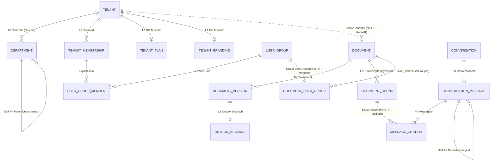
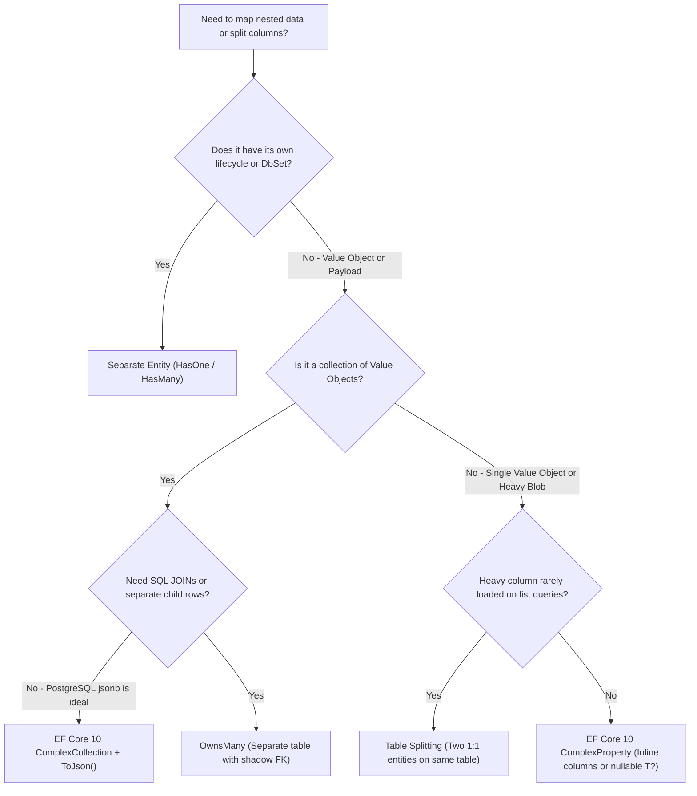
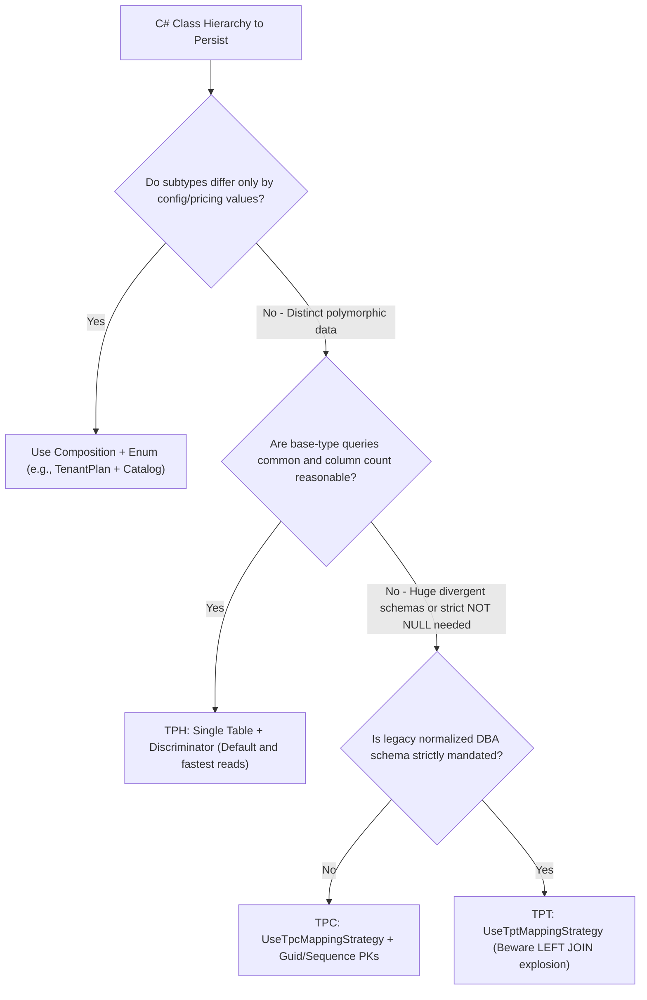

# Chapter 4: Mastering Relationships and Inheritance

## 1. Learning Objectives

By the end of this chapter, you will be able to:
*   Configure One-to-One, One-to-Many, Many-to-Many, and Self-Referencing relationships explicitly using the Fluent API (`IEntityTypeConfiguration<T>`) to avoid convention-based mapping errors.
*   Encapsulate DDD Aggregate collections using private backing fields (`IReadOnlyCollection<T>` and `PropertyAccessMode.Field`).
*   Understand the mechanics of Relationship Fixup within the Change Tracker, and know when to use `AsNoTracking()`, `AsNoTrackingWithIdentityResolution()`, and `.AsSplitQuery()`.
*   Compare **EF Core 10 Complex Types** (`ComplexProperty`, nullable complex properties, and `ComplexCollection().ToJson()`) against legacy **Owned Types** (`OwnsOne`/`OwnsMany`) to map DDD Value Objects cleanly.
*   Implement advanced mapping techniques like **Table Splitting** and **Entity Splitting** to segregate heavy payloads from frequently queried entities.
*   Enforce **Modular Monolith boundaries** by replacing cross-module Foreign Keys with scalar IDs and MediatR contracts (as practiced in **Normora**).
*   Evaluate and implement the three EF Core inheritance strategies—Table-Per-Hierarchy (TPH), Table-Per-Type (TPT), and Table-Per-Concrete-Type (TPC)—plus composition alternatives, analyzing their impact on PostgreSQL/SQL Server execution plans.
*   Safely combine `DeleteBehavior.Restrict` with **EF Core 10 Named Query Filters** (`HasQueryFilter` / `IgnoreQueryFilters`) without leaking multi-tenant data.

## 2. Introduction

Relational databases are defined by relationships: Primary Keys and Foreign Keys linking distinct tables together to enforce data integrity. In Object-Oriented Programming (OOP), relationships are represented by object graphs—collections of references pointing to other objects in memory.

Mapping a relational Foreign Key to an object graph is where many Object-Relational Mappers fail. EF Core 10, however, provides a remarkably sophisticated engine for relationship mapping. It understands Principal entities (the "One" side), Dependent entities (the "Many" side), encapsulated backing fields, value objects, and how to cascade or restrict changes across the graph.

In a real enterprise system like **Normora** (a `.NET 10` multi-tenant knowledge management and conversational-AI modular monolith backed by PostgreSQL + `pgvector`), relationship design also determines **architectural boundaries**. Inside a single module (`Tenants`, `Documents`, or `Conversations`), entities form rich relational graphs inside their own database schema (`tenants`, `documents`, `conversations`). Across module boundaries, however, EF Core navigation properties and Foreign Keys are strictly forbidden—cross-module links use scalar `Guid` identifiers resolved via MediatR contracts.

Furthermore, OOP relies heavily on Inheritance (e.g., `FastCharger` inherits from `Charger`, or `ToolCallMessagePart` inherits from `MessagePart`). Relational databases do not natively understand inheritance. A Solution Architect must explicitly instruct EF Core on how to flatten or split these inheritance hierarchies across SQL tables—or when to replace inheritance with composition. Choosing the wrong inheritance mapping strategy can lead to catastrophic performance issues involving massive, unoptimized `SQL JOIN` operations.

This chapter provides the blueprint for mapping complex object graphs, value objects, modular boundaries, and inheritance hierarchies accurately and performantly.

## 3. Core Concepts

### Principal vs. Dependent Entities
*   **Principal Entity:** The entity that contains the Primary Key (or Alternate Key) referenced by a relationship. In a Tenant-to-Site relationship, `Tenant` is the Principal. In Normora's `Documents` module, `Document` is the Principal for `DocumentChunk`.
*   **Dependent Entity:** The entity that contains the Foreign Key pointing back to the Principal. `Site` is the Dependent because it holds `TenantId`; `DocumentChunk` is the Dependent because it holds `DocumentId`.

### Navigation Properties & Encapsulated Backing Fields
Properties on a C# class that hold references to related entities.
*   **Reference Navigation Property:** Points to a single entity (e.g., `Site.Tenant` or `DocumentChunk.Document`).
*   **Collection Navigation Property:** Points to a collection of entities (e.g., `Tenant.Sites` or `Document.Chunks`).
*   **Backing Field (Aggregate Encapsulation):** In Domain-Driven Design (DDD), exposing a mutable `List<T>` lets external callers mutate the graph (`doc.Chunks.Add(...)`) while bypassing business invariants. Instead, the entity exposes `IReadOnlyCollection<T>` backed by a `private readonly List<T> _chunks = [];` field, and EF Core reads/writes `_chunks` via `PropertyAccessMode.Field`.

### Relationship Fixup
If you query a `Tenant`, and then in a separate query on the *same* tracked `DbContext`, you fetch a `Site` that belongs to that `Tenant` (or in Normora, query a `Document` and later load its `DocumentVersion` rows), EF Core's Change Tracker automatically detects that their Primary and Foreign Keys match and populates the C# navigation properties in memory. You don't have to link them manually.

### Owned Types vs. EF Core 10 Complex Types (Value Objects)
In DDD, a **Value Object** (such as an `Address` or Normora's `BrandPalette`) has no database identity of its own—two value objects with identical property values are interchangeable.
*   **Owned Types (`OwnsOne` / `OwnsMany`):** EF Core's older mechanism (EF Core 2.1+). Under the hood, EF Core still treats an Owned Type as a *hidden dependent entity* with a shadow primary key, meaning it cannot share the exact same CLR instance across two properties and has change-tracking quirks with C# `record` value equality.
*   **Complex Types (`ComplexProperty` / `ComplexCollection`, EF Core 8–10):** True value-object mapping with **zero hidden primary key** and true value semantics. EF Core 10 adds **nullable (optional) complex properties** (`BrandLogo?`) and **collections of complex types** (`ComplexCollection(...).ToJson()` stored in PostgreSQL `jsonb`).

### Table Splitting & Entity Splitting
*   **Table Splitting:** Mapping *two or more* C# entity classes (linked 1:1 by a shared Primary Key) to the *exact same* SQL table so routine queries omit heavy `TEXT`/`bytea`/`jsonb` columns without requiring an extra `JOIN`.
*   **Entity Splitting:** The inverse—mapping a *single* C# entity across two separate SQL tables that share a 1:1 Primary Key.

### Self-Referencing (Hierarchical) Relationships
A relationship where an entity is both Principal and Dependent to its own table (e.g., `Department.ParentDepartmentId -> Department.Id`). Useful for org charts, folder trees, or branched conversation threads.

### Modular Monolith Boundaries (Scalar IDs vs. Foreign Keys)
In a modular monolith like Normora, each bounded context (`TenantsDbContext`, `DocumentsDbContext`, `ConversationsDbContext`) owns its own PostgreSQL schema (`tenants`, `documents`, `conversations`) and migrations. **Entities never hold EF Core navigation properties or database Foreign Keys pointing to entities in another module's `DbContext`.** Cross-module links are stored as plain scalar `Guid` values (e.g., `Document.TenantId`, `MessageCitation.DocumentId`) and verified via MediatR contracts in `Normora.Shared.Contracts.*`.

### Loading Strategies & Split Queries
*   **Eager Loading (`.Include()` / `.ThenInclude()`):** Loads related entities in the same LINQ query.
*   **Split Queries (`.AsSplitQuery()`):** Splits a multi-`Include` query into multiple SQL `SELECT` statements to prevent **Cartesian Explosion** (row multiplication across multiple `JOIN`s).
*   **Explicit Loading (`context.Entry(entity).Collection(...).LoadAsync()`):** Imperatively loads a navigation after the principal is already tracked.
*   **Lazy Loading:** Automatically firing SQL when a navigation getter is accessed. Banned in high-throughput APIs like Normora because it hides N+1 query explosions.

### Delete Behaviors & EF Core 10 Named Query Filters
*   **`DeleteBehavior`:** Controls whether deleting a Principal cascades (`Cascade`), nulls out the FK (`SetNull`), or fails (`Restrict` / `NoAction`), both in PostgreSQL constraints and in EF Core's Change Tracker.
*   **Named Query Filters (EF Core 10):** Allows attaching multiple independent filters per entity—such as `"Tenant"` (`e.TenantId == _tenantContext.TenantId`) and `"SoftDelete"` (`!e.IsDeleted`)—and selectively disabling only `"SoftDelete"` via `.IgnoreQueryFilters(["SoftDelete"])` without ever disabling tenant isolation.

### Inheritance Mapping Strategies
*   **TPH (Table-Per-Hierarchy):** All classes in an inheritance hierarchy are mapped to a single SQL table. A `Discriminator` column indicates the specific type.
*   **TPT (Table-Per-Type):** Every class in the hierarchy maps to its own table. Querying a derived type requires a `SQL JOIN` to the base table.
*   **TPC (Table-Per-Concrete-Type):** Only non-abstract derived classes map to tables. Each table has all columns for both the base and derived properties. No `JOIN` is required, but querying the base type requires `UNION ALL`, and primary keys must be globally unique across tables (`Guid` or PostgreSQL `SEQUENCE`/HiLo).

## 4. Visual Diagrams

```text
=============================================================================
             INHERITANCE MAPPING STRATEGIES (RELATIONAL TABLES)
=============================================================================
C# Hierarchy: 
abstract class Charger { Id, MaxKw }
class FastCharger : Charger { HasLiquidCooling }
class SlowCharger : Charger { RequiresRfid }

1. TPH (Table-Per-Hierarchy) - Default & Fastest for Reading
Table: Chargers
| Id | MaxKw | Discriminator | HasLiquidCooling | RequiresRfid |
|----|-------|---------------|------------------|--------------|
| 1  | 150   | FastCharger   | True             | NULL         |
| 2  | 7     | SlowCharger   | NULL             | True         |
(Sparse columns, but zero JOINs required).

2. TPT (Table-Per-Type) - Cleanest Schema, Slowest for Reading
Table: Chargers (Base)    Table: FastChargers       Table: SlowChargers
| Id | MaxKw |            | ChargerId | Cooling |   | ChargerId | Rfid |
|----|-------|            |-----------|---------|   |-----------|------|
| 1  | 150   |            | 1         | True    |   | 2         | True |
| 2  | 7     |            
(Requires a LEFT JOIN to query all chargers).

3. TPC (Table-Per-Concrete-Type) - Best for Write-Heavy & Partitioning
Table: FastChargers                Table: SlowChargers
| Id | MaxKw | Cooling |           | Id | MaxKw | Rfid |
|----|-------|---------|           |----|-------|------|
| 1  | 150   | True    |           | 2  | 7     | True |
(No Base table. Queries for 'Charger' require a UNION ALL).
```

### Normora Intra-Module Foreign Keys vs. Cross-Module Scalar Boundaries



### Decision Tree: Value Objects, Owned Types & Splitting



### Decision Tree: Inheritance Mapping Strategy



## 5. API Deep Dive: Relationships

While EF Core can infer relationships by convention if you name your properties `TenantId`, relying on conventions in an enterprise application is dangerous. A simple refactoring can silently create shadow foreign keys (`TenantId1`) or change a relationship from `INNER JOIN` to `LEFT JOIN`. **Always use the Fluent API inside parameterless `IEntityTypeConfiguration<T>` classes to explicitly configure relationships.**

### 5.1 One-to-Many & Encapsulated Collections (Backing Fields)

*   **What:** One Principal row links to zero or more Dependent rows via a Foreign Key on the Dependent table.
*   **Why:** Models parent-child ownership (e.g., a `Document` owns its `DocumentChunk`s). Using a private backing field (`_chunks`) with `IReadOnlyCollection<T>` enforces Aggregate Root invariants so callers cannot bypass domain validation methods.
*   **How:** Configure `HasMany().WithOne().HasForeignKey()` and tell EF Core to access the private field via `PropertyAccessMode.Field`. Use `.IsRequired()` when a child cannot exist without a parent—EF Core then generates an `INNER JOIN` instead of a slower `LEFT JOIN`.
*   **When NOT to use:** Do not use a One-to-Many relational table when the children are pure immutable Value Objects that never need independent SQL queries or foreign keys—use EF Core 10's `ComplexCollection().ToJson()` instead (see Section 6.3). Also never configure `HasMany`/`WithOne` across separate module `DbContext` boundaries (see Section 5.5).

#### EV Platform Example
```csharp
public class TenantConfiguration : IEntityTypeConfiguration<Tenant>
{
    public void Configure(EntityTypeBuilder<Tenant> builder)
    {
        // HasMany (from Principal) -> WithOne (from Dependent)
        builder.HasMany(tenant => tenant.Sites)
               .WithOne(site => site.Tenant)
               .HasForeignKey(site => site.TenantId)
               .IsRequired() // Enforces an INNER JOIN, makes TenantId NOT NULL
               .OnDelete(DeleteBehavior.Restrict); // Critical: Prevent accidental cascade deletes
    }
}
```

#### Normora Real-World Examples (5 Scenarios)

1. **`Document` -> `DocumentChunk` (Encapsulated Backing Field in `DocumentsDbContext`):**
   A `Document` owns its Markdown-aware chunks (`pgvector` embeddings). Only `Document.AddChunks(...)` can append chunks.
```csharp
// Domain Entity (server/Modules/Documents/Domain/Document.cs)
public sealed class Document
{
    private readonly List<DocumentChunk> _chunks = [];
    public Guid Id { get; private set; }
    public Guid TenantId { get; private set; }
    public IReadOnlyCollection<DocumentChunk> Chunks => _chunks.AsReadOnly();

    public void AddChunks(IEnumerable<DocumentChunk> chunks) => _chunks.AddRange(chunks);
}

// Configuration (server/Modules/Documents/Persistence/Configurations/DocumentConfiguration.cs)
public sealed class DocumentConfiguration : IEntityTypeConfiguration<Document>
{
    public void Configure(EntityTypeBuilder<Document> builder)
    {
        builder.HasMany(d => d.Chunks)
               .WithOne(c => c.Document)
               .HasForeignKey(c => c.DocumentId)
               .IsRequired()
               .OnDelete(DeleteBehavior.Cascade);

        builder.Navigation(d => d.Chunks)
               .UsePropertyAccessMode(PropertyAccessMode.Field);
    }
}
```

2. **`Document` -> `DocumentVersion` (`DocumentsDbContext`):**
   Every re-upload creates a new immutable `DocumentVersion` pointing to a MinIO object key (`HasMany(d => d.Versions).WithOne(v => v.Document).HasForeignKey(v => v.DocumentId).OnDelete(DeleteBehavior.Restrict)`).

3. **`Conversation` -> `ConversationMessage` (`ConversationsDbContext`):**
   A conversational RAG thread owns ordered `ConversationMessage` turns (`User`, `Assistant`, `Tool`). Configuring `.HasIndex(m => new { m.ConversationId, m.CreatedAtUtc })` guarantees ordered thread hydration without full table scans.

4. **`ConversationMessage` -> `MessageCitation` (`ConversationsDbContext`):**
   An assistant answer records grounded citations pointing back to the `ConversationMessage` (`HasForeignKey(c => c.MessageId).IsRequired()`), enabling clickable `ChunkPreviewDrawerComponent` badges in Angular.

5. **`Tenant` -> `Department` (`TenantsDbContext`):**
   Each workspace organizes employees and documents by department (`builder.HasMany(t => t.Departments).WithOne(d => d.Tenant).HasForeignKey(d => d.TenantId).OnDelete(DeleteBehavior.Restrict)`).

---

### 5.2 One-to-One & Shared Primary Keys

*   **What:** Exactly one Principal row maps to at most one Dependent row.
*   **Why:** Separates distinct bounded sub-entities that have their own lifecycle, permissions, or optional existence while enforcing uniqueness at the database level.
*   **How:** Either (a) give the Dependent its own `Id` and put a `UNIQUE` index on its FK (`HasForeignKey<TDependent>(d => d.PrincipalId)`—EF Core adds the unique index automatically), or (b) use a **Shared Primary Key** where `Dependent.Id` is *both* its PK and its FK to `Principal.Id`.
*   **When NOT to use:** Do not create a separate 1:1 table just to group 3–4 value properties (like `BrandPalette` or `Address`)—use `ComplexProperty` (Section 6.3). Do not create a 1:1 relationship just to defer loading a single heavy `TEXT` column on the same lifecycle—use Table Splitting (Section 6.4).

#### EV Platform Example
```csharp
public class SiteConfiguration : IEntityTypeConfiguration<Site>
{
    public void Configure(EntityTypeBuilder<Site> builder)
    {
        // HasOne -> WithOne
        builder.HasOne(site => site.Manager)
               .WithOne(manager => manager.Site)
               // You MUST specify which entity is the Dependent (holds the FK)
               .HasForeignKey<SiteManager>(manager => manager.SiteId); 
    }
}
```

#### Normora Real-World Examples (5 Scenarios)

1. **`Tenant` -> `TenantPlan` (Shared FK with Unique Constraint in `TenantsDbContext`):**
   Every workspace has exactly one active subscription plan tracking `Tier` (`Free`, `Pro`, `Enterprise`), `Currency`, and `BillingCycle` aligned with `TenantPlanPricingCatalog`.
```csharp
public sealed class TenantPlanConfiguration : IEntityTypeConfiguration<TenantPlan>
{
    public void Configure(EntityTypeBuilder<TenantPlan> builder)
    {
        builder.HasOne(p => p.Tenant)
               .WithOne(t => t.Plan)
               .HasForeignKey<TenantPlan>(p => p.TenantId)
               .IsRequired()
               .OnDelete(DeleteBehavior.Restrict);
    }
}
```

2. **`Tenant` -> `TenantBranding` (`TenantsDbContext`):**
   White-label workspaces optionally store custom logos (stored in MinIO via `IBrandingStorageService`) and theme overrides (`WithOne(t => t.Branding).HasForeignKey<TenantBranding>(b => b.TenantId)`).

3. **`DocumentVersion` -> `DocumentProcessingOutboxMessage` (`DocumentsDbContext`):**
   Using a **Shared Primary Key**, `DocumentProcessingOutboxMessage.Id` can serve as a 1:1 link to the `DocumentVersion` awaiting Hangfire ingestion (`HasForeignKey<DocumentProcessingOutboxMessage>(o => o.DocumentVersionId)` with unique index), preventing duplicate outbox rows for the same upload version.

4. **`Conversation` -> `ConversationSummary` (`ConversationsDbContext`):**
   Long multi-turn threads lazily generate a single rolling `ConversationSummary` entity (`HasOne(c => c.Summary).WithOne().HasForeignKey<ConversationSummary>(s => s.ConversationId)`), keeping the main `conversations` table compact.

5. **`PendingApproval` -> `ApprovalDecisionAudit` (`ConversationsDbContext`):**
   For server-enforced Human-In-The-Loop (HITL) destructive actions (such as `documents_delete`, which records a `PendingApproval` with a 15-minute TTL), a 1:1 `ApprovalDecisionAudit` captures the final approver's `ExternalUserId` and timestamp once resolved.

---

### 5.3 Many-to-Many (Implicit vs. Explicit Join Entities)

*   **What:** Multiple rows of Entity A associate with multiple rows of Entity B via an intermediate join table containing two Foreign Keys.
*   **Why:** Models access-control matrices, tagging, and group memberships where entities intersect flexibly.
*   **How:**
    *   *Implicit (`UsingEntity("TableName")`):* EF Core 5+ hides the join table from your C# domain model.
    *   *Explicit Join Entity (`HasOne().WithMany()` twice, or `UsingEntity<TJoin>()`):* You define a concrete C# class (e.g., `DocumentUserGroup`) with a composite PK (`HasKey(x => new { x.DocumentId, x.UserGroupId })`) and payload columns (`GrantedAtUtc`, `GrantedByExternalUserId`).
*   **When NOT to use:** **Never use implicit Many-to-Many in enterprise authorization or auditing tables.** The moment the business asks *"Who granted access and when?"*, migrating an implicit hidden table to an explicit entity requires disruptive schema migrations and code rewrites. Reserve implicit M2M for throwaway prototypes or pure tag links with zero audit requirements.

#### EV Platform Example (Implicit Join Table)
```csharp
public class DriverConfiguration : IEntityTypeConfiguration<Driver>
{
    public void Configure(EntityTypeBuilder<Driver> builder)
    {
        builder.HasMany(d => d.RfidTags)
               .WithMany(t => t.Drivers)
               .UsingEntity("DriverRfidTags"); // explicitly name the hidden join table
    }
}
```

#### Normora Real-World Examples (5 Scenarios)

1. **`Document` <-> `UserGroup` via Explicit `DocumentUserGroup` (`DocumentsDbContext`):**
   Normora compartmentalizes document retrieval so AI agents only surface chunks belonging to User Groups the caller holds. Because `UserGroup` lives in `TenantsDbContext`, `DocumentUserGroup` holds a navigation to `Document` and a **scalar `Guid UserGroupId`**, plus audit payload fields:
```csharp
public sealed class DocumentUserGroup
{
    public Guid DocumentId { get; private set; }
    public Guid UserGroupId { get; private set; } // Scalar ID (lives in Tenants module)
    public string GrantedByExternalUserId { get; private set; } = string.Empty;
    public DateTimeOffset GrantedAtUtc { get; private set; }
    public Document Document { get; private set; } = null!;
}

public sealed class DocumentUserGroupConfiguration : IEntityTypeConfiguration<DocumentUserGroup>
{
    public void Configure(EntityTypeBuilder<DocumentUserGroup> builder)
    {
        builder.HasKey(dug => new { dug.DocumentId, dug.UserGroupId });
        builder.HasOne(dug => dug.Document)
               .WithMany(d => d.DocumentUserGroups)
               .HasForeignKey(dug => dug.DocumentId)
               .OnDelete(DeleteBehavior.Cascade);
    }
}
```

2. **`TenantMembership` <-> `UserGroup` via Explicit `UserGroupMember` (`TenantsDbContext`):**
   Both entities live inside `TenantsDbContext`, so `UserGroupMember` configures two explicit `HasOne().WithMany()` FKs with composite key `{ MembershipId, UserGroupId }`, `AddedAtUtc`, and `AddedByExternalUserId`.

3. **`TenantMembership` <-> `Department` via Explicit `DepartmentMembership` (`TenantsDbContext`):**
   Supports cross-functional employees belonging to multiple departments while tracking a payload flag `bool IsPrimaryDepartment`.

4. **`Document` <-> `DocumentTag` via `UsingEntity<DocumentTagAssignment>` (`DocumentsDbContext`):**
   Demonstrates EF Core's hybrid approach: `Document` exposes `ICollection<DocumentTag>` for clean LINQ queries while still storing `AssignedByExternalUserId` on the explicit `DocumentTagAssignment` CLR entity via `.UsingEntity<DocumentTagAssignment>(...)`.

5. **`SavedAnswer` <-> `KnowledgeTopic` via Explicit `SavedAnswerTopic` (`ConversationsDbContext`):**
   Allows workspace admins to curate FAQ-style `SavedAnswer`s across multiple topics while recording `SortOrder` on the join entity.

---

### 5.4 Self-Referencing & Hierarchical Relationships

*   **What:** An entity holds a Foreign Key pointing to another row of the **same** entity type (e.g., `ParentId -> Id`).
*   **Why:** Models variable-depth trees—organizational hierarchies, nested document folders, or branching conversation replies—without creating fixed `Level1`, `Level2`, `Level3` tables.
*   **How:** Configure `HasOne(x => x.Parent).WithMany(x => x.Children).HasForeignKey(x => x.ParentId).IsRequired(false).OnDelete(DeleteBehavior.Restrict)`. The FK **must** be nullable for root nodes, and `DeleteBehavior.Restrict` prevents database errors (SQL Server rejects cascading self-references, and PostgreSQL cycle deletions are dangerous).
*   **When NOT to use:** Avoid standard EF Core navigation traversal (`.Include(d => d.Children).ThenInclude(d => d.Children)`) for arbitrary-depth trees (10+ levels), because EF Core generates fixed-depth SQL `JOIN`s. For deep subtrees, use PostgreSQL `ltree` or a recursive CTE via `FromSql` instead.

#### Normora Real-World Examples (5 Scenarios)

1. **`Department` -> `ParentDepartment` / `SubDepartments` (`TenantsDbContext`):**
   Models enterprise org trees (e.g., `Engineering -> Platform Engineering -> AI Infrastructure`).
```csharp
public sealed class DepartmentConfiguration : IEntityTypeConfiguration<Department>
{
    public void Configure(EntityTypeBuilder<Department> builder)
    {
        builder.HasOne(d => d.ParentDepartment)
               .WithMany(d => d.SubDepartments)
               .HasForeignKey(d => d.ParentDepartmentId)
               .IsRequired(false)
               .OnDelete(DeleteBehavior.Restrict);
    }
}
```

2. **`DocumentFolder` -> `ParentFolder` / `ChildFolders` (`DocumentsDbContext`):**
   Hierarchical policy libraries (`HR Policies / India / Leave Policy`) using nullable `ParentFolderId` and unique index `(TenantId, ParentFolderId, Name)`.

3. **`ConversationMessage` -> `ParentMessage` / `RegeneratedReplies` (`ConversationsDbContext`):**
   When a user regenerates or branches a Copilot response, `ParentMessageId` links the alternate turn back to the triggering prompt without duplicating the earlier conversation.

4. **`DocumentVersion` -> `SupersedesVersion` (`DocumentsDbContext`):**
   Tracks linear document replacement lineage (`v3 -> SupersedesVersionId = v2 -> v1`) for compliance auditing.

5. **`TenantInvitation` -> `ReplacedByInvitation` (`TenantsDbContext`):**
   When an admin resends an expired invite, the old invitation stays in the audit trail pointing via `ReplacedByInvitationId` to the fresh token row.

---

### 5.5 Cross-Module Relationships in a Modular Monolith (Scalar IDs vs. Foreign Keys)

*   **What:** Representing relationships between bounded contexts (`Tenants`, `Documents`, `Conversations`) using plain scalar identifiers (`Guid TenantId`, `string ExternalUserId`, `Guid DocumentId`) instead of EF Core navigation properties or database Foreign Keys.
*   **Why:** In Normora, each module encapsulates a private `DbContext` (`TenantsDbContext`, `DocumentsDbContext`, `ConversationsDbContext`) and its own PostgreSQL schema and `IDatabaseMigrator`. If `DocumentsDbContext` held a navigation property to `Tenants.Domain.Tenant`, EF Core would drag `Tenants` tables into `Documents` migrations—destroying module autonomy and making future microservice extraction impossible.
*   **How:** Store the remote entity's ID as a primitive `Guid` (or `string` for `ExternalUserId`), index it for fast lookups, and resolve/validate remote data through **MediatR contracts** in `Normora.Shared.Contracts.*` (always passing explicit `Guid TenantId` for defense-in-depth).
*   **When NOT to use:** Inside a single module where two tables belong to the same bounded context and require atomic relational integrity (e.g., `Document` and `DocumentChunk` inside `DocumentsDbContext`), **always** use real EF Core Foreign Keys.

#### Normora Real-World Examples (5 Scenarios)

1. **`Document.TenantId` (`DocumentsDbContext` -> `Tenants`):**
   `Document` stores `public Guid TenantId { get; private set; }` with no `Tenant` navigation property; `DocumentsDbContext` filters every query automatically via its dynamic tenant query filter.
2. **`DocumentUserGroup.UserGroupId` (`DocumentsDbContext` -> `Tenants`):**
   Before granting a group access to a document, `Documents` dispatches a MediatR query in `Normora.Shared.Contracts.Tenants` (passing `TenantId` and `UserGroupId`) to verify the group exists in that tenant; otherwise it throws `BolaException()` (`404`).
3. **`MessageCitation.DocumentId` & `ChunkId` (`ConversationsDbContext` -> `Documents`):**
   `Conversations` never injects `DocumentsDbContext` or `IRetrievalService`. Instead, `ConversationTurnPreparer` sends `PerformHybridRetrievalQuery(TenantId, ...)` via MediatR and persists the returned scalar `DocumentId` and `ChunkId` on `MessageCitation`.
4. **`PendingApproval.TargetResourceId` (`ConversationsDbContext` -> `Documents`):**
   When an agent triggers `documents_delete`, HITL stores a scalar `TargetResourceId` (`Guid`) and executes deletion post-approval via a MediatR command in `Normora.Shared.Contracts.Documents`.
5. **`AuditLog.ActorExternalUserId` (`TenantsDbContext` -> OIDC / Other Modules):**
   Tracks who performed an action across modules using the vendor-neutral `ExternalUserId` string (`currentUser.ExternalUserId`), never coupling to Keycloak-specific names (`KeycloakUserId`) or cross-module FKs.

## 6. Value Objects, Owned Types, Complex Types & Splitting

### 6.1 Owned Types (Value Objects — EV Platform Case Study)
Our `Site` entity requires an `Address`. We want `Address` to be a strictly validated C# object, but we don't want a separate `Addresses` table requiring a `JOIN` every time we query a Site.

```csharp
// Domain: Value Object
public record Address(string Street, string City, string PostalCode);

// Domain: Entity
public class Site
{
    public Guid Id { get; private set; }
    public Address LocationAddress { get; private set; } // Complex object
    
    // ...
}

// Configuration
public class SiteConfiguration : IEntityTypeConfiguration<Site>
{
    public void Configure(EntityTypeBuilder<Site> builder)
    {
        // Map the complex object to columns in the Sites table
        builder.OwnsOne(s => s.LocationAddress, addressBuilder =>
        {
            addressBuilder.Property(a => a.Street).HasColumnName("Street").IsRequired();
            addressBuilder.Property(a => a.City).HasColumnName("City").IsRequired();
            addressBuilder.Property(a => a.PostalCode).HasColumnName("PostalCode").IsRequired();
        });
    }
}
```
*Resulting SQL Table `Sites`: `[Id], [Street], [City], [PostalCode]`.*

### 6.2 Table Splitting (EV Platform Case Study)
Our `Charger` entity has heavy diagnostic logs (`DiagnosticDump`). We rarely need this data unless actively troubleshooting. If we put it in the `Chargers` table, every `SELECT *` pulls massive amounts of data into memory.

Table Splitting maps *two* C# entities (sharing the exact same Primary Key) to the *exact same SQL table*.

```csharp
// Domain
public class Charger { public Guid Id { get; set; } /* lightweight props */ }
public class ChargerDiagnostics { public Guid Id { get; set; } public string Dump { get; set; } }

// Configuration
public class ChargerConfiguration : IEntityTypeConfiguration<Charger>
{
    public void Configure(EntityTypeBuilder<Charger> builder)
    {
        builder.ToTable("Chargers");
        
        // One-to-One relationship sharing the Primary Key
        builder.HasOne<ChargerDiagnostics>()
               .WithOne()
               .HasForeignKey<ChargerDiagnostics>(d => d.Id);
    }
}

public class ChargerDiagnosticsConfiguration : IEntityTypeConfiguration<ChargerDiagnostics>
{
    public void Configure(EntityTypeBuilder<ChargerDiagnostics> builder)
    {
        // Map to the EXACT SAME TABLE NAME
        builder.ToTable("Chargers"); 
    }
}
```
*Querying `context.Chargers` now only selects the lightweight columns. Querying `context.ChargerDiagnostics` selects the heavy column. Both write to the `Chargers` physical table. Note: When inserting a new `Charger`, ensure required columns mapped by `ChargerDiagnostics` are either nullable or populated in the same `SaveChanges` unit of work.*

---

### 6.3 EF Core 10 Complex Types (`ComplexProperty` & `ComplexCollection`) vs. Owned Types

*   **What:** `ComplexProperty<T>` (introduced in EF Core 8 and dramatically upgraded in EF Core 10) maps C# value objects (`class`, `record`, or `readonly record struct`) directly as inline columns or `jsonb` columns without treating them as entities.
*   **Why:** Legacy `OwnsOne` models a value object as a secret dependent entity with a shadow primary key. That causes friction: you cannot reuse the same `Address` instance across two properties (`BillingAddress = ShippingAddress`), `ExecuteUpdateAsync` cannot update owned types cleanly in older patterns, and `OwnsMany` forces a separate relational child table unless `.ToJson()` is added. **EF Core 10** solves the final two gaps of `ComplexProperty`:
    1. **Optional (Nullable) Complex Properties** (`BrandLogo?`): If all inner members are optional, `.HasDiscriminator()` lets EF Core distinguish `null` from an empty object.
    2. **Collections of Complex Types** (`ComplexCollection` + `.ToJson()`): Stores `List<TValueObject>` in a single PostgreSQL `jsonb` column while preserving value-object semantics.
*   **How:** Use `builder.ComplexProperty(x => x.ValueObject, ...)` for single value objects (nullable or required) and `builder.ComplexCollection(x => x.Items, c => c.ToJson())` for collections.
*   **When NOT to use:**
    *   Do **not** use `ComplexProperty` if the nested object needs its own independent database identity (`Id`), a separate `DbSet<T>`, or Foreign Keys pointing to other tables—use a normal Entity (`HasOne` / `HasMany`).
    *   Do **not** use `ComplexCollection().ToJson()` if you must execute relational `JOIN`s or individual row-level `pgvector` HNSW indexes inside the collection (e.g., `DocumentChunk` MUST be a real relational table, never a JSON collection!).

| Feature | `ComplexProperty` / `ComplexCollection` (EF Core 8–10) | `OwnsOne` / `OwnsMany` (Legacy Owned Types) |
|---|---|---|
| **Hidden Shadow Primary Key** | None (pure Value Object) | Yes (tracked as a hidden Entity) |
| **Reuse Same C# Instance Across 2 Properties** | Supported | Throws tracking exception |
| **`readonly record struct` Support** | First-class | Not supported (`class`/`record` class only) |
| **Optional / Nullable (`T?`)** | Supported in **EF Core 10** | Supported (via nullable columns) |
| **Collection Mapping** | `ComplexCollection(...).ToJson()` (EF Core 10) | `OwnsMany` (separate table or `.ToJson()`) |
| **Separate Relational Table with FKs** | Not supported | `OwnsMany` creates a child table |

#### Normora Real-World Examples (5 Scenarios)

1. **`TenantBranding` -> `BrandPalette` (`ComplexProperty`, Required Value Object):**
   Immutable `record` storing primary/accent hex colors inline in `tenants.tenant_brandings`:
```csharp
public sealed record BrandPalette(string PrimaryHex, string AccentHex, string SurfaceHex);

public sealed class TenantBrandingConfiguration : IEntityTypeConfiguration<TenantBranding>
{
    public void Configure(EntityTypeBuilder<TenantBranding> builder)
    {
        builder.ComplexProperty(b => b.Palette, p =>
        {
            p.Property(x => x.PrimaryHex).HasColumnName("palette_primary_hex").HasMaxLength(7);
            p.Property(x => x.AccentHex).HasColumnName("palette_accent_hex").HasMaxLength(7);
            p.Property(x => x.SurfaceHex).HasColumnName("palette_surface_hex").HasMaxLength(7);
        });
    }
}
```

2. **`TenantBranding` -> `CustomDomainSettings?` (EF Core 10 Nullable `ComplexProperty`):**
   Workspaces on the `Free` tier have `CustomDomain = null`; `Enterprise` workspaces set `CustomDomain` (`DomainName`, `SslThumbprint`). EF Core 10 persists `NULL` columns when null and validates non-null members automatically.

3. **`DocumentChunk` -> `ChunkSpan` (`readonly record struct` `ComplexProperty`):**
   Stores `SectionBreadcrumb`, `StartOffset`, `EndOffset`, and `TokenCount` as a zero-allocation `readonly record struct` directly on `documents.document_chunks`, keeping `DocumentChunk` fast during bulk RAG ingestion.

4. **`ConversationMessage` -> `List<ToolInvocationSnapshot>` (EF Core 10 `ComplexCollection().ToJson()`):**
   Records every tool chip (`tool_started` / `tool_finished`, e.g., `documents_search`, `calculate_policy_limit`) executed during a Copilot turn inside a single PostgreSQL `jsonb` column without extra `JOIN`s when rendering chat history:
```csharp
public sealed record ToolInvocationSnapshot(string ToolName, bool Succeeded, int DurationMs);

public sealed class ConversationMessageConfiguration : IEntityTypeConfiguration<ConversationMessage>
{
    public void Configure(EntityTypeBuilder<ConversationMessage> builder)
    {
        builder.ComplexCollection(m => m.ToolInvocations, c => c.ToJson());
    }
}
```

5. **`TenantPlan` -> `QuotaSnapshot` (`ComplexProperty`):**
   Captures `MaxDocuments`, `MaxStorageMb`, and `MonthlySeatLimit` resolved from `TenantPlanPricingCatalog` (`Free`, `Pro`, `Enterprise`) as an inline atomic value object.

---

### 6.4 Table Splitting & Entity Splitting (5 Normora Examples)

*   **What:** **Table Splitting** maps two 1:1 C# entities to one SQL table; **Entity Splitting** maps one C# entity across two SQL tables (`builder.ToTable("primary").SplitToTable("secondary", ...)`).
*   **Why:** Keeps hot-path list queries narrow (excluding multi-megabyte extracted Markdown or debug prompt dumps) without altering physical database schemas or forcing runtime `JOIN`s on every read.
*   **When NOT to use:** Don't use Table Splitting if the separated columns are small scalars (`varchar(100)`), or if you'd rather just write a `.Select(d => new DocumentSummaryDto(...))` projection in your CQRS query handler!

1. **Table Splitting — `Document` & `DocumentExtractedPayload` (`documents.documents`):**
   Listing documents in the UI loads `Document` (`Title`, `Status`, `ContentHash`) while `DocumentExtractedPayload` isolates the raw extracted Markdown text only needed during re-chunking.
2. **Table Splitting — `ConversationMessage` & `MessagePromptTrace` (`conversations.messages`):**
   Chat rendering reads `ConversationMessage` (`Role`, `Content`, `CreatedAtUtc`); debugging/evaluation tools load `MessagePromptTrace` (`RewrittenQuery`, `RerankScoresJson`).
3. **Table Splitting — `DocumentProcessingOutboxMessage` & `OutboxDiagnosticDetail` (`documents.outbox_messages`):**
   The minutely Hangfire recovery dispatcher (`HangfireDocumentProcessingOutboxDispatcher`) polls only lightweight claim columns (`Id`, `Status`, `NextAttemptAtUtc`), leaving `ErrorCode` and metadata in `OutboxDiagnosticDetail`.
4. **Table Splitting — `Tenant` & `TenantOnboardingMetadata` (`tenants.tenants`):**
   `TenantResolutionMiddleware` resolves slug/active state cleanly via `Tenant`, keeping onboarding/billing audit timestamps in `TenantOnboardingMetadata`.
5. **Entity Splitting — `DocumentVersion` across `documents.document_versions` and `documents.document_version_storage`:**
   Maps `MinioBucket` and `MinioObjectKey` onto a secondary storage-coordinate table via `SplitToTable(...)` while keeping `DocumentVersion` as one unified C# domain class.

## 7. EF Core Internals: Inheritance Configuration

Relational databases have no native concept of `class Derived : Base`. EF Core gives you three mapping strategies—**TPH**, **TPT**, and **TPC**—plus the architectural option of **Composition** (avoiding inheritance altogether).

### 7.1 Comparing TPH, TPT, and TPC

| Strategy | Fluent API | Tables Created | Base Query SQL | Subtype `NOT NULL` Constraints | When to Use / Avoid |
|---|---|---|---|---|---|
| **TPH** (Default) | `HasDiscriminator<string>(...)` | 1 table | Single `SELECT` (0 `JOIN`s) | No (subtype columns must be nullable) | **Default choice (90% of cases).** Fastest reads; index `(TenantId, Discriminator)`. Avoid only if subtypes have dozens of mutually exclusive `NOT NULL` columns. |
| **TPC** | `UseTpcMappingStrategy()` | 1 per concrete class | `UNION ALL` across subtype tables | **Yes** | Use for high-volume, write-heavy, or partitioned tables where subtypes rarely query together. **Requires `Guid` or PostgreSQL `SEQUENCE`/HiLo PKs** (never per-table `IDENTITY`/`SERIAL`). |
| **TPT** | `UseTptMappingStrategy()` | 1 base + 1 per subtype | `LEFT JOIN` to every subtype | Yes | **Avoid in EF Core** unless forced by a legacy DBA schema. Deep hierarchies trigger catastrophic multi-table `LEFT JOIN` plans. |

#### EV Platform Example (TPC)
Let's configure the TPC (Table-Per-Concrete-Type) strategy for our Chargers, as recommended for high-performance SaaS applications where we partition data.

```csharp
public class ChargerConfiguration : IEntityTypeConfiguration<Charger>
{
    public void Configure(EntityTypeBuilder<Charger> builder)
    {
        // 1. Tell EF Core to use TPC
        builder.UseTpcMappingStrategy();
    }
}

public class FastChargerConfiguration : IEntityTypeConfiguration<FastCharger>
{
    public void Configure(EntityTypeBuilder<FastCharger> builder)
    {
        // Maps strictly to FastChargers table. Contains ID, MaxKw, and HasLiquidCooling
        builder.ToTable("FastChargers"); 
    }
}
```

> [!IMPORTANT]
> **TPC Primary Key Rule in PostgreSQL:** Never use independent `SERIAL` or `IDENTITY` columns per table in TPC, because `FastChargers` row `1` and `SlowChargers` row `1` would collide during base `Charger` queries (`UNION ALL`). Always use client-generated `Guid` (`Guid.CreateVersion7()` in .NET 9/10) or a shared PostgreSQL `SEQUENCE` / HiLo generator (`modelBuilder.HasSequence<long>("charger_seq")`).

#### TPH Configuration Deep Dive (Shared Columns & Complete Discriminator)
In EF Core 7–10, two TPH subtypes can even share the same column name if they have compatible properties (e.g., `builder.Property(x => x.PayloadJson).HasColumnName("payload_json")`), and calling `.IsComplete()` on `HasDiscriminator()` lets EF Core skip generating `WHERE Discriminator IN (...)` filters when querying the base type if all rows in the table belong to known configured subtypes.

---

### 7.2 Normora Real-World Examples (5 Inheritance & Composition Scenarios)

1. **TPH — `MessagePart` Hierarchy (`ConversationsDbContext`):**
   Normora's Copilot streams rich multi-modal message parts: plain text (`TextMessagePart`), live tool badges (`ToolCallMessagePart`), and interactive A2UI cards (`A2UiCardMessagePart` for `policy_limit_card`, `hr_escalation_card`, and `intake_form_card`). Querying a conversation thread fetches all parts in a single zero-`JOIN` query:
```csharp
public abstract class MessagePart
{
    public Guid Id { get; protected set; }
    public Guid TenantId { get; protected set; }
    public Guid MessageId { get; protected set; }
    public int SequenceOrder { get; protected set; }
}

public sealed class TextMessagePart : MessagePart { public string Markdown { get; private set; } = string.Empty; }
public sealed class ToolCallMessagePart : MessagePart { public string ToolName { get; private set; } = string.Empty; public string Status { get; private set; } = string.Empty; }
public sealed class A2UiCardMessagePart : MessagePart { public string CardType { get; private set; } = string.Empty; public string CardPayloadJson { get; private set; } = "{}"; }

public sealed class MessagePartConfiguration : IEntityTypeConfiguration<MessagePart>
{
    public void Configure(EntityTypeBuilder<MessagePart> builder)
    {
        builder.ToTable("message_parts");
        builder.HasDiscriminator<string>("part_type")
               .HasValue<TextMessagePart>("text")
               .HasValue<ToolCallMessagePart>("tool_call")
               .HasValue<A2UiCardMessagePart>("a2ui_card")
               .IsComplete();

        builder.HasIndex("TenantId", "part_type");
    }
}
```

2. **TPH — `DocumentSource` Hierarchy (`DocumentsDbContext`):**
   Documents can originate from direct file uploads (`UploadedFileSource` with `MinioObjectKey`), MCP-synced external connectors (`McpSyncedSource` with `ExternalResourceUri`), or seeded workspace policies (`SeededPolicySource`). TPH keeps document catalog queries fast without `LEFT JOIN`s.

3. **TPH — `WorkspaceDeliveryChannel` / Notification Outbox (`TenantsDbContext`):**
   Models `EmailNotificationOutbox` (Resend API) and `RealtimeSignalRNotificationOutbox` (Redis backplane) in one indexed `outbox_notifications` table so a single worker query drains pending deliveries in chronological order.

4. **TPC — High-Volume `UsageMeteringEvent` (`TenantsDbContext` / Metering):**
   `EmbeddingTokenEvent`, `ChatCompletionTokenEvent`, and `StorageSnapshotEvent` contain distinct billing metrics (`PromptTokens`, `CandidateTokens`, `BytesUsed`) and massive write volume. Using `UseTpcMappingStrategy()` with `Guid.CreateVersion7()` PKs isolates each concrete table for independent PostgreSQL partitioning and strict `NOT NULL` column guarantees.

5. **Composition Over Inheritance — `TenantPlan` (`TenantsDbContext`):**
   **When NOT to use inheritance:** Do *not* model `FreePlan`, `ProPlan`, and `EnterprisePlan` as EF Core subclasses! Upgrading or downgrading a tenant from `Free` to `Pro` in TPH/TPT/TPC would require deleting and re-inserting the entity because CLR types cannot mutate at runtime. Instead, Normora models `TenantPlan` as a single concrete class with a `PlanTier` enum + `Currency`, delegating all pricing/tier rules to `TenantPlanPricingCatalog` in `Normora.Modules.Tenants.Domain`.

## 8. Performance Implications, Loading Strategies & Query Filters

### Relationship Fixup Overhead
When executing a query that returns 10,000 entities, if the Change Tracker is enabled, it must perform "Fixup". It iterates through every entity, checks all Foreign Keys against its internal dictionary, and wires up the C# object graph. This is incredibly CPU intensive.

**This is the secondary reason why `.AsNoTracking()` is mandatory for reads.** Without tracking, EF Core skips Relationship Fixup entirely, blindly instantiating the objects exactly as requested by the query projection, resulting in massive performance gains.

> [!TIP]
> **`AsNoTracking()` vs. `AsNoTrackingWithIdentityResolution()`:** When reading a Many-to-One or Many-to-Many graph (such as 500 `DocumentChunk` rows sharing 20 `Document` parents via `.Include(c => c.Document)`), pure `.AsNoTracking()` instantiates 500 separate `Document` CLR objects in RAM. `.AsNoTrackingWithIdentityResolution()` runs lightweight identity resolution for the duration of that single query so all 500 chunks point to the same 20 `Document` instances—without registering anything in the `ChangeTracker`.

### Loading Strategies & Cartesian Explosion
*   **Eager Loading (`.Include()` / `.ThenInclude()` + Filtered Include):** Explicitly joins related entities in the query. Always prefer **Filtered Include** (`.Include(d => d.Versions.Where(v => v.IsCurrent))`) or **direct DTO projection** (`.Select(...)`) over loading entire child collections.
*   **Split Queries (`.AsSplitQuery()`):** Including two or more sibling collections (`.Include(c => c.Messages).Include(c => c.Participants)`) causes a **Cartesian Explosion**—every row in `Messages` is multiplied by every row in `Participants` in a single `JOIN` result set. `.AsSplitQuery()` executes one `SELECT` per collection and stitches the graph via Relationship Fixup. *(Note: Wrap split queries in a snapshot/repeatable-read transaction if strict cross-query atomicity is required.)*
*   **Explicit Loading (`context.Entry(doc).Collection(d => d.Versions).LoadAsync()`):** Useful inside write handlers when you already loaded an Aggregate Root and conditionally need one child collection.
*   **Lazy Loading Proxies (`UseLazyLoadingProxies()`):** **Banned in Normora and high-throughput APIs.** Accessing a navigation property inside a loop or JSON serializer silently triggers N+1 synchronous database round-trips.

### EF Core 10 Named Query Filters & Required Relationships
Historically, EF Core allowed only **one** `HasQueryFilter` per entity, forcing developers to combine `TenantId` and `!IsDeleted` into a single lambda—where calling `.IgnoreQueryFilters()` to inspect archived records accidentally stripped tenant isolation! **EF Core 10 Named Query Filters** fix this:
*   Configure separate named filters: `.HasQueryFilter("Tenant", d => d.TenantId == _tenantContext.TenantId).HasQueryFilter("SoftDelete", d => !d.IsDeleted)`.
*   Bypass only soft-delete safely: `.IgnoreQueryFilters(["SoftDelete"])` leaves `"Tenant"` active.
*   **Required-Relationship Filter Trap:** If `Document` has a `"SoftDelete"` filter (`!d.IsDeleted`) and `DocumentChunk` has a required navigation (`HasOne(c => c.Document).IsRequired()`) **without** a matching filter on `DocumentChunk`, EF Core warns (or produces mismatched counts) because an `INNER JOIN` filters out chunks whose parent is soft-deleted while direct `DbSet<DocumentChunk>` queries without the navigation might not. Always mirror tenant/soft-delete filters onto dependent entities!

### The `GroupBy` Aggregation Rule Across Relationships (`AGENTS.md`)
When aggregating counts or metrics across relationships with `GroupBy`, **never** instantiate a parameterized C# `record` or DTO inside `GroupBy().Select(...)`. The EF Core relational compiler cannot translate constructor invocations after `GroupBy` and throws an unhandled `InvalidOperationException`. Always project to an **anonymous type first** on SQL, then materialize the C# record in memory (`AsEnumerable()` or after `ToListAsync()`).

### The Inheritance Trap (TPT vs TPH)
*   **The TPT Disaster:** If you use Table-Per-Type, and you execute `context.Chargers.ToList()`, EF Core must execute a `SELECT` statement that performs a `LEFT JOIN` on *every single derived table*. If you have 10 derived charger types, that is a 10-table join. This will decimate database performance. **Never use TPT in EF Core unless mandated by legacy DBA schemas.**
*   **The TPH Default:** Table-Per-Hierarchy is the default because it is the fastest for querying. It requires zero JOINs. The trade-off is that columns belonging to specific derived types must be nullable, which prevents strict database-level `NOT NULL` constraints.
*   **The TPC Compromise:** Introduced fully in EF7, Table-Per-Concrete-Type is exceptional. Queries for a specific type (`context.FastChargers`) are incredibly fast. Queries for the base type (`context.Chargers`) generate a `UNION ALL`, which is generally faster than TPT's `LEFT JOINs`, but still slower than TPH.

#### Normora Performance Examples (5 Scenarios)
1. **Filtered `.Include()` on `Document` -> `Versions`:** `.Include(d => d.Versions.Where(v => v.IsActive).OrderByDescending(v => v.VersionNumber).Take(1))` avoids hydrating 50 historical versions during metadata inspection.
2. **`.AsSplitQuery()` on `Conversation` Hydration:** Loading `Conversations.Include(c => c.Messages).ThenInclude(m => m.Citations).AsSplitQuery()` prevents Cartesian multiplication between multi-turn messages and citations.
3. **`AsNoTrackingWithIdentityResolution()` for Group Access Lists:** Querying `DocumentUserGroups.AsNoTrackingWithIdentityResolution().Include(g => g.Document)` deduplicates shared `Document` parent objects in memory with zero Change Tracker overhead.
4. **Anonymous-Type `GroupBy` for Chunk Metrics (`DocumentsDbContext`):**
```csharp
var rawCounts = await documentsDb.DocumentChunks
    .AsNoTracking()
    .GroupBy(c => c.DocumentId)
    .Select(g => new { DocumentId = g.Key, ChunkCount = g.Count() })
    .ToListAsync(cancellationToken);

var dtos = rawCounts.Select(x => new DocumentChunkCountDto(x.DocumentId, x.ChunkCount)).ToList();
```
5. **Explicit Tenant Filter in `TenantsDbContext`:** Because `TenantsDbContext` is the unscoped multi-tenancy root (no ambient `TenantId` global filter), queries on `TenantMemberships`, `Departments`, or `UserGroups` must explicitly filter `.Where(m => m.TenantId == request.TenantId)`.

## 9. ASP.NET Core Integration

When an ASP.NET Core API receives a JSON payload to create a `Site`, that JSON might include the `Address` properties. Because `Address` is an Owned Type, it is instantiated automatically when EF Core reads from the database. But when receiving from an API (a Detached entity), you must ensure the Owned Type property is not null before attaching it to the DbContext, otherwise EF Core will throw an exception during `SaveChanges` (unless mapped with EF Core 10 nullable `ComplexProperty`, e.g. `Address?`, which explicitly supports `null`).

In **Normora's `.NET 10` CQRS handlers**, primary constructors inject the module's private `DbContext`, FluentValidation validates incoming DTOs before handler execution, and authorization failures on related entities enforce strict security semantics:
*   **BOLA (`404 Not Found`):** If a user requests a child resource (e.g., a `DocumentVersion` or `ConversationMessage`) whose parent belongs to a different tenant or restricted `UserGroup`, throw `new BolaException()`—never leak whether the ID exists!
*   **BFLA (`403 Forbidden`):** If the caller lacks role permissions to attach/detach a `UserGroup` or cancel a `TenantPlan`, throw `new BflaException()`.
*   **No Magic Strings:** All domain validation errors reference `Normora.Shared.Constants.ApiMessages`.

#### Normora Integration Examples (5 Scenarios)
1. **Primary Constructor CQRS Handler with `BolaException`:**
```csharp
public sealed class AttachDocumentToGroupCommandHandler(
    DocumentsDbContext documentsDb,
    ISender mediator,
    ICurrentUser currentUser) : IRequestHandler<AttachDocumentToGroupCommand>
{
    public async Task Handle(AttachDocumentToGroupCommand request, CancellationToken ct)
    {
        var doc = await documentsDb.Documents
            .Include(d => d.DocumentUserGroups)
            .FirstOrDefaultAsync(d => d.Id == request.DocumentId, ct)
            ?? throw new BolaException(); // 404, prevents ID enumeration
        // ...
    }
}
```
2. **Updating a Value Object (`ComplexProperty`) from a Request DTO:** `UpdateBrandingCommandHandler` constructs a brand-new `BrandPalette(req.PrimaryHex, req.AccentHex, req.SurfaceHex)` immutable record and assigns `branding.UpdatePalette(palette)`—EF Core 10 detects property changes cleanly with zero shadow-key conflict.
3. **BFLA Enforcement on `CancelSubscriptionCommandHandler`:** Rejects non-admin roles with `BflaException()` (`403`) and Free-tier cancellations with `InvalidOperationException(ApiMessages.CannotCancelFreePlan)`.
4. **Atomic Upload + Outbox Insertion:** `UploadDocumentCommandHandler` inserts `Document`, `DocumentVersion`, and `DocumentProcessingOutboxMessage` (all linked by FK inside `DocumentsDbContext`) in a single `SaveChangesAsync(ct)` transaction before waking Hangfire.
5. **Explicit `ExternalUserId` Linking:** Handlers resolve the caller via `currentUser.ExternalUserId` (never vendor-specific `KeycloakUserId`) when writing `GrantedByExternalUserId` on `DocumentUserGroup`.

## 10. Clean Architecture Perspective

In DDD, relationships are tightly controlled via **Aggregates**. An Aggregate Root (e.g., `Tenant` or `Document`) controls all access to its children (`Site`s or `DocumentChunk`s).

You should configure EF Core to respect these boundaries:
*   **Use `DeleteBehavior.Restrict` on almost all Foreign Keys** to prevent accidental database-level cascading deletes. If a `Tenant` is deleted, the Domain layer should explicitly coordinate the deletion of its `Site`s, raising Domain Events for each deletion, rather than letting the database blindly wipe the data via `CASCADE DELETE`.
*   **Parameterless `IEntityTypeConfiguration<T>` Classes:** In Normora, every entity configuration lives in `server/Modules/{ModuleName}/Persistence/Configurations/{Entity}Configuration.cs` and **must have a public parameterless constructor** so `modelBuilder.ApplyConfigurationsFromAssembly(typeof({ModuleName}DbContext).Assembly)` succeeds. Never inject `ITenantContext` into a configuration constructor; bind global filters to the `DbContext`'s own property inside `OnModelCreating`.

#### Normora Clean Architecture Examples (5 Scenarios)
1. **`Document` Aggregate Root Encapsulation:** `Document` hides `_chunks` and `_versions` behind `IReadOnlyCollection<T>` and `PropertyAccessMode.Field`, guaranteeing chunk invariants are enforced inside domain methods.
2. **`Conversation` Aggregate Root:** `Conversation.AppendAssistantTurn(...)` creates the `ConversationMessage` and its `MessageCitation` children atomically rather than letting controllers insert orphaned citations directly.
3. **Parameterless `DocumentConfiguration`:** Lives in `server/Modules/Documents/Persistence/Configurations/DocumentConfiguration.cs` with zero constructor dependencies, while `DocumentsDbContext.OnModelCreating` applies the dynamic `_tenantContext.TenantId` query filter.
4. **100% `DbContext` Encapsulation:** `McpController` (in `Documents`) never injects `ConversationsDbContext`; it calls `GetMcpToolsQuery` and `ExecuteMcpToolCommand` via MediatR.
5. **Provider-Neutral Domain Entities:** `DocumentVersion` stores `StorageKey` (neutral string), while `MinioDocumentStorageService` lives strictly in `Normora.Infrastructure/Providers/Storage/`.

## 11. Enterprise SaaS Perspective: Cascading Deletes & Multi-Tenant Query Filters

Cascading deletes are the silent killer of Enterprise SaaS applications.
If `Tenant -> Sites` is configured with `DeleteBehavior.Cascade` (the EF Core default for required relationships), and a junior developer accidentally calls `context.Tenants.Remove(tenant)`, PostgreSQL or SQL Server will execute a cascading delete that wipes out the Tenant, all their Sites, all their Chargers, all their Charging Sessions, and all their Invoices.

### Complete `DeleteBehavior` Reference

| Behavior | Database Constraint | In-Memory Change Tracker (when Principal deleted) | Best Used For |
|---|---|---|---|
| `Cascade` | `ON DELETE CASCADE` | Marks tracked dependents `Deleted` | Pure owned child aggregates only (e.g., `Conversation -> ConversationMessage`) |
| `ClientCascade` | `NO ACTION` | Marks tracked dependents `Deleted` (fails in DB if untracked) | Rarely used; legacy compatibility |
| `Restrict` | `NO ACTION` | Leaves dependents untouched; throws on `SaveChanges` if dependents exist | **Enterprise default** (`Tenant -> Department`, `Document -> DocumentVersion`) |
| `NoAction` | `NO ACTION` | Leaves dependents untouched; DB rejects delete | Same as `Restrict` in PostgreSQL/SQL Server |
| `SetNull` | `ON DELETE SET NULL` | Sets tracked dependent FK to `null` | Optional references (e.g., `Document.DepartmentId` when department is removed) |
| `ClientSetNull` | `NO ACTION` | Sets tracked dependent FK to `null` (EF default for optional FKs) | Optional relationships where DB shouldn't auto-null |

**Architectural Rule:** Override the EF Core default conventions globally in `OnModelCreating` to set all non-ownership Foreign Keys to `DeleteBehavior.Restrict`, and pair with **EF Core 10 Named Query Filters** in tenant-scoped DbContexts:

```csharp
protected override void OnModelCreating(ModelBuilder modelBuilder)
{
    modelBuilder.ApplyConfigurationsFromAssembly(typeof(DocumentsDbContext).Assembly);

    // 1. Globally disable Cascade Deletes for non-owned relationships
    var cascadeFKs = modelBuilder.Model.GetEntityTypes()
        .SelectMany(t => t.GetForeignKeys())
        .Where(fk => !fk.IsOwnership && fk.DeleteBehavior == DeleteBehavior.Cascade);

    foreach (var fk in cascadeFKs)
        fk.DeleteBehavior = DeleteBehavior.Restrict;

    // 2. EF Core 10 Named Query Filters bound dynamically to DbContext's _tenantContext
    modelBuilder.Entity<Document>()
        .HasQueryFilter("Tenant", d => d.TenantId == _tenantContext.TenantId)
        .HasQueryFilter("SoftDelete", d => !d.IsDeleted);
}
```

#### Normora Delete & Filter Examples (5 Scenarios)
1. **Protected Root (`Tenant -> Department`):** Uses `DeleteBehavior.Restrict` so accidental `Tenants.Remove` throws instead of destroying org data.
2. **Controlled Child Lifecycle (`Document -> DocumentChunk`):** `Normora.Worker` runs an explicit purge job that deletes chunks in batches (or cascades cleanly within a verified purge transaction) after `PendingApproval` HITL consent.
3. **Optional Department Unlinking (`Document.DepartmentId`):** Uses `DeleteBehavior.SetNull` so deleting a retired `Department` does not delete corporate policy documents—they simply become workspace-wide until reassigned.
4. **Named Filter Bypass for Trash Restore (`DocumentsDbContext`):** An admin restore query calls `.IgnoreQueryFilters(["SoftDelete"])` to locate deleted documents while keeping the `"Tenant"` filter strictly enforced.
5. **Unscoped `TenantsDbContext` Explicit Filter:** `TenantsDbContext` intentionally omits the global `"Tenant"` filter because it handles cross-workspace login resolution; every workspace query explicitly includes `.Where(m => m.TenantId == request.TenantId)`.

## 12. Real Production Case Study

### Case Study 1: EV Platform Energy Aggregation
In our EV Platform, we need to query `ChargingSession`s. A Session belongs to a `Charger`, which belongs to a `Site`, which belongs to a `Tenant`.

If we don't configure relationships correctly, calculating the total energy consumed by a Tenant requires complex manual LINQ joins. By explicitly configuring the `HasOne().WithMany()` graph, EF Core allows us to write elegant queries:

```csharp
var totalEnergy = await context.Tenants
    .Where(t => t.Id == tenantId)
    .SelectMany(t => t.Sites)
    .SelectMany(s => s.Chargers)
    .SelectMany(c => c.Sessions)
    .SumAsync(sess => sess.KwhDelivered);
```
*EF Core translates this seamlessly into a series of highly optimized `INNER JOIN`s, executing entirely on SQL Server, returning a single scalar value to C#.*

### Case Study 2: Normora Departmental RAG Retrieval & Citation Tracking
In Normora, a user asks the Copilot a question in `Conversations`. Retrieval must respect **User Group compartmentalization** without breaking module boundaries:

```csharp
// 1. Inside Documents module (PerformHybridRetrievalQueryHandler - primary constructor)
public sealed class PerformHybridRetrievalQueryHandler(
    DocumentsDbContext documentsDb,
    ITextEmbeddingService embeddingService)
    : IRequestHandler<PerformHybridRetrievalQuery, IReadOnlyList<RetrievedChunkDto>>
{
    public async Task<IReadOnlyList<RetrievedChunkDto>> Handle(
        PerformHybridRetrievalQuery request,
        CancellationToken ct)
    {
        var queryVector = await embeddingService.EmbedAsync(request.QueryText, ct);

        // Explicit Document <-> DocumentUserGroup join inside DocumentsDbContext
        // + global "Tenant" & "SoftDelete" query filters automatically isolate tenant data
        var hits = await documentsDb.DocumentChunks
            .AsNoTracking()
            .Where(c => c.Document.DocumentUserGroups
                .Any(g => request.AllowedUserGroupIds.Contains(g.UserGroupId)))
            .OrderBy(c => c.Embedding.CosineDistance(queryVector))
            .Take(request.TopK)
            .Select(c => new RetrievedChunkDto(
                c.DocumentId,
                c.Id,
                c.Document.Title,
                c.Span.SectionBreadcrumb,
                c.Content))
            .ToListAsync(ct);

        return hits;
    }
}
```
Notice how:
*   `DocumentChunk -> Document -> DocumentUserGroup` uses real relational FKs inside `documents` schema.
*   `DocumentUserGroup.UserGroupId` and `MessageCitation.ChunkId` remain **scalar `Guid`s** across the `Tenants` / `Documents` / `Conversations` boundaries.
*   Using `.Select(...)` avoids loading `Document` entities or triggering Change Tracker Relationship Fixup altogether.

## 13. Common Mistakes & Anti-Patterns

### 13.1 Relying on Naming Conventions for Foreign Keys (Beginner)

> [!CAUTION]
> **Anti-Pattern:** Letting EF Core guess Foreign Key property names by convention instead of binding them explicitly with `HasForeignKey(...)`.
>
> **Wrong Code:**
> ```csharp
> public sealed class DocumentChunk
> {
>     public Guid Id { get; private set; }
>     public Guid DocId { get; private set; } // Misnamed vs "DocumentId"
>     public Document Document { get; private set; } = null!;
> }
> // No Fluent API HasForeignKey(...) call
> ```
> **Why it's wrong:** EF Core expects `DocumentId` by convention. Because `DocId` doesn't match, EF Core silently generates a hidden shadow column (`DocumentId` / `DocumentId1`) in PostgreSQL while leaving `DocId` unlinked!
>
> **The Fix:** Always bind the FK explicitly in `IEntityTypeConfiguration<T>`:
> ```csharp
> builder.HasOne(c => c.Document)
>        .WithMany(d => d.Chunks)
>        .HasForeignKey(c => c.DocId)
>        .IsRequired();
> ```

### 13.2 Uninitialized or Publicly Mutable Collection Navigations (Intermediate)

> [!CAUTION]
> **Anti-Pattern:** Leaving collection navigations uninitialized or exposing `List<T>` publicly without Aggregate Root encapsulation.
>
> **Wrong Code:**
> ```csharp
> public sealed class Document
> {
>     public List<DocumentChunk> Chunks { get; set; } // Null until EF materializes; mutable anywhere
> }
> ```
> **Why it's wrong:** Calling `doc.Chunks.Add(...)` on a newly constructed `Document` throws `NullReferenceException`, and exposing `List<T>` lets controllers mutate child entities while bypassing domain invariants.
>
> **The Fix:** Encapsulate a pre-initialized private backing field and bind `PropertyAccessMode.Field`:
> ```csharp
> public sealed class Document
> {
>     private readonly List<DocumentChunk> _chunks = [];
>     public IReadOnlyCollection<DocumentChunk> Chunks => _chunks.AsReadOnly();
> }
> // In DocumentConfiguration:
> builder.Navigation(d => d.Chunks).UsePropertyAccessMode(PropertyAccessMode.Field);
> ```

### 13.3 Injecting `ITenantContext` into `IEntityTypeConfiguration<T>` Constructors (Senior)

> [!CAUTION]
> **Anti-Pattern:** Passing scoped services into `IEntityTypeConfiguration<T>` to configure global query filters or relationship rules.
>
> **Wrong Code:**
> ```csharp
> public sealed class DocumentConfiguration(ITenantContext tenantContext)
>     : IEntityTypeConfiguration<Document>
> {
>     public void Configure(EntityTypeBuilder<Document> builder)
>     {
>         builder.HasQueryFilter(d => d.TenantId == tenantContext.TenantId);
>     }
> }
> ```
> **Why it's wrong:** `modelBuilder.ApplyConfigurationsFromAssembly(...)` uses reflection (`Activator.CreateInstance`) and requires a **parameterless public constructor**. Even if manually instantiated, EF Core caches `OnModelCreating` once per `DbContext` type—baking a scoped `TenantId` into the model would leak the first tenant's ID across every subsequent HTTP request!
>
> **The Fix:** Keep all `IEntityTypeConfiguration<T>` classes parameterless and bind query filters to the `DbContext` instance property inside `OnModelCreating`:
> ```csharp
> // Inside DocumentsDbContext(DbContextOptions<DocumentsDbContext> options, ITenantContext tenantContext)
> protected override void OnModelCreating(ModelBuilder modelBuilder)
> {
>     modelBuilder.ApplyConfigurationsFromAssembly(typeof(DocumentsDbContext).Assembly);
>     modelBuilder.Entity<Document>()
>         .HasQueryFilter("Tenant", d => d.TenantId == _tenantContext.TenantId);
> }
> ```

### 13.4 Calling `.IgnoreQueryFilters()` Without Filter Names (Senior)

> [!CAUTION]
> **Anti-Pattern:** Calling parameterless `.IgnoreQueryFilters()` when querying soft-deleted records in a multi-tenant database.
>
> **Wrong Code:**
> ```csharp
> var deletedDocs = await documentsDb.Documents
>     .IgnoreQueryFilters() // Strips BOTH SoftDelete AND Tenant isolation!
>     .Where(d => d.IsDeleted)
>     .ToListAsync(ct);
> ```
> **Why it's wrong:** Parameterless `IgnoreQueryFilters()` removes *every* global filter on the entity, returning soft-deleted documents belonging to **all tenants**—a critical cross-tenant BOLA breach.
>
> **The Fix:** Use EF Core 10 **Named Query Filters** and ignore *only* `"SoftDelete"`:
> ```csharp
> var deletedDocs = await documentsDb.Documents
>     .IgnoreQueryFilters(["SoftDelete"])
>     .Where(d => d.IsDeleted)
>     .ToListAsync(ct);
> ```

### 13.5 Cross-Module EF Core Navigations or Cross-Module `DbContext` Injection (Architect)

> [!CAUTION]
> **Anti-Pattern:** Creating an EF Core navigation property between `Documents` and `Tenants` entities, or injecting `TenantsDbContext` inside a `Documents` handler.
>
> **Wrong Code:**
> ```csharp
> public sealed class Document
> {
>     public Guid TenantId { get; private set; }
>     public Tenant Tenant { get; private set; } = null!; // Crosses module boundary!
> }
> ```
> **Why it's wrong:** It drags `Tenants` tables into `DocumentsDbContext`'s EF Core model and migrations, breaking Normora's 4-migrator pipeline (`TenantsDatabaseMigrator`, `DocumentsDatabaseMigrator`) and destroying modular monolith isolation.
>
> **The Fix:** Keep `Guid TenantId` (and `Guid UserGroupId`) as scalar properties with no cross-module navigation, and query remote module state through `Normora.Shared.Contracts.*` MediatR requests passing explicit `Guid TenantId`.

### 13.6 Using TPT Inheritance for Deep Polymorphic Hierarchies (Senior)

> [!CAUTION]
> **Anti-Pattern:** Mapping a 6-subtype hierarchy with `.UseTptMappingStrategy()` to satisfy strict 3NF normalization preferences.
>
> **Wrong Code:**
> ```csharp
> builder.UseTptMappingStrategy();
> // Querying context.MessageParts.ToListAsync() joins 6 tables with LEFT JOIN!
> ```
> **Why it's wrong:** Every polymorphic query against the base `DbSet` forces PostgreSQL/SQL Server to execute a multi-table `LEFT JOIN` across all derived tables, crippling query plans and latency.
>
> **The Fix:** Use **TPH** (default) with an indexed `(TenantId, Discriminator)` composite index, or **TPC** (`UseTpcMappingStrategy()` with `Guid`/`SEQUENCE` PKs) when subtypes have large, mutually exclusive schemas.

### 13.7 Materializing Parameterized Records Directly Inside `GroupBy().Select(...)` (Senior)

> [!CAUTION]
> **Anti-Pattern:** Constructing a C# `record` with a parameterized constructor directly inside an EF Core `GroupBy().Select(...)` expression.
>
> **Wrong Code:**
> ```csharp
> var counts = await documentsDb.DocumentChunks
>     .GroupBy(c => c.DocumentId)
>     .Select(g => new ChunkCountDto(g.Key, g.Count())) // Fails EF Core SQL translation!
>     .ToListAsync(ct);
> ```
> **Why it's wrong:** As documented in Normora's `AGENTS.md`, EF Core's relational query compiler cannot translate parameterized constructor calls after `GroupBy`, throwing an unhandled `InvalidOperationException` at runtime (resulting in 400/500 API failures).
>
> **The Fix:** Project to an **anonymous type** in SQL first, then map to the C# `record` in memory:
> ```csharp
> var rows = await documentsDb.DocumentChunks
>     .GroupBy(c => c.DocumentId)
>     .Select(g => new { DocumentId = g.Key, Count = g.Count() })
>     .ToListAsync(ct);
> var counts = rows.Select(r => new ChunkCountDto(r.DocumentId, r.Count)).ToList();
> ```

### 13.8 Implicit Many-to-Many for Enterprise Authorization & Unchecked Cascade Deletes (Architect)

> [!CAUTION]
> **Anti-Pattern:** Using implicit `.UsingEntity("DocumentUserGroups")` for access-control relationships or leaving EF Core's default `DeleteBehavior.Cascade` enabled on tenant-owned FKs.
>
> **Wrong Code:**
> ```csharp
> builder.HasMany(d => d.UserGroups)
>        .WithMany(g => g.Documents)
>        .UsingEntity("DocumentUserGroups");
> ```
> **Why it's wrong:** Implicit join tables cannot store audit payloads (`GrantedByExternalUserId`, `GrantedAtUtc`) and cannot even be modeled across separate module `DbContext`s (`Documents` vs `Tenants`). Worse, leaving `DeleteBehavior.Cascade` enabled across root relationships allows one accidental `Remove()` call to wipe an entire tenant's knowledge base.
>
> **The Fix:** Model an explicit join entity (`DocumentUserGroup`) with composite PK `{ DocumentId, UserGroupId }`, audit payload columns, and global `DeleteBehavior.Restrict` conventions in `OnModelCreating`.

## 14. Interview Questions

### Beginner (10)
1.  **What is a Navigation Property in EF Core?**
    *Answer:* A property on an entity that references a related entity (or collection of entities), allowing you to traverse the object graph.
2.  **What is the difference between a Principal and a Dependent entity?**
    *Answer:* The Principal entity holds the Primary Key. The Dependent entity holds the Foreign Key pointing to the Principal.
3.  **How do you configure a One-to-Many relationship using the Fluent API?**
    *Answer:* `builder.HasMany(p => p.Children).WithOne(c => c.Parent).HasForeignKey(c => c.ParentId);`
4.  **What is a cascading delete?**
    *Answer:* When a Principal entity is deleted, the database automatically deletes all related Dependent entities to maintain referential integrity.
5.  **Why should you avoid cascading deletes in an enterprise system?**
    *Answer:* Because an accidental deletion of a root entity (like a Tenant) can silently wipe out millions of rows of related data, causing a catastrophic data loss event.
6.  **What is an Owned Type?**
    *Answer:* A complex C# object (like an Address) that has no identity of its own and is mapped to columns within the same table as its parent entity.
7.  **What is the default inheritance mapping strategy in EF Core?**
    *Answer:* Table-Per-Hierarchy (TPH).
8.  **What does the `Discriminator` column do in TPH?**
    *Answer:* It stores a string (or int) indicating which specific derived C# class that particular database row represents.
9.  **Do you need to create a C# class for the join table in a Many-to-Many relationship?**
    *Answer:* Not in EF Core 5+. It can manage the join table automatically if there is no extra data (payload) required on the join table.
10. **How do you require a relationship to be non-nullable?**
    *Answer:* By adding `.IsRequired()` to the relationship configuration, or by making the Foreign Key property a non-nullable type (e.g., `Guid` instead of `Guid?`).

### Intermediate (10)
11. **Explain the concept of Relationship Fixup.**
    *Answer:* The process where the Change Tracker automatically populates navigation properties of tracked entities when it realizes they are related based on their Primary and Foreign Key values.
12. **What happens if you query with `AsNoTracking()`—does Relationship Fixup occur?**
    *Answer:* No. Identity Resolution and Relationship Fixup are completely bypassed to save memory and CPU. If you want navigation properties populated in a no-tracking query, you must explicitly use `.Include()`.
13. **How do you configure a One-to-One relationship?**
    *Answer:* `builder.HasOne(a => a.B).WithOne(b => b.A).HasForeignKey<EntityB>(b => b.A_Id);`. You must explicitly specify which generic type holds the foreign key.
14. **What is Table Splitting?**
    *Answer:* Mapping two distinct C# entities to the exact same physical SQL Server table. It is used to separate heavy columns (like large text or binary data) into a separate entity to improve read performance for the primary entity.
15. **Explain the performance drawback of Table-Per-Type (TPT) inheritance.**
    *Answer:* Querying the base type requires SQL Server to perform a `LEFT JOIN` against every single table representing a derived type. This causes severe execution plan degradation and slow performance.
16. **How do you rename the Discriminator column in TPH?**
    *Answer:* `builder.HasDiscriminator<string>("TypeColumnName");`
17. **What is a "payload" in a Many-to-Many relationship?**
    *Answer:* Additional columns on the join table beyond the two foreign keys (e.g., `CreatedAt`, `IsActive`). If a payload exists, you must explicitly model the join table as a C# entity.
18. **If you have a `Site` that owns an `Address`, how does EF Core name the columns in the database by default?**
    *Answer:* It prefixes them: `Address_Street`, `Address_City`.
19. **How do you prevent an Owned Type or Complex Property from being null?**
    *Answer:* For `OwnsOne` table-sharing types, if all inner properties are nullable, the owned instance itself can materialize as `null` unless you configure `.Navigation(x => x.Address).IsRequired()` or make inner properties required. With **EF Core 10 Complex Types (`ComplexProperty`)**, non-nullable C# types (`Address`) are required by default, while nullable C# types (`Address?`) explicitly opt into optional columns.
20. **What is the difference between `DeleteBehavior.ClientSetNull` and `DeleteBehavior.Restrict`?**
    *Answer:* `ClientSetNull` tells the EF Core Change Tracker to set the FK to null in memory, but creates a `NO ACTION` constraint in SQL. `Restrict` enforces `NO ACTION` in SQL and throws an exception if you attempt to delete a Principal that still has Dependents.

### Senior (10)
21. **Architecturally, why would you choose TPC (Table-Per-Concrete-Type) over TPH for a high-volume SaaS platform?**
    *Answer:* TPH stores everything in one table, which can lead to massive, sparse tables that are difficult to partition. TPC creates distinct, tightly packed tables for each concrete type. This allows for dedicated indexing strategies per type and makes horizontal partitioning (sharding) vastly easier at the DBA level.
22. **You execute `context.Sites.Remove(site)`. The `Site` has a collection of `Chargers`. The relationship is configured as `DeleteBehavior.Cascade`. Explain exactly what SQL EF Core generates.**
    *Answer:* It depends on tracking. If the `Chargers` are NOT loaded in memory, EF Core generates a single `DELETE FROM Sites WHERE Id = 1` and relies entirely on the SQL Server `ON DELETE CASCADE` constraint to delete the chargers. If the `Chargers` ARE tracked in memory, EF Core's Change Tracker takes over, marks all Chargers as Deleted, and generates explicit `DELETE FROM Chargers...` statements for every charger, *then* deletes the Site.
23. **How do you dynamically disable all Cascade Deletes across an entire DbContext with 100 tables?**
    *Answer:* Inside `OnModelCreating`, iterate through `modelBuilder.Model.GetEntityTypes().SelectMany(t => t.GetForeignKeys())`. If `DeleteBehavior == Cascade` and it is not an Ownership relationship, mutate the `DeleteBehavior` to `Restrict`.
24. **Explain how EF Core 7–10 handles mapping JSON columns for Owned Types and Complex Collections.**
    *Answer:* On an Owned Type (`OwnsOne`/`OwnsMany`) or an **EF Core 10 `ComplexCollection`**, calling `.ToJson()` stores the object graph in a single JSON column (`jsonb` in PostgreSQL, `nvarchar(max)` / `json` in SQL Server). EF Core translates LINQ filters against those properties directly into native SQL JSON operators (`->>` / `JSON_VALUE`), enabling database-side filtering without loading the JSON blob into C#.
25. **What is the "Cartesian Explosion" problem, and how does it relate to One-to-Many relationships?**
    *Answer:* If you query a `Tenant` and `.Include(t => t.Sites).Include(t => t.Users).Include(t => t.Invoices)`, EF Core (historically) generated a single massive SQL `JOIN` query. The result set is the Cartesian product of all those tables, resulting in millions of duplicated rows being transferred over the network.
26. **How do you solve the Cartesian Explosion problem in EF Core?**
    *Answer:* By appending `.AsSplitQuery()` to the LINQ statement. EF Core will generate multiple distinct, smaller SQL queries (one for Tenants, one for Sites, etc.) and stitch the object graph together in memory via Relationship Fixup, trading multiple database round-trips for massively reduced network payload size.
27. **You have an `Order` and an `OrderLine`. You want to enforce that an `OrderLine` can NEVER exist without an `Order`. How do you map this strictly in EF Core?**
    *Answer:* You map `OrderLine` as an Owned Type collection (`builder.OwnsMany(o => o.OrderLines)`). This strictly enforces the lifecycle; the `OrderLine` has no independent identity and is treated as a structural part of the `Order` aggregate.
28. **In a Many-to-Many relationship using an explicit Join Entity (e.g., `UserRoles`), how do you configure the Primary Key?**
    *Answer:* You must configure a composite primary key consisting of both foreign keys: `builder.HasKey(ur => new { ur.UserId, ur.RoleId });`
29. **What happens if you use `Include()` on a query, but the target property is an Owned Type vs. a Complex Property?**
    *Answer:* Table-sharing Owned Types (`OwnsOne`) are loaded automatically, so `.Include()` is redundant (and ignored). By contrast, a `ComplexProperty` is not a navigation property at all—calling `.Include()` on a `ComplexProperty` throws an `InvalidOperationException` at runtime.
30. **Evaluate the use of Bi-directional vs. Uni-directional navigation properties.**
    *Answer:* Bi-directional (e.g., `Tenant.Sites` AND `Site.Tenant`) makes LINQ querying easier but couples the Domain entities tightly and increases memory overhead during fixup. Uni-directional (e.g., only `Site.TenantId`) enforces strict Aggregate Root traversal rules in DDD, reducing memory footprint and preventing developers from accidentally bypassing the `Tenant` root when accessing `Sites`.

### Staff Engineer (5)
31. **Architect a mechanism using EF Core Interceptors to implement a "Soft Delete" cascade. When a `Tenant` is soft-deleted (`IsDeleted = true`), all related `Sites` and `Chargers` must also be soft-deleted in the same transaction, without relying on SQL Server triggers.**
    *Answer:* In a `SaveChangesInterceptor`, during `SavingChanges`, find all entities marked as `Modified` where `IsDeleted` changed to `true`. You cannot simply iterate navigation properties, as they might not be loaded in memory. The Architect must use the `DbContext` to dynamically issue an `ExecuteUpdateAsync` command for the dependent tables. E.g., `await context.Sites.Where(s => s.TenantId == tenant.Id).ExecuteUpdateAsync(s => s.SetProperty(x => x.IsDeleted, true))`. This guarantees the cascade occurs entirely within the EF Core transaction boundary without requiring all child entities to be hydrated into RAM.
32. **A legacy database schema utilizes a polymorphic relationship: A `Comments` table has a `ParentId` and a `ParentType` (string) column. It can point to a `User`, a `Site`, or an `Invoice`. Analyze how to map this accurately in EF Core.**
    *Answer:* EF Core does not natively support true polymorphic associations (where a single FK points to multiple unknown tables based on a discriminator). The Architect must use a workaround: Map the `Comment` entity with three separate, nullable Foreign Keys (`UserId`, `SiteId`, `InvoiceId`) and configure a database-level `CHECK CONSTRAINT` ensuring exactly one is non-null. The `ParentType` column becomes obsolete or acts strictly as a computed column.
33. **Explain the internal execution plan differences between querying a TPH base class versus a TPC base class, and dictate when an Architect should choose one over the other.**
    *Answer:* TPH queries the base class using `SELECT * FROM Table`. Very fast. TPC queries the base class by generating `SELECT * FROM (SELECT Cols FROM DerivedA UNION ALL SELECT Cols FROM DerivedB)`. This prevents the use of many advanced indexing strategies on the base query. An Architect chooses TPH for 90% of workloads due to query speed. TPC is chosen ONLY when the derived types are massive, mutually exclusive, and the system requires horizontal partitioning or strict Non-Nullable column constraints at the database schema level.
34. **You are modeling a deeply nested Aggregate: `Invoice -> InvoiceLine -> TaxDetail`. Using `.AsSplitQuery()` causes 3 separate database queries. Explain the isolation level risks associated with Split Queries in a highly concurrent system.**
    *Answer:* Split Queries are not atomic by default. Query 1 reads `Invoices`. Context switch. Query 2 reads `InvoiceLines`. If another process deletes an `InvoiceLine` during that millisecond context switch, the resulting C# object graph is inconsistent (Read Skew). If data consistency is paramount, the Architect must wrap the Split Query in a strict `TransactionScope` using `IsolationLevel.Serializable` or `Snapshot`, or revert to a single, massive `JOIN` query.
35. **Evaluate the use of EF Core `ModelBuilder` conventions to automatically configure all properties named `*Json` as Value Converters that serialize to/from JSON, overriding the need for explicit Fluent API configuration per entity.**
    *Answer:* EF Core 6+ allows overriding pre-convention model building via `ConfigureConventions`. An Architect can write: `configurationBuilder.Properties<JsonDocument>().HaveConversion<JsonDocumentConverter>()`. This is highly recommended for enterprise systems as it enforces architectural consistency globally, reduces Fluent API boilerplate, and guarantees that developers cannot accidentally map a complex object as a standard string.

### Architect (5)
36. **Design a CQRS Read-Model architecture where the Domain heavily utilizes Owned Types and TPC inheritance, but the Read API requires microsecond response times returning flattened DTOs. Justify the interaction between EF Core and the database.**
    *Answer:* EF Core's instantiation of Owned Types and resolution of TPC hierarchies via `UNION ALL` adds unacceptable overhead for microsecond reads. The Architect must design the system to use EF Core *only* for the Command stack. For the Read stack, the Architect creates a highly indexed SQL Server View (e.g., `vw_FlatChargerDashboard`) that pre-joins and flattens the TPC tables and Owned Type columns. Dapper is then used to query this View directly into a flat C# DTO, bypassing EF Core entirely for the critical read path.
37. **In a globally distributed SaaS, a Tenant's data is sharded across multiple SQL Server instances based on `TenantId`. Explain how to configure EF Core relationships when a `User` (stored in a central global database) needs to reference a `Site` (stored in a tenant-specific shard).**
    *Answer:* EF Core cannot manage relationships or execute `JOIN`s across disparate physical databases or DbContexts. The Architect must sever the EF Core navigation property. The `User` entity holds a `SiteId` as a standard `Guid` property, not a Foreign Key. The Application Layer orchestrates the interaction: Query the central DbContext for the User, extract the `SiteId`, resolve the correct tenant DbContext shard via a factory, and issue a second query. Referential integrity must be managed by the application via Saga patterns, not by EF Core or SQL Server.
38. **Defend the decision to map a Many-to-Many relationship explicitly using two One-to-Many relationships and a physical Join Entity class, rather than relying on EF Core's implicit Many-to-Many mapping.**
    *Answer:* Implicit Many-to-Many is a trap for enterprise systems. It works for prototypes, but the moment the business requests "When was this user added to this role?" or "Who approved this assignment?", the implicit join table lacks the payload columns (`CreatedAt`, `ApprovedBy`) to store it. Migrating an implicit join table to an explicit one later requires complex data migration scripts. The Architect future-proofs the schema by always defining the explicit `UserRole` join entity from day one.
39. **Evaluate the performance and architectural impact of using `Include()` inside a loop within an Application Service.**
    *Answer:* Using `Include()` inside a loop (e.g., `foreach(var id in ids) { context.Sites.Include(s => s.Chargers).Single(s => s.Id == id); }`) is an N+1 query disaster. It executes a separate database query for every iteration. The Architect must refactor this to a set-based query before the loop: `context.Sites.Include(s => s.Chargers).Where(s => ids.Contains(s.Id)).ToList()`. This hits the database exactly once, utilizing EF Core's Relationship Fixup to prepare the graph for subsequent in-memory processing.
40. **How do you architect a system to handle EF Core's `DbUpdateConcurrencyException` specifically when it is triggered by a cascading delete conflict?**
    *Answer:* A cascading delete conflict occurs when Process A deletes a `Tenant`, and simultaneously Process B adds a new `Site` to that `Tenant`. Process A attempts to delete the Tenant and cascade to Sites. Process B attempts to insert a Site. SQL Server detects the FK violation or deadlock. The Architect must wrap the `SaveChanges` call in an explicit Execution Strategy (Polly). If the specific SQL Error Number indicates an FK constraint failure during a concurrent delete, the strategy must abort the `Site` creation and return a clean Domain error ("Parent entity no longer exists") rather than crashing the API.

### EF Core 10 & Normora Architecture (8)
41. **[Junior] Why does Normora prefer `ComplexProperty` over `OwnsOne` for Value Objects like `BrandPalette` or `ChunkSpan`?**
    *Answer:* `ComplexProperty` maps true value objects without creating a hidden entity or shadow primary key, cleanly supports immutable `record` and `readonly record struct` types, allows reusing the same value-object instance across properties, and in EF Core 10 supports nullable complex properties (`T?`) and JSON collections (`ComplexCollection().ToJson()`).
42. **[Junior] How do you encapsulate a One-to-Many collection in EF Core so callers cannot call `.Add()` directly on the navigation property?**
    *Answer:* Declare a `private readonly List<T> _items = [];` backing field, expose `public IReadOnlyCollection<T> Items => _items.AsReadOnly();`, and configure `builder.Navigation(x => x.Items).UsePropertyAccessMode(PropertyAccessMode.Field);` in Fluent API.
43. **[Senior] In EF Core 10, how do Named Query Filters eliminate a major multi-tenant security risk during soft-delete queries?**
    *Answer:* You can register `.HasQueryFilter("Tenant", ...)` and `.HasQueryFilter("SoftDelete", ...)` separately, then call `.IgnoreQueryFilters(["SoftDelete"])` to read archived rows while keeping the `"Tenant"` isolation filter strictly enforced.
44. **[Senior] Why does Normora forbid passing `ITenantContext` into `IEntityTypeConfiguration<T>` constructors?**
    *Answer:* `modelBuilder.ApplyConfigurationsFromAssembly(...)` requires parameterless public constructors, and EF Core caches `OnModelCreating` once per `DbContext` type—capturing a scoped `TenantId` inside a configuration class would fail assembly scanning or bake one tenant's ID across requests. Global filters must reference the `DbContext` instance property inside `OnModelCreating`.
45. **[Senior] Explain why `GroupBy` queries across relationships in Normora must project to an anonymous type before constructing a C# `record` DTO.**
    *Answer:* EF Core's relational query compiler cannot translate parameterized record/DTO constructor calls inside `GroupBy().Select(...)`, throwing an `InvalidOperationException` at runtime. Projecting to `new { Key = g.Key, Count = g.Count() }` executes the aggregation in PostgreSQL first, followed by in-memory mapping to the `record`.
46. **[Senior] When reading 500 `DocumentChunk` rows with `.Include(c => c.Document)`, why choose `AsNoTrackingWithIdentityResolution()` over `AsNoTracking()`?**
    *Answer:* `AsNoTracking()` instantiates 500 duplicate `Document` CLR instances in memory for chunks belonging to the same parent document. `AsNoTrackingWithIdentityResolution()` runs single-query Relationship Fixup so shared `Document` references point to the same in-memory instance while still avoiding Change Tracker registration.
47. **[Architect] Why do Normora's `DocumentsDbContext` and `ConversationsDbContext` store `TenantId`, `UserGroupId`, and `ChunkId` as scalar `Guid`s instead of cross-module EF Core Foreign Keys?**
    *Answer:* Cross-module FKs or navigations would couple independent `DbContext` models and break Normora's 4-migrator pipeline (`TenantsDatabaseMigrator`, `DocumentsDatabaseMigrator`, `ConversationsDatabaseMigrator`, `SessionDatabaseMigrator`). Scalar IDs preserve 100% DbContext encapsulation, while cross-module integrity is coordinated via MediatR contracts in `Normora.Shared.Contracts.*` (always passing explicit `Guid TenantId`).
48. **[Architect] Why must TPC inheritance (`UseTpcMappingStrategy()`) in PostgreSQL never use per-table `SERIAL` or `IDENTITY` Primary Keys?**
    *Answer:* Each concrete table would generate overlapping integer IDs (`1`, `2`, `3`), causing key collisions when EF Core queries the base type via `UNION ALL` and breaks Relationship Fixup. TPC requires globally unique keys via `Guid` (`Guid.CreateVersion7()`) or a shared PostgreSQL `SEQUENCE` / HiLo generator.

## 15. Exercises

### Easy
1.  **One-to-Many:** Create an `Author` class and a `Book` class. Use the Fluent API to explicitly map a One-to-Many relationship where an Author has many Books. Ensure the Foreign Key is named `AuthorId` and is required.

### Medium
1.  **Owned Types:** Create a `Customer` entity. Create a `ContactInfo` record containing `Email` and `PhoneNumber`. Configure `ContactInfo` as an Owned Type of `Customer`. Generate a migration and verify that `Email` and `PhoneNumber` are created as columns in the `Customers` table.
2.  **EF Core 10 Complex Types & JSON Collections:** Refactor a `TenantBranding` entity to use `ComplexProperty` for a required `BrandPalette` record, a nullable `CustomDomainSettings?` optional complex property, and `ComplexCollection(...).ToJson()` for `List<SocialLink>` stored in PostgreSQL `jsonb`.

### Hard
1.  **Many-to-Many Payload:** Create `Student` and `Course` entities. Create an explicit join entity `Enrollment` containing `StudentId`, `CourseId`, and an `EnrollmentDate` payload. Use the Fluent API to configure the composite primary key and the two One-to-Many relationships that form the Many-to-Many graph.

### Enterprise
1.  **Inheritance and Fixup:** Implement a TPC (Table-Per-Concrete-Type) hierarchy with an abstract `Vehicle` base class and concrete `Car` and `Truck` classes using `Guid` or a shared PostgreSQL sequence for primary keys. Create a `Fleet` entity that has a collection of `Vehicle`s. Write a query to fetch a `Fleet` and `.Include(f => f.Vehicles)`. Analyze the generated SQL to understand how EF Core constructs the `UNION ALL` query to satisfy the relationship across distinct concrete tables.
2.  **Modular Monolith Boundary & Named Query Filters:** Model `Document` and `DocumentUserGroup` inside `DocumentsDbContext` with an encapsulated `_chunks` backing field, parameterless `IEntityTypeConfiguration<T>` classes, named `"Tenant"` and `"SoftDelete"` query filters, and a scalar `Guid UserGroupId` (no navigation to `Tenants`). Verify that `.IgnoreQueryFilters(["SoftDelete"])` preserves tenant isolation and throw `BolaException` (`404`) when a caller lacks group access.

## 16. Production Checklist

- [ ] Are all relationships explicitly defined using the Fluent API (`HasOne().WithMany()`) inside parameterless `IEntityTypeConfiguration<T>` classes rather than relying on fragile naming conventions?
- [ ] Have Cascade Deletes been globally disabled (`DeleteBehavior.Restrict`) to prevent catastrophic data loss, and are collection navigations encapsulated with private backing fields (`PropertyAccessMode.Field`)?
- [ ] Are DDD Value Objects mapped using **EF Core 10 `ComplexProperty` / `ComplexCollection().ToJson()`** (or `OwnsOne` when table/child semantics require it) rather than creating unnecessary 1:1 tables?
- [ ] Has TPT (Table-Per-Type) inheritance been strictly avoided in favor of TPH, TPC (with `Guid` or shared `SEQUENCE` PKs), or Composition?
- [ ] Are explicit Join Entities used for Many-to-Many relationships to allow for future payload column expansion (e.g., `GrantedByExternalUserId`, `GrantedAtUtc`)?
- [ ] Are cross-module relationships modeled strictly as scalar `Guid` IDs resolved via MediatR contracts (with explicit `TenantId`) rather than cross-DbContext navigations?
- [ ] Are `GroupBy` aggregations across relationships projected to anonymous types before mapping to C# records/DTOs, and are multi-collection `Include()` queries guarded with `.AsSplitQuery()`?
- [ ] Are tenant and soft-delete filters configured as **EF Core 10 Named Query Filters** so `.IgnoreQueryFilters(["SoftDelete"])` never disables tenant isolation?

## 17. Summary

Mastering relationships is the difference between a system that scales and a system that collapses under the weight of Cartesian explosions and N+1 queries. By utilizing the Fluent API inside parameterless `IEntityTypeConfiguration<T>` classes, we explicitly define Principal and Dependent entities, protect Aggregate Roots with private backing fields and `DeleteBehavior.Restrict`, enforce strict DDD Value Object semantics with EF Core 10 `ComplexProperty` and `ComplexCollection`, respect modular monolith boundaries with scalar cross-module IDs, and optimize inheritance hierarchies using TPH, TPC, or Composition.

With our domain modeled and our relationships secured, we are ready to query this data. In the next chapter, we will dissect the EF Core LINQ Provider, exploring how Expression Trees are compiled into SQL, and how to write high-performance queries that avoid the deadly pitfalls of client-side evaluation.
