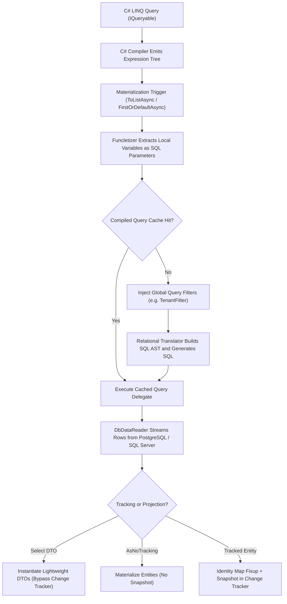
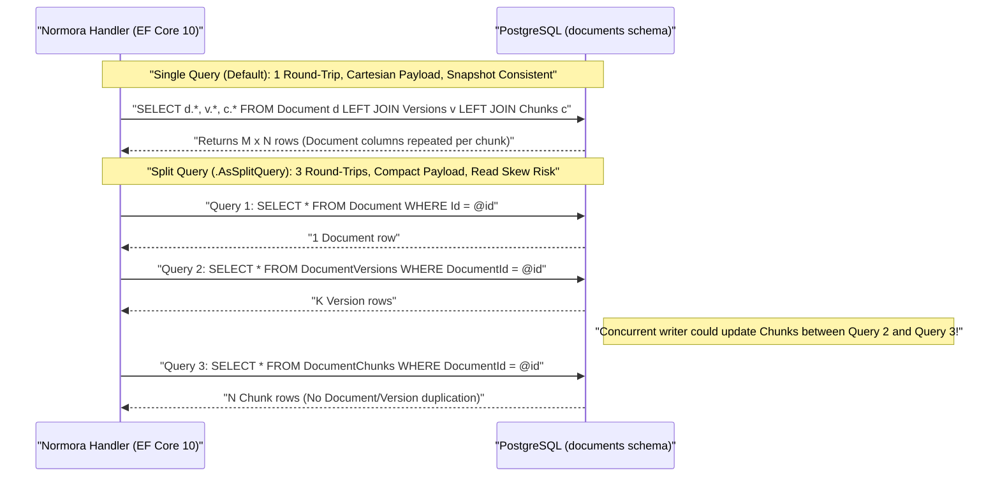
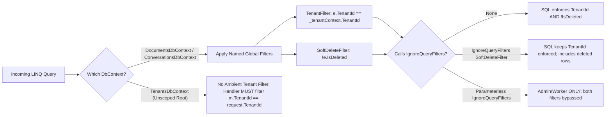

# Chapter 5: The Query Pipeline and LINQ Translation

## 1. Learning Objectives

By the end of this chapter, you will be able to:
*   Deconstruct the internal architecture of the EF Core 10 LINQ Provider and explain how C# Expression Trees are translated into SQL (both SQL Server T-SQL and PostgreSQL SQL via Npgsql).
*   Master the difference between `IQueryable<T>`, `IEnumerable<T>`, and `IAsyncEnumerable<T>`, eliminating accidental client-side evaluation and unbounded memory buffering.
*   Utilize advanced projections (`Select`) and `AsNoTrackingWithIdentityResolution()` to bypass or optimize the Change Tracker and minimize network payloads.
*   Solve the Cartesian Explosion problem using `AsSplitQuery()`, understanding the exact trade-offs involving database connection utilization and Read Skew.
*   Use EF Core 10's newest query capabilities—including native `.LeftJoin()` / `.RightJoin()` operators, Named Query Filters (`.IgnoreQueryFilters(["FilterName"])`), and improved parameterized collections—safely in multi-tenant architectures.
*   Implement deterministic Keyset (Cursor) pagination, compliant `GroupBy` projections (following Normora's anonymous-type rule), and parameterized raw SQL (`FromSqlInterpolated`, `Database.SqlQuery<T>`) for queries that exceed LINQ's capabilities (such as PostgreSQL `pgvector` hybrid search).

## 2. Introduction

The defining feature of Entity Framework Core is its ability to allow developers to query a relational database using C#—specifically, Language Integrated Query (LINQ). 

This is an incredible abstraction. You write strongly-typed C# code, complete with compiler safety and IntelliSense, and EF Core 10 turns it into highly optimized SQL. However, when developers treat this abstraction as magic, production systems fail. A poorly constructed LINQ query might compile perfectly, yet generate a SQL query that performs a full sequential scan across 10 million rows, pulls gigabytes of vectors over the network, or crashes at runtime with a translation exception.

To be an EF Core Architect, you must pierce the abstraction. You must understand exactly how the C# compiler generates an Expression Tree, how EF Core parses and funcletizes that tree, caches the query plan, and translates it into a relational Abstract Syntax Tree (AST) specific to your database engine (PostgreSQL in **Normora**, or SQL Server in traditional enterprise stacks). 

This chapter is a masterclass in the EF Core 10 query pipeline. We will dissect how to fetch data efficiently, how to shape it, how to enforce multi-tenant isolation inside the query pipeline, and how to avoid the deadly pitfalls of the N+1 problem, Cartesian Explosions, and `GroupBy` translation failures.

> [!NOTE]
> **How Normora Runs EF Core 10:** Normora is a **.NET 10 Modular Monolith** backed by **PostgreSQL 15 + pgvector**. Each bounded context owns a private `DbContext` (`TenantsDbContext` in schema `tenants`, `DocumentsDbContext` in schema `documents`, `ConversationsDbContext` in schema `conversations`), configured via parameterless `IEntityTypeConfiguration<T>` classes and CQRS handlers using C# primary constructors. Throughout this chapter, you will see both foundational EV Platform examples and real-world **Normora** production patterns.

## 3. Core Concepts

### `IQueryable<T>`, `IEnumerable<T>`, and Deferred Execution
This is the most critical distinction in EF Core.
*   **`IQueryable<T>`:** Represents a query blueprint that *has not yet been executed* (**Deferred Execution**). It holds an Expression Tree and an `IQueryProvider` (EF Core). When you append `.Where()`, `.OrderBy()`, or `.Skip()`, no SQL touches the database—you are simply composing a larger Expression Tree.
*   **`IEnumerable<T>`:** Represents a sequence evaluated *in memory* (LINQ-to-Objects). If you cast a `DbSet<T>` to `IEnumerable<T>` or call `.ToListAsync()` / `.AsEnumerable()` early, any subsequent `.Where()` filters run in the application server's RAM after fetching potentially millions of rows over the wire.
*   **`IAsyncEnumerable<T>` (`AsAsyncEnumerable()`):** Streams rows asynchronously one by one from the database `DbDataReader` without buffering the entire `List<T>` in memory.

> [!TIP]
> **When NOT to use `IQueryable<T>` outside a handler:** Never return an unexecuted `IQueryable<T>` from a module boundary, MediatR contract, or controller. In Normora, `DbContext` instances are scoped per HTTP request or Hangfire job and strictly encapsulated inside their owning module; returning `IQueryable<T>` leaks persistence abstractions and risks executing queries after the `DbContext` is disposed.

#### Real-World Normora Examples (`IQueryable<T>` vs `IEnumerable<T>` vs `IAsyncEnumerable<T>`)

```csharp
// Example 1 (Documents): Composing IQueryable<Document> across conditional filters before single execution
public async Task<IReadOnlyList<DocumentListItemDto>> Handle(
    GetDocumentsQuery request,
    CancellationToken ct)
{
    IQueryable<Document> query = db.Documents.AsNoTracking();

    if (request.DepartmentId.HasValue)
        query = query.Where(d => d.DepartmentId == request.DepartmentId.Value);

    if (!string.IsNullOrWhiteSpace(request.Search))
        query = query.Where(d => EF.Functions.ILike(d.Title, $"%{request.Search}%"));

    return await query
        .OrderByDescending(d => d.CreatedAt)
        .Select(d => new DocumentListItemDto(d.Id, d.Title, d.Status, d.CreatedAt))
        .ToListAsync(ct); // Single SQL round-trip happens ONLY here
}

// Example 2 (Tenants): Unscoped TenantsDbContext MUST filter TenantId on the IQueryable before materializing
var activeMembers = await tenantsDb.TenantMemberships
    .AsNoTracking()
    .Where(m => m.TenantId == request.TenantId && m.IsActive)
    .OrderBy(m => m.DisplayName)
    .ToListAsync(ct);

// Example 3 (Documents Worker): Streaming large document chunk exports with AsAsyncEnumerable() to avoid OOM
await foreach (var chunk in documentsDb.DocumentChunks
    .AsNoTracking()
    .Where(c => c.DocumentId == documentId)
    .OrderBy(c => c.ChunkIndex)
    .Select(c => new { c.ChunkIndex, c.Content })
    .AsAsyncEnumerable()
    .WithCancellation(ct))
{
    await jsonWriter.WriteChunkAsync(chunk, ct);
}

// Example 4 (Conversations): Intentional switch to IEnumerable via AsEnumerable() ONLY AFTER SQL aggregation
var rawCounts = await conversationsDb.Messages
    .Where(m => m.CreatedAt >= sinceUtc)
    .GroupBy(m => m.Role)
    .Select(g => new { Role = g.Key, Total = g.Count() })
    .ToListAsync(ct);

// Now safely shape in memory (LINQ-to-Objects)
var roleBreakdown = rawCounts
    .Select(x => new RoleUsageDto(x.Role.ToString(), x.Total))
    .ToList();

// Example 5 (Documents): Deferred base query reused for total count and paginated slice
var baseQuery = documentsDb.Documents
    .AsNoTracking()
    .Where(d => d.Status == DocumentStatus.Indexed);

var totalCount = await baseQuery.CountAsync(ct); // Executes COUNT(*)
var pageItems = await baseQuery
    .OrderByDescending(d => d.UpdatedAt)
    .Skip((request.Page - 1) * request.PageSize)
    .Take(request.PageSize)
    .ToListAsync(ct); // Executes SELECT ... LIMIT/OFFSET
```

### Expression Trees
When you write `db.Users.Where(u => u.Age > 18)`, the C# compiler does not compile `u => u.Age > 18` into executable IL code (like a normal `Func<User, bool>` delegate). Because `Queryable.Where` accepts `Expression<Func<T, bool>>`, the compiler emits an **Expression Tree**—an immutable in-memory Abstract Syntax Tree describing the logic: `Parameter(u) -> Property(Age) -> GreaterThan -> Constant(18)`. EF Core inspects this data structure to generate SQL.

#### Real-World Normora Examples (Expression Trees in Action)

```csharp
// Example 1 (Documents): Inline lambda compiled into an Expression<Func<Document, bool>>
Expression<Func<Document, bool>> isReadyFilter =
    d => d.Status == DocumentStatus.Indexed && !d.IsDeleted;

// Example 2 (Tenants): Reusable Expression predicate passed directly into IQueryable.Where()
Expression<Func<AuditLog, bool>> recentSecurityEvents =
    log => log.TenantId == request.TenantId && log.OccurredAt >= cutoffUtc;
var alerts = await tenantsDb.AuditLogs.AsNoTracking().Where(recentSecurityEvents).ToListAsync(ct);

// Example 3 (Conversations): Expression tree inside Global Query Filter (tenant isolation)
// EF Core injects this expression node into EVERY query targeting Conversation
modelBuilder.Entity<Conversation>()
    .HasQueryFilter("TenantFilter", c => c.TenantId == _tenantContext.TenantId);

// Example 4 (Documents): Expression tree for JSON/DateTime comparison translated to Npgsql SQL
var staleOutbox = await documentsDb.DocumentProcessingOutboxMessages
    .Where(m => m.ProcessedAt == null && m.AttemptCount < 5 && m.NextRetryAt <= DateTime.UtcNow)
    .ToListAsync(ct);

// Example 5 (Tenants): Ordering expression passed dynamically to keep query strongly typed
Expression<Func<TenantMembership, DateTime>> sortKey = m => m.JoinedAt;
var orderedMembers = await tenantsDb.TenantMemberships
    .Where(m => m.TenantId == request.TenantId)
    .OrderByDescending(sortKey)
    .ToListAsync(ct);
```

### Client-Side Evaluation
When EF Core encounters a C# function inside a LINQ query that has no SQL translation (e.g., a custom C# helper method like `CalculateTax()` or `FormatCitationLabel()`), it has two historical behaviors:
*   In **EF Core 2.x**, EF Core silently pulled *all* rows from the database into application memory and executed the C# method there (implicit client-side evaluation)—a catastrophic performance trap.
*   In **EF Core 3.0 through EF Core 10**, implicit client-side evaluation in operators like `Where`, `OrderBy`, and `GroupBy` is **forbidden**. EF Core throws an `InvalidOperationException` at runtime, forcing you to either rewrite the expression using translatable SQL/EF primitives or move the C# transformation to the *final* `.Select()` projection (or after `ToListAsync()`).

> [!NOTE]
> **Top-Level Projection Exception:** EF Core *does* allow calling a non-translatable C# method inside the **outermost** `.Select(...)` projection (for example, formatting a string or mapping scalar columns into a DTO), because EF Core knows it can query only the referenced scalar columns from SQL and run your C# constructor/method once per row during materialization. **However**, as Normora's `AGENTS.md` enforces, this exception does **not** apply cleanly after `.GroupBy()`—direct parameterized constructor calls inside `GroupBy().Select(...)` fail to translate and throw `InvalidOperationException`!

#### Real-World Normora Examples (Client-Side Evaluation & Safe Boundaries)

```csharp
// Example 1 (Conversations): Outer Select projection calling C# helper on scalar columns ONLY
var citations = await conversationsDb.Citations
    .AsNoTracking()
    .Where(c => c.MessageId == request.MessageId)
    .Select(c => new CitationSummaryDto(
        c.Id,
        c.DocumentTitle,
        CitationSnippetFormatter.Truncate(c.Excerpt, 160))) // Allowed: only c.Excerpt is fetched from SQL
    .ToListAsync(ct);

// Example 2 (Documents): Replacing untranslatable C# string.Equals(..., OrdinalIgnoreCase) with ILike
// WRONG (throws InvalidOperationException): d.FileName.Equals(name, StringComparison.OrdinalIgnoreCase)
// RIGHT (translates to PostgreSQL ILIKE):
var match = await documentsDb.Documents
    .AsNoTracking()
    .Where(d => EF.Functions.ILike(d.FileName, request.FileName))
    .FirstOrDefaultAsync(ct);

// Example 3 (Tenants): Normora GroupBy Rule — aggregate in SQL to anonymous type, then map to DTO in memory
var groupedRaw = await tenantsDb.TenantMemberships
    .AsNoTracking()
    .Where(m => m.TenantId == request.TenantId)
    .GroupBy(m => m.Role)
    .Select(g => new { Role = g.Key, MemberCount = g.Count() }) // Pure SQL GROUP BY
    .ToListAsync(ct);

var roleDtos = groupedRaw
    .Select(x => new RoleDistributionDto(x.Role, x.MemberCount)) // Safe in-memory record construction
    .ToList();

// Example 4 (Conversations): Never call C# regex or business helper inside Where()
// Compute the normalized hash/slug BEFORE the LINQ query so EF Core sends a SQL parameter
string normalizedSlug = SlugNormalizer.Normalize(request.RawSlug);
var saved = await conversationsDb.SavedAnswers
    .AsNoTracking()
    .FirstOrDefaultAsync(s => s.NormalizedSlug == normalizedSlug, ct);

// Example 5 (Documents): Computing DateTime cutoff outside the tree for clean SQL translation
DateTime staleCutoff = DateTime.UtcNow.AddMinutes(-15);
var stuckDocs = await documentsDb.Documents
    .Where(d => d.Status == DocumentStatus.Processing && d.UpdatedAt < staleCutoff)
    .Select(d => d.Id)
    .ToListAsync(ct);
```

### Projections (`Select`) and Tracking Modes
Querying entities (e.g., `db.Documents.ToListAsync()`) fetches every mapped column and inserts every row into the Change Tracker's snapshot cache. **Projection** (`.Select(d => new DocumentDto(...))`) instructs EF Core to query *only* the columns you explicitly read and map them directly into lightweight DTOs or C# `record` types, **bypassing the Change Tracker completely**.

**When to use Tracking vs `AsNoTracking()` vs `AsNoTrackingWithIdentityResolution()` vs `Select()`:**
*   **Default (Tracked):** Use *only* when you intend to modify the loaded entities and call `SaveChangesAsync()`.
*   **`AsNoTracking()`:** Use for read-only entity queries where you need full domain entity methods without paying Change Tracker snapshot memory costs.
*   **`AsNoTrackingWithIdentityResolution()`:** Use for read-only `.Include()` object graphs where multiple child rows point to the same parent/lookup entity (e.g., 200 `Document` entities referencing 4 `Department` entities). Without identity resolution, `AsNoTracking()` instantiates 200 duplicate `Department` objects in RAM; with `AsNoTrackingWithIdentityResolution()`, EF Core uses a lightweight temporary identity map during materialization so all 200 documents share the exact same 4 `Department` instances—still with zero Change Tracker persistence overhead!
*   **`.Select(...)` Projection:** Default choice for all CQRS `Queries` returning API DTOs. Lowest SQL I/O, lowest RAM, zero tracking overhead. **When NOT to use `Select`:** Never use `Select` when you need to mutate domain state through entity behavior methods and call `SaveChangesAsync()`.

#### Real-World Normora Examples (Projections & Tracking Modes)

```csharp
// Example 1 (Documents): CQRS Query projecting directly to immutable C# record DTO (zero tracking)
var items = await documentsDb.Documents
    .AsNoTracking()
    .Where(d => d.DepartmentId == request.DepartmentId)
    .Select(d => new DocumentCardDto(d.Id, d.Title, d.FileSizeBytes, d.Status, d.CreatedAt))
    .ToListAsync(ct);

// Example 2 (Documents): AsNoTrackingWithIdentityResolution for shared Department graphs
var docsWithDepartments = await documentsDb.Documents
    .AsNoTrackingWithIdentityResolution()
    .Include(d => d.Department)
    .Where(d => d.Status == DocumentStatus.Indexed)
    .ToListAsync(ct); // Shared Department instances are deduplicated in RAM without tracking

// Example 3 (Conversations): Projecting nested counts without loading child Message rows
var threadSummaries = await conversationsDb.Conversations
    .AsNoTracking()
    .Where(c => c.CreatedByExternalUserId == currentUser.ExternalUserId)
    .OrderByDescending(c => c.UpdatedAt)
    .Select(c => new ConversationSummaryDto(
        c.Id,
        c.Title,
        c.Messages.Count(), // Translates to correlated SQL COUNT(*)
        c.UpdatedAt))
    .ToListAsync(ct);

// Example 4 (Tenants): Tracked entity load ONLY because a CommandHandler mutates state
var plan = await tenantsDb.TenantPlans
    .FirstOrDefaultAsync(p => p.TenantId == request.TenantId, ct)
    ?? throw new BolaException(ApiMessages.NotFound);

plan.UpdateCurrency(request.Currency); // Needs Change Tracker to detect modification
await tenantsDb.SaveChangesAsync(ct);

// Example 5 (Documents): Projecting only a scalar column (MinIO object key) for deletion cleanup
string? storageKey = await documentsDb.DocumentVersions
    .Where(v => v.DocumentId == request.DocumentId && v.IsCurrent)
    .Select(v => v.StorageObjectKey)
    .FirstOrDefaultAsync(ct);
```

## 4. Visual Diagrams

### The EF Core 10 Query Translation Pipeline



```text
=============================================================================
             THE EF CORE QUERY TRANSLATION PIPELINE (TEXT VIEW)
=============================================================================

[ C# Code ] 
var query = context.Chargers.Where(c => c.MaxKw > 50).ToList();

       │ (1) C# Compiler generates Expression Tree
       ▼
[ Expression Tree ] 
MethodCall(Where, Parameter(c), GreaterThan(Property(MaxKw), Constant(50)))

       │ (2) EF Core LINQ Provider kicks in upon calling .ToList()
       ▼
[ Query Compiler ] 
Is this query shape cached? 
  ├── YES: Retrieve compiled execution delegate.
  └── NO:  Continue to translation...

       │ (3) Translation
       ▼
[ Relational Provider (SQL Server / PostgreSQL) ]
Translates Expression Tree into a Relational Abstract Syntax Tree (AST).
Resolves Table Names, Column Names, and provider-specific SQL functions.

       │ (4) SQL Generation
       ▼
[ SQL String ]
"SELECT [c].[Id], [c].[MaxKw] FROM [Chargers] AS [c] WHERE [c].[MaxKw] > @p0"

       │ (5) Execution & Materialization
       ▼
[ ADO.NET DataReader ] ──▶ [ Entity Materializer ] ──▶ [ Change Tracker ] ──▶ [ List<Charger> ]
```

### Single Query vs. `AsSplitQuery()` (Round-Trips vs. Cartesian Payload & Read Skew)



### Global Query Filters & EF Core 10 Named Filter Isolation in Normora



## 5. API Deep Dive: Querying

### Filtering, Sorting, and Pagination (Offset vs. Keyset)
The absolute basics of querying rely on `.Where()`, `.OrderBy()`, `.OrderByDescending()`, `.ThenBy()`, `.Skip()`, and `.Take()`.

```csharp
var activeFastChargers = await context.Chargers
    .Where(c => c.IsActive && c.MaxKw > 100)
    .OrderBy(c => c.SiteId)
    .ThenByDescending(c => c.MaxKw)
    .ToListAsync(); // Execution happens HERE
```
*Generated SQL (SQL Server): `SELECT [c].[Id]... FROM [Chargers] AS [c] WHERE [c].[IsActive] = CAST(1 AS bit) AND [c].[MaxKw] > 100 ORDER BY [c].[SiteId], [c].[MaxKw] DESC`*

#### Offset (`Skip`/`Take`) vs. Keyset (Cursor/Seek) Pagination
*   **Offset Pagination (`Skip(offset).Take(pageSize)`):** Translates to `OFFSET @p0 ROWS FETCH NEXT @p1 ROWS ONLY` (SQL Server) or `LIMIT @p1 OFFSET @p0` (PostgreSQL). Simple for small datasets or jump-to-page UIs, **but** the database must still scan and discard all `@p0` skipped rows—on page 5,000, PostgreSQL reads and throws away 100,000+ rows. It also drifts (duplicates or skipped items) when rows are inserted while a user pages forward.
*   **Keyset (Seek) Pagination:** Uses a deterministic tie-breaker sort (`OrderByDescending(x => x.CreatedAt).ThenByDescending(x => x.Id)`) and filters relative to the last item's cursor (`WHERE (CreatedAt, Id) < (@lastCreatedAt, @lastId)`). The database jumps straight to the next page via a B-Tree index seek in $O(\log N)$ time regardless of page depth.
*   **When NOT to use Keyset Pagination:** Do not use Keyset pagination if the UI strictly requires jumping directly to arbitrary page numbers (e.g., "Jump to Page 42") or sorting dynamically on low-cardinality columns without a unique tie-breaker.
*   **Deterministic Ordering Rule:** Never call `.Skip()` and `.Take()` without an `.OrderBy()` ending in a unique column (such as `Id`). Without a deterministic sort, PostgreSQL and SQL Server can return rows in arbitrary heap/page order, causing overlapping or missing rows across pages.

#### Real-World Normora Examples (Filtering, Sorting & Pagination)

```csharp
// Example 1 (Documents): Deterministic Offset Pagination for Documents Data Grid
var pageItems = await documentsDb.Documents
    .AsNoTracking()
    .Where(d => d.Status == DocumentStatus.Indexed)
    .OrderByDescending(d => d.UpdatedAt)
    .ThenBy(d => d.Id) // Unique tie-breaker guarantees deterministic pages
    .Skip((request.Page - 1) * request.PageSize)
    .Take(request.PageSize)
    .Select(d => new DocumentListItemDto(d.Id, d.Title, d.UpdatedAt))
    .ToListAsync(ct);

// Example 2 (Tenants): Keyset (Cursor) Pagination for High-Volume Audit Logs
var auditPage = await tenantsDb.AuditLogs
    .AsNoTracking()
    .Where(a => a.TenantId == request.TenantId)
    .Where(a => !request.CursorTime.HasValue ||
                a.OccurredAt < request.CursorTime.Value ||
                (a.OccurredAt == request.CursorTime.Value && a.Id.CompareTo(request.CursorId!.Value) < 0))
    .OrderByDescending(a => a.OccurredAt)
    .ThenByDescending(a => a.Id)
    .Take(request.PageSize + 1) // Fetch +1 to detect HasNextPage without running a separate COUNT(*)
    .ToListAsync(ct);

// Example 3 (Conversations): Keyset Pagination for Copilot Conversation History Sidebar
var conversations = await conversationsDb.Conversations
    .AsNoTracking()
    .Where(c => c.CreatedByExternalUserId == currentUser.ExternalUserId)
    .Where(c => !request.BeforeUtc.HasValue || c.LastMessageAt < request.BeforeUtc.Value)
    .OrderByDescending(c => c.LastMessageAt)
    .ThenByDescending(c => c.Id)
    .Take(25)
    .Select(c => new ConversationThreadDto(c.Id, c.Title, c.LastMessageAt))
    .ToListAsync(ct);

// Example 4 (Documents): Case-insensitive prefix/substring search using PostgreSQL ILike
var matchingDocs = await documentsDb.Documents
    .AsNoTracking()
    .Where(d => EF.Functions.ILike(d.Title, $"{request.Prefix}%")) // Trailing wildcard stays sargable with text_pattern_ops/citext
    .OrderBy(d => d.Title)
    .Take(20)
    .ToListAsync(ct);

// Example 5 (Tenants): Filtering Employees by Department and Role with explicit TenantId scope
var deptMembers = await tenantsDb.TenantMemberships
    .AsNoTracking()
    .Where(m => m.TenantId == request.TenantId && m.DepartmentId == request.DepartmentId && m.IsActive)
    .OrderBy(m => m.FullName)
    .ThenBy(m => m.Id)
    .Select(m => new EmployeeSummaryDto(m.Id, m.FullName, m.Email, m.Role))
    .ToListAsync(ct);
```

### Existence Checks & Single-Row Lookups (`AnyAsync`, `FirstOrDefaultAsync`, `SingleOrDefaultAsync`, `FindAsync`)
Choosing the right terminal operator changes the generated SQL and safeguards data integrity:
*   **`AnyAsync(predicate)`:** Translates to `SELECT EXISTS (SELECT 1 FROM ...)` (PostgreSQL) or `SELECT CASE WHEN EXISTS (...) THEN 1 ELSE 0 END` (SQL Server). Stops scanning the index at the very first matching row. Always prefer over `CountAsync() > 0`.
*   **`AllAsync(predicate)`:** Translates to `NOT EXISTS (... WHERE NOT predicate)`. Useful for invariant checks (e.g., verifying all chunks are embedded before marking a document ready).
*   **`FirstOrDefaultAsync()`:** Generates `LIMIT 1` / `TOP (1)`. Use when matching by a non-unique column or when expecting at most one row without paying the cost of checking for a second.
*   **`SingleOrDefaultAsync()`:** Generates `LIMIT 2` / `TOP (2)`. Throws `InvalidOperationException` if more than one row matches. Use when querying by a unique constraint or business invariant where duplicates indicate data corruption. **When NOT to use:** Avoid on hot paths where uniqueness is already enforced by a primary key index lookup—`FirstOrDefaultAsync` or `FindAsync` avoids the extra row probe.
*   **`FindAsync(key)`:** Checks the `DbContext` Change Tracker's local identity map *first* before issuing a SQL `WHERE Id = @p0 LIMIT 1`. **When NOT to use:** `FindAsync` cannot be combined with `.AsNoTracking()`, `.Include()`, or `.Select()`, and tracks the entity.

#### Real-World Normora Examples (Lookups, Existence & BOLA 404 Enforcement)

```csharp
// Example 1 (Documents): BOLA-safe lookup — missing OR wrong-tenant document both map to BolaException (HTTP 404)
var document = await documentsDb.Documents
    .FirstOrDefaultAsync(d => d.Id == request.DocumentId, ct)
    ?? throw new BolaException(ApiMessages.NotFound);

// Example 2 (Tenants): Fast existence check before creating a department (never CountAsync() > 0)
bool slugExists = await tenantsDb.Departments
    .AnyAsync(d => d.TenantId == request.TenantId && d.Slug == normalizedSlug, ct);
if (slugExists)
    throw new InvalidOperationException(ApiMessages.DepartmentAlreadyExists);

// Example 3 (Documents): AllAsync check inside Hangfire ingestion pipeline
bool allChunksEmbedded = await documentsDb.DocumentChunks
    .Where(c => c.DocumentVersionId == versionId)
    .AllAsync(c => c.Embedding != null, ct);

// Example 4 (Conversations): SingleOrDefaultAsync for unique PendingApproval token verification
var approval = await conversationsDb.PendingApprovals
    .SingleOrDefaultAsync(a => a.Id == request.ApprovalId && a.ExpiresAtUtc > DateTime.UtcNow, ct)
    ?? throw new BolaException(ApiMessages.NotFound);

// Example 5 (Tenants): FindAsync when mutating a known tracked entity inside a CommandHandler
var group = await tenantsDb.UserGroups.FindAsync([request.GroupId], ct);
if (group is null || group.TenantId != request.TenantId)
    throw new BolaException(ApiMessages.NotFound); // Prevents cross-tenant ID enumeration
```

### Eager Loading (`Include`, `ThenInclude`, and Filtered Includes)
By default, EF Core does not load related navigation properties. If you query a `Site`, its `Chargers` collection is empty. You must explicitly request the related data using Eager Loading.

```csharp
var site = await context.Sites
    .Include(s => s.Tenant)          // Load the parent
    .Include(s => s.Chargers)        // Load the children
        .ThenInclude(c => c.Sessions)// Load the grandchildren
    .FirstOrDefaultAsync(s => s.Id == siteId);
```
*Generated SQL: EF Core generates a massive `LEFT JOIN` query joining `Sites`, `Tenants`, `Chargers`, and `Sessions`.*

**Filtered Includes & When NOT to Use `Include`:**
You can filter and sort inside `.Include(d => d.Versions.Where(v => v.IsCurrent).OrderByDescending(v => v.VersionNumber))`. However, **do NOT use `Include` when you also call `.Select(...)`**—EF Core ignores `Include` whenever a custom projection is used, because it derives all necessary `JOIN`s directly from the properties accessed inside `.Select(...)`.

#### Real-World Normora Examples (Eager Loading & Filtered Includes)

```csharp
// Example 1 (Documents): Loading a Document with its current version only (Filtered Include)
var doc = await documentsDb.Documents
    .AsNoTracking()
    .Include(d => d.Versions.Where(v => v.IsCurrent))
    .FirstOrDefaultAsync(d => d.Id == request.DocumentId, ct)
    ?? throw new BolaException(ApiMessages.NotFound);

// Example 2 (Conversations): Loading Conversation with latest 20 messages and their Citations
var conversation = await conversationsDb.Conversations
    .AsNoTracking()
    .Include(c => c.Messages.OrderByDescending(m => m.CreatedAt).Take(20))
        .ThenInclude(m => m.Citations)
    .FirstOrDefaultAsync(c => c.Id == request.ConversationId, ct);

// Example 3 (Tenants): Loading UserGroup with memberships using AsNoTrackingWithIdentityResolution
var userGroup = await tenantsDb.UserGroups
    .AsNoTrackingWithIdentityResolution()
    .Include(g => g.Memberships)
        .ThenInclude(gm => gm.TenantMembership)
    .FirstOrDefaultAsync(g => g.Id == request.GroupId && g.TenantId == request.TenantId, ct);

// Example 4 (Documents): Loading Document with access-control UserGroup links for mutation
var docToUpdate = await documentsDb.Documents
    .Include(d => d.AccessGroups) // Tracked because we are modifying the collection
    .FirstOrDefaultAsync(d => d.Id == request.DocumentId, ct)
    ?? throw new BolaException(ApiMessages.NotFound);

// Example 5 (Conversations): Filtered Include excluding expired PendingApprovals
var activeThread = await conversationsDb.Conversations
    .Include(c => c.PendingApprovals.Where(p => p.Status == ApprovalStatus.Pending && p.ExpiresAtUtc > DateTime.UtcNow))
    .FirstOrDefaultAsync(c => c.Id == request.ConversationId, ct);
```

### The Cartesian Explosion & `AsSplitQuery()`
The query above joins 4 tables. If a Site has 50 Chargers, and each Charger has 100 Sessions, the database returns 1 * 50 * 100 = 5,000 rows.
However, the `Site` data (Name, Address) and the `Charger` data (Serial Number) are duplicated across all 5,000 rows. This is the **Cartesian Explosion**. It wastes massive amounts of network bandwidth and memory.

To solve this, EF Core provides `.AsSplitQuery()`.

```csharp
var site = await context.Sites
    .AsSplitQuery() // <--- Prevents Cartesian Explosion across sibling/nested collections
    .Include(s => s.Tenant)
    .Include(s => s.Chargers)
        .ThenInclude(c => c.Sessions)
    .FirstOrDefaultAsync(s => s.Id == siteId);
```
*Behavior:* EF Core will now execute **three separate SQL queries**:
1. `SELECT * FROM Sites JOIN Tenants... WHERE Site.Id = 1`
2. `SELECT * FROM Chargers WHERE SiteId = 1`
3. `SELECT * FROM Sessions JOIN Chargers... WHERE Charger.SiteId = 1`

EF Core then stitches the objects together in memory via Relationship Fixup. This trades slightly higher database connection usage for a massive reduction in network payload size.

**When NOT to use `AsSplitQuery()`:**
*   Do **not** use `AsSplitQuery()` when you have only a single collection `.Include()` or reference-only `.Include()`s (many-to-one), because there is no Cartesian product to explode and extra round-trips only add network latency.
*   Do **not** use `AsSplitQuery()` without an explicit `IsolationLevel.RepeatableRead` / `Snapshot` transaction when reading financially or security-critical child collections under heavy concurrent writes, because separate `SELECT` statements can observe **Read Skew** (inconsistent state between Query 1 and Query 2).
*   If `QuerySplittingBehavior.SplitQuery` is enabled globally on `DbContextOptions`, you can opt back into a single atomic query per call using `.AsSingleQuery()`.

#### Real-World Normora Examples (`AsSplitQuery` & `AsSingleQuery`)

```csharp
// Example 1 (Documents): Avoiding Cartesian Explosion when loading Versions AND Chunks AND Tags
var fullDocument = await documentsDb.Documents
    .AsNoTrackingWithIdentityResolution()
    .AsSplitQuery()
    .Include(d => d.Versions)
    .Include(d => d.Tags)
    .FirstOrDefaultAsync(d => d.Id == request.DocumentId, ct);

// Example 2 (Conversations): Split query for Messages (each with Citations AND ToolCalls)
var threadGraph = await conversationsDb.Conversations
    .AsNoTracking()
    .AsSplitQuery()
    .Include(c => c.Messages)
        .ThenInclude(m => m.Citations)
    .Include(c => c.Messages)
        .ThenInclude(m => m.ToolExecutions)
    .FirstOrDefaultAsync(c => c.Id == request.ConversationId, ct);

// Example 3 (Tenants): Wrapping AsSplitQuery in RepeatableRead transaction on PostgreSQL to prevent Read Skew
await using var tx = await tenantsDb.Database.BeginTransactionAsync(System.Data.IsolationLevel.RepeatableRead, ct);
var workspaceExport = await tenantsDb.Tenants
    .AsNoTracking()
    .AsSplitQuery()
    .Include(t => t.Departments)
    .Include(t => t.UserGroups)
    .FirstOrDefaultAsync(t => t.Id == request.TenantId, ct);
await tx.CommitAsync(ct);

// Example 4 (Documents): Overriding global SplitQuery behavior with AsSingleQuery() for a small 1:1 lookup
var docWithParent = await documentsDb.Documents
    .AsNoTracking()
    .AsSingleQuery()
    .Include(d => d.Department) // Reference navigation (many-to-one): zero Cartesian explosion
    .FirstOrDefaultAsync(d => d.Id == request.DocumentId, ct);

// Example 5 (Global DbContext Guard): Enforcing SplitQuery awareness via ConfigureWarnings
optionsBuilder.ConfigureWarnings(w =>
    w.Throw(RelationalEventId.MultipleCollectionIncludeWarning));
```

### Explicit Loading (and Lazy Loading Pitfalls)
Sometimes you don't know if you need related data until after you've inspected the main entity.

```csharp
var site = await context.Sites.FindAsync(siteId);

if (site.RequiresAudit)
{
    // Explicitly load the navigation property on-demand
    await context.Entry(site).Collection(s => s.Chargers).LoadAsync();
}
```
You can also filter an explicit load using `.Query()`:
```csharp
await context.Entry(site).Collection(s => s.Chargers).Query().Where(c => c.IsActive).LoadAsync();
```
*Warning on Lazy Loading:* EF Core supports proxy-based Lazy Loading (`UseLazyLoadingProxies()`), which silently fires SQL queries whenever you touch a navigation property. In enterprise APIs and modular monoliths like Normora, **Lazy Loading is disabled** because it disguises N+1 queries as ordinary property reads and breaks `AsNoTracking()` / async boundaries.

#### Real-World Normora Examples (Explicit Loading)

```csharp
// Example 1 (Documents): Load Versions only when re-indexing is actually needed
var doc = await documentsDb.Documents.FirstOrDefaultAsync(d => d.Id == docId, ct);
if (doc is not null && doc.RequiresReindexing)
{
    await documentsDb.Entry(doc).Collection(d => d.Versions).LoadAsync(ct);
}

// Example 2 (Documents): Filtered explicit load of ONLY the active version
await documentsDb.Entry(doc!)
    .Collection(d => d.Versions)
    .Query()
    .Where(v => v.IsCurrent)
    .LoadAsync(ct);

// Example 3 (Conversations): Explicit Reference() load for a parent Conversation from a PendingApproval
var approval = await conversationsDb.PendingApprovals.FirstOrDefaultAsync(p => p.Id == approvalId, ct);
if (approval is not null)
{
    await conversationsDb.Entry(approval).Reference(p => p.Conversation).LoadAsync(ct);
}

// Example 4 (Tenants): Checking related count via Explicit Query() without loading child entities into memory
int activeMemberCount = await tenantsDb.Entry(department)
    .Collection(d => d.Memberships)
    .Query()
    .CountAsync(m => m.IsActive, ct);

// Example 5 (Documents Worker): Explicit Existence check on outbox children before archival
bool hasPendingVersions = await documentsDb.Entry(doc!)
    .Collection(d => d.Versions)
    .Query()
    .AnyAsync(v => v.Status == VersionStatus.Processing, ct);
```

### Explicit Joins in EF Core 10 (`.Join()`, `.LeftJoin()`, and `.RightJoin()`)
Historically, joining two tables in EF Core *without* a configured navigation property required writing `.Join(...)` for inner joins, or an awkward `.GroupJoin(...).SelectMany(x => x.Right.DefaultIfEmpty(), ...)` pattern for outer joins.

**EF Core 10 / .NET 10** introduces native, first-class **`.LeftJoin()`** and **`.RightJoin()`** LINQ extension methods! EF Core 10 translates them directly into clean SQL `LEFT JOIN` and `RIGHT JOIN` clauses.

*   **When to use `.LeftJoin()` / `.RightJoin()`:** When joining tables in the same `DbContext` that do not share an entity navigation property (e.g., loose references across aggregates, lookup tables, or reading a `TenantsDbContext` `TenantMembership` alongside an optional `Department` or `Invitation` record).
*   **When NOT to use them:** Do **not** replace standard navigation property projections (e.g., `d.Department.Name`) or `.Include()` with manual `.LeftJoin()` when a clean FK navigation already exists—EF Core automatically emits the `LEFT JOIN` or `INNER JOIN` for navigations based on nullability, keeping your LINQ far simpler. Also remember: never try to `.LeftJoin()` across *different* `DbContext`s (`DocumentsDbContext` cannot SQL-join `TenantsDbContext`); cross-module reads in Normora must go through MediatR contracts in `Normora.Shared.Contracts.*`.

#### Real-World Normora Examples (EF Core 10 Joins)

```csharp
// Example 1 (Tenants): EF Core 10 native LeftJoin for optional Department name without navigation loading
var membersWithOptionalDept = await tenantsDb.TenantMemberships
    .AsNoTracking()
    .Where(m => m.TenantId == request.TenantId)
    .LeftJoin(
        tenantsDb.Departments.Where(d => d.TenantId == request.TenantId),
        member => member.DepartmentId,
        dept => dept.Id,
        (member, dept) => new MemberDirectoryItemDto(
            member.Id,
            member.FullName,
            dept != null ? dept.Name : ApiMessages.UnassignedDepartment))
    .ToListAsync(ct);

// Example 2 (Documents): EF Core 10 native LeftJoin between Document and latest Outbox status
var docsWithOutboxState = await documentsDb.Documents
    .AsNoTracking()
    .LeftJoin(
        documentsDb.DocumentProcessingOutboxMessages.Where(o => o.ProcessedAt == null),
        doc => doc.Id,
        outbox => outbox.DocumentId,
        (doc, outbox) => new
        {
            doc.Id,
            doc.Title,
            doc.Status,
            PendingOutboxAttempts = outbox != null ? outbox.AttemptCount : 0
        })
    .ToListAsync(ct);

// Example 3 (Conversations): EF Core 10 RightJoin to find all SavedAnswers and any linked Conversation
var savedWithThread = await conversationsDb.Conversations
    .AsNoTracking()
    .RightJoin(
        conversationsDb.SavedAnswers,
        conv => conv.Id,
        saved => saved.SourceConversationId,
        (conv, saved) => new
        {
            saved.Id,
            saved.Question,
            ConversationTitle = conv != null ? conv.Title : null
        })
    .ToListAsync(ct);

// Example 4 (Tenants): Inner Join between AuditLog and TenantMembership on ExternalUserId
var auditWithActors = await tenantsDb.AuditLogs
    .AsNoTracking()
    .Where(a => a.TenantId == request.TenantId)
    .Join(
        tenantsDb.TenantMemberships.Where(m => m.TenantId == request.TenantId),
        log => log.ActorExternalUserId,
        member => member.ExternalUserId,
        (log, member) => new AuditEventDto(log.Id, log.Action, member.FullName, log.OccurredAt))
    .ToListAsync(ct);

// Example 5 (Documents): LeftJoin DocumentChunks with Document metadata for orphan/audit diagnostics
var chunkAudit = await documentsDb.DocumentChunks
    .AsNoTracking()
    .LeftJoin(
        documentsDb.Documents,
        chunk => chunk.DocumentId,
        doc => doc.Id,
        (chunk, doc) => new { chunk.Id, DocTitle = doc != null ? doc.Title : null })
    .Where(x => x.DocTitle == null)
    .ToListAsync(ct);
```

### Aggregations & `GroupBy` Translation (and Normora's `GroupBy` Rule)
In LINQ-to-Objects, `GroupBy` returns a sequence of `IGrouping<TKey, TElement>` hierarchical buckets. Relational databases cannot return nested hierarchical buckets from a `GROUP BY` query—SQL `GROUP BY` returns flat scalar rows containing keys and aggregate values (`COUNT`, `SUM`, `AVG`, `MIN`, `MAX`).

Therefore, EF Core requires `GroupBy` to be followed immediately by `.Select(...)` producing scalar aggregates.

> [!IMPORTANT]
> **Normora's Mandatory `GroupBy` Rule (`AGENTS.md`):** When querying aggregations with `GroupBy` in EF Core, **ALWAYS project to an anonymous type first** (e.g., `.Select(g => new { Key = g.Key, Count = g.Count() })`), call `ToListAsync()`, and **only then** project in memory to C# `record`s or DTOs with parameterized constructors. Direct instantiation of parameterized constructors inside `GroupBy().Select(...)` cannot be translated by the EF Core relational compiler and throws an unhandled `InvalidOperationException` (mapped to HTTP 400).

**When NOT to use `GroupBy`:** If you are grouping from a parent entity down to its child collection (e.g., counting documents per department), prefer a correlated projection (`departments.Select(d => new { d.Name, Count = d.Documents.Count() })`) instead of flattening and re-grouping via `GroupBy`.

#### Real-World Normora Examples (`GroupBy` & Aggregations)

```csharp
// Example 1 (Documents): Compliant Normora GroupBy — anonymous type first, then record DTO
var statusCountsRaw = await documentsDb.Documents
    .AsNoTracking()
    .GroupBy(d => d.Status)
    .Select(g => new { Status = g.Key, Count = g.Count(), TotalBytes = g.Sum(d => d.FileSizeBytes) })
    .ToListAsync(ct);

var statusCounts = statusCountsRaw
    .Select(x => new DocumentStatusMetricDto(x.Status, x.Count, x.TotalBytes))
    .ToList();

// Example 2 (Tenants): Composite key GroupBy on AuditLogs (explicit TenantId filter on TenantsDbContext!)
var dailyActivityRaw = await tenantsDb.AuditLogs
    .AsNoTracking()
    .Where(a => a.TenantId == request.TenantId && a.OccurredAt >= startUtc)
    .GroupBy(a => new { Day = a.OccurredAt.Date, a.ActionType })
    .Select(g => new { g.Key.Day, g.Key.ActionType, Events = g.Count() })
    .OrderByDescending(x => x.Day)
    .ToListAsync(ct);

var dailyActivity = dailyActivityRaw
    .Select(x => new DailyAuditMetricDto(DateOnly.FromDateTime(x.Day), x.ActionType, x.Events))
    .ToList();

// Example 3 (Conversations): GroupBy with HAVING equivalent (.Where() AFTER .GroupBy())
var heavyThreadsRaw = await conversationsDb.Messages
    .AsNoTracking()
    .GroupBy(m => m.ConversationId)
    .Select(g => new { ConversationId = g.Key, TokenSum = g.Sum(m => m.TokenCount) })
    .Where(x => x.TokenSum > 50_000) // Translates to SQL HAVING SUM("TokenCount") > 50000
    .ToListAsync(ct);

// Example 4 (Documents): Scalar SumAsync with nullable cast to handle empty sets safely
long totalStorageBytes = await documentsDb.Documents
    .SumAsync(d => (long?)d.FileSizeBytes, ct) ?? 0L;

// Example 5 (Conversations): Average response latency per AI model via anonymous projection
var latencyByModelRaw = await conversationsDb.Messages
    .AsNoTracking()
    .Where(m => m.Role == MessageRole.Assistant && m.LatencyMs.HasValue)
    .GroupBy(m => m.ModelName)
    .Select(g => new { Model = g.Key, AvgLatencyMs = g.Average(m => m.LatencyMs!.Value), Calls = g.Count() })
    .ToListAsync(ct);

var latencyDtos = latencyByModelRaw
    .Select(x => new ModelLatencyDto(x.Model ?? "unknown", Math.Round(x.AvgLatencyMs, 1), x.Calls))
    .ToList();
```

### Global Query Filters & EF Core 10 Named Query Filters
Global Query Filters attach a `Where(...)` predicate to an entity inside `OnModelCreating` so EF Core automatically appends it to *every* LINQ query, `.Include()`, and navigation join targeting that entity.

**How Normora configures them (`AGENTS.md`):**
*   **Parameterless Entity Configurations:** `IEntityTypeConfiguration<T>` classes MUST stay parameterless (`ApplyConfigurationsFromAssembly` instantiates them with `new()`). Never inject `ITenantContext` into configuration constructors! Instead, bind global multi-tenant filters dynamically to a private property/field on the `DbContext` itself inside `OnModelCreating` (e.g., `_tenantContext.TenantId`).
*   **EF Core 10 Named Query Filters:** Prior to EF Core 10, an entity could only have one query filter, and calling `.IgnoreQueryFilters()` disabled **everything**—risking catastrophic cross-tenant data leaks if you only wanted to bypass soft-delete! In **EF Core 10**, you can name each filter and selectively ignore *only* one:
    ```csharp
    modelBuilder.Entity<Document>()
        .HasQueryFilter("TenantFilter", d => d.TenantId == CurrentTenantId)
        .HasQueryFilter("SoftDeleteFilter", d => !d.IsDeleted);
    ```
*   **Unscoped `TenantsDbContext`:** `TenantsDbContext` manages cross-workspace resolution and bootstrapping, so it has **no** ambient `TenantId` global filter. Every query for `TenantMemberships`, `Departments`, `UserGroups`, or `AuditLogs` must filter `m.TenantId == request.TenantId` explicitly.
*   **When NOT to use `IgnoreQueryFilters()`:** Never call parameterless `.IgnoreQueryFilters()` in user-facing API query handlers; use `.IgnoreQueryFilters(["SoftDeleteFilter"])` if you need deleted records within the current tenant, and reserve parameterless `.IgnoreQueryFilters()` strictly for trusted system background jobs (such as `Hangfire` purge workers) that filter explicitly by `TenantId`.

#### Real-World Normora Examples (Global & Named Query Filters)

```csharp
// Example 1 (DocumentsDbContext): Binding named TenantFilter + SoftDeleteFilter dynamically to DbContext
protected override void OnModelCreating(ModelBuilder modelBuilder)
{
    modelBuilder.ApplyConfigurationsFromAssembly(typeof(DocumentsDbContext).Assembly);

    modelBuilder.Entity<Document>()
        .HasQueryFilter("TenantFilter", d => d.TenantId == _tenantContext.TenantId)
        .HasQueryFilter("SoftDeleteFilter", d => !d.IsDeleted);
}

// Example 2 (Documents): Restore trash view — disable ONLY SoftDeleteFilter, keep TenantFilter active!
var deletedDocs = await documentsDb.Documents
    .AsNoTracking()
    .IgnoreQueryFilters(["SoftDeleteFilter"])
    .Where(d => d.IsDeleted)
    .OrderByDescending(d => d.DeletedAtUtc)
    .ToListAsync(ct);

// Example 3 (Normora.Worker Purge Job): System-wide cleanup across tenants (parameterless IgnoreQueryFilters)
var expiredSoftDeletes = await documentsDb.Documents
    .IgnoreQueryFilters()
    .Where(d => d.IsDeleted && d.DeletedAtUtc < hardDeleteCutoffUtc)
    .Take(200)
    .ToListAsync(ct);

// Example 4 (ConversationsDbContext): Query filter propagates automatically through Include()
// Both Conversation and Message enforce TenantFilter automatically
var conversation = await conversationsDb.Conversations
    .AsNoTracking()
    .Include(c => c.Messages)
    .FirstOrDefaultAsync(c => c.Id == request.ConversationId, ct);

// Example 5 (TenantsDbContext): Unscoped DbContext — MUST write explicit TenantId predicate
var invitations = await tenantsDb.TenantInvitations
    .AsNoTracking()
    .Where(i => i.TenantId == request.TenantId && i.Status == InvitationStatus.Pending)
    .ToListAsync(ct);
```

### Raw SQL (`FromSql`, `FromSqlInterpolated`, `Database.SqlQuery<T>`)
When LINQ isn't expressive enough (e.g., needing SQL Server `FREETEXT` search, PostgreSQL `pgvector` cosine distance / Reciprocal Rank Fusion, Window Functions, or complex CTEs), you can drop down to raw SQL while still having EF Core materialize results safely.

```csharp
string searchTerm = "Acme";

// Safe from SQL Injection! EF Core parameterizes interpolated strings automatically.
var tenants = await context.Tenants
    .FromSqlInterpolated($"SELECT * FROM Tenants WHERE Name LIKE {searchTerm} + '%'")
    .ToListAsync();
```
*(In EF Core 7+, `.FromSql($"...")` is a concise synonym for `.FromSqlInterpolated($"...")` using `FormattableString`.)*

**Key Raw SQL Rules & When NOT to Use It:**
*   **Entity Mapping Rule:** For `DbSet.FromSql(...)` / `FromSqlInterpolated(...)`, the SQL must return all non-ignored columns required by the entity, with matching column names.
*   **Arbitrary DTOs (EF Core 8–10):** Use `context.Database.SqlQuery<TResult>($"SELECT ...")` to map raw SQL directly onto unmapped C# classes/records without registering keyless entities!
*   **Composability Rule:** You can compose `.Where()`, `.OrderBy()`, `.Take()`, or `.Include()` *after* `FromSql(...)` / `SqlQuery<T>(...)` **only** if your raw SQL is a single composable `SELECT` statement (not a stored procedure `EXEC` / `CALL` or trailing `;`). Note: `FromSql` does **not** automatically inject Global Query Filters inside your custom SQL string unless EF Core composes a wrapping `SELECT` around it—always include `tenant_id = {tenantId}` explicitly inside raw SQL for defense-in-depth!
*   **When NOT to use Raw SQL:** Never drop to raw SQL for standard CRUD, joins, or filters that LINQ handles cleanly—raw SQL bypasses compile-time refactoring checks when entity properties are renamed.

#### Real-World Normora Examples (Raw SQL & PostgreSQL / pgvector)

```csharp
// Example 1 (Documents): Hybrid Search (pgvector cosine similarity + PostgreSQL full-text RRF) into DTO via SqlQuery<T>
var vectorParam = new Vector(queryEmbedding); // Pgvector.Vector mapped by Npgsql
var rankedChunks = await documentsDb.Database
    .SqlQuery<HybridChunkHitDto>($"""
        WITH vector_hits AS (
            SELECT id, document_id, content,
                   ROW_NUMBER() OVER (ORDER BY embedding <=> {vectorParam}) AS vec_rank
            FROM documents.document_chunks
            WHERE tenant_id = {request.TenantId} AND is_deleted = false
            ORDER BY embedding <=> {vectorParam}
            LIMIT 40
        ),
        text_hits AS (
            SELECT id,
                   ROW_NUMBER() OVER (ORDER BY ts_rank_cd(search_vector, plainto_tsquery('english', {request.Query})) DESC) AS txt_rank
            FROM documents.document_chunks
            WHERE tenant_id = {request.TenantId}
              AND is_deleted = false
              AND search_vector @@ plainto_tsquery('english', {request.Query})
            LIMIT 40
        )
        SELECT v.id AS "ChunkId",
               v.document_id AS "DocumentId",
               v.content AS "Content",
               (1.0 / (60 + v.vec_rank) + COALESCE(1.0 / (60 + t.txt_rank), 0.0)) AS "RrfScore"
        FROM vector_hits v
        LEFT JOIN text_hits t ON v.id = t.id
        ORDER BY "RrfScore" DESC
        LIMIT {request.TopK}
        """)
    .ToListAsync(ct);

// Example 2 (Documents): Composable FromSql returning Document entities + LINQ Include & Take
var recentDocs = await documentsDb.Documents
    .FromSql($"""
        SELECT * FROM documents.documents
        WHERE tenant_id = {request.TenantId} AND is_deleted = false
        """)
    .Include(d => d.Versions.Where(v => v.IsCurrent))
    .OrderByDescending(d => d.UpdatedAt)
    .Take(10)
    .AsNoTracking()
    .ToListAsync(ct);

// Example 3 (Tenants): Window function (DENSE_RANK) via SqlQuery<T> for workspace storage leaderboard
var topWorkspaces = await tenantsDb.Database
    .SqlQuery<TenantUsageRankDto>($"""
        SELECT tenant_id AS "TenantId",
               storage_bytes AS "StorageBytes",
               DENSE_RANK() OVER (ORDER BY storage_bytes DESC) AS "Rank"
        FROM tenants.tenant_plans
        WHERE tier = {request.Tier.ToString()}
        """)
    .ToListAsync(ct);

// Example 4 (Documents Worker): Claiming outbox rows atomically with PostgreSQL FOR UPDATE SKIP LOCKED
var claimed = await documentsDb.DocumentProcessingOutboxMessages
    .FromSql($"""
        SELECT * FROM documents.document_processing_outbox_messages
        WHERE processed_at IS NULL AND next_retry_at <= {DateTime.UtcNow}
        ORDER BY created_at
        LIMIT 10
        FOR UPDATE SKIP LOCKED
        """)
    .ToListAsync(ct); // Note: FOR UPDATE is NOT composable with outer LINQ Where/OrderBy!

// Example 5 (Conversations): Scalar count/percentile query via SqlQuery<double>
var p95Latency = await conversationsDb.Database
    .SqlQuery<double>($"""
        SELECT COALESCE(PERCENTILE_CONT(0.95) WITHIN GROUP (ORDER BY latency_ms), 0) AS "Value"
        FROM conversations.messages
        WHERE tenant_id = {request.TenantId} AND created_at >= {sinceUtc}
        """)
    .SingleAsync(ct);
```

## 6. EF Core Internals: Query Caching, Parameterized Collections & Diagnostics

Compiling an Expression Tree into a SQL AST is computationally expensive. EF Core mitigates this by heavily caching compiled query plans in memory (using `IMemoryCache` inside the internal `QueryCompiler`).

When EF Core sees `context.Users.Where(u => u.Id == id)`, the **Funcletizer** walks the Expression Tree, spots that `id` is a captured local variable/closure, and replaces it with a `QueryParameterExpression` (`@p0`). The cache key is derived from the **structural shape** of the parameterized Expression Tree—so passing `id = 1` and `id = 2` produces the *exact same* cache key!

**The Dynamic Query & Constant-Inlining Trap:**
If you embed literal constants directly into Expression Trees (e.g., building custom `Expression.Constant(userId)` nodes manually, or branching across many hardcoded literal values) or generate wildly varying dynamic LINQ shapes on every request, you change the shape of the tree and thrash the compiled query cache (default limit: 1,024 entries in EF Core's internal cache).

```csharp
// BAD: Manually embedding constants into the Expression Tree changes the tree shape per ID!
// Query 1: Where(u => u.Id == 1) -> Cache Miss, Compile, Cache
// Query 2: Where(u => u.Id == 2) -> Cache Miss, Compile, Cache (Different Tree Shape!)
public User? GetUserConstantBad(Guid id)
{
    var param = Expression.Parameter(typeof(User), "u");
    var body = Expression.Equal(Expression.Property(param, nameof(User.Id)), Expression.Constant(id));
    var lambda = Expression.Lambda<Func<User, bool>>(body, param);
    return context.Users.Where(lambda).FirstOrDefault();
}

// GOOD: Standard local variable / method parameter capture.
// EF Core's Funcletizer converts `id` into @p0 -> Tree shape is: Where(u => u.Id == @p0)
// Query 1: Cache Miss, Compile, Cache
// Query 2: Cache Hit! Executes immediately.
public Task<User?> GetUserGoodAsync(Guid id, CancellationToken ct) =>
    context.Users.AsNoTracking().FirstOrDefaultAsync(u => u.Id == id, ct);
```
*Note: EF Core 10 automatically parameterizes captured local variables, method parameters, and primitive collections—so you only hit constant-inlining traps when hand-rolling `Expression.Constant(...)` or concatenating SQL strings.*

### Parameterized Collections in EF Core 10 (`ids.Contains(x.Id)`)
In EF Core 7 and earlier, `ids.Contains(x.Id)` generated hardcoded `IN (1, 2, 3)` SQL—causing SQL Server and PostgreSQL plan cache bloat for every distinct list length.
*   **EF Core 8–10 on SQL Server:** Translates `ids.Contains(x.Id)` into `OPENJSON(@__ids_0)` with a single JSON array parameter, preserving one cached SQL execution plan regardless of whether `ids` has 2 items or 2,000.
*   **EF Core 8–10 on PostgreSQL (Npgsql):** Translates `ids.Contains(x.Id)` into `x."Id" = ANY(@__ids_0)` using a native PostgreSQL typed array parameter—zero plan bloat and full B-Tree index support.
*   **EF Core 10 Refinements:** EF Core 10 further refines parameterized collection translation (supporting configurable translation modes and cleaner parameter handling for inline/constant vs variable collections).

### Query Diagnostics (`ToQueryString()`, `TagWith()`, `TagWithCallSite()`)
Never guess what SQL EF Core generates:
*   **`query.ToQueryString()`:** Generates and returns the exact SQL string (including declared parameter types) **without executing** the query against the database. Ideal in unit/integration tests and debugging.
*   **`query.TagWith("...")`:** Prepends a SQL comment (`-- ...` in PostgreSQL, `/* ... */` in SQL Server) to the emitted SQL so DBAs and OpenTelemetry (`pg_stat_statements` / Query Store) can trace slow SQL directly back to a specific CQRS handler.
*   **`query.TagWithCallSite()`:** Automatically embeds the C# file path and line number into the SQL comment.

*(For ultra-hot paths where even looking up EF Core's internal compiled query cache is a bottleneck, EF Core provides `EF.CompileAsyncQuery`—covered in depth in Chapter 6: High Performance.)*

#### Real-World Normora Examples (Query Caching, Parameterized Collections & Diagnostics)

```csharp
// Example 1 (Documents): Parameterized collection with PostgreSQL = ANY(@ids)
var accessibleGroupIds = currentUser.GroupIds; // IReadOnlyCollection<Guid>
var accessibleDocs = await documentsDb.Documents
    .AsNoTracking()
    .Where(d => d.IsPublic || d.AccessGroups.Any(g => accessibleGroupIds.Contains(g.UserGroupId)))
    .Select(d => new DocumentListItemDto(d.Id, d.Title, d.Status, d.CreatedAt))
    .ToListAsync(ct);

// Example 2 (Conversations): TagWith to correlate slow SQL in OpenTelemetry & PostgreSQL pg_stat_statements
var recentThreads = await conversationsDb.Conversations
    .TagWith("Conversations.GetRecentThreadsQueryHandler")
    .AsNoTracking()
    .Where(c => c.CreatedByExternalUserId == currentUser.ExternalUserId)
    .OrderByDescending(c => c.LastMessageAt)
    .Take(20)
    .ToListAsync(ct);

// Example 3 (Documents): TagWithCallSite during performance profiling of ingestion queries
var pendingOutbox = await documentsDb.DocumentProcessingOutboxMessages
    .TagWithCallSite()
    .Where(m => m.ProcessedAt == null)
    .OrderBy(m => m.CreatedAt)
    .Take(50)
    .ToListAsync(ct);

// Example 4 (Tenants): Inspecting generated SQL with ToQueryString() in debug/test diagnostics
var debugSql = tenantsDb.AuditLogs
    .AsNoTracking()
    .Where(a => a.TenantId == request.TenantId && a.OccurredAt >= sinceUtc)
    .OrderByDescending(a => a.OccurredAt)
    .Take(50)
    .ToQueryString();

// Example 5 (Documents): Passing DateTime.UtcNow via local variable (clean parameter @__now_0)
var nowUtc = DateTime.UtcNow;
var expiredLocks = await documentsDb.DocumentProcessingOutboxMessages
    .Where(m => m.LockedUntilUtc != null && m.LockedUntilUtc < nowUtc)
    .Select(m => m.Id)
    .ToListAsync(ct);
```

## 7. Complete Examples: EV Platform & Normora CQRS Case Studies

### Case Study A: EV Platform Dashboard
We need to build an administrative dashboard that shows a summary of all active Sites for a specific Tenant, including the number of Chargers and the total energy dispensed today.

#### The Inefficient Way (Eager Loading Everything)
```csharp
// Fetches the entire Site object, all Charger objects, and all Session objects into memory.
// Massive Cartesian Explosion. Massive Change Tracker allocation.
var sites = await _context.Sites
    .Include(s => s.Chargers)
        .ThenInclude(c => c.Sessions.Where(sess => sess.Date == DateTime.Today))
    .Where(s => s.TenantId == tenantId && s.IsActive)
    .ToListAsync();

var dtos = sites.Select(s => new SiteDashboardDto 
{
    SiteName = s.Name,
    ChargerCount = s.Chargers.Count,
    TotalEnergyToday = s.Chargers.SelectMany(c => c.Sessions).Sum(sess => sess.Kwh)
});
```
*(Note: On PostgreSQL with Npgsql `timestamptz` columns, prefer `DateTime.UtcNow.Date` or `DateOnly.FromDateTime(DateTime.UtcNow)` over local `DateTime.Today`.)*

#### The Enterprise Way (Projections)
By using `.Select()`, we instruct EF Core to generate a highly optimized SQL query that aggregates the data directly on SQL Server. No entities are tracked. No Cartesian Explosion occurs.

```csharp
var dtos = await _context.Sites
    .Where(s => s.TenantId == tenantId && s.IsActive)
    .Select(s => new SiteDashboardDto // Project directly into the DTO
    {
        SiteName = s.Name,
        ChargerCount = s.Chargers.Count(), // Translates to SQL COUNT()
        TotalEnergyToday = s.Chargers
            .SelectMany(c => c.Sessions)
            .Where(sess => sess.Date == DateTime.Today)
            .Sum(sess => (decimal?)sess.Kwh) ?? 0 // Translates to SQL SUM()
    })
    .ToListAsync();
```
*Generated SQL:*
```sql
SELECT [s].[Name] AS [SiteName], 
    (SELECT COUNT(*) FROM [Chargers] AS [c] WHERE [s].[Id] = [c].[SiteId]) AS [ChargerCount], 
    COALESCE((
        SELECT SUM([sess].[Kwh]) 
        FROM [Chargers] AS [c0] 
        INNER JOIN [Sessions] AS [sess] ON [c0].[Id] = [sess].[ChargerId] 
        WHERE [s].[Id] = [c0].[SiteId] AND [sess].[Date] = CONVERT(date, GETDATE())
    ), 0.0) AS [TotalEnergyToday]
FROM [Sites] AS [s]
WHERE [s].[TenantId] = @__tenantId_0 AND [s].[IsActive] = CAST(1 AS bit)
```
*This is the true power of EF Core. It generated a masterfully optimized T-SQL aggregation query from a few lines of C#.*

### Case Study B: Normora CQRS Query Handlers (.NET 10 Primary Constructors & PostgreSQL)
In Normora's `Modules/Documents`, `Modules/Tenants`, and `Modules/Conversations`, every read operation lives in its own CQRS operation folder (`Application/{Feature}/Queries/{OperationName}/`). Here are five production-grade Normora examples combining primary constructors, projections, `GroupBy`, `LeftJoin`, keyset pagination, and BOLA enforcement:

```csharp
// Example 1 (Documents): GetDocumentMetricsQueryHandler — compliant GroupBy anonymous projection
public sealed class GetDocumentMetricsQueryHandler(DocumentsDbContext db)
    : IRequestHandler<GetDocumentMetricsQuery, DocumentMetricsDto>
{
    public async Task<DocumentMetricsDto> Handle(GetDocumentMetricsQuery request, CancellationToken ct)
    {
        var rawByStatus = await db.Documents
            .TagWith("Documents.GetDocumentMetricsQueryHandler")
            .AsNoTracking()
            .GroupBy(d => d.Status)
            .Select(g => new
            {
                Status = g.Key,
                DocumentCount = g.Count(),
                TotalBytes = g.Sum(d => d.FileSizeBytes)
            })
            .ToListAsync(ct);

        var breakdown = rawByStatus
            .Select(x => new DocumentStatusBreakdownDto(x.Status, x.DocumentCount, x.TotalBytes))
            .ToList();

        return new DocumentMetricsDto(
            TotalDocuments: breakdown.Sum(b => b.DocumentCount),
            TotalStorageBytes: breakdown.Sum(b => b.TotalBytes),
            Breakdown: breakdown);
    }
}

// Example 2 (Documents): GetDocumentDetailQueryHandler — BOLA 404 + Filtered Include + Projection
public sealed class GetDocumentDetailQueryHandler(
    DocumentsDbContext db,
    ICurrentUserService currentUser)
    : IRequestHandler<GetDocumentDetailQuery, DocumentDetailDto>
{
    public async Task<DocumentDetailDto> Handle(GetDocumentDetailQuery request, CancellationToken ct)
    {
        var doc = await db.Documents
            .AsNoTracking()
            .Where(d => d.Id == request.DocumentId)
            .Where(d => d.IsPublic || d.AccessGroups.Any(g => currentUser.GroupIds.Contains(g.UserGroupId)))
            .Select(d => new DocumentDetailDto(
                d.Id,
                d.Title,
                d.Status,
                d.Versions.Where(v => v.IsCurrent).Select(v => v.VersionNumber).FirstOrDefault(),
                d.Versions.Where(v => v.IsCurrent).Select(v => v.ChunkCount).FirstOrDefault(),
                d.UpdatedAt))
            .FirstOrDefaultAsync(ct)
            ?? throw new BolaException(ApiMessages.NotFound); // Missing OR unauthorized -> 404

        return doc;
    }
}

// Example 3 (Tenants): GetAuditLogsQueryHandler — explicit TenantId filter + Keyset cursor pagination
public sealed class GetAuditLogsQueryHandler(TenantsDbContext db)
    : IRequestHandler<GetAuditLogsQuery, KeysetPageResult<AuditLogDto>>
{
    public async Task<KeysetPageResult<AuditLogDto>> Handle(GetAuditLogsQuery request, CancellationToken ct)
    {
        var rows = await db.AuditLogs
            .AsNoTracking()
            .Where(a => a.TenantId == request.TenantId) // Mandatory on unscoped TenantsDbContext!
            .Where(a => !request.CursorOccurredAt.HasValue ||
                        a.OccurredAt < request.CursorOccurredAt.Value ||
                        (a.OccurredAt == request.CursorOccurredAt.Value && a.Id.CompareTo(request.CursorId!.Value) < 0))
            .OrderByDescending(a => a.OccurredAt)
            .ThenByDescending(a => a.Id)
            .Take(request.PageSize + 1)
            .Select(a => new AuditLogDto(a.Id, a.ActionType, a.ActorExternalUserId, a.TargetResourceId, a.OccurredAt))
            .ToListAsync(ct);

        bool hasMore = rows.Count > request.PageSize;
        var items = hasMore ? rows.Take(request.PageSize).ToList() : rows;
        return new KeysetPageResult<AuditLogDto>(items, hasMore);
    }
}

// Example 4 (Conversations): GetConversationHistoryQueryHandler — AsSplitQuery for multi-collection read
public sealed class GetConversationHistoryQueryHandler(
    ConversationsDbContext db,
    ICurrentUserService currentUser)
    : IRequestHandler<GetConversationHistoryQuery, ConversationHistoryDto>
{
    public async Task<ConversationHistoryDto> Handle(GetConversationHistoryQuery request, CancellationToken ct)
    {
        var conversation = await db.Conversations
            .AsNoTrackingWithIdentityResolution()
            .AsSplitQuery()
            .Include(c => c.Messages.OrderBy(m => m.CreatedAt))
                .ThenInclude(m => m.Citations)
            .Include(c => c.PendingApprovals.Where(p => p.Status == ApprovalStatus.Pending))
            .FirstOrDefaultAsync(
                c => c.Id == request.ConversationId && c.CreatedByExternalUserId == currentUser.ExternalUserId,
                ct)
            ?? throw new BolaException(ApiMessages.NotFound);

        return ConversationMapper.ToDto(conversation);
    }
}

// Example 5 (Tenants): GetEmployeesDirectoryQueryHandler — EF Core 10 LeftJoin on unscoped TenantsDbContext
public sealed class GetEmployeesDirectoryQueryHandler(TenantsDbContext db)
    : IRequestHandler<GetEmployeesDirectoryQuery, IReadOnlyList<EmployeeDirectoryDto>>
{
    public async Task<IReadOnlyList<EmployeeDirectoryDto>> Handle(GetEmployeesDirectoryQuery request, CancellationToken ct)
    {
        return await db.TenantMemberships
            .AsNoTracking()
            .Where(m => m.TenantId == request.TenantId && m.IsActive)
            .LeftJoin(
                db.Departments.Where(d => d.TenantId == request.TenantId),
                m => m.DepartmentId,
                d => d.Id,
                (m, d) => new EmployeeDirectoryDto(
                    m.Id,
                    m.FullName,
                    m.Email,
                    m.Role,
                    d != null ? d.Name : null))
            .OrderBy(e => e.FullName)
            .ThenBy(e => e.Id)
            .ToListAsync(ct);
    }
}
```

## 8. Performance Implications

### The N+1 Problem
The most notorious performance killer in ORMs.

```csharp
// 1 Query to get all sites
var sites = await context.Sites.ToListAsync(); 

foreach (var site in sites)
{
    // For every site, we execute a NEW query to get its chargers!
    // If there are 1,000 sites, this loop executes 1,000 queries (N + 1).
    var chargers = await context.Entry(site).Collection(s => s.Chargers).Query().ToListAsync();
}
```
**Solution:** Always use Eager Loading (`.Include()`) or Projections (`.Select()`) to fetch all required data in a single network round-trip.

### `AsNoTracking()` Reminder
If you are returning the results of a query (even a simple `db.Users.ToListAsync()`) to an API client without calling `SaveChangesAsync()`, you MUST append `.AsNoTracking()` (or use `.Select(...)` projections). Skipping this step in high-throughput APIs introduces heavy snapshot-allocation CPU and memory pressure in the Change Tracker.

### Sargability, Index Utilization & Keyset Speed
Even a query that executes in 1 round-trip can cripple PostgreSQL or SQL Server if predicates are **non-sargable** (cannot use a B-Tree index seek):
*   Leading wildcards (`EF.Functions.ILike(d.Title, "%policy%")`) force sequential/index scans; prefer PostgreSQL GIN trigram (`pg_trgm`) or `tsvector` full-text search indexes for substring/keyword search.
*   Wrapping indexed columns in functions (`d.CreatedAt.Year == 2026`) prevents index seeks; rewrite as half-open range predicates (`d.CreatedAt >= startOf2026 && d.CreatedAt < startOf2027`).

#### Real-World Normora Examples (Query Performance Tuning)

```csharp
// Example 1 (Documents): Eliminating N+1 when fetching chunk counts per document
var docSummaries = await documentsDb.Documents
    .AsNoTracking()
    .Select(d => new
    {
        d.Id,
        d.Title,
        ChunkCount = d.Versions.Where(v => v.IsCurrent).SelectMany(v => v.Chunks).Count()
    })
    .ToListAsync(ct); // 1 SQL query total, never N+1

// Example 2 (Documents): Sargable UTC date range instead of CreatedAt.Date == targetDate
DateTime dayStart = request.Date.ToDateTime(TimeOnly.MinValue, DateTimeKind.Utc);
DateTime dayEnd = dayStart.AddDays(1);
var uploadedToday = await documentsDb.Documents
    .AsNoTracking()
    .Where(d => d.CreatedAt >= dayStart && d.CreatedAt < dayEnd)
    .ToListAsync(ct);

// Example 3 (Conversations): Selecting ONLY scalar status fields during SignalR streaming check
var convMeta = await conversationsDb.Conversations
    .Where(c => c.Id == request.ConversationId)
    .Select(c => new { c.Id, c.CreatedByExternalUserId, c.Persona })
    .FirstOrDefaultAsync(ct); // Never pulls heavy message history just to verify ownership

// Example 4 (Tenants): Checking quota with SumAsync in SQL instead of fetching Document rows
long usedBytes = await documentsDb.Documents
    .Where(d => d.Status != DocumentStatus.Failed)
    .SumAsync(d => (long?)d.FileSizeBytes, ct) ?? 0L;

// Example 5 (Documents): AsNoTrackingWithIdentityResolution when reading shared Department references
var taggedDocs = await documentsDb.Documents
    .AsNoTrackingWithIdentityResolution()
    .Include(d => d.Department)
    .Take(100)
    .ToListAsync(ct);
```

## 9. ASP.NET Core & CQRS Integration

When using Projections (`.Select()`) to map to DTOs in an ASP.NET Core API, you often encounter repetitive mapping code. 
Many teams use tools like **AutoMapper**. AutoMapper integrates with EF Core's query pipeline via the `ProjectTo<T>` extension method.

```csharp
// Instead of manual Select statements:
var dtos = await _context.Sites
    .Where(s => s.IsActive)
    .ProjectTo<SiteDto>(_mapper.ConfigurationProvider) // Translates mapping rules to SQL!
    .ToListAsync();
```
*Warning:* AutoMapper `ProjectTo` works by converting your AutoMapper profile into an Expression Tree. It is powerful, but complex mappings (like invoking custom value resolvers) cannot be translated to SQL and will cause runtime exceptions. Keep DTO mappings simple.

> [!TIP]
> **Modern .NET 10 / Normora Approach:** In .NET 10 CQRS handlers, teams increasingly avoid runtime reflection mappers (such as AutoMapper, which also moved to a commercial licensing model for newer versions) in favor of **explicit `.Select(...)` projections into C# `record` DTOs** (or compile-time source generators like Mapperly). Explicit `.Select(...)` projections give you compile-time safety, zero reflection startup cost, Native AOT friendliness, and 100% visibility into which SQL columns are fetched.

#### Real-World Normora Examples (API & MediatR CQRS Query Pipeline Integration)

```csharp
// Example 1 (Documents Controller): Thin decentralized controller forwarding CancellationToken to MediatR
[HttpGet]
public async Task<ActionResult<ApiResponse<IReadOnlyList<DocumentListItemDto>>>> List(
    [FromQuery] GetDocumentsRequest query,
    CancellationToken ct)
{
    var result = await sender.Send(new GetDocumentsQuery(query.DepartmentId, query.Search, query.Page, query.PageSize), ct);
    return Ok(ApiResponse<IReadOnlyList<DocumentListItemDto>>.Success(result));
}

// Example 2 (Tenants): BFLA check before running administrative AuditLog query
if (!currentUser.HasPermission(Permissions.AuditLogsRead))
    throw new BflaException(ApiMessages.Forbidden); // Mapped globally to 403 Forbidden

// Example 3 (Conversations): Streaming query results directly over SignalR / SSE without full-list buffering
await foreach (var item in conversationsDb.SavedAnswers
    .AsNoTracking()
    .OrderByDescending(s => s.CreatedAt)
    .Select(s => new SavedAnswerStreamItem(s.Id, s.Question, s.AnswerMarkdown))
    .AsAsyncEnumerable()
    .WithCancellation(ct))
{
    yield return item;
}

// Example 4 (Cross-Module MediatR Contract): Conversations querying Documents via explicit TenantId
var retrieval = await sender.Send(
    new PerformHybridRetrievalQuery(request.TenantId, rewrittenQuery, currentUser.GroupIds, TopK: 8),
    ct);

// Example 5 (FluentValidation + Query): Validating pagination bounds before QueryHandler touches PostgreSQL
public sealed class GetDocumentsQueryValidator : AbstractValidator<GetDocumentsQuery>
{
    public GetDocumentsQueryValidator()
    {
        RuleFor(x => x.Page).GreaterThanOrEqualTo(1);
        RuleFor(x => x.PageSize).InclusiveBetween(1, 100);
    }
}
```

## 10. Clean Architecture & Modular Monolith Perspective

In Clean Architecture, Repositories often become bloated with dozens of specific query methods: `GetActiveSites()`, `GetSitesByTenant()`, `GetSitesWithChargers()`.

### The Specification Pattern
To keep Repositories clean and encapsulate query logic in the Domain layer, Architects often implement the Specification Pattern. A Specification is a class that encapsulates a LINQ Expression.

```csharp
// Domain/Specifications/ActiveSitesByTenantSpec.cs
public class ActiveSitesByTenantSpec : Specification<Site>
{
    public ActiveSitesByTenantSpec(Guid tenantId)
    {
        // Encapsulate the WHERE clause
        Query.Where(s => s.TenantId == tenantId && s.IsActive)
             .Include(s => s.Chargers); // Encapsulate the INCLUDE clauses
    }
}

// Application Layer
var spec = new ActiveSitesByTenantSpec(tenantId);
// The generic repository evaluates the spec and applies the LINQ expressions
var sites = await _siteRepository.ListAsync(spec); 
```

**When NOT to use Generic Repositories + Specifications:**
In a **CQRS Vertical Slice / Modular Monolith** architecture like **Normora**, wrapping `DbContext` in a generic `IRepository<T>` for queries often creates a leaky abstraction that blocks projections, `AsSplitQuery()`, `LeftJoin()`, and PostgreSQL `SqlQuery<T>()`. Instead, Normora encapsulates each `DbContext` privately inside its owning module (`Modules/Documents`, `Modules/Tenants`, `Modules/Conversations`) and lets CQRS `QueryHandler`s query `DbSet<T>` directly, while exposing cross-module capabilities strictly via **MediatR contracts in `Normora.Shared.Contracts.*`** (taking explicit `Guid TenantId`). You can still extract reusable `Expression<Func<T, bool>>` predicates inside the Domain layer when multiple handlers share identical access rules!

#### Real-World Normora Examples (Module Encapsulation & Shared Predicates)

```csharp
// Example 1 (Documents Domain): Reusable access-control Expression predicate without a generic repository
public static class DocumentAccessExpressions
{
    public static Expression<Func<Document, bool>> CanBeViewedBy(IReadOnlyCollection<Guid> userGroupIds) =>
        doc => doc.IsPublic || doc.AccessGroups.Any(ag => userGroupIds.Contains(ag.UserGroupId));
}

// Example 2 (Documents QueryHandler): Composing Domain Expression into IQueryable + Projection
var visibleDocs = await documentsDb.Documents
    .AsNoTracking()
    .Where(DocumentAccessExpressions.CanBeViewedBy(currentUser.GroupIds))
    .Select(d => new DocumentCardDto(d.Id, d.Title, d.UpdatedAt))
    .ToListAsync(ct);

// Example 3 (Normora.Shared.Contracts.Documents): Cross-module contract enforces explicit TenantId
public sealed record PerformHybridRetrievalQuery(
    Guid TenantId,
    string QueryText,
    IReadOnlyCollection<Guid> UserGroupIds,
    int TopK) : IRequest<IReadOnlyList<RetrievedChunkDto>>;

// Example 4 (Conversations Handler): Never injects DocumentsDbContext — uses ISender only
public sealed class SearchCompanyDocumentsTool(ISender sender, ITenantContext tenantContext)
{
    public Task<IReadOnlyList<RetrievedChunkDto>> ExecuteAsync(string query, IReadOnlyCollection<Guid> groupIds, CancellationToken ct) =>
        sender.Send(new PerformHybridRetrievalQuery(tenantContext.TenantId, query, groupIds, TopK: 6), ct);
}

// Example 5 (Tenants): Scoped query method inside module boundary returning DTO, never IQueryable
public sealed class GetTenantBrandingQueryHandler(TenantsDbContext db)
    : IRequestHandler<GetTenantBrandingQuery, TenantBrandingDto>
{
    public async Task<TenantBrandingDto> Handle(GetTenantBrandingQuery request, CancellationToken ct) =>
        await db.Tenants
            .AsNoTracking()
            .Where(t => t.Id == request.TenantId)
            .Select(t => new TenantBrandingDto(t.Name, t.Slug, t.LogoObjectKey, t.PrimaryColorHex))
            .FirstOrDefaultAsync(ct)
            ?? throw new BolaException(ApiMessages.NotFound);
}
```

## 11. Enterprise SaaS Perspective: Dynamic Querying

In an enterprise SaaS, users often expect advanced data grids with dynamic filtering, sorting, and pagination (e.g., "Show me Chargers where Model contains 'X', sorted by 'InstallationDate' DESC, page 3").

You cannot write static LINQ queries for every permutation. You must build the `IQueryable` dynamically.

```csharp
public async Task<List<Charger>> GetChargersAsync(ChargerFilterDto filter)
{
    // Start with the base query (Deferred execution)
    IQueryable<Charger> query = _context.Chargers.AsNoTracking();

    // Dynamically append WHERE clauses based on filter parameters
    if (filter.TenantId.HasValue)
        query = query.Where(c => c.TenantId == filter.TenantId.Value);

    if (!string.IsNullOrEmpty(filter.Status))
        query = query.Where(c => c.Status == filter.Status);

    // Apply Sorting
    if (filter.SortBy == "Date")
        query = filter.SortDescending ? query.OrderByDescending(c => c.CreatedAt) : query.OrderBy(c => c.CreatedAt);

    // Apply Pagination (Crucial for SaaS performance!)
    int skip = (filter.Page - 1) * filter.PageSize;
    query = query.Skip(skip).Take(filter.PageSize);

    // Execution happens only now!
    return await query.ToListAsync(); 
}
```

**Architectural Caution:** Use a strict allowlist `switch` expression for dynamic `SortBy` fields rather than reflection or arbitrary string-based dynamic LINQ. An allowlist prevents clients from sorting on unindexed columns (causing full scans) or probing internal entity property names, and keeps the number of Expression Tree shapes bounded so EF Core's compiled query cache is never thrashed.

#### Real-World Normora Examples (Dynamic SaaS Filtering & Allowlist Sorting)

```csharp
// Example 1 (Documents): Dynamic filtering + allowlist switch sorting + deterministic tie-breaker
IQueryable<Document> docQuery = documentsDb.Documents.AsNoTracking();
if (request.Status.HasValue)
    docQuery = docQuery.Where(d => d.Status == request.Status.Value);
if (request.DepartmentId.HasValue)
    docQuery = docQuery.Where(d => d.DepartmentId == request.DepartmentId.Value);

docQuery = request.SortBy switch
{
    "title" => request.SortDesc ? docQuery.OrderByDescending(d => d.Title).ThenBy(d => d.Id) : docQuery.OrderBy(d => d.Title).ThenBy(d => d.Id),
    "size" => request.SortDesc ? docQuery.OrderByDescending(d => d.FileSizeBytes).ThenBy(d => d.Id) : docQuery.OrderBy(d => d.FileSizeBytes).ThenBy(d => d.Id),
    _ => docQuery.OrderByDescending(d => d.UpdatedAt).ThenBy(d => d.Id)
};

// Example 2 (Tenants): Dynamic AuditLog filter with explicit TenantId + optional actor/action/date range
IQueryable<AuditLog> auditQuery = tenantsDb.AuditLogs
    .AsNoTracking()
    .Where(a => a.TenantId == request.TenantId);
if (!string.IsNullOrWhiteSpace(request.ActorExternalUserId))
    auditQuery = auditQuery.Where(a => a.ActorExternalUserId == request.ActorExternalUserId);
if (request.FromUtc.HasValue)
    auditQuery = auditQuery.Where(a => a.OccurredAt >= request.FromUtc.Value);

// Example 3 (Conversations): Dynamic SavedAnswers search across question or tag
IQueryable<SavedAnswer> savedQuery = conversationsDb.SavedAnswers.AsNoTracking();
if (!string.IsNullOrWhiteSpace(request.Persona))
    savedQuery = savedQuery.Where(s => s.Persona == request.Persona);
if (!string.IsNullOrWhiteSpace(request.Keyword))
    savedQuery = savedQuery.Where(s => EF.Functions.ILike(s.Question, $"%{request.Keyword}%"));

// Example 4 (Tenants): Dynamic UserGroup filter with optional department scoping
IQueryable<UserGroup> groupQuery = tenantsDb.UserGroups
    .AsNoTracking()
    .Where(g => g.TenantId == request.TenantId);
if (request.OnlyActive)
    groupQuery = groupQuery.Where(g => g.IsActive);

// Example 5 (Documents): Safe dynamic OR across multiple statuses using parameterized Contains (= ANY(@p))
if (request.AllowedStatuses is { Count: > 0 })
{
    var statuses = request.AllowedStatuses;
    docQuery = docQuery.Where(d => statuses.Contains(d.Status));
}
```

## 12. Real Production Case Studies

### Case Study 1: EV Platform Monthly Billing Aggregation
In our EV Platform, the Billing microservice needs to calculate monthly invoices. It needs the total kWh for a specific Tenant for a specific month.

If we pull the `Sessions` into memory and `Sum()` them using LINQ-to-Objects, we might transfer 500,000 rows across the network (50MB of data), allocate 500,000 C# objects, and spike the server's CPU to 100% just to calculate a single decimal number.

By understanding the EF Core query pipeline, we write this:
```csharp
decimal totalKwh = await _context.Sessions
    .Where(s => s.TenantId == tenantId && s.EndTime >= startOfMonth && s.EndTime < endOfMonth)
    .SumAsync(s => s.KwhDelivered);
```
SQL Server is designed to aggregate data. This query executes a heavily optimized index scan on SQL Server, calculates the sum, and returns a single 16-byte decimal scalar over the network in milliseconds.

### Case Study 2: Normora Hybrid RAG Retrieval & Usage Metering
In **Normora**, a single user prompt in the Copilot interface triggers multiple query-pipeline patterns working in concert:
1.  **Access-Control Pre-Filter & `pgvector` HNSW Hybrid Search:** `DocumentsDbContext` executes a parameterized `Database.SqlQuery<HybridChunkHitDto>(...)` combining pgvector cosine distance (`<=>`) over an HNSW index with PostgreSQL `plainto_tsquery` full-text ranking via Reciprocal Rank Fusion (RRF), scoped by `tenant_id` and `user_group_ids = ANY(@groups)`.
2.  **Cross-Module MediatR Boundary:** `Conversations` never touches `DocumentsDbContext`; it sends `PerformHybridRetrievalQuery(TenantId, ...)` so Hangfire workers and HTTP requests execute identical tenant-isolated logic.
3.  **Workspace Usage & Billing Rollups:** When `Tenants` renders the subscription usage dashboard against `TenantPlanPricingCatalog`, storage and token usage are aggregated in PostgreSQL using `SumAsync` and compliant anonymous-type `GroupBy` projections—returning kilobytes of summary DTOs instead of loading tens of thousands of `DocumentChunk` or `Message` rows into RAM.

#### Real-World Normora Production Query Patterns

```csharp
// 1. Parameterized pgvector + UserGroup RBAC SQL query (Documents Module)
var hits = await documentsDb.Database
    .SqlQuery<HybridChunkHitDto>($"""
        SELECT c.id AS "ChunkId", c.document_id AS "DocumentId", c.content AS "Content",
               1.0 - (c.embedding <=> {vector}) AS "Similarity"
        FROM documents.document_chunks c
        INNER JOIN documents.documents d ON d.id = c.document_id
        WHERE d.tenant_id = {request.TenantId}
          AND d.is_deleted = false
          AND (d.is_public = true OR EXISTS (
              SELECT 1 FROM documents.document_access_groups dag
              WHERE dag.document_id = d.id AND dag.user_group_id = ANY({groupIdsArray})
          ))
        ORDER BY c.embedding <=> {vector}
        LIMIT {request.TopK}
        """)
    .ToListAsync(ct);

// 2. Token usage aggregation per conversation turn (Conversations Module)
int monthlyTokens = await conversationsDb.Messages
    .Where(m => m.CreatedAt >= monthStartUtc && m.CreatedAt < monthEndUtc)
    .SumAsync(m => (int?)m.TokenCount, ct) ?? 0;

// 3. Stale outbox recovery scan in Hangfire Worker (Documents Module)
var recoverableIds = await documentsDb.DocumentProcessingOutboxMessages
    .IgnoreQueryFilters() // Worker scans across all tenants safely
    .AsNoTracking()
    .Where(m => m.ProcessedAt == null && m.LockedUntilUtc < nowUtc && m.AttemptCount < maxRetries)
    .OrderBy(m => m.CreatedAt)
    .Take(100)
    .Select(m => m.Id)
    .ToListAsync(ct);

// 4. Tenant seat count check before invitation (Tenants Module)
int usedSeats = await tenantsDb.TenantMemberships
    .Where(m => m.TenantId == request.TenantId && m.IsActive)
    .CountAsync(ct);

// 5. Popular suggestions rollup using Normora's compliant GroupBy rule (Conversations Module)
var topPromptsRaw = await conversationsDb.Messages
    .AsNoTracking()
    .Where(m => m.Role == MessageRole.User && m.CreatedAt >= last30DaysUtc)
    .GroupBy(m => m.NormalizedPromptKey)
    .Select(g => new { PromptKey = g.Key, AskCount = g.Count() })
    .OrderByDescending(x => x.AskCount)
    .Take(5)
    .ToListAsync(ct);

var topPrompts = topPromptsRaw.Select(x => new PopularPromptDto(x.PromptKey, x.AskCount)).ToList();
```

## 13. Common Mistakes & Anti-Patterns

> [!CAUTION]
> **1. Premature Materialization (Calling `.ToList()` / `.ToListAsync()` Before `.Where()`)**
>
> **Wrong Code:**
> ```csharp
> var users = (await context.Users.ToListAsync(ct))
>     .Where(u => u.Age > 18)
>     .ToList();
> ```
> **Why It's Wrong:** `ToListAsync()` executes the SQL query immediately without a `WHERE` clause, transferring the *entire* table across the network and allocating every entity in RAM before filtering in C# (`IEnumerable<T>`).
>
> **The Fix:** Apply all `.Where()`, `.OrderBy()`, `.Skip()`, and `.Take()` operators to the `IQueryable<T>` before calling `ToListAsync()`:
> ```csharp
> var users = await context.Users
>     .AsNoTracking()
>     .Where(u => u.Age > 18)
>     .ToListAsync(ct);
> ```

> [!CAUTION]
> **2. Redundant `.Include()` Alongside `.Select()` Projections**
>
> **Wrong Code:**
> ```csharp
> var summaries = await documentsDb.Documents
>     .Include(d => d.Versions)
>     .Select(d => new DocumentSummaryDto(d.Id, d.Title, d.Versions.Count))
>     .ToListAsync(ct);
> ```
> **Why It's Wrong:** EF Core completely ignores `.Include()` whenever `.Select()` reshapes the output. Leaving `.Include()` misleads reviewers into thinking child entities are materialized or split-queried when EF Core only reads the columns referenced inside `.Select()`.
>
> **The Fix:** Remove `.Include()` when projecting—EF Core automatically generates the needed `JOIN`s or correlated subqueries from the expressions inside `.Select()`:
> ```csharp
> var summaries = await documentsDb.Documents
>     .AsNoTracking()
>     .Select(d => new DocumentSummaryDto(d.Id, d.Title, d.Versions.Count()))
>     .ToListAsync(ct);
> ```

> [!CAUTION]
> **3. Direct Parameterized `record` Constructor Inside `GroupBy().Select(...)` (Normora `AGENTS.md` Rule)**
>
> **Wrong Code:**
> ```csharp
> // Throws InvalidOperationException in EF Core relational translation -> HTTP 400!
> var metrics = await documentsDb.Documents
>     .GroupBy(d => d.Status)
>     .Select(g => new DocumentStatusMetricDto(g.Key, g.Count()))
>     .ToListAsync(ct);
> ```
> **Why It's Wrong:** The EF Core relational compiler cannot translate parameterized constructors (such as primary-constructor C# `record` types) directly inside a `GroupBy().Select(...)` tree.
>
> **The Fix:** Always project `GroupBy` aggregations to an anonymous type in SQL first, materialize with `ToListAsync()`, and then map to C# `record` DTOs in memory:
> ```csharp
> var raw = await documentsDb.Documents
>     .AsNoTracking()
>     .GroupBy(d => d.Status)
>     .Select(g => new { Status = g.Key, Count = g.Count() })
>     .ToListAsync(ct);
>
> var metrics = raw.Select(x => new DocumentStatusMetricDto(x.Status, x.Count)).ToList();
> ```

> [!CAUTION]
> **4. Omitting Explicit `TenantId` Filtering on Unscoped `TenantsDbContext`**
>
> **Wrong Code:**
> ```csharp
> // CRITICAL MULTI-TENANT LEAK: TenantsDbContext has NO global TenantId filter!
> var members = await tenantsDb.TenantMemberships
>     .AsNoTracking()
>     .Where(m => m.DepartmentId == request.DepartmentId)
>     .ToListAsync(ct);
> ```
> **Why It's Wrong:** Unlike `DocumentsDbContext` and `ConversationsDbContext`, `TenantsDbContext` manages cross-workspace resolution and intentionally has no ambient `TenantId` query filter. Omitting `m.TenantId == request.TenantId` leaks or exposes rows across tenants if a foreign ID is guessed or shared.
>
> **The Fix:** Always enforce `m.TenantId == request.TenantId` explicitly on every workspace-scoped query against `TenantsDbContext`:
> ```csharp
> var members = await tenantsDb.TenantMemberships
>     .AsNoTracking()
>     .Where(m => m.TenantId == request.TenantId && m.DepartmentId == request.DepartmentId)
>     .ToListAsync(ct);
> ```

> [!CAUTION]
> **5. Calling Parameterless `.IgnoreQueryFilters()` to Bypass Soft-Delete**
>
> **Wrong Code:**
> ```csharp
> // SECURITY INCIDENT: Also disables TenantFilter, exposing deleted docs from ALL tenants!
> var trash = await documentsDb.Documents
>     .IgnoreQueryFilters()
>     .Where(d => d.IsDeleted)
>     .ToListAsync(ct);
> ```
> **Why It's Wrong:** Parameterless `.IgnoreQueryFilters()` turns off *every* global filter on the entity, including multi-tenant isolation.
>
> **The Fix:** Use EF Core 10 Named Query Filters so you disable only `"SoftDeleteFilter"` while keeping `"TenantFilter"` active:
> ```csharp
> var trash = await documentsDb.Documents
>     .AsNoTracking()
>     .IgnoreQueryFilters(["SoftDeleteFilter"])
>     .Where(d => d.IsDeleted)
>     .ToListAsync(ct);
> ```

> [!CAUTION]
> **6. Non-Deterministic Pagination (`Skip`/`Take` Without Unique `OrderBy`) & Redundant Double Queries**
>
> **Wrong Code:**
> ```csharp
> // Non-deterministic row order + misses total count or repeats unshared base filters
> var page = await documentsDb.Documents
>     .AsNoTracking()
>     .Skip((request.Page - 1) * request.PageSize)
>     .Take(request.PageSize)
>     .ToListAsync(ct);
> ```
> **Why It's Wrong:** Without an explicit `OrderBy` ending in a unique tie-breaker (like `.ThenBy(d => d.Id)`), PostgreSQL/SQL Server can return duplicate or missing items across pages. And when a UI needs total count + slice, remember pagination requires two queries sharing one base `IQueryable`.
>
> **The Fix:** Always sort deterministically, reuse a shared `baseQuery` for `CountAsync()` + slice (or use Keyset cursor pagination with `Take(pageSize + 1)`):
> ```csharp
> var baseQuery = documentsDb.Documents.AsNoTracking().Where(d => d.Status == DocumentStatus.Indexed);
> int totalCount = await baseQuery.CountAsync(ct); // Query 1
> var items = await baseQuery
>     .OrderByDescending(d => d.UpdatedAt)
>     .ThenBy(d => d.Id)
>     .Skip((request.Page - 1) * request.PageSize)
>     .Take(request.PageSize)
>     .ToListAsync(ct); // Query 2
> ```

> [!CAUTION]
> **7. Unindexed Global Query Filter Columns Causing Sequential/Table Scans**
>
> **Wrong Code:**
> ```sql
> -- Table has index on (title), but every EF Core query emits:
> SELECT * FROM documents.documents WHERE tenant_id = @p0 AND is_deleted = false ORDER BY updated_at DESC;
> ```
> **Why It's Wrong:** Global Query Filters (`TenantId`, `IsDeleted`) are injected into *every* query. If `(tenant_id, is_deleted, ...)` is not the leading key (or covered via a partial/filtered index `WHERE is_deleted = false`), the database falls back to full table/index scans under load.
>
> **The Fix:** Include `TenantId` as the leading column in composite indexes and leverage partial/filtered indexes for `IsDeleted = false`:
> ```csharp
> builder.HasIndex(d => new { d.TenantId, d.UpdatedAt })
>     .HasFilter("\"is_deleted\" = false"); // PostgreSQL partial index
> ```

> [!CAUTION]
> **8. String Interpolation Inside `FromSqlRaw` (SQL Injection Vulnerability)**
>
> **Wrong Code:**
> ```csharp
> // CRITICAL SQL INJECTION: FromSqlRaw takes string, so $"..." is formatted BEFORE EF Core sees it!
> var docs = await documentsDb.Documents
>     .FromSqlRaw($"SELECT * FROM documents.documents WHERE title = '{request.Title}'")
>     .ToListAsync(ct);
> ```
> **Why It's Wrong:** Passing an interpolated C# `$""` string to `FromSqlRaw` evaluates it into a plain `string` before EF Core runs, bypassing parameterization completely.
>
> **The Fix:** Always use `.FromSql($"...")` or `.FromSqlInterpolated($"...")` (which accept `FormattableString` and emit `@p0` parameters), or pass explicit `NpgsqlParameter`/`SqlParameter` instances to `FromSqlRaw`:
> ```csharp
> var docs = await documentsDb.Documents
>     .FromSql($"SELECT * FROM documents.documents WHERE tenant_id = {tenantId} AND title = {request.Title}")
>     .ToListAsync(ct);
> ```

> [!CAUTION]
> **9. Using `CountAsync() > 0` for Existence Checks & Leaking Resource Existence on Unauthorized Reads**
>
> **Wrong Code:**
> ```csharp
> bool exists = await tenantsDb.Departments.CountAsync(d => d.TenantId == tenantId && d.Slug == slug, ct) > 0;
> // Also wrong on authorization failure: returning NotFound("Document belongs to another group")
> ```
> **Why It's Wrong:** `CountAsync()` forces the database to tally *all* matching rows instead of short-circuiting on the first hit (`EXISTS`). Meanwhile, returning distinct error messages when a resource exists in another tenant/group enables BOLA enumeration.
>
> **The Fix:** Use `AnyAsync()` for existence checks, and throw `BolaException(ApiMessages.NotFound)` (HTTP 404) whenever an entity is missing *or* unauthorized:
> ```csharp
> bool exists = await tenantsDb.Departments.AnyAsync(d => d.TenantId == tenantId && d.Slug == slug, ct);
> var doc = await documentsDb.Documents
>     .FirstOrDefaultAsync(d => d.Id == request.DocumentId && canAccess, ct)
>     ?? throw new BolaException(ApiMessages.NotFound);
> ```

## 14. Interview Questions

### Normora & EF Core 10 Architectural Scenario Set (8 Questions: Junior, Senior & Architect)

1. **[Junior] Why does calling `.Where(...)` after `.ToListAsync()` hurt performance, and how do you spot it in code review?**
   *Answer:* `.ToListAsync()` materializes the `IQueryable<T>` into an in-memory `List<T>` (`IEnumerable<T>`), executing SQL with no filter. Any `.Where()` afterward runs in application RAM (LINQ-to-Objects), wasting network bandwidth, memory, and database I/O. Always keep filters on `IQueryable<T>` before calling terminal async methods.
2. **[Junior] In Normora, when should a CQRS `QueryHandler` use `.Select(...)` vs `.AsNoTracking()` vs default tracking?**
   *Answer:* Use `.Select(...)` projections into `record` DTOs for almost all read queries—it selects only needed columns and bypasses the Change Tracker. Use `.AsNoTracking()` (or `.AsNoTrackingWithIdentityResolution()` for shared navigation graphs) when a read-only caller genuinely needs domain entity instances. Use default tracking *only* in `CommandHandler`s that mutate entities and call `SaveChangesAsync()`.
3. **[Senior] Explain Normora's `GroupBy` rule from `AGENTS.md` and why direct `record` projection fails in EF Core.**
   *Answer:* EF Core's relational query compiler cannot translate C# parameterized constructors (like primary-constructor `record` DTOs) directly inside `GroupBy().Select(...)`, throwing `InvalidOperationException` (mapped to 400 Bad Request). Always project `GroupBy` aggregates to an anonymous type (`new { Key = g.Key, Count = g.Count() }`) first, call `ToListAsync()`, and map to C# `record` DTOs in memory.
4. **[Senior] How does EF Core 10's Named Query Filters feature prevent accidental multi-tenant leaks when querying soft-deleted entities?**
   *Answer:* Historically, calling `.IgnoreQueryFilters()` disabled *all* filters on an entity—meaning bypassing soft-delete also bypassed `TenantId` isolation. EF Core 10 lets you register named filters (`.HasQueryFilter("TenantFilter", ...).HasQueryFilter("SoftDeleteFilter", ...)`) and selectively disable only one via `.IgnoreQueryFilters(["SoftDeleteFilter"])`, preserving tenant isolation in SQL.
5. **[Senior] When would you use EF Core 10's new `.LeftJoin()` operator instead of `.Include()` or navigation properties?**
   *Answer:* Use `.LeftJoin()` when joining two tables inside the same `DbContext` that do not have a configured navigation property (e.g., optional lookup tables or loosely coupled aggregates like `TenantMembership` -> optional `Department`). Keep `.Include()` or navigation projections when a clean FK navigation exists, and never attempt `.LeftJoin()` across separate module `DbContext`s (use MediatR contracts instead).
6. **[Senior] Compare Offset Pagination (`Skip`/`Take`) and Keyset (Cursor) Pagination for Normora's `AuditLogs` endpoint.**
   *Answer:* Offset pagination (`OFFSET/LIMIT`) must scan and discard all skipped rows, degrading linearly at deep pages, and drifts when new audit rows arrive concurrently. Keyset pagination (`WHERE (OccurredAt, Id) < (@cursorTime, @cursorId)` with `ORDER BY OccurredAt DESC, Id DESC`) uses a B-Tree index seek in $O(\log N)$ time regardless of depth and prevents page drift—use Offset only when arbitrary jump-to-page UI navigation is strictly required.
7. **[Architect] How does `AsSplitQuery()` trade off network payload vs consistency, and how do you make it safe in PostgreSQL?**
   *Answer:* `AsSplitQuery()` replaces a single Cartesian `LEFT JOIN` with multiple `SELECT` round-trips, eliminating duplicated parent columns across large child collections. However, under default `READ COMMITTED` isolation, concurrent writes between the first and last `SELECT` cause **Read Skew** (an inconsistent object graph). For consistency-critical multi-collection reads, wrap `AsSplitQuery()` in an explicit `IsolationLevel.RepeatableRead` (PostgreSQL MVCC snapshot) or `Snapshot` (SQL Server) transaction, or revert to `.AsSingleQuery()`.
8. **[Architect] Why does `TenantsDbContext` omit a global `TenantId` query filter, and what architectural safeguards prevent cross-tenant queries there?**
   *Answer:* `TenantsDbContext` is Normora's unscoped multi-tenancy root responsible for tenant resolution bootstrapping and cross-workspace memberships, so an ambient single-tenant filter would block login/tenant-switching flows. Safeguards include mandatory explicit `m.TenantId == request.TenantId` filters in every workspace-scoped query, passing explicit `Guid TenantId` on all cross-module `Normora.Shared.Contracts.*` MediatR contracts, and mapping unauthorized/missing lookups to `BolaException` (HTTP 404).

---

### Full Topic Review Bank (35 Classic Questions)

### Beginner (10)
1.  **What is LINQ?**
    *Answer:* Language Integrated Query. It allows querying data using strongly-typed C# syntax instead of raw SQL strings.
2.  **What is the difference between `IQueryable` and `IEnumerable` in EF Core?**
    *Answer:* `IQueryable` translates LINQ to SQL and executes it on the database. `IEnumerable` executes LINQ in the application's RAM (Client-Side Evaluation).
3.  **When does EF Core actually execute the SQL query?**
    *Answer:* When you call a materialization method that forces evaluation, such as `.ToList()`, `.ToArray()`, `.FirstOrDefault()`, `.Count()`, or when iterating via `foreach` / `await foreach`.
4.  **How do you load related data (like a Tenant's Sites) in a query?**
    *Answer:* Using Eager Loading with the `.Include()` method.
5.  **How do you load grandchildren (e.g., Tenant -> Sites -> Chargers)?**
    *Answer:* `.Include(t => t.Sites).ThenInclude(s => s.Chargers)`.
6.  **What does `.Select()` do in EF Core?**
    *Answer:* It performs a Projection, allowing you to select only specific columns from the database and map them to custom objects or anonymous types, bypassing the Change Tracker.
7.  **What is the N+1 problem?**
    *Answer:* Executing one query to get a list of entities (the "1"), and then executing a separate query inside a loop for every single entity to get its related data (the "N").
8.  **How do you sort data in EF Core?**
    *Answer:* Using `.OrderBy()` and `.OrderByDescending()` (followed by `.ThenBy()` / `.ThenByDescending()` for tie-breakers).
9.  **How do you perform pagination?**
    *Answer:* Using deterministic sorting plus `.Skip(numberOfItemsToSkip).Take(pageSize)` (Offset pagination) or a cursor predicate + `.Take(pageSize)` (Keyset pagination).
10. **Why should you use asynchronous methods like `ToListAsync()`?**
    *Answer:* To prevent blocking the ASP.NET Core thread while waiting for the database network response, allowing the server to handle vastly more concurrent HTTP requests.

### Intermediate (10)
11. **What is an Expression Tree?**
    *Answer:* A data structure that represents C# code. The EF Core LINQ provider parses this structure to translate the logic into a SQL Abstract Syntax Tree.
12. **What happens if you write a custom C# method `bool IsValidUser(User u)` and use it in a `Where` clause: `context.Users.Where(u => IsValidUser(u))`?**
    *Answer:* EF Core cannot translate your custom C# method into SQL. In EF Core 3+, it will throw an `InvalidOperationException` indicating the query cannot be translated.
13. **Explain the Cartesian Explosion problem.**
    *Answer:* When using `.Include()` on multiple collection navigation properties, EF Core generates a massive `JOIN` query. The database returns the Cartesian product of all rows, resulting in massive data duplication across the network (e.g., Parent data repeated for every Child row).
14. **How do you solve the Cartesian Explosion problem?**
    *Answer:* By appending `.AsSplitQuery()`, instructing EF Core to execute separate SQL queries for each included collection and stitch them together in memory.
15. **What is the difference between `FromSqlRaw` and `FromSqlInterpolated`?**
    *Answer:* `FromSqlRaw` accepts a raw string and you must manually pass `DbParameter` objects to prevent SQL injection. `FromSqlInterpolated` (and `.FromSql` in EF Core 7+) accepts an interpolated `FormattableString` (`$"..."`) and EF Core automatically parameterizes the interpolated variables for you, making it vastly safer.
16. **Can you append LINQ operators like `.Where()` after a `FromSqlInterpolated` call?**
    *Answer:* Yes, if the raw SQL is composable (e.g., a simple `SELECT * FROM`). EF Core will wrap your raw SQL in a subquery and apply the `WHERE` clause to it: `SELECT * FROM (Your Raw SQL) WHERE ...`.
17. **How do you execute a Stored Procedure using EF Core?**
    *Answer:* In SQL Server: `context.Entities.FromSqlInterpolated($"EXEC sp_GetEntities {param1}").ToListAsync();` (not composable with outer `.Where()`). In PostgreSQL, table-returning functions are queried via `SELECT * FROM fn_get_entities({param1})`.
18. **If you project data into an anonymous type, is it tracked by the Change Tracker?**
    *Answer:* No. Projections are never tracked (unless you explicitly project a tracked entity instance inside an anonymous wrapper).
19. **What does `IgnoreQueryFilters()` do?**
    *Answer:* Parameterless `.IgnoreQueryFilters()` disables all Global Query Filters on the query. In EF Core 10, `.IgnoreQueryFilters(["FilterName"])` selectively disables only the named filter(s) while keeping others (like `TenantFilter`) active.
20. **Why is `FirstOrDefault()` generally preferred over `First()`?**
    *Answer:* `First()` throws an `InvalidOperationException` if no rows are found. `FirstOrDefault()` returns `null`. Handling `null` (or throwing a domain exception like `BolaException` -> 404) is cleaner than catching generic invalid-operation exceptions.

### Senior (10)
21. **Analyze the performance impact of dynamic query building on the EF Core Query Cache.**
    *Answer:* EF Core caches the translation of Expression Trees based on their shape. If you dynamically concatenate varying LINQ clauses or embed manual `Expression.Constant` nodes, you generate new tree shapes. If the cache size limit (default 1024) is hit, EF Core starts evicting plans. A Cache Miss forces EF Core to parse the Expression Tree and generate SQL on the fly, which is computationally expensive and causes CPU spikes.
22. **Evaluate the trade-offs between `AsSplitQuery()` and the default Single Query behavior.**
    *Answer:* Single Query uses 1 database connection and 1 statement, guaranteeing point-in-time snapshot consistency. However, it risks Cartesian Explosions causing network/memory bloat. Split Queries eliminate data duplication, but require multiple database round-trips. Crucially, without an explicit `RepeatableRead` or `Snapshot` transaction, Split Queries are subject to Read Skew—data might change between the first query and the third query.
23. **You have a LINQ query: `db.Users.Where(u => idsList.Contains(u.Id))`. How does EF Core translate this, and what is the hidden performance risk?**
    *Answer:* Historically it translated to `IN (@p1..@pN)`, causing SQL plan cache bloat for every distinct list length. EF Core 8–10 solves this cleanly: on SQL Server it uses `OPENJSON(@ids)` (with a single parameter), and on PostgreSQL (Npgsql) it translates to `= ANY(@ids)` using a typed PostgreSQL array parameter, keeping one reusable execution plan.
24. **How do you map a raw SQL query that returns a completely custom flat DTO, not an Entity, using EF Core 8–10?**
    *Answer:* You use `context.Database.SqlQuery<CustomDto>($"SELECT Col1, Col2 FROM...").ToListAsync()`. This maps parameterized raw SQL directly to un-configured C# classes/records without needing Keyless Entities in the `DbContext`, and remains composable if the SQL is a single `SELECT`.
25. **Explain how EF Core processes `.Include(e => e.Children.Where(c => c.IsActive))` (Filtered Includes).**
    *Answer:* EF Core modifies the `LEFT JOIN` or the Split Query to include the additional `WHERE c.IsActive = true` clause. This allows you to pull down partial object graphs securely, massively reducing the payload compared to filtering in-memory after eager loading everything.
26. **What is a Compiled Query, and when would you use it?**
    *Answer:* A mechanism to manually compile an Expression Tree into a reusable delegate via `EF.CompileAsyncQuery`. You use it for ultra-high-throughput endpoints where even the overhead of EF Core hashing/checking its internal query cache is unacceptable.
27. **Why might a seemingly simple `.CountAsync()` query take 10 seconds on a large table, and how do you optimize it?**
    *Answer:* `COUNT(*)` requires scanning an index (or table heap/clustered index). If the table is massive and no narrow covering index exists for the `WHERE` predicates (including Global Query Filters), the database scans huge amounts of data. Add a narrow composite/partial index covering the filter columns—or avoid total counts altogether using Keyset pagination (`Take(pageSize + 1)`).
28. **How does EF Core translate `.GroupBy()`, and what projection rule must Normora developers follow?**
    *Answer:* EF Core translates `GroupBy().Select(...)` to SQL `GROUP BY`. You cannot return raw `IGrouping<TKey, TElement>` because relational databases return flat aggregate rows. In Normora, you must also project to an anonymous type first (`.Select(g => new { ... })`) before constructing C# `record` DTOs in memory, because parameterized constructors inside `GroupBy().Select(...)` fail relational translation.
29. **You are implementing a search feature using `EF.Functions.Like(u.Name, "%term%")` (or `ILike`). A DBA complains about CPU usage. Why?**
    *Answer:* The leading wildcard (`%`) makes the query non-sargable. The database cannot seek through a standard B-Tree index and is forced to perform a full table/index scan. Use PostgreSQL GIN trigram (`pg_trgm`) indexes, PostgreSQL `tsvector` full-text search, SQL Server Full-Text Search, or `pgvector` hybrid search instead.
30. **Explain the purpose and mechanics of `TagWith()`.**
    *Answer:* `query.TagWith("GetActiveUsers_Dashboard")` adds a SQL comment (`-- ...` in PostgreSQL, `/* ... */` in SQL Server) to the generated SQL. This allows Architects and DBAs monitoring `pg_stat_statements`, OpenTelemetry traces, or SQL Server Query Store to trace slow SQL back to the exact CQRS handler that generated it.

### Staff Engineer (5)
31. **Architect a mechanism to prevent developers from accidentally writing queries that trigger Cartesian Explosions across the entire application.**
    *Answer:* In `DbContext` configuration (`OnConfiguring` or `AddDbContext`), configure warnings to throw exceptions for Cartesian Explosions: `optionsBuilder.ConfigureWarnings(w => w.Throw(RelationalEventId.MultipleCollectionIncludeWarning))`. This forces developers to explicitly choose `.AsSplitQuery()` (or `.AsSingleQuery()` / `.Select()`) for any query containing multiple collection includes, preventing the issue from reaching production.
32. **A complex LINQ query utilizing multiple `Include`, `Select`, and `GroupBy` clauses is failing to translate in EF Core 10, throwing an `InvalidOperationException`. The business logic cannot be simplified. How do you resolve this architecturally?**
    *Answer:* When LINQ reaches its limits, do not compromise database performance by falling back to Client-Side evaluation. Resolve it by either using a parameterized `Database.SqlQuery<TDto>($"...")` CTE/window query (like Normora's RRF hybrid retrieval) or creating an optimized SQL View / Materialized View mapped to a Keyless Entity (`HasNoKey().ToView(...)`), pushing the complexity to the database engine where it belongs.
33. **Analyze the isolation level ramifications of using `.AsSplitQuery()` in a highly concurrent inventory management system.**
    *Answer:* `AsSplitQuery` issues multiple distinct `SELECT` statements. Under default `READ COMMITTED` isolation, concurrent writers can modify child records between Query 1 and Query 2, causing Read Skew (an inconsistent C# object graph mixing two points in time). Wrap the Split Query execution in an explicit `IsolationLevel.Snapshot` (SQL Server) or `IsolationLevel.RepeatableRead` (PostgreSQL MVCC) transaction, or revert to a Single Query.
34. **Design an approach for non-blocking reporting queries in a high-write OLTP database without fragile regex SQL rewriting.**
    *Answer:* EF Core does not support `(NOLOCK)` hints natively in LINQ because dirty reads corrupt materialized entity graphs. Instead of regex `DbCommandInterceptor` hacks, enable `READ_COMMITTED_SNAPSHOT` in SQL Server (or rely on PostgreSQL's native MVCC where readers never block writers) and use `IsolationLevel.Snapshot` / read-replica routing at the connection/DbContext level.
35. **Evaluate the performance differences between `context.Users.Any(u => u.Email == email)` and `context.Users.Count(u => u.Email == email) > 0`.**
    *Answer:* `Count()` translates to `SELECT COUNT(*) FROM Users WHERE Email = @p0`, scanning all matching index entries to tally them. `Any()` translates to `SELECT EXISTS (SELECT 1 ...)` (PostgreSQL) or `SELECT CASE WHEN EXISTS (...)` / `TOP 1 1` (SQL Server), halting the index seek the millisecond the first match is found. Always mandate `AnyAsync()` for existence checks.

## 15. Exercises

### Easy
1.  **Filtering and Sorting:** Write a LINQ query to fetch all `Tenant` entities where `IsActive` is true, ordered alphabetically by `Name` with `Id` as a tie-breaker. Execute the query using `ToListAsync()`.
2.  **Normora Existence Check:** Using `TenantsDbContext`, check whether an active `Department` with slug `"engineering"` exists for `request.TenantId` using `AnyAsync()`.

### Medium
1.  **Eager Loading:** Write a query to fetch a specific `Tenant` by ID. Use `.Include()` to eager-load their `Sites`. Ensure the resulting `Sites` collection on the `Tenant` object is populated.
2.  **Projections:** Instead of fetching the full `Tenant` entity, write a query using `.Select()` to return a list of DTOs containing only `TenantId` and `Name`.
3.  **Normora `GroupBy` Rule:** Write a `DocumentsDbContext` query grouping `Document` rows by `Status` into an anonymous type (`Count`, `TotalBytes`), then project in memory to `DocumentStatusBreakdownDto`.

### Hard
1.  **Split Queries & Read Skew:** Create a query that includes multiple collections (e.g., `Conversation -> Messages -> Citations` and `Conversation -> PendingApprovals`). Inspect the generated SQL using `ToQueryString()`. Append `.AsSplitQuery()` and compare the generated SQL statements, then wrap execution in `IsolationLevel.RepeatableRead`.
2.  **EF Core 10 Named Query Filters:** Configure `"TenantFilter"` and `"SoftDeleteFilter"` on `Document`, then write a Trash Recovery query that disables *only* `"SoftDeleteFilter"` via `.IgnoreQueryFilters(["SoftDeleteFilter"])`.

### Enterprise
1.  **Raw SQL Mapping & Hybrid Search:** Write a parameterized raw SQL query using `context.Database.SqlQuery<TDto>($"...")` (e.g., a PostgreSQL `pgvector` + `plainto_tsquery` RRF query or a SQL Server `ROW_NUMBER()` Window Function) that enforces explicit `tenant_id` filtering and maps directly to an immutable C# `record` DTO.

## 16. Production Checklist

- [ ] Are all API read operations utilizing `.Select()` projections, `.AsNoTracking()`, or `.AsNoTrackingWithIdentityResolution()` to avoid unnecessary Change Tracker overhead?
- [ ] Are `IQueryable` operations fully built before calling execution methods like `ToListAsync()` or `AsAsyncEnumerable()` to prevent premature materialization?
- [ ] Does every `GroupBy().Select(...)` project to an anonymous type first before constructing C# `record` DTOs in memory?
- [ ] Do all workspace-scoped queries on unscoped `TenantsDbContext` explicitly filter `m.TenantId == request.TenantId`?
- [ ] Are soft-delete bypass queries using EF Core 10's `.IgnoreQueryFilters(["SoftDeleteFilter"])` instead of parameterless `.IgnoreQueryFilters()`?
- [ ] Has `.AsSplitQuery()` been considered (and weighed against Read Skew / `RepeatableRead` transactions) for all queries containing multiple collection `Include`s?
- [ ] Do all paginated queries include deterministic `OrderBy(...).ThenBy(x => x.Id)` clauses (and use Keyset pagination for deep/high-volume feeds)?
- [ ] Are dynamic variables passed to `FromSql` / `FromSqlInterpolated` / `SqlQuery<T>` using standard `FormattableString` interpolation (`$"{var}"`) to guarantee SQL parameterization?
- [ ] Are existence checks utilizing `.AnyAsync()` instead of `.CountAsync() > 0`?
- [ ] Do unauthorized or missing single-entity lookups map cleanly to `BolaException(ApiMessages.NotFound)` (HTTP 404) without leaking resource existence?

## 17. Summary

The EF Core 10 LINQ Provider is a masterpiece of compiler engineering. It grants developers the power of strong typing while orchestrating highly complex SQL execution plans across PostgreSQL and SQL Server. However, this power demands respect. By mastering Projections, Split Queries, EF Core 10's `LeftJoin` and Named Query Filters, Keyset Pagination, and compliant `GroupBy` translation, the Enterprise Architect ensures the application utilizes the database as a secure, multi-tenant computation engine rather than a dumb storage drive.

While optimizing queries is critical, reading data is only half the battle. In the next chapter, we will master High-Performance EF Core, exploring how to execute massive bulk updates (`ExecuteUpdateAsync`/`ExecuteDeleteAsync`), leverage `DbContext` Pooling, compile hot-path queries with `EF.CompileAsyncQuery`, and bypass the Change Tracker entirely for extreme-throughput write operations.
