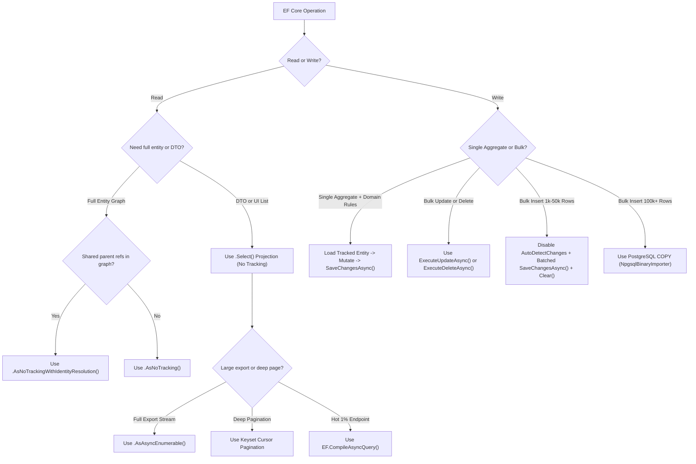
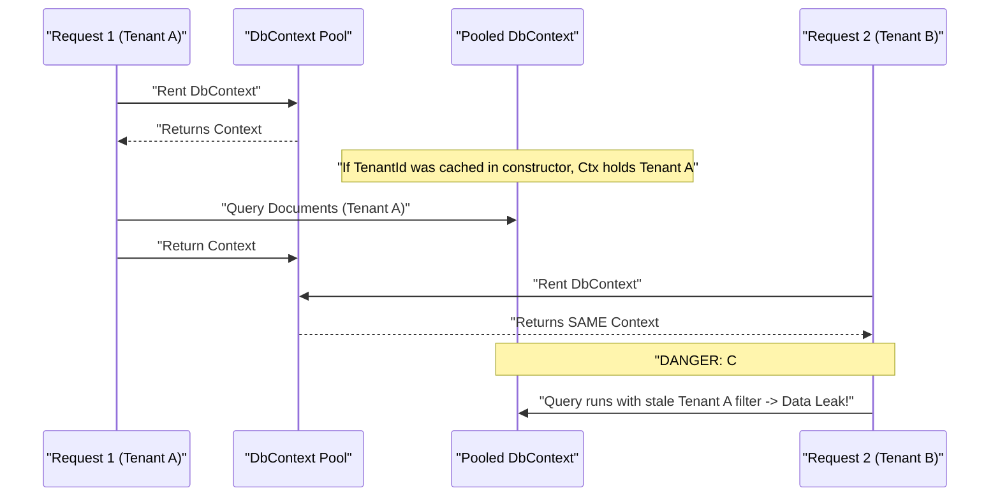
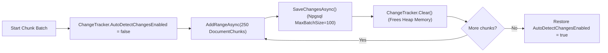
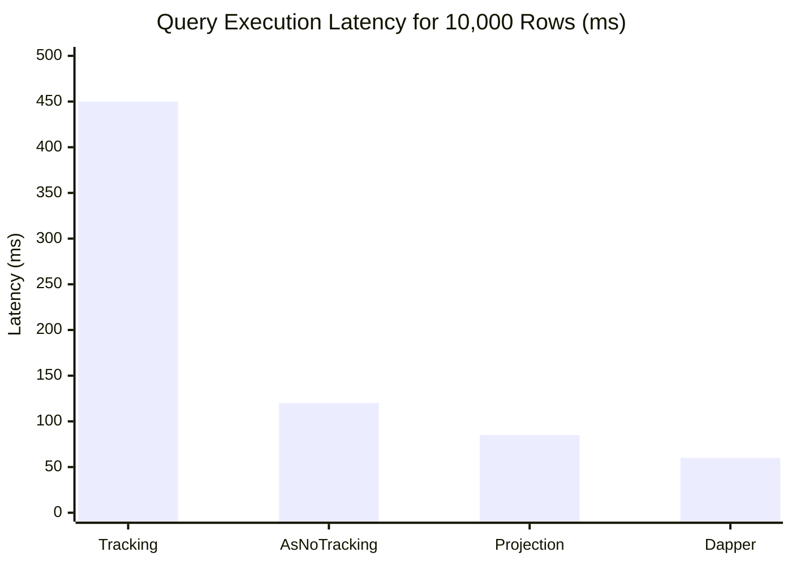

# Chapter 6: High-Performance EF Core

## 1. Learning Objectives

By the end of this chapter, you will be able to:
*   Identify and eliminate the architectural bottlenecks that cause EF Core to perform slowly in enterprise systems.
*   Master `AsNoTracking()`, `AsNoTrackingWithIdentityResolution()`, and `.Select()` projections—and understand their profound impact on Garbage Collection (GC), network payload, and memory allocation.
*   Apply Normora's EF Core `GroupBy` translation rule cleanly in aggregation queries.
*   Implement DbContext Pooling (`AddDbContextPool` / `AddPooledDbContextFactory`) safely in multi-tenant systems without leaking `ITenantContext` state across requests.
*   Utilize `ExecuteUpdateAsync` (including EF Core 10 non-expression `UpdateSettersBuilder` lambdas) and `ExecuteDeleteAsync` to perform set-based database mutations while respecting domain invariants and audit columns.
*   Design Compiled Queries (`EF.CompileAsyncQuery`) and Compiled Models (`dotnet ef dbcontext optimize`) to eliminate runtime expression-tree parsing and cold-start model-building overhead.
*   Execute high-volume ingestion via write batching (`MaxBatchSize`), `AutoDetectChangesEnabled = false`, and `ChangeTracker.Clear()`, and handle massive reads with `AsAsyncEnumerable()` and Keyset (Cursor) Pagination.

## 2. Introduction

"Entity Framework is slow." This is the most common myth in the .NET ecosystem, usually proclaimed by developers who are using it incorrectly.

Entity Framework Core is not inherently slow. However, it *is* an incredibly complex abstraction layer. It parses Expression Trees, generates Abstract Syntax Trees, manages a state machine (the Change Tracker), and performs Identity Resolution. All of these features provide massive developer productivity, but they require CPU cycles and allocate memory.

If you use the default EF Core behavior for a batch process that modifies 100,000 rows—or ingests thousands of 1536-dimensional `pgvector` embeddings in a worker like `Normora.Worker`—your application will crash with an Out-Of-Memory exception. If you use the default behavior for a public-facing API endpoint that receives 10,000 requests per second, your thread pool will starve and CPU usage will pin at 100%.

High-performance EF Core is about knowing exactly when to bypass these abstractions. An Architect knows how to turn off the Change Tracker, how to project only required columns, how to pool contexts safely in a multi-tenant modular monolith, and how to execute set-based SQL commands through the EF Core 10 pipeline. This chapter is the masterclass in making EF Core as fast as a Micro-ORM.

## 3. Core Concepts

### Tracking Overhead
By default, every entity returned by a LINQ query is tracked. This means EF Core allocates the entity, allocates a snapshot dictionary of its original property values (for change detection), and allocates an `EntityEntry` tracking object. This triples the memory footprint of the query and adds significant CPU time during materialization.

### Over-Fetching and Projections
Fetching a full entity loads every column defined in `IEntityTypeConfiguration<T>` across the wire from PostgreSQL into .NET memory—even if the UI only needs three fields. On tables with large `text`, `jsonb`, or `pgvector` embedding columns (like Normora's `DocumentChunk`), over-fetching wastes database disk I/O, network bandwidth, and C# heap allocations. **Projections** (`.Select()`) ask SQL for only the exact columns needed and bypass the Change Tracker automatically.

### DbContext Instantiation Overhead vs. Connection Pooling
Creating a `new DbContext()` is not free. It requires setting up internal services, reading configuration, and preparing the Change Tracker. In a system processing thousands of HTTP requests per second, creating and destroying thousands of `DbContext` instances creates Gen 0 Garbage Collection pressure. Note that **DbContext Pooling** reuses C# `DbContext` objects in RAM, which is distinct from **ADO.NET / Npgsql Connection Pooling**, which reuses TCP sockets to PostgreSQL.

### Set-Based Operations vs. Row-By-Agonizing-Row (RBAR)
If you need to increase the price of all products by 10% (or mark 5,000 expired invitations as revoked), doing this via the Change Tracker requires pulling all rows into memory, mutating each object, and generating thousands of individual `UPDATE` statements (**RBAR**: Row-By-Agonizing-Row). A set-based operation simply sends a single `UPDATE` or `DELETE` statement to the database.

### Query Compilation and Model Building Overhead
Translating a LINQ Expression Tree into SQL takes time. EF Core caches these translations, but checking the cache involves computing a hash of the query shape; for the hottest 1% of queries, **Compiled Queries** skip even the cache lookup. Similarly, on application startup, EF Core inspects `IEntityTypeConfiguration<T>` classes to build its runtime `IModel` metadata—**Compiled Models** pre-generate this metadata at build time to slash container cold-start latency.

### Write Batching and Memory Ceilings (`ChangeTracker.Clear()`)
When inserting thousands of new rows via `SaveChangesAsync()`, EF Core groups multiple `INSERT`/`UPDATE`/`DELETE` commands into fewer database roundtrips (**Command Batching**). However, EF Core keeps every inserted entity inside the Change Tracker until the `DbContext` is disposed, causing `DetectChanges()` to slow down quadratically ($O(N^2)$) unless you disable `AutoDetectChangesEnabled` and periodically call `ChangeTracker.Clear()`.

### Buffering vs. Streaming and Keyset Pagination
`ToListAsync()` **buffers** the entire result set into a C# `List<T>` before returning. `AsAsyncEnumerable()` **streams** rows one at a time over the network reader (`await foreach`), keeping memory constant ($O(1)$). Likewise, traditional offset pagination (`Skip(N).Take(M)`) forces PostgreSQL to scan and discard $N$ rows ($O(N)$), whereas **Keyset (Cursor) Pagination** seeks directly via a B-tree index ($O(\log N)$).

## 4. Visual Diagrams

```text
=============================================================================
             DBCONTEXT POOLING LIFECYCLE
=============================================================================

WITHOUT POOLING:
HTTP Request 1 ──▶ new DbContext() ──▶ Query ──▶ Dispose() ──▶ (Garbage Collected)
HTTP Request 2 ──▶ new DbContext() ──▶ Query ──▶ Dispose() ──▶ (Garbage Collected)
(High allocation, High GC pressure)

WITH POOLING:
[ DbContext Pool (Size: 1024) ]
   │
HTTP Request 1 ──▶ Rents Context A ──▶ Query ──▶ Returns to Pool (ChangeTracker.Clear())
HTTP Request 2 ──▶ Rents Context A ──▶ Query ──▶ Returns to Pool
(Zero allocation, Zero GC pressure for the context)
```

```text
=============================================================================
             CHANGE TRACKER UPDATE vs. EXECUTE UPDATE
=============================================================================
Goal: Mark 10,000 inactive chargers as "Faulted".

THE OLD WAY (Change Tracker):
1. SELECT * FROM Chargers WHERE IsActive = 0 
   (Network pulls 10,000 rows to C# RAM. Allocates 30,000 tracking objects).
2. foreach (c in chargers) c.Status = "Faulted";
3. SaveChanges() generates:
   UPDATE Chargers SET Status='Faulted' WHERE Id=1;
   UPDATE Chargers SET Status='Faulted' WHERE Id=2;
   ... 10,000 times. (Massive transaction log bloat, slow network).

THE NEW WAY (ExecuteUpdate EF7+):
1. context.Chargers.Where(c => c.IsActive == false).ExecuteUpdate(...)
   (Zero entities loaded into RAM. Zero tracking overhead).
2. Generates ONE statement: 
   UPDATE [c] SET [Status] = 'Faulted' FROM [Chargers] AS [c] WHERE [c].[IsActive] = 0;
   (Executes in 5 milliseconds on SQL Server).
```

### Decision Tree: Choosing the Right EF Core Pattern



### Multi-Tenant DbContext Pooling Isolation (Normora)



### Batched Ingestion Loop (`Normora.Worker` / `DocumentProcessingJob`)



## 5. API Deep Dive

### 5.1 `AsNoTracking()` and `AsNoTrackingWithIdentityResolution()`

* **What it is:** `AsNoTracking()` tells EF Core to materialize query results directly without registering them in the `ChangeTracker` or allocating original-value snapshot dictionaries. `AsNoTrackingWithIdentityResolution()` still skips the `ChangeTracker`, but maintains a short-lived lookup dictionary during that single query's materialization so duplicate parent references in a joined graph point to the same C# instance.
* **Why it matters:** Every tracked entity allocates roughly 2–3x more heap memory (`EntityEntry` + snapshot) and forces `DetectChanges()` to scan it if `SaveChangesAsync()` is later called on the same `DbContext`.
* **How to use it:**
```csharp
// EV Platform example: Change Tracker is bypassed completely.
var users = await context.Users
    .AsNoTracking()
    .Where(u => u.Role == "Admin")
    .ToListAsync();
```
*Rule:* If you are not going to call `SaveChangesAsync()`, you must use `AsNoTracking()`.

**`AsNoTrackingWithIdentityResolution()`:**
If you query a `Site` and its `Chargers` with standard `AsNoTracking()`, and two chargers belong to the same site, EF Core will create two duplicate `Site` objects in memory. `AsNoTrackingWithIdentityResolution()` fixes this: it bypasses the Change Tracker for updates, but maintains a temporary dictionary during materialization to ensure object graph references are deduplicated.

* **When NOT to use it:**
  * Do **not** use `AsNoTracking()` when you intend to mutate the loaded domain aggregate and persist changes via `SaveChangesAsync()` (EF Core will not know the entity changed unless you explicitly `.Update()`, which marks *all* columns dirty).
  * Do **not** rely on `AsNoTracking()` when you expect EF Core's **relationship fixup** to stitch together two separate queries in the same `DbContext` scope.
  * Prefer `.Select(...)` projections over `AsNoTracking()` when you only need a subset of columns (see Section 5.5).

#### Real-World Normora Examples (`5.1`)

1. **Listing Workspace Documents (`DocumentsDbContext`):**
```csharp
public sealed class GetDocumentsQueryHandler(DocumentsDbContext dbContext)
    : IRequestHandler<GetDocumentsQuery, IReadOnlyList<Document>>
{
    public async Task<IReadOnlyList<Document>> Handle(
        GetDocumentsQuery request, CancellationToken ct) =>
        await dbContext.Documents
            .AsNoTracking() // Global TenantId filter applies automatically
            .Where(d => d.DepartmentId == request.DepartmentId)
            .OrderByDescending(d => d.CreatedAt)
            .Take(50)
            .ToListAsync(ct);
}
```

2. **Loading Conversation Turns with Shared Citations (`ConversationsDbContext`):**
```csharp
// Multiple MessageCitations in one conversation often point to the same SavedAnswer or Conversation.
// AsNoTrackingWithIdentityResolution prevents duplicate parent instances in memory.
public sealed class GetConversationThreadHandler(ConversationsDbContext dbContext)
    : IRequestHandler<GetConversationThreadQuery, Conversation?>
{
    public async Task<Conversation?> Handle(
        GetConversationThreadQuery request, CancellationToken ct)
    {
        var conversation = await dbContext.Conversations
            .AsNoTrackingWithIdentityResolution()
            .Include(c => c.Messages)
                .ThenInclude(m => m.Citations)
            .FirstOrDefaultAsync(c => c.Id == request.ConversationId, ct);

        return conversation ?? throw new BolaException(); // 404 prevents ID enumeration
    }
}
```

3. **Reading Workspace Branding (`TenantsDbContext` — Explicit `TenantId` Filter):**
```csharp
// TenantsDbContext has NO global tenant filter, so TenantId must always be filtered explicitly.
public sealed class GetTenantBrandingHandler(TenantsDbContext dbContext)
    : IRequestHandler<GetTenantBrandingQuery, TenantBranding?>
{
    public async Task<TenantBranding?> Handle(
        GetTenantBrandingQuery request, CancellationToken ct) =>
        await dbContext.TenantBrandings
            .AsNoTracking()
            .FirstOrDefaultAsync(b => b.TenantId == request.TenantId, ct);
}
```

4. **Reading Audit Logs for the Admin Dashboard (`TenantsDbContext`):**
```csharp
var recentAudits = await tenantsDbContext.AuditLogs
    .AsNoTracking()
    .Where(a => a.TenantId == request.TenantId && a.CreatedAt >= sinceUtc)
    .OrderByDescending(a => a.CreatedAt)
    .Take(100)
    .ToListAsync(ct);
```

5. **Fetching Saved Answers for Copilot Suggestions (`ConversationsDbContext`):**
```csharp
var savedAnswers = await conversationsDbContext.SavedAnswers
    .AsNoTracking()
    .Where(s => s.ExternalUserId == currentUser.ExternalUserId)
    .OrderByDescending(s => s.UpdatedAt)
    .ToListAsync(ct);
```

---

### 5.2 DbContext Pooling and Connection Management

* **What it is:** `AddDbContextPool<T>()` keeps a pool of pre-constructed `DbContext` instances in memory. Instead of allocating a new `DbContext` and rebuilding its internal service graph on every request, ASP.NET Core rents an idle instance and resets its EF-managed state (`ChangeTracker.Clear()`) upon return.
* **Why it matters:** Under high request concurrency (thousands of requests/sec), eliminating `DbContext` object graph allocations reduces Gen 0 GC pauses.
* **DbContext Pooling vs. Connection Pooling:** Do not confuse the two!
  * **Npgsql / ADO.NET Connection Pooling** pools underlying PostgreSQL TCP connections (`NpgsqlDataSource`) and is enabled by default.
  * **EF Core DbContext Pooling** pools C# `DbContext` wrapper instances in RAM.
* **How to use it:** Configured in `Program.cs` or a module's `*ModuleExtensions.cs`:
```csharp
// EV Platform example: Replaces AddDbContext for stateless DbContexts
builder.Services.AddDbContextPool<EvDbContext>(options =>
{
    options.UseSqlServer(connectionString);
}, poolSize: 1024); // Default max retained instances is 1024.
```

> [!WARNING]
> **Multi-Tenant Pooling Trap:** `AddDbContextPool<T>` **forbids** injecting scoped DI services (such as `ITenantContext`) into the `DbContext` constructor—EF Core throws an `InvalidOperationException` at startup, or if state is stored in custom C# fields, `ChangeTracker.Clear()` will **not** reset them, causing catastrophic cross-tenant leaks. Furthermore, `IHttpContextAccessor` is `null` inside background workers like `Normora.Worker`. If a `DbContext` binds global query filters to a scoped `ITenantContext`, either keep `AddDbContext<T>()` (the instantiation cost is microseconds compared to PostgreSQL network I/O) or use `AddPooledDbContextFactory<T>()` and set a stateless `TenantId` property (or `AsyncLocal<Guid>`) per rented instance before querying.

* **When NOT to use it:**
  * Do **not** use `AddDbContextPool<T>` on `DbContext` types whose constructors depend on scoped DI services (`ITenantContext`, `ICurrentUserService`).
  * Do **not** use it in short-lived CLI processes like Normora's ephemeral `--migrate` host (`MigrationHostExtensions.RunMigrationsAsync`), where pooling adds lock/pool overhead with zero reuse benefit.
  * Do **not** expect massive speedups in low-traffic apps; pooling overhead only pays off under high sustained concurrency.

#### Real-World Normora Examples (`5.2`)

1. **Safely Pooling `TenantsDbContext` (Unscoped Root Context):**
```csharp
// TenantsDbContext has NO global ITenantContext query filter, making it stateless and safe to pool.
services.AddDbContextPool<TenantsDbContext>(options =>
    options.UseNpgsql(connectionString, npgsql =>
        npgsql.MigrationsHistoryTable("__EFMigrationsHistory", "tenants")),
    poolSize: 256);
```

2. **Scoped Registration for `DocumentsDbContext` (Tenant-Filtered Context):**
```csharp
// DocumentsDbContext injects scoped ITenantContext for its global query filter:
// modelBuilder.Entity<Document>().HasQueryFilter(d => d.TenantId == _tenantContext.TenantId);
// Keep AddDbContext (scoped) so _tenantContext is guaranteed isolated per HTTP request.
services.AddDbContext<DocumentsDbContext>((sp, options) =>
    options.UseNpgsql(connectionString, npgsql =>
        npgsql.UseVector()
              .MigrationsHistoryTable("__EFMigrationsHistory", "documents")));
```

3. **Pooled Factory in `Normora.Worker` (`DocumentProcessingJob`):**
```csharp
// In Normora.Worker (no HttpContext!), a pooled factory + explicit tenant setter gives both
// pooling performance and strict tenant isolation per Hangfire job.
public sealed class DocumentProcessingJob(IDbContextFactory<DocumentsDbContext> dbFactory)
{
    public async Task ExecuteAsync(Guid tenantId, Guid documentId, CancellationToken ct)
    {
        await using var dbContext = await dbFactory.CreateDbContextAsync(ct);
        dbContext.SetTenantScope(tenantId); // Custom resettable scope cleared on Dispose/Return
        // Process chunks safely for this tenantId...
    }
}
```

4. **Shared `NpgsqlDataSource` Connection Pooling (`DatabaseServiceExtensions.cs`):**
```csharp
// Pool PostgreSQL TCP connections + pgvector type mappings once at startup across all modules.
var dataSourceBuilder = new NpgsqlDataSourceBuilder(connectionString);
dataSourceBuilder.UseVector();
var dataSource = dataSourceBuilder.Build();
services.AddSingleton(dataSource);
```

5. **Non-Pooled Ephemeral `--migrate` Host (`MigrationHostExtensions.RunMigrationsAsync`):**
```csharp
// During `dotnet Normora.Api.dll --migrate`, each IDatabaseMigrator runs once and exits.
// Plain AddDbContext avoids retaining pool structures before clean process teardown.
services.AddDbContext<ConversationsDbContext>(options =>
    options.UseNpgsql(connectionString));
```

---

### 5.3 `ExecuteUpdate` and `ExecuteDelete` (EF Core 7–10)

* **What it is:** Set-based bulk mutation APIs introduced in EF Core 7 and enhanced in EF Core 10. They translate a LINQ `Where` predicate and property setters directly into a single SQL `UPDATE` or `DELETE` statement executed immediately against the database, **bypassing the Change Tracker and `SaveChangesAsync()`**.
* **Why it matters:** Eliminates loading entities into RAM and prevents N-roundtrip RBAR updates when mutating hundreds or millions of rows.
* **EF Core 10 Upgrade (`UpdateSettersBuilder` Non-Expression Lambdas):** Prior to EF Core 10, `ExecuteUpdateAsync` strictly required an expression tree (`Expression<Func<SetPropertyCalls<T>, SetPropertyCalls<T>>>`), making conditional `if` statements inside the setter impossible without manual `Expression.Call` trees. **In EF Core 10**, `ExecuteUpdateAsync` accepts a standard C# delegate (`Action<UpdateSettersBuilder<T>>`), letting you write normal `if` control flow directly inside the lambda!
* **How to use it:**
```csharp
// EV Platform example: UPDATE
await context.Chargers
    .Where(c => c.FirmwareVersion == "1.0")
    .ExecuteUpdateAsync(s => s.SetProperty(c => c.FirmwareVersion, "1.1"));

// EV Platform example: DELETE
await context.Sessions
    .Where(s => s.Date < DateTime.UtcNow.AddYears(-5))
    .ExecuteDeleteAsync();
```

* **When NOT to use it:**
  * Do **not** use `ExecuteUpdateAsync` when single-entity mutations require **domain invariant checks** or **Domain Events** stored on the aggregate root.
  * Do **not** assume `SaveChangesInterceptors` (like automatic `UpdatedAt` auditing or outbox dispatchers) will run—they are **silently bypassed**; you must set audit columns explicitly.
  * Do **not** run unbounded `ExecuteUpdateAsync` / `ExecuteDeleteAsync` on 1M+ rows in a single call on live tables—it can escalate row locks and time out (chunk with `.OrderBy(...).Take(batchSize)` in a loop instead).
  * Remember that **Global Query Filters** (`TenantId`, `IsDeleted`) *are* automatically applied to `ExecuteUpdateAsync` / `ExecuteDeleteAsync` unless `.IgnoreQueryFilters()` is called.

#### Real-World Normora Examples (`5.3`)

1. **Recovering Stuck Ingestion Jobs (`DocumentsDbContext`):**
```csharp
// Marks stuck documents as Failed and manually sets UpdatedAt (interceptors are bypassed).
var cutoffUtc = DateTime.UtcNow.AddMinutes(-30);
var failedCount = await documentsDbContext.Documents
    .Where(d => d.Status == DocumentStatus.Processing && d.UpdatedAt < cutoffUtc)
    .ExecuteUpdateAsync(s => s
        .SetProperty(d => d.Status, DocumentStatus.Failed)
        .SetProperty(d => d.FailureMessage, ApiMessages.DocumentProcessingFailed)
        .SetProperty(d => d.UpdatedAt, DateTime.UtcNow), ct);
```

2. **Purging Expired HITL Approvals (`ConversationsDbContext`):**
```csharp
// PendingApproval rows expire after a 15-minute TTL. Delete in one SQL statement.
var nowUtc = DateTime.UtcNow;
await conversationsDbContext.PendingApprovals
    .IgnoreQueryFilters() // Cross-tenant background cleanup job
    .Where(p => p.ExpiresAtUtc < nowUtc)
    .ExecuteDeleteAsync(ct);
```

3. **EF Core 10 Conditional Bulk Update (`TenantsDbContext` with `UpdateSettersBuilder`):**
```csharp
// EF Core 10 allows standard C# `if` blocks inside ExecuteUpdateAsync!
// TenantsDbContext has no global filter, so explicit TenantId filtering is mandatory.
await tenantsDbContext.TenantInvitations
    .Where(i => i.TenantId == request.TenantId && i.Status == InvitationStatus.Pending)
    .ExecuteUpdateAsync(s =>
    {
        s.SetProperty(i => i.Status, InvitationStatus.Revoked);
        s.SetProperty(i => i.UpdatedAt, DateTime.UtcNow);

        if (request.RevocationReason is not null)
        {
            s.SetProperty(i => i.Notes, request.RevocationReason);
        }
    }, ct);
```

4. **Revoking Expired Invitations (`TenantsDbContext`):**
```csharp
await tenantsDbContext.TenantInvitations
    .Where(i => i.TenantId == request.TenantId && i.ExpiresAtUtc < DateTime.UtcNow)
    .ExecuteDeleteAsync(ct);
```

5. **Bulk Department Reassignment After BOLA Check (`DocumentsDbContext`):**
```csharp
// Verify target department belongs to this tenant first (BOLA -> 404 if missing)
var targetExists = await documentsDbContext.Departments
    .AsNoTracking()
    .AnyAsync(dep => dep.Id == request.TargetDepartmentId, ct);
if (!targetExists) throw new BolaException();

await documentsDbContext.Documents
    .Where(d => d.DepartmentId == request.SourceDepartmentId)
    .ExecuteUpdateAsync(s => s
        .SetProperty(d => d.DepartmentId, request.TargetDepartmentId)
        .SetProperty(d => d.UpdatedAt, DateTime.UtcNow), ct);
```

---

### 5.4 Compiled Queries (`EF.CompileAsyncQuery`)

* **What it is:** A static delegate generated once via `EF.CompileAsyncQuery(...)` that pre-compiles the LINQ Expression Tree into an execution plan, skipping expression-tree hashing and query-cache lookup on every call.
* **Why it matters:** For ultra-hot endpoints executed thousands of times per second (auth checks, tenant resolution, rate-limit lookups), avoiding repeated expression-tree compilation and cache lookup shaves CPU microseconds and allocations off every request.
* **How to use it:**
```csharp
// EV Platform example: Define a static, compiled query delegate
private static readonly Func<EvDbContext, string, Task<User?>> GetUserByApiKey =
    EF.CompileAsyncQuery((EvDbContext context, string apiKey) =>
        context.Users.AsNoTracking().FirstOrDefault(u => u.ApiKey == apiKey));

// Usage in Repository
public async Task<User?> AuthenticateAsync(string apiKey)
{
    // Bypasses Expression Tree parsing and cache lookup entirely!
    return await GetUserByApiKey(_context, apiKey); 
}
```
> [!NOTE]
> Inside `EF.CompileAsyncQuery`, single-result operators like `FirstOrDefault` or `SingleOrDefault` are written synchronously (no `Async` suffix), and the returned delegate produces a `Task<T>`. Sequence queries omit `.ToListAsync()` and return `IAsyncEnumerable<T>`.

* **When NOT to use it:**
  * Do **not** use Compiled Queries for dynamic filters (e.g., optional search text, variable sort columns, or conditional `.Where()` clauses)—each shape needs its own static delegate.
  * Do **not** return anonymous types (they cannot appear in a `static readonly Func<...>` signature); project into a named DTO/record instead.
  * Do **not** compile queries that run infrequently (like admin exports); the gain is negligible and hurts readability.

#### Real-World Normora Examples (`5.4`)

1. **Hot-Path Tenant Resolution by Slug (`TenantsDbContext`):**
```csharp
private static readonly Func<TenantsDbContext, string, CancellationToken, Task<TenantDto?>>
    GetTenantBySlugCompiled = EF.CompileAsyncQuery(
        (TenantsDbContext db, string slug, CancellationToken ct) =>
            db.Tenants
                .AsNoTracking()
                .Where(t => t.Slug == slug && t.IsActive)
                .Select(t => new TenantDto(t.Id, t.Slug, t.Name))
                .FirstOrDefault());
```

2. **Per-Request Membership & RBAC Check (`TenantsDbContext` using `ExternalUserId`):**
```csharp
// Explicit TenantId filter required on TenantsDbContext; uses ExternalUserId (never vendor-specific names)
private static readonly Func<TenantsDbContext, Guid, string, CancellationToken, Task<string?>>
    GetMemberRoleCompiled = EF.CompileAsyncQuery(
        (TenantsDbContext db, Guid tenantId, string externalUserId, CancellationToken ct) =>
            db.TenantMemberships
                .AsNoTracking()
                .Where(m => m.TenantId == tenantId && m.ExternalUserId == externalUserId)
                .Select(m => m.Role)
                .FirstOrDefault());
```

3. **Fast BOLA Ownership Lookup (`DocumentsDbContext`):**
```csharp
private static readonly Func<DocumentsDbContext, Guid, CancellationToken, Task<Guid?>>
    GetDocumentDepartmentIdCompiled = EF.CompileAsyncQuery(
        (DocumentsDbContext db, Guid documentId, CancellationToken ct) =>
            db.Documents
                .AsNoTracking()
                .Where(d => d.Id == documentId)
                .Select(d => (Guid?)d.DepartmentId)
                .FirstOrDefault());
```

4. **Streaming Chunk Metadata for a `DocumentVersion` (`IAsyncEnumerable<T>`):**
```csharp
private static readonly Func<DocumentsDbContext, Guid, IAsyncEnumerable<ChunkSummaryDto>>
    StreamChunksByVersionCompiled = EF.CompileAsyncQuery(
        (DocumentsDbContext db, Guid versionId) =>
            db.DocumentChunks
                .AsNoTracking()
                .Where(c => c.DocumentVersionId == versionId)
                .OrderBy(c => c.ChunkIndex)
                .Select(c => new ChunkSummaryDto(c.Id, c.ChunkIndex, c.Breadcrumb)));
```

5. **Checking Active Subscription Tier Limits Before AI Generation (`TenantsDbContext`):**
```csharp
private static readonly Func<TenantsDbContext, Guid, CancellationToken, Task<TenantPlanTier?>>
    GetTenantTierCompiled = EF.CompileAsyncQuery(
        (TenantsDbContext db, Guid tenantId, CancellationToken ct) =>
            db.TenantPlans
                .AsNoTracking()
                .Where(p => p.TenantId == tenantId)
                .Select(p => (TenantPlanTier?)p.Tier)
                .FirstOrDefault());
```

---

### 5.5 Projections (`.Select()`), Avoiding Over-Fetching, and Normora's `GroupBy` Rule

* **What it is:** Projecting directly in LINQ via `.Select(x => new MyDto(...))` instructs EF Core to emit a SQL `SELECT col1, col2` containing *only* the requested columns and to instantiate the DTO directly—skipping entity materialization and Change Tracker registration completely (even without `.AsNoTracking()`).
* **Why it matters:** Even with `.AsNoTracking()`, selecting a whole entity still drags every column over the network. In PostgreSQL + `pgvector` tables like `DocumentChunks`, loading an entire entity pulls a 768- or 1536-float vector array (`~6 KB` per row) and full extracted text even when the UI only needs a title and status!
* **How to use it:**
  * Always place `.Select(...)` **before** `.ToListAsync()` / `.FirstOrDefaultAsync()`.
  * **Normora's `GroupBy` Translation Rule (`AGENTS.md`):** When aggregating with `GroupBy(...)`, **always** project to an **anonymous type first** (e.g., `.Select(g => new { Status = g.Key, Count = g.Count() })`), materialize with `.ToListAsync()`, and then map in memory to C# `record`s or DTOs. Direct instantiation of parameterized constructors inside `GroupBy().Select(...)` fails EF Core relational translation and throws an `InvalidOperationException` (mapped to HTTP 400).
* **When NOT to use it:**
  * Do **not** use projections when you need the Domain Entity / Aggregate Root to execute business behavior and persist state via `SaveChangesAsync()`.
  * Do **not** call C# helper methods or non-translatable constructors inside `.Select(...)` on `IQueryable`—translate scalar fields first, then format in memory.

#### Real-World Normora Examples (`5.5`)

1. **Document Grid Projection Skipping `ExtractedText` and `Embedding` (`DocumentsDbContext`):**
```csharp
public sealed class ListDocumentSummariesHandler(DocumentsDbContext dbContext)
    : IRequestHandler<ListDocumentSummariesQuery, IReadOnlyList<DocumentSummaryDto>>
{
    public async Task<IReadOnlyList<DocumentSummaryDto>> Handle(
        ListDocumentSummariesQuery request, CancellationToken ct) =>
        await dbContext.Documents
            .AsNoTracking()
            .Where(d => d.DepartmentId == request.DepartmentId)
            .OrderByDescending(d => d.CreatedAt)
            .Select(d => new DocumentSummaryDto(d.Id, d.FileName, d.Status, d.CreatedAt))
            .Take(50)
            .ToListAsync(ct);
}
```

2. **Hybrid Retrieval Projection Returning Only Rag-Needed Fields (`DocumentsDbContext`):**
```csharp
// Skips raw binary metadata and pulls only chunk text, breadcrumb, and pgvector cosine distance.
var candidates = await documentsDbContext.DocumentChunks
    .AsNoTracking()
    .Where(c => request.AllowedDepartmentIds.Contains(c.DepartmentId))
    .OrderBy(c => c.Embedding.CosineDistance(request.QueryVector))
    .Take(20)
    .Select(c => new RetrievalCandidateDto(
        c.Id,
        c.DocumentId,
        c.Breadcrumb,
        c.Content,
        c.Embedding.CosineDistance(request.QueryVector)))
    .ToListAsync(ct);
```

3. **Normora `GroupBy` Rule for Document Status Metrics (`DocumentsDbContext`):**
```csharp
// Step 1: Project GroupBy to an ANONYMOUS type in SQL (never a parameterized record constructor!)
var rawCounts = await documentsDbContext.Documents
    .AsNoTracking()
    .GroupBy(d => d.Status)
    .Select(g => new { Status = g.Key, Count = g.Count() })
    .ToListAsync(ct);

// Step 2: Project in memory to the strongly-typed C# record DTO
var metrics = rawCounts
    .Select(x => new DocumentStatusMetricDto(x.Status, x.Count))
    .ToList();
```

4. **Workspace Dashboard Role Counts (`TenantsDbContext` + Explicit `TenantId` + `GroupBy` Rule):**
```csharp
var rawRoleStats = await tenantsDbContext.TenantMemberships
    .AsNoTracking()
    .Where(m => m.TenantId == request.TenantId)
    .GroupBy(m => m.Role)
    .Select(g => new { Role = g.Key, MemberCount = g.Count() })
    .ToListAsync(ct);

var roleStats = rawRoleStats
    .Select(r => new RoleBreakdownDto(r.Role, r.MemberCount))
    .ToList();
```

5. **Conversation List with Correlated Message Count Subquery (`ConversationsDbContext`):**
```csharp
// Projects c.Messages.Count() as a SQL scalar subquery instead of Include(c => c.Messages)!
var threads = await conversationsDbContext.Conversations
    .AsNoTracking()
    .Where(c => c.ExternalUserId == currentUser.ExternalUserId)
    .OrderByDescending(c => c.UpdatedAt)
    .Select(c => new ConversationListItemDto(
        c.Id,
        c.Title,
        c.Messages.Count,
        c.UpdatedAt))
    .Take(30)
    .ToListAsync(ct);
```

---

### 5.6 Compiled Models (`dotnet ef dbcontext optimize`)

* **What it is:** A build-time code generation step that turns your `OnModelCreating` and `IEntityTypeConfiguration<T>` classes into static, pre-computed C# model metadata (`{ContextName}Model.cs`), registered via `options.UseModel({ContextName}Model.Instance)`.
* **Why it matters:** On cold start, EF Core spends tens to hundreds of milliseconds reflecting over entities, running conventions, and validating configurations to build its runtime `IModel`. In containerized scale-out (`Normora.Api`, `Normora.Worker`) and ephemeral CLI jobs (`dotnet Normora.Api.dll --migrate`), Compiled Models slash startup latency and reduce startup memory allocations.
* **How to use it:**
  ```powershell
  dotnet ef dbcontext optimize `
    --context DocumentsDbContext `
    --output-dir Persistence/CompiledModels `
    --namespace Normora.Modules.Documents.Persistence.CompiledModels
  ```
  Then register in `UseNpgsql(...)`:
  ```csharp
  options.UseModel(DocumentsDbContextModel.Instance);
  ```
* **When NOT to use it:**
  * Do **not** use Compiled Models if `OnModelCreating` dynamically alters the schema or table mappings at runtime based on environment variables or tenant config (global query filters bound to `_tenantContext.TenantId` *are* fine if bound via instance property access, though verify generated code).
  * Do **not** forget to re-run `dotnet ef dbcontext optimize` whenever you modify an entity or `IEntityTypeConfiguration<T>`—stale compiled models cause runtime mapping mismatches or silent omissions!
  * Skip during rapid early schema prototyping where entities change hourly.

#### Real-World Normora Examples (`5.6`)

1. **Pre-Compiling `DocumentsDbContextModel` for Container Scale-Out:**
```csharp
// server/Modules/Documents/DocumentsModuleExtensions.cs
services.AddDbContext<DocumentsDbContext>(options =>
    options.UseNpgsql(connectionString, npgsql => npgsql.UseVector())
           .UseModel(DocumentsDbContextModel.Instance));
```

2. **Pre-Compiling `TenantsDbContextModel` Alongside Pooling:**
```csharp
// Combines Compiled Model (fast cold start) with DbContext Pooling (zero steady-state allocation).
services.AddDbContextPool<TenantsDbContext>(options =>
    options.UseNpgsql(connectionString)
           .UseModel(TenantsDbContextModel.Instance));
```

3. **Pre-Compiling `ConversationsDbContextModel` for `Normora.Worker`:**
```csharp
// Every Hangfire worker pod starts faster when all 3 module models are pre-compiled.
services.AddDbContext<ConversationsDbContext>(options =>
    options.UseNpgsql(connectionString)
           .UseModel(ConversationsDbContextModel.Instance));
```

4. **Faster Ephemeral `--migrate` Execution (`MigrationHostExtensions.RunMigrationsAsync`):**
```csharp
// When running `dotnet Normora.Api.dll --migrate` in CI/CD before rolling pods,
// compiled models avoid runtime model discovery across all 4 sequential migrators.
```

5. **CI Guardrail Script Detecting Stale Compiled Models:**
```powershell
# In CI pipeline: regenerate compiled models and fail if git diff detects un-committed model drift.
dotnet ef dbcontext optimize --context TenantsDbContext --project server/Modules/Tenants
```

---

### 5.7 Write Batching, `AutoDetectChangesEnabled`, and `ChangeTracker.Clear()`

* **What it is:**
  * **Automatic Command Batching:** When `SaveChangesAsync()` flushes multiple inserts/updates/deletes, EF Core + Npgsql automatically packs them into batched SQL commands per network roundtrip (controlled by `MaxBatchSize`).
  * **`AutoDetectChangesEnabled = false`:** Prevents `AddRangeAsync` or loop mutations from triggering an $O(N)$ `DetectChanges()` scan across all tracked entities on every iteration (which otherwise turns a 5,000-row loop into $O(N^2)$ CPU work).
  * **`ChangeTracker.Clear()`:** Detaches all tracked entities immediately after each batch `SaveChangesAsync()` so the heap stays flat during large imports.
* **Why it matters:** Without batching + clearing, inserting 10,000 `DocumentChunk` rows with `pgvector` embeddings balloons memory and slows each `Add()` exponentially.
* **How to use it:** Keep batches around 100–500 rows, disable `AutoDetectChangesEnabled` inside a `try/finally` block, call `SaveChangesAsync()`, and immediately call `ChangeTracker.Clear()`.
* **When NOT to use it:**
  * Do **not** disable `AutoDetectChangesEnabled` if your code modifies tracked properties and expects `SaveChangesAsync()` to auto-detect them *without* calling `ChangeTracker.DetectChanges()` manually first.
  * Do **not** call `ChangeTracker.Clear()` mid-request if later code in the same handler expects previously loaded entities to remain tracked.
  * For **100,000+ rows** of pure bulk append (e.g., massive data backfills), drop below EF Core to PostgreSQL's binary `COPY` protocol (`NpgsqlConnection.BeginBinaryImportAsync`).

#### Real-World Normora Examples (`5.7`)

1. **Chunk & Embedding Ingestion in `DocumentProcessingJob` (`Normora.Worker`):**
```csharp
public async Task PersistChunksAsync(
    DocumentsDbContext db, IReadOnlyList<DocumentChunk> chunks, CancellationToken ct)
{
    const int batchSize = 250;
    var previousDetect = db.ChangeTracker.AutoDetectChangesEnabled;
    db.ChangeTracker.AutoDetectChangesEnabled = false;

    try
    {
        foreach (var batch in chunks.Chunk(batchSize))
        {
            await db.DocumentChunks.AddRangeAsync(batch, ct);
            await db.SaveChangesAsync(ct);
            db.ChangeTracker.Clear(); // Releases chunk + 1536-dim Vector memory immediately
        }
    }
    finally
    {
        db.ChangeTracker.AutoDetectChangesEnabled = previousDetect;
    }
}
```

2. **Tuning Npgsql `MaxBatchSize` for Vector Chunks (`DocumentsDbContext`):**
```csharp
services.AddDbContext<DocumentsDbContext>(options =>
    options.UseNpgsql(connectionString, npgsql =>
    {
        npgsql.UseVector();
        npgsql.MaxBatchSize(100); // Caps SQL batch size to avoid huge parameter packets with vectors
    }));
```

3. **Bulk-Assigning `UserGroup` Memberships (`TenantsDbContext`):**
```csharp
// Adding 500 imported employees to a department UserGroup in one SaveChangesAsync batch
await tenantsDbContext.UserGroupMemberships.AddRangeAsync(newMemberships, ct);
await tenantsDbContext.SaveChangesAsync(ct);
tenantsDbContext.ChangeTracker.Clear();
```

4. **Saving Multiple RAG Citations in One Roundtrip (`ConversationsDbContext`):**
```csharp
// One RAG response may cite 8-12 chunks; EF Core batches all MessageCitation INSERTs into 1 roundtrip.
await conversationsDbContext.MessageCitations.AddRangeAsync(citations, ct);
await conversationsDbContext.SaveChangesAsync(ct);
```

5. **Atomic Outbox Batching on Document Upload (`UploadDocumentCommandHandler`):**
```csharp
// Document + DocumentVersion + DocumentProcessingOutboxMessage commit in ONE single transaction
// and ONE batched SaveChangesAsync roundtrip—never call ChangeTracker.Clear() before commit!
documentsDbContext.Documents.Add(document);
documentsDbContext.DocumentVersions.Add(version);
documentsDbContext.DocumentProcessingOutboxMessages.Add(outboxMessage);
await documentsDbContext.SaveChangesAsync(ct);
```

---

### 5.8 Streaming (`AsAsyncEnumerable`) and Keyset Pagination

* **What it is:**
  * **Streaming (`AsAsyncEnumerable()`):** Returns an `IAsyncEnumerable<T>` that reads rows one by one from the PostgreSQL `NpgsqlDataReader` via `await foreach`, keeping memory constant instead of allocating a giant `List<T>` via `ToListAsync()`.
  * **Keyset (Cursor) Pagination:** Replaces `Skip(offset).Take(pageSize)` with a `Where` comparison against the last seen sort key (e.g., `(CreatedAt, Id)`), allowing PostgreSQL to use a B-tree index seek rather than scanning and discarding thousands of prior rows.
* **Why it matters:** `OFFSET 100000 LIMIT 50` forces PostgreSQL to read and throw away 100,000 rows on every page turn ($O(N)$). Keyset pagination takes ~1 ms even at row 10,000,000 ($O(\log N)$). Meanwhile, `AsAsyncEnumerable()` prevents Out-Of-Memory crashes when exporting or re-indexing tens of thousands of records.
* **How to use it:** Ensure a deterministic composite tie-breaker (like `(CreatedAt, Id)`) backed by a composite B-tree index (`HasIndex(x => new { x.TenantId, x.CreatedAt, x.Id })`).
* **When NOT to use it:**
  * Do **not** use Keyset Pagination when the UI strictly requires jumping to arbitrary page numbers ("Go to Page 42")—in those cases, cap max `Skip` depth or rethink the UX.
  * Do **not** keep a streaming `AsAsyncEnumerable()` reader open across slow external HTTP calls (like calling Gemini per row) without buffering small batches, or you will hold a PostgreSQL connection and snapshot open too long!

#### Real-World Normora Examples (`5.8`)

1. **Keyset Pagination on `AuditLogs` (`TenantsDbContext`):**
```csharp
// Composite cursor (CursorCreatedAt, CursorId) guarantees deterministic ordering without OFFSET scans.
var page = await tenantsDbContext.AuditLogs
    .AsNoTracking()
    .Where(a => a.TenantId == request.TenantId)
    .Where(a => request.CursorCreatedAt == null ||
                a.CreatedAt < request.CursorCreatedAt ||
                (a.CreatedAt == request.CursorCreatedAt && a.Id.CompareTo(request.CursorId!.Value) < 0))
    .OrderByDescending(a => a.CreatedAt)
    .ThenByDescending(a => a.Id)
    .Select(a => new AuditLogDto(a.Id, a.Action, a.ExternalUserId, a.CreatedAt))
    .Take(50)
    .ToListAsync(ct);
```

2. **Infinite-Scroll Chat History (`ConversationsDbContext.Messages`):**
```csharp
var olderMessages = await conversationsDbContext.Messages
    .AsNoTracking()
    .Where(m => m.ConversationId == request.ConversationId)
    .Where(m => request.BeforeCreatedAt == null || m.CreatedAt < request.BeforeCreatedAt)
    .OrderByDescending(m => m.CreatedAt)
    .Select(m => new ChatMessageDto(m.Id, m.Role, m.Content, m.CreatedAt))
    .Take(25)
    .ToListAsync(ct);
```

3. **Streaming Chunks for Re-Embedding Without OOM (`DocumentsDbContext`):**
```csharp
await foreach (var chunk in documentsDbContext.DocumentChunks
    .AsNoTracking()
    .Where(c => c.DocumentVersionId == versionId)
    .OrderBy(c => c.ChunkIndex)
    .Select(c => new ChunkTextDto(c.Id, c.Breadcrumb, c.Content))
    .AsAsyncEnumerable()
    .WithCancellation(ct))
{
    buffer.Add(chunk);
    if (buffer.Count == 100) // Batch to Gemini batchEmbedContents (max 100 chunks/call)
    {
        await ProcessBatchAsync(buffer, ct);
        buffer.Clear();
    }
}
```

4. **Streaming Audit Log CSV Export (`Normora` Compliance Endpoint):**
```csharp
await foreach (var entry in tenantsDbContext.AuditLogs
    .AsNoTracking()
    .Where(a => a.TenantId == request.TenantId && a.CreatedAt >= request.FromUtc)
    .OrderBy(a => a.CreatedAt)
    .Select(a => new AuditExportRow(a.CreatedAt, a.ExternalUserId, a.Action))
    .AsAsyncEnumerable()
    .WithCancellation(ct))
{
    await csvWriter.WriteLineAsync($"{entry.CreatedAt:O},{entry.ExternalUserId},{entry.Action}");
}
```

5. **Keyset Pagination on Large Knowledge Bases (`DocumentsDbContext`):**
```csharp
var docs = await documentsDbContext.Documents
    .AsNoTracking()
    .Where(d => request.CursorCreatedAt == null ||
                d.CreatedAt < request.CursorCreatedAt ||
                (d.CreatedAt == request.CursorCreatedAt && d.Id.CompareTo(request.CursorId!.Value) < 0))
    .OrderByDescending(d => d.CreatedAt)
    .ThenByDescending(d => d.Id)
    .Select(d => new DocumentSummaryDto(d.Id, d.FileName, d.Status, d.CreatedAt))
    .Take(40)
    .ToListAsync(ct);
```

---

### 5.9 Query Plan Caching, Parameterization, and Observability Overhead

* **What it is:** EF Core hashes the LINQ expression tree to cache compiled SQL translations in memory, and PostgreSQL caches server-side query plans. How you pass variables, filter lists, and configure logging directly determines whether those caches hit or thrash.
* **Why it matters:**
  * Passing **constants** instead of local variables (or dynamically concatenating `FromSqlRaw` strings) generates a brand-new cache entry per value, bloating RAM and forcing repeated SQL compilation.
  * Calling `.ToLower()` on a column inside `.Where(x => x.Email.ToLower() == email)` prevents PostgreSQL from using a standard B-tree index on `Email`.
  * Leaving EF Core `Information`-level SQL logging (`RelationalEventId.CommandExecuted`) enabled in production serializes every query and parameter string under load, crushing throughput.
* **How to use it:**
  * Always capture runtime values in variables (`var slug = request.Slug;`) so EF Core parameterizes them (`@__slug_0`).
  * In **EF Core 10**, `.Contains(id)` on collections uses improved parameterization strategies (parameterized scalars / provider array translation) for better PostgreSQL query-planner cardinality estimates without blowing up the query cache.
  * Set EF Core logging to `Warning` in production `appsettings.json`, relying on OpenTelemetry traces/metrics for slow-query observability instead of per-command text formatting.
* **When NOT to use it:**
  * Do **not** manually call `EF.Constant(...)` unless you specifically *want* a constant inlined into SQL to unlock a PostgreSQL partial index (e.g., `WHERE is_active = true`).

#### Real-World Normora Examples (`5.9`)

1. **Parameterized Lookup Preserving One Plan Across All Tenants (`TenantsDbContext`):**
```csharp
// Local variable `tenantId` becomes @__tenantId_0 in SQL; one compiled plan serves all tenants.
var tenantId = request.TenantId;
var plan = await tenantsDbContext.TenantPlans
    .AsNoTracking()
    .FirstOrDefaultAsync(p => p.TenantId == tenantId, ct);
```

2. **Collection Filtering with EF Core 10 Parameterized `.Contains()` (`DocumentsDbContext`):**
```csharp
// Filters documents against the user's allowed RBAC department IDs safely and with plan reuse.
var allowedDeptIds = currentUser.DepartmentIds;
var accessibleDocs = await documentsDbContext.Documents
    .AsNoTracking()
    .Where(d => allowedDeptIds.Contains(d.DepartmentId))
    .Select(d => new DocumentSummaryDto(d.Id, d.FileName, d.Status, d.CreatedAt))
    .ToListAsync(ct);
```

3. **Index-Friendly Case-Insensitive Search (`TenantsDbContext` + PostgreSQL):**
```csharp
// Avoids .ToLower() which breaks B-tree indexes; compares pre-normalized EmailNormalized or uses ILike.
var normalizedEmail = request.Email.Trim().ToUpperInvariant();
var invitation = await tenantsDbContext.TenantInvitations
    .AsNoTracking()
    .FirstOrDefaultAsync(i => i.TenantId == request.TenantId
                           && i.NormalizedEmail == normalizedEmail, ct);
```

4. **Single-Roundtrip BOLA + BFLA Authorization Projection (`DocumentsDbContext`):**
```csharp
// Fetches only the fields needed for BOLA (404) & BFLA (403) checks in ONE DB roundtrip instead of two.
var docAccess = await documentsDbContext.Documents
    .AsNoTracking()
    .Where(d => d.Id == request.DocumentId)
    .Select(d => new { d.DepartmentId, d.UploadedByExternalUserId })
    .FirstOrDefaultAsync(ct)
    ?? throw new BolaException(); // 404 Not Found

if (!currentUser.CanDeleteFromDepartment(docAccess.DepartmentId))
    throw new BflaException(); // 403 Forbidden
```

5. **Production Telemetry Without Log Thrashing (`appsettings.Production.json`):**
```json
{
  "Logging": {
    "LogLevel": {
      "Default": "Information",
      "Microsoft.EntityFrameworkCore.Database.Command": "Warning",
      "Microsoft.EntityFrameworkCore.Infrastructure": "Warning"
    }
  }
}
```

## 6. EF Core Internals: Bulk Operations

When you call `ExecuteUpdateAsync`, EF Core does not touch the Change Tracker. It takes the `Where` clause Expression Tree and translates it normally. It takes the `SetProperty` assignments (or in **EF Core 10**, intercepts `SetProperty` calls inside the non-expression `Action<UpdateSettersBuilder<T>>` delegate) and translates them directly into SQL `SET` clauses. On PostgreSQL, if the `Where` predicate navigates a relationship, Npgsql generates a `UPDATE ... FROM` join statement. EF Core then immediately executes the resulting SQL command via ADO.NET and returns the integer representing `RowsAffected`.

**Crucial Internal Behavior:**
Because `ExecuteUpdate` bypasses the Change Tracker, it also bypasses `SaveChangesInterceptors`. If you rely on an interceptor to set `ModifiedAt` timestamps or write Audit Logs, `ExecuteUpdate` will *silently bypass them*. You must manually update those columns:

```csharp
await context.Chargers
    .Where(c => c.SiteId == 1)
    .ExecuteUpdateAsync(s => s
        .SetProperty(c => c.Status, "Offline")
        .SetProperty(c => c.ModifiedAt, DateTime.UtcNow)); // Must do this manually!
```

Also note: if you have already loaded and tracked entities in the same `DbContext` before calling `ExecuteUpdateAsync`, the Change Tracker is **unaware** of the database mutation—calling `SaveChangesAsync()` afterward could overwrite your bulk update with stale values unless you call `ChangeTracker.Clear()`.

## 7. Complete Examples: EV Platform & Normora Case Studies

### 7.1 EV Platform Case Study

A severe weather event requires us to immediately dial down the maximum kilowatt output (`MaxKw`) of all fast chargers in a specific region to prevent grid collapse.

#### The Inefficient Way
```csharp
public async Task ReduceGridLoadInefficient(string region)
{
    // 1. Fetches potentially 50,000 rows into RAM.
    var chargers = await _context.Chargers
        .Include(c => c.Site) // Unnecessary JOIN
        .Where(c => c.Site.Region == region && c.MaxKw > 50)
        .ToListAsync();

    // 2. Loops in C#
    foreach (var charger in chargers)
    {
        charger.MaxKw = 50; 
    }

    // 3. Generates 50,000 separate UPDATE statements wrapped in one transaction.
    // Takes 45 seconds. The grid collapses.
    await _context.SaveChangesAsync(); 
}
```

#### The Enterprise Way (Set-Based)
```csharp
public async Task ReduceGridLoadEnterprise(string region)
{
    // Generates a single SQL statement:
    // UPDATE c SET MaxKw = 50 FROM Chargers c INNER JOIN Sites s ON c.SiteId = s.Id WHERE s.Region = @p0 AND c.MaxKw > 50
    
    // Executes in 15 milliseconds. Zero RAM allocated. Grid saved.
    await _context.Chargers
        .Where(c => c.Site.Region == region && c.MaxKw > 50)
        .ExecuteUpdateAsync(s => s.SetProperty(c => c.MaxKw, 50));
}
```

### 7.2 Normora End-to-End Case Study: High-Throughput RAG Ingestion & Hybrid Search

Consider Normora's document pipeline: a workspace uploads a 300-page PDF policy (`UploadDocumentCommandHandler`), `Normora.Worker` extracts and chunks it into 1,800 `DocumentChunk` rows with Gemini embeddings (`DocumentProcessingJob`), and `Conversations` searches those chunks via MediatR (`PerformHybridRetrievalQuery`).

*   **Upload (`Normora.Api`):** `Document`, `DocumentVersion`, and `DocumentProcessingOutboxMessage` are inserted in a **single** batched `SaveChangesAsync()` transaction—zero extra roundtrips.
*   **Ingestion (`Normora.Worker`):** Uses `AutoDetectChangesEnabled = false` + 250-row `AddRangeAsync` batches + `ChangeTracker.Clear()`, keeping worker pod RAM flat even with 1536-dim `pgvector` embeddings.
*   **Retrieval (`PerformHybridRetrievalQueryHandler`):** Uses `.AsNoTracking()` + `.Select(...)` projection directly into `RetrievalCandidateDto`, avoiding full entity materialization and keeping `DocumentsDbContext` encapsulated inside `Modules/Documents`.

```csharp
// PerformHybridRetrievalQueryHandler (Modules/Documents/Application/Search/Queries/PerformHybridRetrieval/)
public sealed class PerformHybridRetrievalQueryHandler(DocumentsDbContext dbContext)
    : IRequestHandler<PerformHybridRetrievalQuery, IReadOnlyList<RetrievalCandidateDto>>
{
    public async Task<IReadOnlyList<RetrievalCandidateDto>> Handle(
        PerformHybridRetrievalQuery request, CancellationToken ct)
    {
        // Parameterized variables reuse one compiled SQL plan across tenants/departments.
        var allowedDepartments = request.AllowedDepartmentIds;
        var queryVector = request.QueryVector;

        return await dbContext.DocumentChunks
            .AsNoTracking()
            .Where(c => c.TenantId == request.TenantId && allowedDepartments.Contains(c.DepartmentId))
            .OrderBy(c => c.Embedding.CosineDistance(queryVector))
            .Take(request.TopK)
            .Select(c => new RetrievalCandidateDto(
                c.Id,
                c.DocumentId,
                c.Breadcrumb,
                c.Content))
            .ToListAsync(ct);
    }
}
```

## 8. Performance Benchmarking

If we benchmark fetching 10,000 rows on a standard server:

| Scenario | Time (ms) | Allocated Memory | GC Gen 0 Collections |
| :--- | :--- | :--- | :--- |
| **Tracking (Default)** | 450 ms | 120 MB | 45 |
| **AsNoTracking()** | 120 ms | 18 MB | 6 |
| **Projections (.Select)** | 85 ms | 8 MB | 2 |
| **Dapper (Micro-ORM)** | 60 ms | 6 MB | 2 |



*Conclusion:* `AsNoTracking` makes EF Core competitive. Projections make it extremely fast—and on Normora's `pgvector` tables, projecting away a 1536-dim float vector (`~6 KB/row`) saves ~60 MB of network and heap allocation per 10,000 rows alone! For standard CQRS queries, Projections + No Tracking are mandatory. Only drop down to Dapper (or `SqlQuery<T>`) when you must extract that final 25ms of latency.

## 9. ASP.NET Core Integration: Global No-Tracking

If you follow CQRS (Command Query Responsibility Segregation), you have separate classes for Queries (Reads) and Commands (Writes).

Architectural Best Practice: Create a dedicated `IReadOnlyDbContext` interface. In `Program.cs`, configure this specific DbContext to disable tracking globally, removing the burden from the developers to remember to type `.AsNoTracking()` on every query.

```csharp
// In Program.cs
builder.Services.AddDbContextPool<ReadOnlyEvDbContext>(options =>
{
    options.UseSqlServer(connectionString)
           // GLOBALLY disables tracking for all queries on this context
           .UseQueryTrackingBehavior(QueryTrackingBehavior.NoTracking); 
});
```

In a modular monolith like Normora—where each module owns a single private `DbContext` (`TenantsDbContext`, `DocumentsDbContext`, `ConversationsDbContext`)—you can either register a separate read-only wrapper per module or keep a single `DbContext` per module and enforce `.AsNoTracking()` on every `Queries/*/*QueryHandler.cs` via code review and Roslyn analyzers (while keeping `TenantsDbContext` pooled and domain-filtered contexts scoped).

## 10. Clean Architecture Perspective

Clean Architecture dictates that Domain Logic belongs in the Domain Layer. 

If we use `ExecuteUpdate`, we are modifying state directly in the Infrastructure Layer (or Application Layer if repositories are leaked), bypassing the Domain Entity entirely. For example, if the `Charger` entity has a business rule: `if (MaxKw < 0) throw DomainException()`, `ExecuteUpdate` ignores this rule completely.

**Architectural Conflict:**
High performance (ExecuteUpdate) inherently violates pure DDD (loading the aggregate, calling a domain method, saving). 

**Resolution:**
The Architect must balance purity vs. performance. For single-entity mutations (such as `CancelSubscriptionCommandHandler` rejecting a Free-tier workspace with `InvalidOperationException(ApiMessages.CannotCancelFreePlan)`), load the entity, execute the domain logic, and `SaveChangesAsync()`. For set-based bulk mutations (updating 10,000 rows), bypass the domain layer and use `ExecuteUpdateAsync` in the owning module's Application/Infrastructure handler, manually ensuring that the update logic respects all domain invariants and BOLA/BFLA authorization checks. And remember Normora's Modular Monolith rule: cross-module MediatR contracts in `Normora.Shared.Contracts.*` must return flat, read-only DTOs—never tracked entities or `IQueryable`s.

## 11. Enterprise SaaS Perspective: Idempotency & Bulk Operations

When deploying an Enterprise SaaS to Azure or Kubernetes, transient network faults are common. If `ExecuteUpdate` fails mid-flight, a retry mechanism (like Polly or Npgsql's `EnableRetryOnFailure`) will execute it again.

Because `ExecuteUpdate` executes immediately, it is crucial that the operations are **Idempotent** (running them twice has the same result as running them once).
*   `SetProperty(c => c.Status, "Faulted")` is idempotent.
*   `SetProperty(c => c.Price, c => c.Price * 1.1)` is NOT idempotent. If it retries, prices go up 21%. 

In Normora, `HangfireDocumentProcessingOutboxDispatcher` uses idempotent state-claiming (`ClaimedAtUtc` / lease patterns) and explicit `TenantId` scoping across all cross-module contracts so Hangfire retries never double-process a document or leak tenant boundaries. When using relative bulk updates in a SaaS environment with retry policies, wrap them in strict defensive transactions or use idempotency keys.

## 12. Real Production Case Study

In our EV Platform, we have a background worker (Hangfire) that purges raw telemetry data older than 90 days. Millions of rows are generated daily.

Using `context.Telemetry.RemoveRange(oldTelemetry)` followed by `SaveChanges()` would pull millions of rows into RAM and crash the server.

Instead, we use a single line of EF Core 7+ code inside the background job:
```csharp
int rowsDeleted = await context.Telemetry
    .Where(t => t.Timestamp < DateTime.UtcNow.AddDays(-90))
    .ExecuteDeleteAsync();
```
This is translated into `DELETE FROM Telemetry WHERE Timestamp < @p0` and executed natively on SQL Server, completing in seconds with zero application memory overhead.

**Normora Production Equivalent (`Normora.Worker` Cleanup Jobs):**
Normora applies the exact same set-based pattern in its Hangfire recurring maintenance jobs:
1. Purging processed `DocumentProcessingOutboxMessage` rows older than 7 days via `ExecuteDeleteAsync()`.
2. Purging expired `PendingApproval` HITL records (15-minute TTL) in `ConversationsDbContext` with `.IgnoreQueryFilters()` and chunked `.OrderBy(p => p.Id).Take(5000).ExecuteDeleteAsync()` to avoid table-wide lock contention while keeping live RAG chat traffic fast.

## 13. Common Mistakes & Anti-Patterns

> [!CAUTION]
> **Anti-Pattern 1 (Beginner): Forgetting `.AsNoTracking()` and `.Select()` on Heavy Read Endpoints**
>
> **Wrong Code:**
> ```csharp
> // Loads full DocumentChunk entities (including 1536-dim pgvector Embedding & Content) into Change Tracker
> var chunks = await documentsDbContext.DocumentChunks
>     .Where(c => c.DocumentId == request.DocumentId)
>     .ToListAsync(ct);
> ```
> **Why It's Wrong:** Every chunk allocates a `Vector` buffer, a snapshot dictionary, and an `EntityEntry`, tripling RAM usage and saturating Gen 0/Gen 2 GC on read-only endpoints.
>
> **The Fix:**
> ```csharp
> var chunks = await documentsDbContext.DocumentChunks
>     .AsNoTracking()
>     .Where(c => c.DocumentId == request.DocumentId)
>     .Select(c => new ChunkSummaryDto(c.Id, c.ChunkIndex, c.Breadcrumb))
>     .ToListAsync(ct);
> ```

> [!CAUTION]
> **Anti-Pattern 2 (Intermediate): Calling `ExecuteUpdateAsync` Followed by `SaveChangesAsync()`**
>
> **Wrong Code:**
> ```csharp
> await documentsDbContext.Documents
>     .Where(d => d.DepartmentId == request.DepartmentId)
>     .ExecuteUpdateAsync(s => s.SetProperty(d => d.Status, DocumentStatus.Archived), ct);
> await documentsDbContext.SaveChangesAsync(ct); // Redundant—and dangerous if stale tracked entities exist!
> ```
> **Why It's Wrong:** `ExecuteUpdateAsync` executes immediately via ADO.NET without touching the Change Tracker. Calling `SaveChangesAsync()` afterward is pointless at best, and at worst can overwrite your bulk SQL update with stale tracked entities already sitting in memory.
>
> **The Fix:**
> ```csharp
> await documentsDbContext.Documents
>     .Where(d => d.DepartmentId == request.DepartmentId)
>     .ExecuteUpdateAsync(s => s
>         .SetProperty(d => d.Status, DocumentStatus.Archived)
>         .SetProperty(d => d.UpdatedAt, DateTime.UtcNow), ct);
> ```

> [!CAUTION]
> **Anti-Pattern 3 (Intermediate): Direct Record Constructor Inside `GroupBy().Select(...)`**
>
> **Wrong Code:**
> ```csharp
> // Throws InvalidOperationException in EF Core relational translation -> HTTP 400 Bad Request!
> var metrics = await documentsDbContext.Documents
>     .AsNoTracking()
>     .GroupBy(d => d.Status)
>     .Select(g => new DocumentStatusMetricDto(g.Key, g.Count()))
>     .ToListAsync(ct);
> ```
> **Why It's Wrong:** EF Core's relational compiler cannot translate parameterized C# record/DTO constructors directly inside a `GroupBy().Select(...)` expression tree.
>
> **The Fix (Normora `AGENTS.md` Rule):**
> ```csharp
> var raw = await documentsDbContext.Documents
>     .AsNoTracking()
>     .GroupBy(d => d.Status)
>     .Select(g => new { Status = g.Key, Count = g.Count() })
>     .ToListAsync(ct);
>
> var metrics = raw.Select(x => new DocumentStatusMetricDto(x.Status, x.Count)).ToList();
> ```

> [!CAUTION]
> **Anti-Pattern 4 (Senior): Pooling a `DbContext` That Stores Scoped Tenant State**
>
> **Wrong Code:**
> ```csharp
> // Custom field cached inside a pooled DbContext!
> public sealed class LeakyDocumentsDbContext(
>     DbContextOptions<LeakyDocumentsDbContext> options,
>     ITenantContext tenantContext) : DbContext(options)
> {
>     private readonly Guid _tenantId = tenantContext.TenantId;
> }
> // Registered with AddDbContextPool<LeakyDocumentsDbContext>(...)
> ```
> **Why It's Wrong:** When a pooled `DbContext` is returned, `ChangeTracker.Clear()` resets EF state, **not** your C# fields (and EF Core rejects scoped constructor dependencies in `AddDbContextPool`). A subsequent request for Tenant B can rent Tenant A's context and cause a catastrophic cross-tenant data leak.
>
> **The Fix:**
> Use scoped `AddDbContext<DocumentsDbContext>(...)` when binding global query filters to a scoped `ITenantContext`, or use `IDbContextFactory<DocumentsDbContext>` (`AddPooledDbContextFactory`) with an explicit per-use `SetTenantScope(tenantId)` reset on disposal. Only pool completely stateless contexts like `TenantsDbContext`.

> [!CAUTION]
> **Anti-Pattern 5 (Senior): Omitting `TenantId` Filter on `TenantsDbContext` Queries**
>
> **Wrong Code:**
> ```csharp
> // TenantsDbContext does NOT have a global TenantId query filter!
> var members = await tenantsDbContext.TenantMemberships
>     .AsNoTracking()
>     .Where(m => m.DepartmentId == request.DepartmentId)
>     .ToListAsync(ct);
> ```
> **Why It's Wrong:** `TenantsDbContext` is the unscoped multi-tenancy root. Omitting `m.TenantId == request.TenantId` returns records from *other* workspaces—a severe BOLA vulnerability.
>
> **The Fix:**
> ```csharp
> var members = await tenantsDbContext.TenantMemberships
>     .AsNoTracking()
>     .Where(m => m.TenantId == request.TenantId && m.DepartmentId == request.DepartmentId)
>     .ToListAsync(ct);
> ```

> [!CAUTION]
> **Anti-Pattern 6 (Senior): Deep `Skip(N).Take(M)` Offset Pagination on Large Tables**
>
> **Wrong Code:**
> ```csharp
> // At page 2,000, PostgreSQL must scan and discard 100,000 rows on every request!
> var logs = await tenantsDbContext.AuditLogs
>     .AsNoTracking()
>     .Where(a => a.TenantId == request.TenantId)
>     .OrderByDescending(a => a.CreatedAt)
>     .Skip(request.PageNumber * 50)
>     .Take(50)
>     .ToListAsync(ct);
> ```
> **Why It's Wrong:** `OFFSET` cost grows linearly ($O(N)$) with table depth, causing high CPU and disk I/O as `AuditLogs` or `Messages` grow into millions of rows.
>
> **The Fix:**
> Use Keyset (Cursor) Pagination with `(CreatedAt, Id)` backed by a composite index `(TenantId, CreatedAt, Id)` so PostgreSQL performs an $O(\log N)$ index seek.

> [!CAUTION]
> **Anti-Pattern 7 (Architect): Using `ExecuteUpdateAsync` When Domain Invariants or Domain Events Are Required**
>
> **Wrong Code:**
> ```csharp
> // Bypasses Free-tier guard and domain events in Subscription aggregate!
> await tenantsDbContext.TenantPlans
>     .Where(p => p.TenantId == request.TenantId)
>     .ExecuteUpdateAsync(s => s.SetProperty(p => p.IsCancelled, true), ct);
> ```
> **Why It's Wrong:** `ExecuteUpdateAsync` bypasses C# domain methods, guards (like rejecting cancellation on `Free` tier with `ApiMessages.CannotCancelFreePlan`), `SaveChangesInterceptors`, and entity Domain Events.
>
> **The Fix:**
> Load the single aggregate root, enforce domain invariants (`if (plan.Tier == TenantPlanTier.Free) throw new InvalidOperationException(ApiMessages.CannotCancelFreePlan);`), mutate the entity, and persist via `SaveChangesAsync(ct)`.

> [!CAUTION]
> **Anti-Pattern 8 (Architect): Unbounded `AddRangeAsync` Loop Without `ChangeTracker.Clear()`**
>
> **Wrong Code:**
> ```csharp
> // In DocumentProcessingJob: tracks thousands of chunks + 1536-dim vectors simultaneously!
> foreach (var chunk in all5000Chunks)
> {
>     documentsDbContext.DocumentChunks.Add(chunk);
>     await documentsDbContext.SaveChangesAsync(ct);
> }
> ```
> **Why It's Wrong:** Calling `Add` and `SaveChangesAsync` in a loop without `ChangeTracker.Clear()` causes $O(N^2)$ `DetectChanges()` scans, 5,000 database roundtrips, and heap exhaustion.
>
> **The Fix:**
> Disable `ChangeTracker.AutoDetectChangesEnabled`, batch `AddRangeAsync` in chunks of 250, call `SaveChangesAsync(ct)` once per batch, and immediately call `ChangeTracker.Clear()`.

## 14. Interview Questions

### Beginner (10)
1.  **What is the purpose of `AsNoTracking()`?**
    *Answer:* To instruct EF Core to bypass the Change Tracker, saving memory and CPU when querying data that will not be updated.
2.  **When should you use `AsNoTracking()`?**
    *Answer:* On every single read-only query (e.g., CQRS Query Handlers, reporting endpoints).
3.  **What does DbContext Pooling do?**
    *Answer:* It maintains a pool of reusable DbContext instances to eliminate the allocation and initialization overhead of creating a new DbContext for every HTTP request.
4.  **What is the difference between `SaveChanges()` and `ExecuteUpdate()`?**
    *Answer:* `SaveChanges` analyzes the Change Tracker and generates SQL for multiple entities at once. `ExecuteUpdate` generates a single bulk `UPDATE` statement immediately, bypassing the Change Tracker entirely.
5.  **Can you rollback an `ExecuteDelete()` operation?**
    *Answer:* Only if you manually start an explicit database transaction (`context.Database.BeginTransaction()`) before calling it.
6.  **Does `AsNoTracking` make the database query faster?**
    *Answer:* No. The SQL executed on the database is identical. It makes the *application server* faster by skipping object tracking and snapshot allocation.
7.  **What is the N+1 problem?**
    *Answer:* Executing one query to fetch a list, and then executing a subsequent query inside a loop for every item in that list.
8.  **How do you prevent the N+1 problem?**
    *Answer:* By using Eager Loading (`Include`) or Projections (`Select`).
9.  **What is client-side evaluation?**
    *Answer:* When EF Core cannot translate a LINQ expression to SQL, so it fetches the data into memory and evaluates the expression in C#. (This throws an exception in modern EF Core).
10. **Why is calling `UpdateRange` for 100,000 rows a bad idea?**
    *Answer:* Because it will load 100,000 objects into the Change Tracker, allocate 300MB of RAM, and generate 100,000 separate `UPDATE` statements, which will likely time out.

### Intermediate (10)
11. **Explain the difference between `AsNoTracking()` and `AsNoTrackingWithIdentityResolution()`.**
    *Answer:* `AsNoTracking` instantiates a new C# object for every row. If two rows reference the same parent, you get two identical parent objects in memory. `AsNoTrackingWithIdentityResolution` bypasses the Change Tracker but maintains a temporary dictionary during materialization to ensure those two rows reference the exact same parent object in memory.
12. **How do you configure DbContext Pooling in ASP.NET Core?**
    *Answer:* Use `builder.Services.AddDbContextPool<T>()` instead of `AddDbContext<T>()`.
13. **What is a Compiled Query?**
    *Answer:* A mechanism to pre-compile an Expression Tree into a static delegate, bypassing the EF Core query compiler and cache lookup on subsequent executions.
14. **Why does `ExecuteUpdate` silently bypass `SaveChangesInterceptors`?**
    *Answer:* Interceptors are hooked into the `SaveChanges` pipeline. Because `ExecuteUpdate` translates directly to SQL and executes via ADO.NET, bypassing the Change Tracker and the `SaveChanges` pipeline, the interceptors are never triggered.
15. **If you have a complex JSON column mapped via Value Converter, can you use `ExecuteUpdate` to modify a property inside that JSON?**
    *Answer:* Generally no, not easily. You would have to overwrite the entire JSON string. If you mapped it using native `.ToJson()`, you can often use `ExecuteUpdate` to modify specific JSON properties depending on the database provider's support for JSON updates.
16. **What is the `HasQueryFilter` impact on `ExecuteDelete`?**
    *Answer:* Global Query Filters (like Soft Delete `IsDeleted == false`) ARE automatically applied to `ExecuteDelete` and `ExecuteUpdate` statements.
17. **How do you update multiple different properties using `ExecuteUpdate`?**
    *Answer:* By chaining `.SetProperty()` calls. E.g., `ExecuteUpdate(s => s.SetProperty(c => c.A, 1).SetProperty(c => c.B, 2))`.
18. **Can you join tables in an `ExecuteUpdate` statement?**
    *Answer:* Yes. If your LINQ query contains a `Where` clause that references a navigation property (e.g., `Charger.Site.Region == "US"`), EF Core will generate a SQL `UPDATE` statement with an `INNER JOIN` (or a subquery) to accommodate the filter.
19. **What happens to tracked entities in memory if you run `ExecuteUpdate` on the database?**
    *Answer:* They become stale. The Change Tracker is unaware of the `ExecuteUpdate`. If you subsequently call `SaveChanges`, the Change Tracker might overwrite your bulk update with its stale cached data.
20. **Why is Pagination (`Skip/Take`) critical for performance?**
    *Answer:* Returning 10,000 rows to a UI is useless for a user and consumes massive server RAM and network bandwidth. Pagination forces SQL Server to only return the 50 rows actually needed for the current screen.

### Senior (10)
21. **Analyze the architectural conflict between `ExecuteUpdate` and Domain-Driven Design (DDD).**
    *Answer:* DDD mandates that all state changes must pass through an Aggregate Root to enforce business invariants (rules). `ExecuteUpdate` mutates data directly in the database, bypassing the C# domain entities completely. An Architect must decide when bulk performance requirements override the strictness of DDD encapsulation.
22. **A developer reports that adding `AsNoTracking()` to a query caused it to crash with an `InvalidOperationException` regarding navigation properties. Why?**
    *Answer:* If the query is projecting data and implicitly relying on the Change Tracker's Relationship Fixup to populate navigation properties between separately fetched lists, `AsNoTracking` disables that fixup. The developer must use `.Include()` or manually stitch the objects together.
23. **Evaluate the risk of using DbContext Pooling in a Multi-Tenant architecture where the TenantId is injected into the DbContext via DI.**
    *Answer:* It is extremely risky—and in fact EF Core throws at startup if a pooled `DbContext` constructor takes a scoped DI service. If `TenantId` were cached in a custom C# field, returning the context to the pool calls `ChangeTracker.Clear()` but does **not** reset custom fields, causing a cross-tenant data leak on the next request. Keep tenant-filtered `DbContext`s scoped (`AddDbContext`), or use `AddPooledDbContextFactory<T>` with an explicit per-rent tenant setter reset on disposal (essential for background workers like `Normora.Worker` where `IHttpContextAccessor` is `null`).
24. **How do you perform a "Soft Delete" cascade using `ExecuteUpdate`?**
    *Answer:* You cannot easily cascade via SQL foreign keys for an `UPDATE`. You must write multiple `ExecuteUpdateAsync` calls. E.g., one to update the Parent `IsDeleted = true`, and a second one: `context.Children.Where(c => c.ParentId == id).ExecuteUpdateAsync(s => s.SetProperty(c => c.IsDeleted, true))`, wrapped in an explicit transaction.
25. **Explain the execution plan difference between querying a large table with `AsNoTracking` versus mapping it to a raw DTO using Dapper.**
    *Answer:* The SQL execution plan is identical. The difference is C# allocation. Dapper emits raw IL to map the DataReader directly to the DTO properties. EF Core, even with `AsNoTracking`, still processes the result through its internal materialization pipeline and type-conversion layers. Dapper will always be slightly faster and allocate less memory, making it superior for ultra-high-throughput read APIs.
26. **You have a complex query that joins 5 tables, performs multiple aggregates, and uses Window Functions. It cannot be expressed in LINQ. How do you integrate this into EF Core performantly?**
    *Answer:* Either create a SQL View mapped to a Keyless Entity queried with `.AsNoTracking()`, or use EF Core 8+ `Database.SqlQuery<TDto>($"...")` to map parameterized raw SQL directly to an unmapped DTO/record. Both push all relational work to the database engine and use EF Core strictly for materialization.
27. **What is the `UseQuerySplittingBehavior(QuerySplittingBehavior.SplitQuery)` configuration used for globally?**
    *Answer:* It forces EF Core to use `.AsSplitQuery()` by default for *all* queries in the application that contain collection includes, mitigating Cartesian Explosions globally without developers needing to remember the method call.
28. **How does `ExecuteDelete` interact with database `ON DELETE CASCADE` constraints?**
    *Answer:* Flawlessly. `ExecuteDelete` issues a raw `DELETE FROM Parent WHERE...`. The database engine receives the command and automatically fires its internal `ON DELETE CASCADE` constraint, deleting child rows efficiently without any extra EF Core intervention.
29. **Why might `AddDbContextPool` actually decrease performance in a low-traffic application?**
    *Answer:* Managing the pool (locking, renting, returning, resetting state via `ChangeTracker.Clear()`) has a tiny bit of overhead. In a low-traffic app where GC pressure is non-existent, creating a new DbContext is fast enough that the pooling overhead might actually be slower. Pooling only shines under high concurrency.
30. **Explain how to use Compiled Queries to project data into an anonymous type.**
    *Answer:* You cannot. Compiled Queries require the return type to be explicitly defined in the delegate signature (e.g., `Func<..., Task<List<MyDto>>>`). Anonymous types cannot be used in method signatures. You must create a concrete DTO class or record.

### Staff Engineer (5)
31. **Architect a hybrid data access layer for a SaaS platform utilizing both EF Core and Dapper. Define the strict boundaries and responsibilities for each tool.**
    *Answer:* EF Core is mandated for the Command stack (Writes). It handles complex domain mutations, utilizes the Change Tracker to guarantee transactional integrity across object graphs, and manages concurrency tokens. Dapper is mandated for the Query stack (Reads). Dapper executes raw, highly optimized SQL or calls Stored Procedures, mapping results directly to flat ReadModels/DTOs, completely bypassing EF Core overhead. The two stacks share the same database and connection string but operate in strict architectural isolation (CQRS).
32. **A background job uses `ExecuteUpdate` to modify 1 million rows. It times out after 30 seconds. Architect a solution that completes the update without locking the entire table or timing out.**
    *Answer:* A single `ExecuteUpdate` for 1M rows escalates row locks and holds locks too long, blocking live traffic and hitting `CommandTimeout`. Implement a deterministic chunked update loop: `context.Chargers.Where(c => ...).OrderBy(c => c.Id).Take(10000).ExecuteUpdateAsync(...)` (selecting rows that still need updating so each iteration makes progress). This keeps transactions short, avoids lock escalation, and lets concurrent API traffic continue.
33. **Analyze the performance impact of EF Core's `RelationalEventId.CommandExecuted` logging in a high-throughput production environment.**
    *Answer:* EF Core logging is extremely detailed. If configured to `Information` level in production, EF Core will format and write every single SQL string and its parameters to the logging pipeline. This string allocation and I/O overhead will cripple a high-performance application, causing massive CPU spikes and GC pressure. The Architect must mandate that EF Core logging is set to `Warning` or `Error` exclusively in production.
34. **Design a mechanism to enforce `.AsNoTracking()` globally on all Repositories without altering the `DbContext` configuration (e.g., if you need tracking in some specific legacy areas).**
    *Answer:* `DbCommandInterceptor` operates too late (at the SQL level), though EF Core 7+ *does* provide `IQueryExpressionInterceptor` to inspect or rewrite LINQ expression trees before compilation. Even cleaner architecturally: enforce `.AsNoTracking()` in CQRS Query Handlers via a Roslyn analyzer in CI, or expose an `IQueryable<T>` helper on a read repository/base query service that applies `Set<T>().AsNoTracking()`.
35. **Evaluate the internal mechanics of `ChangeTracker.Clear()` when used as a manual memory management technique during massive batch imports.**
    *Answer:* When importing 100,000 records, calling `SaveChanges` every 1,000 records leaves those 1,000 records in the Change Tracker. By batch 50, you have 50,000 tracked entities slowing down `DetectChanges`. Calling `ChangeTracker.Clear()` after every `SaveChanges` instantly detaches all entities, nullifying their references in the internal dictionary, and making them eligible for immediate Garbage Collection (Gen 0). This is the only way to perform massive batch processing using the Change Tracker without causing an Out-Of-Memory crash.

### Normora & EF Core 10 Architect Scenarios (8)
36. **(Junior) Why does projecting with `.Select(...)` matter so much more on Normora's `DocumentChunks` table than on a typical relational table?**
    *Answer:* Because `DocumentChunks` stores a `pgvector` `Embedding` column (up to 1536 floats, ~6 KB per row) plus full chunk `Content`. Fetching the full entity pulls massive vectors across the wire and onto the managed heap even when a listing endpoint only needs `Id`, `Breadcrumb`, and `ChunkIndex`.
37. **(Junior) Why does Normora mandate projecting `GroupBy` queries to an anonymous type before constructing a C# `record` DTO?**
    *Answer:* Direct instantiation of a parameterized record/DTO constructor inside `GroupBy().Select(...)` cannot be translated by EF Core's relational SQL compiler and throws an `InvalidOperationException` at runtime (mapped to HTTP 400). Projecting to `new { Status = g.Key, Count = g.Count() }` translates cleanly to SQL `GROUP BY`, and the record is constructed in memory afterward.
38. **(Senior) How did EF Core 10 improve `ExecuteUpdateAsync` for conditional bulk updates?**
    *Answer:* EF Core 10 changed `ExecuteUpdate` / `ExecuteUpdateAsync` to accept a regular non-expression lambda (`Action<UpdateSettersBuilder<T>>`), allowing developers to write natural C# `if` blocks inside the setter instead of manually building `Expression.Call` trees.
39. **(Senior) Why can `TenantsDbContext` safely use `AddDbContextPool<TenantsDbContext>`, whereas `DocumentsDbContext` and `ConversationsDbContext` require caution?**
    *Answer:* `TenantsDbContext` is Normora's unscoped multi-tenancy root and does not depend on a scoped `ITenantContext` for global query filters, so pooling it has zero cross-tenant state risk. `DocumentsDbContext` and `ConversationsDbContext` bind global query filters to `_tenantContext.TenantId`; they must either remain scoped (`AddDbContext`) or use `IDbContextFactory` with an explicit resettable tenant scope per use.
40. **(Senior) Why does Normora replace `Skip/Take` with Keyset Pagination on `AuditLogs` and `Messages`?**
    *Answer:* `Skip(N).Take(M)` forces PostgreSQL to scan and discard $N$ rows ($O(N)$), degrading rapidly on deep pages. Keyset pagination uses a composite cursor `(CreatedAt, Id)` backed by an index `(TenantId, CreatedAt, Id)` so PostgreSQL performs an $O(\log N)$ index seek regardless of page depth.
41. **(Architect) When `DocumentProcessingJob` in `Normora.Worker` inserts 2,500 `DocumentChunk` rows with embeddings, what 3 EF Core techniques prevent memory exhaustion and quadratic CPU slowdown?**
    *Answer:* (1) Setting `ChangeTracker.AutoDetectChangesEnabled = false` inside a `try/finally` block, (2) batching `AddRangeAsync` + `SaveChangesAsync()` (e.g., 250 chunks per batch with Npgsql `MaxBatchSize(100)`), and (3) calling `ChangeTracker.Clear()` after each batch to free entity and `Vector` memory immediately.
42. **(Architect) How do Compiled Models (`dotnet ef dbcontext optimize`) help Normora's ephemeral `--migrate` host and Kubernetes autoscaling, and when should you avoid them?**
    *Answer:* Pre-compiling `TenantsDbContextModel`, `DocumentsDbContextModel`, and `ConversationsDbContextModel` removes runtime entity reflection and convention scanning on startup—accelerating `Normora.Api`, `Normora.Worker`, and `dotnet Normora.Api.dll --migrate` container startups. Avoid them if `OnModelCreating` builds dynamic model shapes at runtime or during rapid local schema prototyping before regenerating the compiled model.
43. **(Architect) How should a Normora handler combine BOLA (404) and BFLA (403) checks without executing redundant database roundtrips?**
    *Answer:* Project only the authorization fields (`DepartmentId`, owner `ExternalUserId`) in a single `.AsNoTracking().Where(...).Select(...)` query. If the projection is `null`, throw `BolaException` (mapped to 404 to prevent ID enumeration); if the user lacks department/action permission, throw `BflaException` (mapped to 403).

## 15. Exercises

### Easy
1.  **No Tracking:** Take an existing EF Core query that returns a list of entities. Append `.AsNoTracking()`. Verify that if you mutate one of the returned objects and call `SaveChanges()`, the database is *not* updated.
2.  **Normora Projection & `GroupBy` Rule:** Write a CQRS query handler on `DocumentsDbContext` that counts documents grouped by `DocumentStatus`, projecting first to an anonymous type before mapping in memory to `DocumentStatusMetricDto`.

### Medium
1.  **Execute Update:** Write an API endpoint that accepts a `SiteId` and instantly disables all `Chargers` for that site using a single `ExecuteUpdateAsync` call. Verify in the SQL Profiler that a single bulk `UPDATE` statement is generated, rather than multiple statements.
2.  **Keyset Pagination:** Refactor an `AuditLogs` query on `TenantsDbContext` from `.Skip(page * 50).Take(50)` to composite `(CreatedAt, Id)` keyset pagination with explicit `TenantId` filtering and `.AsNoTracking()`.

### Hard
1.  **Compiled Queries:** Create a static compiled query that retrieves a `Tenant` by their exact `Slug` or `Name` (a string parameter). Execute this compiled query in a loop 10,000 times. Compare the execution time against a standard LINQ `.FirstOrDefaultAsync(t => t.Name == name)` executed 10,000 times.
2.  **Compiled Models:** Run `dotnet ef dbcontext optimize` on a module `DbContext`, register `.UseModel(...)`, and benchmark cold-start time to first query execution.

### Enterprise
1.  **DbContext Pooling:** Refactor a standard ASP.NET Core Web API to use `AddDbContextPool` for a stateless context (like `TenantsDbContext`). Write a load test (using k6 or Apache JMeter) hitting a simple GET endpoint 1,000 times per second. Monitor process memory and compare Gen 0 Garbage Collection metrics with Pooling enabled vs disabled—and verify that tenant-scoped contexts remain isolated.

## 16. Production Checklist

- [ ] Is DbContext Pooling (`AddDbContextPool`) enabled ONLY for stateless contexts (e.g., `TenantsDbContext`), while tenant-filtered contexts (`DocumentsDbContext`, `ConversationsDbContext`) safely isolate `ITenantContext`?
- [ ] Are all read-only CQRS Query Handlers strictly utilizing `.AsNoTracking()` and `.Select()` projections (never loading heavy `pgvector` embeddings or `ExtractedText` when unnecessary)?
- [ ] Do all `GroupBy()` aggregations project to an anonymous type before mapping to C# records/DTOs?
- [ ] Are deep-list endpoints (`AuditLogs`, `Messages`, `Documents`) using Keyset (Cursor) Pagination rather than unbounded `Skip/Take`?
- [ ] Have batch `UPDATE` or `DELETE` loops been refactored to use `ExecuteUpdateAsync` / `ExecuteDeleteAsync` (manually updating `UpdatedAt` and keeping mutations idempotent/chunked)?
- [ ] Are massive batch imports (such as `DocumentProcessingJob` chunk persistence) disabling `AutoDetectChangesEnabled` and calling `ChangeTracker.Clear()` after each `SaveChangesAsync` batch?
- [ ] Are Compiled Models (`dotnet ef dbcontext optimize`) regenerated in CI whenever entities or `IEntityTypeConfiguration<T>` classes change?
- [ ] Is EF Core command logging restricted to `Warning` or `Error` in `appsettings.Production.json`?

## 17. Summary

Performance in Entity Framework Core 10 is not a matter of luck; it is a matter of architectural discipline. By understanding the immense power—and the immense overhead—of the Change Tracker, expression compilation, and network materialization, we can build systems that scale cleanly on PostgreSQL and .NET 10. We use `AsNoTracking()` and `.Select()` projections to eliminate read bloat, `AsAsyncEnumerable()` and Keyset Pagination to keep memory and latency flat at scale, `ExecuteUpdateAsync` / `ExecuteDeleteAsync` for lightning-fast set-based mutations, Compiled Models and Compiled Queries to eliminate CPU overhead, and disciplined `ChangeTracker.Clear()` batching plus tenant-safe DbContext Pooling to stabilize Garbage Collection.

However, writing fast queries is only relevant if the database schema is actually optimized and deployed safely. In the next chapter, we will master Database Migrations and DevOps, learning how to safely evolve production schemas, manage idempotent deployments, and execute zero-downtime schema migrations.
