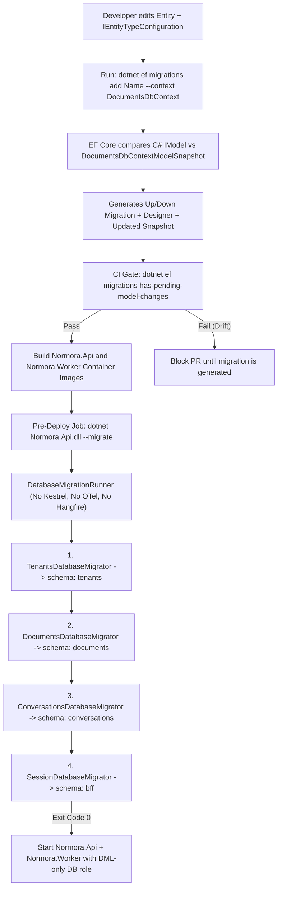
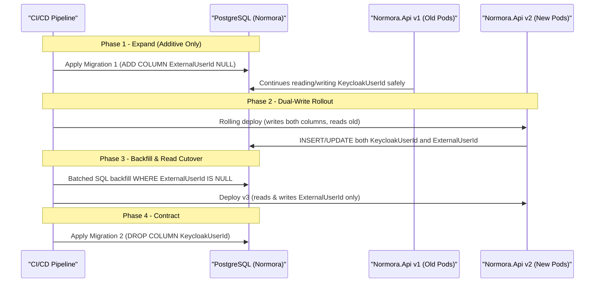

# Chapter 7: Database Migrations and DevOps

## 1. Learning Objectives

By the end of this chapter, you will be able to:
*   Understand how EF Core tracks schema changes via the `ModelSnapshot`, the `__EFMigrationsHistory` table, and EF Core 9/10's `__EFMigrationsLock` coordination table.
*   Master the EF Core 10 CLI tools (`dotnet ef migrations add`, `script --idempotent`, `bundle`, `has-pending-model-changes`, and `dbcontext optimize`) across single and multi-`DbContext` solutions.
*   Implement idempotent data seeding securely using `HasData()` for static constants and EF Core 9/10's `UseSeeding` / `UseAsyncSeeding` for relational/async seeding.
*   Inject custom SQL (Views, Stored Procedures, Triggers, PostgreSQL `pgvector` HNSW indexes, and `CREATE INDEX CONCURRENTLY`) into standard EF Core migrations using `suppressTransaction: true`.
*   Isolate migrations in a **Modular Monolith** (one `DbContext` per module, dedicated PostgreSQL schemas, and per-module history tables) and execute them via an **ephemeral `--migrate` host** rather than calling `context.Database.Migrate()` on web startup.
*   Architect an enterprise CI/CD deployment pipeline using idempotent SQL scripts, self-contained **Migration Bundles**, and model-drift gates.
*   Design and execute **Zero-Downtime** database schema evolutions using the **Expand and Contract** pattern and PostgreSQL lock-safe DDL.

## 2. Introduction

Writing optimized LINQ queries and configuring the Fluent API only matters if the physical database schema actually matches your C# models. Keeping the C# codebase and the database schema (whether SQL Server or PostgreSQL) in perfect synchronization across Development, Staging, and Production environments is one of the most perilous aspects of software engineering.

Historically, DBAs maintained a massive folder of `.sql` scripts. Developers had to manually write `CREATE TABLE` and `ALTER TABLE` scripts to match their code changes. This disconnected process inevitably led to deployment failures when a script was forgotten or executed out of order.

Entity Framework Core solves this with **Migrations**. Migrations are a version control system for your database schema. When you change a C# class, EF Core calculates the difference between your new code and the current schema, and automatically generates the exact C# code required to upgrade (or downgrade) the database.

However, running migrations on a developer's laptop is vastly different from executing them against a 5-Terabyte production database with 10,000 active concurrent users—or coordinating four independent `DbContext`s inside a .NET 10 modular monolith like **Normora** across both an API host (`Normora.Api`) and a background worker (`Normora.Worker`). This chapter bridges the gap between local development and enterprise DevOps.

## 3. Core Concepts

### DDL vs. DML (Why Separation Matters)
*   **DDL (Data Definition Language)** consists of structural commands (`CREATE TABLE`, `ALTER TABLE`, `CREATE INDEX`, `DROP COLUMN`). DDL statements often acquire heavy **schema locks** (e.g., `AccessExclusiveLock` in PostgreSQL or `Sch-M` in SQL Server) that block concurrent reads and writes.
*   **DML (Data Manipulation Language)** consists of row-level commands (`SELECT`, `INSERT`, `UPDATE`, `DELETE`). In production, your runtime API and worker processes should only hold DML privileges, never DDL privileges.

### The Migration File (`Up` and `Down`)
When you generate a migration, EF Core creates a C# class with two methods. `Up()` contains the instructions to apply the new schema changes (e.g., `CreateTable`, `AddColumn`). `Down()` contains the instructions to reverse them (e.g., `DropTable`, `DropColumn`). Notice that EF Core also generates a companion `*.Designer.cs` partial file carrying the `[DbContext(...)]` and `[Migration("...")]` attributes plus the model snapshot as of that specific migration.

### The Model Snapshot (`ModelSnapshot.cs`)
EF Core maintains a single file per `DbContext` called `{DbContextName}ModelSnapshot.cs`. This file is a C# representation of your *entire* compiled EF Core `IModel` (every entity, column type, index, constraint, and seed row) as of the latest migration. When you create a new migration, EF Core does **not** inspect your live database; it compares your current C# domain entities and `IEntityTypeConfiguration<T>` classes against this Snapshot file to calculate the diff.

### The History Table (`__EFMigrationsHistory`)
When a migration is applied to a physical database, EF Core inserts a row into a metadata table named `__EFMigrationsHistory` containing two columns: `MigrationId` (e.g., `20261015120000_AddDocumentOutbox`) and `ProductVersion` (e.g., `10.0.0`). Before applying migrations, EF Core queries this table. If a migration is already recorded, EF Core skips it—guaranteeing each migration runs at most once.

### Migration Locking (`__EFMigrationsLock` in EF Core 9/10)
Starting in EF Core 9 and continuing in EF Core 10, EF Core acquires a distributed provider lock (such as creating/locking `__EFMigrationsLock` in SQL Server/PostgreSQL or using advisory locks) when applying migrations via `Migrate()`, `MigrateAsync()`, or `dotnet ef database update`. This prevents two simultaneous migrator processes from colliding mid-execution—though, as we will see in Section 8, it does **not** make calling `Migrate()` inside ASP.NET Core web startup safe for production.

### Idempotent Scripts
A SQL script is **idempotent** if executing it once, twice, or ten times produces the exact same database state without throwing errors. Idempotent migration scripts check `__EFMigrationsHistory` before executing each migration block (e.g., `IF NOT EXISTS (SELECT 1 FROM "__EFMigrationsHistory" WHERE "MigrationId" = '...')` in PostgreSQL, or `IF NOT EXISTS(SELECT * FROM [__EFMigrationsHistory] ...)` in SQL Server).

### Schema Drift & `PendingModelChangesWarning`
**Schema drift** occurs when your live database schema diverges from your EF Core `ModelSnapshot` (for instance, a DBA manually altered a column in production), or when your C# entities change without generating a new migration. In EF Core 9 and EF Core 10, `RelationalEventId.PendingModelChangesWarning` is **elevated to an error by default** during `Migrate()` / `database update`: if your C# model no longer matches your latest `ModelSnapshot`, EF Core throws an `InvalidOperationException` rather than silently running with an unmigrated model.

### Five Normora Core-Concept Examples
1.  **`TenantsDbContextModelSnapshot` (`server/Modules/Tenants/Persistence/Migrations/`)**: Tracks structural changes across `Tenants`, `TenantMemberships`, `Departments`, `UserGroups`, `Invitations`, `AuditLogs`, and `TenantPlans` inside the PostgreSQL `tenants` schema.
2.  **`DocumentsDbContextModelSnapshot` (`server/Modules/Documents/Persistence/Migrations/`)**: Tracks `Documents`, `DocumentVersions`, `DocumentChunks` (including `vector(768)` columns and `pgvector` HNSW indexes), and `DocumentProcessingOutboxMessages` inside the `documents` schema.
3.  **`ConversationsDbContextModelSnapshot` (`server/Modules/Conversations/Persistence/Migrations/`)**: Tracks `Conversations`, `Messages`, `Citations`, `SavedAnswers`, and `PendingApprovals` (with 15-minute TTL timestamps) inside the `conversations` schema.
4.  **Isolated `__EFMigrationsHistory` per Module**: Rather than letting four `DbContext`s collide on one `public."__EFMigrationsHistory"` table, each Normora module stores its own history table inside its own PostgreSQL schema (`tenants."__EFMigrationsHistory"`, `documents."__EFMigrationsHistory"`, `conversations."__EFMigrationsHistory"`, and `bff."__EFMigrationsHistory"`).
5.  **Pending Model Drift Guard on `TenantPlan`**: If a Normora engineer adds a `BillingCycle` property to `TenantPlan` in `Modules/Tenants/Domain/` and forgets to run `dotnet ef migrations add`, EF Core 10's `PendingModelChangesWarning` aborts `TenantsDatabaseMigrator` before a broken schema reaches staging.

## 4. Visual Diagrams

```text
=============================================================================
             THE MIGRATION GENERATION LIFECYCLE
=============================================================================

1. Developer modifies C#: 
   public class Tenant { public string NewColumn { get; set; } }

2. Developer runs: `dotnet ef migrations add AddNewColumn`

3. EF Core computes the Diff:
   [Current C# Domain Models]  <-- COMPARES -->  [ModelSnapshot.cs]

4. EF Core generates files:
   ├── 20261015_AddNewColumn.cs (Contains Up() and Down() using MigrationBuilder)
   └── ModelSnapshot.cs (Overwritten with the new schema state)
```

```text
=============================================================================
             ENTERPRISE CI/CD DEPLOYMENT PIPELINE
=============================================================================

[ GitHub / Azure DevOps ]
       │
       ▼ (1) Build Code
[ Compile C# DLLs ] 
       │
       ▼ (2) Generate Artifacts
[ dotnet ef migrations script --idempotent ] ──▶ Generates `update.sql`
       │
       ▼ (3) Release Pipeline Starts
[ Approval Gate (DBA Review) ] 
       │
       ▼ (4) Pre-Deployment Step
[ Azure SQL Action / SqlCmd ] ──▶ Executes `update.sql` against Production DB
       │
       ▼ (5) App Deployment Step
[ Deploy new ASP.NET Core Binaries to Azure App Service ]
```

### Normora Multi-DbContext Migration & Ephemeral Host Flow



### Zero-Downtime Expand & Contract Sequence (Normora Rolling Deploy)



## 5. API Deep Dive: CLI, MigrationBuilder, and Design-Time Factories

### The Essential EF Core 10 CLI Commands
To use these commands, install the CLI tool globally (`dotnet tool install --global dotnet-ef`, or pin it in a local `.config/dotnet-tools.json` manifest for deterministic CI builds) and reference `Microsoft.EntityFrameworkCore.Design` in your startup/design project.

*   `dotnet ef migrations add <Name> --context <DbContext>`: Scans the target `DbContext`'s entities and `IEntityTypeConfiguration<T>` classes, compares the resulting `IModel` to `{DbContext}ModelSnapshot.cs`, and generates a new migration class.
*   `dotnet ef database update --context <DbContext>`: Reads `__EFMigrationsHistory` from the database, determines which migrations are pending, acquires `__EFMigrationsLock`, and executes their `Up()` methods sequentially.
*   `dotnet ef migrations remove --context <DbContext>`: Deletes the last *unapplied* migration and rolls back `{DbContext}ModelSnapshot.cs`.
*   `dotnet ef migrations list --context <DbContext>`: Lists all migrations and shows whether each is **Applied** or **Pending** against the target database.
*   `dotnet ef migrations script <From> <To> --idempotent --context <DbContext>`: Generates a raw SQL script (T-SQL for SQL Server or PL/pgSQL for PostgreSQL) wrapped in `__EFMigrationsHistory` checks.
*   `dotnet ef migrations bundle --context <DbContext>`: Compiles a self-contained executable (`efbundle` / `efbundle.exe`) containing the migrations and `DbContext`, ideal for containerized CI/CD init steps.
*   `dotnet ef migrations has-pending-model-changes --context <DbContext>`: Exits with a non-zero exit code if C# model changes exist without a corresponding migration—essential as a CI pull-request gate.
*   `dotnet ef dbcontext optimize --context <DbContext>`: Generates a **Compiled Model** (`{DbContext}ModelBuilder.cs`) to speed up `DbContext` cold-start initialization in large schemas (note: you must re-run `dbcontext optimize` whenever you add a migration).

### Design-Time Resolution (`IDesignTimeDbContextFactory<TContext>`)
When you run `dotnet ef`, the CLI must instantiate your `DbContext` at **design time** (on your laptop or CI runner) without starting a full web server. By default, `dotnet ef` invokes `Program.cs` via `HostFactoryResolver` to read your DI container.

However, in a modular monolith like Normora, booting `Program.cs` can fail at design time if your startup pipeline expects Redis, Keycloak OIDC discovery, or MinIO credentials to be reachable—or if your `DbContext` requires runtime scoped services like `ITenantContext`. Implementing **`IDesignTimeDbContextFactory<TContext>`** gives the EF CLI a clean, isolated factory:

```csharp
using Microsoft.EntityFrameworkCore;
using Microsoft.EntityFrameworkCore.Design;

namespace Normora.Modules.Documents.Persistence;

// Parameterless factory discovered automatically by `dotnet ef` at design time
public sealed class DocumentsDbContextDesignTimeFactory : IDesignTimeDbContextFactory<DocumentsDbContext>
{
    public DocumentsDbContext CreateDbContext(string[] args)
    {
        var optionsBuilder = new DbContextOptionsBuilder<DocumentsDbContext>();
        optionsBuilder.UseNpgsql(
            "Host=localhost;Database=normora_design;Username=postgres;Password=postgres",
            npgsql =>
            {
                npgsql.MigrationsHistoryTable("__EFMigrationsHistory", "documents");
                npgsql.UseVector(); // Registers pgvector type mappings for design-time diffing
            });

        // Pass a design-time null/empty tenant context; global query filters are expression trees
        // evaluated at query execution time, not during schema diffing.
        return new DocumentsDbContext(optionsBuilder.Options, new DesignTimeTenantContext());
    }
}
```

**When to use `IDesignTimeDbContextFactory<TContext>` vs. when NOT to use it:**
*   **Use it** when `Program.cs` depends on external runtime infrastructure (Keycloak, Redis, Secret Managers) or scoped services that complicate `dotnet ef` execution in CI.
*   **Do NOT** put production connection strings or real secrets inside a design-time factory—the database does not even need to exist for `migrations add`, `migrations script`, or `has-pending-model-changes`! Also do not instantiate runtime business dependencies (Hangfire, SignalR) inside it.

### The MigrationBuilder API
Inside the generated migration class, EF Core uses `MigrationBuilder` to define provider-agnostic and provider-specific schema operations (`CreateTable`, `AddColumn`, `RenameColumn`, `CreateIndex`, `InsertData`, and `Sql`).

```csharp
public partial class AddChargerStatus : Migration
{
    protected override void Up(MigrationBuilder migrationBuilder)
    {
        // EF Core generated this:
        migrationBuilder.AddColumn<string>(
            name: "Status",
            table: "Chargers",
            type: "nvarchar(50)",
            maxLength: 50,
            nullable: false,
            defaultValue: "Offline");

        // YOU can add Custom SQL here!
        migrationBuilder.Sql(@"
            CREATE VIEW vw_ActiveChargers AS 
            SELECT Id, SerialNumber FROM Chargers WHERE Status = 'Active';
        ");
    }

    protected override void Down(MigrationBuilder migrationBuilder)
    {
        migrationBuilder.Sql("DROP VIEW vw_ActiveChargers;");
        migrationBuilder.DropColumn(name: "Status", table: "Chargers");
    }
}
```

### Five Normora CLI & `MigrationBuilder` Examples
1.  **Targeting a Specific Module DbContext (`DocumentsDbContext`)**:
    ```bash
    dotnet ef migrations add AddDocumentOutbox \
      --context DocumentsDbContext \
      --project server/Normora.Infrastructure \
      --startup-project server/Normora.Api \
      --output-dir ../Modules/Documents/Migrations
    ```
2.  **Enabling PostgreSQL `pgvector` Extension in `DocumentsDbContext`**:
    ```csharp
    protected override void Up(MigrationBuilder migrationBuilder)
    {
        migrationBuilder.AlterDatabase()
            .Annotation("Npgsql:PostgresExtension:vector", ",,");
    }
    ```
    *Why:* `pgvector` provides the `vector(768)` column type for Normora's Gemini document embeddings; without enabling the PostgreSQL extension in the earliest `DocumentsDbContext` migration, table creation fails on a fresh database.
3.  **Creating a Partial Index on `DocumentProcessingOutboxMessages`**:
    ```csharp
    migrationBuilder.CreateIndex(
        name: "IX_Outbox_PendingDispatch",
        schema: "documents",
        table: "DocumentProcessingOutboxMessages",
        column: "CreatedAtUtc",
        filter: "\"ProcessedAtUtc\" IS NULL");
    ```
    *Why:* Hangfire's recurring recovery dispatcher (`HangfireDocumentProcessingOutboxDispatcher`) only polls unprocessed outbox rows; a PostgreSQL partial index keeps that lookup instantaneous even with millions of historical processed rows.
4.  **Adding a PostgreSQL `HNSW` Vector Index Concurrently (`suppressTransaction: true`)**:
    ```csharp
    migrationBuilder.Sql(
        """
        CREATE INDEX CONCURRENTLY IF NOT EXISTS "IX_DocumentChunks_Embedding_Hnsw"
        ON documents."DocumentChunks"
        USING hnsw ("Embedding" vector_cosine_ops)
        WITH (m = 16, ef_construction = 64);
        """,
        suppressTransaction: true);
    ```
    *Why:* **HNSW (Hierarchical Navigable Small World)** is an approximate nearest-neighbor graph index for high-dimensional embeddings. Building it `CONCURRENTLY` avoids blocking document uploads during production deploys, and PostgreSQL forbids `CONCURRENTLY` inside a transaction block—hence `suppressTransaction: true`.
5.  **Adding a TTL Lookup Index for `PendingApprovals` in `ConversationsDbContext`**:
    ```csharp
    migrationBuilder.CreateIndex(
        name: "IX_PendingApprovals_Tenant_ExpiresAt",
        schema: "conversations",
        table: "PendingApprovals",
        columns: new[] { "TenantId", "ExpiresAtUtc" });
    ```
    *Why:* Normora's server-enforced Human-In-The-Loop (HITL) approvals expire after 15 minutes; indexing `(TenantId, ExpiresAtUtc)` accelerates both approval validation and background expiry cleanup.

## 6. Complete Examples: EV Platform Case Study & Normora Multi-Module Migrations

### 6.1 EV Platform Case Study: `Tariff` Table & Seeding
We are deploying a new feature to the EV Platform: **Tariffs**. We need a new table to store pricing rules, and we need to seed the database with a default "Free" tariff so the application doesn't crash upon deployment.

#### Creating the Entity and Configuration
```csharp
public class Tariff
{
    public int Id { get; set; }
    public string Name { get; set; }
    public decimal PricePerKwh { get; set; }
}

public class TariffConfiguration : IEntityTypeConfiguration<Tariff>
{
    public void Configure(EntityTypeBuilder<Tariff> builder)
    {
        builder.HasKey(t => t.Id);
        // Best Practice for small static constants: Seed Data in the Configuration
        builder.HasData(
            new Tariff { Id = 1, Name = "Default Free Tier", PricePerKwh = 0.00m }
        );
    }
}
```

#### Generating the Migration
We run: `dotnet ef migrations add AddTariffs`

EF Core generates the following `Up()` method:
```csharp
protected override void Up(MigrationBuilder migrationBuilder)
{
    migrationBuilder.CreateTable(
        name: "Tariffs",
        columns: table => new
        {
            Id = table.Column<int>(type: "int", nullable: false)
                .Annotation("SqlServer:Identity", "1, 1"),
            Name = table.Column<string>(type: "nvarchar(max)", nullable: false),
            PricePerKwh = table.Column<decimal>(type: "decimal(18,2)", nullable: false)
        },
        constraints: table =>
        {
            table.PrimaryKey("PK_Tariffs", x => x.Id);
        });

    // EF Core automatically generates the seeding SQL based on HasData!
    migrationBuilder.InsertData(
        table: "Tariffs",
        columns: new[] { "Id", "Name", "PricePerKwh" },
        values: new object[] { 1, "Default Free Tier", 0.00m });
}
```

### 6.2 Five Normora Multi-Module Migration Examples
In Normora, every entity configuration lives in `server/Modules/{ModuleName}/Persistence/Configurations/{Entity}Configuration.cs` and **must have a parameterless public constructor** so `modelBuilder.ApplyConfigurationsFromAssembly(...)` works seamlessly at both runtime and migration design time.

1.  **`Documents` Module — `DocumentProcessingOutboxMessage` Transactional Outbox Table**:
    ```csharp
    // server/Modules/Documents/Persistence/Configurations/DocumentProcessingOutboxMessageConfiguration.cs
    public sealed class DocumentProcessingOutboxMessageConfiguration
        : IEntityTypeConfiguration<DocumentProcessingOutboxMessage>
    {
        public void Configure(EntityTypeBuilder<DocumentProcessingOutboxMessage> builder)
        {
            builder.ToTable("DocumentProcessingOutboxMessages", "documents");
            builder.HasKey(x => x.Id);
            builder.Property(x => x.PayloadJson).HasColumnType("jsonb").IsRequired();
            builder.HasIndex(x => x.CreatedAtUtc)
                .HasFilter("\"ProcessedAtUtc\" IS NULL");
        }
    }
    ```
2.  **`Tenants` Module — Multi-Currency `TenantPlan` Migration**:
    Adding `Currency` (`varchar(3)`, default `"USD"`) and `BillingCycle` (`varchar(16)`, default `"Monthly"`) to `tenants."TenantPlans"` ensures PayU checkout parameters and `TenantPlanPricingCatalog` remain persisted across restarts.
3.  **`Conversations` Module — `PendingApproval` HITL State Table**:
    Mapping `PendingApproval` into `conversations."PendingApprovals"` with a 15-minute `ExpiresAtUtc` timestamp and `Status` column ensures destructive tool calls (like `documents_delete`) survive API pod restarts between proposal and user confirmation.
4.  **`Tenants` Module — `WorkspaceState` Monotonic `DataVersion` Counter**:
    Adding a `DataVersion` (`bigint`, concurrency-safe) column to `tenants."Tenants"` lets `IWorkspaceStateSynchronizer` persist monotonic workspace versions before broadcasting SignalR/SSE invalidations.
5.  **`Bff` Session Store — `SessionDatabaseMigrator` Schema Isolation**:
    Duende BFF's server-side user session table (`bff."UserSessions"`) is migrated independently via `SessionDatabaseMigrator` so session token revocation and key-rotation schema upgrades never interfere with business modules.

## 7. EF Core Internals: Data Seeding (`HasData` vs. `UseSeeding` / `UseAsyncSeeding`)

In EF Core 10, there are **three** distinct seeding approaches—two officially supported patterns for different jobs, and one dangerous anti-pattern:

1.  **Startup `DbInitializer` in `Program.cs` (Anti-Pattern):** Writing manual `if (!context.Tariffs.Any())` logic during web server boot. If 5 API instances start simultaneously, they race and insert duplicates or deadlock.
2.  **Migration-Tracked Static Seeding (`builder.HasData(...)`):** Used in `IEntityTypeConfiguration<T>.Configure()` for small, static, compile-time system constants with deterministic primary keys. EF Core diffs your `HasData` rows against `ModelSnapshot` and emits `InsertData`, `UpdateData`, and `DeleteData` inside migrations.
    *   **When NOT to use `HasData`:** Never use it for large lookup datasets (thousands of rows bloat migration C# files), non-deterministic values (`Guid.NewGuid()`, `DateTime.UtcNow`), or environment-specific/relational data that requires querying existing database rows or calling `IPasswordHasher` / external secrets.
3.  **EF Core 9/10 `UseSeeding` and `UseAsyncSeeding` (Dynamic Idempotent Seeding):** Introduced in EF Core 9 and standard in EF Core 10, `DbContextOptionsBuilder.UseSeeding(...)` and `UseAsyncSeeding(...)` register seeding callbacks directly on the `DbContext` pipeline. EF Core invokes them **automatically** during `EnsureCreatedAsync()`, `MigrateAsync()`, or `dotnet ef database update`—**not** on every HTTP request—while holding EF Core's migration lock (`__EFMigrationsLock`)!
    *   **When NOT to use `UseAsyncSeeding`:** Do not rely on it if your production deployment applies migrations purely via `dotnet ef migrations script --idempotent` without ever invoking `MigrateAsync()` or `dotnet ef database update` (SQL scripts do not run C# `UseAsyncSeeding` delegates unless you run them via an ephemeral `--migrate` host or separate idempotent SQL seed script).

```csharp
// Example: EF Core 10 UseAsyncSeeding configured on TenantsDbContext
services.AddDbContext<TenantsDbContext>(options =>
    options.UseNpgsql(connectionString, npgsql =>
            npgsql.MigrationsHistoryTable("__EFMigrationsHistory", "tenants"))
        .UseAsyncSeeding(async (context, _, cancellationToken) =>
        {
            var hasDefaultTenant = await context.Set<Tenant>()
                .AnyAsync(t => t.Slug == "normora-demo", cancellationToken);

            if (!hasDefaultTenant)
            {
                context.Set<Tenant>().Add(Tenant.CreateSystemDemo("normora-demo"));
                await context.SaveChangesAsync(cancellationToken);
            }
        }));
```

### Five Normora Data Seeding Examples
1.  **`HasData` for Static `SubscriptionTier` Reference Constants (`TenantsDbContext`)**: Seed the 3 immutable tier definitions (`Free`, `Pro`, `Enterprise`) with fixed integer/deterministic UUID keys so `TenantPlanPricingCatalog` foreign keys always resolve cleanly.
2.  **`HasData` for Built-in System `Department` Templates (`TenantsDbContext`)**: Seed static system role/department metadata with deterministic GUIDs—never `Guid.NewGuid()`, which would trigger a fake diff on every `dotnet ef migrations add`!
3.  **`UseAsyncSeeding` for Local/Staging Workspace Bootstrap (`TenantsDatabaseMigrator`)**: When `TenantsDatabaseMigrator` runs inside Normora's `--migrate` host in Development, `UseAsyncSeeding` idempotently seeds the pre-configured workspace slug, demo `ExternalUserId` membership, and initial `TenantPlan`.
4.  **`UseAsyncSeeding` for Default Starter `SavedAnswer` & Prompt Suggestions (`ConversationsDbContext`)**: Seeds initial workspace onboarding suggestions only if `conversations."SavedAnswers"` has no system-tagged rows for that tenant.
5.  **Avoiding `HasData` for `DocumentChunk` Embeddings (`DocumentsDbContext`)**: Never seed pre-computed vector chunks or large policy libraries with `HasData`; instead, ingest sample documents through `UploadDocumentCommandHandler` + `DocumentProcessingOutboxMessage` so `DocumentChunker` and Gemini `batchEmbedContents` populate `vector(768)` columns cleanly.

## 8. ASP.NET Core Integration: The `Migrate()` Anti-Pattern vs. Ephemeral Migration Hosts

In many tutorials, you will see this code in `Program.cs`:
```csharp
// DO NOT DO THIS IN PRODUCTION!
using (var scope = app.Services.CreateScope())
{
    var db = scope.ServiceProvider.GetRequiredService<EvDbContext>();
    db.Database.Migrate(); 
}
```
**Why this is a catastrophic architectural failure:**
1.  **Startup Contention & Health-Probe Failures:** Even though EF Core 9/10 added `__EFMigrationsLock` to serialize concurrent `Migrate()` calls, in Kubernetes or Azure App Service 10 API pods starting simultaneously will sit blocked waiting on the lock. Long-running index migrations cause liveness/readiness probes to time out, triggering CrashLoopBackOff restarts mid-migration.
2.  **Security (Least Privilege Violation):** To run `Migrate()`, the API's connection string must have DDL privileges (`CREATE TABLE`, `ALTER TABLE`, `DROP`). In a secure multi-tenant SaaS, the runtime API and worker connection strings should ONLY have DML privileges (`SELECT`, `INSERT`, `UPDATE`, `DELETE`).
3.  **Rolling-Deployment Schema Skew:** Web pods start serving traffic the moment they boot, potentially racing ahead of or clashing with older pods expecting the previous schema.
4.  **Observability:** If a migration fails because of a lock timeout, web startup crashes without clean, isolated exit-code reporting for your deployment orchestrator.

### The Normora Pattern: Ephemeral Migration Host Isolation (`--migrate`)
When a containerized .NET 10 modular monolith like Normora applies migrations via an executable step (e.g., `start.ps1`, Docker Compose init, or a Kubernetes Pre-Sync Job), calling `dotnet Normora.Api.dll --migrate` must **never** boot the full web server!

Normora uses **Ephemeral Migration Host Isolation** (`MigrationHostExtensions.RunMigrationsAsync`):
*   When `--migrate` is passed, `Program.cs` builds a **minimal console host** containing only configuration, logging, PostgreSQL `DbContext`s, and `DatabaseMigrationRunner`.
*   It explicitly **skips** Kestrel HTTP binding, Duende BFF middleware, OpenTelemetry diagnostic listeners, SignalR hubs, and Hangfire background servers.
*   **Why:** Skipping native/background teardown hooks (especially Hangfire, SignalR backplanes, and OpenTelemetry exporters) guarantees clean, deterministic process exit with **exit code `0`**, avoiding intermittent native `SIGSEGV` crashes (**exit code `139`**) during short-lived container shutdown.
*   **When NOT to use `--migrate`:** In strictly regulated enterprises where DBAs forbid any application binary from holding DDL credentials, generate idempotent `.sql` scripts in CI (Section 9) instead and have the DBA/pipeline runner execute the SQL directly.

### Five Normora Ephemeral-Host & `MigrateAsync` Examples
1.  **`MigrationHostExtensions.RunMigrationsAsync` Entry Gate (`Normora.Api/Extensions/`)**:
    ```csharp
    if (args.Contains("--migrate", StringComparer.OrdinalIgnoreCase))
    {
        return await MigrationHostExtensions.RunMigrationsAsync(args);
    }
    ```
2.  **`DatabaseMigrationRunner` Four-Migrator Sequential Pipeline (`Normora.Infrastructure`)**:
    Uses a primary constructor to inject `IEnumerable<IDatabaseMigrator>` and runs `TenantsDatabaseMigrator`, `DocumentsDatabaseMigrator`, `ConversationsDatabaseMigrator`, and `SessionDatabaseMigrator` sequentially in deterministic dependency order.
3.  **`TenantsDatabaseMigrator` with Primary Constructor & `ApiMessages`**:
    ```csharp
    public sealed class TenantsDatabaseMigrator(
        TenantsDbContext dbContext,
        ILogger<TenantsDatabaseMigrator> logger) : IDatabaseMigrator
    {
        public async Task MigrateAsync(CancellationToken cancellationToken)
        {
            logger.LogInformation("Applying Tenants schema migrations...");
            try
            {
                await dbContext.Database.MigrateAsync(cancellationToken);
            }
            catch (Exception ex)
            {
                logger.LogError(ex, ApiMessages.DatabaseMigrationFailed);
                throw;
            }
        }
    }
    ```
4.  **`Normora.Worker` Never Runs Migrations**: Because `Normora.Worker` references `Normora.Infrastructure` (not `Normora.Api`) and runs Hangfire ingestion jobs on a DML-only role, workers simply wait for the `--migrate` step to succeed before starting.
5.  **Docker Compose / Kubernetes Init Container Execution**: `docker compose run --rm normora-api --migrate` executes with a short-lived DDL connection string (`POSTGRES_MIGRATOR_CONNECTION`), returns exit code `0`, and tears down before `normora-api` and `normora-worker` boot with DML-only credentials.

## 9. Enterprise DevOps: Idempotent SQL Scripts, Migration Bundles, and CI Drift Gates

### Option A: Idempotent SQL Scripts (`--idempotent`)
The traditional enterprise DevOps solution is generating an Idempotent SQL Script during the CI Build pipeline.

```bash
dotnet ef migrations script --idempotent --output update.sql
```

**What `--idempotent` does:**
It wraps every single migration in a conditional block checking the `__EFMigrationsHistory` table.

```sql
IF NOT EXISTS(SELECT * FROM [__EFMigrationsHistory] WHERE [MigrationId] = N'20261015_AddTariffs')
BEGIN
    CREATE TABLE [Tariffs] (
        [Id] int NOT NULL IDENTITY,
        [Name] nvarchar(max) NOT NULL,
        [PricePerKwh] decimal(18,2) NOT NULL,
        CONSTRAINT [PK_Tariffs] PRIMARY KEY ([Id])
    );
    INSERT INTO [__EFMigrationsHistory] ([MigrationId], [ProductVersion])
    VALUES (N'20261015_AddTariffs', N'10.0.0');
END;
GO
```

**The CI/CD Workflow:**
1. The Build Pipeline generates this `update.sql` artifact.
2. The Release Pipeline downloads the artifact.
3. The Release Pipeline executes `update.sql` against the Production database using a privileged DevOps Service Principal (after an optional DBA approval gate).
4. If it succeeds, the Release Pipeline deploys the compiled ASP.NET Core binaries (which use a low-privilege DML connection string).

### Option B: EF Core Migration Bundles (`dotnet ef migrations bundle`)
A **Migration Bundle** is a self-contained native executable (`efbundle` on Linux/macOS, `efbundle.exe` on Windows) generated by the EF Core CLI that packages all migrations for a `DbContext` without requiring the .NET SDK or `dotnet ef` tool to be installed on your deployment runner.

```bash
dotnet ef migrations bundle \
  --context DocumentsDbContext \
  --self-contained \
  --target-runtime linux-x64 \
  --output ./artifacts/documents-efbundle
```
In your release stage, you execute it with the privileged migrator connection string:
```bash
./documents-efbundle --connection "$PROD_MIGRATOR_CONN"
```

*   **When to use Migration Bundles:** Automated container/CD pipelines where you want transactional execution, `UseAsyncSeeding` support, and zero .NET SDK dependencies on the runner.
*   **When NOT to use Migration Bundles:** When DBAs require human-readable SQL diff review before execution, or when your database sits in an air-gapped network where only `.sql` files are accepted. (Note: `suppressTransaction: true` works in bundles, whereas `--idempotent` SQL scripts have caveats around non-transactional commands like `CREATE INDEX CONCURRENTLY` because PostgreSQL cannot run `CONCURRENTLY` inside a `DO $$ ... END $$` procedural block!).

### Option C: CI Model-Drift Gate (`has-pending-model-changes`)
In EF Core 9 and EF Core 10, forgetting to add a migration after changing an entity throws `PendingModelChangesWarning` (treated as an exception) when `MigrateAsync()` runs. Catch this in CI *before* merging:
```bash
dotnet ef migrations has-pending-model-changes --context TenantsDbContext --no-build
```

### Five Normora Enterprise DevOps Examples
1.  **Generating 4 Separate Idempotent PostgreSQL Scripts in CI**:
    Running `dotnet ef migrations script --idempotent` once per context (`TenantsDbContext`, `DocumentsDbContext`, `ConversationsDbContext`, `PersistedGrantDbContext`) outputs `tenants.sql`, `documents.sql`, `conversations.sql`, and `bff.sql`—each targeting its own schema's `__EFMigrationsHistory`.
2.  **CI Pull-Request Drift Check Across All Normora Modules**:
    A GitHub Actions job builds `Normora.Api` once and runs `dotnet ef migrations has-pending-model-changes --no-build` against all 4 `DbContext`s so a PR modifying `DocumentChunkConfiguration` without a migration fails fast.
3.  **Building Linux x64 Migration Bundles for `Tenants` and `Conversations`**:
    Publishing `tenants-efbundle` and `conversations-efbundle` as CI artifacts lets CD runners execute migrations + `UseAsyncSeeding` without pulling the full SDK image.
4.  **PostgreSQL Lock-Timeout Preamble in Scripted Deployments**:
    Prepending `SET lock_timeout = '3s'; SET statement_timeout = '30s';` before executing generated `.sql` scripts ensures a Normora `ALTER TABLE` never queues behind long-running RAG vector queries and piles up an application-wide outage.
5.  **Split Database Roles (`normora_migrator` vs. `normora_app`)**:
    In production PostgreSQL, `normora_migrator` owns the `tenants`, `documents`, `conversations`, and `bff` schemas (used only by `--migrate` / CI scripts), while `normora_app` (used by `Normora.Api` and `Normora.Worker`) only has `USAGE` on those schemas and `SELECT, INSERT, UPDATE, DELETE` on tables.

## 10. Clean Architecture & Modular Monolith Perspective

Where do migrations live?
Because Migrations generate C# code that references the `Microsoft.EntityFrameworkCore` namespace, they **must** live in the Infrastructure or module Persistence layer—never in Domain or pure Application layers.

If your solution has an `EV.Infrastructure` project, you should run CLI commands specifying the project:
`dotnet ef migrations add AddTariffs --project EV.Infrastructure --startup-project EV.Api`

(The `--startup-project` is required so the EF tooling can boot up ASP.NET Core, resolve the DI container, and find your connection string to verify the provider, even if it's not actually applying the migration to the DB).

### Modular Monolith Rules (One `DbContext` Per Module)
In a modular monolith like Normora, each module (`Tenants`, `Documents`, `Conversations`) owns a private `DbContext` sharing one PostgreSQL server. To prevent migration collisions:
1.  **Dedicated PostgreSQL Schema + History Table:** Each `DbContext` sets `builder.HasDefaultSchema("...")` and configures `MigrationsHistoryTable("__EFMigrationsHistory", "<schema>")` inside `UseNpgsql(...)`.
2.  **Assembly-Scanned Parameterless Configurations:** Every `IEntityTypeConfiguration<T>` class must have a **public parameterless constructor** so `modelBuilder.ApplyConfigurationsFromAssembly(typeof({Module}DbContext).Assembly)` succeeds at both runtime and `dotnet ef` design time.
3.  **Dynamic Global Tenant Filters vs. Design Time:** Global multitenant query filters (`modelBuilder.Entity<Document>().HasQueryFilter(d => d.TenantId == _tenantContext.TenantId)`) bind dynamically to the `DbContext`'s instance field (`_tenantContext.TenantId`), never passed into `IEntityTypeConfiguration<T>` constructors. Because EF Core compiles query filters as expression trees, `dotnet ef` does not execute `_tenantContext.TenantId` when diffing schemas.

### Five Normora Modular-Monolith Migration Examples
1.  **`DocumentsDbContext` Schema & History Table Isolation**:
    ```csharp
    services.AddDbContext<DocumentsDbContext>(options =>
        options.UseNpgsql(connectionString, npgsql =>
        {
            npgsql.MigrationsHistoryTable("__EFMigrationsHistory", "documents");
            npgsql.MigrationsAssembly(typeof(DocumentsDbContext).Assembly.FullName);
            npgsql.UseVector();
        }));
    ```
2.  **`TenantsDbContext` Unscoped Root Schema (`tenants`)**:
    `TenantsDbContext` omits global tenant query filters (it resolves workspace slugs and cross-tenant memberships) and keeps its migrations isolated inside `server/Modules/Tenants/Persistence/Migrations` targeting `tenants."__EFMigrationsHistory"`.
3.  **`ConversationsDbContext` Encapsulation (`conversations`)**:
    Migrations in `server/Modules/Conversations/Migrations` are strictly owned by `Conversations`; `Normora.Api` and `Documents` never reference `ConversationsDbContext` directly, communicating across module boundaries only via MediatR contracts in `Normora.Shared.Contracts.*`.
4.  **BFF `SessionDatabaseMigrator` Isolation (`bff`)**:
    Duende BFF's `UserSessions` store lives in `server/Normora.Api/Migrations/Bff` with its own `__EFMigrationsHistory` in the `bff` schema, preventing session-store upgrades from blocking business module migrations.
5.  **Parameterless `DocumentChunkConfiguration` Auto-Discovery**:
    `DocumentChunkConfiguration` has a default parameterless constructor, while `DocumentsDbContext.OnModelCreating` applies `modelBuilder.ApplyConfigurationsFromAssembly(typeof(DocumentsDbContext).Assembly)` and attaches the global `TenantId` filter cleanly.

## 11. Enterprise SaaS Perspective: Zero-Downtime Migrations

In a high-availability SaaS, you cannot take the system offline to run a migration. This introduces the concept of **Expand and Contract**.

**Scenario:** We need to rename the `Name` column in `Tenants` to `CompanyName`.
If you rename a property in C# and run a migration, EF Core either guesses a rename—generating `migrationBuilder.RenameColumn(...)` (which compiles to `EXEC sp_rename 'Tenants.Name', 'CompanyName'` on SQL Server or `ALTER TABLE "Tenants" RENAME COLUMN "Name" TO "CompanyName"` on PostgreSQL)—or worse, if multiple properties changed, generates `DropColumn` + `AddColumn` (causing total data loss!). Even with `RenameColumn`, running it against Production crashes running API pods immediately because their compiled SQL queries still reference `Name`.

**The Zero-Downtime Workflow (4 Deployments):**
1.  **Expand (Migration 1):** Add `CompanyName` as a *new*, nullable column. Do not remove `Name`. Deploy.
2.  **Dual-Write (App Code):** Update the API to write to *both* `Name` and `CompanyName`, but read from `Name`. Deploy.
3.  **Backfill (Custom SQL):** Run a background script: `UPDATE Tenants SET CompanyName = Name WHERE CompanyName IS NULL` (in batches of 5,000–10,000 rows on large tables).
4.  **Transition (App Code):** Update the API to read and write exclusively to `CompanyName`. Deploy.
5.  **Contract (Migration 2):** Drop the `Name` column. Deploy.

### PostgreSQL Zero-Downtime Lock Safety
*   **Avoid Long Table Locks on Constraints:** Adding a `NOT NULL` column with a **constant** default in PostgreSQL 11+ is a fast metadata-only operation, whereas adding a `FOREIGN KEY` or `CHECK` constraint validates every existing row under a heavy lock unless you add it as **`NOT VALID`** first (`ALTER TABLE ... ADD CONSTRAINT ... CHECK (...) NOT VALID;`) and validate it in a separate step (`ALTER TABLE ... VALIDATE CONSTRAINT ...;`, which allows concurrent reads and writes).
*   **Always Use `CONCURRENTLY` for Production Indexes:** A regular `CREATE INDEX` in PostgreSQL blocks all `INSERT`/`UPDATE`/`DELETE` writes on that table for the duration of the build. Always use `CREATE INDEX CONCURRENTLY` with `suppressTransaction: true`.

*Architectural Rule:* Never rename columns, drop columns, or change column types in a single deployment if zero-downtime is required. Migrations must be purely additive until all running API and worker processes are fully migrated away from the old schema.

### Five Normora Zero-Downtime Migration Examples
1.  **Decoupling `KeycloakUserId` to `ExternalUserId` (`TenantsDbContext`)**:
    Add `ExternalUserId` as nullable first (Expand), update `Normora.Api` BFF and `Tenants` handlers to dual-write both columns, backfill existing `TenantMemberships` and `AuditLogs` in batches, cut reads over to `ExternalUserId`, then drop `KeycloakUserId` (Contract).
2.  **Adding `Currency` (`varchar(3)`) to `TenantPlans` (`TenantsDbContext`)**:
    In PostgreSQL 15+, adding a non-nullable `Currency` column with a constant default `'USD'` is instant (`O(1)` metadata update) without rewriting the table—safe during live PayU checkout traffic.
3.  **Building the `DocumentChunks` HNSW Vector Index (`DocumentsDbContext`)**:
    Run `CREATE INDEX CONCURRENTLY ... USING hnsw ("Embedding" vector_cosine_ops)` with `suppressTransaction: true` so `Normora.Worker` Hangfire ingestion jobs can keep inserting new chunks while the index builds.
4.  **Evolving `DocumentProcessingOutboxMessage` Schema (`DocumentsDbContext`)**:
    Before adding a required `CorrelationId` column for OpenTelemetry trace propagation across `UploadDocumentCommandHandler` and `Normora.Worker`, deploy `CorrelationId` as nullable first so in-flight outbox rows from older API pods never fail insertion.
5.  **Adding a `CHECK` Constraint on `PendingApprovals.ExpiresAtUtc` (`ConversationsDbContext`)**:
    Emit `ALTER TABLE conversations."PendingApprovals" ADD CONSTRAINT "CK_PendingApprovals_Expiry" CHECK ("ExpiresAtUtc" > "CreatedAtUtc") NOT VALID;` followed by `VALIDATE CONSTRAINT` so active CopilotKit SSE chats aren't stalled.

## 12. Real Production Case Studies

### 12.1 EV Platform Case Study: SQL Server Full-Text Index (`suppressTransaction: true`)
In the EV Platform, we needed to implement full-text search across all `Sites`. We decided to use SQL Server Full-Text Indexes, which EF Core does not natively support via the Fluent API.

We generated an empty migration: `dotnet ef migrations add AddFullTextIndex`.
We opened the generated file and manually wrote the Custom SQL.

```csharp
protected override void Up(MigrationBuilder migrationBuilder)
{
    // Create the catalog
    migrationBuilder.Sql("CREATE FULLTEXT CATALOG ftCatalog AS DEFAULT;", suppressTransaction: true);
    
    // Create the index on the LocationName column
    migrationBuilder.Sql(
        "CREATE FULLTEXT INDEX ON Sites(LocationName) KEY INDEX PK_Sites ON ftCatalog;", 
        suppressTransaction: true);
}
```
*Note: We must pass `suppressTransaction: true` because SQL Server does not allow Full-Text Catalog creation inside a standard user transaction, which EF Core wraps migrations in by default.*

### 12.2 Normora Case Study: Ephemeral `--migrate` Host & `pgvector` HNSW Safety
During Normora's containerized Docker Compose and CI startup (`dotnet Normora.Api.dll --migrate`), running migrations inside the full ASP.NET Core host caused intermittent **exit code `139` (`SIGSEGV`)** on container teardown because Hangfire, SignalR Redis backplane sockets, and OpenTelemetry native diagnostic listeners were initialized and torn down prematurely right after `MigrateAsync()`.

**The Architectural Fix:**
1.  **Ephemeral Host Isolation:** `MigrationHostExtensions.RunMigrationsAsync` builds a lean console host containing *only* logging, configuration, and the 4 `IDatabaseMigrator` services (`TenantsDatabaseMigrator`, `DocumentsDatabaseMigrator`, `ConversationsDatabaseMigrator`, `SessionDatabaseMigrator`)—zero Kestrel, SignalR, OpenTelemetry, or Hangfire services. Exit code `139` dropped to zero.
2.  **Concurrent `pgvector` Indexing:** In `DocumentsDbContext`, the HNSW cosine-similarity index on `documents."DocumentChunks"` uses `CREATE INDEX CONCURRENTLY ...` with `suppressTransaction: true`, preventing write locks while `Normora.Worker` streams Gemini embeddings.

## 13. Common Mistakes & Anti-Patterns

> [!CAUTION]
> **Anti-Pattern 1: Calling `db.Database.Migrate()` Inside Web App Startup (`Normora.Api`)**
>
> **Wrong Code:**
> ```csharp
> // In Normora.Api Program.cs during normal HTTP boot
> using var scope = app.Services.CreateScope();
> await scope.ServiceProvider.GetRequiredService<DocumentsDbContext>().Database.MigrateAsync();
> ```
> **Why It's Wrong:** Multiple horizontal API replicas block on `__EFMigrationsLock` (causing Kubernetes health-probe timeouts and `CrashLoopBackOff`), your web connection string is forced to hold dangerous DDL permissions (`ALTER`/`DROP`), and older pods clash with mutated tables during rolling deploys.
> **The Fix:** Isolate migrations into a pre-deployment CI/CD step—either idempotent SQL scripts, a Migration Bundle (`efbundle`), or an ephemeral `--migrate` console host (`MigrationHostExtensions.RunMigrationsAsync`) using a dedicated `normora_migrator` DDL role while `Normora.Api` and `Normora.Worker` run with DML-only credentials.

> [!CAUTION]
> **Anti-Pattern 2: Injecting Scoped Services (`ITenantContext`) into `IEntityTypeConfiguration<T>`**
>
> **Wrong Code:**
> ```csharp
> public sealed class DocumentConfiguration(ITenantContext tenantContext)
>     : IEntityTypeConfiguration<Document>
> {
>     public void Configure(EntityTypeBuilder<Document> builder)
>     {
>         builder.HasQueryFilter(d => d.TenantId == tenantContext.TenantId);
>     }
> }
> ```
> **Why It's Wrong:** `modelBuilder.ApplyConfigurationsFromAssembly(...)` instantiates configuration classes via `Activator.CreateInstance` using a parameterless constructor. Both runtime startup and `dotnet ef migrations add` will throw `MissingMethodException`!
> **The Fix:** Keep every `IEntityTypeConfiguration<T>` class strictly parameterless with a public default constructor, and bind global query filters dynamically inside `DocumentsDbContext.OnModelCreating` referencing the `DbContext`'s primary-constructor field (`_tenantContext.TenantId`).

> [!CAUTION]
> **Anti-Pattern 3: Running `CREATE INDEX CONCURRENTLY` Inside a Default Migration Transaction**
>
> **Wrong Code:**
> ```csharp
> protected override void Up(MigrationBuilder migrationBuilder)
> {
>     migrationBuilder.Sql("""
>         CREATE INDEX CONCURRENTLY "IX_DocumentChunks_Embedding_Hnsw"
>         ON documents."DocumentChunks" USING hnsw ("Embedding" vector_cosine_ops);
>         """); // Missing suppressTransaction: true!
> }
> ```
> **Why It's Wrong:** EF Core wraps `Up()` in a database transaction by default. PostgreSQL throws `ERROR: CREATE INDEX CONCURRENTLY cannot run inside a transaction block (25001)`.
> **The Fix:** Always pass `suppressTransaction: true` to `migrationBuilder.Sql(...)` for PostgreSQL `CREATE INDEX CONCURRENTLY` / `DROP INDEX CONCURRENTLY` (and SQL Server Full-Text Catalogs), and keep transactional DDL in separate migrations from non-transactional index builds.

> [!CAUTION]
> **Anti-Pattern 4: Manually Deleting Migration Files or Resolving `ModelSnapshot` Git Conflicts by Hand**
>
> **Wrong Code:**
> ```bash
> # Manually deleting 20261110_AddPendingApproval.cs in File Explorer / Solution Explorer
> rm server/Modules/Conversations/Migrations/20261110_AddPendingApproval.cs
> ```
> **Why It's Wrong:** Deleting the migration file without rolling back `ConversationsDbContextModelSnapshot.cs` leaves EF Core thinking the schema already exists. Similarly, hand-merging snapshot Git conflicts silently corrupts future diff calculations.
> **The Fix:** For an unapplied local migration, run `dotnet ef migrations remove --context ConversationsDbContext`. For a Git snapshot merge conflict, accept the incoming branch's snapshot, remove your local migration files, and regenerate cleanly with `dotnet ef migrations add <Name> --context ConversationsDbContext`.

> [!CAUTION]
> **Anti-Pattern 5: Using `EnsureCreated()` in Production or `HasData()` for Large / Non-Deterministic Data**
>
> **Wrong Code:**
> ```csharp
> // 1. Production schema creation without migration history:
> await dbContext.Database.EnsureCreatedAsync();
>
> // 2. Non-deterministic or massive HasData seed:
> builder.HasData(new Department { Id = Guid.NewGuid(), CreatedAtUtc = DateTime.UtcNow, Name = "HR" });
> ```
> **Why It's Wrong:** `EnsureCreated()` creates tables *without* `__EFMigrationsHistory`, permanently blocking future EF Core migrations on that database. Meanwhile, `Guid.NewGuid()` / `DateTime.UtcNow` inside `HasData()` generates a brand-new `DeleteData` + `InsertData` diff on *every* migration, and seeding thousands of rows bloats C# migration files into sluggish multi-megabyte builds.
> **The Fix:** Reserve `EnsureCreated()` strictly for ephemeral integration tests. Limit `HasData()` to small, static system constants with hardcoded deterministic keys, and use EF Core 10's `UseAsyncSeeding(...)` (or bulk SQL scripts) for dynamic, relational, or large datasets.

> [!CAUTION]
> **Anti-Pattern 6: Editing an Already-Deployed Migration Instead of Rolling Forward**
>
> **Wrong Code:**
> ```csharp
> // Editing an old migration that already ran in Staging/Production to undo a DropColumn!
> ```
> **Why It's Wrong:** Production's `__EFMigrationsHistory` already lists that `MigrationId`, so EF Core will **never re-run it**—yet editing it corrupts your `ModelSnapshot`, causing `PendingModelChangesWarning` failures and broken future diffs.
> **The Fix:** Enforce a strict **Roll Forward Only** policy. Leave deployed migrations immutable, restore the property/column in C#, and generate a brand-new compensating migration (`dotnet ef migrations add RestoreMissingColumn`).

> [!CAUTION]
> **Anti-Pattern 7: Booting Kestrel, OpenTelemetry, or Hangfire Inside `--migrate`**
>
> **Wrong Code:**
> ```csharp
> // Running migrations after builder.Build() with Hangfire, SignalR, and OTel registered
> var app = builder.Build();
> if (args.Contains("--migrate")) { await RunMigratorsAsync(app.Services); return; }
> ```
> **Why It's Wrong:** Short-lived migration containers exit immediately after `MigrateAsync()`, tearing down unstarted or half-initialized native diagnostic listeners, Redis SignalR multiplexers, and Hangfire pools—producing intermittent native `SIGSEGV` crashes (**exit code `139`**) that fail CI/CD pipelines.
> **The Fix:** Branch **before** registering web/observability/background services (`MigrationHostExtensions.RunMigrationsAsync`) so the `--migrate` host registers only configuration, logging, `DbContext`s, and `IDatabaseMigrator` implementations, exiting cleanly with code `0`.

## 14. Interview Questions

### Beginner (10)
1.  **What is an EF Core Migration?**
    *Answer:* A way to keep the database schema in sync with the C# EF Core model. It generates code that represents the differences between the current model and the previous state.
2.  **What CLI command generates a new migration?**
    *Answer:* `dotnet ef migrations add <MigrationName>`
3.  **What CLI command applies the migration to the database?**
    *Answer:* `dotnet ef database update`
4.  **How does EF Core know which migrations have already been applied to a database?**
    *Answer:* By querying the `__EFMigrationsHistory` table in the database.
5.  **What is the purpose of the `Up()` and `Down()` methods?**
    *Answer:* `Up()` contains instructions to apply the new changes. `Down()` contains instructions to revert those exact changes.
6.  **What is the `ModelSnapshot.cs` file?**
    *Answer:* A C# representation of the entire current database schema. EF Core compares your entities against this file to determine what changed.
7.  **Is it safe to manually modify the generated `Up()` method?**
    *Answer:* Yes. It is common practice to inject raw SQL using `migrationBuilder.Sql()` for features EF Core doesn't support.
8.  **How do you safely delete a migration you just created but haven't applied yet?**
    *Answer:* `dotnet ef migrations remove`.
9.  **What does `DbContext.Database.EnsureCreated()` do?**
    *Answer:* It creates the database schema directly without using migrations. It is incompatible with the migrations workflow.
10. **Where should migration files live in a Clean Architecture solution?**
    *Answer:* In the Infrastructure project.

### Intermediate (10)
11. **Explain what an Idempotent script is in the context of EF Core.**
    *Answer:* A SQL script that checks the `__EFMigrationsHistory` table before applying a migration. It can be run repeatedly against the same database without causing errors or duplicate data.
12. **Why is calling `context.Database.Migrate()` at application startup dangerous in production?**
    *Answer:* It causes race conditions if multiple application instances start simultaneously, and requires the application connection string to have dangerous DDL (Schema modification) privileges.
13. **How do you seed data using migrations?**
    *Answer:* By using the `HasData()` method in the Fluent API configuration. EF Core will translate this into `INSERT` or `UPDATE` statements inside the migration.
14. **What happens if you change a seeded value in `HasData()` and generate a new migration?**
    *Answer:* EF Core detects the change in the C# model and generates an `UPDATE` statement in the new migration's `Up()` method.
15. **How do you resolve a Git merge conflict in the `ModelSnapshot.cs`?**
    *Answer:* Discard your local migration and snapshot changes, pull the remote branch, and then regenerate your local migration.
16. **What is a "pending" migration?**
    *Answer:* A migration that exists in your C# codebase but has not yet been recorded in the `__EFMigrationsHistory` table of the target database.
17. **Can you apply a migration directly from code without using the CLI?**
    *Answer:* Yes, using `context.Database.Migrate()`, though it is an anti-pattern for production. You can also generate the script programmatically via `context.Database.GenerateCreateScript()`.
18. **How do you specify a different name for the migrations history table?**
    *Answer:* In the `UseSqlServer` configuration: `options.UseSqlServer(conn, x => x.MigrationsHistoryTable("MyHistoryTable"));`
19. **If you rename a property from `FirstName` to `GivenName`, what does EF Core do when generating the migration?**
    *Answer:* EF Core cannot confidently know if you renamed a column or dropped one and added another. It usually generates a `DropColumn` and `AddColumn` (causing data loss!). You must manually edit the generated migration to use `RenameColumn` instead.
20. **How do you apply migrations to a database that is entirely offline from your development machine?**
    *Answer:* Generate an idempotent SQL script (`dotnet ef migrations script --idempotent`) and hand the `.sql` file to the DBA to execute via SSMS.

### Senior (10)
21. **Architect a deployment pipeline for EF Core migrations using Azure DevOps.**
    *Answer:* The Build Pipeline compiles the code and runs `dotnet ef migrations script --idempotent` to produce an artifact (`update.sql`). The Release Pipeline uses an Azure SQL task to execute `update.sql` using a Service Principal with DDL rights. Upon success, the pipeline deploys the App Service binaries, which run with a separate Managed Identity containing only DML rights.
22. **Explain the Expand and Contract pattern for Zero-Downtime schema migrations.**
    *Answer:* You never make destructive changes (renames, drops, type changes) in a single deployment. You Expand (add new column), update app to dual-write, backfill data, transition app to read from new column, and finally Contract (drop old column) in a subsequent deployment.
23. **You need to create a SQL Server Stored Procedure. Where is the correct place to define the `CREATE PROCEDURE` script in an EF Core project?**
    *Answer:* Generate an empty migration. Add `migrationBuilder.Sql("CREATE PROCEDURE...");` to the `Up()` method, and `migrationBuilder.Sql("DROP PROCEDURE...");` to the `Down()` method. This ensures the procedure is version-controlled and deployed sequentially with table changes.
24. **Why might you need to pass `suppressTransaction: true` to `migrationBuilder.Sql()`?**
    *Answer:* EF Core wraps the entire `Up()` method in a SQL Transaction by default. Certain SQL Server commands (like `CREATE FULLTEXT CATALOG`, `ALTER DATABASE`, or modifying memory-optimized tables) cannot be executed within a user transaction. Suppressing the transaction allows these commands to execute.
25. **Evaluate the performance differences between seeding data via `HasData` versus writing a custom SQL script executed by DbUp.**
    *Answer:* `HasData` parses the C# objects into `INSERT` statements inside the migration file. For small datasets (Roles, Statuses), it is excellent. For large datasets (e.g., 10,000 zip codes), it creates a massive C# file that compiles slowly and executes slowly via ADO.NET parameterization. DbUp executing a bulk `.sql` file (or `SqlBulkCopy`) is orders of magnitude faster for large data seeding.
26. **How do you handle migrations when different developers are working on features that target different bounded contexts (DbContexts) within the same physical database?**
    *Answer:* You must ensure each `DbContext` has its own unique Migrations History table (and ideally its own database schema). On SQL Server, configure `x.MigrationsHistoryTable("__EFMigrationsHistory_Billing")`; on PostgreSQL modular monoliths like Normora, configure both schema and table: `x.MigrationsHistoryTable("__EFMigrationsHistory", "documents")`.
27. **What happens if a migration fails halfway through execution on SQL Server or PostgreSQL?**
    *Answer:* On databases that support transactional DDL (such as SQL Server and PostgreSQL), EF Core wraps the `Up()` execution in a transaction, so the entire migration rolls back and `__EFMigrationsHistory` is not updated. However, this does *not* hold if `suppressTransaction: true` was passed to `migrationBuilder.Sql(...)` or on providers without transactional DDL (e.g., MySQL).
28. **A developer accidentally dropped a column in a previous migration that has already been deployed to production. They want to edit the old migration file to remove the `DropColumn` command. Why is this a catastrophic idea?**
    *Answer:* Editing a previously applied migration does absolutely nothing to the production database, because EF Core skips it based on the history table. However, it completely breaks the `ModelSnapshot`, corrupting future diff calculations. The Architect must enforce a "Roll Forward Only" policy: fix the mistake by creating a *new* migration that re-adds the column.
29. **How do you configure a migration to execute a specific data-scrubbing script before dropping a table?**
    *Answer:* Open the generated migration file. Insert your `migrationBuilder.Sql("UPDATE OtherTable SET Ref = NULL WHERE...");` command *above* the `migrationBuilder.DropTable()` command in the `Up()` method. EF Core guarantees sequential execution within the transaction.
30. **Explain how EF Core migrations interact with SQL Server Temporal Tables (System-Versioned).**
    *Answer:* If you configure an entity with `.ToTable(tb => tb.IsTemporal())`, the initial migration generates the `CREATE TABLE` with `GENERATED ALWAYS AS ROW START/END` and creates the associated History table. If you subsequently drop a column, EF Core correctly handles disabling system-versioning, dropping the column from both main and history tables, and re-enabling system-versioning natively.

### Staff Engineer (5)
31. **Architect a mechanism to automatically apply migrations in a Kubernetes cluster without using `context.Database.Migrate()` in the API pods, ensuring high availability and zero race conditions.**
    *Answer:* Do not apply migrations from the API pods. Use a Kubernetes **Init Container** or a **Pre-Sync Helm Hook** (Kubernetes Job). This dedicated short-lived container contains the EF Core CLI (or a small compiled worker service). It executes the migration script sequentially. Only when this Job completes successfully does the deployment proceed to spin up the actual API pods. This guarantees single-threaded execution and strict separation of privileges.
32. **A SaaS platform uses a separate database per tenant (10,000 databases). The schema must be identical across all. Formulate a strategy to apply EF Core migrations to 10,000 databases efficiently.**
    *Answer:* Using EF Core CLI to apply migrations to 10k databases sequentially would take hours. The Architect must build a custom control-plane service. This service generates the Idempotent SQL Script from EF Core once. It then utilizes a distributed worker queue (e.g., RabbitMQ + Hangfire) or Azure Elastic Jobs to fan-out the execution of the raw SQL script across 10,000 databases in parallel using raw ADO.NET, tracking success/failure for each tenant individually.
33. **Analyze the risks of using EF Core Migrations for extensive data manipulation (DML) alongside schema definition (DDL) within the same `Up()` method.**
    *Answer:* DDL commands (like `CREATE INDEX`) can require schema locks. DML commands (like `UPDATE 1,000,000 rows`) take immense time and transaction log space. Combining them inside a single implicit EF Core transaction risks massive lock escalation, potentially blocking the entire database for minutes, leading to an application outage. The Architect should segregate heavy data migrations from schema migrations, often executing data backfills via background jobs outside the strict deployment window.
34. **Design a solution to reverse a deployed migration that caused a catastrophic production issue, assuming you cannot restore from a database backup due to strict data-loss constraints.**
    *Answer:* Never attempt to run `dotnet ef database update <PreviousMigrationName>` in production. This executes the `Down()` method, which usually drops tables or columns, causing irreversible data loss. The Architect mandates "Roll Forward". You revert the C# code in Git (e.g., `git revert`). You run `dotnet ef migrations add RevertBadFeature`. EF Core computes the diff (which looks identical to the original `Down()` method). You manually review and modify this new `Up()` method to ensure it preserves data (e.g., moving data to a temp table before dropping the main column), and deploy it as a standard new release.
35. **Evaluate the internal diffing algorithm of EF Core when determining if an index has changed, and how it impacts CI/CD pipelines.**
    *Answer:* EF Core calculates diffs by comparing the exact state of the `IModel` against the `ModelSnapshot`. If you change an index from non-unique to unique, EF Core detects this. However, it does not detect changes to database-level constraints applied manually via raw SQL in previous migrations. If your CI/CD pipeline relies on `dotnet ef migrations has-pending-model-changes` (a command to check if a developer forgot to generate a migration), it will only validate the EF Core metadata, completely ignoring any manual SQL drift that a DBA might have introduced directly into production.

### Modern EF Core 10 & Modular Monolith (Junior / Senior / Architect)
36. **[Junior] When should you choose EF Core 10's `UseAsyncSeeding` over `HasData()`?**
    *Answer:* Use `HasData()` only for tiny, static, compile-time constants with deterministic keys (like 3 `SubscriptionTier` rows). Use `UseAsyncSeeding` when seeding needs asynchronous database queries (`AnyAsync`), relational foreign-key lookups, or environment-specific demo workspaces—because EF Core invokes it automatically during `MigrateAsync()` and `dotnet ef database update` under the migration lock.
37. **[Junior] What is an EF Core Migration Bundle and when should you avoid it?**
    *Answer:* `dotnet ef migrations bundle` compiles your `DbContext` and migrations into a self-contained executable (`efbundle`) that runs without the .NET SDK installed. Avoid it when DBAs mandate inspecting and signing off on human-readable `.sql` scripts before production execution; in that case, use `dotnet ef migrations script --idempotent`.
38. **[Senior] Why did EF Core 9/10 introduce `PendingModelChangesWarning` as a default error, and how do you integrate it into CI?**
    *Answer:* To prevent deploying binaries whose C# `IModel` has drifted from the latest `ModelSnapshot`. In CI, run `dotnet ef migrations has-pending-model-changes --no-build --context <DbContext>` for every module `DbContext` so any pull request that changes an entity or `IEntityTypeConfiguration<T>` without adding a migration fails immediately.
39. **[Senior] Why must `IEntityTypeConfiguration<T>` classes have parameterless public constructors in Normora, and how do global tenant filters still work?**
    *Answer:* `modelBuilder.ApplyConfigurationsFromAssembly(...)` instantiates configuration classes via parameterless reflection; injecting `ITenantContext` into a configuration constructor breaks both runtime startup and `dotnet ef`. Instead, configurations remain parameterless and global tenant filters are attached inside `DbContext.OnModelCreating` bound dynamically to the `DbContext`'s instance field (`_tenantContext.TenantId`).
40. **[Senior] Why does `CREATE INDEX CONCURRENTLY` on a PostgreSQL `pgvector` HNSW column require `suppressTransaction: true`, and what trade-off does that introduce?**
    *Answer:* PostgreSQL forbids `CONCURRENTLY` inside a transaction block, so `suppressTransaction: true` is mandatory. The trade-off is non-atomic failure: if a concurrent index build fails midway (e.g., due to a timeout or duplicate key on a unique index), it leaves behind an `INVALID` index that must be dropped and rebuilt cleanly, and `--idempotent` script `DO` blocks cannot wrap it.
41. **[Architect] In a .NET 10 modular monolith using `--migrate` in containers, why should you isolate a minimal console host instead of calling `builder.Build()` with web, OpenTelemetry, and Hangfire services?**
    *Answer:* Booting Kestrel, Hangfire servers, SignalR Redis backplanes, and OpenTelemetry native listeners in a short-lived `--migrate` process risks race conditions during rapid container teardown, leading to native `SIGSEGV` crashes (exit code `139`). An ephemeral migration host (`MigrationHostExtensions.RunMigrationsAsync`) registers only logging, configuration, `DbContext`s, and sequential `IDatabaseMigrator`s, guaranteeing clean exit code `0`.
42. **[Architect] How do you isolate migrations across four `DbContext`s (`Tenants`, `Documents`, `Conversations`, `Bff`) sharing one PostgreSQL instance without cross-module coupling?**
    *Answer:* Each `DbContext` owns a separate PostgreSQL schema (`tenants`, `documents`, `conversations`, `bff`) and its own `MigrationsHistoryTable("__EFMigrationsHistory", "<schema>")`. Migrations live inside their owning module's persistence folder, `IDesignTimeDbContextFactory<T>` decouples CLI tooling from runtime dependencies, and a host-neutral `DatabaseMigrationRunner` in `Normora.Infrastructure` executes all four `IDatabaseMigrator`s sequentially.
43. **[Architect] Design a zero-downtime migration to rename `KeycloakUserId` to `ExternalUserId` across `TenantsDbContext` while `Normora.Api` and `Normora.Worker` roll out independently.**
    *Answer:* Execute Expand-and-Contract across four releases: (1) Expand by adding nullable `ExternalUserId`; (2) deploy dual-write code in both `Normora.Api` and `Normora.Worker` that writes both columns while still reading `KeycloakUserId`; (3) run a batched SQL backfill (`WHERE "ExternalUserId" IS NULL`) and switch all reads to `ExternalUserId`; (4) Contract by dropping `KeycloakUserId` once zero running API or worker pods reference it.

## 15. Exercises

### Easy
1.  **Generate and Apply:** Add a new property `IsPremium` to an existing entity. Run the CLI command to generate the migration. Run the CLI command to apply it to your local database. Verify in SSMS or pgAdmin that the column exists.

### Medium
1.  **Custom SQL:** Generate an empty migration (`dotnet ef migrations add AddUserView`). In the `Up()` method, write `migrationBuilder.Sql()` to create a SQL View. In the `Down()` method, write the SQL to drop the view. Apply the migration.
2.  **Idempotent Scripts & Bundles:** Run `dotnet ef migrations script --idempotent` and open the `.sql` file to inspect the `__EFMigrationsHistory` guard blocks. Then build a Migration Bundle (`dotnet ef migrations bundle`) and compare the two artifacts.

### Hard
1.  **Zero-Downtime Simulation:** Rename a property on an entity. Generate the migration. Observe whether EF Core generated `RenameColumn` or `DropColumn` + `AddColumn`. Remove the migration (`dotnet ef migrations remove`). Now, execute the Expand and Contract pattern: add the new property (Expand), dual-write/backfill, and drop the old property in a second migration (Contract).

### Enterprise
1.  **Automated Script Generation & Drift Gate (CI/CD):** Create a GitHub Actions YAML file (or PowerShell script) that executes during the "Build" phase. The script must compile your EF Core project, run `dotnet ef migrations has-pending-model-changes --no-build` as a PR gate, and run `dotnet ef migrations script --idempotent` (or `migrations bundle`) for each module `DbContext` (`TenantsDbContext`, `DocumentsDbContext`, `ConversationsDbContext`) to prove you have decoupled migration generation from execution.

## 16. Production Checklist

- [ ] Are migrations executed via CI/CD Idempotent SQL scripts, Migration Bundles (`efbundle`), or an isolated ephemeral `--migrate` host rather than `context.Database.Migrate()` on web startup?
- [ ] Does the CI pipeline fail fast on schema drift using `dotnet ef migrations has-pending-model-changes` for every `DbContext`?
- [ ] Does every `DbContext` in a modular monolith use its own schema and dedicated `__EFMigrationsHistory` table, with parameterless `IEntityTypeConfiguration<T>` classes?
- [ ] Do runtime API and background worker processes use a least-privilege connection string with DML-only rights (no DDL privileges) in production?
- [ ] Is `HasData()` strictly limited to small, deterministic system constants, using `UseAsyncSeeding` or bulk SQL pipelines for dynamic or large datasets?
- [ ] Are destructive changes (renames, drops, type changes) managed via Expand and Contract, and non-blocking PostgreSQL indexes created via `CONCURRENTLY` with `suppressTransaction: true`?
- [ ] Are custom SQL objects (Views, Procedures, `pgvector` HNSW indexes) managed inside explicit migration files so they remain version controlled?

## 17. Summary

Migrations transform database management from a chaotic, manual process into a predictable, version-controlled engineering discipline. By understanding the `ModelSnapshot`, `PendingModelChangesWarning`, and per-module `__EFMigrationsHistory` isolation, you can resolve merge conflicts and orchestrate complex, zero-downtime schema evolutions across a modular monolith. By mastering Idempotent Scripts, Migration Bundles, `UseAsyncSeeding`, and ephemeral `--migrate` hosts, you bridge the gap between developer tooling and enterprise DevOps pipelines—guaranteeing secure, race-condition-free deployments.

With our schema securely deployed and our queries optimized, we must now address the most critical aspect of Enterprise SaaS: Data Integrity. In the next chapter, we will master Transactions, Concurrency Control, and Resilience against cloud network failures.
