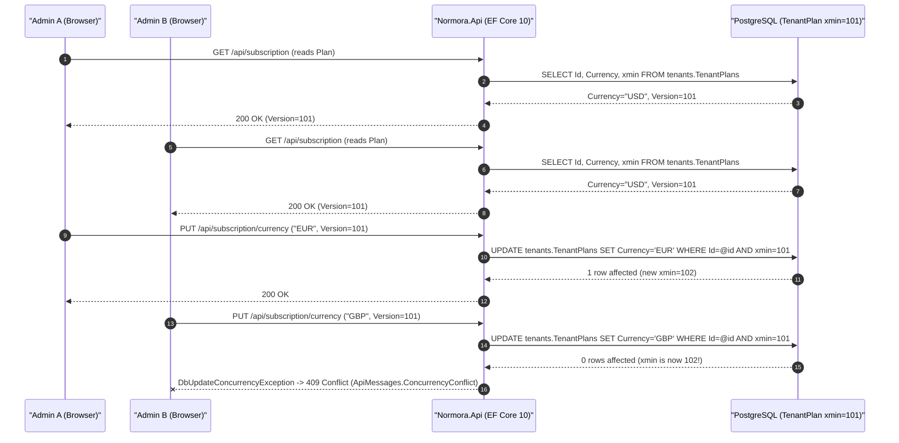
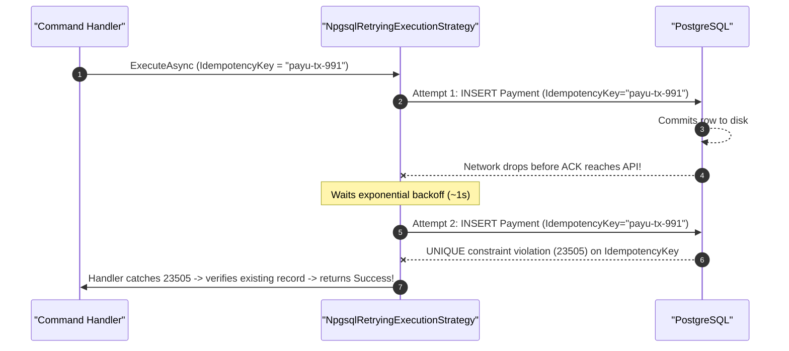
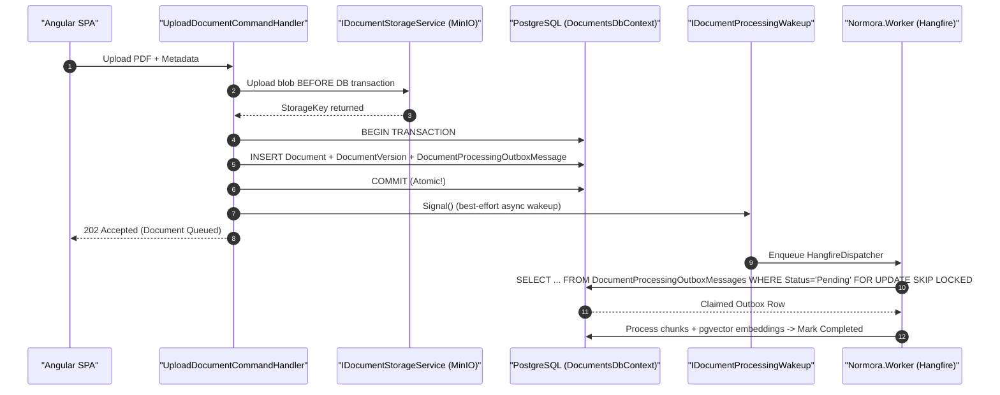
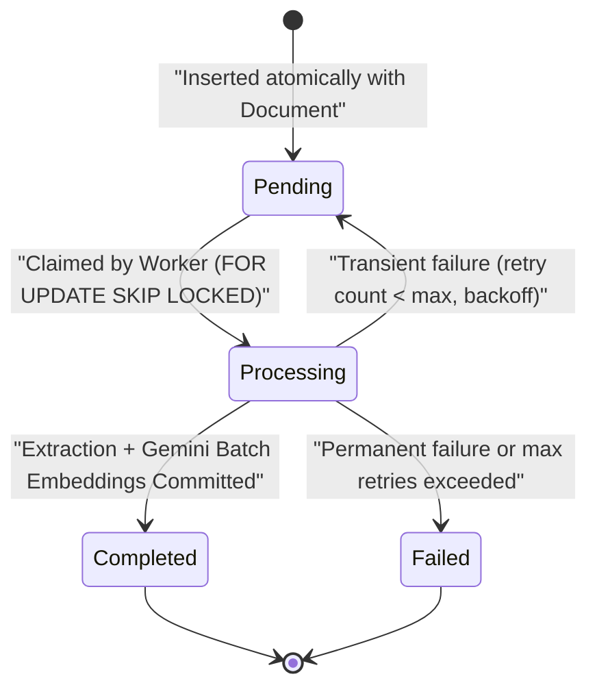

# Chapter 8: Transactions, Concurrency, and Resilience

## 1. Learning Objectives

By the end of this chapter, you will be able to:
*   Control database transactions explicitly in EF Core 10 using `BeginTransactionAsync`, **Savepoints**, and **Isolation Levels** to guarantee atomicity and read consistency across multi-step operations.
*   Implement **Optimistic Concurrency Control** using PostgreSQL `xmin` (`uint` + `.IsRowVersion()`), SQL Server `rowversion`, and application-managed concurrency tokens (`IsConcurrencyToken()` / HTTP `ETag`).
*   Resolve `DbUpdateConcurrencyException` cleanly using **Store Wins**, **Client Wins**, and **Three-Way Merge** strategies, and handle concurrency manually when using `ExecuteUpdateAsync`.
*   Use **Pessimistic Concurrency** (`SELECT ... FOR UPDATE`, `NOWAIT`, and `FOR UPDATE SKIP LOCKED`) safely for job queues, billing settlements, and quota reservations—and know when NOT to lock rows.
*   Configure EF Core **Execution Strategies** (`EnableRetryOnFailure` for PostgreSQL/Npgsql and SQL Server) paired with **Idempotency Keys** to survive transient network faults and deadlocks without duplicate writes.
*   Architect the **Transactional Outbox Pattern** and **Cross-Module Sagas** (as used in Normora's `Tenants`, `Documents`, and `Conversations` modules) to maintain eventual consistency without distributed 2PC locks.

## 2. Introduction

In a single-user prototype, database operations succeed sequentially. In a multi-tenant SaaS platform like **Normora**, hundreds of workspace members, Hangfire background workers, and payment webhooks might modify the same tenant plan, document permissions, or outbox queue at the exact same millisecond—while cloud networks drop connections or databases briefly throttle under load.

If your persistence layer is not designed for this reality, three failures occur:
1.  **Lost Updates:** Admin A updates a workspace's billing currency while Admin B (or a PayU webhook) updates the subscription tier, silently overwriting one another.
2.  **Inconsistent Side Effects (Dual-Write Bugs):** A document row commits to PostgreSQL, but the message to wake up the ingestion worker fails—leaving the document stuck in `Pending` forever; or worse, a file or email is dispatched for a database transaction that later rolls back.
3.  **Cascading Failures:** A momentary PostgreSQL serialization conflict (`40001`), deadlock (`40P01`), or connection blip throws an unhandled exception, failing HTTP requests with `500` errors.

Entity Framework Core 10 provides robust mechanisms to handle these enterprise realities: implicit and explicit transactions with savepoints, configurable isolation levels, optimistic concurrency tokens, raw-SQL escape hatches for pessimistic row locking, and retryable execution strategies.

This chapter transitions your EF Core knowledge from "it works on my machine" to "it survives Black Friday traffic and multi-node cloud failovers."

## 3. Core Concepts

### 3.1 Transactions (ACID), Implicit vs. Explicit Boundaries, and Savepoints

*   **What it is:** A database **transaction** is an all-or-nothing unit of work satisfying **ACID** (**A**tomicity, **C**onsistency, **I**solation, **D**urability). All statements inside the transaction either commit permanently together or roll back completely if any step fails.
*   **Implicit Transactions:** By default, EF Core's `SaveChanges()` and `SaveChangesAsync()` automatically wrap all tracked `INSERT`, `UPDATE`, and `DELETE` statements into a single implicit transaction. If you add a `Tenant`, a `Site`, and a `Charger` (or in Normora, a `Department` and an `AuditLog`), and the last insert violates a constraint, PostgreSQL/SQL Server rolls back the entire batch.
*   **Explicit Transactions & Savepoints:** When an operation requires multiple `SaveChangesAsync()` calls, mixes Change Tracker saves with `ExecuteUpdateAsync`/`ExecuteDeleteAsync`, or executes raw SQL in the same unit of work, you open an explicit boundary with `await context.Database.BeginTransactionAsync()`. Inside an explicit transaction, a **Savepoint** (`CreateSavepointAsync`) acts like a named bookmark allowing partial rollback (`RollbackToSavepointAsync`) of a failing sub-step without aborting earlier valid work in the same transaction.
*   **When NOT to use Explicit Transactions:** Do **not** wrap a single `SaveChangesAsync()` call in `BeginTransactionAsync()`. You gain zero extra atomicity, pay extra round-trip latency, hold database snapshots/locks longer, and break `EnableRetryOnFailure()` unless you manually wrap the block in an `ExecutionStrategy`. Also never span a single database transaction across external HTTP calls (Gemini, MinIO, PayU, Resend).

### 3.2 Database Isolation Levels and Read Phenomena

*   **What it is:** **Isolation** controls what concurrent transactions can see of each other's uncommitted or recently committed changes. Choosing the right isolation level balances **data consistency** against **throughput and contention**.
*   **Four Classic Read Phenomena:**
    1.  **Dirty Read:** Transaction A reads uncommitted changes made by Transaction B, which later rolls back.
    2.  **Non-Repeatable Read:** Transaction A reads a row (`TenantPlan.Currency = "USD"`), Transaction B commits an update (`"EUR"`), and Transaction A reads the same row again inside the same transaction and sees `"EUR"`.
    3.  **Phantom Read:** Transaction A runs a range query (`COUNT(*)` of active memberships = 10), Transaction B inserts an 11th membership and commits, and Transaction A re-runs the query and gets 11.
    4.  **Serialization Anomaly (Write Skew):** Two transactions read overlapping rows (e.g., two admins each read `9/10` seats used), each independently inserts a new membership, and both commit—violating the `<= 10` invariant even though neither overwrote the same row.
*   **How PostgreSQL (MVCC) vs. SQL Server Handle Isolation Levels:**
    *   `ReadCommitted` *(Default in PostgreSQL and SQL Server)*: Prevents dirty reads. Each statement sees data committed before *that statement* began. Non-repeatable reads and phantoms can still occur across statements in the same transaction.
    *   `RepeatableRead` *(Snapshot Isolation in PostgreSQL)*: Under PostgreSQL's **MVCC (Multi-Version Concurrency Control)**, `RepeatableRead` gives your transaction a frozen snapshot of the database from the moment the first query executes—preventing dirty reads, non-repeatable reads, and phantom reads without blocking readers! However, concurrent updates to the *same* row fail with a serialization error (`40001`), and write skew is still possible.
    *   `Serializable`: The strictest level. PostgreSQL uses **Serializable Snapshot Isolation (SSI)** (detecting read/write dependency cycles and aborting with SQLSTATE `40001` rather than blocking readers); SQL Server uses heavy key-range locks.
*   **When NOT to use `RepeatableRead` or `Serializable`:** Avoid them on high-throughput CRUD endpoints where occasional read skew does not matter. Under contention, `Serializable` causes `40001` aborts (requiring a retry loop) or severe lock waits in lock-based engines.

### 3.3 Optimistic vs. Pessimistic Concurrency

*   **Optimistic Concurrency:**
    *   *What & Why:* Assumes conflicts are rare. You read a row, release any database connection/lock immediately (crucial during HTTP think-time), edit the entity in C#, and verify at `SaveChangesAsync()` time that nobody modified the row in the meantime. Highly scalable and the default choice for web APIs.
    *   *When NOT to use:* Do not put optimistic concurrency tokens on ultra-hot single rows updated thousands of times per second (e.g., a global counter) where it creates retry storms, or on append-only logs (`AuditLogs`).
*   **Pessimistic Concurrency:**
    *   *What & Why:* Locks the database row the moment you read it (`SELECT ... FOR UPDATE` in PostgreSQL, `WITH (UPDLOCK, ROWLOCK)` in SQL Server) until the explicit transaction commits or rolls back. Other writers must wait (or skip with `FOR UPDATE SKIP LOCKED`, or fail immediately with `NOWAIT`). EF Core has no fluent LINQ method for row locks—you use `FromSqlInterpolated` / raw SQL inside an explicit transaction.
    *   *When NOT to use:* **Never** use pessimistic locking across HTTP user think-time or external API calls (MinIO, Gemini, PayU). A stalled client or slow API holds the database row lock and exhausts the connection pool.

### 3.4 Concurrency Tokens (`IsRowVersion`, PostgreSQL `xmin`, and Application Tokens)

To implement Optimistic Concurrency, you mark a property as a **Concurrency Token**. Whenever EF Core generates an `UPDATE` or `DELETE`, it adds `AND <TokenColumn> = @originalValue` to the `WHERE` clause:
*   **SQL Server (`rowversion`):** A `byte[]` property configured with `.IsRowVersion()` maps to an auto-incrementing 8-byte binary `rowversion` column.
*   **PostgreSQL (`xmin` via Npgsql):** PostgreSQL has no `rowversion` type. Instead, every table row has a built-in hidden system column called `xmin` (the transaction ID of the last insert/update). In **Npgsql EF Core**, declaring `public uint Version { get; private set; }` (or a shadow `uint`) and calling `.IsRowVersion()` maps it directly to PostgreSQL's `xmin` system column—zero extra storage overhead!
*   **Application-Managed Tokens (`IsConcurrencyToken()`):** A `Guid ConcurrencyStamp` or `int Version` property mutated in domain code (and configured with `.IsConcurrencyToken()`). Database-agnostic, works identically on PostgreSQL, SQL Server, and SQLite (great for in-memory/SQLite integration tests), and maps cleanly to HTTP `ETag` / `If-Match` headers.

### 3.5 Transient Faults, Execution Strategies, and Idempotency

Cloud databases (PostgreSQL in Kubernetes/managed RDS, Azure SQL) periodically drop connections for milliseconds during failovers, connection pool recycling, or load balancing, or abort transactions due to deadlocks (`40P01` in Postgres, `1205` in SQL Server) and serialization conflicts (`40001`). These are **transient faults**.

An **Execution Strategy** (`EnableRetryOnFailure` in Npgsql or SQL Server) automatically retries failed commands with exponential backoff. However, retrying is only safe when the operation is **idempotent** (running it twice produces the exact same final state as running it once—often enforced with a database `UNIQUE` constraint on an **Idempotency Key**).
*   **When NOT to use automatic retries:** Never place non-idempotent external I/O (sending an email, charging a card, uploading a new MinIO blob key) *inside* the Execution Strategy retry delegate, and avoid automatic retries on read endpoints where a circuit breaker + fast `503` is preferable to piling up threads during an outage.

## 4. Visual Diagrams

### Optimistic Concurrency Control Flow (PostgreSQL `xmin` / `RowVersion`)



### Connection Resiliency (Execution Strategy + Idempotency Key)



### Normora Transactional Outbox & Hangfire Worker Flow



### `DocumentProcessingOutboxMessage` Lifecycle



## 5. API Deep Dive

### 5.1 Explicit Transactions, Savepoints, and Connection Sharing

While `SaveChangesAsync()` creates an implicit transaction, you need an explicit boundary when calling `SaveChangesAsync()` multiple times, mixing Change Tracker saves with `ExecuteUpdateAsync`/`ExecuteDeleteAsync` or raw SQL, or using **Savepoints** for partial rollbacks.

```csharp
// EV Platform example: mixing EF Core Change Tracker with raw SQL atomically
await using var transaction = await context.Database.BeginTransactionAsync();

try
{
    context.Sites.Add(newSite);
    await context.SaveChangesAsync(); // Does not commit to DB yet!

    // Parameterized raw SQL executed within the SAME transaction
    var partId = 1;
    await context.Database.ExecuteSqlInterpolatedAsync(
        $"UPDATE Inventory SET Count = Count - 1 WHERE PartId = {partId}");

    await transaction.CommitAsync(); // Commits both operations atomically
}
catch (Exception)
{
    await transaction.RollbackAsync(); // Reverts everything
    throw;
}
```

#### Transaction Savepoints (Partial Rollback)
Savepoints let you roll back a failing sub-operation inside an active transaction without losing earlier valid statements:

```csharp
await using var transaction = await documentsDb.Database.BeginTransactionAsync();
try
{
    documentsDb.Documents.Add(document);
    await documentsDb.SaveChangesAsync();

    await transaction.CreateSavepointAsync("BeforeOptionalTagSync");
    try
    {
        await documentsDb.SaveChangesAsync(); // Optional metadata batch
    }
    catch (DbUpdateException)
    {
        // Reverts only changes after the savepoint; document insert remains intact
        await transaction.RollbackToSavepointAsync("BeforeOptionalTagSync");
    }

    await transaction.CommitAsync();
}
catch
{
    await transaction.RollbackAsync();
    throw;
}
```

> [!NOTE]
> **When NOT to use Explicit Transactions or Savepoints:** Never open `BeginTransactionAsync()` around a single `SaveChangesAsync()` call—EF Core already executes it in an implicit transaction. Also avoid Savepoints inside retry loops unless you clear and rebuild the Change Tracker, because rolling back to a savepoint does **not** revert in-memory tracked entity states in `DbContext.ChangeTracker`.

#### Real-World Normora Examples: Transactions & Savepoints
1. **Implicit Transaction (`Tenants` Module — `CreateDepartmentCommandHandler`):** Creating a `Department` and an `AuditLog` entry inside `TenantsDbContext` requires only a single `await db.SaveChangesAsync(ct)` call. Both rows commit or roll back together with zero boilerplate.
2. **Explicit Transaction Mixing `SaveChangesAsync` + `ExecuteUpdateAsync` (`Documents` Module — `PublishDocumentVersionCommandHandler`):** When activating a new `DocumentVersion`, the handler runs `ExecuteUpdateAsync` to deactivate prior versions (`IsActive = false`) and `SaveChangesAsync()` to insert the new active version inside one `BeginTransactionAsync()`, because `ExecuteUpdateAsync` executes immediately outside `SaveChangesAsync()`.
3. **Savepoint Recovery (`Documents` Module — `IngestDocumentChunksCommandHandler`):** When persisting extracted `DocumentChunk` rows with pgvector embeddings, a savepoint before optional suggested-question generation lets the worker roll back only the optional suggestions if a constraint check fails, without losing expensive Gemini embeddings.
4. **Sharing One Connection Across DbContext and Dapper (`Documents` Module — Hybrid Search Metrics):** If a module runs a bulk Dapper `COPY` or pgvector query alongside EF Core writes on the *same* `DocumentsDbContext` connection, `await connection.OpenAsync()` + `documentsDb.Database.UseTransactionAsync(dbTransaction)` keeps both in one PostgreSQL transaction.
5. **Explicitly Avoiding Cross-Module Transactions (`UploadDocumentCommandHandler`):** `DocumentsDbContext` and `TenantsDbContext` must **never** share a transaction (100% DbContext encapsulation). Instead, `Documents` checks tenant storage quotas via a MediatR query (`Normora.Shared.Contracts.Tenants`) before committing its local `DocumentsDbContext` transaction.

### 5.2 Database Isolation Levels in EF Core

Use `BeginTransactionAsync(IsolationLevel)` when default `ReadCommitted` semantics allow read skew or serialization anomalies:

```csharp
using System.Data;
using Microsoft.EntityFrameworkCore;

await using var transaction = await tenantsDb.Database
    .BeginTransactionAsync(IsolationLevel.RepeatableRead, ct);

// In PostgreSQL, RepeatableRead provides a consistent MVCC snapshot across all queries
var plan = await tenantsDb.TenantPlans
    .AsNoTracking()
    .FirstOrDefaultAsync(p => p.TenantId == request.TenantId, ct);

var activeMembers = await tenantsDb.TenantMemberships
    .CountAsync(m => m.TenantId == request.TenantId && m.IsActive, ct);

await transaction.CommitAsync(ct);
```

#### Real-World Normora Examples: Isolation Levels
1. **`ReadCommitted` (Default — `GetConversationsQueryHandler`):** Standard `ConversationsDbContext` queries and single-row edits use PostgreSQL's default `ReadCommitted`, avoiding snapshot overhead and serialization aborts.
2. **`RepeatableRead` / PostgreSQL Snapshot (`GenerateTenantUsageReportQueryHandler`):** Reading `TenantPlan` limits, `TenantMemberships` count, and `UserGroups` count for billing/dashboard usage cards uses `IsolationLevel.RepeatableRead` so concurrent membership invites mid-query cannot cause mismatched totals (Read Skew).
3. **`Serializable` (`SeatAllocationCommandHandler` in `Tenants`):** Enforcing strict workspace seat caps (`activeMembers + pendingInvites <= plan.MaxSeats`) where two admins invite users concurrently can use `IsolationLevel.Serializable` (paired with `EnableRetryOnFailure` to automatically retry `40001` serialization failures).
4. **Preventing Phantom Reads (`AuditExportQueryHandler` in `Tenants`):** Exporting paginated `AuditLogs` with a total header count inside `RepeatableRead` ensures newly appended audit rows mid-export don't shift page offsets or mismatch the exported count.
5. **When NOT to use `Serializable` (`SendMessageCommandHandler` in `Conversations`):** Streaming RAG chat turns (`ConversationsDbContext`) should never run under `Serializable`—high concurrency across conversation turns would trigger unnecessary `40001` serialization retries and degrade SignalR/SSE latency.

### 5.3 Configuring Concurrency Tokens (PostgreSQL `xmin`, SQL Server `rowversion`, and Application Tokens)

In SQL Server, `IsRowVersion()` on a `byte[]` property maps to an auto-incrementing 8-byte `rowversion` column:

```csharp
public class Charger
{
    public int Id { get; set; }
    public string Status { get; set; } = string.Empty;

    // SQL Server rowversion token
    public byte[] Version { get; set; } = [];
}

public class ChargerConfiguration : IEntityTypeConfiguration<Charger>
{
    public void Configure(EntityTypeBuilder<Charger> builder)
    {
        builder.Property(c => c.Version)
               .IsRowVersion(); // Configures Optimistic Concurrency!
    }
}
```

In **PostgreSQL (Npgsql)**, there is no `rowversion` type. Instead, configuring `.IsRowVersion()` on a `uint` property maps directly to PostgreSQL's built-in `xmin` system column—requiring zero extra schema columns:

```csharp
// Normora Tenants Module: parameterless configuration per AGENTS.md
public sealed class TenantPlan
{
    public Guid Id { get; private set; }
    public Guid TenantId { get; private set; }
    public string Currency { get; private set; } = "USD";
    public uint Version { get; private set; } // Mapped to PostgreSQL xmin
}

public sealed class TenantPlanConfiguration : IEntityTypeConfiguration<TenantPlan>
{
    public void Configure(EntityTypeBuilder<TenantPlan> builder)
    {
        builder.Property(p => p.Version)
               .IsRowVersion(); // Npgsql maps uint + IsRowVersion() to PostgreSQL xmin!
    }
}
```

For database-agnostic concurrency tokens (or HTTP `ETag` headers), use `.IsConcurrencyToken()` on an application-managed `Guid ConcurrencyStamp`:

```csharp
public sealed class DocumentConfiguration : IEntityTypeConfiguration<Document>
{
    public void Configure(EntityTypeBuilder<Document> builder)
    {
        builder.Property(d => d.ConcurrencyStamp)
               .IsConcurrencyToken();
    }
}
```

#### Real-World Normora Examples: Concurrency Tokens
1. **PostgreSQL `xmin` on `TenantPlan` (`Tenants`):** Protects `UpdateTenantCurrencyCommandHandler` (`PUT /api/subscription/currency`) and PayU webhook updates (`PayUPaymentService` callbacks) from silently overwriting each other's currency or tier.
2. **Application `Guid ConcurrencyStamp` + HTTP `ETag` on `Document` (`Documents`):** Two admins editing a document's department visibility send `If-Match: "<stamp>"`. The handler validates and rotates `ConcurrencyStamp = Guid.NewGuid()`, letting EF Core enforce the check in SQL.
3. **Manual Concurrency Token in `ExecuteUpdateAsync` (`Conversations` — `ApprovalsController` HITL):** `ExecuteUpdateAsync` bypasses the Change Tracker, so EF Core does **not** automatically check concurrency tokens! For Normora's 15-minute TTL `PendingApproval` (e.g., approving `documents_delete`), enforce the token explicitly in `.Where(...)`:
   ```csharp
   var updated = await conversationsDb.PendingApprovals
       .Where(a => a.Id == command.ApprovalId
                && a.TenantId == tenantContext.TenantId
                && a.Status == ApprovalStatus.Pending
                && a.Version == command.ExpectedVersion)
       .ExecuteUpdateAsync(s => s
           .SetProperty(a => a.Status, ApprovalStatus.Approved)
           .SetProperty(a => a.ApprovedAtUtc, DateTimeOffset.UtcNow), ct);

   if (updated == 0)
       throw new InvalidOperationException(ApiMessages.ConcurrencyConflict);
   ```
4. **Aggregate Root Versioning (`Documents` — `UpdateDocumentAccessCommandHandler`):** When modifying child `DocumentGroupAccess` rows, explicitly rotate the parent `Document.ConcurrencyStamp` (or call `documentsDb.Entry(document).Property(d => d.UpdatedAtUtc).CurrentValue = DateTimeOffset.UtcNow`) so two admins editing different group permissions on the same document cannot produce conflicting visibility states.
5. **When NOT to use Concurrency Tokens (`Tenants` — `AuditLog`, `Conversations` — `Message` append):** Append-only entities (`AuditLog`, `DocumentProcessingOutboxMessage` inserts) and high-frequency counters (`Document.QueryCount`) should **not** use optimistic concurrency tokens; increment counters atomically via `ExecuteUpdateAsync(s => s.SetProperty(d => d.QueryCount, d => d.QueryCount + 1))`.

### 5.4 Resolving `DbUpdateConcurrencyException` (Store Wins, Client Wins, Custom Merge)

When `SaveChangesAsync()` throws `DbUpdateConcurrencyException`, you have three resolution patterns:

```csharp
// Normora Tenants Module: UpdateUserGroupCommandHandler conflict resolution
try
{
    await tenantsDb.SaveChangesAsync(ct);
}
catch (DbUpdateConcurrencyException ex)
{
    var entry = ex.Entries.Single();
    var databaseValues = await entry.GetDatabaseValuesAsync(ct);

    if (databaseValues is null)
        throw new BolaException(); // Row was deleted; Normora maps BOLA/missing resource to 404

    var currentValues = entry.CurrentValues;
    var originalValues = entry.OriginalValues;

    // Strategy 1: Store Wins (Recommended for UI edits — inform user to refresh)
    // await entry.ReloadAsync(ct);
    // throw new ConflictException(ApiMessages.ConcurrencyConflict);

    // Strategy 2: Client Wins (Overwrite DB with caller's values)
    // entry.OriginalValues.SetValues(databaseValues);
    // await tenantsDb.SaveChangesAsync(ct);

    // Strategy 3: Three-Way Custom Merge (e.g., preserve non-conflicting fields)
    var dbGroup = (UserGroup)databaseValues.ToObject();
    var clientGroup = (UserGroup)currentValues.ToObject();
    var originalGroup = (UserGroup)originalValues.ToObject();

    // If admin only changed Description while another admin renamed the group:
    if (clientGroup.Name == originalGroup.Name && dbGroup.Name != originalGroup.Name)
    {
        currentValues[nameof(UserGroup.Name)] = dbGroup.Name; // Keep DB Name
        entry.OriginalValues.SetValues(databaseValues);       // Refresh token/originals
        await tenantsDb.SaveChangesAsync(ct);
    }
    else
    {
        throw new InvalidOperationException(ApiMessages.ConcurrencyConflict);
    }
}
```

### 5.5 Pessimistic Locking (`FOR UPDATE`, `NOWAIT`, `SKIP LOCKED`)

Because EF Core has no native fluent API for row locks, drop down to `FromSqlInterpolated` inside an **explicit transaction**:

```csharp
// Normora.Worker: Claiming Outbox Messages safely across multiple worker pods
await using var transaction = await documentsDb.Database.BeginTransactionAsync(ct);

var pendingMessages = await documentsDb.OutboxMessages
    .FromSqlInterpolated($"""
        SELECT * FROM documents."DocumentProcessingOutboxMessages"
        WHERE "Status" = 'Pending' AND "AvailableAtUtc" <= NOW()
        ORDER BY "CreatedAtUtc"
        LIMIT 10
        FOR UPDATE SKIP LOCKED
        """)
    .ToListAsync(ct);

foreach (var msg in pendingMessages)
    msg.MarkProcessing(workerId);

await documentsDb.SaveChangesAsync(ct);
await transaction.CommitAsync(ct);
```

#### Real-World Normora Examples: Pessimistic Locking
1. **`FOR UPDATE SKIP LOCKED` (`HangfireDocumentProcessingOutboxDispatcher`):** Multiple `Normora.Worker` instances claim batches of `DocumentProcessingOutboxMessage` rows concurrently without blocking each other or double-processing the same PDF.
2. **`FOR UPDATE` (`ProcessPayUCallbackCommandHandler` in `Tenants`):** Locks the target `TenantSubscription` row while verifying `udf3 = "{currency}:{cycle}"` and transitioning billing status so duplicate PayU webhook deliveries serialize cleanly.
3. **`FOR UPDATE NOWAIT` (`ApproveAgentToolActionCommandHandler` in `Conversations`):** Locks the `PendingApproval` row with `NOWAIT` so if a user double-clicks the A2UI approval card in two tabs, the second request fails immediately instead of waiting and double-deleting a document.
4. **`FOR UPDATE` on Parent Row for Seat Cap (`InviteEmployeeCommandHandler` in `Tenants`):** Locking the `TenantPlan` row (`SELECT * FROM tenants."TenantPlans" WHERE "TenantId" = {tenantId} FOR UPDATE`) serializes concurrent employee invitations for the same tenant without blocking other tenants!
5. **When NOT to use Pessimistic Locking (`GeminiDocumentTextExtractor` / `MinioDocumentStorageService`):** Never hold a `FOR UPDATE` row lock while calling Gemini OCR/embeddings or uploading to MinIO—a 15-second Gemini call would pin PostgreSQL connections and starve the entire API pool.

### 5.6 Configuring Execution Strategies (PostgreSQL Npgsql & SQL Server)

Configured during `DbContext` registration in `Program.cs` or `DatabaseServiceExtensions.cs`:

```csharp
// EV Platform SQL Server Example
builder.Services.AddDbContext<EvDbContext>(options =>
{
    options.UseSqlServer(connectionString, sqlOptions =>
    {
        // Enables automatic retries for transient SQL errors
        sqlOptions.EnableRetryOnFailure(
            maxRetryCount: 3,
            maxRetryDelay: TimeSpan.FromSeconds(5),
            errorNumbersToAdd: null);
    });
});
```

```csharp
// Normora PostgreSQL (Npgsql) Module DbContext Registration in DatabaseServiceExtensions.cs
services.AddDbContext<DocumentsDbContext>(options =>
{
    options.UseNpgsql(connectionString, npgsqlOptions =>
    {
        npgsqlOptions.UseVector(); // pgvector support
        npgsqlOptions.MigrationsHistoryTable("__EFMigrationsHistory", "documents");
        npgsqlOptions.EnableRetryOnFailure(
            maxRetryCount: 3,
            maxRetryDelay: TimeSpan.FromSeconds(5),
            errorCodesToAdd: ["40001", "40P01"]); // Serialization failure & deadlock
    });
});
```

#### Real-World Normora Examples: Execution Strategies & Idempotency
1. **Per-Module Npgsql Retry Configuration (`DatabaseServiceExtensions.cs`):** `TenantsDbContext`, `DocumentsDbContext`, and `ConversationsDbContext` each configure `EnableRetryOnFailure` with schema-isolated `__EFMigrationsHistory` tables.
2. **Idempotent PayU Payment Recording (`Tenants`):** `PayUTransaction` enforces a `UNIQUE` index on `ExternalTransactionId` (`txnid`). If PostgreSQL commits and the connection drops before ACK, Npgsql's retry hits `23505` (unique violation), which the handler recognizes as already committed.
3. **Idempotent Conversational Turn Persistence (`Conversations`):** `SaveConversationTurnCommandHandler` writes a client-supplied `IdempotencyTurnId` (`Guid`) with a `UNIQUE` constraint so SSE stream reconnects or transient DB retries never duplicate assistant messages.
4. **Deadlock Survival on Concurrent Tag/Chunk Updates (`Documents`):** Adding PostgreSQL error code `"40P01"` (deadlock detected) and `"40001"` (serialization failure) lets `NpgsqlRetryingExecutionStrategy` recover automatically without surfacing `500` errors to the Angular SPA.
5. **When NOT to rely on `EnableRetryOnFailure` (`Normora.Api` `--migrate` host):** Ephemeral migrations (`MigrationHostExtensions.RunMigrationsAsync`) and Hangfire job dispatchers wrapping non-idempotent MinIO/Gemini calls should keep external SDK calls **outside** the EF Core execution strategy retry delegate.

## 6. EF Core Internals: The Concurrency Check

When you call `SaveChangesAsync()` on an entity configured with `IsRowVersion()`, EF Core appends the original token value to the `WHERE` clause and reads back the new token in one round-trip.

**SQL Server (`rowversion`):**
```sql
-- Normal Update
UPDATE [Chargers] SET [Status] = 'Faulted' WHERE [Id] = 1;

-- Concurrency Update (Generated by EF Core)
UPDATE [Chargers] SET [Status] = 'Faulted' 
WHERE [Id] = 1 AND [Version] = 0x00000000000007D1; -- <--- The crucial check
```

**PostgreSQL / Npgsql (`xmin`):**
```sql
-- Concurrency Update generated by Npgsql EF Core
UPDATE tenants."TenantPlans"
SET "Currency" = @p0
WHERE "Id" = @p1 AND xmin = @p2
RETURNING xmin; -- Reads back the new transaction ID in the same round-trip
```

EF Core then inspects the `RowsAffected` returned by ADO.NET:
*   If `RowsAffected == 1`: Success (and EF Core updates the tracked entity's `Version` / `xmin` with the new database value).
*   If `RowsAffected == 0`: EF Core immediately throws a `DbUpdateConcurrencyException` and rolls back the implicit transaction. The row existed when loaded, but its token changed (or it was deleted) before your `UPDATE` ran.

## 7. Complete Examples: EV Platform & Normora Case Studies

### Case Study A: EV Platform ("Book a Charging Slot")
Two drivers (Driver A and Driver B) see an open slot at 12:00 PM and click "Book" at the exact same time. Without Concurrency Control, Driver B overwrites Driver A's booking.

```csharp
public async Task<bool> BookSlotAsync(int slotId, Guid driverId)
{
    var slot = await _context.ChargingSlots.FindAsync(slotId);
    
    if (slot is null || slot.IsBooked) return false;

    slot.IsBooked = true;
    slot.DriverId = driverId;

    try
    {
        await _context.SaveChangesAsync();
        return true; // Success for Driver A
    }
    catch (DbUpdateConcurrencyException ex)
    {
        // This hits for Driver B: the row was modified by someone else.
        _logger.LogWarning(ex, "Concurrency conflict for slot {SlotId}", slotId);
        return false;
    }
}
```

### Case Study B: Normora (`Tenants` Module) — Updating Workspace Currency with `xmin`, BOLA/BFLA, and `ApiMessages`
Notice how Normora enforces primary constructors, explicit `TenantId` filtering on `TenantsDbContext`, BOLA (`404`) vs BFLA (`403`), and `ApiMessages` constants (no magic strings):

```csharp
public sealed class UpdateTenantCurrencyCommandHandler(
    TenantsDbContext tenantsDb,
    ICurrentUserService currentUser,
    IWorkspaceStateSynchronizer stateSynchronizer,
    ILogger<UpdateTenantCurrencyCommandHandler> logger)
    : IRequestHandler<UpdateTenantCurrencyCommand, TenantPlanDto>
{
    public async Task<TenantPlanDto> Handle(
        UpdateTenantCurrencyCommand request,
        CancellationToken ct)
    {
        if (!currentUser.HasPermission(Permissions.ManageBilling))
            throw new BflaException(); // 403 Forbidden

        // TenantsDbContext has no global TenantId filter -> filter explicitly!
        var plan = await tenantsDb.TenantPlans
            .FirstOrDefaultAsync(p => p.TenantId == request.TenantId, ct)
            ?? throw new BolaException(); // 404 Not Found (prevents tenant enumeration)

        // Apply caller's original xmin so EF Core checks against what the UI loaded
        tenantsDb.Entry(plan).Property(p => p.Version).OriginalValue = request.ExpectedVersion;

        plan.UpdateCurrency(request.Currency);

        try
        {
            await tenantsDb.SaveChangesAsync(ct);
        }
        catch (DbUpdateConcurrencyException ex)
        {
            logger.LogWarning(ex, "Currency update conflict for Tenant {TenantId}", request.TenantId);
            throw new InvalidOperationException(ApiMessages.ConcurrencyConflict);
        }

        // Broadcast monotonic dataVersion change AFTER commit via SignalR Redis backplane
        await stateSynchronizer.NotifyTenantUpdatedAsync(request.TenantId, ct);

        return TenantPlanDto.FromEntity(plan);
    }
}
```

### Case Study C: Normora (`Documents` Module) — Atomic Upload + Transactional Outbox
Observe how external MinIO object upload happens **before** the database transaction, and `Document` + `DocumentVersion` + `DocumentProcessingOutboxMessage` commit atomically in `DocumentsDbContext` (which dynamically applies `_tenantContext.TenantId` global query filters):

```csharp
public sealed class UploadDocumentCommandHandler(
    DocumentsDbContext documentsDb,
    IDocumentStorageService storageService, // Provider-neutral port (MinIO in Infrastructure)
    IDocumentProcessingWakeup processingWakeup,
    ITenantContext tenantContext)
    : IRequestHandler<UploadDocumentCommand, UploadDocumentResultDto>
{
    public async Task<UploadDocumentResultDto> Handle(
        UploadDocumentCommand request,
        CancellationToken ct)
    {
        var tenantId = tenantContext.TenantId
            ?? throw new InvalidOperationException(ApiMessages.TenantContextMissing);

        // 1. External S3/MinIO upload runs OUTSIDE the DB transaction to avoid holding locks
        var storageKey = await storageService.UploadAsync(
            tenantId, request.FileStream, request.FileName, request.ContentType, ct);

        var strategy = documentsDb.Database.CreateExecutionStrategy();

        var document = await strategy.ExecuteAsync(async () =>
        {
            documentsDb.ChangeTracker.Clear(); // Safe clean slate on retries

            var doc = Document.Create(tenantId, request.Title, request.DepartmentId);
            var version = doc.AddVersion(storageKey, request.ContentHash);
            var outbox = DocumentProcessingOutboxMessage.CreatePending(tenantId, doc.Id, version.Id);

            documentsDb.Documents.Add(doc);
            documentsDb.OutboxMessages.Add(outbox);

            await documentsDb.SaveChangesAsync(ct); // Single implicit atomic transaction
            return doc;
        });

        // 2. Best-effort Hangfire wakeup AFTER commit (minutely recurring job recovers if this fails)
        await processingWakeup.SignalAsync(document.Id, ct);

        return new UploadDocumentResultDto(document.Id, document.Status);
    }
}
```

## 8. ASP.NET Core Integration: Execution Strategies and Explicit Transactions

There is a massive architectural gotcha when you combine Explicit Transactions (`BeginTransactionAsync`) with Connection Resiliency (`EnableRetryOnFailure`).

If an execution strategy is enabled and your code calls `BeginTransactionAsync()` directly, EF Core throws an `InvalidOperationException`. Why? Because the strategy cannot retry a transaction unless it owns the entire unit of work from `BeginTransactionAsync` through `CommitAsync`—otherwise it cannot guarantee that code *before* the transaction block is idempotent.

**The Solution: Manually Invoking `CreateExecutionStrategy().ExecuteAsync()`**

If you need an explicit transaction in an application with resiliency enabled, you *must* wrap the transaction logic inside `strategy.ExecuteAsync(...)` (and clear the `ChangeTracker` at the start of each attempt so failed entities from attempt 1 don't linger into attempt 2!):

```csharp
public async Task ProcessComplexOrder()
{
    // 1. Get the execution strategy configured in Program.cs
    var strategy = _context.Database.CreateExecutionStrategy();

    // 2. Wrap your transaction inside the strategy
    await strategy.ExecuteAsync(async () =>
    {
        _context.ChangeTracker.Clear(); // Reset tracked state before each retry attempt

        await using var transaction = await _context.Database.BeginTransactionAsync();

        try
        {
            _context.Orders.Add(new Order());
            await _context.SaveChangesAsync();

            var orderId = 1;
            await _context.Database.ExecuteSqlInterpolatedAsync(
                $"UPDATE Inventory SET Reserved = Reserved + 1 WHERE OrderId = {orderId}");

            await transaction.CommitAsync();
        }
        catch (Exception)
        {
            await transaction.RollbackAsync();
            throw; // Rethrowing lets the strategy evaluate if the fault is transient
        }
    });
}
```

**Normora Example (`CreateWorkspaceCommandHandler` in `Tenants`):**
When onboarding a new organization in Normora, creating the `Tenant`, initial `TenantMembership` (admin), default `Department`, and Free-tier `TenantPlan` across multiple `SaveChangesAsync()` steps wraps `BeginTransactionAsync` inside `tenantsDb.Database.CreateExecutionStrategy().ExecuteAsync(...)`, using `tenantsDb.ChangeTracker.Clear()` at the top of the delegate so any transient PostgreSQL `40001` or `40P01` retry starts cleanly.

## 9. Clean Architecture & Modular Monolith Perspective

### Where do transactions belong?
In Clean Architecture, transactions belong strictly in the **Application Layer** (Use Cases / Command Handlers). The Domain Layer should know nothing about databases. The Infrastructure layer implements persistence adapters/repositories, but it should not commit transactions prematurely because a single Command Handler might coordinate changes across multiple aggregates.

*Architectural Pattern:* The **Unit of Work (`IUnitOfWork`)**. In EF Core, the `DbContext` *is* the Unit of Work. In a Modular Monolith like **Normora**, each module owns its own private `DbContext` (`TenantsDbContext`, `DocumentsDbContext`, `ConversationsDbContext`). Command handlers mutate entities inside their own module's `DbContext` and call `await db.SaveChangesAsync(ct)` once at the end of the handler. Other modules and API controllers never inject another module's `DbContext`; cross-module workflows communicate strictly through MediatR contracts in `Normora.Shared.Contracts.*`.

### The Outbox Pattern (Eventual Consistency)
If your Command Handler saves data to EF Core **and** dispatches a background job, publishes an event to a Message Broker, or notifies another process over Redis/SignalR, you have a **dual-write problem**. If `SaveChangesAsync()` succeeds, but the network call to the queue/broker fails, your system is permanently inconsistent. Conversely, if you publish the event *before* `SaveChangesAsync()` and the database rolls back, consumers react to phantom state that never existed.

The **Transactional Outbox Pattern** solves this in a single local database transaction:
1. Mutate the Domain Entity (e.g., `Charger.Status = "Faulted"` or create `Document` + `DocumentVersion`).
2. Create an `OutboxMessage` entity containing the serialized work/event payload.
3. Add both to the **same** `DbContext`.
4. Call `await db.SaveChangesAsync(ct)` (one atomic commit to PostgreSQL or SQL Server).
5. A background worker (`Normora.Worker` via Hangfire, or a polling service) claims pending outbox rows (using `FOR UPDATE SKIP LOCKED` in PostgreSQL), executes/publishes them, and marks them `Completed`—guaranteeing **At-Least-Once** delivery.

#### Real-World Normora Examples: Outbox & Unit of Work
1. **Document Upload Outbox (`Documents` — `UploadDocumentCommandHandler`):** Inserts `Document`, `DocumentVersion`, and `DocumentProcessingOutboxMessage` in one atomic `DocumentsDbContext.SaveChangesAsync(ct)` transaction, then calls `IDocumentProcessingWakeup.SignalAsync()` after commit.
2. **Worker Claim & Recovery (`Normora.Worker` — `HangfireDocumentProcessingOutboxDispatcher`):** Immediately wakes up to claim outbox rows, backed by a minutely recurring Hangfire recovery job so even a crashed API pod never leaves an uploaded PDF unprocessed.
3. **Post-Commit SignalR & `dataVersion` Broadcast (`Tenants` — `IWorkspaceStateSynchronizer`):** Mutations to `UserGroups`, `Departments`, or `TenantPlan` commit in `TenantsDbContext` *first*; only after `SaveChangesAsync(ct)` succeeds does the handler increment `dataVersion` and broadcast over the Redis SignalR backplane to Angular `effect()` observers.
4. **Invitation & Escalation Emails without Raw Error Leaks (`Tenants` / `Conversations`):** Invitation and HR escalation handlers persist `TenantInvitation` or `HrEscalation` records first, then enqueue email dispatch in Hangfire. Per Normora's CWE-209 security rule, failure notifications map strictly to `ApiMessages` constants rather than exposing `exception.Message`.
5. **HITL Destructive Tool Execution (`Conversations` — `ApprovalsController`):** When an AI agent proposes `documents_delete`, `PendingApproval` is committed with a 15-minute TTL before streaming the A2UI confirmation card; execution via MediatR (`ExecuteMcpToolCommand`) only occurs after the approval row atomically transitions from `Pending` to `Approved`.

> [!NOTE]
> **When NOT to use the Outbox Pattern:** Do not introduce an Outbox table for purely synchronous, single-module database writes with no downstream side effects, or for fire-and-forget telemetry/metrics where occasional loss is acceptable. Every Outbox adds table growth, polling/wakeup complexity, and requires idempotent consumers.

## 10. Enterprise SaaS Perspective: Cross-Database & Cross-Module Transactions

In a Microservices architecture (or a strictly encapsulated Modular Monolith like Normora), you may need to coordinate state across `BillingDb` and `EvOperationsDb`, or across Normora's `Tenants`, `Documents`, and `Conversations` modules.

Historically, .NET relied on `TransactionScope` and the **Microsoft Distributed Transaction Coordinator (MSDTC)** to achieve this via Two-Phase Commit (2PC).
**Architectural Reality:**
*   **`TransactionScope` async trap:** Whenever you use `TransactionScope` in modern async `.NET 10` code, you **must** pass `TransactionScopeAsyncFlowOption.Enabled`; otherwise `await` switches threads and corrupts or loses the ambient transaction.
*   **Cloud & PostgreSQL reality:** Linux containers, Docker, PostgreSQL, and cloud-managed PaaS databases do not participate in MSDTC distributed 2PC across disparate databases/providers. Even where Elastic Transactions exist on specific homogeneous platforms, distributed locks destroy scalability and availability.

To achieve consistency in a modern Enterprise SaaS, the Architect must abandon distributed ACID locks and implement the **Saga Pattern** using asynchronous messaging, **idempotent handlers**, and **compensating transactions** (undo commands).

**Normora Cross-Module Saga Example (Workspace Purge / Offboarding):**
When an enterprise admin deletes a workspace, `TenantsDbContext`, `DocumentsDbContext`, and `ConversationsDbContext` are strictly encapsulated in separate schemas/modules:
1. `Tenants` marks the `Tenant` status as `Deleting` in `TenantsDbContext` (local ACID commit) and schedules a Hangfire purge orchestrator.
2. The orchestrator dispatches MediatR/module purge commands to `Conversations` (deleting threads/messages) and `Documents` (deleting `DocumentChunk` pgvector rows and MinIO blobs via `IDocumentStorageService`).
3. Each step is **idempotent** (re-running on a already-deleted tenant/blob succeeds cleanly). Once both modules confirm purge, `Tenants` finalizes deletion—zero cross-module `DbContext` coupling and zero distributed locks.

## 11. Real Production Case Study

### Case Study 1: EV Platform — Duplicate Invoices from Retries
In our EV Platform, we experienced transient failures during peak load. The Azure SQL Database would periodically throttle connections (Error `10928`) for 2 seconds. Because we did not have an Execution Strategy configured, our API instantly returned `500 Internal Server Error` to the mobile app.

We enabled `EnableRetryOnFailure()` in `Program.cs`. Immediately, 99% of our `500` errors disappeared—the API paused briefly and retried successfully.

However, we introduced a new bug: **Duplicate Invoices**.
The sequence was:
1. API calls `SaveChangesAsync()` to create an Invoice.
2. SQL Server commits the invoice.
3. The network drops exactly as SQL Server sends the "Success" response back to the API.
4. The API assumes failure and throws a transport exception.
5. The Execution Strategy catches it and retries.
6. SQL Server creates a *second* duplicate invoice.

**The Fix: Idempotency Keys.**
When creating an entity inside an Execution Strategy, the Application Layer generates a unique `IdempotencyKey` (`Guid`) and passes it to the command. The database enforces a `UNIQUE CONSTRAINT` on this key. When the strategy retries, the second `SaveChangesAsync()` hits the unique constraint violation, and the handler catches it, clears the Change Tracker, verifies the existing invoice, and returns success—acknowledging the first attempt committed.

### Case Study 2: Normora — PayU Callback & Document Outbox Idempotency
In Normora's `Tenants` module, PayU payment webhooks can arrive twice within 200ms (user browser redirect + server-to-server webhook callback) while `NpgsqlRetryingExecutionStrategy` may also retry transient PostgreSQL serialization errors (`40001`). By combining:
1. A `UNIQUE` constraint on `PayUTransaction.TransactionReference` (`txnid`),
2. `SELECT ... FOR UPDATE` on `TenantPlan` inside `strategy.ExecuteAsync(...)`, and
3. `TenantPlan.Version` (`xmin`) optimistic checks on interactive currency/plan UI edits,

Normora guarantees that a paid `Pro` or `Enterprise` upgrade is applied **exactly once**, even under concurrent callbacks and network retries.

## 12. Common Mistakes & Anti-Patterns

> [!CAUTION]
> **Beginner Mistake: Calling `SaveChangesAsync()` inside a `foreach` loop**
>
> **Wrong Code:**
> ```csharp
> foreach (var item in request.DepartmentIds)
> {
>     documentsDb.DocumentDepartmentAccess.Add(new DocumentDepartmentAccess(docId, item));
>     await documentsDb.SaveChangesAsync(ct); // N separate DB transactions & round-trips!
> }
> ```
> **Why It's Wrong:** Each `SaveChangesAsync()` opens a separate implicit transaction, flushes the WAL/log, and pays a network round-trip. Worse, if the 4th item fails, the first 3 are already permanently committed (breaking atomicity).
>
> **Fix:** Stage all changes in memory and call `await documentsDb.SaveChangesAsync(ct)` **once** after the loop so EF Core commits them in one batched, atomic transaction.

> [!CAUTION]
> **Intermediate Mistake: Swallowing `DbUpdateConcurrencyException` or forgetting `ChangeTracker.Clear()` on retry**
>
> **Wrong Code:**
> ```csharp
> try { await tenantsDb.SaveChangesAsync(ct); }
> catch (DbUpdateConcurrencyException ex)
> {
>     logger.LogWarning(ex, "Conflict ignored");
>     return Unit.Value; // Pretending the update succeeded!
> }
> ```
> **Why It's Wrong:** When `DbUpdateConcurrencyException` fires, **zero rows were updated** in PostgreSQL/SQL Server. Returning success silently loses the user's edit and leaves stale values in `ChangeTracker`.
>
> **Fix:** Either fail cleanly (`throw new InvalidOperationException(ApiMessages.ConcurrencyConflict)` / `409 Conflict`), or reload database values (`await entry.ReloadAsync(ct)` / three-way merge) before re-saving.

> [!CAUTION]
> **Senior Mistake: Relying on a single `[ConcurrencyCheck]` property instead of `IsRowVersion()` / `xmin`**
>
> **Wrong Code:**
> ```csharp
> builder.Property(u => u.Email).IsConcurrencyToken(); // Only checks Email!
> ```
> **Why It's Wrong:** If Admin A updates `DepartmentId` and Admin B updates `Role` on the same membership concurrently, neither touches `Email`, so `WHERE Email = @oldEmail` still matches for both updates and **neither triggers a conflict**—causing silent partial overwrites.
>
> **Fix:** Use `.IsRowVersion()` (`uint` mapped to PostgreSQL `xmin` or `byte[]` mapped to SQL Server `rowversion`), or rotate an aggregate-wide `Guid ConcurrencyStamp` on *every* domain mutation.

> [!CAUTION]
> **Senior Mistake: Expecting `ExecuteUpdateAsync` / `ExecuteDeleteAsync` to check Concurrency Tokens**
>
> **Wrong Code:**
> ```csharp
> // Bypasses Change Tracker — does NOT append WHERE xmin = @expected!
> await conversationsDb.PendingApprovals
>     .Where(a => a.Id == command.ApprovalId)
>     .ExecuteUpdateAsync(s => s.SetProperty(a => a.Status, ApprovalStatus.Approved), ct);
> ```
> **Why It's Wrong:** `ExecuteUpdateAsync` generates direct SQL and completely bypasses EF Core's Change Tracker and automatic `IsRowVersion()`/`IsConcurrencyToken()` checks. Two concurrent tabs can both approve the same HITL action.
>
> **Fix:** Include the expected token/state directly in `.Where(...)` (`&& a.Status == ApprovalStatus.Pending && a.Version == command.ExpectedVersion`) and verify `rowsAffected == 1`.

> [!CAUTION]
> **Senior Mistake: Calling External APIs (MinIO, Gemini, PayU, Resend) Inside a Database Transaction**
>
> **Wrong Code:**
> ```csharp
> await using var tx = await documentsDb.Database.BeginTransactionAsync(ct);
> var key = await storageService.UploadAsync(tenantId, stream, fileName, contentType, ct); // Slow network I/O!
> documentsDb.Documents.Add(Document.Create(tenantId, title, deptId));
> await documentsDb.SaveChangesAsync(ct);
> await tx.CommitAsync(ct);
> ```
> **Why It's Wrong:** Holding an open PostgreSQL transaction during an S3/MinIO upload or Gemini OCR call pins a database connection from the pool for seconds, holds row locks/snapshots open (blocking PostgreSQL `VACUUM`), and causes duplicate uploads if an Execution Strategy retries the transaction.
>
> **Fix:** Upload blobs to MinIO *before* opening the DB transaction (or use the Transactional Outbox so `Normora.Worker` runs slow Gemini extraction/embeddings asynchronously after commit).

> [!CAUTION]
> **Architect Mistake: Calling `BeginTransactionAsync()` Directly When `EnableRetryOnFailure()` Is Enabled (or Forgetting `ChangeTracker.Clear()`)**
>
> **Wrong Code:**
> ```csharp
> // Throws InvalidOperationException when Npgsql/SQL Server EnableRetryOnFailure is active!
> await using var tx = await tenantsDb.Database.BeginTransactionAsync(ct);
> ```
> **Why It's Wrong:** EF Core blocks user-initiated transactions unless they are executed inside `CreateExecutionStrategy().ExecuteAsync(...)`, because the execution strategy cannot safely retry only half of an un-wrapped transaction.
>
> **Fix:** Wrap the entire `BeginTransactionAsync` -> `SaveChangesAsync` -> `CommitAsync` flow inside `await db.Database.CreateExecutionStrategy().ExecuteAsync(...)` and call `db.ChangeTracker.Clear()` at the start of the delegate.

> [!CAUTION]
> **Architect Mistake: Using `TransactionScope` Across Multiple Module DbContexts or Without `TransactionScopeAsyncFlowOption.Enabled`**
>
> **Wrong Code:**
> ```csharp
> using var scope = new TransactionScope(); // Missing AsyncFlowOption + spans 2 DbContexts!
> await tenantsDb.SaveChangesAsync(ct);
> await documentsDb.SaveChangesAsync(ct);
> scope.Complete();
> ```
> **Why It's Wrong:** Without `TransactionScopeAsyncFlowOption.Enabled`, `await` breaks ambient transaction flow in async code. Worse, spanning `TenantsDbContext` and `DocumentsDbContext` attempts MSDTC promotion (which crashes on Linux/Docker/PostgreSQL) and violates Normora's 100% module encapsulation.
>
> **Fix:** Keep transactions strictly inside a single module's `DbContext`, and coordinate cross-module state via MediatR contracts, the Transactional Outbox, and idempotent Sagas.

## 13. Interview Questions

### Beginner / Junior (10)
1.  **What does ACID stand for?**
    *Answer:* Atomicity, Consistency, Isolation, Durability.
2.  **Does `SaveChangesAsync()` automatically use a transaction?**
    *Answer:* Yes. All tracked changes saved in a single `SaveChangesAsync()` call run inside an implicit atomic transaction.
3.  **What happens if one entity fails validation or a DB constraint during `SaveChangesAsync()`?**
    *Answer:* The entire implicit transaction is rolled back. None of the changes in that `SaveChangesAsync()` call are persisted.
4.  **What is Optimistic Concurrency?**
    *Answer:* A strategy that assumes conflicts are rare. It reads data without holding locks, lets C# modify entities in memory, and checks a concurrency token in the `WHERE` clause at `SaveChangesAsync()` time, rejecting the save if another writer changed the row.
5.  **What exception does EF Core throw when an optimistic concurrency conflict occurs?**
    *Answer:* `DbUpdateConcurrencyException`.
6.  **What is a Concurrency Token?**
    *Answer:* A property (such as `IsRowVersion()` or `IsConcurrencyToken()`) that EF Core includes in the `WHERE` clause of `UPDATE` and `DELETE` statements to verify the row has not changed since it was loaded.
7.  **What is an Execution Strategy?**
    *Answer:* A resiliency component in EF Core (`EnableRetryOnFailure`) that catches transient database faults (network blips, failovers, deadlocks) and retries the operation with exponential backoff.
8.  **How do you explicitly start a transaction in EF Core?**
    *Answer:* `await using var tx = await context.Database.BeginTransactionAsync(ct);`.
9.  **Why would you use an explicit transaction?**
    *Answer:* To group multiple `SaveChangesAsync()` calls, combine `SaveChangesAsync()` with `ExecuteUpdateAsync`/`ExecuteSqlInterpolatedAsync`, use Savepoints, or specify a non-default `IsolationLevel`.
10. **What must you call to finalize an explicit transaction?**
    *Answer:* `await transaction.CommitAsync(ct)`.

### Intermediate (10)
11. **Explain the difference between `[ConcurrencyCheck]` / `IsConcurrencyToken()` and `[Timestamp]` / `IsRowVersion()`.**
    *Answer:* `IsConcurrencyToken()` checks a specific application-managed column (e.g., `Guid ConcurrencyStamp`) whose value you must update in C#. `IsRowVersion()` maps to a database-managed version (`rowversion` in SQL Server, or `uint` mapped to the `xmin` system column in PostgreSQL/Npgsql) that automatically updates on *any* row change.
12. **How do SQL Server `rowversion` and PostgreSQL `xmin` differ under `IsRowVersion()`?**
    *Answer:* SQL Server `rowversion` is an explicit 8-byte `byte[]` column added to the table that increments on every insert/update. PostgreSQL has no `rowversion` type; Npgsql maps a `uint` property configured with `.IsRowVersion()` to PostgreSQL's built-in hidden `xmin` transaction-ID system column with zero extra storage.
13. **You have enabled `EnableRetryOnFailure`. Your code calls `BeginTransactionAsync()`. What happens at runtime?**
    *Answer:* EF Core throws an `InvalidOperationException` stating that user-initiated transactions are not supported directly with a retrying execution strategy unless wrapped inside `CreateExecutionStrategy().ExecuteAsync(...)`.
14. **How do you resolve a concurrency conflict using Store Wins?**
    *Answer:* Catch `DbUpdateConcurrencyException`, inspect `ex.Entries.Single()`, call `await entry.ReloadAsync(ct)` (or inspect `GetDatabaseValuesAsync`), and return a conflict/retry response (e.g., HTTP `409 Conflict`) to the caller.
15. **How do you resolve a concurrency conflict using Client Wins?**
    *Answer:* Catch `DbUpdateConcurrencyException`, fetch `var dbValues = await entry.GetDatabaseValuesAsync(ct)`, call `entry.OriginalValues.SetValues(dbValues)` so EF Core uses the latest database concurrency token, and retry `SaveChangesAsync(ct)`.
16. **What is a "Transient Fault"?**
    *Answer:* A temporary error—such as a dropped socket, failover, deadlock (`40P01` / `1205`), or serialization conflict (`40001`)—that is likely to succeed when retried after a short backoff.
17. **Can you specify custom database error codes for the Execution Strategy to retry?**
    *Answer:* Yes—via `errorCodesToAdd` in Npgsql `EnableRetryOnFailure(...)` (e.g., `["40001", "40P01"]`) or `errorNumbersToAdd` in SQL Server `EnableRetryOnFailure(...)`.
18. **What isolation level does an EF Core explicit transaction use by default?**
    *Answer:* The default isolation level of the underlying database provider (`ReadCommitted` for both PostgreSQL and SQL Server).
19. **How do you specify a different isolation level (e.g., `RepeatableRead` or `Serializable`)?**
    *Answer:* `await context.Database.BeginTransactionAsync(IsolationLevel.RepeatableRead, ct)`.
20. **Why should you avoid `IsolationLevel.Serializable` in high-throughput OLTP endpoints?**
    *Answer:* In lock-based engines (SQL Server) it places heavy range locks causing blocking and deadlocks; in MVCC engines (PostgreSQL SSI) it triggers frequent `40001` serialization aborts under contention, increasing retry overhead and latency.

### Senior (10)
21. **Analyze the performance overhead of Optimistic Concurrency vs. Pessimistic Concurrency.**
    *Answer:* Optimistic concurrency holds zero database locks during reads/think-time and adds only a single column predicate to the `UPDATE`/`DELETE` `WHERE` clause. Pessimistic concurrency (`FOR UPDATE` / `UPDLOCK`) acquires row locks on read, holding connections and blocking concurrent writers until commit/rollback. Optimistic is vastly superior for web APIs; pessimistic is reserved for short-lived background queue claiming (`SKIP LOCKED`) or strict financial serialization.
22. **Architect the Outbox Pattern using EF Core (referencing Normora's document upload flow).**
    *Answer:* Define an outbox entity (`DocumentProcessingOutboxMessage`). In `UploadDocumentCommandHandler`, upload the file to MinIO *outside* the DB transaction, then add `Document`, `DocumentVersion`, and `DocumentProcessingOutboxMessage` to `DocumentsDbContext` and call `SaveChangesAsync(ct)` once. After commit, signal `IDocumentProcessingWakeup`. `Normora.Worker` claims pending rows with `FOR UPDATE SKIP LOCKED` (plus a minutely Hangfire recovery sweep) to run extraction and embeddings reliably.
23. **You implement Connection Resiliency. During a retry, a duplicate record is created. Explain how this happens and how to prevent it architecturally.**
    *Answer:* The initial `INSERT` commits on the database server, but the network drops before the `ACK` reaches the client. The Execution Strategy assumes failure and retries the `INSERT`. Prevent this with **Idempotency Keys**: store a caller-generated `Guid`/`string` key with a database `UNIQUE` constraint, catch the unique violation (`23505` in PostgreSQL, `2601`/`2627` in SQL Server), clear the `ChangeTracker`, and return the already-committed record as success.
24. **How do you implement Pessimistic Locking in EF Core, given there is no fluent LINQ API for it?**
    *Answer:* Execute `FromSqlInterpolated` inside an explicit `BeginTransactionAsync()` block. In PostgreSQL: `SELECT * FROM documents."DocumentProcessingOutboxMessages" WHERE "Status" = 'Pending' LIMIT 10 FOR UPDATE SKIP LOCKED`. In SQL Server: `SELECT * FROM Chargers WITH (UPDLOCK, ROWLOCK) WHERE Id = {id}`. The lock releases on `CommitAsync()` or `RollbackAsync()`.
25. **Explain "Read Skew" and how explicit transactions handle it.**
    *Answer:* Read Skew occurs when a handler reads `TenantPlan`, another transaction updates `TenantPlan` and `TenantMemberships` and commits, and then the handler reads `TenantMemberships`—seeing a mixed before/after snapshot. Wrapping both reads in `BeginTransactionAsync(IsolationLevel.RepeatableRead)` (which provides MVCC snapshot isolation in PostgreSQL) or `IsolationLevel.Snapshot` in SQL Server ensures both queries read from the same consistent point-in-time snapshot.
26. **What is a Deadlock, and how does the EF Core Execution Strategy handle it?**
    *Answer:* Transaction A locks Row 1 and requests Row 2 while Transaction B locks Row 2 and requests Row 1. The database kills one victim (`40P01` in PostgreSQL, `1205` in SQL Server). When configured in `EnableRetryOnFailure`, the Execution Strategy catches the deadlock code, rolls back, clears/retries, and completes the transaction automatically.
27. **Evaluate the use of `TransactionScope` in .NET 10 with EF Core.**
    *Answer:* `TransactionScope` (with `TransactionScopeAsyncFlowOption.Enabled`) can coordinate multiple connections against the *same* database. However, spanning multiple databases/modules attempts MSDTC promotion, which fails on Linux, Docker, and PostgreSQL, and violates Modular Monolith DbContext encapsulation. Prefer single-`DbContext` transactions and Outbox/Saga patterns.
28. **How does `ExecuteUpdateAsync` interact with Concurrency Tokens?**
    *Answer:* `ExecuteUpdateAsync` bypasses the Change Tracker, so it does **not** automatically check `IsRowVersion()` or `IsConcurrencyToken()`. You must include the token check manually in `.Where(e => e.Id == id && e.Version == expectedVersion)` and check if the returned affected row count is `0`.
29. **Design a solution to update a complex aggregate root (e.g., a `Document` with `DocumentGroupAccess` rows, or `Order` with 100 `OrderLines`) securely using Optimistic Concurrency.**
    *Answer:* Place the concurrency token (`xmin` or `ConcurrencyStamp`) on the Aggregate Root (`Document` / `Order`). Whenever any child entity is added, modified, or removed, explicitly mark the root as modified or rotate `ConcurrencyStamp` so the root's `UPDATE` increments its version and detects concurrent child edits across requests.
30. **Explain how EF Core handles nested transactions and Savepoints.**
    *Answer:* EF Core does not support nested `BeginTransactionAsync()` calls—calling it while a transaction is active throws `InvalidOperationException`. Instead, either pass the active `IDbContextTransaction` / reuse the ambient transaction, or use **Savepoints** (`await transaction.CreateSavepointAsync("name")` and `RollbackToSavepointAsync("name")`) inside one transaction for partial database rollback (remembering that savepoint rollbacks do not automatically undo in-memory `ChangeTracker` state).

### Architect & Staff Engineer (5)
31. **Architect a Saga across Normora's `Tenants`, `Documents`, and `Conversations` modules (or separate Microservices) where distributed 2PC locks are prohibited. Detail failure handling and compensation.**
    *Answer:* Use an Orchestrated or Choreographed Saga backed by local Outbox commits. For example, during workspace deletion or plan downgrade: (1) `Tenants` commits a `Pending` state locally via `TenantsDbContext`; (2) `Documents` and `Conversations` execute idempotent MediatR/Hangfire operations on their own `DbContext`s (`DocumentsDbContext`, `ConversationsDbContext`) and MinIO storage; (3) if a downstream step fails permanently, a compensating action transitions the initiating record (`SubscriptionUpgradeFailed` / refund via `IPaymentService`) without ever holding cross-database locks.
32. **A high-volume trading system requires monotonic `Sequence` numbers across thousands of concurrent inserts, but `IDENTITY` causes insert-page latch contention (`PAGELATCH_EX`). Architect a solution using EF Core.**
    *Answer:* Bypass `IDENTITY` with a database `SEQUENCE` configured with a large memory `CACHE` (e.g., `CACHE 1000`): `builder.Property(e => e.TradeId).HasDefaultValueSql("NEXT VALUE FOR TradeSequence")` (SQL Server) or `nextval('trade_sequence')` (PostgreSQL). Allocation happens lock-free in memory cache rather than hitting the table's trailing B-tree page latch.
33. **Analyze the systemic risk of using optimistic concurrency (`IsRowVersion`) on a central hot row (e.g., a global counter or tenant-wide `dataVersion` row) under heavy write load.**
    *Answer:* Every concurrent request reads the same version, only one succeeds, and the remaining requests throw `DbUpdateConcurrencyException` and retry—causing a retry storm that saturates CPU, threads, and DB connections. Fix it by removing the optimistic check on counters (`ExecuteUpdateAsync(s => s.SetProperty(x => x.Counter, x => x.Counter + 1))` which takes only a micro-duration row lock) or using Redis atomic `INCR` (`IWorkspaceStateSynchronizer` / Redis).
34. **Design a resilient background worker (`Normora.Worker` or Azure Function) using EF Core to process queued jobs/messages with exactly-once business effects despite crashes and redeliveries.**
    *Answer:* Claim work with `FOR UPDATE SKIP LOCKED` (or queue peek-lock), execute DB mutations inside `CreateExecutionStrategy().ExecuteAsync(...)`, and enforce idempotency using a `UNIQUE` key on `MessageId`/`OutboxMessageId` (e.g., `ProcessedMessages` or `Status == Completed` guard). If the worker crashes after DB commit but before acking the queue, the redelivery detects the existing completed key and exits cleanly without duplicating side effects.
35. **Evaluate the interaction between EF Core's Execution Strategy, connection pooling (Npgsql/ADO.NET), and primary database failover.**
    *Answer:* During a primary node failover, existing pooled TCP sockets become dead/half-open. The first query throws a transient transport error; ADO.NET/Npgsql evicts the broken connection (or clears the pool on fatal server-shutdown codes like `57P01`), while the Execution Strategy backs off briefly as DNS/service discovery points to the newly promoted replica. On retry, a fresh connection opens to the new primary and succeeds transparently.

## 14. Exercises

### Easy
1.  **Implicit Transactions:** Write a method that adds a `Department` and an `AuditLog` (or two EV entities) to a `DbContext` and calls `SaveChangesAsync()`. Throw an exception *immediately after* `SaveChangesAsync()`. Verify in PostgreSQL/SQL Server that both rows were persisted atomically before the exception fired.

### Medium
1.  **Explicit Transactions & Savepoints:** Wrap two `SaveChangesAsync()` calls in `await context.Database.BeginTransactionAsync()`. Create a savepoint after the first save, force a constraint violation on the second save, call `RollbackToSavepointAsync`, and commit. Verify only the first save persisted.
2.  **Concurrency Setup (PostgreSQL `xmin` or SQL Server `rowversion`):** Add a `uint Version` (for PostgreSQL) or `byte[] Version` (for SQL Server) property to an entity and configure `.IsRowVersion()` in a parameterless `IEntityTypeConfiguration<T>`. Generate a migration and inspect the generated SQL/snapshot.

### Hard
1.  **Simulating & Resolving `DbUpdateConcurrencyException`:** Load the same `TenantPlan` (or `Site`) in two separate `DbContext` scopes. Update and save Scope A. Modify a *different* property in Scope B and attempt `SaveChangesAsync()`. Catch `DbUpdateConcurrencyException` and implement a three-way merge using `OriginalValues`, `CurrentValues`, and `GetDatabaseValuesAsync()`.

### Enterprise
1.  **Normora-Style Transactional Outbox:** Create an entity alongside an `OutboxMessage` entity and save both in one `SaveChangesAsync()` call wrapped in `CreateExecutionStrategy().ExecuteAsync()`. Then write a background worker method using `FromSqlInterpolated` with `FOR UPDATE SKIP LOCKED` (PostgreSQL) to claim pending messages without duplicate processing across concurrent tasks.

## 15. Production Checklist

- [ ] Are mutable aggregates subject to concurrent edits protected with `.IsRowVersion()` (PostgreSQL `uint` `xmin` or SQL Server `byte[]` `rowversion`) or `.IsConcurrencyToken()`?
- [ ] Do all `ExecuteUpdateAsync` / `ExecuteDeleteAsync` mutations on concurrency-sensitive rows explicitly check the version/status in `.Where(...)` and validate `rowsAffected`?
- [ ] Is `EnableRetryOnFailure()` configured on every module `DbContext` (`TenantsDbContext`, `DocumentsDbContext`, `ConversationsDbContext`) with `ChangeTracker.Clear()` inside custom `ExecutionStrategy.ExecuteAsync` blocks?
- [ ] Are all explicit transactions (`BeginTransactionAsync`) wrapped inside `CreateExecutionStrategy().ExecuteAsync(...)`, and kept free of slow external HTTP/storage calls (MinIO, Gemini, PayU, Resend)?
- [ ] Are Outbox tables and Idempotency `UNIQUE` constraints used for background worker dispatch (`Normora.Worker` / Hangfire) and payment webhooks so retries never create duplicates?
- [ ] Are cross-module workflows coordinated via MediatR contracts and eventual consistency rather than `TransactionScope` or cross-module `DbContext` injection?

## 16. Summary

An Enterprise application is defined by how it handles failure. By combining EF Core's **Execution Strategies** with **Idempotency Keys**, our persistence pipeline survives transient cloud failovers and deadlocks without duplicate writes. By mastering **Explicit Transactions**, **Savepoints**, **Isolation Levels**, **Optimistic Concurrency** (`xmin` / `rowversion`), and **Pessimistic Row Locking** (`FOR UPDATE SKIP LOCKED`), we guarantee data integrity under heavy concurrency. Finally, through the **Transactional Outbox** and **Saga** patterns, modular monoliths like Normora achieve rock-solid consistency across modules and background workers without brittle distributed locks.

We have mastered modeling, querying, performance, migrations, and resilience. In the next chapter, we will explore **Advanced Architecture**—mastering multi-tenancy global query filters, CQRS, Modular Monoliths, and EF Core Interceptors—before moving on to **JSON documents and NoSQL patterns** in Chapter 10.
