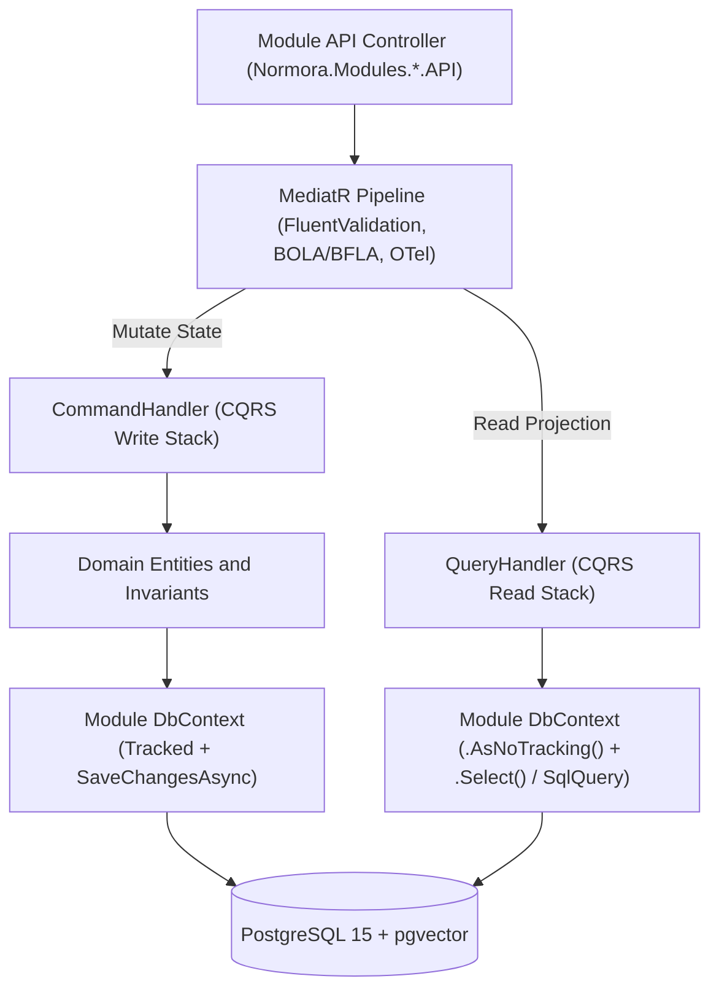
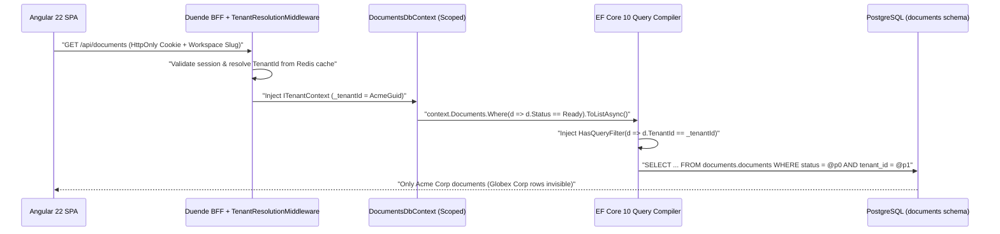
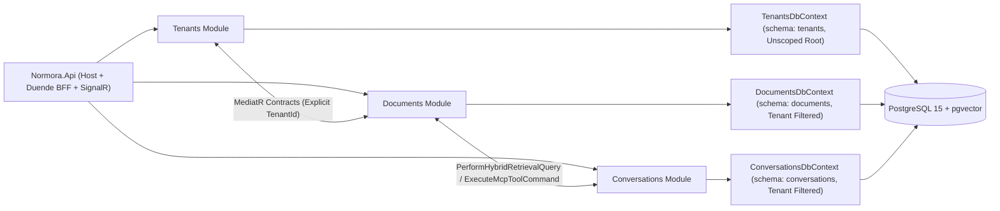
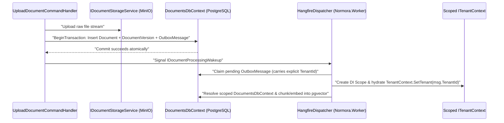
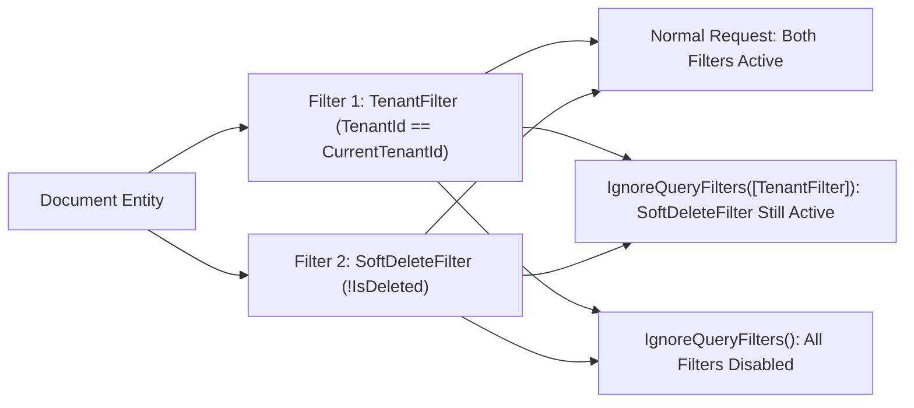

# Chapter 9: Advanced Architecture (CQRS, Multi-Tenancy, and Modular Monoliths)

## 1. Learning Objectives

By the end of this chapter, you will be able to:
*   Implement a strict **CQRS (Command Query Responsibility Segregation)** architecture using `.NET 10` primary constructors, EF Core 10 for tracked domain Commands, and `.AsNoTracking()` projections (or raw SQL / Dapper) for Queries, including EF Core 10's `GroupBy` anonymous-type projection rule.
*   Design a **Modular Monolith** with strict `DbContext` encapsulation (one private `DbContext` per module) and cross-module communication via MediatR contracts.
*   Evaluate the primary **Multi-Tenancy** architectures (Database-per-Tenant, Schema-per-Tenant, Shared-Database, and Hybrid Tiering) and implement Shared-Database isolation using EF Core 10.
*   Utilize **Global Query Filters** and **EF Core 10 Named Query Filters** (`HasQueryFilter(name, ...)` / `IgnoreQueryFilters([...])`) alongside parameterless `IEntityTypeConfiguration<T>` classes to guarantee Tenant Data Isolation and soft deletes.
*   Architect ASP.NET Core DI and background workers (`Hangfire`) to pass contextual state (`TenantId`, `ExternalUserId`) safely into `DbContext` instances without breaking `AddDbContextPool` or `HttpContext`-less jobs.
*   Understand the performance and security implications of Global Query Filters on PostgreSQL (including `pgvector` HNSW) and SQL Server execution plans, plus database-level Row-Level Security (RLS) trade-offs.

## 2. Introduction

Building a simple CRUD (Create, Read, Update, Delete) application is easy. Building a multi-tenant Enterprise SaaS platform that serves hundreds of different companies from a single codebase is one of the hardest challenges in software engineering.

When a user from "Acme Corp" logs in, the system must guarantee—with absolute mathematical certainty—that they can never see data belonging to "Globex Corp". A single developer forgetting to add a `WHERE TenantId = X` clause in a LINQ query can cause a cross-tenant data breach that destroys a company. In security engineering, guessing another tenant's resource ID to read or mutate their data is known as **BOLA (Broken Object Level Authorization)**, while calling an endpoint or action without the right role is **BFLA (Broken Function Level Authorization)**.

Furthermore, as a SaaS grows, both the traditional "Repository Pattern" and a single monolithic `AppDbContext` with 80 `DbSet<T>` properties collapse. Reading complex analytics dashboards requires massively different SQL optimization than enforcing domain invariants during a write operation, and unrelated modules begin coupling directly to each other's tables.

This chapter introduces three enterprise architectural patterns in `.NET 10` and **EF Core 10**: **CQRS**, **Multi-Tenancy**, and **Modular Monolith Persistence**. Throughout this chapter, we pair foundational EV Platform examples with the production architecture of **Normora**—an enterprise multi-tenant knowledge management and conversational-AI platform built as a `.NET 10` modular monolith (`Tenants`, `Documents`, and `Conversations` modules) on PostgreSQL 15 + `pgvector`, Keycloak OIDC, Duende BFF, Hangfire, and MediatR.

## 3. Core Concepts

### 3.1 CQRS (Command Query Responsibility Segregation)
**What it is:** **CQRS** dictates that the code path used to mutate state (**Commands**) should be separated from the code path used to read data (**Queries**). In `.NET 10`, this is commonly paired with **MediatR** (an in-process mediator library that dispatches request objects to dedicated handler classes) and a **folder-per-operation** layout where each Command or Query, its Handler, and its **FluentValidation** validator live together in a focused slice.
*   **Commands:** Use tracked EF Core `DbContext` instances, the Change Tracker, and **Domain Aggregates** (clusters of domain entities treated as a single transactional unit) to enforce invariants, emit outbox messages, and persist changes.
*   **Queries:** Bypass domain entities and the Change Tracker entirely. Use EF Core `.AsNoTracking().Select(...)` projections—or raw SQL (`Database.SqlQuery<T>`) / Micro-ORMs (Dapper)—to read flattened columns directly into immutable **DTOs (Data Transfer Objects)**.

**Why use it:** Reads and writes have opposite scaling and modeling requirements. Writes need strict invariant checking and normalized tables; reads need flat shapes, pagination, and zero change-tracking memory overhead.

**When NOT to use it:** Do not force heavy CQRS boilerplate (separate command/query pipelines, event buses, and separate read databases) onto simple internal admin CRUD tables with 1-to-1 form mappings, early prototypes, or microservices with trivial data shapes. In those cases, keeping a lean folder-per-operation handler without separate read-store infrastructure avoids unnecessary ceremony.

### 3.2 Modular Monolith & Bounded `DbContext` Encapsulation
**What it is:** A **Modular Monolith** deploys a single executable host (`Normora.Api`) while dividing business domains into strictly isolated modules (`Tenants`, `Documents`, `Conversations`). Each module owns its own private `DbContext`, its own PostgreSQL schema (`tenants`, `documents`, `conversations`), and its own migrations. Cross-module calls never inject another module's `DbContext` or services—they communicate exclusively through versioned MediatR contracts in `Normora.Shared.Contracts.*`.

**Why use it:** A single `AppDbContext` across 50+ tables turns into a "big ball of mud" where any module accidentally joins across another module's internal tables, making future microservice extraction or team ownership impossible.

**When NOT to use it:** Avoid splitting into multiple `DbContext` instances if your entire system is a small, tightly coupled single-domain service (under ~10–15 tables) where transactional SQL `JOIN`s across every table are essential and only 1–2 developers maintain the codebase.

### 3.3 Multi-Tenancy Architectures
A **tenant** is an isolated customer organization (workspace) sharing the platform. Every SaaS chooses among three primary models (plus a hybrid tier):

| Architecture | Isolation Level | Cost & Ops Overhead | Best Fit | When NOT to Use |
|---|---|---|---|---|
| **Database-per-Tenant** | Highest (physical DB) | High (connection pools, N migrations) | Government, healthcare, strict compliance | Thousands of free-tier workspaces |
| **Schema-per-Tenant** | Medium (logical schema) | High in EF Core (per-tenant `IModelCacheKeyFactory` & migrations) | Moderate tenant count needing separate schemas | High tenant churn (>500 tenants) |
| **Shared-Database (Row-Level)** | Logical (`TenantId` column) | Lowest (single schema, single migration) | High-scale B2B SaaS (default in Normora) | Tenants legally barred from co-located rows |

### 3.4 Global Query Filters & EF Core 10 Named Query Filters
**What it is:** A **Global Query Filter** is a LINQ predicate registered in `OnModelCreating` via `HasQueryFilter(...)` that EF Core automatically appends to *every* LINQ query (including `.Include()`, `CountAsync()`, and `ExecuteUpdateAsync()`) targeting that entity. It is the primary mechanism for enforcing Shared-Database multi-tenancy (`TenantId == _tenantId`) and soft deletes (`!IsDeleted`).

**EF Core 10 Named Query Filters:** Prior to EF Core 10, calling `HasQueryFilter` twice on the same entity silently overwrote the first filter, and calling `.IgnoreQueryFilters()` disabled *all* filters at once. **EF Core 10** solves this with **Named Query Filters** (`HasQueryFilter("TenantFilter", ...)` and `HasQueryFilter("SoftDeleteFilter", ...)`), allowing you to selectively disable only one filter via `.IgnoreQueryFilters(["TenantFilter"])` while keeping soft-delete protection intact.

**When NOT to use Global Query Filters:** Do not attach an ambient `TenantId` query filter to global **multi-tenancy root/directory tables** (such as Normora's `TenantsDbContext`, which resolves workspace slugs, cross-workspace memberships, and authentication bootstrapping before a tenant is selected). Also, never use `.IgnoreQueryFilters()` in user-facing endpoints as a shortcut—use explicit authorization checks and `BolaException` (`404 Not Found`) instead.

### 3.5 Parameterless `IEntityTypeConfiguration<T>` & Transactional Outbox
*   **Parameterless Configurations:** EF Core's `modelBuilder.ApplyConfigurationsFromAssembly(...)` instantiates every `IEntityTypeConfiguration<T>` via reflection using a public parameterless constructor. Scoped dependencies like `ITenantContext` must **never** be injected into configuration constructors; instead, configurations map table names, schemas, indexes, and value converters, while the `DbContext` binds dynamic query filters to its own instance property.
*   **Transactional Outbox & Non-HTTP Tenant Hydration:** Background jobs (like Hangfire in `Normora.Worker`) have no `HttpContext`. To ensure uploads and background processing never lose work or leak tenant boundaries, Normora commits entity state and an outbox row (`DocumentProcessingOutboxMessage`) in the same database transaction (**Transactional Outbox Pattern**), and passes an explicit `Guid TenantId` into every background job and cross-module contract.

#### Normora Real-World Concept Mapping (5 Production Examples)
1. **Tenants Module (`TenantsDbContext`, schema `tenants`):** Acts as the unscoped multi-tenancy root managing `Tenants`, `TenantMemberships`, `Departments`, `UserGroups`, `TenantInvitations`, `AuditLogs`, and `TenantPlans` (PayU multi-currency billing via `TenantPlanPricingCatalog`). Because it has no ambient `TenantId` global filter, every workspace-scoped query explicitly filters by `m.TenantId == request.TenantId`.
2. **Documents Module (`DocumentsDbContext`, schema `documents`):** Enforces a dynamic global `TenantId` filter across `Documents`, `DocumentVersions`, `DocumentChunks` (`pgvector` HNSW index), and `DocumentProcessingOutboxMessages`. `UploadDocumentCommandHandler` writes document metadata and the outbox row atomically before waking Hangfire.
3. **Conversations Module (`ConversationsDbContext`, schema `conversations`):** Enforces a dynamic global `TenantId` filter across `Conversations`, `ConversationMessages`, `SavedAnswers`, and `PendingApprovals` (15-minute TTL for server-enforced Human-In-The-Loop destructive actions).
4. **Cross-Module MediatR Contracts (`Normora.Shared.Contracts.*`):** When `ConversationTurnPreparer` in `Conversations` needs document context, it dispatches `PerformHybridRetrievalQuery(TenantId, ...)` via MediatR instead of injecting `DocumentsDbContext` or `IRetrievalService`. Likewise, `McpController` in `Documents` dispatches `GetMcpToolsQuery` and `ExecuteMcpToolCommand` to `Conversations`.
5. **CQRS Folder-per-Operation & `ApiMessages`:** Every endpoint maps to a dedicated folder under `Application/{Feature}/Commands/{OperationName}/` or `Queries/{OperationName}/`, keeping the Command/Query record, Handler, and `FluentValidation` validator in separate files, and throwing `BolaException` (`404`) or `BflaException` (`403`) with centralized `ApiMessages` constants—never hardcoded strings.

## 4. Visual Diagrams

### 4.1 Strict CQRS & MediatR Pipeline Architecture



### 4.2 Shared-Database Multi-Tenancy & Global Query Filter Flow



### 4.3 Normora Modular Monolith Bounded `DbContext` Encapsulation



### 4.4 Transactional Outbox & Background Worker Tenant Hydration



## 5. API Deep Dive: Implementing Shared-Database Multi-Tenancy

To build a secure SaaS, we must inject the current user's Tenant ID into the `DbContext` and apply it globally. First, let's look at the core 3-step mechanics using our foundational EV Platform example, and then examine how Normora implements this at production scale with `.NET 10` primary constructors, `ApplyConfigurationsFromAssembly`, and modular boundaries.

### Step 1: The Tenant Provider
We need a stateless way for the DbContext to know who is executing the query.

```csharp
// Application Layer
public interface ITenantProvider
{
    Guid GetTenantId();
}

// API Layer (Implementation)
public class HttpContextTenantProvider : ITenantProvider
{
    private readonly IHttpContextAccessor _accessor;
    public HttpContextTenantProvider(IHttpContextAccessor accessor) => _accessor = accessor;

    public Guid GetTenantId()
    {
        // Extract from JWT Claims or Custom Header
        var claim = _accessor.HttpContext?.User.FindFirst("TenantId");
        return claim != null ? Guid.Parse(claim.Value) : throw new UnauthorizedAccessException();
    }
}
```

### Step 2: Injecting into the DbContext
We inject the provider into the DbContext constructor and store the current Tenant ID.

```csharp
public class EvDbContext : DbContext
{
    private readonly Guid _tenantId;

    // Inject the provider
    public EvDbContext(DbContextOptions<EvDbContext> options, ITenantProvider tenantProvider) 
        : base(options)
    {
        _tenantId = tenantProvider.GetTenantId();
    }
}
```

### Step 3: Configuring the Global Query Filter
In `OnModelCreating`, we apply the filter to all entities that implement an `IMustHaveTenant` interface.

```csharp
public interface IMustHaveTenant { Guid TenantId { get; set; } }

protected override void OnModelCreating(ModelBuilder builder)
{
    // Apply filter strictly relying on the private _tenantId field
    builder.Entity<Site>().HasQueryFilter(s => s.TenantId == _tenantId);
    builder.Entity<Charger>().HasQueryFilter(c => c.TenantId == _tenantId);
    
    // (In a real system, you would use reflection to apply this automatically 
    // to all entities implementing IMustHaveTenant).
}
```

### Normora Production Implementation (5 Real-World Examples)

In `.NET 10` and EF Core 10, Normora avoids putting `HttpContext` lookups inside `DbContext` constructors and avoids putting Fluent API mappings inside `OnModelCreating`. Instead, it combines **primary constructors**, **parameterless `IEntityTypeConfiguration<T>` classes**, and a host-neutral `ITenantContext`.

#### Example 1: Host-Neutral `ITenantContext` & `TenantResolutionMiddleware`
`Normora.Api` resolves the workspace slug and user membership via Redis cache (30s–5m sliding expiration) in `TenantResolutionMiddleware`, populating a scoped `ITenantContext` that works identically in HTTP requests and Hangfire workers.

```csharp
namespace Normora.Shared.Interfaces;

public interface ITenantContext
{
    Guid? TenantId { get; }
    bool HasTenant => TenantId.HasValue && TenantId.Value != Guid.Empty;
    void SetTenant(Guid tenantId);
}

// In Normora.Api/Middleware/TenantResolutionMiddleware.cs (.NET 10 primary constructor)
public sealed class TenantResolutionMiddleware(
    RequestDelegate next,
    ITenantResolutionCache resolutionCache)
{
    public async Task InvokeAsync(HttpContext httpContext, ITenantContext tenantContext)
    {
        var slug = httpContext.Request.Headers["X-Workspace-Slug"].FirstOrDefault();
        if (!string.IsNullOrWhiteSpace(slug))
        {
            var resolved = await resolutionCache.GetBySlugAsync(slug, httpContext.RequestAborted);
            if (resolved is null)
            {
                throw new BolaException(ApiMessages.WorkspaceNotFound); // Mapped globally to 404
            }
            tenantContext.SetTenant(resolved.TenantId);
        }

        await next(httpContext);
    }
}
```

#### Example 2: `DocumentsDbContext` with Primary Constructor & Dynamic Query Filter
Notice how `DocumentsDbContext` stays lean: it auto-discovers configurations via `ApplyConfigurationsFromAssembly` and dynamically binds the EF Core 10 query filter to `CurrentTenantId` (an instance property reading `_tenantContext.TenantId`), never hardcoding filters inside configuration classes.

```csharp
public sealed class DocumentsDbContext(
    DbContextOptions<DocumentsDbContext> options,
    ITenantContext tenantContext) : DbContext(options)
{
    // Bound dynamically per DbContext instance so query plans remain parameterized
    private Guid CurrentTenantId => tenantContext.TenantId ?? Guid.Empty;

    public DbSet<Document> Documents => Set<Document>();
    public DbSet<DocumentVersion> DocumentVersions => Set<DocumentVersion>();
    public DbSet<DocumentChunk> DocumentChunks => Set<DocumentChunk>();
    public DbSet<DocumentProcessingOutboxMessage> OutboxMessages => Set<DocumentProcessingOutboxMessage>();

    protected override void OnModelCreating(ModelBuilder modelBuilder)
    {
        base.OnModelCreating(modelBuilder);
        modelBuilder.HasDefaultSchema("documents");
        modelBuilder.HasPostgresExtension("vector");

        // All IEntityTypeConfiguration<T> classes MUST have public parameterless constructors
        modelBuilder.ApplyConfigurationsFromAssembly(typeof(DocumentsDbContext).Assembly);

        // Apply multi-tenant & soft-delete named filters across all ITenantEntity types
        foreach (var entityType in modelBuilder.Model.GetEntityTypes())
        {
            if (typeof(ITenantEntity).IsAssignableFrom(entityType.ClrType))
            {
                ApplyTenantFilter(modelBuilder, entityType.ClrType);
            }
        }
    }

    private void ApplyTenantFilter(ModelBuilder modelBuilder, Type clrType)
    {
        var method = typeof(DocumentsDbContext)
            .GetMethod(nameof(ConfigureTenantFilter), BindingFlags.NonPublic | BindingFlags.Instance)!
            .MakeGenericMethod(clrType);
        method.Invoke(this, [modelBuilder]);
    }

    private void ConfigureTenantFilter<TEntity>(ModelBuilder modelBuilder)
        where TEntity : class, ITenantEntity
    {
        modelBuilder.Entity<TEntity>()
            .HasQueryFilter("TenantFilter", e => e.TenantId == CurrentTenantId);
    }
}
```

#### Example 3: Parameterless `DocumentChunkConfiguration` (PostgreSQL + `pgvector`)
Because `ApplyConfigurationsFromAssembly` instantiates configuration classes with `Activator.CreateInstance`, `DocumentChunkConfiguration` has **no constructor dependencies**.

```csharp
// server/Modules/Documents/Persistence/Configurations/DocumentChunkConfiguration.cs
public sealed class DocumentChunkConfiguration : IEntityTypeConfiguration<DocumentChunk>
{
    public void Configure(EntityTypeBuilder<DocumentChunk> builder)
    {
        builder.ToTable("document_chunks");
        builder.HasKey(c => c.Id);

        builder.Property(c => c.Content).IsRequired();
        builder.Property(c => c.Embedding).HasColumnType("vector(768)");

        // Composite index leads with TenantId so global query filters always seek
        builder.HasIndex(c => new { c.TenantId, c.DocumentId, c.ChunkIndex });

        // HNSW index for fast cosine similarity search in pgvector
        builder.HasIndex(c => c.Embedding)
            .HasMethod("hnsw")
            .HasOperators("vector_cosine_ops");
    }
}
```

#### Example 4: `TenantsDbContext` as an Unscoped Multi-Tenancy Root
`TenantsDbContext` manages directory lookups, workspace resolution bootstrapping, and cross-workspace memberships (`ExternalUserId` mapped from Keycloak OIDC). Therefore, it **intentionally omits** an ambient `TenantId` global filter—and any query fetching workspace-scoped rows MUST filter explicitly by `request.TenantId`.

```csharp
public sealed class GetWorkspaceDepartmentsQueryHandler(TenantsDbContext dbContext)
    : IRequestHandler<GetWorkspaceDepartmentsQuery, IReadOnlyList<DepartmentDto>>
{
    public async Task<IReadOnlyList<DepartmentDto>> Handle(
        GetWorkspaceDepartmentsQuery request,
        CancellationToken ct)
    {
        // TenantsDbContext is unscoped: explicit TenantId filter is mandatory
        return await dbContext.Departments
            .AsNoTracking()
            .Where(d => d.TenantId == request.TenantId && !d.IsDeleted)
            .OrderBy(d => d.Name)
            .Select(d => new DepartmentDto(d.Id, d.Name, d.Slug))
            .ToListAsync(ct);
    }
}
```

#### Example 5: `ConversationsDbContext` `SaveChangesAsync` Stamping & BOLA `404` Enforcement
If a user in Workspace A sends `DELETE /api/conversations/{globexConversationId}`, `ConversationsDbContext`'s global filter returns `null` (because `TenantId` doesn't match), and the handler throws `BolaException(ApiMessages.NotFound)`—mapped globally to `404 Not Found` so attackers cannot enumerate IDs across workspaces.

```csharp
public sealed class DeleteConversationCommandHandler(
    ConversationsDbContext dbContext,
    ICurrentUser currentUser) : IRequestHandler<DeleteConversationCommand>
{
    public async Task Handle(DeleteConversationCommand request, CancellationToken ct)
    {
        var conversation = await dbContext.Conversations
            .FirstOrDefaultAsync(c => c.Id == request.ConversationId, ct);

        // Either doesn't exist OR belongs to another tenant/user -> 404 BOLA (no enumeration)
        if (conversation is null || conversation.OwnerExternalUserId != currentUser.ExternalUserId)
        {
            throw new BolaException(ApiMessages.ConversationNotFound);
        }

        conversation.MarkDeleted(DateTime.UtcNow);
        await dbContext.SaveChangesAsync(ct);
    }
}
```

## 6. EF Core Internals: Dynamic Query Compilation & LINQ Translation

When you reference a `DbContext` instance field or property (like `_tenantId` or `CurrentTenantId`) inside a `HasQueryFilter`, EF Core's expression tree compiler recognizes it as a **parameterized closure**, not a hardcoded constant.

If User A (`TenantId: 1`) executes `context.Sites.ToList()`, EF Core compiles and caches the SQL query plan:
`SELECT * FROM Sites WHERE TenantId = @p0` (where `@p0` evaluates to `1`).

If User B (`TenantId: 2`) executes the exact same LINQ query, EF Core hits its internal query cache, reuses the compiled SQL plan, and binds `2` to `@p0`. This avoids query-cache bloat in EF Core and plan-cache bloat in SQL Server / PostgreSQL.

**The Internal Warnings:**
1. **Never invoke methods on injected services inside `OnModelCreating` lambdas:** `OnModelCreating` runs only *once* per `DbContext` type to build the internal `IModel`. If you capture a service call like `provider.GetTenantId()` inside `HasQueryFilter(s => s.TenantId == provider.GetTenantId())`, or worse, try to resolve `TenantId` once as a local variable in `OnModelCreating`, you either evaluate the DI chain on every query or permanently bake the first tenant's ID into the cached `IModel`! Always bind to a field or property on `this` (`DbContext` instance).
2. **Never use `AddDbContextPool` when the `DbContext` constructor captures tenant state:** Pooled `DbContext` instances are reused across requests without re-running their constructors. Using `AddDbContextPool` with `_tenantId = provider.GetTenantId()` causes cross-tenant leakage!
3. **EF Core `GroupBy` LINQ Translation Rule:** In EF Core 10, aggregating with `GroupBy(...)` and projecting directly into a parameterized C# `record` constructor (`GroupBy(...).Select(g => new MySummaryDto(g.Key, g.Count()))`) fails SQL translation with an `InvalidOperationException`. Always project to an **anonymous type** in SQL first, materialize with `ToListAsync()`, and map to your C# `record` or DTO in memory.

### EF Core Internals: 5 Normora Production Examples

#### Example 1: Parameterized Plan Reuse in `ConversationsDbContext`
When an Acme employee and a Globex employee both open their Copilot sidebar, `ConversationsDbContext` generates one cached query plan parameterized by `@__CurrentTenantId_0`:

```csharp
var recentThreads = await conversationsDb.Conversations
    .AsNoTracking()
    .Where(c => c.OwnerExternalUserId == currentUser.ExternalUserId)
    .OrderByDescending(c => c.LastActivityAt)
    .Take(20)
    .Select(c => new ConversationSummaryDto(c.Id, c.Title, c.LastActivityAt))
    .ToListAsync(ct);
```

#### Example 2: `GroupBy` Anonymous-Type-First Rule in `GetDocumentMetricsQueryHandler`
To compute document counts by ingestion status (`Pending`, `Processing`, `Ready`, `Failed`) for Normora's dashboard without triggering EF Core's `InvalidOperationException` (which would become a `400 Bad Request`), the handler projects to an anonymous type first:

```csharp
public sealed class GetDocumentMetricsQueryHandler(DocumentsDbContext dbContext)
    : IRequestHandler<GetDocumentMetricsQuery, IReadOnlyList<DocumentStatusCountDto>>
{
    public async Task<IReadOnlyList<DocumentStatusCountDto>> Handle(
        GetDocumentMetricsQuery request,
        CancellationToken ct)
    {
        // Step 1: Translate GroupBy into SQL using an anonymous type
        var grouped = await dbContext.Documents
            .AsNoTracking()
            .GroupBy(d => d.Status)
            .Select(g => new { Status = g.Key, Count = g.Count() })
            .ToListAsync(ct);

        // Step 2: Project to C# record DTOs safely in memory
        return grouped
            .Select(x => new DocumentStatusCountDto(x.Status.ToString(), x.Count))
            .ToList();
    }
}
```

#### Example 3: `GroupBy` Multi-Key Aggregation for Department Token Usage
Even multi-column `GroupBy` aggregations over `DocumentChunks` follow the exact same two-step pattern:

```csharp
var chunkStats = await dbContext.DocumentChunks
    .AsNoTracking()
    .GroupBy(c => new { c.DocumentId, c.DepartmentId })
    .Select(g => new
    {
        g.Key.DocumentId,
        g.Key.DepartmentId,
        ChunkCount = g.Count(),
        TotalTokens = g.Sum(x => x.TokenCount)
    })
    .ToListAsync(ct);

var result = chunkStats
    .Select(s => new DocumentChunkUsageDto(s.DocumentId, s.DepartmentId, s.ChunkCount, s.TotalTokens))
    .ToList();
```

#### Example 4: `IModelCacheKeyFactory` for Multi-Mode Schema Isolation
Because EF Core caches the `IModel` once per `DbContext` type, if an Enterprise Normora tier ever switches between a shared schema (`documents`) and a tenant-specific schema (`tenant_acme_documents`), you must implement `IModelCacheKeyFactory` so EF Core caches a distinct `IModel` per schema/mode:

```csharp
public sealed class TenantModelCacheKeyFactory : IModelCacheKeyFactory
{
    public object Create(DbContext context, bool designTime)
        => context is DocumentsDbContext docsContext
            ? (context.GetType(), docsContext.SchemaName, designTime)
            : (context.GetType(), designTime);
}
```

#### Example 5: Safe `AddDbContext` Registration in `DocumentsModuleExtensions`
Normora registers module `DbContext`s with standard scoped `AddDbContext` (never `AddDbContextPool`) so `ITenantContext` and `DocumentsDbContext` share the exact same DI scope:

```csharp
services.AddDbContext<DocumentsDbContext>((sp, options) =>
{
    var connectionString = configuration.GetConnectionString("DefaultConnection");
    options.UseNpgsql(connectionString, npgsql =>
    {
        npgsql.UseVector(); // pgvector support
        npgsql.MigrationsHistoryTable("__EFMigrationsHistory", "documents");
    });
});
```

## 7. Complete Examples: EV Platform & Normora CQRS Case Studies

### Part A: EV Platform Case Study (Foundational Pattern)

We are building a CQRS system for the EV Platform. 

#### The Command Stack (Writes - EF Core)
When a user wants to create a new Site, they send a Command. We use EF Core to validate domain rules and save.

```csharp
// MediatR Command Handler
public async Task Handle(CreateSiteCommand command, CancellationToken ct)
{
    // 1. Domain Validation
    var site = new Site(command.Name, command.Address);
    
    // 2. Multi-Tenancy Enforcement (Implicit)
    // The TenantId is automatically set by overriding SaveChangesAsync
    
    // 3. Save via tracked DbContext
    _context.Sites.Add(site);
    await _context.SaveChangesAsync(ct);
}

// Inside EvDbContext.cs - Securing the Write Path
public override Task<int> SaveChangesAsync(CancellationToken ct = default)
{
    foreach (var entry in ChangeTracker.Entries<IMustHaveTenant>().Where(e => e.State == EntityState.Added))
    {
        // Force every new entity to belong to the current user's tenant
        entry.Entity.TenantId = _tenantId; 
    }
    return base.SaveChangesAsync(ct);
}
```

#### The Query Stack (Reads - Projections)
When a user views their dashboard, we bypass the Domain completely.

```csharp
// MediatR Query Handler
public async Task<List<SiteDashboardDto>> Handle(GetDashboardQuery query, CancellationToken ct)
{
    // 1. CQRS Read: Use AsNoTracking and Select
    // 2. Security: The Global Query Filter automatically appends WHERE TenantId = _tenantId
    return await _context.Sites
        .AsNoTracking()
        .Select(s => new SiteDashboardDto 
        {
            SiteName = s.Name,
            TotalChargers = s.Chargers.Count
        })
        .ToListAsync(ct);
}
```
*Note: Even though the developer didn't write a `WHERE` clause, the SaaS is secure. Data isolation is mathematically guaranteed by the architecture.*

### Part B: Normora CQRS Folder-per-Operation Case Study (6 Real-World Examples)

Normora organizes every module operation into `Application/{Feature}/Commands/{OperationName}/` or `Queries/{OperationName}/` with separate files for the Record, Handler, and `FluentValidation` Validator—all using `.NET 10` primary constructors and centralized `ApiMessages` constants.

#### Example 1: Command + Transactional Outbox (`UploadDocumentCommandHandler`)
`UploadDocumentCommandHandler` writes the `Document`, initial `DocumentVersion`, and `DocumentProcessingOutboxMessage` inside a single database transaction so background ingestion can never be lost even if the Hangfire wakeup signal fails.

```csharp
// UploadDocumentCommand.cs
public sealed record UploadDocumentCommand(
    Guid DepartmentId,
    string FileName,
    string ContentType,
    Stream ContentStream) : IRequest<UploadDocumentResponseDto>;

// UploadDocumentCommandValidator.cs
public sealed class UploadDocumentCommandValidator : AbstractValidator<UploadDocumentCommand>
{
    public UploadDocumentCommandValidator()
    {
        RuleFor(x => x.FileName).NotEmpty().WithMessage(ApiMessages.DocumentFileNameRequired);
        RuleFor(x => x.DepartmentId).NotEmpty().WithMessage(ApiMessages.DepartmentRequired);
    }
}

// UploadDocumentCommandHandler.cs
public sealed class UploadDocumentCommandHandler(
    DocumentsDbContext dbContext,
    ITenantContext tenantContext,
    ICurrentUser currentUser,
    IDocumentStorageService storageService,
    IDocumentProcessingWakeup wakeup) : IRequestHandler<UploadDocumentCommand, UploadDocumentResponseDto>
{
    public async Task<UploadDocumentResponseDto> Handle(UploadDocumentCommand request, CancellationToken ct)
    {
        var tenantId = tenantContext.TenantId
            ?? throw new InvalidOperationException(ApiMessages.TenantContextMissing);

        var objectKey = $"{tenantId}/{Guid.NewGuid()}/{request.FileName}";
        await storageService.UploadAsync(objectKey, request.ContentStream, request.ContentType, ct);

        await using var tx = await dbContext.Database.BeginTransactionAsync(ct);

        var document = Document.Create(tenantId, request.DepartmentId, request.FileName, currentUser.ExternalUserId);
        var version = DocumentVersion.Create(tenantId, document.Id, versionNumber: 1, objectKey);
        var outbox = DocumentProcessingOutboxMessage.Create(tenantId, document.Id, version.Id);

        dbContext.Documents.Add(document);
        dbContext.DocumentVersions.Add(version);
        dbContext.OutboxMessages.Add(outbox);

        await dbContext.SaveChangesAsync(ct);
        await tx.CommitAsync(ct);

        // Best-effort async wakeup; Hangfire's recurring recovery job catches missed signals
        await wakeup.SignalAsync(ct);

        return new UploadDocumentResponseDto(document.Id, document.Status.ToString());
    }
}
```

#### Example 2: Paginated No-Tracking Query (`GetDocumentsQueryHandler`)
The read path uses `.AsNoTracking()`, enforces pagination (never unbounded `ToListAsync()`), and relies on `DocumentsDbContext`'s global query filter to isolate the workspace.

```csharp
public sealed class GetDocumentsQueryHandler(DocumentsDbContext dbContext)
    : IRequestHandler<GetDocumentsQuery, PagedResult<DocumentListItemDto>>
{
    public async Task<PagedResult<DocumentListItemDto>> Handle(GetDocumentsQuery request, CancellationToken ct)
    {
        var baseQuery = dbContext.Documents
            .AsNoTracking()
            .Where(d => !request.DepartmentId.HasValue || d.DepartmentId == request.DepartmentId);

        var totalCount = await baseQuery.CountAsync(ct);

        var items = await baseQuery
            .OrderByDescending(d => d.CreatedAt)
            .Skip((request.Page - 1) * request.PageSize)
            .Take(request.PageSize)
            .Select(d => new DocumentListItemDto(
                d.Id,
                d.FileName,
                d.Status.ToString(),
                d.DepartmentId,
                d.CreatedAt))
            .ToListAsync(ct);

        return new PagedResult<DocumentListItemDto>(items, totalCount, request.Page, request.PageSize);
    }
}
```

#### Example 3: Cross-Module MediatR Query (`ConversationTurnPreparer` -> `Documents`)
`Conversations` needs document chunks for RAG (Retrieval-Augmented Generation), but must never inject `DocumentsDbContext`. It sends `PerformHybridRetrievalQuery` with an explicit `Guid TenantId` for defense-in-depth.

```csharp
// Normora.Shared.Contracts.Documents/PerformHybridRetrievalQuery.cs
public sealed record PerformHybridRetrievalQuery(
    Guid TenantId,
    string QueryText,
    IReadOnlyCollection<Guid> AllowedDepartmentIds,
    int TopK = 8) : IRequest<IReadOnlyList<RetrievedChunkDto>>;

// Inside Modules/Conversations/Application/Chat/Services/ConversationTurnPreparer.cs
public sealed class ConversationTurnPreparer(ISender mediator, ITenantContext tenantContext)
{
    public async Task<IReadOnlyList<RetrievedChunkDto>> RetrieveContextAsync(
        string prompt,
        IReadOnlyCollection<Guid> departmentIds,
        CancellationToken ct)
    {
        var tenantId = tenantContext.TenantId
            ?? throw new InvalidOperationException(ApiMessages.TenantContextMissing);

        return await mediator.Send(
            new PerformHybridRetrievalQuery(tenantId, prompt, departmentIds, TopK: 8),
            ct);
    }
}
```

#### Example 4: Cross-Module MediatR Command (`McpController` -> `Conversations`)
When an external AI client invokes Normora's JSON-RPC Model Context Protocol endpoint (`/api/mcp`), `McpController` in `Documents` delegates tool execution to `Conversations` via `ExecuteMcpToolCommand`.

```csharp
// Inside Modules/Documents/API/McpController.cs
[HttpPost]
public async Task<IActionResult> InvokeTool(
    [FromBody] McpToolInvocationRequest body,
    CancellationToken ct)
{
    if (!currentUser.HasPermission(NormoraPermissions.McpExecute))
    {
        throw new BflaException(ApiMessages.Forbidden); // Mapped globally to 403 Forbidden
    }

    var result = await mediator.Send(
        new ExecuteMcpToolCommand(tenantContext.TenantId!.Value, currentUser.ExternalUserId, body.ToolName, body.Arguments),
        ct);

    return Ok(ApiResponse.Success(result));
}
```

#### Example 5: MediatR `IPipelineBehavior` for Validation & Telemetry
Instead of duplicating FluentValidation checks or OpenTelemetry tracing inside every handler, a MediatR `IPipelineBehavior<TRequest, TResponse>` intercepts all Commands and Queries uniformly:

```csharp
public sealed class ValidationPipelineBehavior<TRequest, TResponse>(
    IEnumerable<IValidator<TRequest>> validators)
    : IPipelineBehavior<TRequest, TResponse>
    where TRequest : notnull
{
    public async Task<TResponse> Handle(
        TRequest request,
        RequestHandlerDelegate<TResponse> next,
        CancellationToken ct)
    {
        if (!validators.Any()) return await next();

        var context = new ValidationContext<TRequest>(request);
        var failures = (await Task.WhenAll(validators.Select(v => v.ValidateAsync(context, ct))))
            .SelectMany(r => r.Errors)
            .Where(f => f is not null)
            .ToList();

        if (failures.Count > 0)
        {
            throw new ValidationException(failures);
        }

        return await next();
    }
}
```

#### Example 6: BOLA-Safe Command Mutation (`CancelSubscriptionCommandHandler`)
In `Tenants`, domain invariants combine with BOLA/BFLA rules: `CancelSubscriptionCommandHandler` loads from `TenantsDbContext` with explicit `TenantId` filtering and rejects `Free` tier cancellations using `ApiMessages`.

```csharp
public sealed class CancelSubscriptionCommandHandler(
    TenantsDbContext dbContext,
    ICurrentUser currentUser) : IRequestHandler<CancelSubscriptionCommand>
{
    public async Task Handle(CancelSubscriptionCommand request, CancellationToken ct)
    {
        if (!currentUser.IsWorkspaceAdmin)
        {
            throw new BflaException(ApiMessages.Forbidden); // 403
        }

        var plan = await dbContext.TenantPlans
            .FirstOrDefaultAsync(p => p.TenantId == request.TenantId, ct)
            ?? throw new BolaException(ApiMessages.WorkspaceNotFound); // 404

        if (plan.Tier == SubscriptionTier.Free)
        {
            throw new InvalidOperationException(ApiMessages.CannotCancelFreePlan);
        }

        plan.ScheduleCancellation(DateTime.UtcNow);
        await dbContext.SaveChangesAsync(ct);
    }
}
```

## 8. Performance Implications of Query Filters

Adding `HasQueryFilter(x => x.TenantId == _tenantId)` changes *every* SQL query.

If you execute `context.Sites.Where(s => s.Region == "US").ToList()`, the SQL becomes:
`SELECT * FROM Sites WHERE Region = 'US' AND TenantId = @p0`.

**The Missing Index Disaster:**
If a DBA created an index on `(Region)`, that index is now virtually useless. SQL Server or PostgreSQL has to filter by `TenantId` first (or intersect inefficiently), because the query is only **SARGable** (Search ARGument-able, meaning the engine can do a fast B-Tree Index Seek) when the leading index columns match the predicates.

**Architectural Rule:** In a Shared-Database multi-tenant system, `TenantId` **must** be the leading column in almost every single composite index in the database. 
`CREATE INDEX IX_Sites_Tenant_Region ON Sites(TenantId, Region);`

If you fail to do this, your Global Query Filters will cause catastrophic Index Scans across the entire database.

### Performance & Indexing: 5 Normora Production Examples

#### Example 1: Leading `TenantId` Composite Index in `DocumentConfiguration`
In `DocumentsDbContext`, workspace document tables filter by `TenantId`, `DepartmentId`, and `Status`. Putting `TenantId` first turns every list query into an index seek:

```csharp
// server/Modules/Documents/Persistence/Configurations/DocumentConfiguration.cs
public sealed class DocumentConfiguration : IEntityTypeConfiguration<Document>
{
    public void Configure(EntityTypeBuilder<Document> builder)
    {
        builder.ToTable("documents");
        builder.HasIndex(d => new { d.TenantId, d.DepartmentId, d.Status })
            .HasDatabaseName("ix_documents_tenant_dept_status");
    }
}
```

#### Example 2: `pgvector` HNSW Index + Tenant Pre-Filtering in Hybrid Search
An HNSW (Hierarchical Navigable Small World) vector index accelerates approximate nearest-neighbor cosine similarity search. However, if Workspace A owns only 0.5% of the rows in `document_chunks` and you apply a post-filter `WHERE tenant_id = @p0`, a naive top-K HNSW scan can return fewer than `K` results after filtering! Normora pairs a B-Tree composite index on `(TenantId, DepartmentId)` for full-text/lexical filtering with `pgvector`'s HNSW index (`vector_cosine_ops`) and RRF (Reciprocal Rank Fusion) candidate oversampling:

```csharp
// Full-text + tenant/department candidate filter alongside pgvector HNSW
builder.HasIndex(c => new { c.TenantId, c.DepartmentId })
    .HasDatabaseName("ix_document_chunks_tenant_dept");

builder.HasIndex(c => c.Embedding)
    .HasMethod("hnsw")
    .HasOperators("vector_cosine_ops")
    .HasDatabaseName("ix_document_chunks_embedding_hnsw");
```

#### Example 3: Descending Composite Index on `AuditLogs` (`TenantsDbContext`)
`TenantsDbContext` serves paginated compliance logs ordered newest-first. Indexing `(TenantId, CreatedAt)` in descending order avoids expensive in-memory `Sort` operations on PostgreSQL:

```csharp
builder.HasIndex(a => new { a.TenantId, a.CreatedAt })
    .IsDescending(false, true)
    .HasDatabaseName("ix_audit_logs_tenant_created_desc");
```

#### Example 4: PostgreSQL Partial Index for Soft-Deleted `Conversations`
When a table combines a `TenantId` filter with `!IsDeleted`, a PostgreSQL **partial index** (`WHERE is_deleted = false`) shrinks index size and keeps hot B-Tree pages in RAM:

```csharp
builder.HasIndex(c => new { c.TenantId, c.OwnerExternalUserId, c.LastActivityAt })
    .HasFilter("\"IsDeleted\" = false")
    .HasDatabaseName("ix_conversations_active_tenant_owner");
```

#### Example 5: Set-Based `ExecuteUpdateAsync` & `ExecuteDeleteAsync` with Active Query Filters
Bulk set-based operations in EF Core 10 automatically include Global Query Filters in the generated `UPDATE`/`DELETE` `WHERE` clause—avoiding loading 10,000 entities into the Change Tracker while remaining tenant-isolated:

```csharp
// Expires only pending approvals belonging to the current tenant (Global Query Filter applies!)
var expiredCount = await conversationsDb.PendingApprovals
    .Where(p => p.ExpiresAtUtc < DateTime.UtcNow && p.Status == ApprovalStatus.Pending)
    .ExecuteUpdateAsync(
        setters => setters.SetProperty(p => p.Status, ApprovalStatus.Expired),
        ct);
```

## 9. ASP.NET Core Integration: Bypassing Filters & EF Core 10 Named Query Filters

Occasionally, a background worker, purge job, or platform-level compliance task needs to query data across all tenants (e.g., generating a global billing summary or claiming outbox messages).

You can bypass Global Query Filters using `.IgnoreQueryFilters()`.

```csharp
public async Task<decimal> CalculateGlobalRevenueAsync()
{
    // Bypasses the TenantId filter! Extremely dangerous, use with caution.
    return await _context.Invoices
        .IgnoreQueryFilters() 
        .SumAsync(i => i.TotalAmount);
}
```

### The Legacy Limitation vs. EF Core 10 Named Query Filters
*   **Before EF Core 10:** You could only register **one** `HasQueryFilter(...)` lambda per entity. Combining tenant isolation and soft delete forced a single expression (`e => !e.IsDeleted && e.TenantId == _tenantId`), and calling `.IgnoreQueryFilters()` disabled **both** filters at once—creating a dangerous trap where bypassing the tenant filter accidentally resurrected soft-deleted records!
*   **In EF Core 10 (.NET 10):** EF Core introduces **Named Query Filters**. You can register multiple independent filters with explicit string names and selectively disable only the filter(s) you intend to bypass via `.IgnoreQueryFilters(["FilterName"])`.



**When NOT to use `IgnoreQueryFilters`:** Never call `IgnoreQueryFilters()` inside user-facing HTTP controllers or tenant-scoped CQRS queries to "check if an ID belongs to someone else." Doing so removes compiler-level safety and invites BOLA leaks.

### Named Query Filters & Bypassing: 5 Normora Production Examples

#### Example 1: Registering Named Query Filters in `DocumentsDbContext`
Each filter has an explicit name so `TenantFilter` and `SoftDeleteFilter` can be toggled independently:

```csharp
private void ConfigureFilters<TEntity>(ModelBuilder modelBuilder)
    where TEntity : class, ITenantEntity, ISoftDeletable
{
    modelBuilder.Entity<TEntity>()
        .HasQueryFilter("TenantFilter", e => e.TenantId == CurrentTenantId)
        .HasQueryFilter("SoftDeleteFilter", e => !e.IsDeleted);
}
```

#### Example 2: Cross-Tenant Storage Quota Calculation Keeping Soft-Delete Protection
A nightly infrastructure job computing active S3/MinIO storage per workspace bypasses *only* `"TenantFilter"`, ensuring deleted documents aren't billed to customers:

```csharp
var storageByTenant = await documentsDb.Documents
    .AsNoTracking()
    .IgnoreQueryFilters(["TenantFilter"]) // SoftDeleteFilter remains enforced!
    .GroupBy(d => d.TenantId)
    .Select(g => new { TenantId = g.Key, TotalBytes = g.Sum(d => d.FileSizeBytes) })
    .ToListAsync(ct);
```

#### Example 3: Tenant Admin "Trash Bin" Query Keeping Tenant Isolation
When a Workspace Admin views recently deleted documents for recovery, the query bypasses `"SoftDeleteFilter"` while keeping `"TenantFilter"` strictly active:

```csharp
var deletedDocs = await documentsDb.Documents
    .AsNoTracking()
    .IgnoreQueryFilters(["SoftDeleteFilter"]) // TenantFilter remains enforced!
    .Where(d => d.IsDeleted)
    .OrderByDescending(d => d.DeletedAtUtc)
    .Select(d => new DeletedDocumentDto(d.Id, d.FileName, d.DeletedAtUtc!.Value))
    .ToListAsync(ct);
```

#### Example 4: `HangfireDocumentProcessingOutboxDispatcher` Claiming Outbox Rows
Because the outbox dispatcher polls pending uploads across all workspaces before hydrating a per-job tenant scope, it bypasses `"TenantFilter"` strictly to claim the next batch of outbox records, then sets `ITenantContext` to `message.TenantId` for actual ingestion:

```csharp
var pendingMessages = await documentsDb.OutboxMessages
    .IgnoreQueryFilters(["TenantFilter"])
    .Where(m => m.ProcessedAtUtc == null && m.AttemptCount < MaxAttempts)
    .OrderBy(m => m.CreatedAtUtc)
    .Take(20)
    .ToListAsync(ct);
```

#### Example 5: Avoiding `IgnoreQueryFilters()` Entirely via `TenantsDbContext`
For workspace resolution (`GET` slug -> `TenantId`), invitation acceptance, and cross-workspace membership lists (`ExternalUserId` -> workspaces), Normora does **not** put a tenant filter on `TenantsDbContext` and bypass it—instead, `TenantsDbContext` is architected as an unscoped root by design, keeping bypass usage near zero across the entire codebase.

## 10. Clean Architecture & Modular Monolith Perspective

CQRS naturally aligns with Clean Architecture:
*   **Commands** interact with the core Domain Layer. They load Aggregates, invoke business methods (`site.Deactivate()`), and save through the module's `DbContext`.
*   **Queries** belong strictly in the Application Layer (or a specialized Read Layer). They query the database directly and return Data Transfer Objects (DTOs). Queries do not use Domain Entities, and they do not use Repositories.

This segregation prevents the `Site` or `Document` Domain Entity from becoming bloated with 50 different properties needed only for various UI screens.

In a **Modular Monolith**, Clean Architecture extends one level deeper:
*   **100% `DbContext` Encapsulation:** Every business module registers its own internal `DbContext` inside `{ModuleName}ModuleExtensions.cs`. Controllers, SignalR hubs, and other modules never inject another module's `DbContext`.
*   **External Provider Boundary (Ports & Adapters):** Business modules (`Tenants`, `Documents`, `Conversations`) must contain **zero** third-party vendor SDKs (no MinIO, Google Gemini, AWS, or PayU SDK packages). Modules declare provider-neutral ports (`IDocumentStorageService`, `ITextEmbeddingService`, `ITextGenerationService`, `IBrandingStorageService`), while `Normora.Infrastructure` implements adapters (`MinioDocumentStorageService`, `GeminiEmbeddingService`) wired via `ProviderServiceExtensions.cs`.

### Clean Architecture & Modular Boundaries: 5 Normora Examples

#### Example 1: Module Composition Root (`DocumentsModuleExtensions.cs`)
Each module wires its own `DbContext`, MediatR handlers, and domain services independently; `Normora.Api` calls `services.AddDocumentsModule(configuration)` without knowing `DocumentsDbContext` internals.

```csharp
public static class DocumentsModuleExtensions
{
    public static IServiceCollection AddDocumentsModule(
        this IServiceCollection services,
        IConfiguration configuration)
    {
        services.AddDbContext<DocumentsDbContext>(/* Npgsql + pgvector */);
        services.AddMediatR(cfg => cfg.RegisterServicesFromAssembly(typeof(DocumentsModuleExtensions).Assembly));
        services.AddValidatorsFromAssembly(typeof(DocumentsModuleExtensions).Assembly);
        return services;
    }
}
```

#### Example 2: Architectural Fitness Tests (`Normora.Architecture.Tests`)
Normora enforces module isolation automatically in CI using architecture unit tests—ensuring `Conversations` never references `DocumentsDbContext` and modules never reference `Minio` or `Normora.Api`:

```csharp
[Fact]
public void Modules_Should_Not_Reference_Other_Module_DbContexts()
{
    var result = Types.InAssembly(typeof(ConversationsModuleExtensions).Assembly)
        .ShouldNot()
        .HaveDependencyOn("Normora.Modules.Documents.Persistence")
        .GetResult();

    Assert.True(result.IsSuccessful);
}
```

#### Example 3: Provider-Neutral Ports vs. Infrastructure Adapters
`Documents` depends only on `ITextEmbeddingService`; `Normora.Infrastructure/Providers/Gemini/` implements Gemini's `batchEmbedContents` API (up to 100 chunks/call) without leaking vendor types into `DocumentsDbContext` or handlers:

```csharp
// Domain port inside Modules/Documents/Domain/
public interface ITextEmbeddingService
{
    Task<IReadOnlyList<float[]>> GenerateEmbeddingsAsync(
        IReadOnlyList<string> texts,
        CancellationToken ct);
}
```

#### Example 4: Decoupled External Identity (`ExternalUserId`)
Domain entities in `Tenants` and `Conversations` store `ExternalUserId` (never `KeycloakUserId`), decoupling EF Core schemas and audit logs from Keycloak if the identity provider changes in the future.

#### Example 5: Host-Neutral `Normora.Infrastructure` vs `Normora.Worker`
`Normora.Infrastructure` holds shared Hangfire, Redis caching, SignalR Redis backplane (`AddNormoraSignalR`), and migration infrastructure, and never references `Normora.Api` or `Normora.Worker`. Meanwhile, `Normora.Worker` references `Normora.Infrastructure` and `Normora.Shared.Contracts.*`—never `Normora.Api`.

## 11. Enterprise SaaS Perspective: Cross-Database Multi-Tenancy, Workers & RLS

If an enterprise client (like a government agency) demands strict physical isolation, you must abandon the Shared-Database model and use Database-per-Tenant.

EF Core handles this cleanly through dynamic Connection Strings.

```csharp
// The Tenant Provider now returns a Connection String, not an ID
public class EvDbContext : DbContext
{
    private readonly string _tenantConnectionString;

    public EvDbContext(DbContextOptions<EvDbContext> options, ITenantProvider provider) : base(options)
    {
        _tenantConnectionString = provider.GetConnectionString();
    }

    protected override void OnConfiguring(DbContextOptionsBuilder builder)
    {
        // Override the default DI configuration dynamically!
        if (!builder.IsConfigured || !string.IsNullOrEmpty(_tenantConnectionString))
        {
            builder.UseSqlServer(_tenantConnectionString);
        }
    }
}
```
*Architecture Note:* In this model, you do *not* use Global Query Filters for `TenantId` because the data is physically isolated. However, schema migrations become significantly harder, as you must orchestrate deploying schema changes across hundreds of separate databases.

### Defense-in-Depth: PostgreSQL Row-Level Security (RLS)
EF Core Global Query Filters protect LINQ queries, but what if a developer executes raw SQL via `Database.SqlQueryRaw` or connects directly with reporting credentials? **PostgreSQL Row-Level Security (RLS)** enforces tenant isolation inside the database engine itself:
1. Enable RLS on the table: `ALTER TABLE documents.documents ENABLE ROW LEVEL SECURITY;`
2. Create a policy reading a session setting:
   `CREATE POLICY tenant_isolation ON documents.documents USING (tenant_id = current_setting('app.current_tenant_id', true)::uuid);`
3. Use an EF Core `DbConnectionInterceptor` to set `app.current_tenant_id` whenever a pooled Npgsql connection opens (and reset it on close/clear so pooled connections never leak state).

**When NOT to use DB-level RLS:** If you have tens of thousands of high-throughput queries per second on complex joins where PostgreSQL's planner struggles with RLS predicate pushdown—or if you use `PgBouncer` in transaction-pooling mode without `SET LOCAL` transaction scoping—RLS can cause subtle pooling leaks or CPU overhead.

### Enterprise Scaling & Worker Isolation: 5 Normora Examples

#### Example 1: `Normora.Worker` Hangfire Scope Hydration (No `HttpContext`)
Because `Normora.Worker` runs outside ASP.NET Core requests, `IHttpContextAccessor.HttpContext` is `null`. Jobs receive an explicit `tenantId`, create a fresh DI scope via `IServiceScopeFactory`, hydrate `ITenantContext`, and only then resolve `DocumentsDbContext`:

```csharp
public sealed class ProcessDocumentJob(IServiceScopeFactory scopeFactory)
{
    public async Task ExecuteAsync(Guid tenantId, Guid documentId, CancellationToken ct)
    {
        await using var scope = scopeFactory.CreateAsyncScope();
        var tenantContext = scope.ServiceProvider.GetRequiredService<ITenantContext>();
        tenantContext.SetTenant(tenantId);

        var dbContext = scope.ServiceProvider.GetRequiredService<DocumentsDbContext>();
        // Global Query Filter now safely resolves CurrentTenantId == tenantId
        var document = await dbContext.Documents.FirstOrDefaultAsync(d => d.Id == documentId, ct);
        if (document is null) return;

        // Chunk, embed via Gemini batchEmbedContents, and broadcast via SignalR Redis backplane
    }
}
```

#### Example 2: PostgreSQL RLS via `DbConnectionInterceptor`
For Enterprise workspaces requiring defense-in-depth beneath EF Core filters, an interceptor sets the PostgreSQL session variable on connection open:

```csharp
public sealed class PostgresTenantRlsInterceptor(ITenantContext tenantContext) : DbConnectionInterceptor
{
    public override async Task ConnectionOpenedAsync(
        DbConnection connection,
        ConnectionEndEventData eventData,
        CancellationToken ct = default)
    {
        if (tenantContext.HasTenant)
        {
            await using var cmd = connection.CreateCommand();
            cmd.CommandText = "SELECT set_config('app.current_tenant_id', @tid, false);";
            var param = cmd.CreateParameter();
            param.ParameterName = "tid";
            param.Value = tenantContext.TenantId!.Value.ToString();
            cmd.Parameters.Add(param);
            await cmd.ExecuteNonQueryAsync(ct);
        }
    }
}
```

#### Example 3: Hybrid Shared-vs-Dedicated Connection Routing
If Normora promotes an Enterprise workspace from the shared PostgreSQL cluster to a dedicated instance, `ITenantConnectionResolver` reads the Redis-cached tenant metadata (`IsDedicated`, `ConnectionString`) and switches `DocumentsDbContext` dynamically via `AddDbContext` factory options.

#### Example 4: AI Thread Partitioning (`NormoraAgentIsolationKeyProvider`)
Even in-memory/distributed AI agent threads can suffer cross-tenant leaks if keyed only by `ConversationId`. Normora's `NormoraAgentIsolationKeyProvider` formats session keys as `{TenantId}:{ExternalUserId}`, isolating `NormoraWorkplaceAgent` state at the protocol layer.

#### Example 5: Ephemeral Migration Host (`--migrate`) Across 4 Migrators
When deploying schema updates across Normora's modular `DbContext`s, running `dotnet Normora.Api.dll --migrate` boots a lean console host (`MigrationHostExtensions.RunMigrationsAsync`) without Kestrel, SignalR, OpenTelemetry listeners, or Hangfire—preventing native shutdown crashes (exit code 139) while executing `DatabaseMigrationRunner` sequentially across all 4 migrators: `TenantsDatabaseMigrator`, `DocumentsDatabaseMigrator`, `ConversationsDatabaseMigrator`, and `SessionDatabaseMigrator`.

## 12. Real Production Case Study

### Case Study A: EV Platform Background Job `Include()` Trap
In the EV Platform, we used Global Query Filters to enforce multi-tenancy. It worked flawlessly for 6 months.

Then, we introduced a feature where a `Driver` (a global entity, not tied to a specific tenant) could be assigned an `RfidTag` (which *is* tied to a specific tenant).

A developer wrote this query in a background job running outside of a web request (meaning `ITenantProvider` returned `null` or `Empty Guid`):

`var tags = await context.Drivers.Include(d => d.RfidTags).ToListAsync();`

The background job returned empty results and failed silently. Why?
Because `RfidTag` has a Global Query Filter (`WHERE TenantId = _tenantId`). In the background job, `_tenantId` was `Guid.Empty`. EF Core diligently appended `WHERE TenantId = '00000000-0000-0000-0000-000000000000'` to the `LEFT JOIN` for `RfidTags`. The query executed without throwing, but filtered out all the tags!

**The Lesson:** Global Query Filters apply to `Include()` statements as well. If an entity crosses tenant boundaries, or if jobs run outside a tenant context, you must explicitly hydrate `ITenantContext` inside a dedicated DI scope or use EF Core 10's `.IgnoreQueryFilters(["TenantFilter"])` with explicit security constraints.

### Case Study B: Normora Ingestion Outbox & `GroupBy` Projection Incident
During Normora's early rollout, two subtle production issues surfaced within the same week:
1. **Orphaned Uploads Under Transient Broker Failure:** `UploadDocumentCommandHandler` originally saved the `Document` row, committed the transaction, and then called Hangfire directly to enqueue `DocumentProcessingJob`. When Redis/Hangfire experienced a 3-second network blip, the document stayed stuck in `Pending` forever. Switching to the **Transactional Outbox Pattern** (`DocumentProcessingOutboxMessage` committed in the exact same `DocumentsDbContext` transaction as `Document` and `DocumentVersion`, paired with a minutely recurring Hangfire recovery sweep) eliminated stuck uploads completely.
2. **Dashboard `400 Bad Request` on `GroupBy`:** A metrics query projected `GroupBy(d => d.Status).Select(g => new DocumentStatusDto(g.Key, g.Count()))` directly inside EF Core's expression tree. EF Core failed to translate the parameterized record constructor inside `GroupBy`, throwing an `InvalidOperationException` that middleware mapped to `400`. Splitting it into an anonymous-type SQL projection followed by an in-memory `.Select(...)` resolved it permanently—and became a strict repository rule.

## 13. Common Mistakes & Anti-Patterns

Every architectural bug below represents a real failure mode in multi-tenant EF Core systems. Review the wrong code, understand why it breaks or leaks data, and apply the fix.

### 1. Trusting Caller-Supplied `TenantId` or Forgetting to Stamp `TenantId` on Writes

> [!CAUTION]
> **Cross-Tenant Write Spoofing / Missing Tenant Ownership**
> Accepting `TenantId` from a request DTO or expecting every developer to set `TenantId` manually on `new Document(...)` guarantees an eventual cross-tenant write bug.

**Wrong Code:**
```csharp
public async Task Handle(CreateDepartmentCommand cmd, CancellationToken ct)
{
    // Danger: Trusts cmd.TenantId or developer might forget to assign TenantId altogether!
    var dept = new Department { Name = cmd.Name, TenantId = cmd.TenantId };
    _tenantsDb.Departments.Add(dept);
    await _tenantsDb.SaveChangesAsync(ct);
}
```

**Why It's Wrong:**
If a malicious client modifies `cmd.TenantId` in the JSON payload, they can create records inside another company's workspace (BOLA). Conversely, if a developer forgets to assign `TenantId`, the row is saved with `Guid.Empty` and permanently orphaned from every tenant's Global Query Filter.

**The Fix:**
Resolve `TenantId` strictly from the authenticated `ITenantContext` (populated by `TenantResolutionMiddleware` or background scope hydration), and enforce automatic stamping in `SaveChangesAsync`:
```csharp
public override Task<int> SaveChangesAsync(CancellationToken ct = default)
{
    var tenantId = _tenantContext.TenantId
        ?? throw new InvalidOperationException(ApiMessages.TenantContextMissing);

    foreach (var entry in ChangeTracker.Entries<ITenantEntity>().Where(e => e.State == EntityState.Added))
    {
        entry.Entity.TenantId = tenantId;
    }
    return base.SaveChangesAsync(ct);
}
```

---

### 2. Injecting `ITenantContext` into `IEntityTypeConfiguration<T>` or Calling Methods Inside `HasQueryFilter`

> [!CAUTION]
> **Broken `ApplyConfigurationsFromAssembly` & Unparameterized Query Filter Traps**
> Passing scoped dependencies into `IEntityTypeConfiguration<T>` constructors crashes `ApplyConfigurationsFromAssembly`, and invoking `provider.GetTenantId()` inside `HasQueryFilter` bypasses clean parameterization.

**Wrong Code:**
```csharp
public sealed class DocumentConfiguration(ITenantContext tenantContext)
    : IEntityTypeConfiguration<Document>
{
    public void Configure(EntityTypeBuilder<Document> builder)
    {
        // Breaks ApplyConfigurationsFromAssembly (no parameterless constructor!)
        // AND bakes the design-time/first TenantId into the cached IModel!
        builder.HasQueryFilter(d => d.TenantId == tenantContext.TenantId);
    }
}
```

**Why It's Wrong:**
`modelBuilder.ApplyConfigurationsFromAssembly(...)` uses reflection requiring a **public parameterless constructor**; any constructor dependency throws `MissingMethodException`. Even worse, `OnModelCreating` executes once per `DbContext` type to cache the EF Core `IModel`, so capturing external locals or calling methods incorrectly breaks query parameterization or freezes the first tenant's ID globally.

**The Fix:**
Keep all `IEntityTypeConfiguration<T>` classes strictly parameterless, and bind `HasQueryFilter` inside the `DbContext` to a `DbContext` instance property:
```csharp
// Parameterless configuration
public sealed class DocumentConfiguration : IEntityTypeConfiguration<Document>
{
    public void Configure(EntityTypeBuilder<Document> builder)
    {
        builder.ToTable("documents");
        builder.HasIndex(d => new { d.TenantId, d.DepartmentId, d.Status });
    }
}

// Inside DocumentsDbContext
private Guid CurrentTenantId => tenantContext.TenantId ?? Guid.Empty;
// ...
modelBuilder.Entity<Document>().HasQueryFilter("TenantFilter", d => d.TenantId == CurrentTenantId);
```

---

### 3. Using `AddDbContextPool` When `DbContext` Holds Constructor-Captured Tenant State

> [!CAUTION]
> **Catastrophic Cross-Tenant Context Poisoning via `AddDbContextPool`**
> `AddDbContextPool` reuses `DbContext` instances across HTTP requests *without* re-running the constructor, permanently binding a pooled `DbContext` to the first tenant's ID!

**Wrong Code:**
```csharp
// In Program.cs / ModuleExtensions.cs
builder.Services.AddDbContextPool<DocumentsDbContext>(options =>
    options.UseNpgsql(connectionString));

// Inside DocumentsDbContext
public DocumentsDbContext(DbContextOptions<DocumentsDbContext> options, ITenantContext ctx) : base(options)
{
    _tenantId = ctx.TenantId!.Value; // Captured ONCE when pool creates the instance!
}
```

**Why It's Wrong:**
When Tenant A finishes a request, the pooled `DocumentsDbContext` returns to the pool with `_tenantId = TenantA`. When Tenant B's request arrives next, EF Core resets the Change Tracker, **does not re-run the constructor**, and serves Tenant A's data to Tenant B!

**The Fix:**
Register tenant-scoped contexts using standard scoped `AddDbContext<DocumentsDbContext>(...)` (never `AddDbContextPool`), or dynamically resolve `ITenantContext` per-query via an `IDbContextFactory` / `DbContext` property without caching `_tenantId` in a `readonly` constructor field.

---

### 4. Projecting Directly to a C# `record` Inside `GroupBy().Select(...)`

> [!CAUTION]
> **EF Core `GroupBy` LINQ Translation Failure (Runtime `400 Bad Request`)**
> Constructing a C# `record` or DTO with a parameterized constructor directly inside `GroupBy(...).Select(...)` throws an unhandled `InvalidOperationException` at runtime.

**Wrong Code:**
```csharp
// Crashes EF Core 10's relational query translator!
var stats = await documentsDb.Documents
    .GroupBy(d => d.Status)
    .Select(g => new DocumentStatusCountDto(g.Key.ToString(), g.Count()))
    .ToListAsync(ct);
```

**Why It's Wrong:**
EF Core's relational SQL compiler cannot translate arbitrary parameterized record constructors (and method calls like `.ToString()`) inside a SQL `GROUP BY` aggregate projection. In APIs that map `InvalidOperationException` to HTTP 400, this breaks dashboard endpoints in production.

**The Fix:**
Always project `GroupBy(...).Select(...)` into an **anonymous type** in SQL first, materialize with `ToListAsync(ct)`, and project to your C# `record` in memory:
```csharp
var grouped = await documentsDb.Documents
    .AsNoTracking()
    .GroupBy(d => d.Status)
    .Select(g => new { Status = g.Key, Count = g.Count() })
    .ToListAsync(ct);

var stats = grouped
    .Select(x => new DocumentStatusCountDto(x.Status.ToString(), x.Count))
    .ToList();
```

---

### 5. Missing Leading `TenantId` in Database Indexes

> [!CAUTION]
> **Full Table / Index Scans Under Multi-Tenant Load**
> Creating indexes on `(Status)` or `(CreatedAt)` without `TenantId` as the leading column destroys query performance once a shared table crosses hundreds of thousands of rows.

**Wrong Code:**
```csharp
// Missing TenantId! EF Core appends WHERE tenant_id = @p0 AND status = @p1
builder.HasIndex(d => d.Status);
```

**Why It's Wrong:**
PostgreSQL and SQL Server cannot efficiently seek a B-Tree ordered by `Status` when every query filters by `TenantId` first—forcing broad index scans across every workspace's rows.

**The Fix:**
Make `TenantId` the leading column in composite indexes:
```csharp
builder.HasIndex(d => new { d.TenantId, d.DepartmentId, d.Status });
```

---

### 6. Injecting Another Module's `DbContext` Across Modular Monolith Boundaries

> [!CAUTION]
> **Modular Monolith Boundary Erosion**
> Injecting `DocumentsDbContext` inside `Conversations` (or vice versa) destroys module encapsulation, causes cross-schema coupling, and breaks clean architectural extraction.

**Wrong Code:**
```csharp
// Inside Modules/Conversations/Application/Chat/ConversationTurnPreparer.cs
public sealed class ConversationTurnPreparer(DocumentsDbContext documentsDb) // VIOLATION!
{
    public Task<List<DocumentChunk>> SearchAsync(string q) =>
        documentsDb.DocumentChunks.Where(c => c.Content.Contains(q)).ToListAsync();
}
```

**Why It's Wrong:**
`Conversations` now depends directly on `Documents`' internal persistence schema, bypassing `Documents`' retrieval ranking (RRF + pgvector HNSW), RBAC department rules, and caching.

**The Fix:**
Communicate strictly via MediatR contracts in `Normora.Shared.Contracts.*` carrying explicit `TenantId`:
```csharp
public sealed class ConversationTurnPreparer(ISender mediator)
{
    public Task<IReadOnlyList<RetrievedChunkDto>> SearchAsync(Guid tenantId, string query, IReadOnlyCollection<Guid> depts, CancellationToken ct) =>
        mediator.Send(new PerformHybridRetrievalQuery(tenantId, query, depts), ct);
}
```

---

### 7. Using `IHttpContextAccessor` in Background Workers or Blanket `.IgnoreQueryFilters()`

> [!CAUTION]
> **Silent Empty Queries in Hangfire Workers & Accidental Soft-Delete Resurrection**
> Reading `IHttpContextAccessor` inside `Normora.Worker` always sees `HttpContext == null` (`Guid.Empty`), and parameterless `.IgnoreQueryFilters()` disables soft-delete protection alongside tenant filtering.

**Wrong Code:**
```csharp
// In a Hangfire worker or admin report:
// 1. HttpContext is null -> returns 0 rows silently!
// 2. Or developer adds .IgnoreQueryFilters() -> accidentally includes soft-deleted rows!
var docs = await documentsDb.Documents.IgnoreQueryFilters().ToListAsync(ct);
```

**Why It's Wrong:**
Parameterless `.IgnoreQueryFilters()` is a blunt instrument that turns off *both* tenant isolation and `!IsDeleted`. And relying on `HttpContext` in `Normora.Worker` silently filters against `Guid.Empty`.

**The Fix:**
In background workers, pass `tenantId` explicitly, open a fresh `IServiceScope`, and call `tenantContext.SetTenant(tenantId)`. When an infrastructure job legitimately needs cross-tenant reads, use **EF Core 10 Named Query Filters** to bypass only `"TenantFilter"` while preserving `"SoftDeleteFilter"`:
```csharp
var activeDocs = await documentsDb.Documents
    .AsNoTracking()
    .IgnoreQueryFilters(["TenantFilter"]) // SoftDeleteFilter stays active!
    .ToListAsync(ct);
```

## 14. Interview Questions

### Junior / Beginner (10)
1.  **What does CQRS stand for?**
    *Answer:* Command Query Responsibility Segregation.
2.  **In CQRS, what is the responsibility of a Command?**
    *Answer:* To mutate state (Create, Update, Delete) and enforce strict business rules.
3.  **In CQRS, what is the responsibility of a Query?**
    *Answer:* To read data as fast as possible without mutating state or validating business rules.
4.  **What is a Global Query Filter in EF Core?**
    *Answer:* A LINQ expression configured in `OnModelCreating` that is automatically appended to every query executed against a specific entity.
5.  **What is the most common use case for a Global Query Filter?**
    *Answer:* Enforcing Soft Deletes (`IsDeleted == false`) and Row-Level Multi-Tenancy (`TenantId == currentTenant`).
6.  **How do you bypass a Global Query Filter?**
    *Answer:* By appending `.IgnoreQueryFilters()` (or in EF Core 10, `.IgnoreQueryFilters(["FilterName"])` for a specific named filter) to the LINQ query.
7.  **What is Shared-Database Multi-Tenancy?**
    *Answer:* All tenants share the same database and tables. Data is separated logically using a discriminator column (like `TenantId`).
8.  **What is Database-per-Tenant Multi-Tenancy?**
    *Answer:* Each tenant has their own separate physical database, providing maximum isolation.
9.  **Should Queries in CQRS use the Change Tracker?**
    *Answer:* No. They should always use `.AsNoTracking()` or bypass EF Core entirely using a Micro-ORM like Dapper or `Database.SqlQuery<T>`.
10. **Where do you configure Global Query Filters?**
    *Answer:* Inside `OnModelCreating` of the `DbContext` (or parameterless `IEntityTypeConfiguration<T>` classes, though dynamic tenant filters belong in the `DbContext` so they can bind to the context's tenant property).

### Intermediate (10)
11. **How do you ensure a developer never forgets to set the `TenantId` on a newly inserted record?**
    *Answer:* Override `SaveChangesAsync`, iterate through `ChangeTracker.Entries()`, find all entities in the `Added` state that implement `IMustHaveTenant` (or `ITenantEntity`), and force their `TenantId` property to the current `ITenantContext.TenantId`.
12. **Why is it dangerous to use parameterless `IgnoreQueryFilters()`?**
    *Answer:* It removes *all* filters on every entity in the query. If an entity has both a Tenant filter and a Soft Delete filter, calling parameterless `IgnoreQueryFilters()` to generate a global report will accidentally include soft-deleted records unless you use EF Core 10's named `.IgnoreQueryFilters(["TenantFilter"])`.
13. **How does EF Core handle Global Query Filters on navigation properties via `.Include()`?**
    *Answer:* The filter is automatically applied to the `JOIN` clause. If you `Include(t => t.Sites)`, it generates `LEFT JOIN Sites ON ... AND Sites.IsDeleted = 0`.
14. **How do you inject HTTP context (like a JWT claim or workspace slug) into a DbContext?**
    *Answer:* Create a host-neutral scoped abstraction (e.g., `ITenantContext` / `ITenantProvider`), populate it in middleware (such as `TenantResolutionMiddleware`) or via `IHttpContextAccessor`, and inject that scoped service into the `DbContext` primary constructor.
15. **What is the performance implication of Global Query Filters on SQL Server and PostgreSQL Indexes?**
    *Answer:* Every query will include the filter column (`TenantId`) in the `WHERE` clause. Composite indexes must lead with `TenantId` (e.g., `(TenantId, DepartmentId, Status)`), otherwise the database falls back to broad index scans instead of index seeks.
16. **Why are Repositories often considered an anti-pattern when using strict CQRS with EF Core?**
    *Answer:* Repositories are designed for aggregate roots (Commands). Using a Repository to execute a complex read projection (Query) spanning multiple aggregates forces the Repository to leak domain boundaries or return awkward DTOs. CQRS suggests querying the `DbContext` directly with `.AsNoTracking().Select(...)` for reads.
17. **Can you configure multiple Global Query Filters on a single entity in EF Core 10?**
    *Answer:* Yes! While EF Core 9 and earlier only allowed one filter per entity (overwriting earlier calls), **EF Core 10 introduced Named Query Filters**. You can chain `.HasQueryFilter("TenantFilter", e => e.TenantId == CurrentTenantId).HasQueryFilter("SoftDeleteFilter", e => !e.IsDeleted)` and selectively disable one via `.IgnoreQueryFilters(["TenantFilter"])`.
18. **If you have an administrative background job (such as Hangfire) that needs to update data for Tenant A, how do you scope the DbContext?**
    *Answer:* Pass `tenantId` explicitly into the job, create a fresh DI scope via `IServiceScopeFactory.CreateAsyncScope()`, resolve `ITenantContext` and set its `TenantId`, and then resolve the scoped `DbContext` within that scope.
19. **What happens if you use `ExecuteUpdateAsync` on an entity with a Global Query Filter?**
    *Answer:* The filter IS applied. EF Core automatically appends the filter to the generated `UPDATE ... WHERE` clause.
20. **Is it possible to use DbContext Pooling with a dynamic connection string (Database-per-tenant) or constructor-captured `TenantId`?**
    *Answer:* No. `AddDbContextPool` reuses instances without re-running constructors and assumes identical configuration/connection strings. Constructor-captured tenant state would leak across requests.

### Senior (12)
21. **Architect a mechanism to apply Global Query Filters dynamically to all entities without explicitly mapping them one by one in `OnModelCreating`.**
    *Answer:* In `OnModelCreating`, iterate `foreach (var entityType in builder.Model.GetEntityTypes())`. Check if `entityType.ClrType` implements `ITenantEntity`. Use reflection to invoke a generic helper method that calls `builder.Entity<TEntity>().HasQueryFilter("TenantFilter", e => e.TenantId == CurrentTenantId)` bound to the `DbContext` instance property.
22. **Explain the security vulnerability in Shared-Database multi-tenancy known as "Cross-Tenant ID Guessing" (BOLA) and how EF Core mitigates it.**
    *Answer:* If Tenant A sends `PUT /api/documents/999` or `DELETE /api/conversations/999` for a record owned by Tenant B, a naive update could overwrite Tenant B's data or return `403` (confirming the ID exists). With a Global Query Filter, the query adds `AND tenant_id = @TenantA`, returning `null` (or 0 rows). The handler then throws `BolaException` mapped to `404 Not Found`, preventing both unauthorized mutation and ID enumeration.
23. **You are implementing a multi-tenant system using a single DbContext. Tenant A requires SQL Server. Tenant B requires PostgreSQL. Is this possible?**
    *Answer:* It is technically possible but architecturally disastrous. You would have to dynamically call `.UseSqlServer()` or `.UseNpgsql()` in `OnConfiguring` based on the tenant. However, EF Core caches its internal `IModel` globally per `DbContext` type, and providers have incompatible metadata (e.g., Identity vs Sequences). You must implement `IModelCacheKeyFactory` to cache a separate `IModel` per provider.
24. **Evaluate the architectural choice of using MediatR to implement CQRS versus standard Controller injection.**
    *Answer:* MediatR enforces strict decoupling and clean modular boundaries. Controllers depend only on `ISender`/`IMediator`, preventing them from injecting Domain Services or another module's `DbContext`, while enabling cross-cutting `IPipelineBehavior`s (FluentValidation, OpenTelemetry, BOLA/BFLA logging).
25. **How do you handle a scenario where a user (e.g., a Support Tech) belongs to Multiple Tenants and needs to query data across them?**
    *Answer:* Use a collection on the `DbContext` (e.g., `IReadOnlyList<Guid> CurrentTenantIds`) and filter via `.Contains()`: `HasQueryFilter("TenantFilter", e => CurrentTenantIds.Contains(e.TenantId))`. Watch execution plans for large `IN` lists or parameter sniffing.
26. **Design a solution to enforce Row-Level Security (RLS) inside SQL Server or PostgreSQL itself, rather than relying solely on EF Core Global Query Filters.**
    *Answer:* Create a database RLS policy reading session state (`SESSION_CONTEXT()` in SQL Server or `current_setting('app.current_tenant_id', true)` in PostgreSQL). Use an EF Core `DbConnectionInterceptor` (`ConnectionOpenedAsync`) to set the session variable on connection open and reset it on return to the pool, providing defense-in-depth against raw SQL or missed filters.
27. **What is the danger of using parameterless `.IgnoreQueryFilters()` inside a complex query with multiple `.Include()` statements?**
    *Answer:* Parameterless `.IgnoreQueryFilters()` removes *all* filters across the entire query tree (root and included children). Even with EF Core 10 Named Query Filters, `.IgnoreQueryFilters(["TenantFilter"])` disables `"TenantFilter"` for every entity in that query tree—so you should never mix tenant-scoped `Include()` graphs with cross-tenant bypasses without explicit `Where(...)` predicates.
28. **Explain the implementation differences between intercepting `SaveChanges` via overriding the method versus using an `ISaveChangesInterceptor`.**
    *Answer:* Overriding `SaveChangesAsync` in the `DbContext` has direct access to private `DbContext` state (`CurrentTenantId`). `ISaveChangesInterceptor` is decoupled and reusable across multiple module `DbContext`s, but must resolve scoped state carefully via DI (`AddDbContext((sp, opts) => opts.AddInterceptors(sp.GetRequiredService<...>()))`).
29. **Why might CQRS Queries using Dapper fail to deserialize JSON columns configured via EF Core's Value Converters?**
    *Answer:* Dapper has no knowledge of EF Core's internal metadata or Value Converters. If EF Core serializes a C# object to a JSON column, Dapper reads it as a raw string unless you register custom Dapper `TypeHandler<T>` implementations.
30. **In a Database-per-tenant architecture, how do you execute Entity Framework Migrations?**
    *Answer:* You cannot run a single `dotnet ef database update`. Instead, generate an idempotent SQL script (or run a dedicated ephemeral `--migrate` runner) that iterates over the tenant registry, opens each tenant's database connection sequentially or in controlled batches, and applies pending migrations safely.
31. **Why must `IEntityTypeConfiguration<T>` classes be parameterless when using `ApplyConfigurationsFromAssembly`, and how do you still apply dynamic tenant filters?**
    *Answer:* `ApplyConfigurationsFromAssembly` uses reflection to invoke each configuration's public parameterless constructor; injecting `ITenantContext` into a configuration throws `MissingMethodException`. Keep `IEntityTypeConfiguration<T>` parameterless for schema, indexes, and conversions, and bind `HasQueryFilter` inside `DbContext.OnModelCreating` referencing a `DbContext` instance property.
32. **Why does `GroupBy(...).Select(g => new MySummaryDto(g.Key, g.Count()))` fail in EF Core, and how do you fix it?**
    *Answer:* EF Core's relational query compiler cannot translate arbitrary parameterized C# record/DTO constructor invocations inside a SQL `GROUP BY` projection, throwing `InvalidOperationException`. Project to an anonymous type (`new { Key = g.Key, Count = g.Count() }`) in SQL, call `ToListAsync(ct)`, and project to the C# record in memory.

### Architect / Staff Engineer (7)
33. **Architect a Multi-Tenant system that utilizes a Shared-Database model for free-tier users, but automatically migrates a user to a Database-per-Tenant model when they upgrade to an Enterprise tier, seamlessly switching connection strategies at runtime.**
    *Answer:* `ITenantContext` / `ITenantConnectionResolver` queries a Redis-backed Tenant Directory returning `IsDedicated` and `ConnectionString`. `AddDbContext` configures the Npgsql/SQL Server connection string dynamically per scope, and `IModelCacheKeyFactory` keys the cached `IModel` by `(DbContextType, IsDedicated)` so dedicated contexts omit shared-table `TenantFilter`s if desired. Data migration runs via a saga/outbox workflow: briefly pause writes, copy tenant rows to the dedicated database, flip the directory cache, and purge shared rows.
34. **Analyze the execution plan degradation caused by `HasQueryFilter` when querying a heavily partitioned table using EF Core.**
    *Answer:* If a massive table is partitioned by `CreatedAt` (Date), but the Global Query Filter appends `WHERE TenantId = @p0`, the database can suffer Partition Elimination Failure—scanning every partition for `TenantId`. Composite partition keys or partition-aligned indexes leading with `TenantId` restore partition pruning and index seeks.
35. **Design a CQRS Event Sourcing architecture where EF Core is strictly used as the Read Model projection engine, while an Event Store persists the Event Stream.**
    *Answer:* Commands append immutable domain events (`DocumentUploaded`, `ChunkIndexed`) to an Event Store. Background workers subscribe to the stream and project denormalized read tables into PostgreSQL using EF Core (for atomic checkpointing + Change Tracker/bulk updates). Queries read those flat projection tables via `.AsNoTracking()` or Dapper.
36. **Evaluate the security and performance implications of using PostgreSQL/SQL Server Row-Level Security (RLS) versus EF Core Global Query Filters at 50,000 tenants.**
    *Answer:* EF Core Query Filters compile into parameterized SQL predicates in application memory with zero per-row database function overhead. Database RLS evaluates a policy predicate against every scanned row and requires strict connection-pool session hygiene (`set_config` / `SESSION_CONTEXT` resets), adding measurable CPU overhead if indexes miss, but providing defense-in-depth against raw SQL or non-EF clients.
37. **A development team wants to expose an EF Core `IQueryable` directly through GraphQL so clients can compose arbitrary queries. Critique this in the context of CQRS and Enterprise Security.**
    *Answer:* It breaks CQRS, exposes internal persistence schemas, and invites DoS via deeply nested object graphs causing Cartesian explosions and N+1 queries. Keep a strict MediatR/DTO boundary between GraphQL resolvers and EF Core—never expose raw `IQueryable` over the wire.
38. **In a Modular Monolith (like Normora) with `TenantsDbContext`, `DocumentsDbContext`, and `ConversationsDbContext`, why is `TenantsDbContext` left unscoped while `DocumentsDbContext` enforces an ambient `TenantId` filter?**
    *Answer:* `TenantsDbContext` is the multi-tenancy bootstrapping root: it resolves workspace slugs *before* `ITenantContext` is populated, handles cross-workspace user memberships (`ExternalUserId`), and runs invitation lookups. Applying an ambient `TenantId` filter there would create a chicken-and-egg deadlock on login/resolution. Instead, `TenantsDbContext` requires explicit `m.TenantId == request.TenantId` filters on every workspace-scoped query, while `DocumentsDbContext` and `ConversationsDbContext` enforce ambient tenant isolation automatically.
39. **How do you guarantee atomic consistency between object storage/database state and Hangfire background ingestion in a multi-tenant platform without distributed 2-Phase Commit?**
    *Answer:* Use the **Transactional Outbox Pattern**. In `UploadDocumentCommandHandler`, commit `Document`, `DocumentVersion`, and `DocumentProcessingOutboxMessage` (carrying explicit `TenantId`) in a single `DocumentsDbContext` ACID transaction. Send a best-effort wakeup signal to Hangfire (`IDocumentProcessingWakeup`), backed by a minutely recurring recovery dispatcher that claims unprocessed outbox rows and hydrates a fresh DI `ITenantContext` scope per `TenantId`.

## 15. Exercises

### Easy
1.  **Global Query Filter:** Add an `IsDeleted` boolean property to a `Charger` entity. In `OnModelCreating`, configure a Global Query Filter so that queries only return chargers where `IsDeleted == false`. Write a LINQ query and verify the generated SQL includes the filter.

### Medium
1.  **EF Core 10 Named Query Filters:** Configure two named filters on `Document` in `DocumentsDbContext`: `"TenantFilter"` and `"SoftDeleteFilter"`. Write one query that retrieves soft-deleted documents *only* for the current tenant using `.IgnoreQueryFilters(["SoftDeleteFilter"])`.
2.  **Multi-Tenancy Injection:** Create a scoped `ITenantContext` that holds a `Guid? TenantId`. Inject it via a `.NET 10` primary constructor into `DocumentsDbContext` and verify two sequential scopes with different `TenantId`s reuse the same SQL query plan with different `@p0` parameters.

### Hard
1.  **Automatic Auditing & `GroupBy` Rule:** Override `SaveChangesAsync` in your `DbContext` to stamp `TenantId` on `Added` entities and `LastModifiedAtUtc` on `Modified` entities. Then write a `GetDocumentMetricsQueryHandler` that groups `Documents` by `Status` using the anonymous-type-first projection rule before returning a C# `record` DTO.

### Enterprise
1.  **Strict Modular CQRS & Outbox:** Build a `UploadDocumentCommandHandler` that commits a `Document` and `DocumentProcessingOutboxMessage` in one transaction, plus a Hangfire-style worker method using `IServiceScopeFactory` to hydrate `ITenantContext` and process the document via `DocumentsDbContext`. Expose a MediatR contract in `Normora.Shared.Contracts` so a second module (`Conversations`) can query retrieved chunks without referencing `DocumentsDbContext`.

## 16. Production Checklist

- [ ] Are Global Query Filters (or EF Core 10 Named Query Filters `"TenantFilter"` / `"SoftDeleteFilter"`) implemented to enforce row-level Multi-Tenancy security?
- [ ] Are all `IEntityTypeConfiguration<T>` classes strictly **parameterless** so `ApplyConfigurationsFromAssembly` works cleanly, with dynamic filters bound in the `DbContext`?
- [ ] Has `ITenantContext` been injected via scoped DI (and hydrated explicitly via `IServiceScopeFactory` inside background workers like Hangfire) without static variables or `HttpContext` assumptions in workers?
- [ ] Are all database indexes optimized to lead with `TenantId` (including composite indexes alongside `pgvector` HNSW indexes)?
- [ ] Is CQRS strictly enforced, ensuring complex read-queries use `.AsNoTracking()` projections and `GroupBy` queries project to anonymous types before C# records?
- [ ] Are module `DbContext`s 100% encapsulated per module (cross-module communication exclusively via MediatR contracts carrying explicit `TenantId`)?
- [ ] Is `AddDbContextPool` disabled whenever the `DbContext` constructor or properties retain tenant-specific scoped state?

## 17. Summary

An Enterprise application cannot rely on developer discipline to enforce security; it must rely on architecture. By implementing EF Core 10 Global and Named Query Filters, we push multi-tenant data isolation down to the compiler and query pipeline. By adopting strict CQRS, modular `DbContext` encapsulation, and the Transactional Outbox Pattern, we decouple heavy transactional write-paths from ultra-fast read projections while keeping background workers as isolated as HTTP requests.

We have mastered the relational and modular architecture aspects of EF Core. But modern applications are rarely purely relational. In the next chapter, we will cross the boundary into JSON and NoSQL, exploring how modern EF Core bridges the gap between relational integrity and document-database flexibility.
