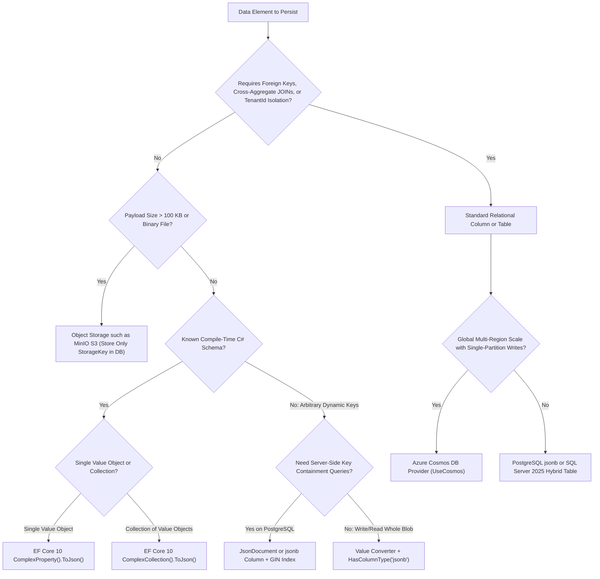
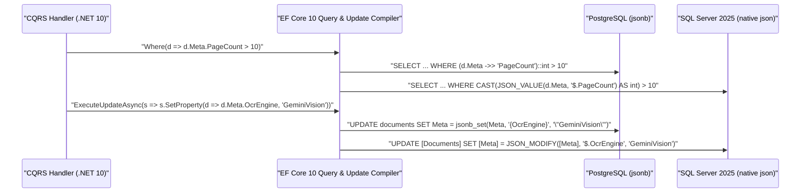
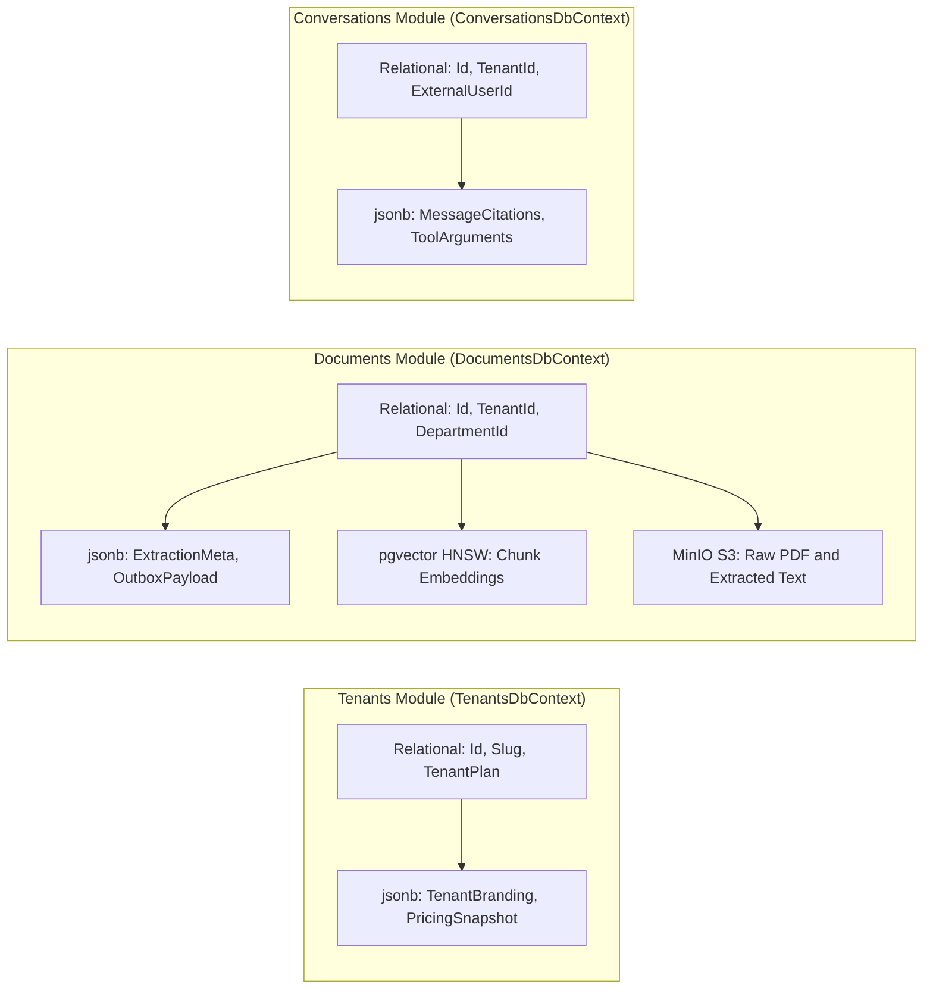
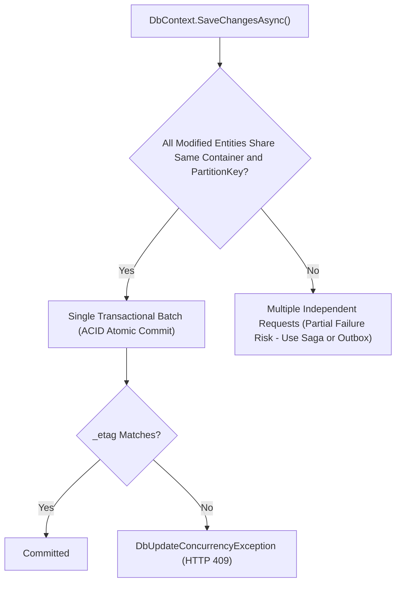

# Chapter 10: JSON and NoSQL Integration

## 1. Learning Objectives

By the end of this chapter, you will be able to:
*   Integrate semi-structured and unstructured JSON data natively into relational databases (PostgreSQL `jsonb`, SQL Server `NVARCHAR(MAX)` / SQL Server 2025 native `json`, and SQLite) using EF Core 10 `ComplexProperty(...).ToJson()`, `ComplexCollection(...).ToJson()`, and legacy `OwnsOne(...).ToJson()`.
*   Translate C# LINQ queries directly into optimized database JSON operations (`->>`, `@>` in PostgreSQL `jsonb`; `JSON_VALUE`, `OPENJSON` in SQL Server) and perform server-side partial JSON updates with EF Core 10 `ExecuteUpdateAsync`.
*   Architect hybrid schemas in a `.NET 10` modular monolith like **Normora**, balancing strict relational normalization, `jsonb` documents, `pgvector` embeddings, and MinIO S3 object storage.
*   Evaluate the performance, storage (TOAST / off-row LOB), and indexing implications of querying JSON columns using PostgreSQL GIN / expression indexes and SQL Server computed columns.
*   Understand the fundamentals, EF Core 10 AI/vector capabilities (`VectorDistance`, `Rrf`), and architectural trade-offs of swapping a relational provider for the **Azure Cosmos DB (NoSQL)** provider.

## 2. Introduction

Historically, the software architecture world was divided into two warring factions: Relational (SQL) and NoSQL (Document). 
*   **Relational Purists** normalized everything into dozens of tables, creating inflexible schemas that required weeks of DBA approval to change. 
*   **NoSQL Advocates** dumped everything into massive JSON documents, abandoning referential integrity and eventually drowning in data corruption.

Modern Enterprise Architecture embraces the **Hybrid Database**. PostgreSQL has offered binary-indexed `jsonb` for years, SQL Server (since 2016) treats JSON as a first-class citizen—culminating in SQL Server 2025's native binary `json` data type—and modern systems routinely store strict relational data (Users, Tenants, Invoices) alongside dynamic or snapshot JSON data (Tenant Branding, Outbox Payloads, Agent Tool Arguments, User Preferences) *in the exact same table*.

Prior to EF Core 7, interacting with relational JSON required clunky workarounds using Value Converters or raw SQL. EF Core 7 introduced native `.ToJson()` mapping, EF Core 8 added primitive collections and nested JSON collections, and **EF Core 10** elevates JSON to first-class status with **`ComplexProperty(...).ToJson()`**, **`ComplexCollection(...).ToJson()`**, nullable value-object structs, native SQL Server 2025 `json` support, and **server-side `ExecuteUpdateAsync` directly against nested JSON properties**.

This chapter teaches you how to break the rules of relational normalization safely, securely, and performantly—using **Normora** (our `.NET 10` multi-tenant knowledge management and conversational-AI modular monolith running on PostgreSQL + `pgvector`) as our primary reference architecture.

## 3. Core Concepts

### The Hybrid Schema
*   **What:** A relational table where the Aggregate Root's identity, foreign keys, and tenant boundaries live in standard relational columns, while tightly owned Value Objects, configuration trees, or semi-structured payloads live in a JSON column (`jsonb` in PostgreSQL, `json` or `NVARCHAR(MAX)` in SQL Server).
*   **Why:** You retain ACID transactions, foreign-key referential integrity, and B-tree indexes on core keys (such as `TenantId` and `Id`), while avoiding table explosion (excessive `JOIN`s) and constant schema migrations for evolving sub-structures.
*   **How:** Map core relational columns normally, and map nested value objects via `ComplexProperty(...).ToJson()` or collections via `ComplexCollection(...).ToJson()`.
*   **When NOT to use:** Do not put `TenantId`, foreign keys to other aggregates, or frequently joined entities inside JSON. Never store multi-megabyte blobs (such as raw PDFs or full extracted book text) in JSON columns; store them in S3/MinIO object storage and persist only the storage key.

### Value Converters vs. Native JSON (`.ToJson()`)
*   **Value Converters (`.HasConversion(...)`, EF Core 3–6 style):** You instruct EF Core to serialize a CLR object into a JSON string on `SaveChanges()` and deserialize it on materialization. However, to the EF Core query pipeline, the column is an opaque string. Writing `Where(c => c.Diagnostics.CpuTemp > 100)` throws a translation exception (or forces dangerous client-side evaluation).
*   **Native JSON (`.ToJson()`, EF Core 7–10):** EF Core maps the C# object graph as a structural Complex Type (or Owned Type) stored in a JSON column. Crucially, EF Core *understands* the JSON schema. It translates `Where(c => c.Diagnostics.CpuTemp > 100)` into `WHERE CAST(JSON_VALUE([c].[Diagnostics], '$.CpuTemp') AS int) > 100` on SQL Server, or `WHERE (c."Diagnostics" ->> 'CpuTemp')::int > 100` on PostgreSQL `jsonb`.
*   **When NOT to use `.ToJson()`:** `.ToJson()` requires a statically known CLR schema (classes, records, structs). If you need an arbitrary key-value property bag with unknown keys at compile time (like `Dictionary<string, object>`), use `System.Text.Json.JsonDocument`, Npgsql's native `jsonb` dictionary mapping, or a Value Converter paired with raw `EF.Functions` queries.

### EF Core 10 Complex Types (`ComplexProperty` / `ComplexCollection`) vs. Owned Types (`OwnsOne` / `OwnsMany`)
*   **What:** **Complex Types** represent pure Value Objects—data without an independent database identity (primary key). In EF Core 7–9, JSON mapping relied on Owned Entities (`OwnsOne(...).ToJson()`, `OwnsMany(...).ToJson()`), which secretly created shadow entity keys and treated the JSON payload as a tracked entity rather than a value. **EF Core 10** promotes `ComplexProperty(...).ToJson()` and `ComplexCollection(...).ToJson()` as the modern standard.
*   **Why:** Complex types support C# value semantics (`struct`, `readonly record struct`, `record`, `class`), support nullable/optional JSON objects (when at least one property inside is required so EF Core can distinguish `null` from an empty object), and—uniquely in EF Core 10—support server-side **`ExecuteUpdateAsync`** directly against nested JSON properties.
*   **When NOT to use `ComplexProperty`:** Complex types cannot have independent foreign keys or navigation properties pointing to other entities, and `ComplexCollection` elements must be reference types (`class` or `record`, not `struct`). If you need a separate child table with independent rows and FKs, use a standard `HasMany` entity relationship instead.

### Primitive Collections (`List<string>`, `string[]`)
*   **What:** Starting in EF Core 8 (and refined through EF Core 10), primitive collections such as `List<string>` or `Guid[]` map natively without needing a wrapper class or `.ToJson()`.
*   **How:** On SQL Server, EF Core stores primitive collections as a JSON array column and translates `.Contains(...)` into `OPENJSON(...)`. On PostgreSQL (Npgsql), primitive collections map natively to PostgreSQL array columns (`text[]`, `uuid[]`) and translate `.Contains(...)` into `= ANY(...)` (or can be explicitly mapped to `jsonb` when needed).
*   **When NOT to use:** Avoid storing thousands of IDs in a single array column for high-churn many-to-many memberships; use a proper join table with composite indexes instead.

### PostgreSQL `jsonb` vs. SQL Server `NVARCHAR(MAX)` / Native `json`
*   **PostgreSQL `jsonb`:** Stores JSON in a decomposed binary format—whitespace and duplicate keys are stripped, numbers/booleans are stored natively, and **GIN (Generalized Inverted Indexes)** can index every key and value inside the document without computed columns. Large `jsonb` payloads (> ~2 KB) are automatically compressed and moved out-of-line by PostgreSQL's **TOAST** (The Oversized-Attribute Storage Technique) engine.
*   **SQL Server `NVARCHAR(MAX)` vs. SQL Server 2025 Native `json`:** Historically, SQL Server stored JSON as UTF-16 text in `NVARCHAR(MAX)`, parsing it on demand via `JSON_VALUE` and requiring Computed Columns for indexing. In **EF Core 10** targeting SQL Server 2025 (`UseCompatibilityLevel(170)`) or Azure SQL, EF Core automatically maps `.ToJson()` and primitive collections to SQL Server's new native binary `json` data type, enforcing structural validity and accelerating reads and partial updates.

### The Azure Cosmos DB Provider
*   **What:** EF Core is provider-agnostic. With `Microsoft.EntityFrameworkCore.Cosmos` (`UseCosmos(...)`), the exact same `DbContext` and LINQ surface translates into Azure Cosmos DB for NoSQL queries, storing each root entity—along with its embedded owned/complex collections—as a single JSON document inside a partitioned container.
*   **Why:** Ideal for globally distributed, multi-region low-latency reads/writes and massive append-only ingestion partitioned by a shard key (e.g., `TenantId`). In EF Core 10, the Cosmos provider also supports native **Vector Search** (`IsVectorProperty`, `VectorDistance`), **Full-Text Search** (`FullTextContains`), **Hybrid Search** (`EF.Functions.Rrf`), and resilient schema evolution (defaulting missing newly-required properties instead of throwing).
*   **When NOT to use:** Cosmos DB has no cross-partition `JOIN`s and guarantees ACID transactions *only within a single logical partition key*. Do not replace a relational database with Cosmos DB if your workload requires cross-aggregate joins, complex `GroupBy` reporting, or multi-tenant transactions spanning partition boundaries.

### Five Real-World Normora Examples (Core Concepts in Practice)
1.  **`Tenants` Module — White-Label Branding (`ComplexProperty().ToJson()`):** A `Tenant` row stores relational keys (`Id`, `Slug`, `SubscriptionTier`) in columns in `TenantsDbContext`, while its `TenantBranding` value object (`LogoUrl`, `PrimaryColor`, `AccentColor`, `CustomCssVariables`) is mapped as an optional `ComplexProperty` to a PostgreSQL `jsonb` column so theme additions never require schema migrations.
2.  **`Documents` Module — Transactional Outbox Payload (`JsonDocument` / JSON string vs `.ToJson()`):** `DocumentProcessingOutboxMessage` stores relational scheduling columns (`Id`, `TenantId`, `Status`, `Attempts`, `NextRetryAt`) alongside a `Payload` `jsonb` column capturing the ingestion job context (`DocumentId`, `DocumentVersionId`, `StorageKey`, `MimeType`) in the exact same ACID transaction as the document upload.
3.  **`Conversations` Module — Grounded Citations (`ComplexCollection().ToJson()`):** Each `ConversationMessage` stores `Id`, `ConversationId`, `TenantId`, `Role`, and `CreatedAt` relationally, while its list of `MessageCitation` items (`DocumentId`, `ChunkId`, `DocumentTitle`, `SectionBreadcrumb`, `Score`) is stored as a JSON array via `ComplexCollection(...).ToJson()`, eliminating extra `JOIN`s when streaming chat history.
4.  **`Conversations` Module — HITL Tool Approval Snapshot (`JsonDocument` for Dynamic Schemas):** `PendingApproval` persists an AI agent's paused tool call (`documents_delete`, `workspace_invite_employee`) for 15 minutes. Because each of Normora's 19 agent tools has different parameters, `ToolArguments` is stored as a `JsonDocument` in `jsonb` rather than a rigid `.ToJson()` class.
5.  **`Documents` Module — When NOT to Use JSON (`MinioDocumentStorageService` + `pgvector`):** Normora explicitly *refuses* to store raw PDF bytes or 5 MB extracted markdown texts inside PostgreSQL `jsonb`. Raw files live in MinIO S3 (`IDocumentStorageService`), chunk embeddings (`vector(768)`) live in dedicated `pgvector` HNSW-indexed rows, and `TenantId` always remains an indexed relational column for global query filters.

## 4. Visual Diagrams

### 4.1 Hybrid Storage Decision Flowchart (Architect's Guide)



### 4.2 EF Core 10 JSON Query & `ExecuteUpdateAsync` Pipeline



### 4.3 Normora Hybrid Persistence Topology



### 4.4 Column Layout Comparison

```text
=============================================================================
             TRADITIONAL RELATIONAL vs. JSON MAPPING
=============================================================================

[ C# Domain Model ]
class Charger { 
  Guid Id; 
  Diagnostics Diagnostics { int CpuTemp; string ErrorCode; } 
}

1. TRADITIONAL MAPPING (Owned Types to Columns)
Table: Chargers
| Id | Diagnostics_CpuTemp | Diagnostics_ErrorCode |
|----|---------------------|-----------------------|
| 1  | 65                  | NULL                  |
(Rigid schema. Adding 'FanSpeed' requires a database migration).

2. NATIVE JSON MAPPING (.ToJson)
Table: Chargers
| Id | Diagnostics (jsonb / json / NVARCHAR(MAX))         |
|----|----------------------------------------------------|
| 1  | {"CpuTemp": 65, "ErrorCode": null, "FanSpeed": 12} |
(Dynamic schema. Adding 'FanSpeed' in C# requires ZERO database migrations).
```

```text
=============================================================================
             JSON QUERY TRANSLATION PIPELINE
=============================================================================

C# LINQ:
context.Chargers.Where(c => c.Diagnostics.CpuTemp > 80)

       │ EF Core Query Compiler
       ▼

T-SQL (SQL Server):
SELECT [c].[Id], [c].[Diagnostics]
FROM [Chargers] AS [c]
WHERE CAST(JSON_VALUE([c].[Diagnostics], '$.CpuTemp') AS int) > 80

PostgreSQL (Npgsql):
SELECT c."Id", c."Diagnostics"
FROM "Chargers" AS c
WHERE (c."Diagnostics" ->> 'CpuTemp')::int > 80
```

## 5. API Deep Dive: Native JSON Mapping

### 5.1 Configuring the JSON Column (Legacy Owned Types vs. EF Core 10 Complex Types)
Originally (EF Core 7–9), JSON mapping utilized Owned Types (`OwnsOne(...).ToJson()` and `OwnsMany(...).ToJson()`). In **EF Core 10**, **`ComplexProperty(...).ToJson()`** and **`ComplexCollection(...).ToJson()`** are the preferred APIs because they treat JSON objects as true Value Objects without hidden entity keys and unlock `ExecuteUpdateAsync` on nested JSON properties.

```csharp
public class Charger
{
    public int Id { get; set; }
    // Complex object graph
    public ChargerConfiguration Config { get; set; } 
}

public class ChargerConfiguration
{
    public int MaxKw { get; set; }
    public List<SupportedProtocol> Protocols { get; set; } // Nested Collections!
}

public class SupportedProtocol { public string Name { get; set; } }

// Legacy EF Core 7-9 Owned Type style (still supported, but lacks ExecuteUpdateAsync on JSON):
builder.Entity<Charger>().OwnsOne(
    c => c.Config, 
    ownedBuilder =>
    {
        ownedBuilder.ToJson(); 
        ownedBuilder.Property(x => x.MaxKw).HasJsonPropertyName("max_output_kw");
        ownedBuilder.OwnsMany(x => x.Protocols); 
    });

// Modern EF Core 10 Complex Type style (recommended):
builder.Entity<Charger>().ComplexProperty(
    c => c.Config,
    complexBuilder =>
    {
        complexBuilder.ToJson();
        complexBuilder.Property(x => x.MaxKw).HasJsonPropertyName("max_output_kw");
        complexBuilder.ComplexCollection(x => x.Protocols);
    });
```

### 5.2 Querying JSON
You write standard LINQ. EF Core handles the translation to PostgreSQL `jsonb` operators (`->>`, `jsonb_array_elements`), SQL Server `JSON_VALUE`/`OPENJSON`, or SQLite `json_extract`.

```csharp
// 1. Filtering by a nested JSON property
var hotChargers = await context.Chargers
    .Where(c => c.Config.MaxKw > 150)
    .ToListAsync();

// 2. Querying inside a nested JSON array (EF Core 8+)
var ocppChargers = await context.Chargers
    .Where(c => c.Config.Protocols.Any(p => p.Name == "OCPP 2.0.1"))
    .ToListAsync();
```

### 5.3 Updating JSON (`SaveChangesAsync` vs. EF Core 10 `ExecuteUpdateAsync`)
EF Core's Change Tracker monitors tracked JSON objects. If you load an entity, modify a property deep inside the JSON object, and call `SaveChangesAsync()`, EF Core serializes the *entire* JSON column and issues a full column `UPDATE`.

In **EF Core 10**, if you map the property via `ComplexProperty(...).ToJson()` (instead of legacy `OwnsOne`), you can also use **`ExecuteUpdateAsync`** to patch individual nested JSON keys directly in the database (emitting `jsonb_set` in PostgreSQL or `JSON_MODIFY` in SQL Server) without loading the entity into memory!

### 5.4 EF Core 10 `ComplexProperty`, `ComplexCollection`, Structs, and Optional JSON
*   **Value-Type Structs (`struct` / `readonly record struct`):** In EF Core 10, a single `ComplexProperty(...).ToJson()` can be a C# `struct` or `readonly record struct`, enforcing stack-friendly immutability and value equality.
*   **Optional (Nullable) Complex Properties:** Mark the property nullable (e.g., `public TenantBranding? Branding { get; set; }`). When `Branding` is `null`, the database column stores SQL `NULL`. **Rule:** At least one property inside the complex type must be `required` (or non-nullable) so EF Core can distinguish a `NULL` complex object from an initialized object whose optional fields are all `null`.
*   **`ComplexCollection(...).ToJson()`:** Maps `List<T>` of value objects into a single JSON array column. **Constraint:** Collection elements (`T`) must be reference types (`class` or `record`), not `struct`s.
*   **SQL Server 2025 Native `json` Type:** When targeting SQL Server 2025 (`options.UseSqlServer(connStr, sql => sql.UseCompatibilityLevel(170))`), EF Core 10 automatically creates columns with the native binary `json` type instead of `NVARCHAR(MAX)`. On PostgreSQL (`Npgsql`), `.ToJson()` automatically maps to `jsonb`.

### 5.5 Server-Side Partial Updates with `ExecuteUpdateAsync` (EF Core 10)
*   **What & Why:** Avoids fetching a large JSON document over the network, deserializing it, mutating one field, and sending the whole document back.
*   **How:** Supports both expression-based updates and EF Core 10's new **non-expression lambdas** (allowing standard C# `if` statements inside `ExecuteUpdateAsync`):
```csharp
await context.Documents
    .Where(d => d.Id == documentId)
    .ExecuteUpdateAsync(s =>
    {
        s.SetProperty(d => d.Extraction.PageCount, newPageCount);
        if (ocrCompleted)
        {
            s.SetProperty(d => d.Extraction.OcrEngine, "Gemini-2.5-Flash");
        }
    });
```
*   **When NOT to use `ExecuteUpdateAsync`:** It bypasses the EF Core Change Tracker, domain events, concurrency tokens (unless explicitly checked in `Where`), and transactional outbox side effects. Never use `ExecuteUpdateAsync` when mutating state that must emit a `DomainEvent` or write an outbox message in `SaveChangesAsync`.

### 5.6 Primitive Collections & Dictionary Alternatives
EF Core's `.ToJson()` requires a fixed, statically known CLR schema—**it does NOT support mapping `Dictionary<TKey, TValue>` directly via `.ToJson()`**. When you need dynamic key-value pairs, choose one of these three patterns:
1.  **Structured Key-Value List (`ComplexCollection().ToJson()`):** Replace `Dictionary<string, string>` with `List<MetadataEntry>` (`class MetadataEntry { public required string Key { get; set; } public required string Value { get; set; } }`). Fully supports LINQ `.Any(m => m.Key == "Department" && m.Value == "HR")`.
2.  **`System.Text.Json.JsonDocument` (Npgsql `jsonb` DOM):** Map a `JsonDocument` property directly to a PostgreSQL `jsonb` column and query it with `EF.Functions.JsonContains(...)` backed by a GIN index. (Dispose or detach carefully if tracking).
3.  **Value Converter (`HasConversion` + `HasColumnType("jsonb")`):** Serializes `Dictionary<string, string>` to JSON when you only ever read/write the dictionary as an atomic blob and never filter by its keys in LINQ.

### 5.7 Five Real-World Normora API Mapping Examples

> [!NOTE]
> Per Normora's `AGENTS.md`, DbContexts remain lean and apply parameterless `IEntityTypeConfiguration<T>` classes automatically via `modelBuilder.ApplyConfigurationsFromAssembly(typeof(DocumentsDbContext).Assembly)`. Never inject `ITenantContext` into a configuration constructor!

#### Example 1: Optional `ComplexProperty().ToJson()` for White-Label Branding (`Tenants` Module)
```csharp
// server/Modules/Tenants/Domain/Entities/Tenant.cs
public sealed class Tenant
{
    public Guid Id { get; private set; }
    public required string Slug { get; private set; }
    public TenantBranding? Branding { get; private set; } // Nullable Complex Type
}

public sealed record TenantBranding
{
    public required string PrimaryColor { get; init; } // Required marker for EF Core 10 null-detection
    public string? LogoStorageKey { get; init; }
    public string? CustomDomain { get; init; }
}

// server/Modules/Tenants/Persistence/Configurations/TenantConfiguration.cs
public sealed class TenantConfiguration : IEntityTypeConfiguration<Tenant>
{
    public void Configure(EntityTypeBuilder<Tenant> builder)
    {
        builder.ToTable("tenants", "tenants");
        builder.HasKey(t => t.Id);

        builder.ComplexProperty(t => t.Branding, b =>
        {
            b.ToJson("branding");
            b.Property(x => x.PrimaryColor).HasJsonPropertyName("primary_color");
            b.Property(x => x.LogoStorageKey).HasJsonPropertyName("logo_storage_key");
            b.Property(x => x.CustomDomain).HasJsonPropertyName("custom_domain");
        });
    }
}
```

#### Example 2: `ComplexCollection().ToJson()` for Grounded RAG Citations (`Conversations` Module)
```csharp
// server/Modules/Conversations/Domain/Entities/ConversationMessage.cs
public sealed class ConversationMessage
{
    public Guid Id { get; private set; }
    public Guid TenantId { get; private set; } // Always relational for global query filter!
    public Guid ConversationId { get; private set; }
    public List<MessageCitation> Citations { get; private set; } = [];
}

public sealed record MessageCitation
{
    public required Guid DocumentId { get; init; }
    public required Guid ChunkId { get; init; }
    public required string DocumentTitle { get; init; }
    public string? SectionBreadcrumb { get; init; }
    public double Score { get; init; }
}

// server/Modules/Conversations/Persistence/Configurations/ConversationMessageConfiguration.cs
public sealed class ConversationMessageConfiguration : IEntityTypeConfiguration<ConversationMessage>
{
    public void Configure(EntityTypeBuilder<ConversationMessage> builder)
    {
        builder.ToTable("conversation_messages", "conversations");
        builder.HasKey(m => m.Id);
        builder.HasIndex(m => new { m.TenantId, m.ConversationId });

        builder.ComplexCollection(m => m.Citations, c => c.ToJson("citations"));
    }
}
```

#### Example 3: EF Core 10 `ExecuteUpdateAsync` on Nested JSON Metadata (`Documents` Module)
```csharp
// server/Modules/Documents/Application/Documents/Commands/MarkExtractionCompleted/MarkExtractionCompletedCommandHandler.cs
public sealed class MarkExtractionCompletedCommandHandler(
    DocumentsDbContext dbContext)
    : IRequestHandler<MarkExtractionCompletedCommand, Unit>
{
    public async Task<Unit> Handle(MarkExtractionCompletedCommand request, CancellationToken ct)
    {
        // Note: DocumentsDbContext applies the global TenantId filter automatically.
        var updated = await dbContext.Documents
            .Where(d => d.Id == request.DocumentId)
            .ExecuteUpdateAsync(s => s
                .SetProperty(d => d.ExtractionMeta.PageCount, request.PageCount)
                .SetProperty(d => d.ExtractionMeta.OcrEngine, request.EngineName)
                .SetProperty(d => d.ExtractionMeta.ExtractedAtUtc, DateTime.UtcNow), ct);

        if (updated == 0)
        {
            throw new BolaException(); // Mapped globally to 404 Not Found
        }

        return Unit.Value;
    }
}
```

#### Example 4: `JsonDocument` for Dynamic HITL Tool Arguments (`Conversations` Module)
```csharp
// server/Modules/Conversations/Domain/Entities/PendingApproval.cs
public sealed class PendingApproval
{
    public Guid Id { get; private set; }
    public Guid TenantId { get; private set; }
    public required string ExternalUserId { get; private set; }
    public required string ToolName { get; private set; }
    public required JsonDocument ToolArguments { get; private set; } // Arbitrary JSON schema per tool
    public DateTime ExpiresAtUtc { get; private set; }
}

// server/Modules/Conversations/Persistence/Configurations/PendingApprovalConfiguration.cs
public sealed class PendingApprovalConfiguration : IEntityTypeConfiguration<PendingApproval>
{
    public void Configure(EntityTypeBuilder<PendingApproval> builder)
    {
        builder.ToTable("pending_approvals", "conversations");
        builder.HasKey(p => p.Id);
        builder.Property(p => p.ToolArguments).HasColumnType("jsonb");
    }
}
```

#### Example 5: `GroupBy` Over a JSON Property Following Normora's Anonymous Projection Rule (`Documents` Module)
```csharp
// server/Modules/Documents/Application/Metrics/Queries/GetExtractionStats/GetExtractionStatsQueryHandler.cs
public sealed class GetExtractionStatsQueryHandler(
    DocumentsDbContext dbContext)
    : IRequestHandler<GetExtractionStatsQuery, IReadOnlyList<EngineUsageDto>>
{
    public async Task<IReadOnlyList<EngineUsageDto>> Handle(
        GetExtractionStatsQuery request, CancellationToken ct)
    {
        // AGENTS.md rule: ALWAYS project GroupBy to an anonymous type first!
        var rawCounts = await dbContext.Documents
            .AsNoTracking()
            .GroupBy(d => d.ExtractionMeta.OcrEngine)
            .Select(g => new { Engine = g.Key, DocumentCount = g.Count() })
            .ToListAsync(ct);

        return rawCounts
            .Select(x => new EngineUsageDto(x.Engine ?? "Unknown", x.DocumentCount))
            .ToList();
    }
}
```

## 6. EF Core Internals: JSON Translation Constraints & Change Tracking

While `.ToJson()` is powerful, it has strict architectural and runtime limits:
1.  **Strict Serialization:** You cannot use `[JsonIgnore]` or custom `System.Text.Json` converters on properties mapped via `.ToJson()`. EF Core uses its own internal relational JSON serializer/deserializer so that its query translator knows the exact JSON property names (`HasJsonPropertyName`) and CLR types.
2.  **No Navigation Properties Out:** The classes/records inside a JSON column cannot contain foreign key navigation properties pointing back to standard relational tables. The JSON document is a strict aggregate boundary. (You may store raw scalar IDs like `Guid DocumentId`, but EF Core will not enforce FK constraints or `.Include()` across them).
3.  **Client-Side Evaluation & Translation Failures:** If you invoke a custom C# method or an untranslatable LINQ operator inside a query over a JSON property, EF Core throws an `InvalidOperationException` rather than silently evaluating on the client.
4.  **`DetectChanges()` Snapshot Overhead:** For tracked queries (`DbContext` default), EF Core snapshots every scalar property inside a JSON-mapped object graph so it can compare original vs. current values on `SaveChangesAsync()`. On entities with large `ComplexCollection` arrays (hundreds of nested items), `DetectChanges()` allocates memory and burns CPU. Always use `.AsNoTracking()` on read queries!
5.  **When NOT to Use `.ToJson()`:**
    *   When you need foreign-key cascades or `JOIN`s against the nested items.
    *   When multiple concurrent users mutate different items inside the same JSON array simultaneously (causing last-writer-wins overwrites during `SaveChangesAsync()`).
    *   When the payload is a completely untyped `Dictionary<string, object>` (use `JsonDocument` or a key-value `ComplexCollection` instead).

### Five Real-World Normora Internals Examples
1.  **`AsNoTracking()` Citation Read (`ConversationsDbContext`):** When `GetConversationHistoryQueryHandler` loads 50 messages, each containing 5 `MessageCitation` items in JSON, adding `.AsNoTracking()` skips creating 250 snapshot objects in the Change Tracker.
2.  **Scalar ID Without Navigation (`MessageCitation`):** `MessageCitation` stores `Guid DocumentId` and `Guid ChunkId` inside `citations` (`jsonb`), NOT a `Document` navigation property. If a document is later deleted, historical chat citations remain readable (or show a graceful fallback) without breaking FK constraints across modules (`Conversations` -> `Documents`).
3.  **`[JsonIgnore]` Trap on `TenantBranding`:** Adding `[System.Text.Json.Serialization.JsonIgnore]` to a property on `TenantBranding` has zero effect on EF Core's `.ToJson()` column—you must either remove it from the persistence model or configure `.Ignore()` in `TenantConfiguration` (if supported) / keep API DTOs separate.
4.  **Translation Failure on Custom C# Method:** Writing `.Where(d => ColorHelper.IsDark(d.Branding!.PrimaryColor))` inside `TenantsDbContext` fails EF Core LINQ-to-SQL translation. Translate using native string operators (`StartsWith`, `==`) or fetch the minimal projected fields first.
5.  **Concurrency Overwrite on `ComplexCollection`:** If two background jobs concurrently append tags via `SaveChangesAsync()` on the same `Document` JSON array without optimistic concurrency (`xmin` / `RowVersion`), one overwrites the other's array. Use PostgreSQL `xmin` concurrency tokens or `ExecuteUpdateAsync` / normalized child rows for concurrent writers.

## 7. Complete Examples: EV Platform & Normora Case Studies

### 7.1 EV Platform Case Study: Telemetry Snapshots
In the EV Platform, chargers send massive bursts of telemetry data. Different hardware manufacturers send completely different telemetry fields. Manufacturer A sends `{"battery_temp": 45}`, Manufacturer B sends `{"cooling_fluid_pressure": 2.1}`.

We cannot create a relational table with 500 nullable columns. We must use a Hybrid Schema.

#### Domain Model
> [!NOTE]
> Native EF Core `.ToJson()` does **not** map arbitrary `Dictionary<string, string>` properties directly. To combine strongly typed telemetry fields with extensible key-value pairs inside `.ToJson()`, model the catch-all attributes as a `ComplexCollection` of `TelemetryAttribute` records (or store dynamic bags separately in a `JsonDocument` column).

```csharp
public class TelemetrySnapshot
{
    public Guid Id { get; private set; }
    public int ChargerId { get; private set; }
    public DateTime Timestamp { get; private set; }
    
    // Dynamic payload mapped via ComplexProperty().ToJson()
    public DynamicPayload Payload { get; private set; } 
}

public class DynamicPayload
{
    public decimal? BatteryTemp { get; set; }
    public decimal? CoolingPressure { get; set; }
    // Catch-all key-value collection supported natively by EF Core 10 ComplexCollection().ToJson()
    public List<TelemetryAttribute> ExtendedData { get; set; } = [];
}

public sealed record TelemetryAttribute
{
    public required string Key { get; init; }
    public required string Value { get; init; }
}
```

#### Configuration
```csharp
builder.Entity<TelemetrySnapshot>()
       .ComplexProperty(t => t.Payload, p =>
       {
           p.ToJson();
           p.ComplexCollection(x => x.ExtendedData);
       });
```

#### The Query
A dashboard needs to find all snapshots where Battery Temp exceeded 60 degrees.
```csharp
var criticalEvents = await _context.TelemetrySnapshots
    .AsNoTracking()
    .Where(t => t.Payload.BatteryTemp > 60.0m)
    .OrderByDescending(t => t.Timestamp)
    .Take(100)
    .ToListAsync();
```

### 7.2 Normora Platform Case Study: Five End-to-End Examples

#### 1. `Documents`: Transactional Outbox Upload (`UploadDocumentCommandHandler`)
When a workspace user uploads a PDF, `UploadDocumentCommandHandler` commits the `Document`, `DocumentVersion`, and `DocumentProcessingOutboxMessage` in a **single PostgreSQL ACID transaction**. The outbox row keeps scheduling columns relational (`Status`, `NextAttemptAtUtc`) and stores job parameters in `jsonb`:
```csharp
public sealed class DocumentProcessingOutboxMessage
{
    public Guid Id { get; private set; }
    public Guid TenantId { get; private set; }
    public OutboxStatus Status { get; private set; }
    public int AttemptCount { get; private set; }
    public OutboxJobPayload Payload { get; private set; } = default!;
}

public sealed record OutboxJobPayload
{
    public required Guid DocumentId { get; init; }
    public required Guid DocumentVersionId { get; init; }
    public required string StorageKey { get; init; } // MinIO object key, NOT file bytes!
    public required string MimeType { get; init; }
}
```

#### 2. `Tenants`: Unscoped `TenantsDbContext` Workspace Branding Query
Because `TenantsDbContext` is the unscoped multi-tenancy root (no ambient `TenantId` global query filter per `AGENTS.md`), any query reading a tenant's JSON `Branding` MUST explicitly filter by `t.Id == request.TenantId`:
```csharp
public sealed class GetTenantBrandingQueryHandler(
    TenantsDbContext dbContext)
    : IRequestHandler<GetTenantBrandingQuery, TenantBrandingDto>
{
    public async Task<TenantBrandingDto> Handle(GetTenantBrandingQuery request, CancellationToken ct)
    {
        var branding = await dbContext.Tenants
            .AsNoTracking()
            .Where(t => t.Id == request.TenantId)
            .Select(t => t.Branding)
            .FirstOrDefaultAsync(ct);

        if (branding is null)
        {
            throw new BolaException(); // Generic 404 to prevent tenant enumeration
        }

        return new TenantBrandingDto(branding.PrimaryColor, branding.LogoStorageKey, branding.CustomDomain);
    }
}
```

#### 3. `Conversations`: Cross-Module Hybrid Retrieval Metadata (`Normora.Shared.Contracts.Documents`)
`Conversations` never injects `DocumentsDbContext`. Instead, `SearchCompanyDocumentsTool` sends `PerformHybridRetrievalQuery` with an explicit `Guid TenantId` and receives grounded chunk metadata (partially sourced from `jsonb` section breadcrumbs and `pgvector` cosine distances):
```csharp
var retrievalResult = await mediator.Send(new PerformHybridRetrievalQuery(
    TenantId: request.TenantId,
    DepartmentIds: callerContext.DepartmentIds,
    QueryText: rewrittenQuery,
    TopK: 8), ct);
```

#### 4. `Documents`: Querying Nested `ComplexCollection` Department Tags
Documents carry structured ingestion tags (`ComplexCollection` -> `jsonb`) alongside relational `DepartmentId` RBAC scoping:
```csharp
var policyDocs = await dbContext.Documents
    .AsNoTracking()
    .Where(d => d.Tags.Any(t => t.Key == "Compliance" && t.Value == "SOC2"))
    .Select(d => new DocumentSummaryDto(d.Id, d.Title, d.ExtractionMeta.PageCount))
    .ToListAsync(ct);
```

#### 5. `Tenants`: Immutable Subscription Invoice Snapshot (`TenantPlanPricingCatalog`)
When a tenant upgrades to `Pro` or `Enterprise` in `INR`, `USD`, or `EUR`, the invoice persists a `PricingSnapshot` JSON column (`ComplexProperty().ToJson()`) copied from `TenantPlanPricingCatalog` at checkout time—guaranteeing historical invoices never change if catalog prices or annual discounts evolve later.

## 8. Performance: Indexing JSON Columns & Storage Engine Limits

### 8.1 The Architectural Trap (Full Table Scans)
If you execute a filter on a JSON property across a table with 10 million rows without an index, the database must evaluate `JSON_VALUE(...)` or parse `jsonb` operators on *every single row* in the table. This causes a catastrophic Sequential / Full Table Scan and massive CPU spikes.

### 8.2 SQL Server Solution: Computed Columns (and SQL Server 2025 Native `json`)
Legacy SQL Server (`NVARCHAR(MAX)`) does not natively index properties *inside* a JSON string. To index a JSON property, create a **Computed Column** in SQL Server and index that computed column (ensuring the SQL cast type matches the LINQ query's CLR type!):

```csharp
// 1. In EF Core Configuration:
builder.Entity<TelemetrySnapshot>()
    .Property<decimal?>("ComputedBatteryTemp") // Shadow property
    // Instruct SQL Server to compute this column on the fly
    .HasComputedColumnSql("CAST(JSON_VALUE(Payload, '$.BatteryTemp') AS decimal(18,2))");

// 2. Create a standard index on the computed column
builder.Entity<TelemetrySnapshot>()
    .HasIndex("ComputedBatteryTemp");
```

Now, when you query `Where(t => t.Payload.BatteryTemp > 60.0m)`, SQL Server's query optimizer recognizes that `JSON_VALUE(Payload, '$.BatteryTemp')` matches the definition of the `ComputedBatteryTemp` indexed column and executes an ultra-fast Index Seek!

*(Note: Even with SQL Server 2025's native `json` data type, SQL Server 2025 introduces dedicated JSON indexes in the engine, while computed columns remain useful for exact B-tree range seeks).*

### 8.3 PostgreSQL `jsonb` Solution: GIN & Expression Indexes
PostgreSQL (`Npgsql`, used by **Normora**) stores `.ToJson()` columns as decomposed binary **`jsonb`**. You do **not** need computed columns to index `jsonb` in PostgreSQL:
1.  **Document-Wide GIN Index (`jsonb_path_ops`):** Accelerates containment queries (`@>`, emitted by `EF.Functions.JsonContains`). `jsonb_path_ops` creates a smaller, faster index than default `jsonb_ops` when you only use `@>` containment.
2.  **B-Tree Expression Index:** Accelerates equality and range filters (`=`, `>`, `<`, `ORDER BY`) on a specific nested JSON key when EF Core emits `(->>'Key')::type`.
3.  **EF Core 10 Limitation Note:** In EF Core 10, `builder.HasIndex(e => e.ComplexProp.NestedField)` is not yet supported in the Fluent Model Builder; add the GIN or expression index via `migrationBuilder.Sql(...)` in an EF Core migration.

### 8.4 Storage Engine Limits: TOAST (PostgreSQL) & LOB Off-Row (SQL Server)
*   **PostgreSQL TOAST (~2 KB threshold):** When a row's `jsonb` column exceeds ~2 KB, PostgreSQL compresses it and moves it out-of-line into a separate **TOAST** table. Every query that selects the whole entity (`SELECT *`) must perform extra I/O to fetch and decompress the TOASTed JSON—even if you only needed the `Title`! **Fix:** Always use `.Select(...)` projections in read queries to omit heavy `jsonb` columns when not displayed.
*   **SQL Server Off-Row LOB (8 KB threshold):** Values exceeding 8,060 bytes are stored off-row in LOB pages, incurring extra page reads. Any payload regularly exceeding ~100 KB–1 MB belongs in object storage (MinIO / Azure Blob Storage), not a database column.

### 8.5 Five Real-World Normora Performance & Indexing Examples
1.  **PostgreSQL GIN Index on `PendingApproval.ToolArguments` (`Conversations`):**
    ```csharp
    // Inside ConversationsDbContext migration Up():
    migrationBuilder.Sql(
        """CREATE INDEX "IX_pending_approvals_tool_args_gin" ON conversations.pending_approvals USING gin (tool_arguments jsonb_path_ops);""");
    ```
2.  **Expression B-Tree Index on `ExtractionMeta` (`Documents`):**
    ```csharp
    // Matches EF Core's generated (extraction_meta ->> 'ocr_engine') predicate
    migrationBuilder.Sql(
        """CREATE INDEX "IX_documents_ocr_engine" ON documents.documents ((extraction_meta ->> 'ocr_engine'));""");
    ```
3.  **GIN Containment Query with `EF.Functions.JsonContains` (`Conversations`):**
    ```csharp
    var pendingDeletions = await dbContext.PendingApprovals
        .AsNoTracking()
        .Where(p => p.ToolName == "documents_delete"
                 && EF.Functions.JsonContains(p.ToolArguments, $$"""{"documentId": "{{documentId}}"}"""))
        .ToListAsync(ct);
    ```
4.  **Avoiding TOAST I/O via Explicit Projection (`Documents`):** When rendering the Documents list grid, `ListDocumentsQueryHandler` projects only `d.Id`, `d.Title`, `d.Status`, and `d.ExtractionMeta.PageCount`—never loading heavy `jsonb` diagnostics or chunk metadata unless a user opens the detail drawer.
5.  **MinIO Offloading Guard (`Documents`):** `UploadDocumentCommandHandler` streams raw PDFs and multi-megabyte extracted Markdown files directly to MinIO via `IDocumentStorageService`, keeping PostgreSQL `jsonb` columns strictly under a few kilobytes of lightweight metadata.

## 9. ASP.NET Core Integration: API Payloads, CQRS & Security

When a frontend SPA (such as Normora's Angular 22 client behind Duende BFF) sends a JSON payload to update an entity, the ASP.NET Core Model Binder (`System.Text.Json`) deserializes the HTTP request body into your C# DTO or Command.

It is critical to decouple the API's JSON representation from EF Core's JSON storage.
Never expose the EF Core mapped Complex/Owned Type directly in your API signatures. If you rename a property in C# to satisfy a frontend change, EF Core will change the JSON schema in the database, potentially breaking queries or corrupting historical rows—and accepting raw persistence types directly from HTTP opens **mass-assignment (over-posting)** vulnerabilities!

Always validate incoming commands with **FluentValidation**, map explicitly from the Command/DTO to the domain Complex Type in the Application Layer, enforce **BOLA (`BolaException` -> 404)** and **BFLA (`BflaException` -> 403)**, and source all error strings from `Normora.Shared.Constants.ApiMessages`.

### Five Real-World Normora CQRS & API Integration Examples
1.  **Decoupled Branding Update (`UpdateTenantBrandingCommand`):**
    *   `UpdateTenantBrandingCommand` accepts `string PrimaryColor`, `string? CustomDomain`, and `string? LogoStorageKey`.
    *   `UpdateTenantBrandingCommandValidator` validates hex color format (`^#[0-9A-Fa-f]{6}$`) and domain length via FluentValidation before the handler runs.
    *   `UpdateTenantBrandingCommandHandler` maps the validated fields onto `Tenant.Branding` (`ComplexProperty().ToJson()`)—never binding HTTP JSON directly into the EF entity.
2.  **BFLA + BOLA Guard Before Mutating JSON (`ApprovalsController` / `ConfirmApprovalCommandHandler`):**
    *   If a user tries to approve a `PendingApproval` belonging to a different `ExternalUserId` or `TenantId`, the handler throws `new BolaException()` (mapped globally to `404 Not Found` with `ApiMessages.NotFound`)—never revealing that the approval ID exists.
    *   If the user lacks the required workspace role for the underlying tool, it throws `new BflaException()` (`403 Forbidden` with `ApiMessages.Forbidden`).
3.  **Strict Payload Validation for Dynamic `JsonDocument` (`ExecuteMcpToolCommandValidator`):**
    *   When `/api/mcp` receives arbitrary JSON arguments for `ExecuteMcpToolCommand`, FluentValidation enforces maximum payload byte size and JSON depth limits so an attacker cannot submit a 10 MB deeply nested JSON bomb into `PendingApproval.ToolArguments`.
4.  **CWE-209 Safe Outbox Failure Handling (`DocumentProcessingJob`):**
    *   If `GeminiDocumentTextExtractor` fails to parse a file and records failure metadata in a `jsonb` diagnostic field for internal logs, transactional emails and SignalR user notifications strictly emit generic `ApiMessages` constants—never raw exception messages or JSON stack traces.
5.  **Cross-Module DTO Isolation (`Normora.Shared.Contracts.Documents`):**
    *   `PerformHybridRetrievalQuery` returns immutable contract DTOs (`RetrievedChunkDto`) to `Conversations`, completely hiding `DocumentsDbContext`'s internal `ExtractionMeta` and `DocumentProcessingOutboxMessage` JSON structures.

## 10. Clean Architecture Perspective

When should an Architect use Relational Tables vs. JSON Columns vs. Object Storage vs. NoSQL?

**Use Relational Tables / Columns When:**
1.  The data is a first-class Aggregate Root or tenant isolation key (`TenantId`, `ExternalUserId`, `DepartmentId`).
2.  The data requires Foreign Key constraints to maintain referential integrity.
3.  You frequently use the data in complex `JOIN` clauses, RBAC security joins, or high-concurrency partial row updates.
4.  The schema is rigid and well-understood.

**Use JSON Columns (`ComplexProperty().ToJson()` / `ComplexCollection().ToJson()`) When:**
1.  The data is a complex Value Object strictly owned by the parent (e.g., `TenantBranding`, `MessageCitation`, `ShippingAddress`).
2.  The schema is evolving or captures an immutable point-in-time snapshot (e.g., `PricingSnapshot`, `OutboxJobPayload`).
3.  The data is frequently read/written as a single atomic unit alongside the parent row.
4.  You have a deep inheritance hierarchy and want to avoid the `JOIN` penalty of TPT (Table-Per-Type), flattening the varying properties into a single JSON column on a TPH base table.

**When NOT to Use JSON Columns (Use MinIO/Blob Storage or Separate Tables Instead):**
1.  Payloads exceed ~100 KB–1 MB (bloats PostgreSQL TOAST / SQL Server LOB pages and memory buffers).
2.  Multiple background workers concurrently update different elements of the same list.
3.  Cross-entity relationships or security predicates (`DepartmentId`, `TenantId`) depend on the field.

### Five Real-World Normora Clean Architecture Examples
1.  **`TenantId` Always Relational:** Even though `Documents` and `Conversations` use `jsonb` heavily, `TenantId` is ALWAYS an indexed relational column so EF Core global query filters (`_tenantContext.TenantId`) execute via B-tree index seeks.
2.  **`DepartmentId` RBAC Always Relational:** Document compartmentalization (`UserGroups` and `Departments`) lives in relational join tables in `TenantsDbContext` and `DocumentsDbContext`—never inside JSON—because every RAG query must enforce departmental authorization cleanly.
3.  **`MessageCitation` in `ComplexCollection().ToJson()`:** Citations belong strictly to one `ConversationMessage` snapshot and are always rendered together in the Angular `ChunkPreviewDrawerComponent`, making JSON array storage ideal.
4.  **`MinioDocumentStorageService` for Blobs:** Raw uploaded PDFs/DOCXs and large extracted Markdown artifacts live in MinIO S3; `DocumentsDbContext` stores only the `StorageKey` string and lightweight `ExtractionMeta` in `jsonb`.
5.  **Cross-Module Neutrality:** `Conversations` and `Tenants` never expose their EF Core JSON types in `Normora.Shared.Contracts.*`; MediatR contracts pass clean, versionable C# records.

## 11. Enterprise SaaS Perspective: Dynamic Form Builders & Schemas

A common SaaS requirement is allowing tenants to define their own custom fields (e.g., "Add a 'SecurityGateCode' field to the Site form") or dynamic metadata schemas.

Adding physical columns to the SQL schema dynamically at runtime is a catastrophic security and stability risk.

The enterprise solution utilizes EF Core JSON storage—but with an important EF Core 10 distinction:
*   **Option A (`ComplexCollection().ToJson()` with Key-Value Records):** Because EF Core `.ToJson()` does **not** natively map `Dictionary<string, string>`, model custom fields as `List<CustomFieldValue>` (`record CustomFieldValue(string Key, string Value)`). You can query it directly in LINQ via `.Where(s => s.CustomFields.Any(f => f.Key == "SecurityGateCode" && f.Value == "1234"))`!
*   **Option B (PostgreSQL `JsonDocument` + GIN Index):** Store dynamic fields as `JsonDocument` in a `jsonb` column and query via `EF.Functions.JsonContains(s.CustomFields, """{"SecurityGateCode": "1234"}""")`, backed by a `jsonb_path_ops` GIN index.
*   **Option C (Value Converter):** Use `.HasConversion(...)` on `Dictionary<string, string>` only if you never need to filter by individual keys inside SQL.

### Five Real-World Normora Enterprise SaaS Dynamic Schema Examples
1.  **Dynamic A2UI Intake Forms (`workspace_request_form`):** When an AI agent needs missing parameters (e.g., travel tier, cost center, manager email), the generated form schema and submitted values are captured dynamically as `JsonDocument` (`jsonb`) without altering PostgreSQL tables per tool.
2.  **Tenant-Customizable Document Metadata Tags:** Enterprise tenants tag HR vs. Finance policies with custom key-value attributes (`List<DocumentTagEntry>` mapped via `ComplexCollection().ToJson()`), enabling filtered RAG retrieval.
3.  **Multi-Currency Checkout State (`PayUPaymentService` + `TenantPlan`):** While `TenantPlanPricingCatalog` governs canonical pricing in code, payment callback diagnostics and gateway metadata snapshots can be stored in `jsonb` across all 8 supported currencies (`INR`, `USD`, `EUR`, `GBP`, `CAD`, `AUD`, `JPY`, `SGD`).
4.  **Audit Log Context Envelopes (`Tenants.AuditLogs`):** Workspace actions (department created, member invited, subscription canceled) attach heterogeneous before/after context payloads (`JsonDocument` in `jsonb`) while keeping `TenantId`, `ExternalUserId`, `ActionType`, and `OccurredAtUtc` relational for fast filtering.
5.  **Per-Tenant Agent Persona Overrides:** Workspace administrators can customize suggested prompts and persona hints for `All-Rounder`, `HR & People Ops`, `Finance & Travel`, and `IT & Security` inside a tenant-level `ComplexProperty().ToJson()` configuration object.

## 12. NoSQL Provider Deep Dive: Azure Cosmos DB in EF Core 10

### 12.1 What, Why, How, and When NOT to Use It
*   **What:** `Microsoft.EntityFrameworkCore.Cosmos` swaps EF Core's relational SQL engine for Azure Cosmos DB for NoSQL. Every root entity (along with embedded `OwnsOne` / `OwnsMany` sub-documents) is persisted as a standalone JSON document inside a partitioned container.
*   **Why:** Multi-region active-active writes, elastic throughput (RU/s), automatic indexing of every JSON path by default, and built-in EF Core 10 **Vector Similarity Search** + **Full-Text Search** + **Hybrid Search (`Rrf`)**.
*   **How:**
    1.  Configure `options.UseCosmos(endpoint, key, databaseName)` (or Entra ID token credential).
    2.  Map each entity to a container and partition key using `ToContainer(...)` and `HasPartitionKey(...)` (or hierarchical partition keys like `HasPartitionKey(c => new { c.TenantId, c.ConversationId })`).
    3.  Enable optimistic concurrency with Cosmos DB's built-in `_etag` via `builder.UseETagConcurrency()`.
    4.  In EF Core 10, configure AI vector search with `.IsVectorProperty(...)` / `.IsVectorIndex(...)` and execute hybrid RAG queries via `EF.Functions.Rrf(EF.Functions.FullTextScore(...), EF.Functions.VectorDistance(...))`.
    5.  **EF Core 10 Schema Evolution Fix:** Adding a new `required` property to an entity no longer crashes materialization when reading older Cosmos documents that omit the field—EF Core 10 gracefully assigns the CLR default value and uses `ExecutionStrategy` retries out of the box.
*   **When NOT to Use the Cosmos DB Provider:**
    *   When you need cross-aggregate ACID transactions across different partition keys or containers (Cosmos ACID transactions are scoped strictly to a **single logical partition key**).
    *   When your domain relies on relational `JOIN`s, foreign-key cascades, or complex `GroupBy` ad-hoc reporting across aggregates.
    *   When high-throughput bulk ingestion/Change Feed streaming needs direct `Microsoft.Azure.Cosmos` SDK tuning rather than EF Core's change tracker.

### 12.2 Cosmos DB Partitioning & Transaction Scope Diagram



### 12.3 Cosmos DB EF Core 10 Configuration & Hybrid Search Example
```csharp
public sealed class CosmosKnowledgeChunkConfiguration : IEntityTypeConfiguration<CosmosKnowledgeChunk>
{
    public void Configure(EntityTypeBuilder<CosmosKnowledgeChunk> builder)
    {
        builder.ToContainer("knowledge_chunks");
        // Hierarchical partition key: isolates tenant data AND prevents hot partitions
        builder.HasPartitionKey(c => new { c.TenantId, c.DocumentId });
        builder.UseETagConcurrency();

        builder.Property(c => c.Embedding)
            .IsVectorProperty(DistanceFunction.Cosine, dimensions: 768);
        builder.HasIndex(c => c.Embedding)
            .IsVectorIndex(VectorIndexType.DiskANN);
    }
}

// EF Core 10 Cosmos Hybrid Search (Full-Text + Vector via Reciprocal Rank Fusion)
var topChunks = await cosmosContext.KnowledgeChunks
    .WithPartitionKey(tenantId, documentId)
    .OrderBy(c => EF.Functions.Rrf(
        EF.Functions.FullTextScore(c.Content, queryKeywords),
        EF.Functions.VectorDistance(c.Embedding, queryVector)))
    .Take(8)
    .ToListAsync(ct);
```

### 12.4 Five Real-World Normora Evaluation Examples (PostgreSQL Hybrid vs. Cosmos DB)
1.  **Why Normora Chose PostgreSQL + `pgvector` Over Cosmos DB for `TenantsDbContext`:** Workspace onboarding (`CreateTenantCommand`) atomically creates a `Tenant`, default `Department`s, an owner `TenantMembership`, and a `TenantPlan` in one transaction—cross-aggregate ACID guarantees that Cosmos DB cannot provide across distinct containers/partitions.
2.  **Where Cosmos DB Would Fit in Normora (`ConversationMessage` Archive):** High-volume, multi-region chat transcripts partitioned hierarchically by `{TenantId, ConversationId}` are an ideal Cosmos DB fit because reads and writes target a single partition and scale horizontally.
3.  **Why `Documents` Stays on PostgreSQL `jsonb` + `pgvector`:** Normora's `PerformHybridRetrievalQuery` combines `DepartmentId` RBAC filtering, `jsonb` metadata, and HNSW vector similarity in one relational SQL query—avoiding dual-database sync lag.
4.  **Hierarchical Partition Key Lesson for Multi-Tenancy:** Partitioning Cosmos DB solely by `TenantId` creates a **20 GB logical partition limit** risk for large enterprise tenants. Normora-scale multi-tenancy requires hierarchical partition keys (`{TenantId, AggregateId}`).
5.  **Cross-Module CQRS Consistency:** Even if `Conversations` moved to Cosmos DB in a future scale-out phase, `Normora.Shared.Contracts.*` MediatR contracts and the Transactional Outbox pattern isolate `Tenants` and `Documents` from knowing or caring which EF Core provider backs `ConversationsDbContext`.

## 13. Real Production Case Study

In our EV Platform, the `Invoice` entity had a complex relationship graph. An Invoice has `InvoiceLines`, which have `TaxDetails`, which have `TaxRates`. 

Originally, these were modeled as 4 separate relational tables. When a user viewed an invoice, EF Core executed a Split Query joining 4 tables.

**The Bug:** A Tax Rate changed globally from 5% to 6%. When users viewed historical invoices from last year, the invoice dynamically recalculated using the new 6% rate, altering historical financial records (a massive compliance violation).

**The Architectural Fix (Document Snapshotting):**
An Invoice is an immutable historical record. We refactored the Domain Model. `InvoiceLine` and `TaxDetail` were changed to strictly owned Value Objects. We configured them using `.ToJson()`. 

When an Invoice is generated, the complex hierarchy is serialized into a single `DocumentData` JSON column on the `Invoices` table. 
1.  **Immutability:** The historical tax rates are permanently frozen inside the JSON string.
2.  **Performance:** Viewing an invoice now requires querying exactly 1 table and 1 row. No JOINs. No Split Queries. 
We transformed a highly relational model into a NoSQL Document model stored natively inside SQL Server, leveraging EF Core's JSON capabilities to handle the translation seamlessly.

## 14. Common Mistakes & Anti-Patterns

> [!CAUTION]
> **Beginner Anti-Pattern: Confusing `[NotMapped]` with JSON Persistence**
>
> **Wrong Code:**
> ```csharp
> public class Tenant
> {
>     public Guid Id { get; set; }
>     [NotMapped]
>     public TenantBranding Branding { get; set; } = default!;
> }
> ```
> **Why it's wrong:** `[NotMapped]` instructs EF Core to ignore the property completely during `SaveChangesAsync()` and queries. Your branding data will silently vanish on every request.
>
> **The Fix:** Remove `[NotMapped]` and configure `builder.ComplexProperty(t => t.Branding, b => b.ToJson())` inside a parameterless `IEntityTypeConfiguration<Tenant>` class.

> [!CAUTION]
> **Beginner/Intermediate Anti-Pattern: Using `Dictionary<string, string>` Inside `.ToJson()`**
>
> **Wrong Code:**
> ```csharp
> public class Document
> {
>     public DocumentMeta Meta { get; set; } = default!;
> }
> public class DocumentMeta
> {
>     public Dictionary<string, string> Tags { get; set; } = [];
> }
> // Configuration: builder.ComplexProperty(d => d.Meta, m => m.ToJson());
> ```
> **Why it's wrong:** EF Core 10's `.ToJson()` requires statically declared CLR properties and does **not** natively map arbitrary `Dictionary<TKey, TValue>` types inside `ComplexProperty` or `OwnsOne`.
>
> **The Fix:** Use `List<DocumentTagEntry>` mapped with `ComplexCollection(...).ToJson()` when keys/values need LINQ filtering, or map a standalone `JsonDocument` property to PostgreSQL `jsonb` (`HasColumnType("jsonb")`) and query with `EF.Functions.JsonContains`.

> [!CAUTION]
> **Intermediate Anti-Pattern: Expecting `ExecuteUpdateAsync` to Patch `OwnsOne(...).ToJson()`**
>
> **Wrong Code:**
> ```csharp
> // Model configured with legacy builder.OwnsOne(d => d.ExtractionMeta, b => b.ToJson());
> await dbContext.Documents
>     .Where(d => d.Id == docId)
>     .ExecuteUpdateAsync(s => s.SetProperty(d => d.ExtractionMeta.PageCount, 42));
> ```
> **Why it's wrong:** In EF Core 10, server-side partial JSON updates via `ExecuteUpdateAsync` (emitting `jsonb_set` / `JSON_MODIFY`) require **Complex Types** (`ComplexProperty().ToJson()`), not legacy Owned Entities (`OwnsOne().ToJson()`). Mixing `OwnsOne` with `ExecuteUpdateAsync` throws a translation error.
>
> **The Fix:** Migrate Value Objects from `OwnsOne(...).ToJson()` to `ComplexProperty(...).ToJson()` in EF Core 10, or load and update the entity via `SaveChangesAsync()` when domain events / outbox messages must also fire.

> [!CAUTION]
> **Senior Anti-Pattern: Storing `TenantId` Inside JSON or Injecting `ITenantContext` into `IEntityTypeConfiguration<T>`**
>
> **Wrong Code:**
> ```csharp
> public class DocumentConfiguration(ITenantContext tenantContext) : IEntityTypeConfiguration<Document>
> {
>     public void Configure(EntityTypeBuilder<Document> builder)
>     {
>         builder.ComplexProperty(d => d.Scope, s => s.ToJson()); // Scope contains TenantId!
>         builder.HasQueryFilter(d => d.Scope.TenantId == tenantContext.TenantId);
>     }
> }
> ```
> **Why it's wrong:** First, injecting scoped services (`ITenantContext`) into `IEntityTypeConfiguration<T>` breaks EF Core's parameterless `ApplyConfigurationsFromAssembly` scanning. Second, burying `TenantId` inside JSON prevents standard B-tree index usage and risks cross-tenant data exposure if JSON keys drift.
>
> **The Fix:** Keep `IEntityTypeConfiguration<T>` strictly parameterless. Keep `Guid TenantId` as an indexed relational column, and bind the global query filter dynamically to the DbContext instance field (`_tenantContext.TenantId`) inside `OnModelCreating` (except `TenantsDbContext`, which filters explicitly).

> [!CAUTION]
> **Senior Anti-Pattern: Direct Record/DTO Construction Inside `GroupBy` Over a JSON Property**
>
> **Wrong Code:**
> ```csharp
> var stats = await dbContext.Documents
>     .GroupBy(d => d.ExtractionMeta.OcrEngine)
>     .Select(g => new EngineUsageDto(g.Key ?? "Unknown", g.Count()))
>     .ToListAsync(ct);
> ```
> **Why it's wrong:** Per Normora's `AGENTS.md`, EF Core's relational query compiler cannot translate parameterized record/DTO constructors directly inside `GroupBy(...).Select(...)`, throwing an `InvalidOperationException` (mapped to HTTP 400).
>
> **The Fix:** Always project `GroupBy` to an anonymous type in SQL first (`.Select(g => new { Engine = g.Key, Count = g.Count() })`), execute `.ToListAsync(ct)`, and project to `EngineUsageDto` in memory.

> [!CAUTION]
> **Senior/Architect Anti-Pattern: Storing Multi-Megabyte Documents in PostgreSQL `jsonb` or SQL Server `NVARCHAR(MAX)`**
>
> **Wrong Code:**
> ```csharp
> // Storing 5 MB extracted Markdown or base64 PDFs inside a jsonb column
> document.ExtractionMeta = new ExtractionMeta { FullMarkdownText = fiveMegabyteString };
> ```
> **Why it's wrong:** SQL Server moves values >8 KB off-row to LOB pages, and PostgreSQL compresses/moves values >~2 KB out-of-line into **TOAST** tables. Fetching or updating 5 MB JSON payloads saturates database memory, bloats WAL/transaction logs, and triggers severe row-lock contention.
>
> **The Fix:** Offload multi-kilobyte/megabyte files and extracted text blobs to object storage (Normora's `MinioDocumentStorageService` via `IDocumentStorageService` or Azure Blob Storage) and persist only the lightweight `StorageKey` URI and summary metadata in PostgreSQL `jsonb`.

> [!CAUTION]
> **Architect Anti-Pattern: Binding HTTP Request Bodies Directly to EF Core `.ToJson()` Types & Skipping BOLA Checks**
>
> **Wrong Code:**
> ```csharp
> [HttpPut("{id:guid}/branding")]
> public async Task<IActionResult> Update(Guid id, TenantBranding brandingFromBody)
> {
>     var tenant = await dbContext.Tenants.FindAsync(id);
>     tenant.Branding = brandingFromBody; // Mass-assignment + schema coupling + no BOLA check!
>     await dbContext.SaveChangesAsync();
>     return Ok();
> }
> ```
> **Why it's wrong:** Controllers must never inject a DbContext directly (`100% DbContext encapsulation`), HTTP models must never expose persistence Complex Types directly, and returning `NotFound("Tenant missing")` or leaking missing IDs violates Normora's BOLA (`404` via `BolaException` + `ApiMessages.NotFound`) rules.
>
> **The Fix:** Dispatch a dedicated CQRS `Command`, validate inputs with FluentValidation, enforce tenant/object authorization (throwing `BolaException` / `BflaException`), and map validated fields explicitly inside the handler.

> [!CAUTION]
> **Architect Anti-Pattern: Using Azure Cosmos DB for Cross-Aggregate Transactional Domains**
>
> **Wrong Code:**
> ```csharp
> // Attempting atomic onboarding across 3 Cosmos containers/partitions in one SaveChangesAsync()
> cosmosContext.Tenants.Add(tenant);
> cosmosContext.Departments.Add(defaultDept);
> cosmosContext.Memberships.Add(ownerMembership);
> await cosmosContext.SaveChangesAsync(); // NOT atomic across partitions!
> ```
> **Why it's wrong:** Cosmos DB guarantees ACID transactions *only within a single logical partition key in a single container*. Using Cosmos DB solely because "JSON is flexible" forces eventual consistency and Sagas onto workflows that belong in relational ACID transactions.
>
> **The Fix:** Use a Hybrid relational database (PostgreSQL `jsonb` + `pgvector` or SQL Server 2025 native `json`) to keep ACID transactions and ad-hoc relational joins alongside JSON flexibility; reserve Cosmos DB for single-partition high-scale workloads.

## 15. Interview Questions

### Beginner (10)
1.  **Can SQL Server and PostgreSQL store JSON data?**
    *Answer:* Yes. SQL Server historically stores JSON in `NVARCHAR(MAX)` (and introduced a native binary `json` type in SQL Server 2025), while PostgreSQL stores JSON natively in `jsonb` (binary decomposed) or `json` (text).
2.  **What does the `.ToJson()` method do in EF Core?**
    *Answer:* It instructs EF Core to map a `ComplexProperty` / `ComplexCollection` (EF Core 10 recommended) or legacy Owned Type (`OwnsOne` / `OwnsMany`) to a single JSON column in the database while enabling LINQ query translation against its nested properties.
3.  **What was the old way of storing JSON before EF Core 7?**
    *Answer:* Using Value Converters (`.HasConversion()`), which serialized the object but prevented EF Core from translating LINQ queries into SQL JSON functions.
4.  **Can you query inside a nested JSON array using EF Core?**
    *Answer:* Yes, in EF Core 8+, you can use LINQ `.Any()` to query inside nested JSON collections.
5.  **Is the JSON column strongly typed in C#?**
    *Answer:* Yes. You interact with standard C# classes and properties. The JSON serialization is completely abstracted by EF Core.
6.  **Can an object inside a JSON column have a Foreign Key pointing to another table?**
    *Answer:* No. JSON mapped types are strictly isolated value objects.
7.  **What SQL Server function does EF Core use to extract a value from the JSON?**
    *Answer:* `JSON_VALUE`.
8.  **What is a Hybrid Database?**
    *Answer:* A database (like SQL Server) that utilizes strict relational tables for primary entities, but leverages JSON columns for dynamic or highly nested data within those tables.
9.  **If you rename a C# property mapped via `.ToJson()`, what happens to the database?**
    *Answer:* Future saves will use the new property name in the JSON. Historical data will still have the old property name, meaning queries might return nulls unless a data migration is performed.
10. **How do you explicitly set the JSON property name?**
    *Answer:* `ownedBuilder.Property(x => x.Prop).HasJsonPropertyName("custom_name");`

### Intermediate (10)
11. **Explain the performance risk of `Where(c => c.JsonPayload.Status == "Active")`.**
    *Answer:* SQL Server must evaluate the `JSON_VALUE` function on every row in the table, resulting in a full table scan and massive CPU usage.
12. **How do you index a specific property inside a JSON column in SQL Server?**
    *Answer:* You cannot index it directly. You must create a Computed Column in SQL Server that extracts the `JSON_VALUE`, and then create a standard non-clustered index on that computed column.
13. **How do you map a `Dictionary<string, string>` to a JSON column in EF Core 10?**
    *Answer:* EF Core's native `.ToJson()` does **not** directly map arbitrary `Dictionary<TKey, TValue>` properties because it requires statically known CLR schemas. Instead, you either (a) replace the dictionary with a `List<KeyValueEntry>` mapped via `ComplexCollection(...).ToJson()` for full LINQ querying, (b) map `System.Text.Json.JsonDocument` to PostgreSQL `jsonb` and query with `EF.Functions.JsonContains`, or (c) use a `HasConversion(...)` Value Converter (sacrificing standard LINQ translation).
14. **Why might you use JSON storage instead of Table-Per-Type (TPT) inheritance?**
    *Answer:* TPT requires a `LEFT JOIN` for every derived type, degrading performance. Flattening the hierarchy and storing the varying derived properties in a single JSON column on the base table eliminates all JOINs.
15. **Does EF Core use `System.Text.Json` to serialize the `.ToJson()` columns?**
    *Answer:* No. It uses its own internal relational mapper to ensure tight integration with the query translation engine. You cannot easily customize the serialization rules using standard `[JsonIgnore]` attributes.
16. **Can you map a primitive collection (e.g., `List<int>`) directly to a column without `.ToJson()`?**
    *Answer:* Yes, EF Core 8 introduced Primitive Collections mapping. It stores `List<int>` natively as a JSON array in SQL Server without needing a complex Owned Type wrapper.
17. **What is the Cosmos DB Provider in EF Core?**
    *Answer:* A database provider that translates LINQ and DbContext operations into Azure Cosmos DB NoSQL queries, mapping entire aggregates to Cosmos DB JSON documents.
18. **Why is Change Tracking difficult for massive JSON columns?**
    *Answer:* EF Core must compare the current JSON object graph against the snapshot it took when the entity was loaded to detect changes. For very deep/large JSON structures, this `DetectChanges` process consumes significant CPU time.
19. **If you use a Value Converter instead of `.ToJson()`, what happens if you query `Where(x => x.Json.Id == 1)`?**
    *Answer:* The EF Core compiler cannot translate it. It will either throw an exception or execute client-side (fetching all rows into RAM and filtering in C#).
20. **Is it possible to use `.ToJson()` with SQLite?**
    *Answer:* Yes, EF Core supports JSON mapping for SQLite, translating LINQ into SQLite's native `json_extract` functions.

### Senior (10)
21. **Architect a mechanism to handle schema evolution within a `.ToJson()` mapped column.**
    *Answer:* JSON schemas drift. If Property A was an `int` and becomes a `string`, EF Core will throw deserialization errors reading historical rows. The Architect must implement defensive C# properties. Map the raw JSON to loosely typed or dynamic internal properties, and expose strictly typed calculated properties on the domain model that can gracefully handle historical data variations (e.g., parsing a string to an int if necessary).
22. **Evaluate the architectural choice of using Cosmos DB vs. SQL Server with JSON columns for an Event Sourcing Event Store.**
    *Answer:* Cosmos DB is vastly superior for a raw Event Store. It handles massive append-only write throughput infinitely better than SQL Server, and its Change Feed provides native event streaming. SQL Server with JSON is an awkward fit for an Event Store because relational databases struggle with massive lock contention on append-only un-indexed massive tables.
23. **A query against a Computed Column index over a JSON property is still performing a Table Scan. Why?**
    *Answer:* The EF Core LINQ query expression might not perfectly match the SQL Server Computed Column definition. For example, if the Computed Column is `CAST(JSON_VALUE(...) AS decimal(18,2))` but the LINQ query uses a C# `double`, EF Core generates `CAST(... AS float)`. SQL Server sees a type mismatch and cannot use the index. The definitions must match flawlessly.
24. **Design a solution to implement full-text search across all nested string properties within a complex JSON column using EF Core.**
    *Answer:* SQL Server Full-Text Indexes cannot natively parse JSON structure intelligently (it just treats it as a massive string). The Architect must instruct SQL Server to index the `NVARCHAR(MAX)` column using a Full-Text Index. In EF Core, you must drop down to raw SQL or use `EF.Functions.FreeText()` if the provider supports it, acknowledging that the search will hit keys as well as values. For true intelligent JSON search, export the data to Azure AI Search.
25. **Explain how EF Core 8's Primitive Collection mapping translates `context.Users.Where(u => u.Tags.Contains("Admin"))` into SQL Server syntax.**
    *Answer:* It uses the `OPENJSON` function. The generated SQL looks something like: `WHERE EXISTS (SELECT 1 FROM OPENJSON([u].[Tags]) WITH ([Value] nvarchar(max) '$') AS [t] WHERE [t].[Value] = 'Admin')`. This is incredibly powerful as it evaluates the array contents on the database server.
26. **What is the `HasConversion` workaround for storing JSON in EF Core 3-6, and why is it dangerous?**
    *Answer:* You define a conversion: `v => JsonSerializer.Serialize(v), v => JsonSerializer.Deserialize(v)`. The danger is that developers write LINQ queries against the object properties, assuming they will execute on SQL Server. In EF Core 3+, this throws a runtime exception, breaking APIs.
27. **How does EF Core handle `NULL` values when mapping C# objects to JSON columns?**
    *Answer:* By default, missing keys in the database JSON evaluate to `null` in C#. If the entire database column is `NULL`, EF Core instantiates the Owned Type as `null`. You must defensively check for nulls before accessing JSON properties in C#.
28. **In an Enterprise SaaS, you allow tenants to define custom schemas. How do you map this in EF Core so that you can still query the dynamic fields?**
    *Answer:* On PostgreSQL, map a `JsonDocument` property to `jsonb` and query dynamic fields using `EF.Functions.JsonContains(...)` backed by a `GIN` (`jsonb_path_ops`) index; across all relational providers, model custom fields as `List<CustomFieldEntry>` mapped via `ComplexCollection(...).ToJson()` and query with `.Any(f => f.Key == ... && f.Value == ...)`, or fall back to a Value Converter + `FromSqlInterpolated` with `JSON_VALUE`.
29. **Evaluate the locking implications of updating a 1MB JSON column in SQL Server.**
    *Answer:* Updating a large `NVARCHAR(MAX)` column is an expensive operation. It consumes significant transaction log space and holds exclusive row locks longer than updating an `INT`. In highly concurrent systems, frequent updates to massive JSON columns will cause severe blocking and deadlocks. The Architect should segregate volatile data into standard relational columns and reserve JSON for mostly-read/rarely-updated document payloads.
30. **How does the Cosmos DB provider handle relationships (`Include`)?**
    *Answer:* It doesn't. Cosmos DB has no concept of SQL JOINs. If you configure a relationship, the Cosmos provider typically embeds the child entities as a nested JSON array within the parent document. If you try to enforce relational behavior (separate documents requiring a JOIN), EF Core will throw an exception or evaluate the join locally (catastrophically slow).

### Staff Engineer (5)
31. **Architect a CQRS system where EF Core writes to SQL Server, and a mechanism automatically syncs the data to Cosmos DB to serve as the high-speed Read Model. Detail the synchronization mechanism and latency guarantees.**
    *Answer:* The Architect implements the Outbox Pattern in EF Core. The Command transaction saves the relational data and an `OutboxMessage` containing the serialized aggregate state. A background worker (e.g., Azure Function) polls the Outbox (or uses SQL Server Change Tracking/CDC) and upserts the JSON document into Cosmos DB. This guarantees Eventual Consistency. The latency is dictated by the polling interval (typically 1-5 seconds). The Read API queries Cosmos DB natively using the Cosmos SDK (bypassing EF Core) for sub-10ms response times.
32. **A legacy system stores JSON in a `VARCHAR(MAX)` column. A new EF Core `.ToJson()` mapping fails randomly on certain historical rows. Diagnose the root cause at the database engine level.**
    *Answer:* SQL Server does not enforce JSON validity on `VARCHAR(MAX)` columns unless explicitly configured with a `CHECK (ISJSON(column) = 1)` constraint. The legacy system likely inserted truncated, malformed, or invalid JSON strings (e.g., unescaped quotes). When EF Core's materializer attempts to parse this invalid JSON using its strict internal reader, it throws an exception. The Architect must run a data cleansing script using `ISJSON()` to find and fix the corrupted rows before EF Core can safely map the column.
33. **Design a strategy to migrate a deeply nested Table-Per-Type (TPT) inheritance hierarchy (which is causing massive JOIN performance issues) into a single JSON-mapped TPH structure, ensuring zero downtime during the migration.**
    *Answer:* (Expand and Contract). 1. Add an `NVARCHAR(MAX)` JSON column to the Base table. 2. Update the Application Layer to write the derived properties to *both* the old TPT tables and the new JSON column (Dual Write). 3. Write a background SQL script to backfill historical TPT data into the JSON column. 4. Update the EF Core model to use `.ToJson()` mapping on the base table and remove the TPT configurations, instructing it to read from the JSON. 5. Deploy. 6. Drop the old derived TPT tables.
34. **Analyze the execution plan differences between `context.Chargers.Where(c => c.Config.MaxKw == 50)` running on SQL Server (using `JSON_VALUE`) versus running on PostgreSQL (using `jsonb`).**
    *Answer:* Legacy SQL Server parses the `NVARCHAR(MAX)` string at runtime using `JSON_VALUE`, requiring a persisted/indexed computed column for index seeks (SQL Server 2025 adds a native binary `json` type). PostgreSQL stores `.ToJson()` columns in decomposed binary `jsonb`, and Npgsql translates the filter to `(c."Config" ->> 'MaxKw')::int = 50`. For equality/range seeks on `->>`, PostgreSQL uses an expression B-tree index; for structural containment queries (`EF.Functions.JsonContains`, `@>`), PostgreSQL uses a native **GIN** index without computed columns.
35. **Evaluate the architectural limitations of using the EF Core Cosmos DB Provider for a complex Domain-Driven Design aggregate that requires strict cross-aggregate transactional consistency.**
    *Answer:* It is a fundamental mismatch. Cosmos DB guarantees ACID transactions *only within a single logical partition key*. If an EF Core transaction attempts to `SaveChanges()` containing modifications to multiple Aggregates that reside in different Cosmos DB partitions (or different containers), the operation will fail or execute without atomic guarantees. The Architect must strictly design the Cosmos partition strategy to encapsulate the transactional boundary, or abandon EF Core's implicit transactions in favor of a distributed Saga pattern.

### EF Core 10, PostgreSQL & Normora Synthesis (8)
36. **(Junior) Why does EF Core 10 prefer `ComplexProperty(...).ToJson()` over `OwnsOne(...).ToJson()`?**
    *Answer:* `ComplexProperty` treats the mapped object as a true Value Object without hidden shadow primary keys, supports C# `struct`/`readonly record struct` value types and optional nullable JSON columns (with at least one required inner property), and enables server-side `ExecuteUpdateAsync` on nested JSON properties.
37. **(Junior) Can you map `List<MyStruct>` using EF Core 10 `ComplexCollection(...).ToJson()`?**
    *Answer:* No. While a single `ComplexProperty(...).ToJson()` can be a `struct`, `ComplexCollection(...).ToJson()` requires reference types (`class` or `record`) for its collection elements.
38. **(Senior) How does `ExecuteUpdateAsync` work on JSON properties in EF Core 10, and when should you avoid it?**
    *Answer:* When the property is mapped via `ComplexProperty(...).ToJson()`, `ExecuteUpdateAsync` translates `SetProperty(x => x.Meta.Count, ...)` into partial JSON updates (`jsonb_set` in PostgreSQL, `JSON_MODIFY` / native JSON updates in SQL Server) without loading entities. Avoid it when domain invariants, optimistic concurrency checks (unless explicitly added to `Where`), domain events, or transactional outbox rows must be committed via `SaveChangesAsync()`.
39. **(Senior) In Normora's PostgreSQL schema, why do we still use explicit `.Select(...)` projections on tables with `jsonb` columns?**
    *Answer:* PostgreSQL's TOAST engine compresses and moves `jsonb` values larger than ~2 KB out-of-line. Fetching entire entities (`SELECT *`) forces extra disk I/O and decompression for `jsonb` columns even when the UI grid only displays relational fields.
40. **(Senior) Why must `GroupBy` over a JSON property in Normora project to an anonymous type first?**
    *Answer:* EF Core's relational compiler cannot translate parameterized C# record or DTO constructor invocations directly inside `GroupBy(...).Select(...)`, throwing an `InvalidOperationException` (400 Bad Request). Always project `.Select(g => new { Key = g.Key, Count = g.Count() })` in SQL and map to DTOs in memory.
41. **(Architect) Why should `TenantId` and `DepartmentId` never be moved inside a `.ToJson()` column in a multi-tenant modular monolith?**
    *Answer:* Global tenant query filters (`_tenantContext.TenantId`) and departmental RBAC filters run on every query; keeping them as indexed relational columns guarantees B-tree index seeks, referential/composite-index integrity, and predictable query plans without JSON extraction overhead or schema-drift leakage risks.
42. **(Architect) Compare EF Core 10's Cosmos DB Hybrid Search (`EF.Functions.Rrf`) with Normora's PostgreSQL `jsonb` + `pgvector` architecture.**
    *Answer:* Cosmos DB in EF Core 10 natively combines `FullTextScore` and `VectorDistance` via `EF.Functions.Rrf` inside a partitioned NoSQL container, which excels for globally distributed single-partition reads/writes. Normora uses PostgreSQL `jsonb` + `pgvector` (HNSW) because it needs cross-aggregate ACID transactions (tenant onboarding, upload + transactional outbox) and relational `DepartmentId` RBAC joins alongside hybrid RRF retrieval in a single database engine.
43. **(Architect) How do you prevent BOLA and mass-assignment vulnerabilities when exposing JSON-backed entities through a Duende BFF API?**
    *Answer:* Never bind HTTP request bodies directly to EF Core `.ToJson()` domain types. Accept validated CQRS Command DTOs (via FluentValidation), enforce object-level ownership (`BolaException` -> 404 with `ApiMessages.NotFound`) and permission checks (`BflaException` -> 403), and explicitly map validated fields inside the Application Layer handler.

## 16. Exercises

### Easy
1.  **Map a JSON Object (EF Core 10):** Create a `TenantBranding` record containing `PrimaryColor` (required `string`) and `CustomDomain` (`string?`). Add it as a nullable property to a `Tenant` entity and map it in a parameterless `IEntityTypeConfiguration<Tenant>` using `.ComplexProperty(...).ToJson()`. Generate a migration and inspect `Up()` to observe `jsonb` (PostgreSQL) or `json` / `nvarchar(max)` (SQL Server).

### Medium
1.  **JSON Querying & `ExecuteUpdateAsync`:** Write a LINQ query to fetch all tenants where `Branding!.PrimaryColor == "#0F172A"`, then use EF Core 10 `ExecuteUpdateAsync` to update `CustomDomain` inside JSON without loading the entity. Inspect the generated SQL (`->>` and `jsonb_set` or `JSON_VALUE` and `JSON_MODIFY`).
2.  **Primitive Collections & `ComplexCollection`:** Add a `List<MessageCitation>` property to `ConversationMessage` mapped via `ComplexCollection(...).ToJson()`, and query `.Where(m => m.Citations.Any(c => c.DocumentId == targetDocId))`. Also test a `GroupBy` over a JSON property following the anonymous-type projection rule.

### Hard
1.  **PostgreSQL GIN & SQL Server Computed Column Indexing:** Write raw SQL in a migration to add a PostgreSQL `GIN` (`jsonb_path_ops`) index on a `JsonDocument` column (or a SQL Server persisted Computed Column + index on `JSON_VALUE`), and verify index usage via `EXPLAIN ANALYZE` or the SQL Server execution plan.

### Enterprise
1.  **Normora-Style Hybrid Aggregate with Outbox:** Model a `Document` aggregate with relational `TenantId` and `DepartmentId` columns, a `ComplexProperty().ToJson()` `ExtractionMeta`, a `MinIO` `StorageKey` for large blobs, and a `DocumentProcessingOutboxMessage` committed in the same transaction. Expose a CQRS Command + FluentValidation validator that rejects oversized payloads and throws `BolaException` on cross-tenant access.

## 17. Production Checklist

- [ ] Are JSON columns strictly reserved for dynamic, unstructured, or isolated Value Objects, keeping `TenantId`, FKs, and RBAC keys relational?
- [ ] Are EF Core 10 `ComplexProperty(...).ToJson()` / `ComplexCollection(...).ToJson()` mappings favored over legacy `OwnsOne` and manual Value Converters?
- [ ] Are `IEntityTypeConfiguration<T>` classes strictly parameterless (no scoped `ITenantContext` constructor injection), with `GroupBy` queries projecting to anonymous types first?
- [ ] Have PostgreSQL `GIN` / expression indexes (or SQL Server Computed Columns) been created in migrations for any JSON properties used in `WHERE` clauses?
- [ ] Are multi-kilobyte/megabyte payloads offloaded to object storage (MinIO / Azure Blob Storage) to prevent PostgreSQL TOAST and SQL Server LOB bloat?
- [ ] Are EF Core JSON types completely decoupled from ASP.NET Core / Duende BFF API DTOs, validated with FluentValidation, and protected against BOLA/BFLA?

## 18. Summary

The Hybrid Database is the pinnacle of modern data architecture. By mastering EF Core 10's native JSON integration (`ComplexProperty().ToJson()`, `ComplexCollection().ToJson()`, `ExecuteUpdateAsync` on JSON, and PostgreSQL `jsonb` / SQL Server 2025 `json`) alongside relational integrity and object storage, you no longer have to choose between ACID safety and schema flexibility.

Whether building **Normora** on PostgreSQL `jsonb` + `pgvector` + MinIO or evaluating **Azure Cosmos DB** for globally partitioned NoSQL workloads with `EF.Functions.Rrf`, you now have the architectural judgment to pick the right persistence boundary for every piece of data.

In the final chapter, we will consolidate all this knowledge into the **Master Architect's Playbook**, providing a comprehensive, quick-reference guide to debugging production issues, structuring enterprise solutions, and leading development teams to EF Core mastery.
