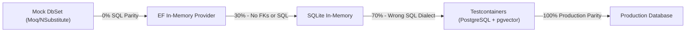
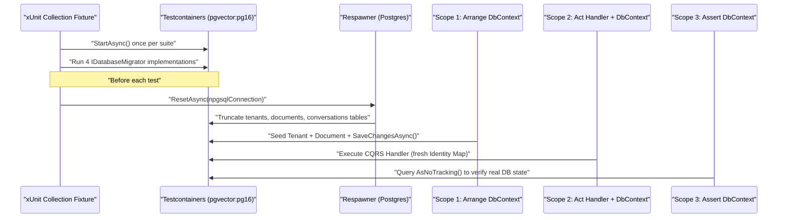
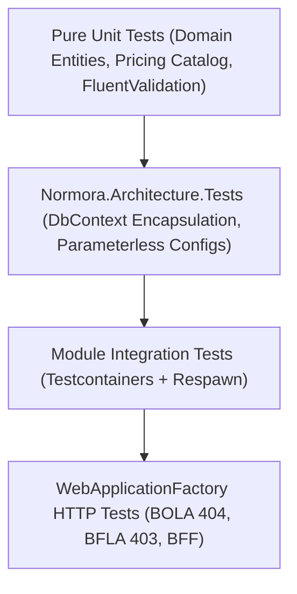

# Chapter 11: Testing and Mocking Strategies

## 1. Learning Objectives

By the end of this chapter, you will be able to:
*   Explain the architectural fallacy of mocking `DbContext` or `DbSet` using frameworks like Moq or NSubstitute.
*   Evaluate the limitations of the EF Core In-Memory provider and SQLite In-Memory, and recognize exactly when they produce false positives or false negatives.
*   Master **Testcontainers** for both SQL Server and **PostgreSQL + `pgvector`**, deploying real database containers for absolute parity between integration tests and production environments.
*   Enforce **Arrange / Act / Assert `DbContext` isolation** so the Change Tracker's Identity Map never masks broken `.Include()` paths, missing `AsNoTracking()`, or stale `ExecuteUpdateAsync` assertions.
*   Verify EF Core 10 **Global Query Filters** (including multi-tenant `TenantId` isolation and Named Query Filters), `GroupBy` LINQ translations, parameterless `IEntityTypeConfiguration<T>` discovery, and pending model-drift checks (`HasPendingModelChangesAsync`).
*   Architect high-speed, parallel-safe test suites using **Respawn** (including multi-schema PostgreSQL setups), **WebApplicationFactory**, `FakeTimeProvider`, SQL query-count interceptors, and **Architecture Tests** across a modular monolith.

## 2. Introduction: The Mocking Fallacy

For over a decade, .NET developers were taught to achieve 100% Code Coverage by writing Unit Tests for everything. This dogma led to one of the most destructive anti-patterns in data access: **Mocking the DbContext**.

Developers would use libraries like Moq to create a fake `DbSet`, feed it a `List<T>`, and write a unit test to verify that `context.Users.Add()` was called. 

This test is entirely worthless. It proves only that the developer typed `Add()`. It does not prove that the database connection works. It does not prove that the Foreign Key constraint is satisfied. It does not prove that the Global Query Filter is applied. It does not prove that the `.ToJson()` mapping or `pgvector` similarity query translates correctly.

When you mock the DbContext, you are mocking the very thing that is most likely to fail in production.

This chapter redefines how to test data access. We will abandon the fragile practice of mocking the ORM. Instead, we will write robust Integration Tests using real, isolated database instances, ensuring that if our tests pass, our production deployment will succeed.

### What Mocking Misses in Normora (5 Real-World Failure Modes)
In a production .NET 10 / EF Core 10 modular monolith like **Normora**, mocking `DbContext` fails to catch five critical bug classes:
1. **Global Tenant Query Filter Bypasses (`DocumentsDbContext`)**: A mocked `DbSet<Document>` ignores the EF Core model's global filter (`e => e.TenantId == _tenantContext.TenantId`), hiding cross-tenant data leaks that must throw `BolaException` (mapped to `404 Not Found`).
2. **Unscoped Root Context Leaks (`TenantsDbContext`)**: Because `TenantsDbContext` intentionally omits an ambient `TenantId` global filter to handle directory bootstrapping, any query on `TenantMemberships` or `AuditLogs` missing `.Where(m => m.TenantId == request.TenantId)` only fails against real multi-tenant database rows.
3. **`GroupBy` Projection Translation Crashes**: Normora's `AGENTS.md` enforces projecting `GroupBy().Select(...)` to an anonymous type before constructing C# DTO records. A mocked `IQueryable` runs LINQ-to-Objects and passes; real EF Core relational translation throws `InvalidOperationException` at runtime.
4. **Vector & Index Constraints (`pgvector` HNSW & Unique Indexes)**: Testing `PerformHybridRetrievalQuery` or `DocumentProcessingOutboxMessage` against an in-memory list cannot validate PostgreSQL `vector` cosine distance operators, `jsonb` columns, or unique slug indexes on `Tenant`.
5. **Parameterless `IEntityTypeConfiguration<T>` Scanning Bugs**: If a developer injects `ITenantContext` into `DocumentConfiguration`'s constructor, `modelBuilder.ApplyConfigurationsFromAssembly(...)` silently skips or fails on configuration instantiation—something a mocked `DocumentsDbContext` never executes.

## 3. Core Concepts

### Test Doubles for EF Core
*   **Moq / NSubstitute (Mocks & Stubs):** A *test double* replaces a dependency with a controllable stand-in. Use mocks/fakes **only** for boundary interfaces (such as `ITenantContext`, `IEmailSender`, `IDocumentStorageService`, or `ITextEmbeddingService`). **Never** mock `DbContext` or `DbSet<T>`.
*   **EF Core In-Memory Provider:** A non-relational key-value store provided by Microsoft (`UseInMemoryDatabase`). It does not understand Foreign Keys, Unique Constraints, Transactions, or raw SQL.
*   **SQLite In-Memory:** A real relational database that runs entirely in RAM. Fast, enforces foreign keys, but speaks a different SQL dialect than SQL Server or PostgreSQL (no `pgvector`, no `jsonb`, no SQL Server `JSON_VALUE`).
*   **Testcontainers (Docker):** A library that dynamically spins up a real database Docker container (PostgreSQL + `pgvector` or SQL Server) for your test suite, applies migrations, runs the tests, and destroys the container. (The Enterprise Gold Standard).

### Integration Testing & `WebApplicationFactory<T>`
*   **Integration Testing:** Unit tests isolate a single pure C# class (Domain entity or FluentValidation validator). Integration tests verify that multiple components—Controller, MediatR Command/Query Handler, EF Core, and the Database—work together end-to-end.
*   **`WebApplicationFactory<T>`:** An ASP.NET Core testing utility that boots up your entire `Program.cs` in memory, allowing you to execute real HTTP requests against your API and intercept the DI container (`ConfigureTestServices`) to swap out production infrastructure for Testcontainers and test auth handlers.

### Arrange / Act / Assert `DbContext` Isolation (The Identity Map Trap)
A single `DbContext` maintains a first-level cache called the **Identity Map** inside its `ChangeTracker`. If you insert an entity in the **Arrange** phase using `_context`, execute your handler on that same `_context` in **Act**, and then query `_context` in **Assert**, EF Core often returns the cached C# object from RAM instead of reading the real row from PostgreSQL!
*   **Why it matters:** Cached tracked entities hide missing `.Include()` calls, unpersisted property updates, and `ExecuteUpdateAsync` database mutations.
*   **The Rule:** Always create a **fresh `DbContext` scope** (via `IDbContextFactory<T>` or `IServiceScopeFactory`) for Arrange, a separate scope for Act, and a third scope for Assert (or call `ChangeTracker.Clear()` before asserting).

### Database Reset Strategies: `Respawn` vs. Transaction Rollback
*   **`Respawn`:** Inspects foreign-key graphs and generates minimal `TRUNCATE` / `DELETE` commands between tests in ~5–15 ms, preserving committed transactions and migrations.
*   **Transaction Rollback (`BeginTransactionAsync`):** Wraps a single test in a database transaction and rolls it back in `DisposeAsync`.
*   **When NOT to use Transaction Rollback:** Never use outer-transaction rollback when the code under test commits its own explicit transactions (like Normora's `UploadDocumentCommandHandler` outbox transaction), uses `ExecutionStrategy` retries, or spans multiple HTTP requests via `WebApplicationFactory` that open independent connections.

### Deterministic Time (`TimeProvider` / `FakeTimeProvider`)
Starting in .NET 8 and standard in .NET 10, `TimeProvider` replaces `DateTime.UtcNow` / `DateTimeOffset.UtcNow`. Injecting `FakeTimeProvider` (from `Microsoft.Extensions.TimeProvider.Testing`) lets EF Core tests advance time instantaneously (`fakeTime.Advance(TimeSpan.FromMinutes(16))`) to test TTL expirations, audit timestamps, and outbox retry windows without `Task.Delay`.

### Decision Matrix: Choosing the Right Test Strategy
| Target Layer / Behavior | Recommended Strategy | Why | When NOT to Use |
|---|---|---|---|
| Domain Entities & Value Objects (`Tenant`, `Document`) | Pure Unit Tests (xUnit) | Zero I/O, sub-millisecond feedback | Do not use if logic depends on SQL constraints |
| `FluentValidation` Validators (`InviteEmployeeCommandValidator`) | Pure Unit Tests | Validates input rules cleanly in isolation | Cannot check DB uniqueness constraints |
| Module Boundaries & `IEntityTypeConfiguration` rules | Architecture Tests (`NetArchTest`) | Catches forbidden cross-module `DbContext` refs at build time | Does not verify runtime SQL execution |
| CQRS Handlers, Query Filters, `GroupBy`, Outbox, Migrations | **Testcontainers (PostgreSQL + pgvector)** + `Respawn` | 100% SQL dialect, constraint, and index parity | Overkill for pure domain math (e.g., `TenantPlanPricingCatalog`) |
| Full HTTP Pipeline, BOLA/BFLA, BFF Auth, Middleware | **`WebApplicationFactory<Program>`** + Testcontainers | Verifies routing, auth policies, JSON envelopes, and DB | Slower than handler-level tests for matrix permutations |

### 5 Normora Examples of Choosing the Right Test Double
1. **Pure Domain Unit Test (`TenantPlanPricingCatalog`)**: Testing that `Annual` billing applies the exact 20% discount across `INR`, `USD`, and `EUR` requires zero database and zero mocks.
2. **Boundary Mock + Real DB (`UploadDocumentCommandHandler`)**: Stub `IDocumentStorageService` (MinIO) with NSubstitute, but run against a real `DocumentsDbContext` in Testcontainers PostgreSQL so the `Document` + `DocumentVersion` + `DocumentProcessingOutboxMessage` transaction commits for real.
3. **Separate `DbContext` Scopes (`AddDocumentChunkCommand`)**: Seed a `Document` in Scope 1, run the handler in Scope 2, and assert `DocumentChunks.AsNoTracking()` in Scope 3 to verify `pgvector` embeddings actually persisted.
4. **`FakeTimeProvider` (`ApprovalsController` / `PendingApproval`)**: Seed a `PendingApproval` created at `T=0`, advance `FakeTimeProvider` by 16 minutes, and assert the EF Core query rejects the expired HITL approval.
5. **Architecture Test (`Normora.Architecture.Tests`)**: Scan assemblies with reflection/NetArchTest to assert that `Conversations` never references `DocumentsDbContext` or `TenantsDbContext`, and every `IEntityTypeConfiguration<T>` has a public parameterless constructor.

## 4. Visual Diagrams

```text
=============================================================================
             THE EVOLUTION OF EF CORE TESTING
=============================================================================

1. THE DARK AGES (Mocking)
[ Test ] ──▶ [ Mock<DbSet> (List<T>) ]
* Speed: Instant
* Reliability: 0% (Fails to catch SQL syntax errors, constraint violations, translations).

2. THE MIDDLE AGES (EF In-Memory)
[ Test ] ──▶ [ UseInMemoryDatabase() ]
* Speed: Fast
* Reliability: 30% (Catches basic LINQ issues. Fails on Foreign Keys, Transactions, Raw SQL).

3. THE RENAISSANCE (SQLite In-Memory)
[ Test ] ──▶ [ UseSqlite("DataSource=:memory:") ]
* Speed: Fast
* Reliability: 70% (Catches relational issues. Fails on PostgreSQL pgvector/jsonb or SQL Server JSON_VALUE).

4. THE ENTERPRISE STANDARD (Testcontainers)
[ Test ] ──▶ [ Docker: pgvector/pgvector:pg16 or mssql/server:2022 ]
* Speed: Moderate (Container boot takes 2-4 seconds once per suite)
* Reliability: 100% (Absolute parity with Production PostgreSQL / Azure SQL).
```



### Normora Integration Test Execution Lifecycle (Arrange / Act / Assert Isolation)


### Normora Modular Monolith Test Pyramid


## 5. API Deep Dive: Testing Providers

### 5.1 The EF Core In-Memory Provider (Anti-Pattern)
Microsoft explicitly discourages using this provider for relational testing in their official documentation. It is not a relational database: it ignores Foreign Keys, Unique Indexes, PostgreSQL schemas (`tenants`, `documents`, `conversations`), and SQL translation errors.

```csharp
// DO NOT DO THIS FOR RELATIONAL DOMAINS
var options = new DbContextOptionsBuilder<DocumentsDbContext>()
    .UseInMemoryDatabase(databaseName: $"NormoraTest_{Guid.NewGuid()}")
    .Options;

await using var context = new DocumentsDbContext(options, new FakeTenantContext(tenantId));
// Adding a DocumentVersion pointing to a non-existent DocumentId SUCCEEDS here!
// InMemory ignores Foreign Key constraints, unique slug indexes, and pgvector columns completely.
```

### 5.2 SQLite In-Memory
A step up from EF In-Memory because it is a true relational database that enforces foreign keys and unique constraints.

```csharp
// Requires Microsoft.EntityFrameworkCore.Sqlite
await using var connection = new SqliteConnection("DataSource=:memory:");
await connection.OpenAsync(); // Must keep connection open for the lifetime of the test!

var options = new DbContextOptionsBuilder<EvDbContext>()
    .UseSqlite(connection)
    .Options;

await using var context = new EvDbContext(options);
await context.Database.EnsureCreatedAsync(); // Creates the schema in RAM

// This will now correctly throw an exception if a Foreign Key is violated.
```
*Limitation:* If your production database is **PostgreSQL + `pgvector`** (like Normora) or **SQL Server**, SQLite will fail on dialect-specific features: `UseVector()` (`pgvector`), `HNSW` indexes, `jsonb` operators, `EF.Functions.ILike()`, PostgreSQL schema separation, or SQL Server `JSON_VALUE` / `EF.Functions.FreeText()`. Also, calling `EnsureCreatedAsync()` bypasses your actual migration files.

### 5.3 Testcontainers (The Gold Standard: SQL Server & PostgreSQL + pgvector)
Testcontainers (`Testcontainers.PostgreSql` or `Testcontainers.MsSql`) leverages Docker Desktop (or CI/CD Docker runners) to spin up a real database container for your test suite.

#### SQL Server Example
```csharp
// Requires Testcontainers.MsSql (v4+ uses image string in constructor)
var msSqlContainer = new MsSqlBuilder("mcr.microsoft.com/mssql/server:2022-latest")
    .Build();

await msSqlContainer.StartAsync();

string connectionString = msSqlContainer.GetConnectionString();

var options = new DbContextOptionsBuilder<EvDbContext>()
    .UseSqlServer(connectionString)
    .Options;

await using var context = new EvDbContext(options);
await context.Database.MigrateAsync(); // Apply real migrations!
```

#### Normora PostgreSQL + `pgvector` Example
Normora runs on PostgreSQL with the `pgvector` extension (`HNSW` vector indexes) and three separate schemas (`tenants`, `documents`, `conversations`). Use the `pgvector/pgvector:pg16` Docker image with `Testcontainers.PostgreSql`:

```csharp
// Requires Testcontainers.PostgreSql and Npgsql.EntityFrameworkCore.PostgreSQL
var pgContainer = new PostgreSqlBuilder("pgvector/pgvector:pg16")
    .WithDatabase("normora_test")
    .WithUsername("postgres")
    .WithPassword("postgres")
    .Build();

await pgContainer.StartAsync();

var options = new DbContextOptionsBuilder<DocumentsDbContext>()
    .UseNpgsql(
        pgContainer.GetConnectionString(),
        npgsql => npgsql.UseVector())
    .Options;

await using var context = new DocumentsDbContext(options, new FakeTenantContext(tenantId));
await context.Database.MigrateAsync(); // Executes migrations + CREATE EXTENSION vector!
```

### 5.4 EF Core 10 Model-Drift & Named Query Filter Testing
EF Core 9/10 introduces two essential capabilities you should verify in your provider tests:
1. **Pending Model Changes (`HasPendingModelChangesAsync`)**: In EF Core 10, `HasPendingModelChanges()` / `HasPendingModelChangesAsync()` detects whether any `IEntityTypeConfiguration<T>` change was made without generating a matching migration.
2. **Named Query Filters (`IgnoreQueryFilters(["..."])`)**: EF Core 10 supports naming individual filters (e.g., `"TenantFilter"` vs `"SoftDeleteFilter"`), allowing tests or admin recovery paths to bypass soft-delete without accidentally disabling tenant isolation!

```csharp
// Verify no model drift exists in DocumentsDbContext
bool hasPendingChanges = await context.Database.HasPendingModelChangesAsync();
Assert.False(hasPendingChanges);

// EF Core 10 Named Query Filter test: disable ONLY soft-delete while keeping tenant isolation intact
var archivedForTenant = await context.Documents
    .IgnoreQueryFilters(["SoftDelete"])
    .Where(d => d.IsDeleted)
    .ToListAsync();
```

### 5 Normora Provider Testing Examples
1. **`DocumentsDbContext` Vector Extension Verification**: Running `MigrateAsync()` against `pgvector/pgvector:pg16` verifies that `HasPostgresExtension("vector")` and the HNSW index DDL succeed on a blank PostgreSQL instance.
2. **`TenantsDbContext` Unique Workspace Slug Index**: Inserting two `Tenant` rows with the same `Slug` (`"acme-corp"`) passes in EF In-Memory, but correctly throws `PostgresException` (`23505` unique violation) in `Testcontainers.PostgreSql`.
3. **`DocumentsDbContext` Model-Drift Gate**: Calling `Assert.False(await docsDb.Database.HasPendingModelChangesAsync())` fails CI immediately if a developer adds a `DocumentSummary` property without creating a migration.
4. **Parameterless `IEntityTypeConfiguration<T>` Discovery**: Constructing `ConversationsDbContext` against Testcontainers triggers `modelBuilder.ApplyConfigurationsFromAssembly(typeof(ConversationsDbContext).Assembly)` and proves every entity config has a parameterless constructor.
5. **Named Soft-Delete Filter Audit**: Using `.IgnoreQueryFilters(["SoftDelete"])` in a purge-verification test confirms deleted `Document` records remain tenant-isolated (`TenantFilter` still active) while visible to retention cleanup.

## 6. EF Core Internals: Provider Translation Limits

Why does swapping the database provider in tests cause false positives and false negatives?

EF Core's LINQ translation pipeline converts an `Expression<Func<T, bool>>` tree into provider-specific SQL.
*   If you write `context.Users.Where(u => u.Name.Contains("A", StringComparison.OrdinalIgnoreCase))`, SQL Server translates it via its collation, whereas PostgreSQL uses `ILIKE` via `EF.Functions.ILike(u.Name, "%A%")`.
*   If you run that LINQ query against the **EF Core In-Memory** provider, it skips SQL compilation completely and runs C# `string.Contains` in RAM!
*   If you run it against **SQLite**, it throws `InvalidOperationException` or silently uses case-sensitive/ASCII semantics.

### Normora's `GroupBy` Translation Rule
In PostgreSQL + EF Core, projecting a parameterized C# `record` constructor directly inside `GroupBy().Select(...)` causes EF Core's relational query compiler to throw `InvalidOperationException` (which Normora's global handler maps to `400 Bad Request`).
*   **In-Memory Provider:** Evaluates in C# and **passes**, hiding the production crash!
*   **Testcontainers PostgreSQL:** Translates the `GROUP BY` to SQL and catches the bug immediately.

### `ExecuteUpdateAsync` / `ExecuteDeleteAsync` vs. Change Tracker Identity Map
Bulk operations (`ExecuteUpdateAsync` and `ExecuteDeleteAsync`) bypass the EF Core Change Tracker and execute SQL directly against PostgreSQL.
*   If your test already loaded a `Document` into `context`, and then runs `ExecuteUpdateAsync(s => s.SetProperty(d => d.Status, DocumentStatus.Indexed))` on the **same** `DbContext` without clearing the tracker, reading `context.Documents.FindAsync(id)` returns the **stale tracked instance** (`Pending`) from memory!
*   **Fix:** Either call `context.ChangeTracker.Clear()` or read using a **separate Assert `DbContext`** with `AsNoTracking()`.

**Architectural Rule:** If you want your tests to prove your production application works, you must test against the exact same database engine used in production.

### 5 Normora Provider Translation Examples
1. **PostgreSQL `EF.Functions.ILike` Search**: Searching `Documents` by title with `EF.Functions.ILike(d.Title, $"%{term}%")` translates to PostgreSQL `ILIKE`, which throws under SQLite and cannot validate case-insensitivity accurately under In-Memory.
2. **`GroupBy` Anonymous Projection Verification**: Testing `DocumentsDbContext` metrics (`GroupBy(d => d.Status).Select(g => new { Status = g.Key, Count = g.Count() })`) before projecting to `DocumentMetricDto` proves EF Core translates the SQL `GROUP BY` cleanly.
3. **`pgvector` Cosine Distance Translation**: Executing `OrderBy(c => c.Embedding.CosineDistance(queryVector))` in `PerformHybridRetrievalQuery` only compiles and runs against `Testcontainers.PostgreSql` with `pgvector`.
4. **`ExecuteUpdateAsync` Tracker Bypass Test**: Marking outbox messages or bulk-updating `Document.Status` via `ExecuteUpdateAsync`, then querying with a **fresh `DocumentsDbContext`**, proves both SQL execution and absence of stale tracker reads.
5. **JSONB (`ToJson()` / `ComplexProperty().ToJson()`) Queries**: Querying nested metadata stored in PostgreSQL `jsonb` columns (e.g., `ConversationMessage` tool metadata) uses `->` / `->>` SQL operators that SQLite and In-Memory cannot validate.

## 7. Complete Examples: EV Platform & Normora Case Studies

### 7.1 EV Platform Case Study: Optimistic Concurrency (`RowVersion`)
We need to write an Integration Test to verify our "Book a Charging Slot" CQRS Command. This command utilizes EF Core's Optimistic Concurrency (`RowVersion`) to prevent double-booking. Mocking `DbContext` cannot test `RowVersion` concurrency, and the In-Memory database does not support `RowVersion` natively.

```csharp
public class BookingIntegrationTests : IAsyncLifetime
{
    private MsSqlContainer _dbContainer = null!;
    private string _connectionString = string.Empty;

    public async Task InitializeAsync()
    {
        // 1. Boot up SQL Server
        _dbContainer = new MsSqlBuilder("mcr.microsoft.com/mssql/server:2022-latest").Build();
        await _dbContainer.StartAsync();
        _connectionString = _dbContainer.GetConnectionString();

        // 2. Apply Schema
        await using var setupContext = CreateContext(Guid.NewGuid());
        await setupContext.Database.MigrateAsync();
    }

    public async Task DisposeAsync()
        => await _dbContainer.DisposeAsync().AsTask();

    private EvDbContext CreateContext(Guid tenantId)
    {
        var options = new DbContextOptionsBuilder<EvDbContext>()
            .UseSqlServer(_connectionString)
            .Options;

        var mockTenantProvider = new Mock<ITenantProvider>();
        mockTenantProvider.Setup(x => x.GetTenantId()).Returns(tenantId);

        return new EvDbContext(options, mockTenantProvider.Object);
    }

    [Fact]
    public async Task BookSlot_ConcurrentRequests_ThrowsConcurrencyException()
    {
        var tenantId = Guid.NewGuid();
        int slotId;

        // Arrange: Seed a Slot in its own isolated DbContext
        await using (var arrangeContext = CreateContext(tenantId))
        {
            var slot = new ChargingSlot { IsBooked = false };
            arrangeContext.ChargingSlots.Add(slot);
            await arrangeContext.SaveChangesAsync();
            slotId = slot.Id; // Read DB-generated IDENTITY key
        }

        // Simulate User A and User B reading the slot in separate DbContexts
        await using var userAContext = CreateContext(tenantId);
        var slotA = await userAContext.ChargingSlots.FindAsync(slotId);

        await using var userBContext = CreateContext(tenantId);
        var slotB = await userBContext.ChargingSlots.FindAsync(slotId);

        // Act: User A books it and saves (Success)
        slotA!.IsBooked = true;
        await userAContext.SaveChangesAsync();

        // Act: User B tries to book the stale RowVersion
        slotB!.IsBooked = true;

        // Assert: EF Core MUST throw DbUpdateConcurrencyException
        await Assert.ThrowsAsync<DbUpdateConcurrencyException>(() =>
            userBContext.SaveChangesAsync());
    }
}
```

### 7.2 Normora Case Study: 5 Real-World Integration Tests (PostgreSQL + `pgvector`)
Using `.NET 10` primary constructors, `Testcontainers.PostgreSql`, and separate Arrange/Act/Assert contexts:

```csharp
public sealed class FakeTenantContext(Guid tenantId) : ITenantContext
{
    public Guid TenantId => tenantId;
    public bool HasTenant => tenantId != Guid.Empty;
}

public sealed class NormoraDocumentsIntegrationTests(NormoraPostgresFixture fixture)
    : IClassFixture<NormoraPostgresFixture>, IAsyncLifetime
{
    public Task InitializeAsync() => fixture.ResetDatabaseAsync();
    public Task DisposeAsync() => Task.CompletedTask;

    // Example 1: Global Tenant Query Filter blocks cross-tenant reads (BOLA defense)
    [Fact]
    public async Task GetDocument_DifferentTenant_ThrowsBolaException()
    {
        var tenantA = Guid.NewGuid();
        var tenantB = Guid.NewGuid();
        Guid docId;

        await using (var arrangeDb = fixture.CreateDocumentsDbContext(tenantA))
        {
            var doc = Document.Create(tenantA, "HR Policy.pdf", "hr/policy.pdf");
            arrangeDb.Documents.Add(doc);
            await arrangeDb.SaveChangesAsync();
            docId = doc.Id;
        }

        await using var actDb = fixture.CreateDocumentsDbContext(tenantB);
        var handler = new GetDocumentByIdQueryHandler(actDb);

        await Assert.ThrowsAsync<BolaException>(() =>
            handler.Handle(new GetDocumentByIdQuery(docId), CancellationToken.None));
    }

    // Example 2: Unscoped TenantsDbContext requires explicit TenantId predicate
    [Fact]
    public async Task ListMemberships_FiltersExplicitlyByRequestedTenant()
    {
        var tenantA = Guid.NewGuid();
        var tenantB = Guid.NewGuid();

        await using (var arrangeDb = fixture.CreateTenantsDbContext())
        {
            arrangeDb.TenantMemberships.AddRange(
                TenantMembership.Create(tenantA, "ext-user-1", TenantRole.Admin),
                TenantMembership.Create(tenantB, "ext-user-2", TenantRole.Member));
            await arrangeDb.SaveChangesAsync();
        }

        await using var actDb = fixture.CreateTenantsDbContext();
        var handler = new GetTenantMembersQueryHandler(actDb);
        var result = await handler.Handle(new GetTenantMembersQuery(tenantA), CancellationToken.None);

        var member = Assert.Single(result);
        Assert.Equal("ext-user-1", member.ExternalUserId);
    }

    // Example 3: Transactional Outbox commits Document, Version, and OutboxMessage atomically
    [Fact]
    public async Task UploadDocument_CommitsMetadataAndOutboxInSingleTransaction()
    {
        var tenantId = Guid.NewGuid();
        var storageMock = Substitute.For<IDocumentStorageService>();
        var wakeupMock = Substitute.For<IDocumentProcessingWakeup>();

        await using (var actDb = fixture.CreateDocumentsDbContext(tenantId))
        {
            var handler = new UploadDocumentCommandHandler(actDb, storageMock, wakeupMock);
            await handler.Handle(
                new UploadDocumentCommand(tenantId, "Security.md", Stream.Null),
                CancellationToken.None);
        }

        // Assert in a brand-new DbContext so Identity Map cannot lie
        await using var assertDb = fixture.CreateDocumentsDbContext(tenantId);
        Assert.Equal(1, await assertDb.Documents.CountAsync());
        Assert.Equal(1, await assertDb.DocumentVersions.CountAsync());
        Assert.Equal(1, await assertDb.DocumentProcessingOutboxMessages.CountAsync());
    }

    // Example 4: GroupBy anonymous projection translates cleanly in PostgreSQL
    [Fact]
    public async Task GetDocumentMetrics_GroupByAnonymousProjection_TranslatesToSql()
    {
        var tenantId = Guid.NewGuid();
        await using (var arrangeDb = fixture.CreateDocumentsDbContext(tenantId))
        {
            arrangeDb.Documents.AddRange(
                Document.Create(tenantId, "A.pdf", "a.pdf", DocumentStatus.Indexed),
                Document.Create(tenantId, "B.pdf", "b.pdf", DocumentStatus.Indexed),
                Document.Create(tenantId, "C.pdf", "c.pdf", DocumentStatus.Pending));
            await arrangeDb.SaveChangesAsync();
        }

        await using var actDb = fixture.CreateDocumentsDbContext(tenantId);
        var counts = await actDb.Documents
            .GroupBy(d => d.Status)
            .Select(g => new { Status = g.Key, Count = g.Count() })
            .ToListAsync();

        var records = counts
            .Select(x => new DocumentStatusCountDto(x.Status, x.Count))
            .ToList();

        Assert.Equal(2, records.Single(r => r.Status == DocumentStatus.Indexed).Count);
        Assert.Equal(1, records.Single(r => r.Status == DocumentStatus.Pending).Count);
    }

    // Example 5: FakeTimeProvider tests PendingApproval 15-minute HITL TTL deterministically
    [Fact]
    public async Task ApproveToolAction_After15MinuteTtl_RejectsExpiredApproval()
    {
        var tenantId = Guid.NewGuid();
        var fakeTime = new FakeTimeProvider(new DateTimeOffset(2026, 11, 20, 10, 0, 0, TimeSpan.Zero));
        Guid approvalId;

        await using (var arrangeDb = fixture.CreateConversationsDbContext(tenantId))
        {
            var approval = PendingApproval.Create(
                tenantId, "ext-user-1", "documents_delete", fakeTime.GetUtcNow());
            arrangeDb.PendingApprovals.Add(approval);
            await arrangeDb.SaveChangesAsync();
            approvalId = approval.Id;
        }

        fakeTime.Advance(TimeSpan.FromMinutes(16)); // Instant jump past 15m TTL

        await using var actDb = fixture.CreateConversationsDbContext(tenantId);
        var expired = await actDb.PendingApprovals
            .AnyAsync(a => a.Id == approvalId && a.ExpiresAt > fakeTime.GetUtcNow());

        Assert.False(expired);
    }
}
```

## 8. Performance: Parallel Test Execution & State Isolation

Spinning up a PostgreSQL or SQL Server Docker container takes roughly 2 to 5 seconds. If you have 500 integration tests and spin up a new container for *every single test*, your test suite will take over 30 minutes to run.

**The Solution: Container Re-use and Respawning**
Instead of creating a container per test, you create one container per *Test Class* (using xUnit `IClassFixture`) or globally for an entire test collection (using `ICollectionFixture`).

However, when tests share one database, Test A might insert a `Document`, and Test B might query `Documents.CountAsync()`, expecting `0` but getting `1` because Test A's row is still there.

### The `Respawn` Library (v6+ API)
Respawn (created by Jimmy Bogard) inspects foreign-key graphs and generates minimal `TRUNCATE` / `DELETE` SQL between tests, wiping the database clean in ~5–15 milliseconds without destroying the container.

```csharp
// Requires Respawn (v6+) and Npgsql
public sealed class NormoraPostgresFixture : IAsyncLifetime
{
    private readonly PostgreSqlContainer _container = new PostgreSqlBuilder("pgvector/pgvector:pg16")
        .WithDatabase("normora_test")
        .WithUsername("postgres")
        .WithPassword("postgres")
        .Build();

    private Respawner _respawner = null!;

    public string ConnectionString => _container.GetConnectionString();

    public async Task InitializeAsync()
    {
        await _container.StartAsync();

        // Run all module migrations first
        await using var tenantsDb = CreateTenantsDbContext();
        await tenantsDb.Database.MigrateAsync();

        await using var docsDb = CreateDocumentsDbContext(Guid.Empty);
        await docsDb.Database.MigrateAsync();

        await using var convsDb = CreateConversationsDbContext(Guid.Empty);
        await convsDb.Database.MigrateAsync();

        // Build Respawner against the real PostgreSQL schema graph
        await using var conn = new NpgsqlConnection(ConnectionString);
        await conn.OpenAsync();

        _respawner = await Respawner.CreateAsync(conn, new RespawnerOptions
        {
            DbAdapter = DbAdapter.Postgres,
            SchemasToInclude = ["tenants", "documents", "conversations"],
            TablesToIgnore = [new Respawn.Graph.Table("__EFMigrationsHistory")]
        });
    }

    public async Task ResetDatabaseAsync()
    {
        await using var conn = new NpgsqlConnection(ConnectionString);
        await conn.OpenAsync();
        await _respawner.ResetAsync(conn);
    }

    public async Task DisposeAsync()
        => await _container.DisposeAsync().AsTask();
}
```
*Result:* You boot Docker once (3 seconds). You run 500 tests. `Respawn` wipes all three module schemas between each test in milliseconds while preserving `__EFMigrationsHistory` and `pgvector` HNSW indexes.

### Transaction Rollback vs. `Respawn`: When NOT to Use Rollback
An alternative to `Respawn` is wrapping each test in `await using var tx = await context.Database.BeginTransactionAsync()` and never calling `CommitAsync()`.
*   **When Rollback works:** Simple single-context read/write queries with no internal `BeginTransactionAsync()` calls.
*   **When NOT to use Rollback:**
    1. Your handler starts or commits its own transaction (such as Normora's `UploadDocumentCommandHandler` writing `Document` + `DocumentProcessingOutboxMessage` atomically).
    2. Your `DbContext` enables `EnableRetryOnFailure()` (`ExecutionStrategy` rejects user-initiated ambient transactions outside `ExecuteAsync`).
    3. You are testing via `WebApplicationFactory<Program>`, where HTTP requests create separate DI scopes and independent database connections.

### 5 Normora Parallel & Isolation Examples
1. **Multi-Schema `Respawn` Configuration**: Explicitly setting `SchemasToInclude = ["tenants", "documents", "conversations"]` ensures wiping `TenantsDbContext` also cleans cross-module test rows in `Documents` and `Conversations`.
2. **Preserving `__EFMigrationsHistory`**: Adding `__EFMigrationsHistory` to `TablesToIgnore` prevents `Respawn` from deleting migration history and breaking subsequent `MigrateAsync()` assertions.
3. **Database-per-Collection Parallelism**: To run `DocumentsTests` and `TenantsTests` in parallel on separate CPU cores without `Respawn` lock contention, spin up one PostgreSQL container and assign `normora_test_docs` vs `normora_test_tenants` databases per xUnit collection.
4. **Avoiding Rollback on Outbox Tests**: `UploadDocumentCommandHandler` explicitly commits an EF Core transaction before triggering `IDocumentProcessingWakeup`; testing it with `Respawn` verifies the real commit instead of failing on nested transaction restrictions.
5. **Resetting Before, Not After**: Always call `await fixture.ResetDatabaseAsync()` in `InitializeAsync()` (before each test), never only in `DisposeAsync()`, so a crashed previous run never poisons the next test.

## 9. ASP.NET Core Integration: WebApplicationFactory

Testing a `DbContext` directly verifies queries and configurations, while `WebApplicationFactory<Program>` tests the full HTTP pipeline: routing, Duende BFF/auth test middleware, FluentValidation, MediatR behaviors, BOLA/BFLA exception mapping, and EF Core.

> [!IMPORTANT]
> **EF Core 9/10 DI Replacement Trap:** In EF Core 8/9/10, `services.AddDbContext<T>()` registers both `DbContextOptions<T>` and `IDbContextOptionsConfiguration<T>`. If you only remove `DbContextOptions<T>` inside `ConfigureTestServices`, the production `IDbContextOptionsConfiguration<T>` remains active and triggers an invalid/duplicate provider setup! Remove **both** using `RemoveAll`.

```csharp
using Microsoft.AspNetCore.TestHost;
using Microsoft.EntityFrameworkCore.Infrastructure;
using Microsoft.Extensions.DependencyInjection.Extensions;

public sealed class NormoraApiFactory : WebApplicationFactory<Program>, IAsyncLifetime
{
    private readonly PostgreSqlContainer _pgContainer = new PostgreSqlBuilder("pgvector/pgvector:pg16")
        .WithDatabase("normora_api_test")
        .WithUsername("postgres")
        .WithPassword("postgres")
        .Build();

    public async Task InitializeAsync() => await _pgContainer.StartAsync();

    protected override void ConfigureWebHost(IWebHostBuilder builder)
    {
        builder.ConfigureTestServices(services =>
        {
            // Remove BOTH DbContextOptions<T> and IDbContextOptionsConfiguration<T>
            services.RemoveAll<DbContextOptions<DocumentsDbContext>>();
            services.RemoveAll<IDbContextOptionsConfiguration<DocumentsDbContext>>();

            services.AddDbContext<DocumentsDbContext>(options =>
                options.UseNpgsql(_pgContainer.GetConnectionString(), npgsql => npgsql.UseVector()));

            // Swap external MinIO/Gemini providers for deterministic fakes
            services.RemoveAll<IDocumentStorageService>();
            services.AddSingleton(Substitute.For<IDocumentStorageService>());
        });
    }

    public new async Task DisposeAsync()
    {
        await _pgContainer.DisposeAsync();
        await base.DisposeAsync();
    }
}
```

### Automated N+1 Query Detection via `DbCommandInterceptor`
A subtle N+1 regression can pass every functional assertion while crippling production latency. Register a lightweight `DbCommandInterceptor` in your `WebApplicationFactory` test host to count SQL commands executed per HTTP request:

```csharp
public sealed class QueryCountInterceptor : DbCommandInterceptor
{
    private int _count;
    public int Count => _count;
    public void Reset() => _count = 0;

    public override InterceptionResult<DbDataReader> ReaderExecuting(
        DbCommand command, CommandEventData eventData, InterceptionResult<DbDataReader> result)
    {
        Interlocked.Increment(ref _count);
        return base.ReaderExecuting(command, eventData, result);
    }

    public override ValueTask<InterceptionResult<DbDataReader>> ReaderExecutingAsync(
        DbCommand command, CommandEventData eventData, InterceptionResult<DbDataReader> result,
        CancellationToken cancellationToken = default)
    {
        Interlocked.Increment(ref _count);
        return base.ReaderExecutingAsync(command, eventData, result, cancellationToken);
    }
}
```

### 5 Normora `WebApplicationFactory` Integration Examples
1. **BOLA Protection (`404 Not Found` + `ApiMessages.NotFound`)**: Authenticate as Tenant B's user via a test auth handler, request `GET /api/documents/{tenantADocumentId}`, and assert status `404` with `ApiMessages.NotFound` (never leaking `403` or resource existence).
2. **BFLA Protection (`403 Forbidden` + `ApiMessages.Forbidden`)**: Authenticate as a non-admin `Member`, send `POST /api/tenants/invitations`, and assert status `403` with the structured `ApiResponse.Failure(ApiMessages.Forbidden)` JSON payload.
3. **Currency Persistence (`PUT /api/subscription/currency`)**: Send `UpdateTenantCurrencyCommand` (`"EUR"`), then open a fresh `TenantsDbContext` scope to verify `TenantPlan.Currency == "EUR"` persisted in PostgreSQL.
4. **Free Tier Cancellation Invariant**: On a `Free`-tier workspace, call `POST /api/subscription/cancel` and assert the global handler rejects it with `ApiMessages.CannotCancelFreePlan`.
5. **N+1 Query Budget Gate on `GET /api/conversations`**: Seed 25 conversations with citations, reset `QueryCountInterceptor`, invoke the endpoint via `HttpClient`, and assert `interceptor.Count <= 2` (1 count query + 1 paged projection query).

## 10. Clean Architecture & Modular Monolith Testing Strategy

In Clean Architecture, the **Domain Layer** contains Entities, Value Objects, and pure invariants (`Document.MarkFailed(...)`, `TenantPlanPricingCatalog.GetPrice(...)`). The Domain layer does not reference EF Core, so it belongs in **instantaneous Pure Unit Tests**—zero database required.

The **Infrastructure Layer** (EF Core `IEntityTypeConfiguration<T>`, `DbContext`s, migrations, `pgvector` indexes) and **Application Layer** (MediatR Command/Query Handlers orchestrating persistence) MUST be tested using **Integration Tests** with Testcontainers.

Do not write Unit Tests for Repositories or Handlers using mocked `DbContext`s. It is wasted engineering time.

### Enforcing Modular Monolith Boundaries (`Normora.Architecture.Tests`)
Normora includes a dedicated `server/Normora.Architecture.Tests` project that acts as a build-time architectural firewall. Even before running SQL tests, architecture tests verify structural EF Core rules via reflection or `NetArchTest`:

```csharp
[Fact]
public void EntityConfigurations_MustHavePublicParameterlessConstructor()
{
    var configTypes = new[]
    {
        typeof(TenantsDbContext).Assembly,
        typeof(DocumentsDbContext).Assembly,
        typeof(ConversationsDbContext).Assembly
    }
    .SelectMany(a => a.GetTypes())
    .Where(t => !t.IsAbstract && t.GetInterfaces().Any(i =>
        i.IsGenericType && i.GetGenericTypeDefinition() == typeof(IEntityTypeConfiguration<>)));

    foreach (var type in configTypes)
    {
        Assert.NotNull(type.GetConstructor(Type.EmptyTypes));
    }
}
```

### 5 Normora Clean Architecture & Modular Monolith Test Examples
1. **Pure Domain Test (`TenantPlanPricingCatalog`)**: Verify `Enterprise` + `Annual` + `USD` computes the exact 20% discounted price without touching `TenantsDbContext`.
2. **Pure Validator Test (`InviteEmployeeCommandValidator`)**: Verify empty email or invalid role names fail FluentValidation synchronously in < 1 ms.
3. **Architecture Test (`100% DbContext Encapsulation`)**: Assert no type in `Normora.Modules.Documents` or `Normora.Api` references `TenantsDbContext` or `ConversationsDbContext`.
4. **Architecture Test (`Zero Vendor SDKs in Modules`)**: Assert `Normora.Modules.*` assemblies do not reference `Minio` or Google Gemini SDK assemblies—only `Normora.Infrastructure` may do so.
5. **Application/Infrastructure Integration Test (`ExecuteMcpToolCommand`)**: Exercise cross-module MediatR contract calls (`Documents` -> `Conversations` via `Normora.Shared.Contracts.Conversations`) backed by real Testcontainers PostgreSQL.

## 11. Enterprise SaaS Perspective: Testing Migrations & Ephemeral Hosts

In a multi-tenant SaaS environment, deploying a broken migration causes a system-wide outage. Your CI/CD pipeline must include automated tests that verify migrations from an empty database **and** detect uncommitted model drift.

### Normora's Four-Migrator Sequential Pipeline & `--migrate` Gate
Normora executes schema migrations via an ephemeral minimal console host (`dotnet Normora.Api.dll --migrate` -> `MigrationHostExtensions.RunMigrationsAsync`) without starting Kestrel, OpenTelemetry listeners, SignalR hubs, or Hangfire workers. `DatabaseMigrationRunner` runs four `IDatabaseMigrator` implementations sequentially:
1. `TenantsDatabaseMigrator`
2. `DocumentsDatabaseMigrator`
3. `ConversationsDatabaseMigrator`
4. `SessionDatabaseMigrator`

In CI, an integration test boots a blank `pgvector/pgvector:pg16` container, invokes all four migrators sequentially, and then asserts `HasPendingModelChangesAsync()` is `false` on each `DbContext`.

```csharp
[Fact]
public async Task AllModuleDbContexts_MigrateCleanly_WithZeroPendingModelChanges()
{
    await using var tenantsDb = fixture.CreateTenantsDbContext();
    await tenantsDb.Database.MigrateAsync();
    Assert.False(await tenantsDb.Database.HasPendingModelChangesAsync());

    await using var docsDb = fixture.CreateDocumentsDbContext(Guid.Empty);
    await docsDb.Database.MigrateAsync();
    Assert.False(await docsDb.Database.HasPendingModelChangesAsync());

    await using var convsDb = fixture.CreateConversationsDbContext(Guid.Empty);
    await convsDb.Database.MigrateAsync();
    Assert.False(await convsDb.Database.HasPendingModelChangesAsync());
}
```

### 5 Normora Migration & SaaS Testing Examples
1. **Sequential Four-Migrator Verification**: Running `TenantsDatabaseMigrator` -> `DocumentsDatabaseMigrator` -> `ConversationsDatabaseMigrator` -> `SessionDatabaseMigrator` against an empty container verifies schema creation order and idempotency.
2. **EF Core 10 Model-Drift Detection (`HasPendingModelChangesAsync`)**: Fails the PR build immediately if a developer modifies `DocumentConfiguration` (e.g., changes `MaxLength` from 200 to 500) without running `dotnet ef migrations add`.
3. **Ephemeral `--migrate` Host Smoke Test**: Executing `MigrationHostExtensions.RunMigrationsAsync` in a subprocess against Testcontainers verifies zero-exit code (`0`), confirming Kestrel/SignalR/OpenTelemetry are not initialized during migrations (preventing SIGSEGV exit code `139`).
4. **PostgreSQL `pgvector` Extension Migration Test**: Verifies the initial `DocumentsDbContext` migration runs `CREATE EXTENSION IF NOT EXISTS vector;` and creates the HNSW index without permission or syntax errors.
5. **Idempotent Re-Migration Check**: Calling `MigrateAsync()` twice in a row proves custom raw SQL inside `migrationBuilder.Sql(...)` uses `IF NOT EXISTS` guards safely.

## 12. Real Production Case Study

### Case Study A: EV Platform (Orphaned Records & `DeleteBehavior.Restrict`)
In the EV Platform, we had a bug where the API successfully returned `200 OK` when deleting a `Tenant`, but the related `Sites` were not deleted in the database, resulting in orphaned records.

**Why the Unit Test missed it:**
The developer wrote a unit test using Moq:
`mockContext.Verify(m => m.Tenants.Remove(tenant), Times.Once);`
The test passed because the code did call `Remove()`.

**Why the In-Memory Test missed it:**
Another developer wrote a test using `UseInMemoryDatabase()`.
The In-Memory database does not enforce Foreign Key constraints. It happily deleted the Tenant and ignored the child Sites.

**The Fix (Testcontainers):**
We refactored the test suite to use Testcontainers (SQL Server). The test instantly failed. Why? Because the SQL Server Database threw an FK Constraint violation! We realized we had configured the relationship with `DeleteBehavior.Restrict` instead of implementing a domain-driven soft-delete cascade.
We fixed the application logic to correctly coordinate the deletion of child aggregates. The Testcontainers test now passes, and we have absolute confidence the bug is fixed in production.

### Case Study B: Normora (`GroupBy` Record Projection & Unscoped `TenantsDbContext`)
In Normora, two subtle bugs passed initial mocked/In-Memory checks before Testcontainers caught both:
1. **The `GroupBy` Crash**: A document metrics query projected `GroupBy(d => d.DepartmentId).Select(g => new DepartmentDocSummary(g.Key, g.Count()))` directly into a parameterized C# record. EF Core In-Memory ran it in RAM and passed. Against `Testcontainers.PostgreSql`, EF Core immediately threw `InvalidOperationException` because the relational compiler cannot translate parameterized record constructors inside `GroupBy().Select(...)`. Switching to an anonymous projection (`new { g.Key, Count = g.Count() }`) before `.AsEnumerable()` / `.ToListAsync()` fixed it permanently.
2. **Unscoped `TenantsDbContext` Cross-Tenant Leak**: A `GetAuditLogsQuery` on `TenantsDbContext` omitted `.Where(a => a.TenantId == request.TenantId)` because the author assumed `TenantsDbContext` had the same global tenant query filter as `DocumentsDbContext`. A single-tenant unit test passed. A multi-tenant Testcontainers test seeding Tenant A and Tenant B immediately caught Tenant B's audit logs leaking into Tenant A's response.

## 13. Common Mistakes & Anti-Patterns

> [!CAUTION]
> **1. Mocking `DbSet<T>` or `DbContext` with Moq / NSubstitute (Beginner)**
> ```csharp
> // WRONG: Mocking DbSet<Document> in RAM
> var mockSet = new Mock<DbSet<Document>>();
> var mockDb = new Mock<DocumentsDbContext>();
> mockDb.Setup(x => x.Documents).Returns(mockSet.Object);
> ```
> **Why it's wrong:** Mocked `DbSet`s evaluate LINQ in C# memory (`LINQ-to-Objects`), completely bypassing SQL translation, `TenantId` global query filters, PostgreSQL unique/FK constraints, and `pgvector` operators.
>
> **The fix:** Never mock `DbContext` or `DbSet<T>`. Inject real `DocumentsDbContext` wired to `Testcontainers.PostgreSql` (`pgvector/pgvector:pg16`), and mock only external boundary ports like `IDocumentStorageService`.

> [!CAUTION]
> **2. Reusing One `DbContext` Across Arrange, Act, and Assert (Intermediate)**
> ```csharp
> // WRONG: Same _context used for seeding, executing, and asserting
> _context.Documents.Add(doc);
> await _context.SaveChangesAsync();
>
> await _context.Documents
>     .Where(d => d.Id == doc.Id)
>     .ExecuteUpdateAsync(s => s.SetProperty(d => d.Status, DocumentStatus.Indexed));
>
> var loaded = await _context.Documents.FindAsync(doc.Id);
> Assert.Equal(DocumentStatus.Indexed, loaded!.Status); // FAILS! Returns stale Pending from ChangeTracker
> ```
> **Why it's wrong:** `FindAsync` and tracked queries return the cached instance from the `ChangeTracker` Identity Map. It hides both `ExecuteUpdateAsync` database state and missing `.Include()` navigation loads.
>
> **The fix:** Create separate `DbContext` instances (or scopes) for Arrange, Act, and Assert—or call `ChangeTracker.Clear()` and query with `.AsNoTracking()` before asserting.

> [!CAUTION]
> **3. Using `UseInMemoryDatabase` for `GroupBy`, `pgvector`, or Constraints (Intermediate)**
> ```csharp
> // WRONG: Testing Normora's document metrics query against EF In-Memory
> var options = new DbContextOptionsBuilder<DocumentsDbContext>()
>     .UseInMemoryDatabase("NormoraMetrics")
>     .Options;
> // Passes in tests even if GroupBy().Select(g => new DocumentMetricDto(...)) crashes in PostgreSQL!
> ```
> **Why it's wrong:** EF Core In-Memory runs C# delegates directly without relational query compilation, silently hiding `InvalidOperationException` on parameterized record constructors inside `GroupBy().Select(...)`, missing `pgvector` HNSW indexes, and violated foreign keys.
>
> **The fix:** Run query and handler tests against `Testcontainers.PostgreSql` (`pgvector/pgvector:pg16`) and project `GroupBy` to an anonymous type (`new { Key = g.Key, Count = g.Count() }`) before mapping to DTO records.

> [!CAUTION]
> **4. Calling `EnsureCreatedAsync()` Instead of `MigrateAsync()` in Suite Setup (Intermediate)**
> ```csharp
> // WRONG: Bypasses all EF Core migration files
> await using var docsDb = fixture.CreateDocumentsDbContext(tenantId);
> await docsDb.Database.EnsureCreatedAsync();
> ```
> **Why it's wrong:** `EnsureCreatedAsync()` builds tables straight from the current C# model and never creates `__EFMigrationsHistory` or executes custom `Up()` SQL (such as `CREATE EXTENSION vector`). Broken migrations pass tests and blow up `dotnet Normora.Api.dll --migrate` in production.
>
> **The fix:** Always run `await docsDb.Database.MigrateAsync()` in your Testcontainers fixture and assert `!await docsDb.Database.HasPendingModelChangesAsync()`.

> [!CAUTION]
> **5. Removing Only `DbContextOptions<T>` in `WebApplicationFactory` (Senior)**
> ```csharp
> // WRONG: Incomplete EF Core 9/10 DI replacement
> services.RemoveAll<DbContextOptions<DocumentsDbContext>>();
> services.AddDbContext<DocumentsDbContext>(o => o.UseNpgsql(testConnStr));
> ```
> **Why it's wrong:** In EF Core 8/9/10, `AddDbContext<T>()` also registers `IDbContextOptionsConfiguration<T>`. Leaving the production configuration delegate registered causes conflicting provider options or multiple database providers errors.
>
> **The fix:** Remove both `DbContextOptions<T>` and `IDbContextOptionsConfiguration<T>` before registering the test `DbContext`:
> ```csharp
> services.RemoveAll<DbContextOptions<DocumentsDbContext>>();
> services.RemoveAll<IDbContextOptionsConfiguration<DocumentsDbContext>>();
> services.AddDbContext<DocumentsDbContext>(o =>
>     o.UseNpgsql(testConnStr, npgsql => npgsql.UseVector()));
> ```

> [!CAUTION]
> **6. Using Outer Transaction Rollback Around Explicit Transactions or `ExecutionStrategy` (Senior)**
> ```csharp
> // WRONG: Wrapping UploadDocumentCommandHandler in an outer test transaction
> await using var tx = await docsDb.Database.BeginTransactionAsync();
> await uploadHandler.Handle(command, ct); // Handler calls BeginTransactionAsync() internally -> THROWS!
> ```
> **Why it's wrong:** PostgreSQL/Npgsql does not support nested `BeginTransactionAsync()` calls on the same connection, and `EnableRetryOnFailure()` rejects ambient user transactions outside `ExecuteAsync`.
>
> **The fix:** Let the handler execute and commit real transactions against Testcontainers, and reset state cleanly before the next test using `Respawn`.

> [!CAUTION]
> **7. Forgetting PostgreSQL Schemas or `__EFMigrationsHistory` in `Respawn` (Senior)**
> ```csharp
> // WRONG: Default Respawner misses module schemas or wipes __EFMigrationsHistory
> var respawner = await Respawner.CreateAsync(conn, new RespawnerOptions
> {
>     DbAdapter = DbAdapter.Postgres
> });
> ```
> **Why it's wrong:** Without `SchemasToInclude = ["tenants", "documents", "conversations"]` and `TablesToIgnore = [new Table("__EFMigrationsHistory")]`, `Respawn` can either miss non-`public` schemas (causing state leakage across tests) or wipe migration history.
>
> **The fix:** Explicitly configure `DbAdapter.Postgres`, list all three Normora module schemas in `SchemasToInclude`, and exclude `__EFMigrationsHistory`.

> [!CAUTION]
> **8. Injecting Scoped Dependencies into `IEntityTypeConfiguration<T>` Constructors (Architect)**
> ```csharp
> // WRONG: Breaks ApplyConfigurationsFromAssembly and test model creation
> public sealed class DocumentConfiguration(ITenantContext tenantContext)
>     : IEntityTypeConfiguration<Document>
> {
>     public void Configure(EntityTypeBuilder<Document> builder)
>         => builder.HasQueryFilter(d => d.TenantId == tenantContext.TenantId);
> }
> ```
> **Why it's wrong:** `modelBuilder.ApplyConfigurationsFromAssembly(...)` requires parameterless constructors, and EF Core compiles the model once per cache key—capturing a single `TenantId` inside the configuration freezes the first tenant's ID across all requests!
>
> **The fix:** Keep every `IEntityTypeConfiguration<T>` parameterless, bind global tenant filters dynamically to `_tenantContext.TenantId` inside `DocumentsDbContext.OnModelCreating`, and enforce parameterless constructors in `Normora.Architecture.Tests`.

## 14. Interview Questions

### Junior / Beginner (10)
1.  **Why is mocking a `DbContext` considered an anti-pattern?**
    *Answer:* Because the DbContext is an abstraction over a physical database. Mocking it hides all SQL translation errors, constraint violations, query filters, and concurrency issues, providing zero confidence that the code will work in production.
2.  **What is the EF Core In-Memory provider designed for?**
    *Answer:* It is a general-purpose, non-relational datastore primarily useful for testing trivial CRUD operations without foreign key complexities, though its use is discouraged for production enterprise systems.
3.  **Why is SQLite In-Memory better than the EF Core In-Memory provider?**
    *Answer:* SQLite is a true relational database. It enforces Foreign Key constraints and unique indexes, making tests much more realistic.
4.  **What is a limitation of using SQLite for testing a PostgreSQL or SQL Server application?**
    *Answer:* SQLite cannot execute provider-specific features such as PostgreSQL `pgvector` HNSW similarity, `jsonb` operators, `EF.Functions.ILike()`, or SQL Server `JSON_VALUE` and Full-Text search.
5.  **What is Testcontainers?**
    *Answer:* A library that orchestrates Docker containers from C# code, allowing you to dynamically spin up a real PostgreSQL (`pgvector`) or SQL Server database for integration tests.
6.  **What does `WebApplicationFactory` do?**
    *Answer:* It boots up an ASP.NET Core application in memory, allowing you to write integration tests that send HTTP requests to the API and test middleware, authentication, CQRS, and EF Core end-to-end.
7.  **How do you override the database connection string when using `WebApplicationFactory`?**
    *Answer:* By overriding `ConfigureWebHost` and calling `builder.ConfigureTestServices(...)` to remove both `DbContextOptions<T>` and `IDbContextOptionsConfiguration<T>`, then registering the test `DbContext` pointing to the Testcontainers connection string.
8.  **Should Domain Entities be tested with Unit Tests or Integration Tests?**
    *Answer:* Unit tests. Domain entities (Aggregates) should be pure C# classes without external dependencies, making them perfect for fast, isolated unit tests.
9.  **Should Repositories or CQRS Query Handlers be tested with Unit Tests or Integration Tests?**
    *Answer:* Integration Tests. Their core responsibility is database communication and LINQ-to-SQL translation, which cannot be validated via mocks.
10. **What happens if you don't clear the database between integration tests?**
    *Answer:* Test State Leakage. Test A inserts data that Test B accidentally queries, causing random, flaky test failures depending on execution order.

### Intermediate (10)
11. **Explain how the `Respawn` library solves test state leakage.**
    *Answer:* `Respawn` inspects the database foreign-key graph and generates minimal `TRUNCATE` / `DELETE` commands to wipe data and reset sequences in milliseconds between tests (`await respawner.ResetAsync(connection)`) without restarting the Docker container.
12. **You write a test for `AsSplitQuery()`. Can you use the In-Memory provider?**
    *Answer:* No. The In-Memory provider ignores relational concepts like `JOIN`s and Split Queries.
13. **How do you test Optimistic Concurrency (`RowVersion` / PostgreSQL `xmin`) in EF Core?**
    *Answer:* Use a real relational database (Testcontainers). Load the same entity in two separate `DbContext` instances, modify both, `SaveChangesAsync()` on the first, and assert that `SaveChangesAsync()` on the second throws `DbUpdateConcurrencyException`.
14. **How do you ensure a Testcontainer is destroyed even if the test fails and throws an exception?**
    *Answer:* By implementing `IAsyncLifetime` (in xUnit) and calling `await _container.DisposeAsync().AsTask()` in `DisposeAsync()`, which instructs Docker to stop and remove the container.
15. **Can you use Testcontainers in a CI/CD pipeline like GitHub Actions?**
    *Answer:* Yes, GitHub Actions Linux runners include Docker by default, so Testcontainers automatically detects the Docker daemon and starts containers during CI runs.
16. **Why does `context.Database.EnsureCreated()` break migration testing?**
    *Answer:* `EnsureCreated()` bypasses the migrations pipeline and builds the schema directly from the C# model without `__EFMigrationsHistory`. Use `context.Database.MigrateAsync()` to test actual migration files.
17. **How do you test a Global Query Filter (e.g., `TenantId`)?**
    *Answer:* Seed records for Tenant A and Tenant B in one `DbContext`, then open a separate `DbContext` bound to Tenant A's `ITenantContext` and assert that only Tenant A's rows are returned (and querying Tenant B's ID triggers `BolaException` / 404).
18. **What is the `HasConversion` risk when testing with SQLite?**
    *Answer:* SQLite stores converted values as plain text/strings without native PostgreSQL `jsonb` or SQL Server `NVARCHAR` semantics, so LINQ queries probing inside converted structures may behave differently or evaluate locally.
19. **How do you verify that an EF Core query generates the exact SQL you expect?**
    *Answer:* Call `.ToQueryString()` on the `IQueryable` in a test and assert the generated SQL string contains the expected `WHERE`, `JOIN`, or `GROUP BY` clauses.
20. **Is it possible to simulate a transient fault with an `ExecutionStrategy` in a test?**
    *Answer:* Yes. You can register a custom `IExecutionStrategy` (or a test `DbCommandInterceptor` that throws a transient error once before succeeding) to verify idempotency and retry handling.

### Senior (5)
21. **Architect a test suite strategy for an Enterprise SaaS utilizing Database-per-Tenant. How do you test the dynamic connection string resolution?**
    *Answer:* Boot a single database Testcontainer and provision two logical databases (`Tenant1` and `Tenant2`). In `WebApplicationFactory`, swap `ITenantContext` to return Tenant 1, `POST` a record, verify it lands in `Tenant1`, switch to Tenant 2, and verify `GET` returns empty.
22. **Evaluate the performance trade-offs of using `IClassFixture` versus `ICollectionFixture` with Testcontainers in xUnit.**
    *Answer:* `IClassFixture` boots a container per test class (high startup overhead if you have 50 classes). `ICollectionFixture` shares one container across all classes in the collection, cutting startup time to ~3 seconds total, though tests within that collection run sequentially unless isolated per logical database. Pairing `ICollectionFixture` with `Respawn` is typically the sweet spot.
23. **You are using EF Core `.ToJson()` / `ComplexProperty().ToJson()` mapping. You write an integration test using SQLite and it fails. Why?**
    *Answer:* EF Core 8–10 translates JSON mappings into provider-specific SQL (`jsonb` operators `->`/`->>` in PostgreSQL, `JSON_VALUE` in SQL Server, `json_extract` in SQLite). Provider-specific migrations and raw expressions cannot be cross-compiled onto SQLite—you must test against the production engine via Testcontainers.
24. **Design an automated CI gate that prevents N+1 queries and Cartesian explosions from reaching production.**
    *Answer:* Enable `options.ConfigureWarnings(w => w.Throw(RelationalEventId.MultipleCollectionIncludeWarning))` in test `DbContext`s to catch Cartesian explosion (`AsSingleQuery` with multiple collection `.Include()`s). To catch N+1 roundtrips, register a `DbCommandInterceptor` that counts SQL executions per HTTP request in `WebApplicationFactory` and fails any endpoint exceeding its query budget.
25. **How do you write an integration test to verify that `ExecuteUpdateAsync` bypasses domain logic validations enforced by the Change Tracker?**
    *Answer:* Insert a valid entity in an Arrange `DbContext`. Execute `ExecuteUpdateAsync` in an Act `DbContext` with a direct column mutation, then open a fresh Assert `DbContext` (avoiding the stale Identity Map) to verify the row updated directly in SQL without triggering domain setters or `SaveChangesAsync` interceptors.

### Architect (8)
26. **Why must integration tests use separate `DbContext` instances for Arrange, Act, and Assert?**
    *Answer:* Reusing one `DbContext` causes the `ChangeTracker` Identity Map to return cached C# object references rather than fresh database rows. That masks unpersisted changes, missing `.Include()` paths, and stale entities after `ExecuteUpdateAsync`. Separate scopes force genuine SQL roundtrips in every phase.
27. **In EF Core 9/10, why does `services.RemoveAll<DbContextOptions<TDbContext>>()` alone often fail in `WebApplicationFactory`?**
    *Answer:* `AddDbContext<T>()` also registers `IDbContextOptionsConfiguration<T>` entries containing the production `UseNpgsql` / `UseSqlServer` callback. Failing to remove `IDbContextOptionsConfiguration<T>` leaves the production provider callback active alongside your test configuration.
28. **How do you test Normora's unscoped `TenantsDbContext` vs. tenant-scoped `DocumentsDbContext` differently?**
    *Answer:* For `DocumentsDbContext`, seed two tenants and verify the global query filter isolates reads automatically without explicit `.Where(d => d.TenantId == ...)` in callers. For `TenantsDbContext` (which intentionally has no ambient filter), write negative multi-tenant tests on every workspace-scoped query (`TenantMemberships`, `AuditLogs`) to prove explicit `m.TenantId == request.TenantId` predicates prevent cross-tenant leakage.
29. **How can an Architect enforce EF Core conventions (such as parameterless `IEntityTypeConfiguration<T>` and module `DbContext` encapsulation) without relying on code reviews?**
    *Answer:* Add a build-blocking `Architecture.Tests` project using reflection / `NetArchTest` that asserts every `IEntityTypeConfiguration<T>` has a public parameterless constructor and that no module or host assembly references another module's `DbContext`.
30. **How do you design a CI gate for EF Core 10 model drift across a modular monolith with four migrators?**
    *Answer:* Spin up an empty `pgvector/pgvector:pg16` Testcontainer, execute all four `IDatabaseMigrator` implementations sequentially (`Tenants`, `Documents`, `Conversations`, `Session`), and assert `HasPendingModelChangesAsync() == false` on each `DbContext`. Any entity configuration change lacking a migration immediately breaks the build.
31. **When does the Transaction Rollback test isolation pattern break, and what should replace it?**
    *Answer:* It breaks whenever the handler opens/commits its own transaction (e.g., Normora's transactional outbox), uses `EnableRetryOnFailure()`, or runs multi-connection HTTP requests through `WebApplicationFactory`. Replace it with `Respawn` configured for all PostgreSQL module schemas (`tenants`, `documents`, `conversations`) while ignoring `__EFMigrationsHistory`.
32. **How do you deterministically test time-sensitive EF Core queries (e.g., 15-minute `PendingApproval` TTLs or outbox retries) without flaky `Task.Delay` calls?**
    *Answer:* Inject .NET's `TimeProvider` into handlers and interceptors, pass `FakeTimeProvider` in tests, seed records at `T0`, call `fakeTime.Advance(TimeSpan.FromMinutes(16))`, and assert the EF Core predicate immediately excludes the expired rows.
33. **In a modular monolith using PostgreSQL `pgvector`, how do you test hybrid retrieval (`PerformHybridRetrievalQuery`) with zero external AI API calls?**
    *Answer:* Stub `ITextEmbeddingService` with NSubstitute to return deterministic unit vectors, seed `DocumentChunk` rows with known embeddings into `Testcontainers.PostgreSql` (`pgvector/pgvector:pg16`), and execute the real EF Core `CosineDistance` + full-text RRF query against PostgreSQL.

## 15. Exercises

### Easy
1.  **Stop Mocking:** If you have an existing project that mocks `DbSet` using Moq or NSubstitute, delete those tests. They are technical debt.

### Medium
1.  **SQLite In-Memory:** Create a simple test class. Initialize a `SqliteConnection` to `:memory:`. Configure the DbContext to use it, call `EnsureCreatedAsync()`, insert a record, query it in a separate context/cleared tracker, and assert the values.
2.  **ToQueryString():** Write a complex Normora-style `GroupBy` LINQ query using anonymous projection. In a test, call `.ToQueryString()` and use xUnit's `ITestOutputHelper.WriteLine(...)` and `Assert.Contains("GROUP BY", sql)` to verify the exact SQL EF Core generates.

### Hard
1.  **Testcontainers Setup (PostgreSQL + `pgvector`):** Install `Testcontainers.PostgreSql` and `Npgsql.EntityFrameworkCore.PostgreSQL`. Implement `IAsyncLifetime` in an xUnit test class using `pgvector/pgvector:pg16`, configure `UseNpgsql(..., o => o.UseVector())`, call `MigrateAsync()`, assert `HasPendingModelChangesAsync()` is `false`, and verify global `TenantId` query filter isolation using separate Arrange/Act/Assert contexts.

### Enterprise
1.  **Multi-Schema `Respawn` + Query Budget Gate:** Upgrade your Testcontainers fixture with `Respawn` (`DbAdapter.Postgres`, `SchemasToInclude = ["tenants", "documents", "conversations"]`, ignoring `__EFMigrationsHistory`). Add 5 tests verifying outbox atomicity, `FakeTimeProvider` TTL expiration, and a `DbCommandInterceptor` that fails any `WebApplicationFactory` endpoint executing more than 2 SQL queries.

## 16. Production Checklist

- [ ] Has mocking `DbContext` or `DbSet<T>` via Moq/NSubstitute been strictly banned from the codebase?
- [ ] Do all integration tests use **separate `DbContext` scopes** for Arrange, Act, and Assert (or `ChangeTracker.Clear()`) to eliminate Identity Map illusions?
- [ ] Is **Testcontainers** (`pgvector/pgvector:pg16` for PostgreSQL or `mssql/server:2022-latest` for SQL Server) used for 100% dialect, constraint, and vector/JSON parity?
- [ ] Is test state isolation guaranteed between tests using `Respawn` (`DbAdapter.Postgres` with all module schemas included and `__EFMigrationsHistory` ignored)?
- [ ] Are Global Tenant Query Filters (`DocumentsDbContext`, `ConversationsDbContext`) and explicit `TenantId` predicates (`TenantsDbContext`) verified with multi-tenant cross-leak tests (asserting `BolaException` / 404)?
- [ ] Does the CI/CD pipeline execute all `IDatabaseMigrator` migrations (`MigrateAsync()`) against an empty container and assert `!HasPendingModelChangesAsync()` before merging?
- [ ] Do architecture tests verify parameterless `IEntityTypeConfiguration<T>` constructors and 100% module `DbContext` encapsulation?

## 17. Summary

Testing data access should provide absolute confidence that your code will execute correctly in production. Mocking EF Core destroys that confidence, hiding SQL translation errors, `GroupBy` compilation failures, tenant-filter leaks, and concurrency conflicts behind fake C# lists.

By embracing **Testcontainers** (`pgvector/pgvector:pg16` and SQL Server), **Respawn**, **Arrange/Act/Assert `DbContext` isolation**, **`FakeTimeProvider`**, **Architecture Tests**, and **`WebApplicationFactory`** with query-count gates, we elevate our testing strategy to the Enterprise tier. We test the actual SQL executed against an actual database, guaranteeing that our migrations, query filters, transactional outboxes, and high-performance `ExecuteUpdateAsync` commands function flawlessly.

We have reached the end of the technical journey. In the final chapter, we will synthesize everything you have learned into the **Master Architect's Playbook**—a quick-reference guide containing the golden rules, performance checklists, and architectural mandates required to lead a team in building world-class EF Core applications.
