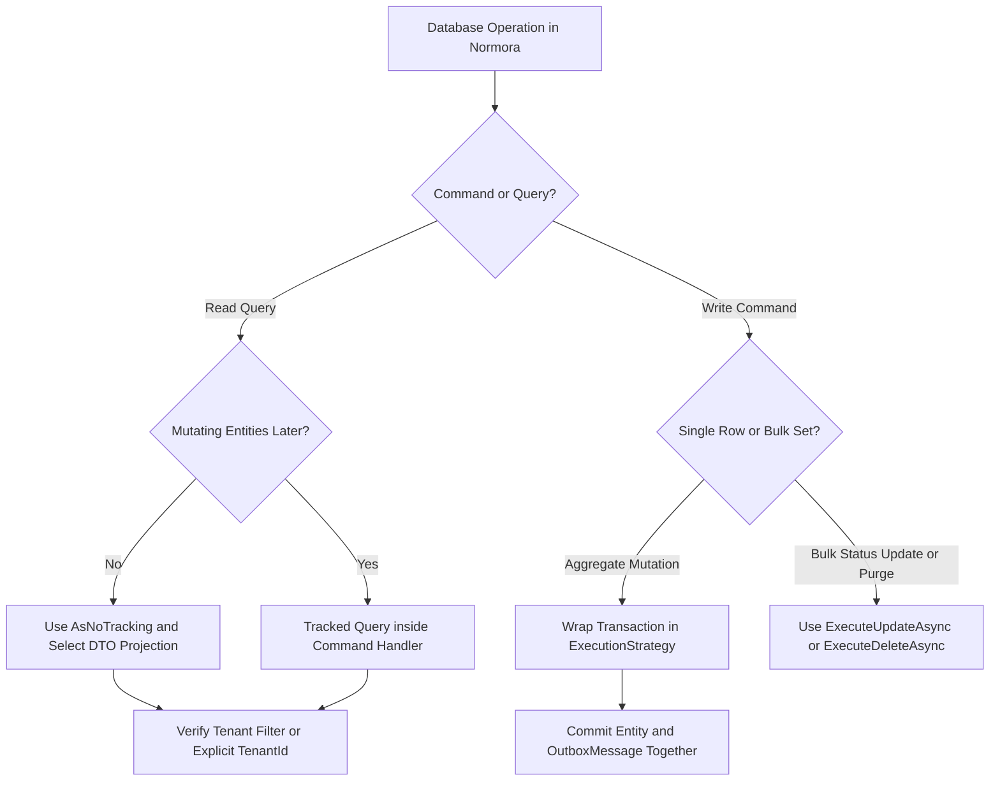
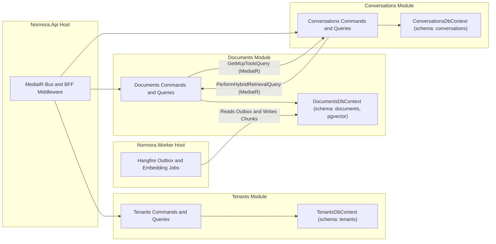
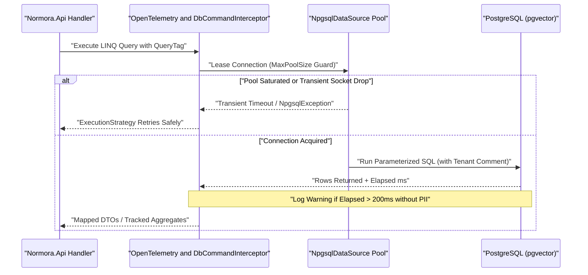

# Chapter 12: The Master Architect's Playbook

## 1. Introduction

Congratulations. If you have mastered the material in the preceding chapters, you have ascended from a developer who merely uses Entity Framework Core to an Architect who bends it to their will.

You understand that EF Core is not just a tool for generating SQL; it is a complex abstraction engine that parses expression trees, tracks object states, manages database connections, and enforces structural boundaries across Enterprise SaaS (Software-as-a-Service) architectures.

This final chapter is not a tutorial on basic syntax. It is an **Architectural Playbook** designed for **.NET 10** and **EF Core 10**. It synthesizes the most critical rules, architectural trade-offs, production diagnostics, and **fitness functions** (automated tests that verify architectural rules never drift) from the entire course into an actionable reference guide. Every rule and pattern is grounded in **Normora**, a multi-tenant `.NET 10` modular monolith backed by PostgreSQL, `pgvector`, Redis, and Hangfire. When a production system degrades, or when a pull request threatens data isolation, consult this playbook.

## 2. The 10 Golden Rules of EF Core 10

Violating these rules in an enterprise system will eventually result in an outage, cross-tenant data leakage, or severe performance degradation. For each rule, understand **what** it mandates, **why** it matters, **how** to apply it, and **when NOT to apply it** blindly.



### Rule 1: Never Mock the `DbContext`
* **What & Why:** Mocking `DbContext` or `DbSet<T>` with Moq/NSubstitute creates a false sense of security. An in-memory `List<T>` hides SQL translation failures, `GroupBy` projection bugs, PostgreSQL `pgvector` operator errors, unique constraint violations, and concurrency exceptions.
* **How:** Use **Testcontainers** running the exact production database engine (for Normora, PostgreSQL with the `pgvector` extension in Docker) for all persistence integration tests.
* **When NOT to use:** Pure domain logic unit tests (such as `TenantPlanPricingCatalog` calculations or FluentValidation rules) should *not* spin up Testcontainers; keep domain logic free of `DbContext` dependencies so it runs in milliseconds.

### Rule 2: Mandate `.AsNoTracking()` or Projections for Read Queries
* **What & Why:** The **Change Tracker** (EF Core's in-memory snapshot dictionary that detects entity mutations) is the single largest CPU and memory overhead on read paths. If you are not calling `SaveChangesAsync()`, tracking snapshots wastes memory and GC cycles.
* **How:** Enforce `.AsNoTracking()` on read-only queries, or project directly to immutable C# `record` DTOs using `.Select(...)`, which automatically skips change tracking.
* **When NOT to use:** Do not use `.AsNoTracking()` when loading an Aggregate Root inside a command handler that will mutate properties and call `SaveChangesAsync()`. Also, if a read-only graph has many shared child references (e.g., multiple chunks pointing to one document), prefer `.AsNoTrackingWithIdentityResolution()` to avoid duplicate object instances in memory.

### Rule 3: Disable Unintended Global Cascade Deletes
* **What & Why:** Relational `ON DELETE CASCADE` is enabled by default by EF Core for required relationships. On a multi-tenant graph, a single accidental parent deletion can wipe out thousands of child rows—or fail migrations when multiple cascade paths collide.
* **How:** Configure `DeleteBehavior.Restrict` (or `NoAction`) in your `IEntityTypeConfiguration<T>` classes and handle deletions deliberately in command handlers (often via soft-deletes or explicit batched `ExecuteDeleteAsync`).
* **When NOT to use:** Tightly owned value/child tables whose lifecycle cannot exist independently (for example, `DocumentChunk` rows tied strictly to a `DocumentVersion` during a hard purge) may intentionally use `DeleteBehavior.Cascade` when explicitly documented and audited.

### Rule 4: Eliminate Cartesian Explosions
* **What & Why:** Calling `.Include()` on multiple collection navigation properties in a single query generates massive `JOIN` results that multiply row counts (`M × N`), saturating network bandwidth and memory.
* **How:** Use `.AsSplitQuery()` (which issues one SQL query per collection) or, better yet, project only the needed columns into a DTO. When using `.AsSplitQuery()` on mutable data, wrap the read in an explicit transaction with `RepeatableRead` or `Snapshot` isolation to prevent **Read Skew** (seeing inconsistent state between the first and second SQL query).
* **When NOT to use:** Avoid `.AsSplitQuery()` for tiny 1-to-few lookups where the extra database round-trips cost more latency than a small single `JOIN`, or when no collection navigations are included.

### Rule 5: Isolate Schemas with Parameterless `IEntityTypeConfiguration<T>`
* **What & Why:** Data Annotations (`[Table]`, `[Required]`, `[MaxLength]`) pollute Domain entities with persistence concerns, and giant `OnModelCreating` methods become merge-conflict magnets.
* **How:** Put every entity's mapping in its own parameterless `IEntityTypeConfiguration<T>` class inside the module's `Persistence/Configurations/` folder and load them with `modelBuilder.ApplyConfigurationsFromAssembly(typeof(DocumentsDbContext).Assembly)`. Never inject scoped services (like `ITenantContext`) into configuration constructors—that breaks `ApplyConfigurationsFromAssembly`.
* **When NOT to use:** Never skip `IEntityTypeConfiguration<T>` for production tables; the only place `OnModelCreating` should hold cross-cutting configuration is global conventions (such as attaching the DbContext-scoped multi-tenant query filter across entities implementing `ITenantScoped`).

### Rule 6: Never Call `Database.Migrate()` Inside API Startup
* **What & Why:** Calling `context.Database.Migrate()` in `Program.cs` during web server startup causes catastrophic race conditions, lock contention, and partial schema states when multiple API replicas boot simultaneously in Kubernetes or Docker.
* **How:** Execute migrations out-of-band before traffic arrives using one of two architect-approved mechanisms:
  1. **Idempotent SQL Scripts** (`dotnet ef migrations script --idempotent`) executed by a privileged CI/CD deployment step.
  2. **An Ephemeral Migration Host** (Normora's pattern): invoking `dotnet Normora.Api.dll --migrate`, which runs a lean console host (`MigrationHostExtensions.RunMigrationsAsync`) without starting Kestrel, OpenTelemetry listeners, SignalR hubs, or background workers.
* **When NOT to use:** Local developer F5 quick-starts on a single disposable container are the only acceptable exception; never ship auto-migration inside horizontal API replicas.

### Rule 7: Prevent the N+1 Problem
* **What & Why:** Iterating over `N` entities and issuing `1` query per item to fetch related rows (`1 + N` round-trips) exhausts database connection pools and multiplies latency.
* **How:** Use `.Select(...)` projections, `.Include(...)`, or batched `.Where(x => ids.Contains(x.Id))` queries so all required data returns in a single round-trip (or bounded split queries). Keep Lazy Loading proxies disabled.
* **When NOT to use:** Avoid blindly `.Include()`-ing entire graphs "just in case"—over-fetching unused columns and blobs hurts as much as N+1. Always fetch only the columns the UI or contract requires.

### Rule 8: Enforce Multi-Tenancy at the Model Level (Plus EF Core 10 Named Filters)
* **What & Why:** Relying on developers to remember `.Where(d => d.TenantId == tenantId)` on every LINQ query is a data breach waiting to happen.
* **How:** Bind a **Global Query Filter** inside the module `DbContext` dynamically to an instance property backed by `ITenantContext` (never capture a local `Guid` variable in `OnModelCreating`, or EF Core's model cache freezes the first tenant forever). In **EF Core 10**, use **Named Query Filters** (`HasQueryFilter("TenantFilter", ...)` and `HasQueryFilter("SoftDeleteFilter", ...)`) so callers can disable soft-delete filtering via `.IgnoreQueryFilters(["SoftDeleteFilter"])` without accidentally bypassing tenant isolation.
* **When NOT to use:** Do **not** put an ambient `TenantId` global filter on a root directory/resolution context like Normora's `TenantsDbContext`, which must resolve workspace slugs and cross-workspace memberships *before* a single tenant is selected; instead, require explicit `m.TenantId == request.TenantId` filters on all workspace-scoped queries in that module.

### Rule 9: Use `ExecuteUpdateAsync` and `ExecuteDeleteAsync` for Bulk Mutations
* **What & Why:** Loading 10,000 entities into RAM just to flip a status flag or purge expired rows causes massive allocations, round-trips, and lock duration.
* **How:** Use `ExecuteUpdateAsync` and `ExecuteDeleteAsync` (EF Core 7+, enhanced in EF Core 10 to support regular `Action`-based setter blocks for conditional updates) to run set-based `UPDATE`/`DELETE` SQL directly on the database engine while bypassing the Change Tracker.
* **When NOT to use:** Do not use `ExecuteUpdateAsync`/`ExecuteDeleteAsync` when you need per-entity domain validation, Change Tracker audit interceptors, optimistic concurrency checks per aggregate, or in-memory domain events raised by each entity. Also remember that EF Core's Change Tracker is *not* updated automatically after `ExecuteUpdateAsync`—call `ChangeTracker.Clear()` or re-query if the same `DbContext` continues using those entities.

### Rule 10: Defend Against Transient Faults with Execution Strategies
* **What & Why:** Cloud networks drop sockets, databases fail over, and concurrent transactions hit transient deadlocks or serialization failures.
* **How:** Enable retries (`EnableRetryOnFailure()` / Npgsql `EnableRetryOnFailure()`) in `DbContextOptions`. Whenever you open an explicit transaction (`BeginTransactionAsync`), wrap the entire unit of work inside `dbContext.Database.CreateExecutionStrategy().ExecuteAsync(...)` so EF Core can safely roll back and replay the full transaction on transient errors.
* **When NOT to use:** Never wrap non-idempotent external side effects (such as charging a PayU payment gateway or sending an email via Resend) inside a retryable `ExecutionStrategy` block—commit the database state + Outbox row first, then execute external I/O asynchronously.

### Real-World Normora Examples: Golden Rules in Action

1. **Rule 5 & Rule 8 — Parameterless Configuration + EF Core 10 Named Query Filters (`DocumentsDbContext`):**
   ```csharp
   // server/Modules/Documents/Persistence/Configurations/DocumentChunkConfiguration.cs
   public sealed class DocumentChunkConfiguration : IEntityTypeConfiguration<DocumentChunk>
   {
       public void Configure(EntityTypeBuilder<DocumentChunk> builder)
       {
           builder.ToTable("document_chunks", "documents");
           builder.HasKey(c => c.Id);
           builder.Property(c => c.Embedding).HasColumnType("vector(768)");
           builder.HasIndex(c => c.Embedding)
               .HasMethod("hnsw")
               .HasOperators("vector_cosine_ops");
           builder.HasOne<DocumentVersion>()
               .WithMany(v => v.Chunks)
               .HasForeignKey(c => c.DocumentVersionId)
               .OnDelete(DeleteBehavior.Restrict);
       }
   }

   // server/Modules/Documents/Persistence/DocumentsDbContext.cs
   public sealed class DocumentsDbContext(
       DbContextOptions<DocumentsDbContext> options,
       ITenantContext tenantContext) : DbContext(options)
   {
       // Instance property evaluated per-query; never capture tenantContext.TenantId into a local variable!
       private Guid CurrentTenantId => tenantContext.TenantId;

       public DbSet<Document> Documents => Set<Document>();
       public DbSet<DocumentChunk> DocumentChunks => Set<DocumentChunk>();

       protected override void OnModelCreating(ModelBuilder modelBuilder)
       {
           modelBuilder.ApplyConfigurationsFromAssembly(typeof(DocumentsDbContext).Assembly);

           modelBuilder.Entity<Document>()
               .HasQueryFilter("TenantFilter", d => d.TenantId == CurrentTenantId)
               .HasQueryFilter("SoftDeleteFilter", d => !d.IsDeleted);
       }
   }
   ```
2. **Rule 2 & Rule 7 — Projection + `AsNoTracking()` in `Conversations`:**
   ```csharp
   // server/Modules/Conversations/Application/Conversations/Queries/GetConversations/GetConversationsQueryHandler.cs
   public sealed class GetConversationsQueryHandler(ConversationsDbContext db)
       : IRequestHandler<GetConversationsQuery, IReadOnlyList<ConversationSummaryDto>>
   {
       public async Task<IReadOnlyList<ConversationSummaryDto>> Handle(
           GetConversationsQuery request, CancellationToken ct)
       {
           return await db.Conversations
               .AsNoTracking()
               .OrderByDescending(c => c.UpdatedAtUtc)
               .Take(request.Limit)
               .Select(c => new ConversationSummaryDto(c.Id, c.Title, c.UpdatedAtUtc))
               .ToListAsync(ct);
       }
   }
   ```
3. **Rule 6 — Ephemeral Migration Host (`--migrate`) in Normora:**
   Instead of calling `Migrate()` inside `Normora.Api`'s web host startup, Normora runs `dotnet Normora.Api.dll --migrate` before rolling API pods. `MigrationHostExtensions.RunMigrationsAsync` boots a minimal console host (no Kestrel, no SignalR, no OpenTelemetry) and invokes `DatabaseMigrationRunner` to execute `TenantsDatabaseMigrator`, `DocumentsDatabaseMigrator`, `ConversationsDatabaseMigrator`, and `SessionDatabaseMigrator` sequentially with a clean zero-exit teardown.
4. **Rule 9 — Bulk Cleanup via `ExecuteDeleteAsync` in `Normora.Worker`:**
   ```csharp
   // Purging expired Human-In-The-Loop PendingApproval records (15-minute TTL) without loading rows into RAM
   int deleted = await conversationsDb.PendingApprovals
       .IgnoreQueryFilters(["SoftDeleteFilter"]) // TenantFilter remains active!
       .Where(a => a.ExpiresAtUtc <= DateTimeOffset.UtcNow)
       .ExecuteDeleteAsync(ct);
   ```
5. **Rule 10 — `ExecutionStrategy` + Atomic Outbox Transaction in `UploadDocumentCommandHandler`:**
   ```csharp
   var strategy = documentsDb.Database.CreateExecutionStrategy();
   await strategy.ExecuteAsync(async () =>
   {
       await using var tx = await documentsDb.Database.BeginTransactionAsync(ct);
       documentsDb.Documents.Add(document);
       documentsDb.DocumentVersions.Add(version);
       documentsDb.OutboxMessages.Add(outboxMessage);
       await documentsDb.SaveChangesAsync(ct);
       await tx.CommitAsync(ct);
   });
   ```
6. **EF Core 10 `GroupBy` Translation Standard (Normora Rule):**
   ```csharp
   // Always project GroupBy aggregations to an anonymous type first, then map to DTO records in memory
   var grouped = await documentsDb.Documents
       .AsNoTracking()
       .GroupBy(d => d.Status)
       .Select(g => new { Status = g.Key, Count = g.Count() })
       .ToListAsync(ct);

   return grouped
       .Select(x => new DocumentStatusMetricDto(x.Status, x.Count))
       .ToList();
   ```

## 3. Architectural Patterns & Decision Playbook

Knowing a pattern's name is junior knowledge; knowing **when to apply it, how it maps to EF Core 10, and when NOT to use it** is architectural mastery.



### Modular Monolith & Strict `DbContext` Encapsulation
* **What & Why:** A **Modular Monolith** organizes one deployable application into isolated **Bounded Contexts** (business modules with explicit domain boundaries) instead of a single tangled database context. In Normora, `Tenants`, `Documents`, and `Conversations` each own a private `DbContext` mapped to its own PostgreSQL schema (`tenants`, `documents`, `conversations`).
* **How:** Never inject another module's `DbContext` into a controller, hub, or handler. Cross-module communication travels exclusively through **MediatR contracts** in `Normora.Shared.Contracts.*` (explicitly carrying `Guid TenantId` for defense-in-depth in both HTTP and background worker contexts), and is verified automatically by architecture tests in `Normora.Architecture.Tests`.
* **When NOT to use:** Avoid splitting a tiny single-feature CRUD utility into separate `DbContext` schemas if there are no distinct business boundaries; premature modularization adds MediatR ceremony where one module suffices.

### Clean Architecture & Domain-Driven Design (DDD)
* **What & Why:** Mixing SQL queries with domain invariants produces untestable spaghetti code. EF Core's Change Tracker enables DDD by detecting mutations on rich C# domain entities without polluting the domain with persistence attributes.
* **How:** The Domain layer defines Aggregates and domain constants (e.g., `TenantPlanPricingCatalog`), `Persistence/Configurations/` isolates Fluent API mappings in parameterless `IEntityTypeConfiguration<T>` classes, and CQRS handlers coordinate transactions via the module's `DbContext`.
* **When NOT to use:** Do not force heavy Aggregate Root encapsulation onto simple reporting queries or reference lookup tables—use flat read projections instead.

### CQRS & The Data Access Decision Matrix (EF Core vs. Dapper / Raw SQL)
* **What & Why:** **CQRS (Command Query Responsibility Segregation)** separates state-changing Commands from read-only Queries because an entity graph optimized for transactional consistency is rarely optimal for list grids or search analytics.
* **How:** Choose the lightest EF Core / SQL mechanism that fits the workload:

| Workload Type | Recommended Mechanism | Why | When NOT to Use |
|---|---|---|---|
| **Transactional Write** (e.g., creating a `Document` or updating `TenantPlan`) | Tracked `DbContext` + `SaveChangesAsync()` | Enforces invariants, concurrency tokens, and atomic Outbox commits | Bulk updates over thousands of rows (use `ExecuteUpdateAsync`) |
| **Standard Read / Paginated List** | `DbContext` `.AsNoTracking().Select(...)` | Generates minimal SQL `SELECT` columns with zero Change Tracker overhead | Complex multi-CTE analytics or recursive ranking |
| **Hot-Path Single Lookup** (e.g., tenant slug resolution fallback) | `EF.CompileAsyncQuery` | Eliminates LINQ expression-tree compilation overhead on repeated calls | Queries with dynamic optional filters (`WhereIf`) |
| **Hybrid Vector + Full-Text Search (RRF)** | `Database.SqlQuery<T>` / `FromSql` or Dapper | Cleanly expresses PostgreSQL `pgvector` cosine distance + `tsvector` Reciprocal Rank Fusion | Simple CRUD where standard LINQ is clearer and safer |
| **Mass Purge / Status Flip** | `ExecuteUpdateAsync` / `ExecuteDeleteAsync` | Set-based SQL directly in PostgreSQL without loading entities into RAM | When per-entity domain events or EF Core audit interceptors must fire |

### Hybrid Relational + Vector + JSON Persistence
* **What & Why:** Rigid normalized tables struggle with dynamic tool arguments, approval payloads, or variable AI metadata, while pure NoSQL sacrifices ACID foreign keys and relational reporting.
* **How:** In EF Core 10 on PostgreSQL, combine relational tables with `pgvector` HNSW indexes for embeddings and native `jsonb` columns (via `.ToJson()` for owned/complex types or `HasColumnType("jsonb")`) for semi-structured metadata.
* **When NOT to use:** Never dump relational foreign keys or frequently aggregated billing columns (such as `TenantPlan.Currency` or `TenantPlan.Tier`) inside a JSON blob—keep core invariants strongly typed and indexed.

### Transactional Outbox Pattern & Worker Isolation
* **What & Why:** Distributed two-phase commits across PostgreSQL, MinIO, Redis, and Hangfire do not scale in cloud environments. If an upload commits to PostgreSQL and the process crashes before enqueueing ingestion, the document is stranded forever.
* **How:** Commit the domain entity and an `OutboxMessage` in the exact same `DbContext` transaction, then signal a background worker (`Normora.Worker` via Hangfire) to process it asynchronously with a recurring recovery sweep.
* **When NOT to use:** Synchronous validation checks that must return immediately to the caller (e.g., verifying a user's `BflaException` permission) belong inline in the request pipeline, not in an outbox.

### Real-World Normora Examples: Architectural Patterns in Action

1. **Cross-Module Contract Instead of `DbContext` Coupling (`Conversations` -> `Documents`):**
   ```csharp
   // Conversations never injects DocumentsDbContext or IRetrievalService; it dispatches a shared contract with explicit TenantId
   var chunks = await mediator.Send(
       new PerformHybridRetrievalQuery(
           TenantId: tenantContext.TenantId,
           UserId: currentUser.UserId,
           QueryText: rewrittenQuery,
           TopK: 8),
       ct);
   ```
2. **Unscoped Root Context (`TenantsDbContext`) Explicit Filtering + BOLA 404 Guard:**
   ```csharp
   // TenantsDbContext has NO global TenantId filter because it bootstraps resolution across workspaces.
   // Every workspace-scoped query MUST explicitly filter by request.TenantId.
   var membership = await tenantsDb.TenantMemberships
       .AsNoTracking()
       .Where(m => m.TenantId == request.TenantId && m.Id == request.MembershipId)
       .Select(m => new EmployeeDetailDto(m.Id, m.Email, m.Role))
       .FirstOrDefaultAsync(ct)
       ?? throw new BolaException(ApiMessages.NotFound);
   ```
3. **Hybrid Vector + Full-Text RRF Query Using `SqlQuery<T>` in `Documents`:**
   ```csharp
   // Combining pgvector cosine similarity with PostgreSQL full-text ranking via parameterized FormattableString (SQL-injection safe)
   var vectorParam = new Pgvector.Vector(queryEmbedding);
   var results = await documentsDb.Database
       .SqlQuery<HybridChunkMatch>($"""
           SELECT id AS "ChunkId", document_id AS "DocumentId", content AS "Content",
                  (1.0 / (60 + ROW_NUMBER() OVER (ORDER BY embedding <=> {vectorParam}))) AS "RrfScore"
           FROM documents.document_chunks
           WHERE tenant_id = {request.TenantId}
           LIMIT {request.TopK}
           """)
       .ToListAsync(ct);
   ```
4. **Atomic Upload Outbox in `Documents` + `Normora.Worker` Recovery:**
   `UploadDocumentCommandHandler` commits `Document`, `DocumentVersion`, and `DocumentProcessingOutboxMessage` inside one `DocumentsDbContext` transaction, then fires `IDocumentProcessingWakeup`. `Normora.Worker` runs `HangfireDocumentProcessingOutboxDispatcher` (backed by a minutely Hangfire recovery job) and broadcasts completion over the Redis SignalR backplane without referencing `Normora.Api`.
5. **Architecture Fitness Function in `Normora.Architecture.Tests`:**
   ```csharp
   [Fact]
   public void Conversations_Module_Should_Not_Reference_DocumentsDbContext()
   {
       var result = Types.InAssembly(typeof(ConversationsModuleExtensions).Assembly)
           .ShouldNot()
           .HaveDependencyOn("Normora.Modules.Documents.Persistence.DocumentsDbContext")
           .GetResult();

       Assert.True(result.IsSuccessful);
   }
   ```
6. **EF Core 10 JSON Mapping for `PendingApproval` Tool Payloads:**
   ```csharp
   // Maps structured HITL tool arguments to PostgreSQL jsonb without extra join tables
   builder.OwnsOne(a => a.ToolArguments, owned => owned.ToJson("tool_arguments"));
   ```

## 4. Production Diagnostics, Observability & Incident Triage

An Architect's job begins when production traffic hits unexpected skew, connection pools saturate, or latency spikes at the p99 tail. You cannot tune what you cannot observe.



### Structured Observability (`DbCommandInterceptor`, Query Tags & OpenTelemetry)
* **What & Why:** In production, `EnableSensitiveDataLogging()` must **never** be turned on because it leaks customer PII, JWTs, and document contents into logs. Yet without correlation, slow SQL in PostgreSQL (`pg_stat_statements`) looks anonymous.
* **How:** Use `.TagWith("OperationName")` on critical LINQ queries to emit SQL comments (`-- OperationName`), combine **OpenTelemetry** EF Core/Npgsql instrumentation for distributed traces, and attach a lightweight `DbCommandInterceptor` that logs queries exceeding a latency threshold (e.g., 200 ms) with command duration and correlation IDs—never raw parameter values.
* **When NOT to use:** Never enable `LogLevel.Information` for `Microsoft.EntityFrameworkCore.Database.Command` in `appsettings.Production.json`; logging every SQL statement under load saturates disk I/O and log-ingestion pipelines.

### Connection Pool Isolation (`NpgsqlDataSource` & Multi-Host Contention)
* **What & Why:** Background ingestion jobs (such as `Normora.Worker` generating batch embeddings) can open long-running connections or burst concurrent queries, starving interactive `Normora.Api` user requests if they exhaust PostgreSQL's `max_connections`.
* **How:** Register a shared `NpgsqlDataSource` per host with explicit `MaxPoolSize` budgets (`Normora.Api` prioritized over `Normora.Worker`) and enforce strict command timeouts. Keep `DbContext` lifetimes short (one per HTTP request or Hangfire job unit of work), and use `AddDbContextPool` **only** when the `DbContext` carries zero request-scoped constructor dependencies (or reset state explicitly via an `IDbContextFactory<T>`).
* **When NOT to use:** Never use `AddDbContextPool` with constructor-injected scoped services like `ITenantContext` unless you intentionally migrate tenant binding into an explicit pooled-state reset mechanism; standard `AddDbContext` scoped registration in Normora is safe and negligible in allocation cost compared to network I/O.

### Compiled Queries & Compiled Models
* **What & Why:** Every time EF Core executes a brand-new LINQ expression tree, it must parse and compile it into SQL (cached by expression shape). On ultra-hot fallback paths, **Compiled Queries** (`EF.CompileAsyncQuery`) pre-compile the delegate once. For very large models (hundreds of entities), **Compiled Models** (`dotnet ef dbcontext optimize`) pre-generate model metadata at build time to cut cold-start latency and support Native AOT.
* **How:** Use `EF.CompileAsyncQuery` for fixed-shape hot lookups, and evaluate compiled models when cold-start time in serverless/autoscaling containers is measurable.
* **When NOT to use:** Compiled queries cannot compose dynamic predicates (`WhereIf` filters or dynamic sorting). Compiled models add build-time maintenance and do not support all dynamic runtime model-building patterns—do not add them prematurely to small/medium schemas (< 50 entities per `DbContext`).

### Optimistic Concurrency Across Database Engines
* **What & Why:** **Optimistic Concurrency** prevents two concurrent users from silently overwriting each other's updates ("lost update" anomaly) without holding slow pessimistic database locks.
* **How:** On SQL Server, `.IsRowVersion()` maps to a `rowversion` binary column. On PostgreSQL (Normora's engine), there is no automatic `rowversion` type—use PostgreSQL's system transaction column via `.UseXminAsConcurrencyToken()` (Npgsql) or a domain-managed `Version`/`ConcurrencyStamp` property configured with `.IsConcurrencyToken()`. Catch `DbUpdateConcurrencyException` and return HTTP 409 Conflict (or retry safely if idempotent).
* **When NOT to use:** Append-only tables (`AuditLogs`, `DocumentProcessingOutboxMessage` inserts) do not update existing domain state and do not need row-version tokens.

### Real-World Normora Examples: Diagnostics & Scale in Action

1. **Hot-Path Compiled Query Behind Redis Cache (`Tenants`):**
   ```csharp
   // Pre-compiled query used when Redis cache misses during TenantResolutionMiddleware lookup
   private static readonly Func<TenantsDbContext, string, Task<TenantResolutionDto?>> GetTenantBySlugQuery =
       EF.CompileAsyncQuery((TenantsDbContext db, string slug) =>
           db.Tenants
               .AsNoTracking()
               .Where(t => t.Slug == slug && t.IsActive)
               .Select(t => new TenantResolutionDto(t.Id, t.Slug, t.Tier))
               .FirstOrDefault());
   ```
2. **Query Tagging + Slow-Query `DbCommandInterceptor` in `Normora.Infrastructure`:**
   ```csharp
   // Tagging critical hybrid/RAG queries so PostgreSQL pg_stat_statements traces back to the exact CQRS handler
   var messages = await conversationsDb.Messages
       .TagWith("GetConversationTurnContextQueryHandler")
       .AsNoTracking()
       .Where(m => m.ConversationId == request.ConversationId)
       .OrderByDescending(m => m.CreatedAtUtc)
       .Take(20)
       .ToListAsync(ct);
   ```
3. **PostgreSQL Optimistic Concurrency on `TenantPlan` Billing Updates:**
   ```csharp
   // server/Modules/Tenants/Persistence/Configurations/TenantPlanConfiguration.cs
   public sealed class TenantPlanConfiguration : IEntityTypeConfiguration<TenantPlan>
   {
       public void Configure(EntityTypeBuilder<TenantPlan> builder)
       {
           builder.ToTable("tenant_plans", "tenants");
           builder.HasKey(p => p.Id);
           // PostgreSQL system column 'xmin' guarantees concurrent currency/tier switches throw DbUpdateConcurrencyException
           builder.Property<uint>("xmin")
               .HasColumnType("xid")
               .ValueGeneratedOnAddOrUpdate()
               .IsConcurrencyToken();
       }
   }
   ```
4. **Separate `NpgsqlDataSource` Pool Budgets for `Normora.Api` vs. `Normora.Worker`:**
   `Normora.Api` configures `MaxPoolSize=60` for low-latency interactive BFF, SignalR, and RAG streaming requests, while `Normora.Worker` configures `MaxPoolSize=25` for Hangfire ingestion jobs (`DocumentProcessingJob`), ensuring a burst of 500 uploaded PDFs never starves API logins or chat turns.
5. **Memory-Safe Batch Ingestion Using `ChangeTracker.Clear()`:**
   ```csharp
   // Inside DocumentProcessingJob when persisting hundreds of chunks for a massive PDF
   const int batchSize = 100;
   foreach (var batch in chunks.Chunk(batchSize))
   {
       documentsDb.DocumentChunks.AddRange(batch);
       await documentsDb.SaveChangesAsync(ct);
       documentsDb.ChangeTracker.Clear(); // Prevents O(N^2) snapshot overhead and RAM growth
   }
   ```

## 5. Common Mistakes & Anti-Patterns

Every anti-pattern below has caused real outages or silent data leaks in production EF Core systems. Study the wrong pattern, understand *why* it fails, and enforce the fix in code reviews.

> [!CAUTION]
> **Anti-Pattern 1: Injecting Scoped `ITenantContext` into `IEntityTypeConfiguration<T>`**
>
> **Wrong:**
> ```csharp
> public sealed class DocumentConfiguration(ITenantContext tenantContext)
>     : IEntityTypeConfiguration<Document>
> {
>     public void Configure(EntityTypeBuilder<Document> builder)
>     {
>         builder.HasQueryFilter(d => d.TenantId == tenantContext.TenantId);
>     }
> }
> ```
> **Why it's wrong:** `modelBuilder.ApplyConfigurationsFromAssembly(...)` instantiates configuration classes using `Activator.CreateInstance`, which requires a parameterless constructor. Passing `ITenantContext` throws `MissingMethodException` at startup—and even if instantiated manually inside `OnModelCreating`, capturing a fixed `Guid` freezes the first tenant's ID in EF Core's cached model forever.
>
> **Fix:** Keep all `IEntityTypeConfiguration<T>` classes strictly parameterless, and bind global query filters inside the `DbContext` to an instance property (`private Guid CurrentTenantId => tenantContext.TenantId;`).

> [!CAUTION]
> **Anti-Pattern 2: Injecting Another Module's `DbContext` Across Bounded Contexts**
>
> **Wrong:**
> ```csharp
> public sealed class ConversationTurnPreparer(
>     ConversationsDbContext conversationsDb,
>     DocumentsDbContext documentsDb) // Violates module encapsulation!
> ```
> **Why it's wrong:** Directly coupling `Conversations` to `DocumentsDbContext` creates hidden cross-schema joins, bypasses module authorization/retrieval contracts, breaks independent refactoring, and fails `Normora.Architecture.Tests` fitness checks.
>
> **Fix:** Dispatch a MediatR contract from `Normora.Shared.Contracts.Documents` carrying explicit `TenantId`:
> ```csharp
> var chunks = await mediator.Send(
>     new PerformHybridRetrievalQuery(tenantContext.TenantId, currentUser.UserId, query, TopK: 8), ct);
> ```

> [!CAUTION]
> **Anti-Pattern 3: Calling a C# Record Constructor Directly Inside `GroupBy().Select()`**
>
> **Wrong:**
> ```csharp
> var metrics = await documentsDb.Documents
>     .AsNoTracking()
>     .GroupBy(d => d.DepartmentId)
>     .Select(g => new DepartmentDocumentCountDto(g.Key, g.Count())) // Crashes at runtime!
>     .ToListAsync(ct);
> ```
> **Why it's wrong:** EF Core's relational LINQ translator cannot reliably translate parameterized `record` constructors inside a `GroupBy().Select(...)` projection, throwing an unhandled `InvalidOperationException` (mapped to HTTP 400 Bad Request in Normora).
>
> **Fix:** Project to an anonymous type inside SQL first, materialize with `ToListAsync(ct)`, and then map to the C# `record` in memory:
> ```csharp
> var rows = await documentsDb.Documents
>     .AsNoTracking()
>     .GroupBy(d => d.DepartmentId)
>     .Select(g => new { DepartmentId = g.Key, Count = g.Count() })
>     .ToListAsync(ct);
>
> var metrics = rows.Select(r => new DepartmentDocumentCountDto(r.DepartmentId, r.Count)).ToList();
> ```

> [!CAUTION]
> **Anti-Pattern 4: Calling Parameterless `IgnoreQueryFilters()` on Multi-Tenant Entities**
>
> **Wrong:**
> ```csharp
> // Developer wants to restore a soft-deleted document, so they disable all filters:
> var doc = await documentsDb.Documents
>     .IgnoreQueryFilters()
>     .FirstOrDefaultAsync(d => d.Id == request.DocumentId, ct);
> ```
> **Why it's wrong:** In EF Core 8/9 (and parameterless `IgnoreQueryFilters()` in EF Core 10), disabling filters strips **both** the soft-delete filter *and* the `TenantId` isolation filter—exposing another tenant's deleted document if a caller guesses or enumerates an ID (catastrophic BOLA vulnerability!).
>
> **Fix:** Use EF Core 10 **Named Query Filters** (`HasQueryFilter("TenantFilter", ...)` and `HasQueryFilter("SoftDeleteFilter", ...)`) and disable *only* the soft-delete filter:
> ```csharp
> var doc = await documentsDb.Documents
>     .IgnoreQueryFilters(["SoftDeleteFilter"])
>     .FirstOrDefaultAsync(d => d.Id == request.DocumentId, ct)
>     ?? throw new BolaException(ApiMessages.NotFound);
> ```

> [!CAUTION]
> **Anti-Pattern 5: Calling `Database.Migrate()` During `Normora.Api` Web Host Boot**
>
> **Wrong:**
> ```csharp
> // Inside Program.cs of Normora.Api web replicas
> using var scope = app.Services.CreateScope();
> await scope.ServiceProvider.GetRequiredService<DocumentsDbContext>().Database.MigrateAsync();
> app.Run();
> ```
> **Why it's wrong:** When multiple API containers scale out simultaneously, concurrent `MigrateAsync()` calls race on `__EFMigrationsHistory`, causing deadlocks, crashed pods, and partial migrations—and coupling migration execution to Kestrel/OpenTelemetry startup can cause native teardown issues.
>
> **Fix:** Run migrations via an isolated pre-deployment step—either CI/CD idempotent SQL scripts or Normora's ephemeral console host (`dotnet Normora.Api.dll --migrate` -> `MigrationHostExtensions.RunMigrationsAsync` -> `DatabaseMigrationRunner`)—before API traffic starts.

> [!CAUTION]
> **Anti-Pattern 6: Omitting `TenantId` Filters on `TenantsDbContext` & Leaking Object Existence**
>
> **Wrong:**
> ```csharp
> var userGroup = await tenantsDb.UserGroups
>     .FirstOrDefaultAsync(g => g.Id == request.GroupId, ct)
>     ?? throw new KeyNotFoundException($"UserGroup {request.GroupId} not found in workspace.");
> ```
> **Why it's wrong:** First, `TenantsDbContext` is an unscoped multi-tenancy root with **no** global `TenantId` filter—omitting `g.TenantId == request.TenantId` lets an attacker read any tenant's `UserGroup` by GUID. Second, throwing a hardcoded message string violates Normora's no-magic-strings rule and leaks object existence instead of returning a generic 404.
>
> **Fix:** Always filter explicitly by `request.TenantId` in `TenantsDbContext` and throw `BolaException(ApiMessages.NotFound)` (or `BflaException(ApiMessages.Forbidden)` for missing permissions):
> ```csharp
> var userGroup = await tenantsDb.UserGroups
>     .AsNoTracking()
>     .FirstOrDefaultAsync(g => g.TenantId == request.TenantId && g.Id == request.GroupId, ct)
>     ?? throw new BolaException(ApiMessages.NotFound);
> ```

## 6. The Ultimate Production Readiness Checklist

Before a new EF Core 10 application (or a major refactor) is deployed to production, the Architect must verify every item below.

### Database & Schema
- [ ] Migrations are generated against each module's `ModelSnapshot` and executed out-of-band via CI/CD Idempotent Scripts or an ephemeral `--migrate` console host (`DatabaseMigrationRunner`).
- [ ] No `Table-Per-Type` (TPT) inheritance hierarchies exist unless strictly justified, avoiding costly multi-table `JOIN` penalties.
- [ ] All Foreign Keys default to `DeleteBehavior.Restrict` unless an intentional, audited child cascade is explicitly documented.
- [ ] Semi-structured/JSON columns use EF Core 10 `.ToJson()` / PostgreSQL `jsonb`, while frequently filtered relational keys stay typed and indexed.
- [ ] All Global Query Filter columns (`TenantId`, `IsDeleted`) are the leading key in supporting composite indexes (and vector HNSW / full-text indexes are tuned).

### Performance & Configuration
- [ ] `AddDbContextPool` is **not** used on DbContexts carrying request-scoped constructor state (such as `ITenantContext` in `DocumentsDbContext` and `ConversationsDbContext`).
- [ ] `NpgsqlDataSource` pool sizes (`MaxPoolSize`) are budgeted separately between interactive API hosts (`Normora.Api`) and background workers (`Normora.Worker`).
- [ ] Execution Strategies (`EnableRetryOnFailure`) are enabled, and explicit transactions execute inside `CreateExecutionStrategy().ExecuteAsync(...)`.
- [ ] EF Core SQL command logging is restricted to `Warning` or `Error` in `appsettings.Production.json`, with `EnableSensitiveDataLogging()` strictly disabled.
- [ ] Large batch imports call `ChangeTracker.Clear()` periodically to prevent memory exhaustion.

### Code, Security & Boundaries
- [ ] `.AsNoTracking()` or `.Select()` DTO projections are used on every read query that never calls `SaveChangesAsync()`.
- [ ] `ExecuteUpdateAsync` and `ExecuteDeleteAsync` are used for set-based bulk mutations.
- [ ] Split Queries (`AsSplitQuery()`) are evaluated for multi-collection includes, with `RepeatableRead`/`Snapshot` transaction isolation used where Read Skew would corrupt results.
- [ ] `AnyAsync()` is used for existence checks instead of `CountAsync() > 0`.
- [ ] Optimistic Concurrency (`UseXminAsConcurrencyToken()` on PostgreSQL or `IsRowVersion()` on SQL Server) protects contended aggregates like `TenantPlan`.
- [ ] All `IEntityTypeConfiguration<T>` classes are parameterless; `GroupBy` queries project to anonymous types before C# records; cross-module reads use MediatR contracts carrying `TenantId`; BOLA throws `BolaException(ApiMessages.NotFound)`.

### Testing & Governance
- [ ] `DbContext` is never mocked with Moq/NSubstitute.
- [ ] Integration tests use Testcontainers running the exact production database image (PostgreSQL + `pgvector`) and reset state rapidly (e.g., `Respawn`).
- [ ] Automated architecture fitness tests (`Normora.Architecture.Tests`) verify zero cross-module `DbContext` references.

### Real-World Normora Pre-Release Verification Examples

1. **Migration Pipeline Dry-Run:** Execute `dotnet Normora.Api.dll --migrate` against a staging PostgreSQL snapshot and confirm exit code `0` across `TenantsDatabaseMigrator`, `DocumentsDatabaseMigrator`, `ConversationsDatabaseMigrator`, and `SessionDatabaseMigrator`.
2. **Cross-Tenant BOLA Penetration Check:** Replay a valid user's BFF session cookie against `GET /api/documents/{otherTenantDocId}` and verify `DocumentsDbContext`'s `TenantFilter` yields `null` -> `BolaException` -> HTTP `404` with `ApiMessages.NotFound`.
3. **Architecture Fitness Gate in CI:** Run `dotnet test server/Normora.Architecture.Tests` to ensure no PR injected `TenantsDbContext`, `DocumentsDbContext`, or `ConversationsDbContext` across module boundaries or added vendor SDKs (`Minio`, Gemini) to business modules.
4. **Outbox Recovery Verification:** Simulate a `Normora.Worker` crash mid-upload, confirm `Document`, `DocumentVersion`, and `DocumentProcessingOutboxMessage` exist atomically in PostgreSQL, restart `Normora.Worker`, and confirm the minutely Hangfire dispatcher finishes ingestion and pushes SignalR status over Redis.
5. **GroupBy Regression Audit:** Grep CQRS query handlers for `.GroupBy(` and verify every aggregation projects to `new { ... }` prior to `.ToListAsync(ct)` and record mapping.

## 7. Interview Questions

### 1. (Junior) Why should you avoid `CountAsync() > 0` and use `AnyAsync()` instead, and why should read queries use `.AsNoTracking()`?
**Answer:** `CountAsync() > 0` forces the database to scan and count all matching rows (`SELECT COUNT(*) ...`), whereas `AnyAsync()` translates to `SELECT EXISTS(...)` and short-circuits on the first matching row. `.AsNoTracking()` disables EF Core's Change Tracker snapshot creation, cutting CPU and memory allocations on read-only queries that will never call `SaveChangesAsync()`.

### 2. (Junior) Why do we put entity mappings in parameterless `IEntityTypeConfiguration<T>` classes instead of Data Annotations or a huge `OnModelCreating` method?
**Answer:** Data Annotations couple pure domain entities to database schema concerns (column types, table names), while a giant `OnModelCreating` becomes unreadable and causes merge conflicts. Separate parameterless `IEntityTypeConfiguration<T>` classes keep domain models clean, isolate persistence rules per entity, and allow automatic discovery via `modelBuilder.ApplyConfigurationsFromAssembly(...)`.

### 3. (Senior) What happens if you capture `var tenantId = _tenantContext.TenantId;` as a local variable inside `OnModelCreating` for a Global Query Filter?
**Answer:** EF Core invokes `OnModelCreating` only once per model cache key (usually on the very first request) and caches the compiled expression tree. Capturing a local variable embeds that first tenant's `Guid` as a constant in the cached model forever, causing every subsequent tenant to receive the first tenant's data—a severe data breach. You must bind the filter to a `DbContext` instance property (e.g., `d => d.TenantId == CurrentTenantId`) so EF Core parameterizes and evaluates it on every query execution.

### 4. (Senior) How do EF Core 10 Named Query Filters fix the classic `IgnoreQueryFilters()` multi-tenancy bug?
**Answer:** Before EF Core 10, calling `.IgnoreQueryFilters()` to include soft-deleted rows disabled *all* filters on the entity, silently removing the `TenantId` filter too. EF Core 10 introduces **Named Query Filters** (`HasQueryFilter("TenantFilter", ...)` and `HasQueryFilter("SoftDeleteFilter", ...)`), letting handlers write `.IgnoreQueryFilters(["SoftDeleteFilter"])` so soft-deleted records can be queried without ever bypassing tenant isolation.

### 5. (Senior) What is Read Skew in `.AsSplitQuery()`, and when should you avoid split queries?
**Answer:** `.AsSplitQuery()` prevents Cartesian explosion by issuing separate SQL queries per included collection. Because each query runs separately under default `ReadCommitted` isolation, concurrent writes between Query 1 and Query 2 can return an inconsistent parent-child snapshot (**Read Skew**). Mitigate this by wrapping the read in a `RepeatableRead` or `Snapshot` transaction—or avoid `.AsSplitQuery()` entirely in favor of a flat `.Select()` projection or small single-JOIN lookup.

### 6. (Senior) Why does calling `Database.Migrate()` in `Program.cs` fail in cloud deployments, and what are the two architect-approved alternatives?
**Answer:** When multiple API pods boot simultaneously, concurrent `Migrate()` calls race on `__EFMigrationsHistory`, causing lock timeouts, failed startups, or partially applied schemas. The two safe alternatives are: (1) generating idempotent SQL scripts (`dotnet ef migrations script --idempotent`) executed by a CI/CD pipeline before rollout, or (2) running a dedicated ephemeral migration console host (like Normora's `dotnet Normora.Api.dll --migrate`) as a single pre-deployment job without starting Kestrel or background services.

### 7. (Architect) In a Modular Monolith like Normora, how do you prevent cross-module database coupling while still supporting features like Conversational RAG that need data from multiple domains?
**Answer:** Give each module (`Tenants`, `Documents`, `Conversations`) its own encapsulated `DbContext` mapped to a dedicated PostgreSQL schema (`tenants`, `documents`, `conversations`) and enforce via automated architecture tests (`Normora.Architecture.Tests`) that no module references another module's `DbContext`. Cross-module reads/writes communicate through explicit MediatR contracts in `Normora.Shared.Contracts.*` (such as `PerformHybridRetrievalQuery`), carrying `Guid TenantId` explicitly so isolation holds identically across both HTTP requests and Hangfire worker jobs.

### 8. (Architect) When would you intentionally bypass EF Core LINQ for `Database.SqlQuery<T>` or Dapper, and how do you safely handle transactional side effects like document ingestion?
**Answer:** Bypass LINQ for specialized database-engine features that LINQ cannot express cleanly—such as Normora's hybrid search combining PostgreSQL `pgvector` cosine distance (`<=>`) and full-text `tsvector` Reciprocal Rank Fusion (RRF)—while still using parameterized `FormattableString` SQL and explicit `TenantId` predicates. For transactional side effects (e.g., uploading to MinIO or enqueueing Hangfire ingestion), never rely on distributed transactions; commit the domain entities and a `DocumentProcessingOutboxMessage` atomically inside one `ExecutionStrategy`-wrapped `DbContext` transaction, then let an independent worker (`Normora.Worker`) process the outbox reliably.

## 8. Final Words

Entity Framework Core 10 is .NET's premier data access engine. It bridges the gap between object-oriented domain modeling in C# and relational, JSON, and vector storage in modern databases such as PostgreSQL and SQL Server.

When treated carelessly—when treated as "magic"—it will punish you with N+1 queries, Cartesian explosions, frozen tenant filters, and agonizingly slow tail latency.

But when engineered with discipline—by an Architect who understands its expression-tree translation pipeline, its Change Tracker lifecycle, its execution strategies, and strict modular boundaries—EF Core becomes a foundation of immense leverage. It empowers you to build secure, isolated, high-throughput Enterprise SaaS platforms with remarkable clarity and confidence.

You have the playbook. Now go build.
