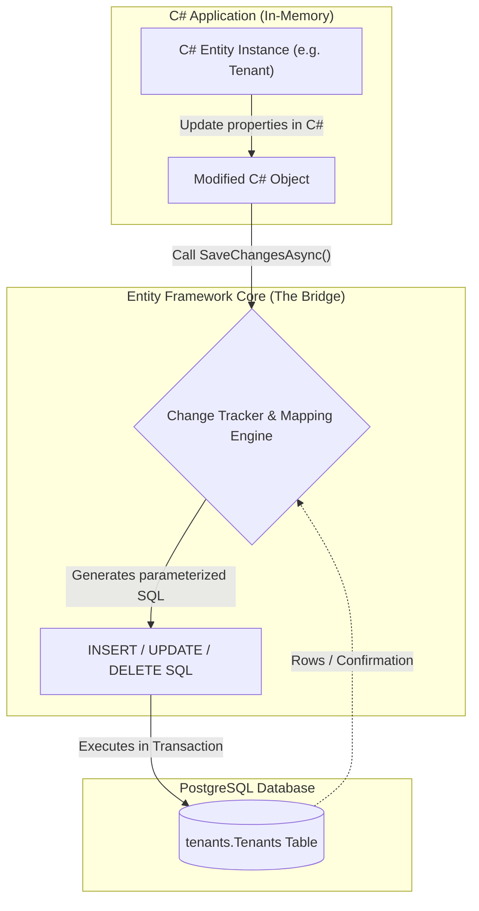
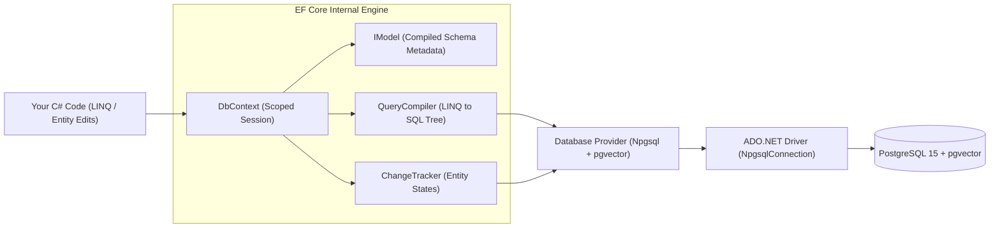
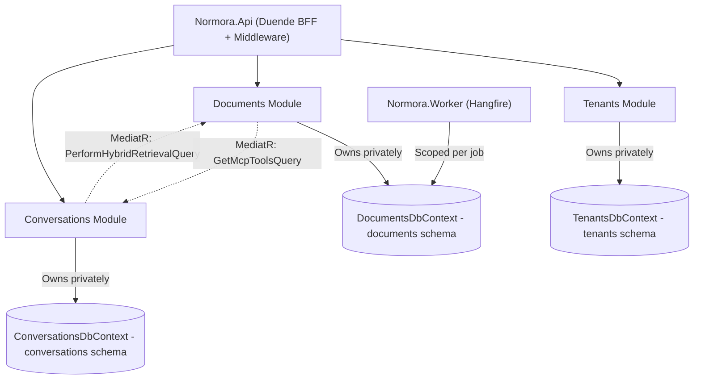

# Module 1: Introduction to Entity Framework Core

Welcome to **EF Core Fundamentals** (targeting **EF Core 10** on **.NET 10**). Throughout this course, we will explore **Normora**—a real-world, enterprise multi-tenant SaaS knowledge management and conversational-AI platform backed by **PostgreSQL** and **pgvector**. We will see how EF Core manages data across Normora's domain models such as `Tenant`, `TenantMembership`, `TenantBranding`, `Document`, `DocumentChunk`, and `Conversation`.

---

## 1. How an ORM Bridges the Gap

An **Object-Relational Mapper (ORM)** is the bridge between the object-oriented world of C# and the relational world of SQL databases. To understand why an ORM exists, you first have to understand the problem it solves: the **Object-Relational Impedance Mismatch**.

### The Object-Relational Impedance Mismatch
C# applications and relational databases (like PostgreSQL) model the world differently:
*   **Objects vs. Tables:** In C#, a `Tenant` object can directly hold a `List<Department>` or a nested `TenantBranding` object in memory. In PostgreSQL, tables are flat grids of rows and columns connected only by **foreign keys** (IDs pointing to rows in another table).
*   **Rich Types vs. Column Types:** C# uses strongly typed classes, enums, `Guid`s, and specialized types such as `Pgvector.Vector` (for AI embeddings). Databases store relational SQL types (`uuid`, `text`, `jsonb`, `vector(768)`).
*   **Behavior vs. Storage:** C# classes encapsulate behavior and validation rules; database tables store persistent state.

To bridge this mismatch, let's look at the two sides of our application:

### The C# (In-Memory) Side
*   **Models Define the Shape:** In C#, we create classes (**Entities / Models**) that define what our domain data looks like (e.g., a `Tenant` class with `Id`, `Name`, and `Slug` properties).
*   **Rows Match Models:** Each row returned from a database table is **materialized** (constructed in memory) into an instance of your C# class.
*   **In-Memory Updates:** When we want to modify data, we update properties on C# objects using normal C# code. At this stage, all changes live purely **in memory**.

### The Database Side
*   **Persisting Changes:** To ensure the data modified in C# survives process restarts, we must send it to a persistent database such as PostgreSQL.
*   **SQL Statements:** Relational databases do not understand C# objects or `List<T>` properties; they only understand SQL commands (`SELECT`, `INSERT`, `UPDATE`, `DELETE`).

### The Role of EF Core
This is where **Entity Framework Core (EF Core)** steps in. Ultimately, **data** is the payload moving between your C# application and PostgreSQL, and EF Core acts as the automated engine translating and tracking it.

Under the hood, EF Core performs four core jobs:
1.  **Model Mapping:** Builds an internal metadata map linking your C# classes and properties to PostgreSQL schemas, tables, and columns.
2.  **Query Translation:** Turns strongly-typed **LINQ (Language Integrated Query)** C# expressions (via **Expression Trees**, which represent code as inspectable data rather than compiled IL) into parameterized SQL queries.
3.  **Materialization:** Reads incoming database rows and populates C# entity instances automatically.
4.  **Change Tracking:** Watches loaded entities in memory (via the **Change Tracker**), detects exactly which properties changed, and emits minimal `INSERT`, `UPDATE`, and `DELETE` SQL statements inside a transaction when you save.

### The Data Flow



### Real-World Scenario: Loading a Tenant (Raw ADO.NET vs. EF Core)
Without an ORM, using raw **ADO.NET** (`Npgsql`, the low-level .NET PostgreSQL driver), you must open connections, write SQL strings by hand, bind parameters, and manually read every column by index:

```csharp
Tenant? tenant = null;

await using var connection = new NpgsqlConnection(connectionString);
await connection.OpenAsync(cancellationToken);

await using var command = new NpgsqlCommand(
    """SELECT "Id", "Name", "Slug" FROM tenants."Tenants" WHERE "Id" = @id""",
    connection);
command.Parameters.AddWithValue("id", tenantId);

await using var reader = await command.ExecuteReaderAsync(cancellationToken);
if (await reader.ReadAsync(cancellationToken))
{
    tenant = new Tenant
    {
        Id = reader.GetGuid(0),
        Name = reader.GetString(1),
        Slug = reader.GetString(2)
    };
}
```

With **EF Core**, the same asynchronous, parameterized database query shrinks to a single readable, compile-time checked line:

```csharp
var tenant = await dbContext.Tenants
    .FirstOrDefaultAsync(t => t.Id == tenantId, cancellationToken);
```

> [!TIP]
> **Always prefer `Async` methods + `CancellationToken`:** In ASP.NET Core APIs like Normora, synchronous calls (such as `.FirstOrDefault()` instead of `.FirstOrDefaultAsync(..., cancellationToken)`) block a .NET ThreadPool thread while waiting on network I/O to PostgreSQL, hurting throughput under load.

### The Cost of Not Using an ORM (Raw SQL Pitfalls)
If you rely purely on raw SQL string literals everywhere, you introduce four major risks:
1.  **Error Prone:** A typo in a column name (`"Sulg"` instead of `"Slug"`) is invisible to the C# compiler and crashes only at runtime in production.
2.  **Maintenance Nightmare:** If you rename a property on `Document` or split a column on `TenantBranding`, you must hunt down every raw SQL string across the repository and update column ordinals (`reader.GetString(2)`) manually.
3.  **Incomplete Updates:** When writing manual `UPDATE` statements, it is easy to forget a newly added column, causing silent data loss.
4.  **Security Risks (SQL Injection):** Concatenating user input into raw SQL strings (`"... WHERE Slug = '" + slug + "'"`) opens the door to SQL Injection. **EF Core automatically emits parameterized queries** (`@__slug_0`) for all LINQ operations, neutralizing SQL injection by default.

*Best Practice (Compile-Time Safety & Refactoring):* Because EF Core queries are written in C# using strongly-typed models and **LINQ**, renaming a property in your IDE updates all queries automatically—or fails immediately at compile time if something is missed.

### When NOT to Use an ORM
An ORM is a tool, not a silver bullet. Avoid using EF Core's entity tracking for:
*   **Massive Bulk Ingestion / Set-Based Deletes on Millions of Rows:** Loading 500,000 rows into memory just to flip one boolean column wastes RAM and CPU. Use EF Core's set-based `ExecuteUpdateAsync` / `ExecuteDeleteAsync` (which generate single SQL statements without loading entities) or PostgreSQL's `COPY` binary import.
*   **Complex Analytical / OLAP Queries:** Multi-level recursive CTEs, window functions with custom framing, or PostgreSQL-specific `pgvector` + `tsvector` Reciprocal Rank Fusion (RRF) scoring are cleaner in raw SQL (via `FromSql` or Dapper) than forcing awkward LINQ translations.
*   **Legacy Databases Locked Behind Stored Procedures:** If a DBA team forbids table access and requires calling dozens of stored procedures with custom table-valued parameters, a micro-ORM like Dapper fits more naturally.

### Real-World Normora Examples: EF Core Bridging the Gap

1.  **Loading a Tenant Workspace (`Tenants` module):**
    Resolving an active tenant by its URL slug during workspace lookup without manual `NpgsqlDataReader` mapping:
    ```csharp
    var tenant = await dbContext.Tenants
        .AsNoTracking()
        .FirstOrDefaultAsync(t => t.Slug == request.Slug, cancellationToken);
    ```
2.  **Saving an Object Graph (`Tenants` module):**
    Creating a `Tenant` and its initial `Department` in memory and letting EF Core order the PostgreSQL `INSERT` statements and foreign keys in one transaction:
    ```csharp
    var tenant = new Tenant { Id = Guid.NewGuid(), Name = request.Name, Slug = request.Slug };
    tenant.Departments.Add(new Department { Id = Guid.NewGuid(), Name = "Engineering", TenantId = tenant.Id });

    dbContext.Tenants.Add(tenant);
    await dbContext.SaveChangesAsync(cancellationToken);
    ```
3.  **Partial Column Updates (`Tenants` module):**
    Updating only `TenantBranding.PrimaryColor` triggers an `UPDATE` statement for the single changed column rather than rewriting the whole row:
    ```csharp
    var branding = await dbContext.TenantBrandings
        .FirstOrDefaultAsync(b => b.TenantId == tenantId, cancellationToken)
        ?? throw new BolaException();

    branding.PrimaryColor = request.PrimaryColor;
    await dbContext.SaveChangesAsync(cancellationToken);
    ```
4.  **Compile-Time Safe Filtering (`Documents` module):**
    Querying documents awaiting ingestion; if `Document.Status` is ever renamed, the C# compiler catches it immediately:
    ```csharp
    var pendingDocs = await dbContext.Documents
        .Where(d => d.Status == DocumentStatus.Pending)
        .OrderBy(d => d.CreatedAt)
        .Take(50)
        .ToListAsync(cancellationToken);
    ```
5.  **Preventing SQL Injection on User Search (`Conversations` module):**
    Searching a user's saved answers with arbitrary text—EF Core binds `searchTerm` as a safe PostgreSQL parameter (`@__term_0`):
    ```csharp
    var matches = await dbContext.SavedAnswers
        .Where(a => a.UserId == currentUser.ExternalUserId && a.Title.Contains(request.SearchTerm))
        .ToListAsync(cancellationToken);
    ```

---

## 2. EF Core vs. The World

You might wonder why Normora chose **EF Core 10** instead of alternatives like **Dapper**, pure **ADO.NET**, or older **.NET Framework Entity Framework 6 (EF6)**.

*   **ADO.NET (`Npgsql` / `Microsoft.Data.SqlClient`):** The foundational data-access layer in .NET. It executes raw SQL directly over database connections with near-zero overhead, making it extremely fast—but it forces you to write verbose boilerplate code for parameter binding, connection management, and row-by-row materialization.
*   **Dapper (Micro-ORM):** A lightweight library built on top of ADO.NET. It removes the `DataReader` mapping boilerplate by automatically copying SQL result columns into C# classes (e.g., `connection.QueryAsync<Tenant>("SELECT ...")`), while leaving 100% of the SQL authoring, migrations, and relationship ordering to you.
*   **Entity Framework Core 10 (Full ORM):** A modern, cross-platform, open-source ORM built for .NET 10. It handles LINQ-to-SQL translation, relationship & Change Tracking, schema migrations, bulk set-based updates (`ExecuteUpdateAsync` / `ExecuteDeleteAsync`), and native database extensions like PostgreSQL's `pgvector` and JSON columns.

> [!NOTE]
> **EF6 vs. EF Core (Don't Mix Up Tutorials):**
> If you search online, you will still find older articles about **Entity Framework 6 (EF6)** (`System.Data.Entity`, `.edmx` visual XML designers, Windows-only `.NET Framework`). **EF Core** is a ground-up rewrite, not EF6 v7+. Always look for **EF Core** (`Microsoft.EntityFrameworkCore`) APIs—for instance, EF Core uses `DbContextOptions<T>`, `ApplyConfigurationsFromAssembly`, and `ExecuteSqlAsync` rather than EF6's `DbModelBuilder` or `Database.SqlQuery`.

**Why EF Core for a Multi-Tenant SaaS App?**
In an enterprise platform like Normora, domain operations involve rich object graphs and strict invariants: a `Tenant` has `Department`s, `UserGroup`s, `TenantMembership`s, and a `TenantPlan`; uploading a `Document` must atomically create a `Document`, a `DocumentVersion`, and a `DocumentProcessingOutboxMessage`. Managing foreign-key ordering, optimistic concurrency, and tenant isolation manually in Dapper for every *insert* and *update* is error-prone. EF Core's Change Tracker automatically inserts parent and child records in dependency order inside a single database transaction.

### Architectural Comparison Matrix

| Dimension | ADO.NET (`Npgsql`) | Dapper (Micro-ORM) | EF Core 10 (Full ORM) |
|---|---|---|---|
| **Abstraction Level** | Lowest (connections, commands, readers) | Low (SQL in, objects out) | High (LINQ, models, change tracking) |
| **Raw Read Speed** | Fastest | Near ADO.NET (very fast) | Fast (use `AsNoTracking()` for reads; slight translation overhead) |
| **Change Tracking & Graph Saves** | None (manual SQL) | None (manual SQL) | Automatic (orders parent/child `INSERT`/`UPDATE`/`DELETE`) |
| **Schema Migrations** | None (external SQL scripts) | None (external SQL scripts) | Built-in (`dotnet ef migrations`) |
| **Compile-Time Query Safety** | None (raw strings) | None (raw strings) | High (LINQ + strongly typed models) |
| **When to Use** | Custom streaming, PostgreSQL `COPY` bulk import | Complex read-only reporting, hand-tuned SQL | Domain CRUD, multi-entity writes, standard queries, migrations |
| **When NOT to Use** | Standard app CRUD (too much boilerplate) | Complex multi-table writes & schema evolution | Massive row-by-row tracking loops (use `ExecuteUpdateAsync` or raw SQL instead) |

### Hybrid Data Access: They Work Together
Choosing EF Core does **not** lock you out of raw SQL or Dapper. Because EF Core sits on top of ADO.NET, you can drop down to `dbContext.Database.ExecuteSqlAsync(...)`, `dbContext.DbSet.FromSql(...)`, or even share `dbContext.Database.GetDbConnection()` with Dapper inside the **same** database transaction whenever a specific hot path demands hand-crafted PostgreSQL SQL.

### Real-World Normora Examples: Choosing the Right Tool

1.  **EF Core for Transactional Outbox (`Documents` module):**
    When a user uploads a company policy PDF, `UploadDocumentCommandHandler` uses EF Core to atomically save `Document`, `DocumentVersion`, and `DocumentProcessingOutboxMessage` in one transaction so Hangfire never misses a background ingestion job.
2.  **EF Core for Multi-Entity Workspace Onboarding (`Tenants` module):**
    Creating a new workspace inserts a `Tenant`, its default `Free` `TenantPlan`, and the creator's owner `TenantMembership` in a single `SaveChangesAsync()` call—EF Core resolves foreign keys automatically.
3.  **EF Core Set-Based Bulk Execution for Archival (`Tenants` module):**
    When purging or archiving millions of old `AuditLog` entries, Normora avoids loading entities into the Change Tracker and instead uses EF Core's set-based `ExecuteUpdateAsync` or `ExecuteSqlAsync` to run a single `UPDATE` on PostgreSQL.
4.  **Raw SQL / `FromSql` for pgvector Hybrid Search (`Documents` module):**
    Normora's `PerformHybridRetrievalQuery` combines `pgvector` HNSW cosine similarity with PostgreSQL full-text keyword ranking (`tsvector`) via Reciprocal Rank Fusion (RRF)—a PostgreSQL-specific query shape where hand-tuned SQL via EF Core `FromSql` / `Npgsql` is far cleaner and faster than pure LINQ.
5.  **Dapper / Un-tracked Projections for Executive Dashboards:**
    If an enterprise billing or usage analytics screen aggregates millions of token-usage rows across multiple CTEs, Dapper (or a raw `Npgsql` reader) avoids Change Tracker memory allocation completely while reusing the same PostgreSQL connection pool.

---

## 3. Core Concepts: `DbContext`, `DbSet<T>`, and the EF Core Pipeline

To use EF Core effectively—from your first query to production architecture—you must understand its two foundational classes, how its internal pipeline works, and how long a `DbContext` should live.

### The `DbContext` (The Session & Unit of Work)
The `DbContext` represents your active **session** with the database. Internally, it combines two classic software patterns:
*   **Unit of Work:** Tracks all changes made during a business operation (e.g., an HTTP request or background job) and commits them atomically when `SaveChangesAsync()` is called.
*   **Identity Map:** Remembers entities already loaded in the current session so querying the same primary key twice returns the same tracked C# instance.

In Normora, because the backend follows a **Modular Monolith** architecture, each business module owns its own private `DbContext` mapped to its own PostgreSQL schema:
*   `TenantsDbContext` (`tenants` schema)
*   `DocumentsDbContext` (`documents` schema)
*   `ConversationsDbContext` (`conversations` schema)

### The `DbSet<T>` (The Table Entry Point)
A `DbSet<TEntity>` represents a queryable collection of a specific entity type—essentially, a database table (or view). If `TenantsDbContext` is the session to the `tenants` schema, `DbSet<Tenant>` is your gateway to the `Tenants` table.

Notice the modern C# pattern `=> Set<Tenant>();` below: instead of declaring `{ get; set; } = null!;` to silence nullable-reference-type warnings, calling `DbContext.Set<T>()` delegates directly to EF Core's internal set cache. Also notice Normora uses **C# primary constructors** (`class TenantsDbContext(DbContextOptions<TenantsDbContext> options) : DbContext(options)`) to keep constructors concise.

### Inside the EF Core Pipeline



### `DbContext` Lifetime & Thread-Safety (Critical Architect Rule)
A **`DbContext` is NOT thread-safe** and is designed to be **short-lived** (one unit of work, then disposed).
*   **In ASP.NET Core (`Normora.Api`):** `AddDbContext<T>()` registers your context with a **Scoped** lifetime—one fresh instance per incoming HTTP request, automatically disposed when the request ends.
*   **Why Thread-Safety Fails:** `DbContext` holds a stateful `ChangeTracker` and wraps a single underlying database connection (`NpgsqlConnection`), which cannot execute two concurrent commands simultaneously. Running two `await` queries on the same `DbContext` with `Task.WhenAll` throws `InvalidOperationException: A second operation was started on this context instance before a previous operation completed`.
*   **When NOT to Use a Standard Scoped `DbContext`:**
    *   **Inside Singleton Services:** Injecting a Scoped `DbContext` into a Singleton creates a **Captive Dependency**—the context stays alive forever, accumulating tracked entities (memory leak), holding stale data across tenants, and crashing on concurrent requests.
    *   **In Parallel Tasks or Long-Lived Workers:** If a Hangfire job in `Normora.Worker` or a SignalR hub processes items in parallel, inject `IDbContextFactory<TContext>` (or create a fresh DI scope via `IServiceScopeFactory`) so each concurrent unit of work gets its own isolated `DbContext`.

### Lean `DbContext` & 100% Module Encapsulation
In Normora, `DbContext` classes stay **lean**: we never dump hundreds of lines of column/index configuration inside `OnModelCreating`. Instead, each entity gets a dedicated `IEntityTypeConfiguration<T>` class discovered automatically via `ApplyConfigurationsFromAssembly(...)` (covered in **Module 4**). Furthermore, every module's `DbContext` is **strictly private** to that module—API controllers in other modules, middleware, and `Normora.Api` must never inject another module's `DbContext`.

### Real-World Normora Examples: `DbContext` & `DbSet<T>`

1.  **`TenantsDbContext` (`server/Modules/Tenants/Persistence/`):**
    Manages multi-tenancy, memberships, organizational structure, white-label branding, and subscription plans in the `tenants` schema:
    ```csharp
    public sealed class TenantsDbContext(DbContextOptions<TenantsDbContext> options)
        : DbContext(options)
    {
        public DbSet<Tenant> Tenants => Set<Tenant>();
        public DbSet<TenantMembership> TenantMemberships => Set<TenantMembership>();
        public DbSet<Department> Departments => Set<Department>();
        public DbSet<UserGroup> UserGroups => Set<UserGroup>();
        public DbSet<TenantBranding> TenantBrandings => Set<TenantBranding>();
        public DbSet<TenantPlan> TenantPlans => Set<TenantPlan>();
        public DbSet<AuditLog> AuditLogs => Set<AuditLog>();

        protected override void OnModelCreating(ModelBuilder modelBuilder)
        {
            modelBuilder.HasDefaultSchema("tenants");
            modelBuilder.ApplyConfigurationsFromAssembly(typeof(TenantsDbContext).Assembly);
        }
    }
    ```
2.  **`DocumentsDbContext` (`server/Modules/Documents/Persistence/`):**
    Manages uploaded files, versions, vector-indexed chunks, and the transactional outbox in the `documents` schema:
    ```csharp
    public sealed class DocumentsDbContext(DbContextOptions<DocumentsDbContext> options)
        : DbContext(options)
    {
        public DbSet<Document> Documents => Set<Document>();
        public DbSet<DocumentVersion> DocumentVersions => Set<DocumentVersion>();
        public DbSet<DocumentChunk> DocumentChunks => Set<DocumentChunk>();
        public DbSet<DocumentProcessingOutboxMessage> OutboxMessages => Set<DocumentProcessingOutboxMessage>();

        protected override void OnModelCreating(ModelBuilder modelBuilder)
        {
            modelBuilder.HasDefaultSchema("documents");
            modelBuilder.HasPostgresExtension("vector");
            modelBuilder.ApplyConfigurationsFromAssembly(typeof(DocumentsDbContext).Assembly);
        }
    }
    ```
3.  **`ConversationsDbContext` (`server/Modules/Conversations/Persistence/`):**
    Manages RAG chat threads, streamed messages, HITL `PendingApproval` records, and `SavedAnswer` bookmarks in the `conversations` schema:
    ```csharp
    public sealed class ConversationsDbContext(DbContextOptions<ConversationsDbContext> options)
        : DbContext(options)
    {
        public DbSet<Conversation> Conversations => Set<Conversation>();
        public DbSet<ConversationMessage> Messages => Set<ConversationMessage>();
        public DbSet<PendingApproval> PendingApprovals => Set<PendingApproval>();
        public DbSet<SavedAnswer> SavedAnswers => Set<SavedAnswer>();

        protected override void OnModelCreating(ModelBuilder modelBuilder)
        {
            modelBuilder.HasDefaultSchema("conversations");
            modelBuilder.ApplyConfigurationsFromAssembly(typeof(ConversationsDbContext).Assembly);
        }
    }
    ```
4.  **Isolated Context Per Concurrent Worker via `IDbContextFactory<T>` (`Normora.Worker`):**
    When a background processor needs to check or update multiple document batches concurrently without sharing a single `DbContext`:
    ```csharp
    public sealed class BatchChunkIndexer(IDbContextFactory<DocumentsDbContext> contextFactory)
    {
        public async Task MarkBatchProcessedAsync(Guid documentId, CancellationToken ct)
        {
            await using var dbContext = await contextFactory.CreateDbContextAsync(ct);
            var doc = await dbContext.Documents.FirstOrDefaultAsync(d => d.Id == documentId, ct);
            if (doc is not null)
            {
                doc.Status = DocumentStatus.Ready;
                await dbContext.SaveChangesAsync(ct);
            }
        }
    }
    ```
5.  **Cross-Module Read via MediatR Contract Instead of `DbContext` Leakage:**
    When `Conversations` needs document chunks for RAG, it never injects `DocumentsDbContext`; it dispatches a contract from `Normora.Shared.Contracts.Documents` carrying an explicit `Guid TenantId`:
    ```csharp
    // Inside ConversationTurnPreparer (Conversations module)
    var retrievalResult = await mediator.Send(
        new PerformHybridRetrievalQuery(
            TenantId: request.TenantId,
            QueryText: rewrittenQuery,
            TopK: 8),
        cancellationToken);
    ```

---

## 4. Connecting to Data (PostgreSQL, Providers & Environments)

EF Core itself is **database-agnostic**—it knows how to track entities and parse LINQ, but it does not know PostgreSQL, SQL Server, or SQLite syntax on its own. To talk to a real database, you plug in a **Database Provider** NuGet package.

### What a Database Provider Does
A provider translates EF Core's internal query trees and schema definitions into a specific database's SQL dialect and wire protocol:
*   **PostgreSQL (Normora's choice):** `Npgsql.EntityFrameworkCore.PostgreSQL` (`options.UseNpgsql(...)`) + `Pgvector.EntityFrameworkCore` (`npgsql.UseVector()`).
*   **Other providers:** SQL Server (`UseSqlServer`), SQLite (`UseSqlite`—great for lightweight local tests), MySQL/MariaDB (`UseMySql`).

There are three ways EF Core obtains its provider and connection string:

### Approach 1: Dependency Injection (Best Practice for APIs & Workers)
In ASP.NET Core and .NET generic hosts (such as `Normora.Api` and `Normora.Worker`), each module registers its `DbContext` during startup inside its module composition root (`{ModuleName}ModuleExtensions.cs`) or shared database setup (`DatabaseServiceExtensions.cs`):

```csharp
// Example inside DocumentsModuleExtensions.cs
var connectionString = configuration.GetConnectionString("DefaultConnection");

services.AddDbContext<DocumentsDbContext>(options =>
{
    options.UseNpgsql(connectionString, npgsql =>
    {
        npgsql.UseVector(); // Enables PostgreSQL pgvector type mapping
        npgsql.MigrationsHistoryTable("__EFMigrationsHistory", "documents");
        npgsql.EnableRetryOnFailure(maxRetryCount: 3);
    });
});
```

### Approach 2: Overriding `OnConfiguring` (Fallback / Prototypes Only)
If you are writing a quick standalone console app or need a fallback when DI is not used, you can override `OnConfiguring` inside the `DbContext`. Always guard it with `if (!optionsBuilder.IsConfigured)` so DI-supplied options take precedence:

```csharp
public class TenantsDbContext(DbContextOptions<TenantsDbContext> options) : DbContext(options)
{
    public DbSet<Tenant> Tenants => Set<Tenant>();

    protected override void OnConfiguring(DbContextOptionsBuilder optionsBuilder)
    {
        // Only configure if it wasn't already configured via Dependency Injection
        if (!optionsBuilder.IsConfigured)
        {
            var fallbackConn = Environment.GetEnvironmentVariable("NORMORA_CONNECTION_STRING");
            optionsBuilder.UseNpgsql(fallbackConn);
        }
    }
}
```

*When NOT to use `OnConfiguring`:* Never rely on `OnConfiguring` in production web APIs or workers. It bypasses central configuration (`IConfiguration`), makes environment-specific connection strings and test overrides awkward, and couples your persistence class to hardcoded provider settings.

### Approach 3: Design-Time Factories & Normora's Ephemeral `--migrate` Host
CLI tools like `dotnet ef migrations add` need to instantiate your `DbContext` at design time without running your entire web server. For this, EF Core looks for `IDesignTimeDbContextFactory<TContext>` or boots your host.

At deployment time, Normora takes this isolation a step further with an **ephemeral migration host**:
*   Running `dotnet Normora.Api.dll --migrate` executes `MigrationHostExtensions.RunMigrationsAsync` inside a minimal console host—skipping Kestrel, SignalR hubs, Hangfire, and OpenTelemetry listeners.
*   `DatabaseMigrationRunner` then runs four `IDatabaseMigrator` implementations sequentially (`TenantsDatabaseMigrator`, `DocumentsDatabaseMigrator`, `ConversationsDatabaseMigrator`, and `SessionDatabaseMigrator`) and exits cleanly with code `0`.

### Connection Resiliency, Diagnostics & Security

> [!IMPORTANT]
> **Connection Strings & Logging Security:**
> *   **Never hardcode production credentials** in C# source files. Load connection strings from environment variables, `.env` files (Docker Compose), `appsettings.json` (local dev placeholders only), or a secret manager (Azure Key Vault / AWS Secrets Manager).
> *   **Never enable `EnableSensitiveDataLogging()` in Production:** It prints raw parameter values (user emails, tenant prompts, OIDC identifiers) straight into application logs, violating Normora's CWE-209 security rules. Only enable it inside `if (environment.IsDevelopment())`.

### Real-World Normora Examples: Configuring Providers

1.  **`DocumentsDbContext` with `pgvector` & Isolated Migration History (`Documents` module):**
    Keeping each module's `__EFMigrationsHistory` table inside its own PostgreSQL schema prevents schema collisions between modules:
    ```csharp
    services.AddDbContext<DocumentsDbContext>(options =>
        options.UseNpgsql(connectionString, npgsql =>
        {
            npgsql.UseVector();
            npgsql.MigrationsHistoryTable("__EFMigrationsHistory", "documents");
        }));
    ```
2.  **Transient Fault Resiliency on `TenantsDbContext` (`Tenants` module):**
    Configuring automatic exponential-backoff retries (`EnableRetryOnFailure`) and a command timeout so brief container or network blips don't drop workspace lookups:
    ```csharp
    services.AddDbContext<TenantsDbContext>(options =>
        options.UseNpgsql(connectionString, npgsql =>
        {
            npgsql.MigrationsHistoryTable("__EFMigrationsHistory", "tenants");
            npgsql.EnableRetryOnFailure(
                maxRetryCount: 5,
                maxRetryDelay: TimeSpan.FromSeconds(10),
                errorCodesToAdd: null);
            npgsql.CommandTimeout(30);
        }));
    ```
3.  **Development-Only SQL Diagnostics (`ConversationsDbContext`):**
    Logging generated SQL and detailed binding errors strictly in local development while keeping production logs clean and OpenTelemetry-instrumented:
    ```csharp
    services.AddDbContext<ConversationsDbContext>((sp, options) =>
    {
        var env = sp.GetRequiredService<IHostEnvironment>();
        options.UseNpgsql(connectionString);

        if (env.IsDevelopment())
        {
            options.EnableDetailedErrors();
            options.EnableSensitiveDataLogging();
        }
    });
    ```
4.  **Shared Configuration in `Normora.Worker` (`Normora.Infrastructure`):**
    Both `Normora.Api` and `Normora.Worker` share `DatabaseServiceExtensions.cs` so Hangfire ingestion jobs connect to the exact same `documents` and `tenants` PostgreSQL schemas without referencing `Normora.Api`.
5.  **Design-Time Factory for Clean `dotnet ef` Tooling:**
    Allowing `dotnet ef migrations add` to construct `TenantsDbContext` without booting Keycloak OIDC, Redis, or Gemini AI providers:
    ```csharp
    public sealed class TenantsDbContextFactory : IDesignTimeDbContextFactory<TenantsDbContext>
    {
        public TenantsDbContext CreateDbContext(string[] args)
        {
            var connectionString = Environment.GetEnvironmentVariable("NORMORA_CONNECTION_STRING");
            var options = new DbContextOptionsBuilder<TenantsDbContext>()
                .UseNpgsql(connectionString)
                .Options;
            return new TenantsDbContext(options);
        }
    }
    ```

---

## 5. Real-World Scenarios in Normora

Let's bring all of Module 1's concepts together using five concrete production patterns from **Normora**.



### Scenario A: Multi-Context Architecture (Bounded Contexts)
In Normora, instead of one massive `AppDbContext` for the entire platform, persistence is split strictly by business module:

```csharp
// server/Modules/Tenants/Persistence/ — Tenants, memberships, departments, branding, TenantPlan billing
public sealed class TenantsDbContext(DbContextOptions<TenantsDbContext> options) : DbContext(options) { /* ... */ }

// server/Modules/Documents/Persistence/ — Documents, versions, pgvector chunks, ingestion outbox
public sealed class DocumentsDbContext(DbContextOptions<DocumentsDbContext> options) : DbContext(options) { /* ... */ }

// server/Modules/Conversations/Persistence/ — RAG threads, messages, PendingApprovals, SavedAnswers
public sealed class ConversationsDbContext(DbContextOptions<ConversationsDbContext> options) : DbContext(options) { /* ... */ }
```

**Why?** Each context owns a **Bounded Context** from Domain-Driven Design (DDD). Notice there is no separate `BillingDbContext` or `UsersDbContext`—subscription plans (`TenantPlan`) and workspace memberships (`TenantMembership`) belong inside `TenantsDbContext`. This prevents a single "God-context" from growing to 50+ `DbSet`s and lets each module manage its own migrations and schema independently.

### Scenario B: Safe Set-Based Bulk Operations Alongside EF Core
When archiving 1 million old `AuditLog` records, loading them into EF Core's Change Tracker would exhaust memory. Instead, Normora uses either EF Core's set-based `ExecuteUpdateAsync` (no entities loaded) or parameterized `ExecuteSqlAsync` (note the `$` interpolated `FormattableString`—EF Core automatically converts `{cutoff}` into a safe SQL parameter, unlike `ExecuteSqlRawAsync`):

```csharp
var cutoff = DateTime.UtcNow.AddYears(-2);

// Option 1 (Preferred when entity-mapped): Set-based LINQ update in EF Core 10
await dbContext.AuditLogs
    .Where(a => !a.IsArchived && a.CreatedAt < cutoff)
    .ExecuteUpdateAsync(
        setters => setters.SetProperty(a => a.IsArchived, true),
        cancellationToken);

// Option 2: Safe parameterized raw SQL using ExecuteSqlAsync (FormattableString)
await dbContext.Database.ExecuteSqlAsync(
    $"""UPDATE tenants."AuditLogs" SET "IsArchived" = TRUE WHERE "CreatedAt" < {cutoff}""",
    cancellationToken);
```

### Scenario C: Atomic Transactional Outbox on Document Upload
In `UploadDocumentCommandHandler` (`Documents` module), uploading a file to MinIO must never leave orphaned database rows or lost background jobs. EF Core saves the `Document`, `DocumentVersion`, and `DocumentProcessingOutboxMessage` inside a single `SaveChangesAsync()` transaction:

```csharp
dbContext.Documents.Add(document);
dbContext.DocumentVersions.Add(version);
dbContext.OutboxMessages.Add(outboxMessage);

// Single atomic PostgreSQL transaction: all 3 rows succeed or all 3 roll back
await dbContext.SaveChangesAsync(cancellationToken);
```

### Scenario D: Cross-Module Querying Without Breaking Encapsulation
`Conversations` needs relevant `DocumentChunk`s to answer a user's prompt, but Normora enforces **100% DbContext encapsulation**. `ConversationTurnPreparer` never touches `DocumentsDbContext`; instead, it dispatches a MediatR query contract from `Normora.Shared.Contracts.Documents` passing an explicit `Guid TenantId`:

```csharp
var chunks = await mediator.Send(
    new PerformHybridRetrievalQuery(request.TenantId, rewrittenQuery, TopK: 8),
    cancellationToken);
```

### Scenario E: Background Worker Concurrency (`Normora.Worker`)
Hangfire jobs run outside HTTP requests, so there is no ASP.NET Core request scope by default. Each background job creates an explicit DI scope (or uses `IDbContextFactory<DocumentsDbContext>`) so parallel ingestion jobs never share a `DbContext` instance across threads.

---

## 6. Common Mistakes & Anti-Patterns

> [!CAUTION]
> **Anti-Pattern 1: Sharing One `DbContext` Across Concurrent `Task.WhenAll` Operations**
>
> **Wrong Code:**
> ```csharp
> // Crashes at runtime with InvalidOperationException!
> var tenantTask = dbContext.Tenants.FirstOrDefaultAsync(t => t.Id == tenantId, ct);
> var brandingTask = dbContext.TenantBrandings.FirstOrDefaultAsync(b => b.TenantId == tenantId, ct);
> await Task.WhenAll(tenantTask, brandingTask);
> ```
> **Why It's Wrong:** `DbContext` is **not thread-safe** and wraps a single PostgreSQL connection (`NpgsqlConnection`) that cannot run two queries concurrently.
>
> **The Fix:** Either `await` the queries sequentially on the same scoped `DbContext`, combine them into one projected query, or use `IDbContextFactory<TenantsDbContext>` to create a separate context per parallel task:
> ```csharp
> var tenant = await dbContext.Tenants.FirstOrDefaultAsync(t => t.Id == tenantId, ct);
> var branding = await dbContext.TenantBrandings.FirstOrDefaultAsync(b => b.TenantId == tenantId, ct);
> ```

> [!CAUTION]
> **Anti-Pattern 2: Captive Dependency (Injecting Scoped `DbContext` into a Singleton)**
>
> **Wrong Code:**
> ```csharp
> // Registered as AddSingleton<TenantCacheWarmer>()
> public sealed class TenantCacheWarmer(TenantsDbContext dbContext)
> {
>     public Task WarmAsync(CancellationToken ct) => dbContext.Tenants.ToListAsync(ct);
> }
> ```
> **Why It's Wrong:** A Singleton outlives every HTTP request, trapping the Scoped `DbContext` forever. It leaks tracked entities in memory, returns stale cached objects from its Change Tracker, and crashes under concurrent requests.
>
> **The Fix:** Inject `IServiceScopeFactory` (or `IDbContextFactory<TenantsDbContext>`) into the Singleton and create/dispose a fresh scope per operation:
> ```csharp
> public sealed class TenantCacheWarmer(IServiceScopeFactory scopeFactory)
> {
>     public async Task WarmAsync(CancellationToken ct)
>     {
>         await using var scope = scopeFactory.CreateAsyncScope();
>         var dbContext = scope.ServiceProvider.GetRequiredService<TenantsDbContext>();
>         var tenants = await dbContext.Tenants.AsNoTracking().ToListAsync(ct);
>     }
> }
> ```

> [!CAUTION]
> **Anti-Pattern 3: Injecting Another Module's `DbContext` (Breaking Bounded Contexts)**
>
> **Wrong Code:**
> ```csharp
> // Inside Modules/Conversations/Application/...
> public sealed class ConversationTurnPreparer(DocumentsDbContext documentsDb) // Violation!
> ```
> **Why It's Wrong:** Reaching directly into `DocumentsDbContext` couples `Conversations` to `Documents`'s internal tables, bypasses module invariants, and breaks Normora's Modular Monolith boundaries.
>
> **The Fix:** Communicate across modules strictly through MediatR contracts in `Normora.Shared.Contracts.*` with an explicit `Guid TenantId`:
> ```csharp
> public sealed class ConversationTurnPreparer(ISender mediator)
> {
>     // Calls PerformHybridRetrievalQuery via Normora.Shared.Contracts.Documents
> }
> ```

> [!CAUTION]
> **Anti-Pattern 4: String Interpolation Inside `ExecuteSqlRawAsync` (SQL Injection)**
>
> **Wrong Code:**
> ```csharp
> // CRITICAL SECURITY VULNERABILITY: User-controlled slug is concatenated into raw SQL!
> await dbContext.Database.ExecuteSqlRawAsync(
>     $"UPDATE tenants.\"Tenants\" SET \"IsActive\" = FALSE WHERE \"Slug\" = '{slug}'",
>     cancellationToken);
> ```
> **Why It's Wrong:** `ExecuteSqlRawAsync` takes a plain `string`. Passing an interpolated `$""` string bakes `slug` directly into the SQL command before EF Core sees it, exposing your database to SQL injection.
>
> **The Fix:** Use `ExecuteSqlAsync` (which accepts `FormattableString` and automatically turns `{slug}` into a safe `@p0` parameter) or EF Core's `ExecuteUpdateAsync`:
> ```csharp
> await dbContext.Database.ExecuteSqlAsync(
>     $"""UPDATE tenants."Tenants" SET "IsActive" = FALSE WHERE "Slug" = {slug}""",
>     cancellationToken);
> ```

> [!CAUTION]
> **Anti-Pattern 5: Hardcoding Connection Strings or Enabling `EnableSensitiveDataLogging()` in Production**
>
> **Wrong Code:**
> ```csharp
> optionsBuilder
>     .UseNpgsql("Host=prod-pg.internal;Username=postgres;Password=SuperSecretPassword123")
>     .EnableSensitiveDataLogging(); // Always enabled!
> ```
> **Why It's Wrong:** Hardcoded credentials leak through Git history and binaries, while `EnableSensitiveDataLogging()` writes user emails, OIDC `ExternalUserId`s, and query parameters into production logs (violating CWE-209).
>
> **The Fix:** Load connection strings via `IConfiguration` (environment variables / secret manager) and gate `EnableSensitiveDataLogging()` behind `env.IsDevelopment()`.

> [!CAUTION]
> **Anti-Pattern 6: Loading Millions of Entities into `ChangeTracker` for a Bulk Update**
>
> **Wrong Code:**
> ```csharp
> var oldLogs = await dbContext.AuditLogs
>     .Where(l => l.CreatedAt < cutoff)
>     .ToListAsync(cancellationToken); // Loads 1,000,000 rows into RAM!
>
> foreach (var log in oldLogs)
>     log.IsArchived = true;
>
> await dbContext.SaveChangesAsync(cancellationToken); // Emits up to 1,000,000 updates!
> ```
> **Why It's Wrong:** Materializing and change-tracking hundreds of thousands of rows causes massive GC memory pressure and slow batched round-trips.
>
> **The Fix:** Use set-based `ExecuteUpdateAsync` (or `ExecuteDeleteAsync`) so PostgreSQL updates all matching rows in a single command without loading entities into memory:
> ```csharp
> await dbContext.AuditLogs
>     .Where(l => l.CreatedAt < cutoff)
>     .ExecuteUpdateAsync(s => s.SetProperty(l => l.IsArchived, true), cancellationToken);
> ```

---

## 7. Interview Questions

**Q1 (Junior): What is an ORM, what problem does the "Object-Relational Impedance Mismatch" refer to, and why use EF Core over raw ADO.NET?**
> An **ORM (Object-Relational Mapper)** translates between C# object graphs and relational SQL tables. The **impedance mismatch** exists because C# models use nested objects, inheritance, and rich types (`Guid`, `Vector`), whereas databases store flat tables linked by foreign keys. EF Core eliminates ADO.NET's manual connection/reader boilerplate while giving you compile-time LINQ safety, automatic parameterized queries (preventing SQL injection), change tracking, and schema migrations.

**Q2 (Junior): What is the difference between `DbContext` and `DbSet<T>`?**
> `DbContext` represents your active database session and **Unit of Work**—it manages the connection, Change Tracker, and `SaveChangesAsync()` transactions. `DbSet<T>` represents a single table (or view) inside that context through which you query and add entities of type `T`.

**Q3 (Junior): What happens internally when you call `SaveChangesAsync()`?**
> EF Core's `ChangeTracker` inspects all tracked entities for state changes (`Added`, `Modified`, `Deleted`), determines dependency order for foreign keys, generates parameterized SQL (`INSERT`, `UPDATE`, `DELETE`), and executes them inside a single database transaction. If any statement fails, the transaction rolls back; if it succeeds, database-generated values (such as sequence IDs or timestamps) are populated back onto the C# entities and states reset to `Unchanged`.

**Q4 (Senior): When would you choose Dapper or raw SQL over EF Core—and how can they work together?**
> Choose Dapper or raw SQL for read-heavy reporting queries with complex multi-CTE SQL, PostgreSQL-specific syntax like `pgvector` + `tsvector` Reciprocal Rank Fusion (RRF), or massive bulk imports (`COPY`). EF Core is better for domain writes, multi-entity graphs, and migrations. In practice they coexist cleanly: in Normora, you can use EF Core for CRUD and drop down to `FromSql` / `ExecuteSqlAsync` or share `dbContext.Database.GetDbConnection()` with Dapper for specialized read hot paths.

**Q5 (Senior): What is the difference between `ExecuteSqlAsync` and `ExecuteSqlRawAsync`?**
> `ExecuteSqlAsync` accepts a `FormattableString` (`$"... WHERE \"Slug\" = {slug}"`), so EF Core automatically extracts interpolated values into parameterized SQL arguments (`@p0`), preventing SQL injection. `ExecuteSqlRawAsync` accepts a plain `string`—passing an interpolated C# string to `ExecuteSqlRawAsync` creates a SQL injection vulnerability unless you manually pass positional `{0}` placeholders and separate parameter arguments.

**Q6 (Senior): Why is `DbContext` not thread-safe, and how do you safely run EF Core queries in parallel or in background workers like Hangfire?**
> `DbContext` holds mutable `ChangeTracker` state and a single underlying database connection (`NpgsqlConnection`) that cannot execute overlapping commands concurrently. Calling `Task.WhenAll` on two queries against the same `DbContext` throws an `InvalidOperationException`. To run parallel tasks or Hangfire jobs safely, inject `IDbContextFactory<TContext>` (or create a dedicated DI scope via `IServiceScopeFactory`) so each unit of work receives its own short-lived `DbContext`.

**Q7 (Architect): Why does Normora use multiple `DbContext`s (`TenantsDbContext`, `DocumentsDbContext`, `ConversationsDbContext`) instead of one shared `AppDbContext`, and how do modules read each other's data?**
> Splitting into one `DbContext` per Bounded Context (mapped to separate PostgreSQL schemas: `tenants`, `documents`, `conversations`) enforces strict modular boundaries, keeps each `IModel` small and fast to compile, avoids cross-team migration conflicts, and makes future extraction into separate databases or microservices straightforward. Because `DbContext`s are private to their module, cross-module reads go exclusively through explicit MediatR contracts in `Normora.Shared.Contracts.*` carrying `Guid TenantId`.

**Q8 (Architect): What is a Captive Dependency with `DbContext`, and what symptoms does it cause in production?**
> A Captive Dependency occurs when a **Scoped** service (`DbContext`) is injected into a **Singleton** service. Because the Singleton never gets disposed between requests, the `DbContext` lives for the entire process lifetime—causing unbounded memory growth in its `ChangeTracker`, stale entity reads from its identity map, cross-tenant data bleed, and thread-safety crashes under concurrent traffic. Fixing it requires injecting `IDbContextFactory<T>` or `IServiceScopeFactory` instead of `DbContext` directly.

---

## Summary
In this module, we learned how EF Core 10 bridges the **Object-Relational Impedance Mismatch** between C# domain models and PostgreSQL tables, how EF Core compares to ADO.NET, Dapper, and legacy EF6, how `DbContext` and `DbSet<T>` coordinate the Unit of Work pipeline, and why Normora isolates each bounded context (`TenantsDbContext`, `DocumentsDbContext`, `ConversationsDbContext`) with strict lifetime and security rules. In the next module (**Module 2: Building Models**), we will dive into designing entity classes, keys, constraints, and conventions.
