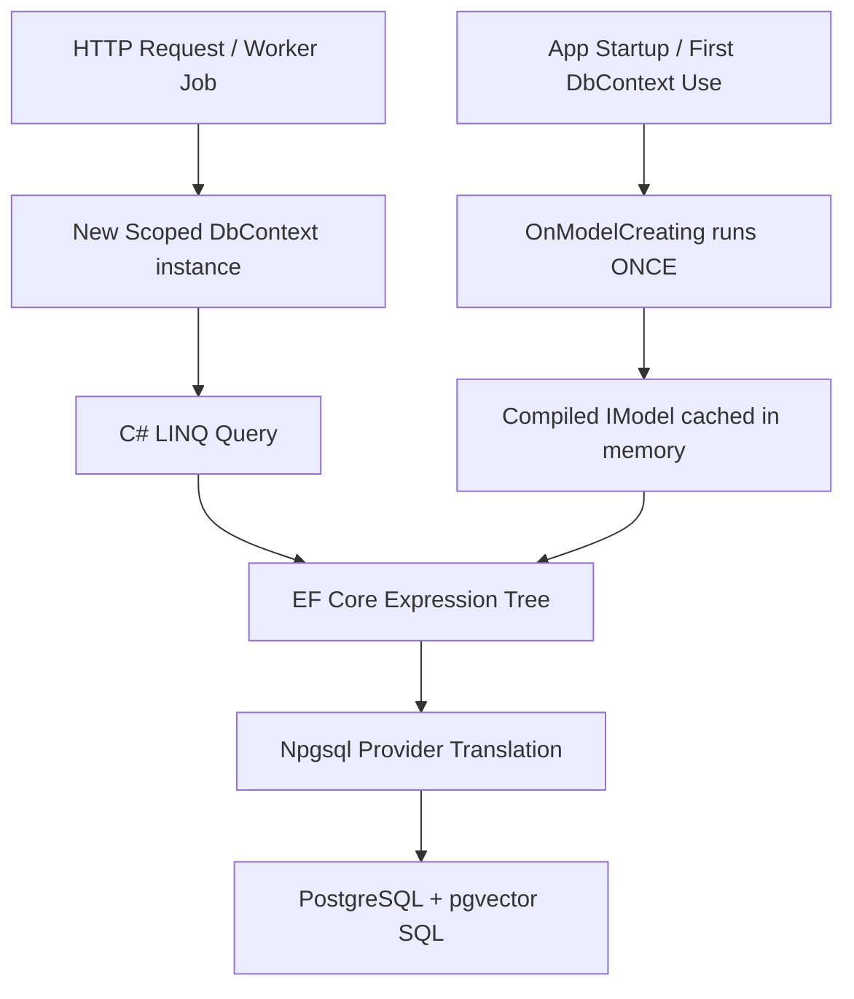
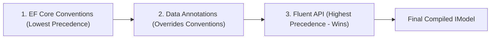
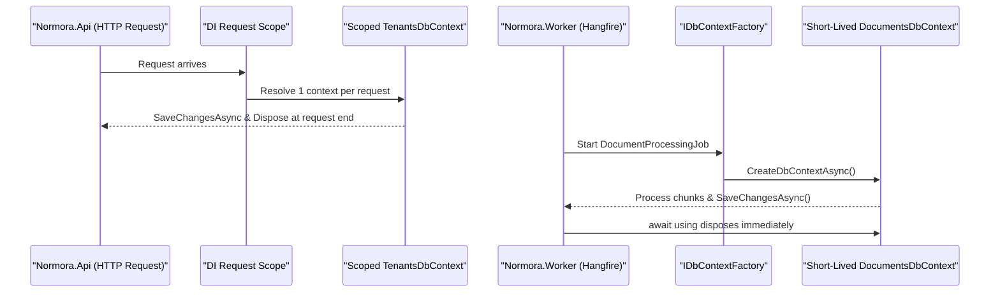

# Module 2: Building Your First Data Model

In this module, we will explore how to configure C# domain classes (like `Tenant`, `Document`, and `Conversation` in **Normora**) so that Entity Framework Core 10 understands exactly how to map them to **PostgreSQL** tables, constraints, indexes, and schemas. We'll also cover how `DbContext` builds and caches its internal model, shadow properties, global query filters, and how to register `DbContext` safely in ASP.NET Core and background workers.

---

## 1. How DbContext Works (The Mental Model)
**`DbContext` is the base class that EF Core offers for implementing the mapping between the code side and the database.** It acts as the mediator orchestrating how your objects correspond to table rows, combining two classic architectural patterns:
- **Unit of Work:** Tracks all changes made during a logical operation and commits them atomically in a single transaction on `SaveChangesAsync()`.
- **Repository (via `DbSet<T>`):** Exposes strongly-typed collections you can query with LINQ.

The `DbContext` works based on **mappings** between our C# classes and our database tables.

When the server starts and the `DbContext` is spun up for the first time, it builds an immutable, compiled **mental model** (`IModel`) of the relationship between your classes and the database. Based on your models, Fluent API configurations, and EF Core conventions, it knows the exact shape of the data in the database.

Because it builds and caches this `IModel` once per `DbContext` type, it does not need to rediscover the mappings on every HTTP request. Any changes you make to your tracked classes/models are recorded inside the `DbContext`'s **Change Tracker** and then propagated to the database on the `SaveChangesAsync()` method call.

### How `IModel` Caching Affects Dynamic Values (Critical Concept!)
Because `OnModelCreating(ModelBuilder modelBuilder)` runs **only once** for the lifetime of the application (keyed by `IModelCacheKeyFactory`), any expression or value baked directly as a constant inside `OnModelCreating` is **frozen forever** for all requests.
- **Wrong mental model:** Reading `var tenantId = _tenantContext.TenantId;` into a local variable inside `OnModelCreating` — the first tenant's ID gets baked into the compiled model for every subsequent tenant!
- **Right mental model:** Reference a `DbContext` instance property (e.g., `_tenantContext.TenantId`) inside a lambda expression (like `HasQueryFilter`). EF Core detects the reference to the `DbContext` instance (`this`) and evaluates that property **dynamically per query execution**.

### The DbContext is Database Agnostic
When you write C# code and LINQ queries against the `DbContext`, **you do not have to know which database you are using.** The LINQ statements remain largely the same whether you are using PostgreSQL, SQL Server, or SQLite.

**Why?** EF Core uses a **Provider Model**. When you write a query in C#, EF Core translates it into an **Expression Tree** (an in-memory representation of the query logic). The specific database provider (e.g., `Npgsql.EntityFrameworkCore.PostgreSQL` for PostgreSQL + `pgvector` in Normora, or `Microsoft.EntityFrameworkCore.SqlServer` for SQL Server) is responsible for taking that tree and translating it into the exact SQL dialect required. This abstraction protects your application code from being tightly coupled to a specific database engine.

### Configuring `DbContextOptions` and Modular Schema Isolation
In modern .NET 10 applications like Normora, a `DbContext` receives its configuration (connection string, provider, retry policies, pgvector support) from Dependency Injection via `DbContextOptions<TContext>` using a **C# Primary Constructor**:

```csharp
public sealed class DocumentsDbContext(
    DbContextOptions<DocumentsDbContext> options,
    ITenantContext tenantContext) : DbContext(options)
{
    private readonly ITenantContext _tenantContext = tenantContext;

    protected override void OnModelCreating(ModelBuilder modelBuilder)
    {
        // Isolate all Documents module tables inside PostgreSQL schema "documents"
        modelBuilder.HasDefaultSchema("documents");
        modelBuilder.ApplyConfigurationsFromAssembly(typeof(DocumentsDbContext).Assembly);
    }
}
```

- **When to use `HasDefaultSchema(...)`:** Always use it in a **Modular Monolith** (like Normora's `tenants`, `documents`, and `conversations` PostgreSQL schemas) so modules share one database cluster without table-name collisions or cross-module coupling.
- **When NOT to split into separate `DbContext`s:** If two entities belong to the **same** bounded context and frequently require ACID transactions and SQL `JOIN`s together (e.g., `Document` and `DocumentVersion`), keep them in the same `DbContext`. Only separate `DbContext`s along true module boundaries, where cross-module communication happens via contracts (such as MediatR in Normora).
- **When NOT to use `OnConfiguring`:** Avoid hardcoding `optionsBuilder.UseNpgsql("Host=...")` inside `OnConfiguring` for production apps. Always inject `DbContextOptions<T>` from DI so environments (Docker, CI tests, production) can swap connection strings and providers cleanly.



### Real-World Normora Examples (Section 1)

1. **Isolated `TenantsDbContext` (`tenants` schema):**
   ```csharp
   public sealed class TenantsDbContext(DbContextOptions<TenantsDbContext> options)
       : DbContext(options)
   {
       public DbSet<Tenant> Tenants => Set<Tenant>();
       public DbSet<TenantMembership> TenantMemberships => Set<TenantMembership>();

       protected override void OnModelCreating(ModelBuilder modelBuilder)
       {
           modelBuilder.HasDefaultSchema("tenants");
           modelBuilder.ApplyConfigurationsFromAssembly(typeof(TenantsDbContext).Assembly);
       }
   }
   ```
   `TenantsDbContext` serves as the unscoped multi-tenancy root, storing workspaces, memberships, departments, and billing plans in the `tenants` schema.

2. **Isolated `DocumentsDbContext` (`documents` schema + `pgvector`):**
   ```csharp
   public sealed class DocumentsDbContext(
       DbContextOptions<DocumentsDbContext> options,
       ITenantContext tenantContext) : DbContext(options)
   {
       private readonly ITenantContext _tenantContext = tenantContext;

       protected override void OnModelCreating(ModelBuilder modelBuilder)
       {
           modelBuilder.HasDefaultSchema("documents");
           modelBuilder.HasPostgresExtension("vector"); // Enables pgvector in PostgreSQL
           modelBuilder.ApplyConfigurationsFromAssembly(typeof(DocumentsDbContext).Assembly);
       }
   }
   ```

3. **Isolated `ConversationsDbContext` (`conversations` schema):**
   ```csharp
   public sealed class ConversationsDbContext(
       DbContextOptions<ConversationsDbContext> options,
       ITenantContext tenantContext) : DbContext(options)
   {
       private readonly ITenantContext _tenantContext = tenantContext;

       protected override void OnModelCreating(ModelBuilder modelBuilder)
       {
           modelBuilder.HasDefaultSchema("conversations");
           modelBuilder.ApplyConfigurationsFromAssembly(typeof(ConversationsDbContext).Assembly);
       }
   }
   ```
   `ConversationsDbContext` stores chat threads, citations, saved answers, and `PendingApproval` HITL records without ever touching `DocumentsDbContext` directly.

4. **Dynamic Instance Evaluation vs. Frozen Model Constants:**
   ```csharp
   // Inside DocumentsDbContext.OnModelCreating:
   // Good: References `_tenantContext` via `this`, evaluated on every query!
   modelBuilder.Entity<Document>()
       .HasQueryFilter(d => d.TenantId == _tenantContext.TenantId);
   ```
   Even though `OnModelCreating` only runs once at startup, EF Core compiles `_tenantContext.TenantId` as a member access against the active `DocumentsDbContext` instance, keeping tenant isolation safe across concurrent requests.

5. **Database-Agnostic LINQ Translated by `Npgsql`:**
   ```csharp
   // Pure C# LINQ in a Normora query handler — zero SQL dialect hardcoded
   var activeDocs = await _dbContext.Documents
       .Where(d => d.Status == DocumentStatus.Indexed)
       .OrderByDescending(d => d.CreatedAt)
       .Take(20)
       .ToListAsync(cancellationToken);
   ```
   In production, `Npgsql` translates `.Take(20)` to PostgreSQL's `LIMIT 20`; in a SQL Server test harness, `SqlServer` translates the identical C# code to `TOP(20)`.

---

## 2. The DbSet<T>, Entity Discovery, and Null-Forgiving Operator

As we saw in Module 1, `DbSet<T>` represents the collection of entities in our context. But when defining it, you might run into C# compiler warnings about uninitialized non-nullable properties.

```csharp
public class TenantsDbContext(DbContextOptions<TenantsDbContext> options) : DbContext(options)
{
    // Approach 1: The null-forgiving operator (= null!)
    public DbSet<Tenant> Tenants { get; set; } = null!;

    // Approach 2: Using Set<T>() directly (preferred in modern .NET)
    public DbSet<UserProfile> UserProfiles => Set<UserProfile>();
}
```

### Understanding DbSet Initialization

In modern C#, declaring a non-nullable property (like `DbSet<Tenant>`) without initializing it in the constructor throws a compiler warning (CS8618). Since EF Core handles the initialization of these properties behind the scenes, we need a way to satisfy the compiler. Here are the two standard approaches:

#### 1. Approach 1: The Null-Forgiving Operator (`= null!`)
*   **How:** You define a standard auto-implemented property but assign `= null!` at the end.
*   **Why:** The `= null!` syntax is a directive to the C# compiler that essentially says: *"I know this looks like it will be null, but trust me, a framework (EF Core) will initialize it via reflection before I ever use it."* It suppresses the warning without actually initializing the object in your code.
*   **Benefits:** It keeps the standard `{ get; set; }` syntax that C# developers are deeply familiar with, while correctly delegating the actual object creation to EF Core's internal lifecycle.

#### 2. Approach 2: Using `Set<T>()` Directly
*   **How:** You define an expression-bodied property (`=>`) that delegates directly to the base `DbContext`'s `Set<T>()` method.
*   **Why:** `Set<T>()` is an EF Core method that returns the `DbSet` associated with the current context. Because you are using an expression body (`=>`), there is no backing field stored in memory for this property. Since there is no backing field, the compiler doesn't expect you to initialize it, naturally bypassing the warning.
*   **Benefits:** You don't have to use a "hacky" null-forgiving operator. It is arguably cleaner and safer because it actively calls a base class method instead of just suppressing a compiler warning.

*Note:* `DbSet<Tenant>` represents the entity collection in our code, **not** the actual database records. EF Core only retrieves records when you explicitly execute a query.

### How EF Core Discovers Entity Types (and How to Exclude Types)
A common misconception is that a class becomes a database table *only* if you add a `DbSet<T>` property to `DbContext`. In reality, EF Core discovers entities through **three** paths:
1. **`DbSet<T>` properties** declared directly on the `DbContext` subclass.
2. **Reachable Navigation Properties:** If `Tenant` has a `List<Department> Departments` navigation property, EF Core automatically discovers and maps `Department` to a table—even if `TenantsDbContext` has no `public DbSet<Department> Departments` property!
3. **Explicit Registration in `OnModelCreating`:** Calling `modelBuilder.Entity<DocumentProcessingOutboxMessage>()` registers an entity even without a `DbSet<T>` property (useful when you want to keep internal/join tables hidden from casual querying).

**When NOT to map a C# type as an entity:**
If your domain class contains a transient object (such as an in-memory `DomainEvent` list or a temporary calculation DTO) that shares a property reference on an entity, EF Core may try to map it as a table and fail with a missing primary key error. Explicitly exclude non-persisted types in `OnModelCreating`:
```csharp
modelBuilder.Ignore<DomainEvent>();
```

### Real-World Normora Examples (Section 2)

1. **`TenantsDbContext` Core Entities (`=> Set<T>()`):**
   ```csharp
   internal sealed class TenantsDbContext(DbContextOptions<TenantsDbContext> options) : DbContext(options)
   {
       public DbSet<Tenant> Tenants => Set<Tenant>();
       public DbSet<TenantMembership> TenantMemberships => Set<TenantMembership>();
       public DbSet<Department> Departments => Set<Department>();
       public DbSet<UserGroup> UserGroups => Set<UserGroup>();
       public DbSet<TenantPlan> TenantPlans => Set<TenantPlan>();
       public DbSet<AuditLog> AuditLogs => Set<AuditLog>();
   }
   ```
   Notice `internal sealed`: Normora encapsulates each module's `DbContext` so external modules and `Normora.Api` controllers cannot inject it directly.

2. **`DocumentsDbContext` Including Transactional Outbox:**
   ```csharp
   internal sealed class DocumentsDbContext(
       DbContextOptions<DocumentsDbContext> options,
       ITenantContext tenantContext) : DbContext(options)
   {
       public DbSet<Document> Documents => Set<Document>();
       public DbSet<DocumentVersion> DocumentVersions => Set<DocumentVersion>();
       public DbSet<DocumentChunk> DocumentChunks => Set<DocumentChunk>();
       public DbSet<DocumentProcessingOutboxMessage> OutboxMessages => Set<DocumentProcessingOutboxMessage>();
   }
   ```
   Having `Document` and `DocumentProcessingOutboxMessage` on the same `DocumentsDbContext` guarantees `UploadDocumentCommandHandler` can persist both in one atomic `SaveChangesAsync()` transaction.

3. **`ConversationsDbContext` with HITL Approvals & Citations:**
   ```csharp
   internal sealed class ConversationsDbContext(
       DbContextOptions<ConversationsDbContext> options,
       ITenantContext tenantContext) : DbContext(options)
   {
       public DbSet<Conversation> Conversations => Set<Conversation>();
       public DbSet<Message> Messages => Set<Message>();
       public DbSet<SavedAnswer> SavedAnswers => Set<SavedAnswer>();
       public DbSet<PendingApproval> PendingApprovals => Set<PendingApproval>();
   }
   ```

4. **Discovery via Navigation Properties (Without a Public `DbSet<T>`):**
   If `Document` contains `public ICollection<DocumentTag> Tags { get; private set; } = [];`, EF Core maps `DocumentTag` to a `DocumentTags` table even if `DocumentsDbContext` omits `DbSet<DocumentTag>`. You can still query it internally via `context.Set<DocumentTag>()` while discouraging direct queries outside the `Document` aggregate root.

5. **Excluding Non-Persisted Domain Types (`modelBuilder.Ignore<T>()`):**
   ```csharp
   // Inside TenantsDbContext.OnModelCreating:
   // BaseEntity holds `List<IDomainEvent> DomainEvents` for MediatR dispatch after SaveChanges
   modelBuilder.Ignore<DomainEvent>();
   ```
   Without `Ignore<DomainEvent>()`, EF Core attempts to discover `DomainEvent` as a relational table and throws an `InvalidOperationException` because events have no primary key.

---

## 3. Defining Constraints: Conventions, Data Annotations, and the Fluent API

Once we have our `Tenant` class, we need to define constraints (e.g., maximum length of a string, indexes, check constraints, or specifying the table name). EF Core builds its model using **three layers of configuration**, listed from lowest to highest precedence:

1. **Conventions (Automatic):** Built-in rules (e.g., a property named `Id` becomes the primary key; nullable C# reference types like `string?` become nullable columns, while `string` becomes `NOT NULL`).
2. **Data Annotations (Attributes):** Attributes placed on entity properties (`[MaxLength]`, `[Table]`).
3. **Fluent API (Explicit Code):** Configuration inside `OnModelCreating` or `IEntityTypeConfiguration<T>` classes. **Fluent API always wins** if there is a conflict.



### The Problem with Data Annotations
Data Annotations involve decorating your domain classes with attributes:

```csharp
[Table("SystemTenants")]
public class Tenant
{
    [Key]
    public Guid Id { get; set; }

    [Required]
    [MaxLength(128)]
    [Column(TypeName = "varchar")]
    public string Name { get; set; } = string.Empty;
}
```

While this works for simple apps, **it is not recommended for enterprise applications like Normora.**
1. **Polluted Domain Models:** We add database-specific attributes to our pure C# domain classes, violating persistence ignorance.
2. **Database Coupling:** Provider-specific `TypeName` strings (like `"nvarchar(max)"` vs `"text"`) break or behave unexpectedly if you switch providers.
3. **Limited Expressiveness:** Data Annotations cannot express composite indexes, filtered indexes, check constraints, shadow properties, or global query filters.

### The Solution: The Fluent API (`OnModelCreating` & `IEntityTypeConfiguration<T>`)
The Fluent API allows us to define our data mappings and constraints outside our domain classes—either directly inside `OnModelCreating` or, in enterprise codebases like Normora, extracted into parameterless `IEntityTypeConfiguration<T>` classes (which we cover in depth in **Module 4**).

```csharp
public class Tenant
{
    public Guid Id { get; set; }
    public string Name { get; set; } = string.Empty; // Clean, pure C# class!
    public string Slug { get; set; } = string.Empty;
}

public class TenantsDbContext(DbContextOptions<TenantsDbContext> options) : DbContext(options)
{
    public DbSet<Tenant> Tenants => Set<Tenant>();

    protected override void OnModelCreating(ModelBuilder modelBuilder)
    {
        modelBuilder.HasDefaultSchema("tenants");

        // Fluent API Configuration
        modelBuilder.Entity<Tenant>()
            .ToTable("SystemTenants")
            .HasKey(t => t.Id);

        modelBuilder.Entity<Tenant>()
            .Property(t => t.Name)
            .HasColumnName("TenantName")
            .HasMaxLength(128)
            .IsRequired();
    }
}
```

### Why EF Core Defaults to the "Worst-Case" (and PostgreSQL vs. SQL Server Differences)
When you don't explicitly configure data constraints (like max length), EF Core defaults to the "safest-case" scenario to prevent your application from crashing.

1. **The "Safety First" Principle:** In C#, a `string` has virtually no length limit. If EF Core blindly guessed `varchar(255)` for a `Title` column, the database would throw a **Data Truncation Exception** and crash the moment a user typed a 256-character title. To guarantee that *any* valid C# string can be saved without crashing, EF Core defaults to an unbounded type.
2. **C# Types Lack Database Context:** To EF Core, `public string Slug` and `public string ExtractedMarkdown` look identical. It has no idea that a slug should never exceed 63 characters.

**Provider Nuance (PostgreSQL vs. SQL Server):**
- On **SQL Server**, an unconfigured `string` maps to `nvarchar(MAX)`, which triggers off-row LOB storage penalties and **cannot be indexed** with a standard B-tree index.
- On **PostgreSQL (`Npgsql` — used by Normora)**, an unconfigured `string` maps to `text`. Internally PostgreSQL handles `text` and `varchar(n)` similarly for storage, **but** setting `.HasMaxLength(n)` (`character varying(n)`) is still critical for:
  - Enforcing schema-level length bounds matching your FluentValidation rules.
  - Guaranteeing B-tree index key size safety on slugs, emails, and lookup codes.
  - Preventing multi-megabyte accidental payloads in metadata columns.

#### Other Types Affected by Default Mappings (SQL Server vs. PostgreSQL)
| C# Type | SQL Server Default | PostgreSQL (`Npgsql`) Default | Why Explicit Fluent API Configuration Matters |
|---|---|---|---|
| `string` | `nvarchar(MAX)` | `text` | Use `.HasMaxLength(128)` for names/slugs; leave `text` only for long content like `DocumentChunk.Content`. |
| `byte[]` | `varbinary(MAX)` | `bytea` | For fixed hashes (e.g., 32-byte SHA-256 checksums), specify `.HasMaxLength(32)`. |
| `DateTime` | `datetime2(7)` | `timestamp with time zone` (`timestamptz`) | If you only need a calendar date (e.g., invoice date), use `DateOnly` or `.HasColumnType("date")`. |
| `decimal` | `decimal(18, 2)` | `numeric` (unbounded) | Always call `.HasPrecision(18, 4)` (or `(18, 2)`) for billing/currency amounts so rounding and scale are explicit. |
| `enum` | `int` (4 bytes) | `integer` (4 bytes) | Maps to integer by default; for small lookups or readable schemas, configure `.HasColumnType("smallint")` or Value Conversions (Module 7). |

### Common Fluent API Methods & Their Use Cases

When building enterprise applications like Normora, you will frequently use these Fluent API methods to define exact database constraints:

1. **`ToTable(string tableName)` & Check Constraints**
   *   **Use Case:** Overrides the default table name (which otherwise matches the `DbSet` property). Modern EF Core also accepts a builder action to define SQL `CHECK` constraints directly on the table.
   *   **When NOT to use:** Avoid renaming tables arbitrarily unless matching an established DBA naming convention; consistency reduces confusion.
2. **`HasKey(Expression<Func<T, object>> keyExpression)`**
   *   **Use Case:** Explicitly defines the primary key (single or composite, e.g., `HasKey(m => new { m.TenantId, m.UserId })`). Explicit `HasKey` prevents silent bugs during refactoring.
3. **`HasColumnName(string columnName)`**
   *   **Use Case:** Maps a C# property to a legacy or specific snake_case/PascalCase database column name without renaming your C# domain property.
4. **`HasColumnType(string columnType)`**
   *   **Use Case:** Overrides the provider's default SQL type—for example, `vector(768)` for `pgvector` embeddings in Normora, `jsonb` for structured metadata, or `varchar(63)` for ASCII subdomains.
5. **`HasMaxLength(int maxLength)` & `HasPrecision(int precision, int scale)`**
   *   **Use Case:** Bounds string/byte lengths (`HasMaxLength`) and decimal precision (`HasPrecision(18, 2)` for multi-currency billing in `TenantPlan`).
6. **`IsRequired()`**
   *   **Use Case:** Adds a `NOT NULL` database constraint. With C# nullable reference types enabled (`<Nullable>enable</Nullable>`), EF Core infers `NOT NULL` for non-nullable `string` and `NULL` for `string?`, but explicit `.IsRequired()` makes business invariants unmistakable.
7. **`HasDefaultValue(...)` & `HasDefaultValueSql(...)`**
   *   **Use Case:** Sets a database-side column default (`HasDefaultValue(false)` or `HasDefaultValueSql("NOW()")` in PostgreSQL). Useful when external tools or raw SQL inserts might omit a column.
8. **`HasIndex(...)` (Unique, Composite, Filtered, & Vector HNSW)**
   *   **Use Case:** Creates B-tree, unique, composite, or filtered (`HasFilter(...)`) indexes so queries stay fast (`O(log n)`) instead of full table scans. On PostgreSQL, `Npgsql` even lets you configure `pgvector` HNSW indexes with `.HasMethod("hnsw")`.
9. **`HasNoKey()` & `ToView(string viewName)`**
   *   **Use Case:** Maps read-only **Keyless Entity Types** to PostgreSQL views or reporting projections that have no primary key and are never tracked for `INSERT`/`UPDATE`/`DELETE`.
10. **`HasData(params TEntity[] data)`**
    *   **Use Case:** **Deterministic Data Seeding** embedded directly into EF Core migrations (`INSERT`/`UPDATE`/`DELETE` generated at migration time).
    *   **Crucial Rules:** You **must** provide deterministic static Primary Keys and static property values (e.g., `new Guid("11111111-...")`, never `Guid.NewGuid()` or `DateTime.UtcNow`!). Dynamic values cause EF Core to detect phantom model changes on every future migration.

### Global Query Filters (Multi-Tenancy & Soft Deletes)

A **Global Query Filter** is a LINQ predicate attached to an entity type in `OnModelCreating` via `.HasQueryFilter(...)`. EF Core automatically appends that `WHERE` clause to **every** LINQ query targeting that entity—including `Include()` navigations!

- **Why:** Eliminates the risk of a developer forgetting `.Where(d => d.TenantId == tenantId)` and accidentally leaking another organization's confidential documents.
- **EF Core 10 Named Query Filters:** Prior to EF Core 10, an entity could only have **one** query filter, meaning calling `.IgnoreQueryFilters()` to bypass multi-tenancy in a background job also accidentally bypassed soft-delete (`!d.IsDeleted`) filtering! EF Core 10 introduces **Named Query Filters** so you can register and selectively disable filters independently:
  ```csharp
  // Inside DocumentsDbContext.OnModelCreating:
  builder.HasQueryFilter("TenantFilter", d => d.TenantId == _tenantContext.TenantId);
  builder.HasQueryFilter("SoftDeleteFilter", d => !d.IsDeleted);

  // Later, in a Hangfire background purge job:
  var expiredDocs = await _dbContext.Documents
      .IgnoreQueryFilters(["TenantFilter"]) // Bypasses TenantFilter, keeps SoftDeleteFilter active!
      .ToListAsync(cancellationToken);
  ```
- **When NOT to use Global Query Filters:**
  1. **Unscoped Root Contexts:** In Normora, `TenantsDbContext` manages directory resolution and cross-workspace memberships before a tenant is resolved, so it intentionally **does not** apply an ambient `TenantId` global query filter. Queries against `TenantMemberships`, `Departments`, `UserGroups`, and `AuditLogs` must explicitly write `.Where(m => m.TenantId == request.TenantId)`.
  2. **High-volume batch jobs that forget `IgnoreQueryFilters()`:** If a background worker runs with an empty `_tenantContext.TenantId` (`Guid.Empty`), a global tenant filter will silently return **0 rows** unless disabled with `IgnoreQueryFilters`.

### Real-World Normora Examples (Section 3)

1. **`Tenant` Domain Constraints & Unique Slug Index (`Tenants` module):**
   ```csharp
   builder.ToTable("Tenants");
   builder.HasKey(t => t.Id);

   builder.Property(t => t.Name).HasMaxLength(128).IsRequired();
   builder.Property(t => t.Slug).HasColumnType("varchar(63)").HasMaxLength(63).IsRequired();
   builder.HasIndex(t => t.Slug).IsUnique();
   ```
   Guarantees every workspace slug (used in URLs and `TenantResolutionMiddleware`) is ASCII-bounded and globally unique at the PostgreSQL index level.

2. **`DocumentProcessingOutboxMessage` Filtered Index & Check Constraint (`Documents` module):**
   ```csharp
   builder.ToTable("DocumentProcessingOutboxMessages", t =>
       t.HasCheckConstraint("CK_Outbox_RetryCount", "\"RetryCount\" >= 0"));

   builder.HasKey(m => m.Id);
   builder.Property(m => m.Status).IsRequired();

   // PostgreSQL partial index: only index pending messages so the index stays tiny!
   builder.HasIndex(m => m.CreatedAt)
       .HasFilter("\"ProcessedAt\" IS NULL");
   ```

3. **`DocumentChunk` with `pgvector` Column & HNSW Index (`Documents` module):**
   ```csharp
   builder.ToTable("DocumentChunks");
   builder.HasKey(c => c.Id);

   builder.Property(c => c.Content).IsRequired(); // PostgreSQL 'text' — markdown chunks can be large
   builder.Property(c => c.Embedding)
       .HasColumnType("vector(768)")
       .IsRequired();

   builder.HasIndex(c => c.Embedding)
       .HasMethod("hnsw")
       .HasOperators("vector_cosine_ops");
   ```

4. **`TenantPlan` Multi-Currency Precision & Check Constraint (`Tenants` module):**
   ```csharp
   builder.ToTable("TenantPlans", t =>
       t.HasCheckConstraint("CK_TenantPlans_AmountNonNegative", "\"MonthlyPrice\" >= 0"));

   builder.Property(p => p.Currency)
       .HasColumnType("varchar(3)")
       .HasMaxLength(3)
       .IsRequired(); // ISO 4217 codes: INR, USD, EUR, GBP, CAD, AUD, JPY, SGD

   builder.Property(p => p.MonthlyPrice)
       .HasPrecision(18, 2)
       .IsRequired();
   ```

5. **Deterministic `HasData` Seeding for `SystemRole` (`Tenants` module):**
   ```csharp
   builder.HasData(
       new SystemRole { Id = 1, Name = "Owner", NormalizedName = "OWNER" },
       new SystemRole { Id = 2, Name = "Admin", NormalizedName = "ADMIN" },
       new SystemRole { Id = 3, Name = "Member", NormalizedName = "MEMBER" }
   );
   ```
   Using deterministic IDs (`1`, `2`, `3`) instead of `Guid.NewGuid()` ensures EF Core migrations stay idempotent across every developer machine and CI pipeline.

6. **Named Global Query Filters on `Document` (`Documents` module):**
   ```csharp
   builder.HasQueryFilter("TenantFilter", d => d.TenantId == _tenantContext.TenantId);
   builder.HasQueryFilter("SoftDeleteFilter", d => !d.IsDeleted);
   ```
   Every API query automatically enforces tenant isolation and hides soft-deleted documents, while `Hangfire` cleanup jobs can selectively bypass `"TenantFilter"` without exposing soft-deleted records unintentionally.

---

## 4. Shadow Properties (Hidden Columns)

A **Shadow Property** is a column that exists in your database table, but **does not exist** as a property in your C# entity class. The value and state of a shadow property are maintained purely by the EF Core Change Tracker. Note that if we mention some property in configuration and that property does not exist in the model, EF Core will create that property as a shadow property.

### How to Configure a Shadow Property
Because the property doesn't exist in your C# class, you must configure it using the Fluent API by passing the data type and a string name:

```csharp
public class TenantConfiguration : IEntityTypeConfiguration<Tenant>
{
    public void Configure(EntityTypeBuilder<Tenant> builder)
    {
        // Tell EF Core to create a timestamptz column named 'CreatedAt'
        // even though the 'Tenant' C# class has no such property!
        builder.Property<DateTime>("CreatedAt");

        // Decoupled OIDC subject ID (see Normora AGENTS.md: always ExternalUserId, never vendor names)
        builder.Property<string?>("CreatedByExternalUserId")
               .HasMaxLength(128);
    }
}
```

### The WHY (The Use Case)
The primary use case for Shadow Properties is **Auditing and Infrastructure Metadata**.
In enterprise systems like Normora, compliance and security (such as SOC 2 auditing) often require columns like `CreatedAt`, `UpdatedAt`, and `CreatedByExternalUserId` on database tables. However, as a C# developer, you may not want infrastructural database concerns polluting pure Domain Models. By using shadow properties, you keep your C# classes clean while keeping the database schema compliant.

### How to Read and Write Shadow Properties
Since `tenant.CreatedAt` doesn't exist in C#, how do you interact with it? You ask the Change Tracker!

**Setting the value manually:**
```csharp
var newTenant = new Tenant { Name = "Acme Corp", Slug = "acme-corp" };
context.Tenants.Add(newTenant);

// Tell the Change Tracker to set the shadow properties
context.Entry(newTenant).Property("CreatedAt").CurrentValue = DateTime.UtcNow;
context.Entry(newTenant).Property("CreatedByExternalUserId").CurrentValue = currentUser.ExternalUserId;

await context.SaveChangesAsync();
```
*(Note: You can also assign a `ValueGenerator<T>` — covered in **Module 9** — or populate shadow properties automatically inside a `SaveChangesInterceptor` or `SaveChangesAsync` override!)*

**Querying with LINQ:**
To use a shadow property in a `Where` or `OrderBy` clause, you must use the special `EF.Property` static method:
```csharp
// Querying a shadow property
var olderTenants = await context.Tenants
    .Where(t => EF.Property<DateTime>(t, "CreatedAt") < new DateTime(2026, 1, 1, 0, 0, 0, DateTimeKind.Utc))
    .ToListAsync();

// Updating a shadow property (Usually done inside a SaveChangesInterceptor)
context.Entry(existingTenant).Property("UpdatedAt").CurrentValue = DateTime.UtcNow;
```

### Advanced: Applying Shadow Properties Globally (Safely)
If you want *every table* in a `DbContext` to have auditing columns, you don't need to duplicate configuration across 50 `IEntityTypeConfiguration<T>` classes. Instead, loop through registered entities in `OnModelCreating`—**while skipping owned types and keyless views**:

```csharp
protected override void OnModelCreating(ModelBuilder modelBuilder)
{
    base.OnModelCreating(modelBuilder);
    modelBuilder.ApplyConfigurationsFromAssembly(typeof(DocumentsDbContext).Assembly);

    // Loop through entity types, skipping Owned Types and Keyless Views
    foreach (var entityType in modelBuilder.Model.GetEntityTypes()
        .Where(e => !e.IsOwned() && e.FindPrimaryKey() is not null))
    {
        modelBuilder.Entity(entityType.ClrType).Property<DateTime>("CreatedAt");
        modelBuilder.Entity(entityType.ClrType).Property<DateTime?>("UpdatedAt");
        modelBuilder.Entity(entityType.ClrType).Property<string?>("CreatedByExternalUserId")
            .HasMaxLength(128);
    }
}
```
If you combine this global configuration with a `SaveChangesInterceptor` (to auto-fill the timestamps and actor ID when saving), you achieve a **100% automated enterprise auditing system**.

### Bonus: PostgreSQL `xmin` Shadow Concurrency Token
On PostgreSQL, every table row already has a hidden system column called `xmin` (an internal transaction ID updated on every `UPDATE`). `Npgsql` lets you map `xmin` as an **optimistic concurrency shadow property** without adding any column to your table or C# class:
```csharp
// Inside TenantPlanConfiguration: prevents two concurrent billing updates from overwriting each other
builder.Property<uint>("xmin")
       .IsRowVersion(); // Or builder.UseXminAsConcurrencyToken(); in Npgsql
```
*(We explore optimistic concurrency and `DbUpdateConcurrencyException` in depth in **Module 7**.)*

### When NOT to use Shadow Properties
**Never use shadow properties for core business data.** If your application logic, authorization rules, or API DTOs frequently need to read, write, or display the data (e.g., `Document.Title`, `Tenant.Slug`, `TenantPlan.Currency`, `Document.TenantId`), it **must** be a real property in your C# class.

Because shadow properties are hidden from C#:
1. They make LINQ queries clunky to write (`EF.Property()`).
2. You lose compile-time safety (a typo like `"CreatedDate"` compiles cleanly and crashes at runtime).
3. They are invisible to JSON serializers and DTO mappers, and cannot be checked cleanly in unit tests without a `DbContext`.

**Rule of Thumb:** Reserve shadow properties strictly for hidden, infrastructural data (such as audit columns, PostgreSQL `xmin` tokens, or internal-only foreign keys).

### Real-World Normora Examples (Section 4)

1. **Global Audit Columns Across `DocumentsDbContext`:**
   Injecting `CreatedAt`, `UpdatedAt`, and `CreatedByExternalUserId` across `Document`, `DocumentVersion`, and `DocumentChunk` keeps ingestion entities focused on RAG metadata while satisfying enterprise audit trails.

2. **Querying Stale Pending Outbox Rows via `EF.Property`:**
   ```csharp
   var cutoff = DateTime.UtcNow.AddMinutes(-5);
   var stuckUploads = await _dbContext.Documents
       .Where(d => d.Status == DocumentStatus.Pending
                && EF.Property<DateTime>(d, "CreatedAt") < cutoff)
       .ToListAsync(cancellationToken);
   ```

3. **PostgreSQL `xmin` Concurrency Protection on `TenantPlan`:**
   When two workspace admins update subscription billing cycle or currency simultaneously, mapping `xmin` as a shadow concurrency token ensures the second write fails safely instead of silently overwriting the first.

4. **Decoupled OIDC Identity Shadow Audit (`CreatedByExternalUserId`):**
   Using a `string?` shadow property named `CreatedByExternalUserId` (never `KeycloakUserId`, per Normora's identity-provider neutrality rule) supports both interactive API users (`ExternalUserId`) and `null` or `"system-worker"` values in `Normora.Worker` Hangfire jobs.

5. **When Normora Does NOT Use a Shadow Property (`TenantId` & `Document.Title`):**
   `Document.TenantId` is explicitly declared as a C# `Guid` property on `Document`—NOT a shadow property—because CQRS handlers, BOLA ownership checks (`BolaException`), and `PerformHybridRetrievalQuery` contracts explicitly read and validate `TenantId` in memory.

---

## 5. Registering the DbContext: DI Lifetimes, Pooling, and Factories

When we register our `DbContext` inside a module's composition root (such as `TenantsModuleExtensions.cs` or `DatabaseServiceExtensions.cs`), we must choose the right Dependency Injection (DI) lifetime and creation pattern.

```csharp
// By default, AddDbContext registers the context as Scoped
services.AddDbContext<TenantsDbContext>(options =>
    options.UseNpgsql(connectionString));
```

### Why should DbContext be **Scoped**?
*   It provides a natural **Unit of Work** lifetime (one instance per HTTP Request in `Normora.Api`, or one instance per Hangfire job execution scope).
*   It ensures the context and its underlying database connection are properly disposed of when the scope ends.
*   It allows EF Core to safely track changes across all handlers and repositories participating in the same request.

### Why not **Singleton**?
*   **Not Thread-Safe:** `DbContext` is not thread-safe. Sharing one instance across concurrent HTTP requests causes `InvalidOperationException` ("A second operation was started on this context instance"), corrupted change tracking, and security leaks.

### Why not **Transient**?
*   If multiple services in a single HTTP request inject the `DbContext`, Transient creates a separate instance (and separate Change Tracker) for each service, breaking atomic `SaveChangesAsync()` transactions across a single request.

### `AddDbContextPool<T>` (Performance vs. Multi-Tenant State)
For high-throughput APIs, instantiating a `DbContext` and its internal services on every request allocates memory. `AddDbContextPool<T>` maintains a pool of reusable `DbContext` instances—when a request finishes, EF Core resets the Change Tracker and returns the instance to the pool instead of disposing it.

- **When to use it:** High-traffic, stateless contexts (e.g., an unscoped lookup context like `TenantsDbContext` that takes only `DbContextOptions<TenantsDbContext>`).
- **When NOT to use it:** Do **not** blindly switch a `DbContext` to `AddDbContextPool` if its constructor injects **Scoped** services (like `ITenantContext` in `DocumentsDbContext`) into `readonly` fields! A pooled `DbContext` lives across scopes as a pseudo-singleton; capturing a scoped service from the *first* request inside its constructor can leak that tenant's `TenantId` to future requests. (With pooling, dynamic state must be resolved cleanly or managed via `IDbContextFactory` / `DbContextPool` reset hooks.)

### `IDbContextFactory<T>` for Background Workers & Parallelism
In `Normora.Worker` (Hangfire background jobs) or when running parallel queries (`Task.WhenAll`), there is either **no HTTP request scope** or multiple threads need independent contexts simultaneously. Registering `AddDbContextFactory<T>` lets a service create and dispose short-lived `DbContext` instances on demand:

```csharp
// Registration in Infrastructure / Module Extensions
services.AddDbContextFactory<DocumentsDbContext>(options =>
    options.UseNpgsql(connectionString, npgsql => npgsql.UseVector()));
```



### `CreateScope()`, `EnsureCreated()`, and Normora's `--migrate` Host
Outside an HTTP request (such as startup seeding or integration tests), you can manually create a DI scope using `IServiceScopeFactory` or `app.Services.CreateScope()`:

```csharp
using var scope = app.Services.CreateScope();
var context = scope.ServiceProvider.GetRequiredService<TenantsDbContext>();

// ONLY for disposable integration tests or local prototypes — NEVER production!
await context.Database.EnsureDeletedAsync();
await context.Database.EnsureCreatedAsync();
```

- **When to use `EnsureCreated()`:** Fast integration tests (e.g., spinning up a fresh PostgreSQL Testcontainer per test run) where you never evolve the schema afterward.
- **When NOT to use `EnsureCreated()`:** Any production or shared database! `EnsureCreated()` bypasses `__EFMigrationsHistory` completely, making future `dotnet ef database update` migrations fail.
- **How Normora Runs Migrations in Production:** Normora uses an **ephemeral migration host** (`dotnet Normora.Api.dll --migrate`) that executes `MigrationHostExtensions.RunMigrationsAsync` to run four sequential migrators (`TenantsDatabaseMigrator`, `DocumentsDatabaseMigrator`, `ConversationsDatabaseMigrator`, `SessionDatabaseMigrator`) without booting Kestrel, SignalR, or Hangfire (covered in depth in **Module 10** and **Module 11**).

### Real-World Normora Examples (Section 5)

1. **Scoped Registration in `TenantsModuleExtensions.cs`:**
   ```csharp
   services.AddDbContext<TenantsDbContext>((sp, options) =>
       options.UseNpgsql(configuration.GetConnectionString("DefaultConnection")));
   ```
   Every MediatR command/query in `Tenants` shares one `TenantsDbContext` per HTTP request.

2. **`IDbContextFactory<DocumentsDbContext>` in `HangfireDocumentProcessingOutboxDispatcher`:**
   ```csharp
   await using var dbContext = await _dbContextFactory.CreateDbContextAsync(cancellationToken);
   var pending = await dbContext.OutboxMessages
       .IgnoreQueryFilters(["TenantFilter"])
       .Where(m => m.ProcessedAt == null)
       .Take(20)
       .ToListAsync(cancellationToken);
   ```
   Using `await using` ensures background Hangfire jobs never hold connections longer than needed.

3. **Safe Parallel Queries with `IDbContextFactory`:**
   If a dashboard aggregator needs to run two independent heavy queries concurrently via `Task.WhenAll`, each task calls `await using var ctx = await _factory.CreateDbContextAsync(ct)` instead of sharing one `DbContext` across threads.

4. **Using `AddDbContextPool` Safely for Unscoped Read Contexts:**
   `TenantsDbContext` (which takes only `DbContextOptions<TenantsDbContext>` and holds no scoped tenant fields) is a valid candidate for `AddDbContextPool<TenantsDbContext>(...)`, whereas `DocumentsDbContext` (which holds `ITenantContext`) stays `AddDbContext` (Scoped) unless tenant state is explicitly decoupled.

5. **Disposable Test Harness vs. Ephemeral `--migrate` Host:**
   ```csharp
   // Architecture / Integration Test: fast schema spin-up
   await using var testDb = new TenantsDbContext(testOptions);
   await testDb.Database.EnsureCreatedAsync();
   ```
   Meanwhile, Docker Compose and production deployments strictly invoke `dotnet Normora.Api.dll --migrate` so every schema change is tracked in `__EFMigrationsHistory`.

---

## 6. Real-World Scenarios

### Scenario A: Auditing Every Table with Shadow Properties (Normora API + Worker Safe)
In Normora, tables require `CreatedAt`, `UpdatedAt`, and `CreatedByExternalUserId` columns for compliance. Notice that background jobs in `Normora.Worker` have **no `HttpContext`**, so never couple `DbContext` directly to `IHttpContextAccessor`! Instead, inject a host-neutral `ICurrentUserContext` abstraction (which reads `ExternalUserId` in `Normora.Api` and returns `"system-worker"` or `null` in `Normora.Worker`):

```csharp
public override async Task<int> SaveChangesAsync(CancellationToken cancellationToken = default)
{
    var externalUserId = _currentUserContext.ExternalUserId; // Null-safe in Normora.Worker!

    foreach (var entry in ChangeTracker.Entries()
        .Where(e => e.Metadata.FindProperty("CreatedAt") is not null))
    {
        if (entry.State == EntityState.Added)
        {
            entry.Property("CreatedAt").CurrentValue = DateTime.UtcNow;
            entry.Property("CreatedByExternalUserId").CurrentValue = externalUserId;
        }
        else if (entry.State == EntityState.Modified)
        {
            entry.Property("UpdatedAt").CurrentValue = DateTime.UtcNow;
        }
    }

    return await base.SaveChangesAsync(cancellationToken);
}
```
Zero developer effort — every row saved from either an HTTP endpoint or a Hangfire background worker is automatically audited!

### Scenario B: Deterministic Data Seeding for Default Roles (`Tenants` Module)
```csharp
public sealed class SystemRoleConfiguration : IEntityTypeConfiguration<SystemRole>
{
    public void Configure(EntityTypeBuilder<SystemRole> builder)
    {
        builder.ToTable("SystemRoles");
        builder.HasKey(r => r.Id);
        builder.Property(r => r.Name).HasMaxLength(64).IsRequired();

        builder.HasData(
            new SystemRole { Id = 1, Name = "Owner" },
            new SystemRole { Id = 2, Name = "Admin" },
            new SystemRole { Id = 3, Name = "Member" }
        );
    }
}
```
When `dotnet Normora.Api.dll --migrate` runs on a fresh deployment, the migration automatically seeds these roles with deterministic keys so authorization works from day one without manual SQL scripts.

### Scenario C: Choosing `text`, `varchar`, and `nvarchar` Deliberately
```csharp
// Tenant's display name can contain international Unicode characters (Arabic, Japanese, etc.)
// On PostgreSQL, `character varying(128)` is UTF-8 safe by default; on SQL Server, use `nvarchar`.
builder.Property(t => t.Name).HasMaxLength(128).IsRequired();

// Tenant's URL slug is strictly lowercase ASCII (e.g., "acme-corp")
// Explicit `varchar(63)` matches DNS/subdomain limits and keeps index keys compact
builder.Property(t => t.Slug).HasColumnType("varchar(63)").HasMaxLength(63).IsRequired();

// Extracted document markdown can be tens of thousands of characters
// Omit HasMaxLength so Npgsql maps it cleanly to PostgreSQL `text`
builder.Property(c => c.Content).IsRequired();
```

---

## 7. Common Mistakes & Anti-Patterns

> [!CAUTION]
> **Anti-Pattern 1: Injecting Scoped Dependencies into `IEntityTypeConfiguration<T>` Constructors**
>
> **Wrong:**
> ```csharp
> public class DocumentConfiguration(ITenantContext tenantContext)
>     : IEntityTypeConfiguration<Document>
> {
>     public void Configure(EntityTypeBuilder<Document> builder)
>     {
>         builder.HasQueryFilter(d => d.TenantId == tenantContext.TenantId);
>     }
> }
> ```
> **Why it's wrong:** `ApplyConfigurationsFromAssembly(...)` calls `Activator.CreateInstance` requiring a **public parameterless constructor**—injecting `ITenantContext` throws a `MissingMethodException` at startup. Even if instantiated manually, `OnModelCreating` runs only once, freezing the first tenant's ID forever!
>
> **Fix:** Keep all `IEntityTypeConfiguration<T>` constructors parameterless, and configure dynamic `HasQueryFilter` expressions inside `DocumentsDbContext.OnModelCreating` referencing the `DbContext` instance field (`_tenantContext.TenantId`).

> [!CAUTION]
> **Anti-Pattern 2: Capturing `TenantId` in a Local Variable Inside `OnModelCreating`**
>
> **Wrong:**
> ```csharp
> protected override void OnModelCreating(ModelBuilder modelBuilder)
> {
>     var currentTenantId = _tenantContext.TenantId; // Captured at model-build time!
>     modelBuilder.Entity<Document>().HasQueryFilter(d => d.TenantId == currentTenantId);
> }
> ```
> **Why it's wrong:** Because EF Core caches the compiled `IModel` once, `currentTenantId` is baked into the expression as a constant (`Guid.Empty` or Tenant A's ID). Every future tenant will see zero rows—or worse, Tenant A's confidential documents!
>
> **Fix:** Reference the `DbContext` field directly inside the lambda (`d => d.TenantId == _tenantContext.TenantId`) so EF Core evaluates `_tenantContext.TenantId` dynamically per query.

> [!CAUTION]
> **Anti-Pattern 3: Using `AddDbContextPool<T>` on a Context with Scoped Constructor Dependencies**
>
> **Wrong:**
> ```csharp
> // DocumentsDbContext takes scoped `ITenantContext` in its constructor
> services.AddDbContextPool<DocumentsDbContext>(options => options.UseNpgsql(connStr));
> ```
> **Why it's wrong:** `AddDbContextPool` reuses `DbContext` instances across different HTTP requests. Scoped services injected at first construction are **not** re-injected when an instance is popped from the pool, leading to `ObjectDisposedException` or cross-tenant data leaks.
>
> **Fix:** Register contexts that depend on scoped services like `ITenantContext` using `AddDbContext<DocumentsDbContext>(...)` (Scoped), or use `IDbContextFactory<T>` in background workers.

> [!CAUTION]
> **Anti-Pattern 4: Using Data Annotations & SQL Server `TypeName`s on Domain Entities**
>
> **Wrong:**
> ```csharp
> [Table("Documents")]
> public class Document
> {
>     [Column(TypeName = "nvarchar(max)")]
>     public string Title { get; set; } = string.Empty;
> }
> ```
> **Why it's wrong:** This couples pure Normora domain entities to EF Core and SQL Server types (`nvarchar(max)` does not even exist in PostgreSQL!).
>
> **Fix:** Keep `Document` as a clean POCO entity in `Normora.Modules.Documents.Domain` and configure `.ToTable("Documents")`, `.HasMaxLength(256)`, and `.IsRequired()` via Fluent API in `DocumentConfiguration`.

> [!CAUTION]
> **Anti-Pattern 5: Using `EnsureCreated()` in Production Startup**
>
> **Wrong:**
> ```csharp
> using var scope = app.Services.CreateScope();
> await scope.ServiceProvider.GetRequiredService<TenantsDbContext>().Database.EnsureCreatedAsync();
> ```
> **Why it's wrong:** `EnsureCreated()` creates tables once without creating `__EFMigrationsHistory`. As soon as you add a column in Sprint 2, EF Core migrations cannot upgrade the production schema without manual intervention or data loss.
>
> **Fix:** Reserve `EnsureCreated()` strictly for disposable tests. In production and Docker deployments, run versioned migrations via Normora's `--migrate` ephemeral console host (`MigrationHostExtensions.RunMigrationsAsync`).

> [!CAUTION]
> **Anti-Pattern 6: Non-Deterministic Values Inside `HasData()`**
>
> **Wrong:**
> ```csharp
> builder.HasData(new SystemRole
> {
>     Id = Guid.NewGuid(), // Changes on every build!
>     Name = "Owner",
>     SeededAt = DateTime.UtcNow
> });
> ```
> **Why it's wrong:** EF Core diffs `HasData` values against the model snapshot when generating migrations. Random GUIDs or `DateTime.UtcNow` cause EF Core to generate destructive `DELETE` + `INSERT` operations in *every* subsequent migration!
>
> **Fix:** Always use hardcoded, deterministic IDs (e.g., `1`, `2`, `3` or fixed `Guid.Parse("...")` constants) and fixed timestamps.

> [!CAUTION]
> **Anti-Pattern 7: Directly Injecting Another Module's `DbContext`**
>
> **Wrong:**
> ```csharp
> // Inside Normora.Modules.Conversations
> public class ConversationTurnPreparer(DocumentsDbContext documentsDb) { ... }
> ```
> **Why it's wrong:** Directly coupling `Conversations` to `DocumentsDbContext` violates Normora's modular monolith boundary, bypasses module invariants, and prevents independent extraction or schema evolution.
>
> **Fix:** Keep every `DbContext` `internal` to its module and communicate across boundaries exclusively through MediatR contracts in `Normora.Shared.Contracts.*` (e.g., `PerformHybridRetrievalQuery`), passing explicit `Guid TenantId`.

---

## 8. Interview Questions

**Q1 `[Junior]`: What is the difference between Data Annotations and the Fluent API? Which should you prefer and why?**
> Data Annotations are C# attributes placed directly on entity classes (e.g., `[MaxLength(128)]`). The Fluent API is configured via `ModelBuilder` or `IEntityTypeConfiguration<T>` classes. The Fluent API is preferred in enterprise applications because: (1) it keeps domain models clean and persistence-ignorant, (2) it has the highest configuration precedence, and (3) it supports advanced features Data Annotations cannot express (composite/filtered indexes, check constraints, shadow properties, and global query filters).

**Q2 `[Junior]`: Why must `DbContext` be registered as Scoped and not Singleton or Transient?**
> `DbContext` is not thread-safe. As a **Singleton**, concurrent requests cause race conditions, `InvalidOperationException`s, and corrupted change tracking. As **Transient**, multiple services within the same HTTP request get separate `DbContext` instances and separate Change Trackers, breaking atomic Unit-of-Work transactions. **Scoped** gives one isolated `DbContext` per HTTP request and disposes it cleanly when the request finishes.

**Q3 `[Junior]`: What is a Shadow Property, and when should you NOT use one?**
> A shadow property is a database column tracked by EF Core's Change Tracker that has no C# property on the entity class (configured via `builder.Property<T>("Name")` and queried with `EF.Property<T>(e, "Name")`). It is great for hidden infrastructural metadata like `CreatedAt` or PostgreSQL `xmin`. You must **never** use it for core business fields (like `Document.Title` or `Tenant.Slug`) because you lose compile-time safety, clean LINQ syntax, and JSON serialization.

**Q4 `[Senior]`: Why does EF Core default unconfigured `string` properties to `nvarchar(MAX)` (SQL Server) or `text` (PostgreSQL), and why should you still configure `.HasMaxLength()` on PostgreSQL?**
> Because C# `string` has no fixed length, EF Core chooses an unbounded type so valid C# strings don't crash with truncation errors. While PostgreSQL's `text` doesn't suffer SQL Server's `nvarchar(MAX)` off-row LOB indexing failure, `.HasMaxLength()` is still vital in PostgreSQL to align schema constraints with API validation (FluentValidation), protect B-tree index key sizes on slugs/emails, and prevent oversized payloads.

**Q5 `[Senior]`: How does `EnsureCreated()` differ from EF Core Migrations, and how does Normora run migrations safely in containerized deployments?**
> `EnsureCreated()` creates the schema in one shot without creating `__EFMigrationsHistory`, so it cannot evolve an existing database—making it suitable only for disposable tests. Production systems use versioned Migrations. Normora runs `dotnet Normora.Api.dll --migrate`, an ephemeral console host (`MigrationHostExtensions.RunMigrationsAsync`) that executes all four module migrators sequentially without booting Kestrel, SignalR, or Hangfire.

**Q6 `[Senior]`: Why does `Normora.Worker` use `IDbContextFactory<DocumentsDbContext>` instead of injecting a scoped `DocumentsDbContext` directly into long-lived services?**
> Background workers (Hangfire jobs) and parallel tasks (`Task.WhenAll`) either lack an ASP.NET Core HTTP request scope or execute concurrently across threads. Injecting `IDbContextFactory<T>` lets each job create a fresh, thread-safe `DbContext` via `await using var ctx = await _factory.CreateDbContextAsync(ct)` and dispose it immediately when the unit of work finishes.

**Q7 `[Architect]`: Why does Normora forbid injecting `ITenantContext` into `IEntityTypeConfiguration<T>` constructors, and how do dynamic global query filters still work when `OnModelCreating` only runs once?**
> `OnModelCreating` builds and caches the immutable `IModel` once at startup, and `ApplyConfigurationsFromAssembly` requires parameterless constructors on `IEntityTypeConfiguration<T>`. If you injected `ITenantContext` or captured `var id = _tenantContext.TenantId` in a local variable, that single `TenantId` would freeze into the cached model—causing a catastrophic cross-tenant leak. Instead, defining `.HasQueryFilter("TenantFilter", d => d.TenantId == _tenantContext.TenantId)` directly in `DbContext.OnModelCreating` references the `DbContext` instance (`this`), so EF Core evaluates `_tenantContext.TenantId` dynamically per query.

**Q8 `[Architect]`: Why did EF Core 10 introduce Named Query Filters, and how do they solve a classic multi-tenant soft-delete bug?**
> In earlier EF Core versions, an entity could only have one query filter (e.g., `d => d.TenantId == _tenantContext.TenantId && !d.IsDeleted`). Calling `.IgnoreQueryFilters()` in a cross-tenant Hangfire job accidentally disabled soft-delete filtering too, exposing deleted data. With EF Core 10 Named Query Filters, you register `"TenantFilter"` and `"SoftDeleteFilter"` separately and call `.IgnoreQueryFilters(["TenantFilter"])` to bypass only multi-tenancy while keeping soft-delete safety active.

---

## Summary
In this module, we built a senior-architect mental model of EF Core model building: how `DbContext` compiles and caches its `IModel`, how `DbSet<T>` and entity discovery work, how to map PostgreSQL types, constraints, `pgvector` indexes, and EF Core 10 Named Query Filters using the Fluent API, how shadow properties enable invisible auditing and `xmin` concurrency protection, and how to register `DbContext` cleanly across ASP.NET Core requests and background workers. In **Module 3**, we will dive into querying, inserting, updating, and deleting data (CRUD)!
