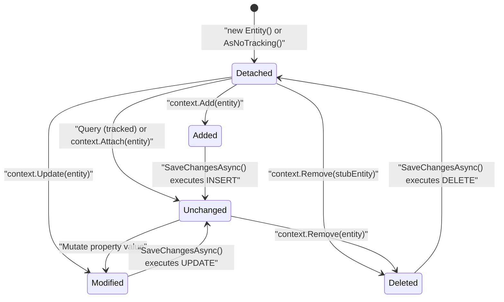
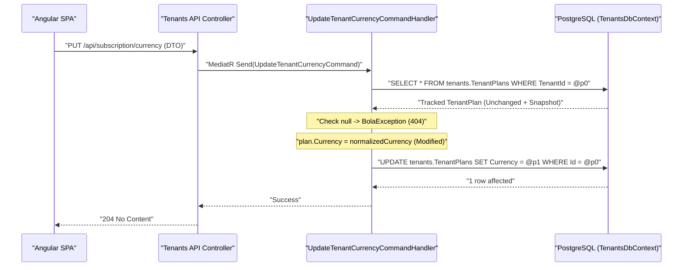

# Module 3: Essential CRUD Operations

In this module, we will explore how to **Create, Read, Update, and Delete (CRUD)** records in PostgreSQL using **Entity Framework Core 10 (EF Core 10)**. We will also look at how EF Core translates LINQ queries into SQL, tracks changes in memory via the **Change Tracker**, and commits work atomically with `SaveChangesAsync`.

Throughout this module, every example comes from **Normora** — a .NET 10 modular monolith using **PostgreSQL + pgvector**, **CQRS** (Command Query Responsibility Segregation, where writes and reads live in separate handler classes), and strict module encapsulation (`TenantsDbContext`, `DocumentsDbContext`, and `ConversationsDbContext`).

---

## 1. Under the Hood: The Change Tracker & `EntityState`

Before writing a single `Add`, `Update`, or `Remove`, you need to understand the engine that powers all EF Core persistence: the **Change Tracker**.

### What is the Change Tracker?
Every `DbContext` instance maintains an in-memory dictionary (called the **Change Tracker**) of entity objects it has loaded or been told to track during its lifetime (typically a single HTTP request or a single Hangfire background job).

By default, EF Core uses **Snapshot Change Tracking**:
1. When you load a `Document` from `DocumentsDbContext`, EF Core stores the object *plus* a hidden snapshot of all its original column values.
2. When you mutate `document.Title = "Updated HR Policy"` in C#, **no SQL runs yet**.
3. When you call `await dbContext.SaveChangesAsync()`, EF Core compares current property values against the original snapshot (`DetectChanges`), calculates the exact diff, and emits an `UPDATE` statement containing **only the changed columns**.

### The Five `EntityState` Values
Every tracked entity (wrapped in an `EntityEntry`) has one of five states:

| `EntityState` | Meaning in Memory | SQL Emitted on `SaveChangesAsync()` |
|---|---|---|
| `Detached` | Not tracked by this `DbContext` (e.g., new `record`/entity or loaded with `AsNoTracking()`) | None |
| `Unchanged` | Loaded from PostgreSQL and identical to its original snapshot | None |
| `Added` | Registered via `.Add()` / `.AddAsync()`, does not exist in PostgreSQL yet | `INSERT INTO ...` |
| `Modified` | At least one property differs from the snapshot (or explicitly marked via `.Update()`) | `UPDATE ... SET ...` |
| `Deleted` | Marked for removal via `.Remove()` | `DELETE FROM ...` |



> [!TIP]
> **When NOT to track entities:** Tracking and snapshotting allocate memory and CPU time. For read-only endpoints (like listing workspace documents or rendering chat history), opt out of tracking with `.AsNoTracking()` (covered in detail in Section 2 and Module 6).

### 5 Real-World Normora Change Tracker Examples

1. **Tracking a New `Department` (`Detached` -> `Added` -> `Unchanged`)**: Calling `tenantsDbContext.Departments.Add(dept)` moves the entity from `Detached` to `Added`; after `SaveChangesAsync()`, it becomes `Unchanged`.
2. **Reading Documents Without Tracking (`Detached`)**: `documentsDbContext.Documents.AsNoTracking().ToListAsync(ct)` skips snapshot creation when rendering the Knowledge Base table in Angular.
3. **Mutating `TenantPlan.Currency` (`Unchanged` -> `Modified`)**: Fetching `TenantPlan` starts it as `Unchanged`; assigning `plan.Currency = "USD"` flips only `Currency` to modified so `SaveChangesAsync()` updates only that column.
4. **Preventing Accidental Hard Delete (`Deleted` -> `Modified`)**: In `SaveChangesAsync()`, Normora's `ISoftDeletable` interceptor catches `EntityState.Deleted` on `Document` or `Department` and switches it to `EntityState.Modified` with `IsDeleted = true`.
5. **Clearing Tracker Memory Between Batch Imports (`ChangeTracker.Clear()`)**: When `DocumentProcessingJob` persists hundreds of `DocumentChunk` embeddings in batches, calling `documentsDbContext.ChangeTracker.Clear()` between batches releases tracked snapshots back to GC.

---

## 2. Fetching Data (Read)

### Fetching a Single Record
When fetching a single record from PostgreSQL, EF Core provides five primary LINQ/DbSet methods:

1. **`FirstOrDefaultAsync`**: Translates to `LIMIT 1` in PostgreSQL and returns `null` if no row matches. Use this when 0 or 1 match is expected (or when taking the top row after `.OrderBy()`).
   ```csharp
   var document = await dbContext.Documents
       .FirstOrDefaultAsync(d => d.Id == documentId, cancellationToken);
   ```
2. **`SingleOrDefaultAsync`**: Translates to `LIMIT 2` in PostgreSQL and **throws `InvalidOperationException` if more than one row matches**. Use this only when uniqueness is a strict business invariant you want asserted at runtime.
   ```csharp
   var tenant = await dbContext.Tenants
       .SingleOrDefaultAsync(t => t.Slug == slug, cancellationToken);
   ```
3. **`FirstAsync` / `SingleAsync`**: Non-nullable variants that **throw `InvalidOperationException` if zero rows match**. Avoid these in API handlers where missing records should throw `BolaException` (`404 Not Found`) rather than an unhandled 500 error.
4. **`FindAsync`**: Checks the **in-memory Change Tracker first** (using the primary key). If the entity is already loaded in the current `DbContext`, it returns it with **zero database round-trips**; otherwise, it queries PostgreSQL.
   ```csharp
   // Pass keys as an object[] when also passing a CancellationToken
   var membership = await dbContext.TenantMemberships
       .FindAsync([membershipId], cancellationToken);
   ```

### Comparison: `FirstOrDefaultAsync` vs `SingleOrDefaultAsync` vs `FindAsync`

| Method | DB Hit? | Throws if >1 result? | Checks Change Tracker first? | Generated SQL Limit | Use When |
|---|---|---|---|---|---|
| `FirstOrDefaultAsync` | Always | No | No | `LIMIT 1` | Fetching by filter/FK, or top item after `.OrderBy()` |
| `SingleOrDefaultAsync` | Always | Yes | No | `LIMIT 2` | Enforcing a 0-or-1 business invariant (e.g., unique slug) |
| `FindAsync` | Only if not tracked | No | **Yes** | `LIMIT 1` (by PK) | Re-fetching by primary key within the same request |

> [!WARNING]
> **When NOT to use `FindAsync` or `SingleOrDefaultAsync`:**
> - **Do NOT use `FindAsync` when you need `.Include(...)`, `.Select(...)` projections, or `.AsNoTracking()`**, because `FindAsync` only accepts primary key values and ignores LINQ query operators. Also note that in `TenantsDbContext` (which has no global `TenantId` filter), `FindAsync(id)` alone does **not** verify `TenantId` — always verify ownership afterward or query with `.FirstOrDefaultAsync(x => x.Id == id && x.TenantId == tenantId)`.
> - **Do NOT use `SingleOrDefaultAsync` on high-throughput lookups** where the database already enforces a `UNIQUE` index (like primary keys); `LIMIT 2` forces PostgreSQL to scan past the first match just to prove a second doesn't exist.

### Existence Checks & Counts (`AnyAsync` vs `CountAsync`)
Never fetch a full entity or call `.CountAsync() > 0` just to check if a record exists:
- **Use `AnyAsync()`**: Translates to PostgreSQL `SELECT EXISTS (SELECT 1 FROM ...)` and stops scanning on the very first matching row.
- **Use `CountAsync()`** (or `LongCountAsync()`): Only when you actually need the numeric total (such as pagination metadata).

### `IQueryable` vs `IEnumerable` (Deferred Execution)
When you write LINQ against a `DbSet<T>`, you are building an **`IQueryable<T>`** expression tree — not executing SQL yet.
* **`IQueryable<T>` (Deferred Execution)**: Composes an expression tree in memory. No database round-trip happens until a **materializing** operator is called (`ToListAsync`, `FirstOrDefaultAsync`, `AnyAsync`, `CountAsync`, `ToDictionaryAsync`).
* **`IEnumerable<T>` (LINQ to Objects)**: Operates on objects **already in .NET memory**. If you cast a `DbSet` to `IEnumerable<T>` or call `.ToListAsync()` too early, EF Core pulls the entire table over the network and filters in C# RAM!

```csharp
// 1. Build an IQueryable<Document> (Zero database hits yet!)
IQueryable<Document> query = dbContext.Documents.AsNoTracking();

// 2. Conditionally compose filters (Still zero database hits!)
if (departmentId.HasValue)
{
    query = query.Where(d => d.DepartmentId == departmentId.Value);
}

// 3. Materialize once (Executes a single parameterized PostgreSQL query)
var activeDocuments = await query
    .OrderByDescending(d => d.CreatedAt)
    .ToListAsync(cancellationToken);
```

### Projections & `AsNoTracking()` for Reads
If an endpoint only returns read-only JSON to the Angular client, you do not need EF Core to allocate Change Tracker snapshots or fetch unused columns (like massive `ExtractedText` blobs or `pgvector` embeddings):
- **Use `.Select(x => new Dto(...))` (Projection)**: Fetches only the exact columns needed. Even better, projected DTOs/records are **automatically not tracked** by the Change Tracker!
- **Use `.AsNoTracking()`**: When returning full entities for read-only inspection (e.g., passing an entity to a mapper without `.Select()`), disable snapshot tracking to reduce memory and CPU overhead.

*(Note: Module 6 covers projections, split queries, compiled queries, and `GroupBy` translation rules in full depth.)*

### 5 Real-World Normora Read Examples

1. **Tenant-Scoped Document Lookup with BOLA Protection (`Documents` Module)**
   `DocumentsDbContext` automatically applies a global query filter for `_tenantContext.TenantId`. If the document belongs to another tenant or doesn't exist, `FirstOrDefaultAsync` returns `null`, and Normora throws `BolaException` (`404 Not Found`) so attackers cannot enumerate document IDs:
   ```csharp
   // server/Modules/Documents/Application/Documents/Queries/GetDocumentById/GetDocumentByIdQueryHandler.cs
   public sealed class GetDocumentByIdQueryHandler(DocumentsDbContext dbContext)
   {
       public async Task<DocumentSummaryDto> Handle(GetDocumentByIdQuery query, CancellationToken ct)
       {
           var dto = await dbContext.Documents
               .Where(d => d.Id == query.DocumentId)
               .Select(d => new DocumentSummaryDto(d.Id, d.FileName, d.Status, d.CreatedAt))
               .FirstOrDefaultAsync(ct);

           return dto ?? throw new BolaException();
       }
   }
   ```

2. **Explicit `TenantId` Filtering in Unscoped `TenantsDbContext` (`Tenants` Module)**
   Per Normora's architecture rules, `TenantsDbContext` manages cross-workspace directories and does **not** apply a global `TenantId` filter. Every workspace-scoped read must filter explicitly by `TenantId`:
   ```csharp
   // server/Modules/Tenants/Application/Memberships/Queries/GetMembership/GetMembershipQueryHandler.cs
   var membership = await tenantsDbContext.TenantMemberships
       .AsNoTracking()
       .FirstOrDefaultAsync(
           m => m.TenantId == query.TenantId && m.ExternalUserId == query.ExternalUserId,
           ct);

   if (membership is null) throw new BolaException();
   ```

3. **Validating Uniqueness Before Creation with `AnyAsync` (`Tenants` Module)**
   Before creating a new department in `CreateDepartmentCommandHandler`, check for duplicate names in one fast `SELECT EXISTS` query:
   ```csharp
   var exists = await tenantsDbContext.Departments
       .AnyAsync(d => d.TenantId == command.TenantId && d.Name == command.Name, ct);

   if (exists)
   {
       throw new InvalidOperationException(ApiMessages.DepartmentAlreadyExists);
   }
   ```

4. **Resolving a Tenant by Unique Slug with `SingleOrDefaultAsync` (`Tenants` Module)**
   `TenantResolutionMiddleware` (backed by Redis caching) resolves a workspace slug (`acme-corp`) where duplicate slugs must never exist:
   ```csharp
   var tenant = await tenantsDbContext.Tenants
       .AsNoTracking()
       .Where(t => t.Slug == normalizedSlug && !t.IsDeleted)
       .Select(t => new TenantResolutionDto(t.Id, t.Slug, t.Name))
       .SingleOrDefaultAsync(ct);
   ```

5. **Paginated, Projected Query with PostgreSQL `ILike` (`Conversations` Module)**
   Fetching a user's saved answers with deferred filtering, sorting, and projection — avoiding loading full conversation transcripts or tracking entities:
   ```csharp
   var query = conversationsDbContext.SavedAnswers
       .Where(a => a.ExternalUserId == currentUser.ExternalUserId);

   if (!string.IsNullOrWhiteSpace(request.Search))
   {
       query = query.Where(a => EF.Functions.ILike(a.Title, $"%{request.Search.Trim()}%"));
   }

   var items = await query
       .OrderByDescending(a => a.CreatedAt)
       .Skip((request.Page - 1) * request.PageSize)
       .Take(request.PageSize)
       .Select(a => new SavedAnswerListItemDto(a.Id, a.Title, a.CreatedAt))
       .ToListAsync(ct);
   ```
   Generated PostgreSQL SQL selects only `"Id"`, `"Title"`, and `"CreatedAt"` with `ILIKE`, `ORDER BY`, `LIMIT`, and `OFFSET` pushed entirely to PostgreSQL.

---

## 3. Creating Data (Create)

To insert a new record, you register the entity with the Change Tracker using `.Add()` (or `.AddAsync()`) and commit the transaction with `await dbContext.SaveChangesAsync(ct)`.

```csharp
// server/Modules/Tenants/Application/Departments/Commands/CreateDepartment/CreateDepartmentCommandHandler.cs
public sealed class CreateDepartmentCommandHandler(TenantsDbContext dbContext)
{
    public async Task<Guid> Handle(CreateDepartmentCommand command, CancellationToken ct)
    {
        var department = new Department
        {
            Id = Guid.CreateVersion7(),
            TenantId = command.TenantId,
            Name = command.Name.Trim(),
            CreatedAt = DateTime.UtcNow
        };

        // 1. Track in memory (EntityState.Added — no SQL executed yet)
        dbContext.Departments.Add(department);

        // 2. Execute INSERT INTO tenants."Departments" (...) VALUES (...)
        await dbContext.SaveChangesAsync(ct);

        return department.Id;
    }
}
```

### `Add` vs `AddAsync` (And `AddRange` for Batches)
- **Use `.Add()` by default**: Registering an entity in the Change Tracker is purely in-memory CPU work; actual database I/O happens in `SaveChangesAsync()`. In .NET 10, Normora generates primary keys in C# (e.g., `Guid.CreateVersion7()`) or lets PostgreSQL generate them on `INSERT`, so `.Add()` avoids unnecessary `ValueTask` allocations.
- **When `.AddAsync()` matters**: Only use `AddAsync()` when your entity uses a **database sequence / HiLo value generator** that may fetch a block of IDs asynchronously from PostgreSQL before `SaveChangesAsync()`.
- **Batching with `.AddRange()`**: When inserting multiple rows (such as seeding departments or saving 50 document chunks), call `AddRange(entities)` followed by **one** `SaveChangesAsync()`. EF Core automatically batches multiple `INSERT` statements into fewer PostgreSQL network round-trips.

### Atomic Unit of Work (One `SaveChangesAsync` = One Transaction)
Every call to `SaveChangesAsync()` wraps all pending `Added`, `Modified`, and `Deleted` changes in a single database transaction. Either **all** statements succeed, or PostgreSQL rolls **all** of them back.

> [!WARNING]
> **When NOT to use `AddRange`:** Do not use `AddRange` + `SaveChangesAsync` to ingest 50,000+ rows in a single call. Tracking tens of thousands of entities bloats memory and slows down `DetectChanges()`. For massive ingestion workloads, insert in bounded batches (e.g., 200–500 chunks per batch and `dbContext.ChangeTracker.Clear()` between batches) or use Npgsql binary `COPY`.

### 5 Real-World Normora Create Examples

1. **Creating a Department in a CQRS Handler (`Tenants` Module)**
   ```csharp
   var department = new Department
   {
       Id = Guid.CreateVersion7(),
       TenantId = command.TenantId,
       Name = command.Name,
       CreatedAt = DateTime.UtcNow
   };
   tenantsDbContext.Departments.Add(department);
   await tenantsDbContext.SaveChangesAsync(ct);
   ```

2. **Atomic Transactional Outbox on Document Upload (`Documents` Module)**
   Per Normora's Transactional Outbox rule, `UploadDocumentCommandHandler` commits the `Document`, its initial `DocumentVersion`, and a `DocumentProcessingOutboxMessage` in **one** `SaveChangesAsync()` call so a crash between uploading metadata and queuing Hangfire can never lose work:
   ```csharp
   documentsDbContext.Documents.Add(document);
   documentsDbContext.DocumentVersions.Add(version);
   documentsDbContext.OutboxMessages.Add(new DocumentProcessingOutboxMessage
   {
       Id = Guid.CreateVersion7(),
       TenantId = command.TenantId,
       DocumentId = document.Id,
       DocumentVersionId = version.Id,
       CreatedAt = DateTime.UtcNow
   });

   // Single PostgreSQL transaction commits all 3 inserts atomically
   await documentsDbContext.SaveChangesAsync(ct);
   ```

3. **Seeding Default Departments on Workspace Signup (`Tenants` Module)**
   ```csharp
   var defaultDepartments = new[]
   {
       new Department { Id = Guid.CreateVersion7(), TenantId = newTenant.Id, Name = "Engineering" },
       new Department { Id = Guid.CreateVersion7(), TenantId = newTenant.Id, Name = "HR & People Ops" },
       new Department { Id = Guid.CreateVersion7(), TenantId = newTenant.Id, Name = "Finance" }
   };

   tenantsDbContext.Departments.AddRange(defaultDepartments);
   await tenantsDbContext.SaveChangesAsync(ct);
   ```

4. **Saving an AI Conversation Turn with Citations (`Conversations` Module)**
   Adding a parent `Message` together with its child `Citation` list causes EF Core to cascade-track all children as `Added` and insert them in dependency order:
   ```csharp
   var assistantMessage = new Message
   {
       Id = Guid.CreateVersion7(),
       ConversationId = conversation.Id,
       Role = MessageRole.Assistant,
       Content = generatedAnswer,
       Citations = retrievedChunks.Select(c => new Citation
       {
           Id = Guid.CreateVersion7(),
           DocumentId = c.DocumentId,
           ChunkId = c.ChunkId,
           Score = c.RrfScore
       }).ToList()
   };

   conversationsDbContext.Messages.Add(assistantMessage);
   await conversationsDbContext.SaveChangesAsync(ct);
   ```

5. **Recording a HITL `PendingApproval` for Destructive Agent Tools (`Conversations` Module)**
   When an AI agent invokes `documents_delete`, Normora intercepts execution and persists a 15-minute `PendingApproval` record before streaming an interactive confirmation card:
   ```csharp
   var approval = new PendingApproval
   {
       Id = Guid.CreateVersion7(),
       TenantId = tenantId,
       ExternalUserId = currentUser.ExternalUserId,
       ToolName = "documents_delete",
       PayloadJson = serializedArgs,
       ExpiresAt = DateTime.UtcNow.AddMinutes(15)
   };

   conversationsDbContext.PendingApprovals.Add(approval);
   await conversationsDbContext.SaveChangesAsync(ct);
   ```

---

## 4. Updating Data (Update)

EF Core supports three distinct update patterns depending on whether you already hold the entity in memory, receive a DTO over HTTP, or need to update thousands of rows at once.

### Approach A: Connected Fetch-then-Update (Recommended for Single Records)
In a web API or CQRS handler, the client sends a JSON DTO, not a tracked EF Core entity. The safest pattern is **Fetch-then-Update**:



```csharp
// CORRECT: Fetch-then-update pattern with BOLA check
var document = await documentsDbContext.Documents
    .FirstOrDefaultAsync(d => d.Id == command.DocumentId, ct);

if (document is null)
{
    throw new BolaException(); // Mapped globally to 404 Not Found
}

// Only Title is modified — EF Core generates:
// UPDATE documents."Documents" SET "Title" = @p0 WHERE "Id" = @p1
document.Title = command.NewTitle.Trim();
document.UpdatedAt = DateTime.UtcNow;

await documentsDbContext.SaveChangesAsync(ct);
```

### Approach B: Disconnected Update (`Attach` vs `Update`)
Sometimes a background job or helper already knows the primary key and wants to update **one** column without a `SELECT` round-trip.

- **NEVER call `dbContext.Update(entity)` on an entity built from a user DTO!** Calling `.Update()` marks **every single column** as `EntityState.Modified`. Any property omitted from the DTO (like `CreatedAt`, `TenantId`, or `ExternalUserId`) gets overwritten with `default` (`Guid.Empty` or `0001-01-01`), corrupting data and creating a **mass-assignment vulnerability**.
- **Selective `Attach` + `IsModified` (when a `SELECT` is unnecessary)**:
  ```csharp
  var stub = new Document { Id = documentId };
  documentsDbContext.Documents.Attach(stub);

  stub.Status = DocumentStatus.Failed;
  documentsDbContext.Entry(stub).Property(d => d.Status).IsModified = true;

  await documentsDbContext.SaveChangesAsync(ct);
  ```

> [!WARNING]
> **When NOT to use `Attach` + `IsModified`:** Do not use disconnected `Attach` stubs in user-facing HTTP commands where you must enforce **BOLA** (`TenantId` / ownership verification) or check the entity's current state (e.g., preventing cancellation of a `Free` tier plan). Always fetch the entity first so authorization and domain invariants are validated before writing.

### Approach C: Set-Based Bulk Updates (`ExecuteUpdateAsync`)
Since EF Core 7 (and enhanced in EF Core 10), **`ExecuteUpdateAsync`** lets you update many rows directly in PostgreSQL **without loading them into memory**.

```csharp
// Marks all expired pending approvals as Expired in 1 SQL UPDATE round-trip
var affectedRows = await conversationsDbContext.PendingApprovals
    .Where(a => a.Status == ApprovalStatus.Pending && a.ExpiresAt <= DateTime.UtcNow)
    .ExecuteUpdateAsync(setters => setters
        .SetProperty(a => a.Status, ApprovalStatus.Expired), ct);
```

> [!IMPORTANT]
> **When NOT to use `ExecuteUpdateAsync`:**
> 1. **It bypasses the Change Tracker**: Any entities already loaded in the same `DbContext` will still hold stale values in memory.
> 2. **It bypasses `SaveChangesAsync` overrides and interceptors**: Automatic `UpdatedAt` stamps, audit log generators, or domain events wired into `SaveChangesAsync` will **not** run — you must set columns like `UpdatedAt` explicitly inside `.SetProperty(...)`.
> 3. **No automatic concurrency token checks**: You must include any concurrency predicate in `.Where(...)` yourself.

### Optimistic Concurrency Basics (`DbUpdateConcurrencyException`)
What happens if two admins edit the same `TenantPlan` simultaneously, or a Hangfire worker updates a `Document` right as a user renames it? Without concurrency protection, the second write silently overwrites the first (**lost update**).

When a column is configured as a concurrency token (in PostgreSQL, typically the built-in `xmin` system column via `.UseXminAsConcurrencyToken()` or an explicit `Version` column), EF Core appends `AND xmin = @original_xmin` to the `UPDATE`. If another transaction already changed the row, 0 rows match and EF Core throws **`DbUpdateConcurrencyException`** so your handler can retry or return a `409 Conflict` (`ApiMessages.Conflict`). *(Concurrency configuration is covered in Modules 4 and 11).*

### 5 Real-World Normora Update Examples

1. **Updating Workspace Currency (`Tenants` Module)**
   `UpdateTenantCurrencyCommandHandler` fetches the workspace's `TenantPlan` (explicitly filtering by `TenantId` since `TenantsDbContext` has no global filter), validates existence, and updates `Currency`:
   ```csharp
   var plan = await tenantsDbContext.TenantPlans
       .FirstOrDefaultAsync(p => p.TenantId == command.TenantId, ct)
       ?? throw new BolaException();

   plan.Currency = command.Currency.ToUpperInvariant();
   plan.UpdatedAt = DateTime.UtcNow;

   await tenantsDbContext.SaveChangesAsync(ct);
   ```

2. **Canceling a Paid Subscription with Domain Invariant Guard (`Tenants` Module)**
   Per Normora's billing rules, Free tier workspaces cannot be canceled:
   ```csharp
   var plan = await tenantsDbContext.TenantPlans
       .FirstOrDefaultAsync(p => p.TenantId == command.TenantId, ct)
       ?? throw new BolaException();

   if (plan.Tier == PlanTier.Free)
   {
       throw new InvalidOperationException(ApiMessages.CannotCancelFreePlan);
   }

   plan.CancelAtPeriodEnd = true;
   await tenantsDbContext.SaveChangesAsync(ct);
   ```

3. **Worker Updating Document Ingestion Status (`Documents` Module)**
   `DocumentProcessingJob` in `Normora.Worker` transitions a document from `Processing` to `Indexed` after generating Gemini embeddings:
   ```csharp
   var document = await documentsDbContext.Documents
       .IgnoreQueryFilters() // Worker runs outside HTTP tenant context
       .FirstOrDefaultAsync(d => d.Id == job.DocumentId && d.TenantId == job.TenantId, ct)
       ?? throw new BolaException();

   document.Status = DocumentStatus.Indexed;
   document.ChunkCount = chunkCount;
   document.IndexedAt = DateTime.UtcNow;

   await documentsDbContext.SaveChangesAsync(ct);
   ```

4. **Bulk-Reclaiming Stale Outbox Locks with `ExecuteUpdateAsync` (`Documents` Module)**
   The recurring Hangfire recovery dispatcher resets outbox messages whose worker lease timed out, updating all stuck rows in one SQL statement:
   ```csharp
   await documentsDbContext.OutboxMessages
       .IgnoreQueryFilters()
       .Where(m => m.ProcessedAt == null && m.LockedUntilUtc < DateTime.UtcNow)
       .ExecuteUpdateAsync(s => s
           .SetProperty(m => m.LockedUntilUtc, (DateTime?)null)
           .SetProperty(m => m.AttemptCount, m => m.AttemptCount + 1), ct);
   ```

5. **Approving a HITL `PendingApproval` (`Conversations` Module)**
   `ApproveActionCommandHandler` verifies tenant + user ownership (`BolaException` on mismatch), ensures it hasn't expired, and marks it approved:
   ```csharp
   var approval = await conversationsDbContext.PendingApprovals
       .FirstOrDefaultAsync(
           a => a.Id == command.ApprovalId && a.ExternalUserId == currentUser.ExternalUserId,
           ct)
       ?? throw new BolaException();

   if (approval.ExpiresAt <= DateTime.UtcNow)
   {
       throw new InvalidOperationException(ApiMessages.ApprovalExpired);
   }

   approval.Status = ApprovalStatus.Approved;
   approval.ResolvedAt = DateTime.UtcNow;
   await conversationsDbContext.SaveChangesAsync(ct);
   ```

---

## 5. Deleting Data: Hard Delete, Soft Delete & Bulk Delete

When removing data from an enterprise application, you must choose between a **Hard Delete** (permanently erasing the row from PostgreSQL), a **Soft Delete** (flagging the row as deleted while preserving compliance history), or a **Set-Based Bulk Delete** (`ExecuteDeleteAsync`).

### Approach A: The Hard Delete (`.Remove()`)
A hard delete permanently destroys the record in PostgreSQL.

```csharp
var savedAnswer = await conversationsDbContext.SavedAnswers
    .FirstOrDefaultAsync(
        a => a.Id == command.SavedAnswerId && a.ExternalUserId == currentUser.ExternalUserId,
        ct)
    ?? throw new BolaException();

// Marked as EntityState.Deleted in memory
conversationsDbContext.SavedAnswers.Remove(savedAnswer);

// Executes DELETE FROM conversations."SavedAnswers" WHERE "Id" = @p0
await conversationsDbContext.SaveChangesAsync(ct);
```

#### Pro-Tip: The One-Round-Trip Stub Entity Trick (And When NOT to Use It)
If you do **not** need a 404 check or ownership validation, you can delete in **one round-trip** by attaching a stub with only the primary key:

```csharp
var stubInvitation = new Invitation { Id = invitationId };
tenantsDbContext.Invitations.Remove(stubInvitation);
await tenantsDbContext.SaveChangesAsync(ct);
```

> [!WARNING]
> **When NOT to use the stub-entity trick:** Never use `Remove(new Entity { Id = id })` in user-facing API commands where **BOLA** authorization applies! A stub only filters `WHERE "Id" = @p0`, allowing an attacker who guesses a UUID in `TenantsDbContext` (or bypasses validation) to delete another tenant's record. Even when `DocumentsDbContext` has a global query filter, `.Remove(stub)` executes a raw `DELETE` by primary key **without** appending the `TenantId` filter! Always fetch first (and throw `BolaException` if missing) or use `ExecuteDeleteAsync` with explicit predicates.

### Approach B: Set-Based Bulk Delete (`ExecuteDeleteAsync`)
Introduced in EF Core 7 and standard in EF Core 10, **`ExecuteDeleteAsync`** deletes all matching rows in a single SQL `DELETE` statement **without loading entities into memory**:

```csharp
// Deletes expired HITL approvals directly in PostgreSQL (0 entities loaded into RAM)
var deletedCount = await conversationsDbContext.PendingApprovals
    .Where(a => a.ExpiresAt < DateTime.UtcNow)
    .ExecuteDeleteAsync(ct);
```

> [!IMPORTANT]
> **When NOT to use `ExecuteDeleteAsync`:**
> - **It completely bypasses `SaveChangesAsync` soft-delete interceptors!** If your `DbContext` turns `.Remove()` into `IsDeleted = true`, calling `.ExecuteDeleteAsync()` will still execute a physical `DELETE FROM ...` and permanently destroy rows. For bulk soft deletes, use `.ExecuteUpdateAsync(s => s.SetProperty(e => e.IsDeleted, true))`.
> - **It bypasses cascade-delete logic configured only in EF Core client memory** (relying solely on PostgreSQL `ON DELETE CASCADE` foreign keys).

### Approach C: The Soft Delete (The Enterprise Standard)
In systems like Normora, you rarely want to Hard Delete a `Tenant`, `Department`, or `Document` with audit history. Doing so would orphan `AuditLog` references, break billing records, or violate compliance retention rules.

Instead, we use a **Soft Delete** by setting `IsDeleted = true` and `DeletedAt = DateTime.UtcNow`:

```csharp
public interface ISoftDeletable
{
    bool IsDeleted { get; set; }
    DateTime? DeletedAt { get; set; }
}
```

When an admin deletes a workspace record, we update the flag instead of calling `.Remove()`:

```csharp
var department = await tenantsDbContext.Departments
    .FirstOrDefaultAsync(d => d.Id == command.DepartmentId && d.TenantId == command.TenantId, ct)
    ?? throw new BolaException();

// SOFT DELETE: Flip the flag — executes UPDATE, not DELETE
department.IsDeleted = true;
department.DeletedAt = DateTime.UtcNow;

await tenantsDbContext.SaveChangesAsync(ct);
```

*(Note: To ensure soft-deleted rows stay hidden from normal queries automatically, combine `ISoftDeletable` with a **Global Query Filter** covered in Module 6.)*

### Advanced: Intercepting `.Remove()` in Both `SaveChanges` and `SaveChangesAsync`
Sometimes a developer accidentally calls `.Remove()` on an `ISoftDeletable` entity. You can protect your database by converting `EntityState.Deleted` into `EntityState.Modified` before saving.

**Crucial detail:** Asynchronous handlers call `SaveChangesAsync()`, which does **not** call `SaveChanges()`. You must handle **both** `SaveChanges` and `SaveChangesAsync` (or register an EF Core `SaveChangesInterceptor` in DI):

```csharp
public override int SaveChanges()
{
    ApplySoftDelete();
    return base.SaveChanges();
}

public override Task<int> SaveChangesAsync(CancellationToken cancellationToken = default)
{
    ApplySoftDelete();
    return base.SaveChangesAsync(cancellationToken);
}

private void ApplySoftDelete()
{
    foreach (var entry in ChangeTracker.Entries<ISoftDeletable>()
                                       .Where(e => e.State == EntityState.Deleted))
    {
        entry.State = EntityState.Modified;
        entry.Entity.IsDeleted = true;
        entry.Entity.DeletedAt = DateTime.UtcNow;
    }
}
```
Now, even if a developer calls `.Remove()` inside an async CQRS handler, EF Core swaps it to `UPDATE ... SET "IsDeleted" = true, "DeletedAt" = @p0` before it hits PostgreSQL!

### 5 Real-World Normora Delete Examples

1. **Soft-Deleting a Document with BOLA + Outbox/Storage Cleanup (`Documents` Module)**
   When an admin approves `documents_delete` via HITL, `DeleteDocumentCommandHandler` verifies tenant scope (`BolaException` if missing), soft-deletes the `Document`, and enqueues cleanup of MinIO blobs and `DocumentChunk` vectors:
   ```csharp
   var document = await documentsDbContext.Documents
       .FirstOrDefaultAsync(d => d.Id == command.DocumentId, ct)
       ?? throw new BolaException();

   document.IsDeleted = true;
   document.DeletedAt = DateTime.UtcNow;
   await documentsDbContext.SaveChangesAsync(ct);
   ```

2. **Hard-Deleting a User's Bookmark (`SavedAnswer`) (`Conversations` Module)**
   Saved answers are lightweight user bookmarks with no compliance retention requirement:
   ```csharp
   var saved = await conversationsDbContext.SavedAnswers
       .FirstOrDefaultAsync(
           s => s.Id == command.Id && s.ExternalUserId == currentUser.ExternalUserId, ct)
       ?? throw new BolaException();

   conversationsDbContext.SavedAnswers.Remove(saved);
   await conversationsDbContext.SaveChangesAsync(ct);
   ```

3. **Purging Expired `PendingApproval` Rows in Background Worker (`Conversations` Module)**
   `Normora.Worker` cleans up expired 15-minute HITL confirmation cards using `ExecuteDeleteAsync`:
   ```csharp
   await conversationsDbContext.PendingApprovals
       .IgnoreQueryFilters()
       .Where(p => p.ExpiresAt < DateTime.UtcNow)
       .ExecuteDeleteAsync(ct);
   ```

4. **Revoking a Pending Workspace Invitation (`Tenants` Module)**
   Explicitly scoping by `TenantId` in `TenantsDbContext`, then hard-deleting an unaccepted `Invitation`:
   ```csharp
   var affected = await tenantsDbContext.Invitations
       .Where(i => i.Id == command.InvitationId && i.TenantId == command.TenantId)
       .ExecuteDeleteAsync(ct);

   if (affected == 0) throw new BolaException();
   ```

5. **Purging Processed Outbox Messages (`Documents` Module)**
   After `DocumentProcessingOutboxMessage` records have been processed for >7 days, a nightly Hangfire purge job removes them in one SQL statement without loading them into memory:
   ```csharp
   var cutoff = DateTime.UtcNow.AddDays(-7);
   await documentsDbContext.OutboxMessages
       .IgnoreQueryFilters()
       .Where(m => m.ProcessedAt != null && m.ProcessedAt < cutoff)
       .ExecuteDeleteAsync(ct);
   ```

---

## 6. Error Handling, Concurrency & Explicit Transactions

CRUD operations fail in production — duplicate slugs, foreign key violations, concurrent edits, or external storage failures.

### Handling `DbUpdateException` Safely
When `SaveChangesAsync()` violates a PostgreSQL constraint, EF Core wraps the `PostgresException` inside a `DbUpdateException`:
- **SQLSTATE `23505` (`unique_violation`)**: Duplicate unique index (e.g., two concurrent requests creating a `Tenant` with the same `Slug` or `Department` with the same `Name`). Catch it and throw a domain conflict or validation error using `ApiMessages` — **never return `ex.Message` or `ex.InnerException?.Message` to the client (CWE-209)**.
- **SQLSTATE `23503` (`foreign_key_violation`)**: Referencing a non-existent parent ID (e.g., uploading a `Document` into a deleted `DepartmentId`).

### Explicit Transactions (`BeginTransactionAsync`)
One `SaveChangesAsync()` already runs in an implicit transaction. You only need an explicit `await dbContext.Database.BeginTransactionAsync(ct)` when:
1. You must call `SaveChangesAsync()` **more than once** (e.g., to obtain a database-generated ID or execute an `ExecuteUpdateAsync` alongside tracked writes) and need both steps to roll back together.
2. You coordinate EF Core writes with an external side effect that should abort the commit on failure.

*(Note: Never wrap an HTTP call to Google Gemini or MinIO inside a long-running PostgreSQL transaction — holding database locks over network calls starves the connection pool! Instead, use Normora's **Transactional Outbox** pattern.)*

### 5 Real-World Normora Error-Handling & Transaction Examples

1. **Handling Unique Slug Race Conditions (`Tenants` Module)**
   Even if `AnyAsync` passed milliseconds earlier, a unique index on `Tenants.Slug` catches concurrent signups:
   ```csharp
   try
   {
       await tenantsDbContext.SaveChangesAsync(ct);
   }
   catch (DbUpdateException ex) when (ex.InnerException is PostgresException { SqlState: PostgresErrorCodes.UniqueViolation })
   {
       throw new InvalidOperationException(ApiMessages.TenantSlugAlreadyExists);
   }
   ```

2. **Handling Optimistic Concurrency on `TenantPlan` Updates (`Tenants` Module)**
   ```csharp
   try
   {
       await tenantsDbContext.SaveChangesAsync(ct);
   }
   catch (DbUpdateConcurrencyException)
   {
       throw new InvalidOperationException(ApiMessages.Conflict);
   }
   ```

3. **Explicit Transaction Combining `ExecuteUpdateAsync` + `Add` (`Documents` Module)**
   When replacing all chunks of a re-uploaded document (`DocumentVersion` bump), an explicit transaction guarantees old chunks aren't deleted if inserting the new outbox record fails:
   ```csharp
   await using var tx = await documentsDbContext.Database.BeginTransactionAsync(ct);

   await documentsDbContext.DocumentChunks
       .Where(c => c.DocumentId == document.Id)
       .ExecuteDeleteAsync(ct);

   documentsDbContext.OutboxMessages.Add(reprocessMessage);
   await documentsDbContext.SaveChangesAsync(ct);

   await tx.CommitAsync(ct);
   ```

4. **Safe Worker Failure Reporting Without CWE-209 Leakage (`Documents` Module)**
   In `DocumentProcessingJob`, if `SaveChangesAsync` fails, log the full exception to OpenTelemetry/Serilog, and persist/notify only a constant from `ApiMessages`:
   ```csharp
   catch (DbUpdateException ex)
   {
       logger.LogError(ex, "Database persistence failed for Document {DocumentId}", job.DocumentId);
       await notificationService.NotifyFailureAsync(job.TenantId, job.DocumentId, ApiMessages.DocumentProcessingFailed, ct);
   }
   ```

5. **Avoiding Long Transactions During MinIO Uploads (`Documents` Module)**
   Upload the file stream to `IDocumentStorageService` (MinIO) *first*; only after the object key exists in storage does `UploadDocumentCommandHandler` open a brief database transaction via `SaveChangesAsync()` to insert `Document`, `DocumentVersion`, and `DocumentProcessingOutboxMessage`.

---

## 7. Debugging EF Core & Inspecting Generated SQL

Seeing the exact PostgreSQL SQL EF Core generates is essential for catching N+1 queries, missing `WHERE` clauses, and unexpected `UPDATE` columns.

### 1. Inspecting SQL Without Running the Query (`ToQueryString()`)
Call `.ToQueryString()` on any `IQueryable<T>` during debugging or unit tests to print the exact parameterized PostgreSQL query without touching the database:

```csharp
var sql = documentsDbContext.Documents
    .Where(d => d.Status == DocumentStatus.Indexed)
    .OrderByDescending(d => d.CreatedAt)
    .Select(d => new { d.Id, d.FileName })
    .ToQueryString();
```

### 2. Development Console Logging & Production OpenTelemetry
In Development, log SQL via `.LogTo(...)` (never enable `EnableSensitiveDataLogging()` in Production, as it logs PII, tokens, and user text into log sinks!):

```csharp
builder.Services.AddDbContext<TenantsDbContext>((sp, options) =>
{
    options.UseNpgsql(connectionString);

    if (builder.Environment.IsDevelopment())
    {
        options.LogTo(Console.WriteLine, LogLevel.Information)
               .EnableDetailedErrors()
               .EnableSensitiveDataLogging(); // Development ONLY!
    }
});
```

In Production, Normora exports EF Core SQL spans and timings through **OpenTelemetry** (`Npgsql` + EF Core instrumentation) without exposing sensitive parameter values.

### 5 Real-World Normora Debugging & Inspection Examples

1. **Verifying Global Tenant Filter Injection via `ToQueryString()` (`Documents` Module)**
   Inspecting `documentsDbContext.Documents.Where(d => d.Id == id).ToQueryString()` confirms EF Core automatically injected `WHERE d."TenantId" = @__ef_filter__TenantId_0 AND NOT (d."IsDeleted")`.
2. **Catching Missing `TenantId` Predicates in `TenantsDbContext` (`Tenants` Module)**
   Running `ToQueryString()` on a `TenantMemberships` query immediately reveals if a developer forgot `m.TenantId == query.TenantId`.
3. **Verifying Minimal `UPDATE` Columns in Development Logs (`Tenants` Module)**
   Confirming `UpdateTenantCurrencyCommandHandler` logs `UPDATE tenants."TenantPlans" SET "Currency" = @p0 WHERE "Id" = @p1` (only 1 column updated, not all columns).
4. **Inspecting `ChangeTracker.DebugView.LongView` During Complex Saves (`Conversations` Module)**
   In a debugger watch window, `conversationsDbContext.ChangeTracker.DebugView.LongView` lists every tracked `Message` and `Citation`, its `EntityState`, and which properties are flagged `Modified`.
5. **Tracing Slow Hybrid-Retrieval SQL in OpenTelemetry (`Documents` Module)**
   OpenTelemetry traces show exact PostgreSQL duration for `PerformHybridRetrievalQueryHandler` vs Gemini `batchEmbedContents` API latency, pinpointing whether slowness is SQL or network I/O.

---

## 8. Real-World Normora Scenarios

### Scenario A: Paginated Workspace Member List (`Tenants` Module)
The Normora workspace admin dashboard displays a paginated list of members. Because `TenantsDbContext` has **no** global `TenantId` filter, the query explicitly filters by `TenantId`, uses PostgreSQL `ILike` for case-insensitive search, and projects directly to a DTO:

```csharp
public async Task<List<TenantMemberDto>> GetMembersAsync(
    Guid tenantId, int page, int pageSize, string? search, CancellationToken ct)
{
    var query = tenantsDbContext.TenantMemberships
        .AsNoTracking()
        .Where(m => m.TenantId == tenantId && !m.IsDeleted);

    if (!string.IsNullOrWhiteSpace(search))
    {
        var term = $"%{search.Trim()}%";
        query = query.Where(m =>
            EF.Functions.ILike(m.DisplayName, term) ||
            EF.Functions.ILike(m.Email, term));
    }

    return await query
        .OrderBy(m => m.DisplayName)
        .Skip((page - 1) * pageSize)
        .Take(pageSize)
        .Select(m => new TenantMemberDto(m.Id, m.ExternalUserId, m.DisplayName, m.Email, m.Role))
        .ToListAsync(ct);
}
```
**Generated SQL:** Only the requested page of filtered, sorted members is fetched — never the full table, and zero Change Tracker snapshots are allocated.

### Scenario B: Bulk Insert with `AddRange` (`Tenants` Module)
When a new organization provisions a workspace, Normora seeds default departments in one batched `SaveChangesAsync()`:

```csharp
var defaultDepartments = new[]
{
    new Department { Id = Guid.CreateVersion7(), TenantId = newTenant.Id, Name = "Engineering" },
    new Department { Id = Guid.CreateVersion7(), TenantId = newTenant.Id, Name = "HR" },
    new Department { Id = Guid.CreateVersion7(), TenantId = newTenant.Id, Name = "Finance" },
};

// Add all at once — EF Core batches these into a single multi-row INSERT
tenantsDbContext.Departments.AddRange(defaultDepartments);
await tenantsDbContext.SaveChangesAsync(ct);
```

### Scenario C: Implementing `ISoftDeletable` System-Wide
```csharp
// Base class for all soft-deletable domain entities
public abstract class SoftDeletableEntity : ISoftDeletable
{
    public bool IsDeleted { get; set; }
    public DateTime? DeletedAt { get; set; }
}

public class Tenant : SoftDeletableEntity { /* ... */ }
public class Department : SoftDeletableEntity { /* ... */ }
public class Document : SoftDeletableEntity { /* ... */ }
```
Combined with a Global Query Filter (`.HasQueryFilter(e => !e.IsDeleted)` in Module 6) and overriding **both** `SaveChanges` and `SaveChangesAsync`, this provides a consistent, leak-proof soft delete system across Normora.

---

## 9. Common Mistakes & Anti-Patterns

> [!CAUTION]
> **Anti-Pattern 1: Calling `dbContext.Update(entity)` on a Disconnected API DTO**
> **Wrong:**
> ```csharp
> // Marks EVERY property as Modified — overwrites TenantId, CreatedAt, and CreatedBy!
> var doc = new Document { Id = request.Id, Title = request.Title };
> documentsDbContext.Documents.Update(doc);
> await documentsDbContext.SaveChangesAsync(ct);
> ```
> **Why it's wrong:** `.Update()` sets `EntityState.Modified` on the entire entity graph. Unpopulated properties (`CreatedAt = default`, `TenantId = Guid.Empty`) overwrite real database columns and can bypass BOLA ownership checks.
> **Fix:** Fetch the tracked entity with a tenant-scoped query, validate null (`BolaException`), and mutate only the allowed properties.

> [!CAUTION]
> **Anti-Pattern 2: Overriding Only `SaveChanges()` for Soft Delete or Auditing**
> **Wrong:**
> ```csharp
> public override int SaveChanges() { ApplySoftDelete(); return base.SaveChanges(); }
> // Missing SaveChangesAsync override!
> ```
> **Why it's wrong:** All modern ASP.NET Core and Hangfire handlers call `await dbContext.SaveChangesAsync(ct)`. EF Core does **not** route `SaveChangesAsync()` through `SaveChanges()`, so any `.Remove()` call silently performs a permanent hard `DELETE`!
> **Fix:** Override **both** `SaveChanges()` and `SaveChangesAsync(CancellationToken)`, or register a `SaveChangesInterceptor` implementing both `SavingChanges` and `SavingChangesAsync`.

> [!CAUTION]
> **Anti-Pattern 3: Checking Existence with `.CountAsync() > 0` or Premature `.ToListAsync()`**
> **Wrong:**
> ```csharp
> var docs = await documentsDbContext.Documents.ToListAsync(ct);
> var hasPending = docs.Any(d => d.Status == DocumentStatus.Pending);
> ```
> **Why it's wrong:** `.ToListAsync()` pulls every `Document` row in the tenant over the network into C# RAM just to check a boolean. Even `.CountAsync() > 0` forces PostgreSQL to count *all* matching rows instead of stopping at the first match.
> **Fix:** Use `await documentsDbContext.Documents.AnyAsync(d => d.Status == DocumentStatus.Pending, ct);` (`SELECT EXISTS (...)`).

> [!CAUTION]
> **Anti-Pattern 4: Using the Stub-Entity `.Remove(new Entity { Id = id })` Trick on User-Controlled IDs**
> **Wrong:**
> ```csharp
> // BOLA VULNERABILITY: No TenantId or ownership check!
> tenantsDbContext.Departments.Remove(new Department { Id = command.DepartmentId });
> await tenantsDbContext.SaveChangesAsync(ct);
> ```
> **Why it's wrong:** Generating `DELETE FROM tenants."Departments" WHERE "Id" = @p0` lets any authenticated user who guesses a department UUID delete another tenant's department.
> **Fix:** Query with explicit tenant/ownership filters first and throw `BolaException()` when `null`, or use `.Where(d => d.Id == command.DepartmentId && d.TenantId == command.TenantId).ExecuteDeleteAsync(ct)` (and check `affected == 0`).

> [!CAUTION]
> **Anti-Pattern 5: Expecting `ExecuteUpdateAsync` / `ExecuteDeleteAsync` to Run Interceptors or Update Tracked Entities**
> **Wrong:**
> ```csharp
> var doc = await documentsDbContext.Documents.FirstAsync(d => d.Id == id, ct);
> // Bypasses SoftDelete SaveChangesAsync override AND leaves 'doc' stale in memory!
> await documentsDbContext.Documents.Where(d => d.Id == id).ExecuteDeleteAsync(ct);
> ```
> **Why it's wrong:** Set-based `Execute*` methods execute SQL directly against PostgreSQL. They skip `SaveChangesAsync` soft-delete/audit logic and do not refresh entities already tracked in the `ChangeTracker`.
> **Fix:** Use `.ExecuteUpdateAsync(s => s.SetProperty(d => d.IsDeleted, true).SetProperty(d => d.DeletedAt, DateTime.UtcNow))` for bulk soft deletes, and avoid mixing `Execute*` with tracked mutations on the same entities in one unit of work.

> [!CAUTION]
> **Anti-Pattern 6: Calling `SaveChangesAsync()` Inside a Loop**
> **Wrong:**
> ```csharp
> foreach (var chunk in chunks)
> {
>     documentsDbContext.DocumentChunks.Add(chunk);
>     await documentsDbContext.SaveChangesAsync(ct); // N separate DB transactions & round-trips!
> }
> ```
> **Why it's wrong:** 100 chunks = 100 network round-trips and 100 separate transactions. If chunk #51 fails, chunks 1–50 remain committed in a corrupted half-ingested state.
> **Fix:** Call `documentsDbContext.DocumentChunks.AddRange(chunks)` and execute **one** `await documentsDbContext.SaveChangesAsync(ct)`.

> [!CAUTION]
> **Anti-Pattern 7: Leaking Raw `DbUpdateException` Messages to Clients or Emails (CWE-209)**
> **Wrong:**
> ```csharp
> catch (DbUpdateException ex) { return BadRequest(ex.InnerException?.Message); }
> ```
> **Why it's wrong:** Exposes PostgreSQL table names, constraint names, and SQL details to attackers and violates Normora's `ApiMessages` and CWE-209 security rules.
> **Fix:** Log `ex` internally with structured logging/OpenTelemetry, and return or throw a safe constant from `Normora.Shared.Constants.ApiMessages`.

---

## 10. Interview Questions

**Q1 (Junior): What is the difference between `FirstOrDefaultAsync` and `SingleOrDefaultAsync`?**
> Both return one record or `null`. `FirstOrDefaultAsync` generates `LIMIT 1` and returns the first match even if more exist. `SingleOrDefaultAsync` generates `LIMIT 2` and **throws `InvalidOperationException`** if more than one row matches. Use `FirstOrDefaultAsync` for general lookups and `SingleOrDefaultAsync` only when enforcing a strict 0-or-1 business invariant (like resolving a tenant by unique slug).

**Q2 (Junior): What is deferred execution in EF Core, and why does it matter?**
> Deferred execution means building a LINQ query (`.Where()`, `.OrderBy()`, `.Skip()`, `.Take()`) on an `IQueryable<T>` only constructs an expression tree in memory without hitting PostgreSQL. SQL executes only when a materializing method (`ToListAsync`, `FirstOrDefaultAsync`, `AnyAsync`, `CountAsync`) is called. This lets handlers compose conditional filters dynamically and push all filtering, sorting, and pagination to PostgreSQL in one round-trip.

**Q3 (Junior): What is the difference between `Add()` and `AddAsync()`, and when does `AddAsync()` actually do asynchronous work?**
> `Add()` registers an entity in the Change Tracker in memory (`EntityState.Added`) without performing I/O; the database `INSERT` happens later in `SaveChangesAsync()`. `AddAsync()` only performs real async I/O when paired with an async database sequence / HiLo value generator. For GUID keys (`Guid.CreateVersion7()`) or database `IDENTITY`/`SERIAL` columns, prefer `Add()` to avoid unnecessary `ValueTask` allocations.

**Q4 (Senior): How does the EF Core Change Tracker know which columns to include in an `UPDATE` statement?**
> By default, EF Core uses **Snapshot Change Tracking**. When an entity is fetched via a tracked query, the Change Tracker stores an original snapshot of every property's value. When `SaveChangesAsync()` runs, `DetectChanges()` compares current property values against the snapshot and generates a minimal `UPDATE ... SET ...` statement containing **only** the modified columns.

**Q5 (Senior): Why is `dbContext.Update(entity)` dangerous on an API DTO, and what are the safe alternatives?**
> Calling `.Update()` on a detached entity marks **all** scalar properties as `EntityState.Modified`, causing EF Core to overwrite every column — including `CreatedAt`, `TenantId`, or `ExternalUserId` — with `default` values if the DTO omitted them (mass-assignment/data-loss risk). The safe default is **Fetch-then-Update** (load the tracked entity with BOLA/tenant checks, mutate allowed fields, save). For background jobs updating one known column without authorization checks, use `Attach(stub)` + `Entry(stub).Property(x => x.Status).IsModified = true`, or `ExecuteUpdateAsync`.

**Q6 (Senior): What happens if you override `SaveChanges()` for Soft Delete (`ISoftDeletable`) but forget `SaveChangesAsync()`?**
> `SaveChangesAsync()` does **not** invoke `SaveChanges()`. Any async handler calling `await dbContext.SaveChangesAsync()` after `.Remove(entity)` will bypass your interceptor and execute a physical `DELETE FROM ...` statement. Always override **both** `SaveChanges` and `SaveChangesAsync` (or register a `SaveChangesInterceptor` implementing both `SavingChanges` and `SavingChangesAsync`).

**Q7 (Architect): When would you choose `ExecuteUpdateAsync` / `ExecuteDeleteAsync` over `ChangeTracker` mutations, and what are the architectural trade-offs?**
> Use `ExecuteUpdateAsync` / `ExecuteDeleteAsync` for set-based operations across many rows (like purging expired `PendingApproval` records or reclaiming stale `DocumentProcessingOutboxMessage` locks in `Normora.Worker`), because they execute a single SQL statement without loading entities into memory. However, they **bypass** the Change Tracker, `SaveChangesAsync` soft-delete/audit interceptors, and automatic concurrency checks — and leave any already-tracked entities in the same `DbContext` stale. Never use `ExecuteDeleteAsync` on soft-deletable entities when retention is required.

**Q8 (Architect): Why must Normora's `UploadDocumentCommandHandler` use the Transactional Outbox pattern within a single `SaveChangesAsync()` instead of calling Hangfire directly after saving?**
> Calling PostgreSQL `SaveChangesAsync()` and then enqueueing Hangfire (or publishing to Redis/RabbitMQ) are two separate network operations without a distributed transaction. If the process crashes or Hangfire/Redis is briefly unreachable after `SaveChangesAsync()`, the `Document` row exists in PostgreSQL with no processing job (**lost work**); if queued before `SaveChangesAsync()` and the DB fails, the worker runs on a non-existent document. Persisting `Document`, `DocumentVersion`, and `DocumentProcessingOutboxMessage` in **one** `SaveChangesAsync()` leverages EF Core's atomic single-transaction Unit of Work guarantee.

**Q9 (Architect): How do you prevent BOLA (Broken Object Level Authorization) vulnerabilities during EF Core Read, Update, and Delete operations in a multi-tenant modular monolith?**
> Never rely on primary-key-only lookups (`FindAsync(id)` or stub `Remove(new Entity { Id = id })`) without tenant/ownership verification. In `DocumentsDbContext` and `ConversationsDbContext`, bind a dynamic global query filter to `_tenantContext.TenantId` (and check `ExternalUserId` where user-owned). In `TenantsDbContext` (which intentionally has no global tenant filter), explicitly include `x.TenantId == request.TenantId` in every workspace-scoped `Where`/`FirstOrDefaultAsync`/`ExecuteDeleteAsync` predicate, and map any `null` or `0`-row result to `BolaException` (`404 Not Found`) so resource IDs cannot be enumerated.

---

## Summary
In this module, we mastered how EF Core 10 executes CRUD operations under the hood:
- **Change Tracker & `EntityState`**: Understand `Detached`, `Unchanged`, `Added`, `Modified`, and `Deleted` transitions and snapshot diffing.
- **Reads**: Use `IQueryable<T>` deferred execution, `AnyAsync()` for existence checks, `.Select()` projections / `.AsNoTracking()` for read-only endpoints, and explicit `TenantId` filtering in `TenantsDbContext`.
- **Creates**: Prefer `.Add()` for client-generated GUIDs, batch with `.AddRange()`, and leverage `SaveChangesAsync()`'s atomic Unit of Work (as in Normora's Transactional Outbox).
- **Updates & Deletes**: Use Fetch-then-Update with BOLA checks instead of `dbContext.Update(dto)`; override **both** `SaveChanges` and `SaveChangesAsync` for `ISoftDeletable`; and know when `ExecuteUpdateAsync` / `ExecuteDeleteAsync` trade interceptor execution for set-based speed.
