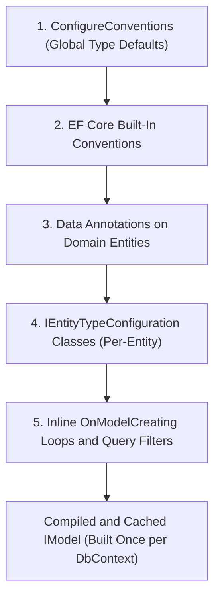
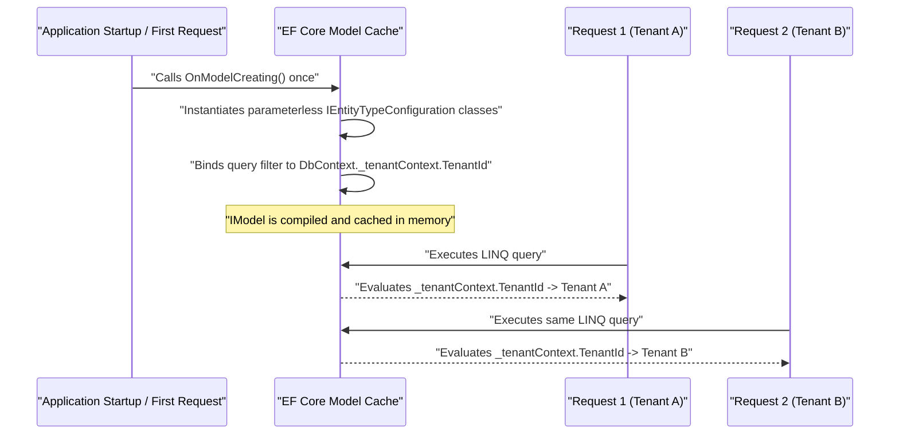
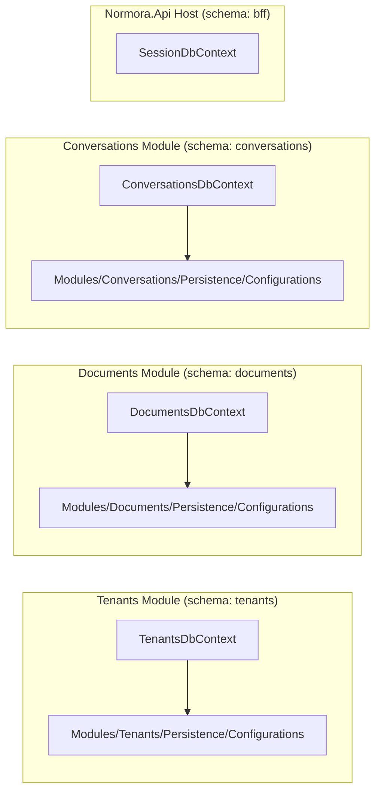

# Module 4: Organizing Fluent API Configurations

When configuring your database models using the Fluent API, you will quickly run into a scaling problem. As your application grows from 2 tables to 50 tables—or into a multi-module enterprise system like **Normora** with separate `Tenants`, `Documents`, and `Conversations` contexts—how do you keep all that mapping code clean, isolated, and maintainable?

There are two primary ways to write Fluent API configurations in EF Core, plus higher-level architectural tools (`ConfigureConventions`, base configuration classes, and **EF Core 10 Named Query Filters**) for cross-cutting concerns. Let's explore how EF Core builds your model under the hood, the two core configuration approaches, and how a senior architect structures configurations in production.

---

## How EF Core Builds & Caches Your Model (`OnModelCreating` Lifecycle)

Before deciding *where* to put your Fluent API code, you need to understand **when** EF Core actually executes it.

When your application starts and resolves a `DbContext` for the first time, EF Core executes a **Model Building Pipeline** to construct an immutable `IModel` (the internal blueprint mapping your C# classes to database tables, columns, and indexes). **By default, EF Core runs `OnModelCreating` only once per `DbContext` type** and caches the resulting `IModel` in memory for the lifetime of the application.

### Configuration Precedence Order
If the same property or table is configured in multiple places, **later stages override earlier stages**:

1. **Pre-Convention Configuration (`ConfigureConventions`)**: Global type-wide defaults that run *before* conventions (e.g., all `string` properties default to max length 256).
2. **Built-in Conventions**: EF Core's automatic rules (e.g., `Id` becomes the primary key, `DbSet<Tenant>` maps to a `Tenants` table).
3. **Data Annotations**: Attributes placed directly on entity properties (e.g., `[MaxLength(100)]`).
4. **Grouped Fluent API (`ApplyConfigurationsFromAssembly` / `ApplyConfiguration`)**: Entity-specific `IEntityTypeConfiguration<T>` classes.
5. **Inline Fluent API (`OnModelCreating` after applying configurations)**: Cross-cutting overrides, loops over `modelBuilder.Model.GetEntityTypes()`, and global query filters.



### 5 Normora Examples of Model Lifecycle & Precedence
1. **Model Caching & `TenantId` (`DocumentsDbContext`)**: Because `OnModelCreating` runs only once, `DocumentsDbContext` never reads a literal `Guid` tenant ID during model building. Instead, its global query filter captures `this` (the `DbContext` instance) and evaluates `_tenantContext.TenantId` dynamically on every query.
2. **Precedence Override on `Tenant.Slug`**: Even if a global convention sets all strings to `maxLength: 256`, `TenantConfiguration` explicitly configures `.HasMaxLength(63)` on `Tenant.Slug` (matching DNS subdomain limits), which wins because Fluent API overrides `ConfigureConventions`.
3. **Schema Precedence (`ConversationsDbContext`)**: Calling `modelBuilder.HasDefaultSchema("conversations")` at the top of `OnModelCreating` sets the default PostgreSQL **schema** (a logical namespace inside the database) for every entity, while an individual `IEntityTypeConfiguration<T>` can still override a specific table name via `builder.ToTable("PendingApprovals")`.
4. **Domain Purity on `DocumentChunk`**: Instead of decorating `DocumentChunk` with `[Column(TypeName = "vector(768)")]` Data Annotations—which would tie the `Documents.Domain` layer to PostgreSQL's `pgvector`—`DocumentChunkConfiguration` applies the column type in Fluent API, keeping the domain entity 100% database-agnostic.
5. **Cross-Cutting Overrides After Assembly Scanning**: In `TenantsDbContext`, `ApplyConfigurationsFromAssembly` runs first to map individual tables (`Tenant`, `TenantMembership`, `Department`), and an inline loop right afterward registers cross-cutting `CreatedAt` shadow properties across every entity in the model.

---

## Approach 1: Inline Configuration (`OnModelCreating`)

This is the standard approach you see in basic tutorials. All configuration is written directly inside the `OnModelCreating` method of your `DbContext`.

### The Syntax
```csharp
protected override void OnModelCreating(ModelBuilder modelBuilder)
{
    // You must repeatedly call modelBuilder.Entity<T>() to get the builder
    modelBuilder.Entity<Movie>()
        .ToTable("Pictures")
        .HasKey(m => m.Identifier);

    modelBuilder.Entity<Movie>()
        .Property(m => m.Title)
        .HasColumnType("varchar")
        .HasMaxLength(128)
        .IsRequired();
        
    // Imagine 50 more entities configured exactly like this...
}
```

### The Problem
If you have 50 entities, and each entity has 5 properties to configure, your `OnModelCreating` method will easily grow to **thousands of lines of code**. It becomes a massive, unreadable dumping ground that violates the **Single Responsibility Principle (SRP)**—the rule that a class should have only one job and one reason to change.

### When Inline Configuration IS Acceptable (and When NOT to Use It)
- **Acceptable:** Tiny, single-purpose contexts with 1–2 infrastructure tables that rarely change—for example, Normora's Duende BFF `SessionDbContext` in `Normora.Api` (which only stores encrypted server-side user sessions) or a quick prototype/repro test.
- **NOT Acceptable:** Any business module `DbContext` (`TenantsDbContext`, `DocumentsDbContext`, `ConversationsDbContext`) or any context with more than 2–3 entities, custom indexes, or multiple developers working in parallel.

### 5 Normora Examples of Inline Configuration (and Why They Don't Scale)
If Normora's developers dumped all module mappings directly into `OnModelCreating`, each context would rapidly become unmanageable:

```csharp
// Example 1 (TenantsDbContext - Anti-pattern if kept inline):
modelBuilder.Entity<Tenant>(b =>
{
    b.ToTable("Tenants", "tenants");
    b.HasKey(t => t.Id);
    b.Property(t => t.Slug).HasMaxLength(63).IsRequired();
    b.HasIndex(t => t.Slug).IsUnique();
});

// Example 2 (DocumentsDbContext - Document metadata):
modelBuilder.Entity<Document>(b =>
{
    b.ToTable("Documents", "documents");
    b.Property(d => d.Title).HasMaxLength(255).IsRequired();
    b.Property(d => d.StorageKey).HasMaxLength(512).IsRequired();
});

// Example 3 (DocumentsDbContext - pgvector HNSW embeddings):
modelBuilder.Entity<DocumentChunk>(b =>
{
    b.ToTable("DocumentChunks", "documents");
    b.Property(c => c.Embedding).HasColumnType("vector(768)");
    b.HasIndex(c => c.Embedding).HasMethod("hnsw");
});

// Example 4 (ConversationsDbContext - Multi-turn chat thread):
modelBuilder.Entity<Conversation>(b =>
{
    b.ToTable("Conversations", "conversations");
    b.Property(c => c.Title).HasMaxLength(200).IsRequired();
    b.HasIndex(c => new { c.TenantId, c.ExternalUserId });
});

// Example 5 (Normora.Api SessionDbContext - The ONLY case where inline is fine):
// A tiny infrastructure-only context with a single BFF session entity doesn't
// need a separate Configurations/ folder unless it grows.
```

Notice how even 5 entities already create clutter when placed inline. Imagine adding `TenantMembership`, `Department`, `UserGroup`, `AuditLog`, `DocumentVersion`, `DocumentProcessingOutboxMessage`, `PendingApproval`, and `SavedAnswer` into the same methods!

---

## Approach 2: Grouped Configuration (`IEntityTypeConfiguration<T>`)

This is the **Enterprise Best Practice**. Instead of dumping everything into the `DbContext`, EF Core provides an interface called `IEntityTypeConfiguration<T>`. This allows you to extract the configuration for *one specific entity* into its own dedicated class.

### The Syntax
You create a new class that implements the interface, and EF Core injects an `EntityTypeBuilder<T>` directly into the `Configure` method.

```csharp
public class MovieConfiguration : IEntityTypeConfiguration<Movie>
{
    public void Configure(EntityTypeBuilder<Movie> builder)
    {
        // Notice we don't need modelBuilder.Entity<Movie>() anymore!
        // We just use 'builder' directly.
        
        builder.ToTable("Pictures")
               .HasKey(m => m.Identifier);

        builder.Property(m => m.Title)
               .HasColumnType("varchar")
               .HasMaxLength(128)
               .IsRequired();
               
        builder.Property(m => m.Synopsis)
               .HasColumnType("varchar(max)")
               .HasColumnName("Plot");
    }
}
```

### How to apply it in DbContext
Once you move your configurations to separate classes, you must "wire them up" inside the `OnModelCreating` method of your `DbContext`. There are two ways to do this:

#### 1. The Manual Way (`ApplyConfiguration`)
You can explicitly register each configuration class one by one. 

```csharp
protected override void OnModelCreating(ModelBuilder modelBuilder)
{
    modelBuilder.ApplyConfiguration(new MovieConfiguration());
    modelBuilder.ApplyConfiguration(new TenantConfiguration());
    modelBuilder.ApplyConfiguration(new UserConfiguration());
    // This gets tedious if you have 50 tables...
}
```

#### 2. The Enterprise Magic Way (`ApplyConfigurationsFromAssembly`)
Instead of wiring them manually, you can tell EF Core to scan your entire project (**Assembly**—the compiled `.dll` output of a .NET project), use **Reflection** (runtime inspection of classes and interfaces) to find *every* non-abstract class that implements `IEntityTypeConfiguration<T>`, and wire them all up automatically with just one line of code:

```csharp
protected override void OnModelCreating(ModelBuilder modelBuilder)
{
    // This scans the assembly where TenantsDbContext lives.
    // It finds TenantConfiguration, TenantMembershipConfiguration, etc. automatically!
    modelBuilder.ApplyConfigurationsFromAssembly(typeof(TenantsDbContext).Assembly);
}
```
This second method is the ultimate best practice because when a developer adds a new table and a new configuration class, they **never have to touch `DbContext` at all**. It just works automatically!

> [!TIP]
> **Filtering with the Predicate Overload:** `ApplyConfigurationsFromAssembly` accepts an optional `Func<Type, bool>` predicate! If two `DbContext`s share the same assembly (or you separate provider-specific configs by namespace), you can filter which configurations get applied:
> ```csharp
> modelBuilder.ApplyConfigurationsFromAssembly(
>     typeof(TenantsDbContext).Assembly,
>     type => type.Namespace?.StartsWith("Normora.Modules.Tenants.Persistence") == true);
> ```

### Why `IEntityTypeConfiguration<T>` Classes MUST Be Parameterless
Because `ApplyConfigurationsFromAssembly` instantiates your configuration classes via `Activator.CreateInstance(type)`, **every `IEntityTypeConfiguration<T>` class must have a public parameterless constructor** (or no explicit constructor at all).

More importantly, **never inject scoped runtime services (like `ITenantContext` or `ICurrentUser`) into a configuration class constructor**, even when using manual `ApplyConfiguration(...)`. Remember that `OnModelCreating` executes only once and caches the `IModel`.



### 5 Normora `IEntityTypeConfiguration<T>` Real-World Examples
Here is how Normora's three business modules (`Tenants`, `Documents`, `Conversations`) organize their entity configurations using PostgreSQL (`Npgsql`) conventions:

```csharp
// 1. Tenants Module: Tenant entity (server/Modules/Tenants/Persistence/Configurations/TenantConfiguration.cs)
public sealed class TenantConfiguration : IEntityTypeConfiguration<Tenant>
{
    public void Configure(EntityTypeBuilder<Tenant> builder)
    {
        builder.ToTable("Tenants", "tenants");
        builder.HasKey(t => t.Id);

        builder.Property(t => t.Name).HasMaxLength(128).IsRequired();
        builder.Property(t => t.Slug).HasColumnType("varchar(63)").IsRequired();
        builder.HasIndex(t => t.Slug).IsUnique();
    }
}

// 2. Tenants Module: TenantMembership (decoupled ExternalUserId, never vendor-specific KeycloakUserId)
public sealed class TenantMembershipConfiguration : IEntityTypeConfiguration<TenantMembership>
{
    public void Configure(EntityTypeBuilder<TenantMembership> builder)
    {
        builder.ToTable("TenantMemberships", "tenants");
        builder.HasKey(m => m.Id);

        builder.Property(m => m.ExternalUserId).HasMaxLength(128).IsRequired();
        builder.Property(m => m.Role).HasConversion<string>().HasMaxLength(32).IsRequired();
        builder.HasIndex(m => new { m.TenantId, m.ExternalUserId }).IsUnique();
    }
}

// 3. Documents Module: Document metadata + MinIO object storage key
public sealed class DocumentConfiguration : IEntityTypeConfiguration<Document>
{
    public void Configure(EntityTypeBuilder<Document> builder)
    {
        builder.ToTable("Documents", "documents");
        builder.HasKey(d => d.Id);

        builder.Property(d => d.Title).HasMaxLength(255).IsRequired();
        builder.Property(d => d.StorageKey).HasMaxLength(512).IsRequired();
        builder.Property(d => d.Status).HasConversion<string>().HasMaxLength(32).IsRequired();
        builder.HasIndex(d => new { d.TenantId, d.Status });
    }
}

// 4. Documents Module: DocumentChunk with pgvector HNSW index for semantic RAG search
// (HNSW = Hierarchical Navigable Small World graph index for fast vector similarity)
public sealed class DocumentChunkConfiguration : IEntityTypeConfiguration<DocumentChunk>
{
    public void Configure(EntityTypeBuilder<DocumentChunk> builder)
    {
        builder.ToTable("DocumentChunks", "documents");
        builder.HasKey(c => c.Id);

        builder.Property(c => c.Content).IsRequired();
        builder.Property(c => c.Embedding).HasColumnType("vector(768)");
        builder.HasIndex(c => c.Embedding)
               .HasMethod("hnsw")
               .HasOperators("vector_cosine_ops");
    }
}

// 5. Conversations Module: PendingApproval for server-enforced HITL (15-min TTL)
public sealed class PendingApprovalConfiguration : IEntityTypeConfiguration<PendingApproval>
{
    public void Configure(EntityTypeBuilder<PendingApproval> builder)
    {
        builder.ToTable("PendingApprovals", "conversations");
        builder.HasKey(p => p.Id);

        builder.Property(p => p.ToolName).HasMaxLength(100).IsRequired();
        builder.Property(p => p.ExternalUserId).HasMaxLength(128).IsRequired();
        builder.HasIndex(p => new { p.TenantId, p.ExpiresAt });
    }
}
```

### Which one should you prefer? (The "Multiple Database Engines" edge case)

Choosing between these two methods depends entirely on how many database engines your application supports.

#### 1. If you have ONLY ONE Database Engine (e.g., PostgreSQL or SQL Server)
**Always prefer `ApplyConfigurationsFromAssembly`.**
Since every configuration in your project is meant for that one specific database, you want EF Core to scan and apply all of them automatically. It saves time and prevents human error (like forgetting to register a new configuration file).

#### 2. If you have MORE THAN ONE Database Engine
If you are supporting multiple database engines (e.g., SQL Server and PostgreSQL) and they require *different* configurations, **the "Assembly" method can actually break your app.** If you write `MovieSqlServerConfig` and `MoviePostgresConfig` in the same assembly without filtering, the Assembly scanner will blindly apply both, causing conflicts.

In a multi-engine scenario, you have three choices:

**Choice A: The Manual Way (Preferred for small multi-engine apps)**
Use `if/else` statements in your `DbContext` to selectively load configurations based on the active provider.

```csharp
protected override void OnModelCreating(ModelBuilder modelBuilder)
{
    if (Database.IsSqlServer()) 
    {
        modelBuilder.ApplyConfiguration(new MovieSqlServerConfiguration());
        modelBuilder.ApplyConfiguration(new UserSqlServerConfiguration());
    }
    else if (Database.IsNpgsql()) // Postgres
    {
        modelBuilder.ApplyConfiguration(new MoviePostgresConfiguration());
        modelBuilder.ApplyConfiguration(new UserPostgresConfiguration());
    }
}
```

**Choice B: The Advanced "Separate Assemblies" Way (Enterprise multi-engine apps)**
Put your SQL Server configs in one Class Library (`MyProject.Data.SqlServer`) and your Postgres configs in another (`MyProject.Data.Postgres`). Then, dynamically pass the correct assembly into the magic method:

```csharp
protected override void OnModelCreating(ModelBuilder modelBuilder)
{
    Assembly configAssembly;

    if (Database.IsSqlServer()) 
        configAssembly = typeof(SomeSqlServerSpecificClass).Assembly;
    else 
        configAssembly = typeof(SomePostgresSpecificClass).Assembly;

    // Magically loads ALL configs, but only from the correct project!
    modelBuilder.ApplyConfigurationsFromAssembly(configAssembly);
}
```

**Choice C: Predicate-Filtered Assembly Scanning (Single project, namespace-split)**
Keep `Postgres` and `SqlServer` configurations in separate namespaces within the same Infrastructure project and pass a predicate to `ApplyConfigurationsFromAssembly(assembly, t => ...)`.

> [!NOTE]
> **Runtime Provider Switching & `IModelCacheKeyFactory`:** Remember that EF Core caches `IModel` by `(DbContext type, design-time flag)` by default. If the *same* `DbContext` class runs against PostgreSQL in production and SQLite in automated tests, you must either configure provider-agnostic mappings or replace `IModelCacheKeyFactory` so EF Core caches a separate `IModel` per provider!

---

## Why is Approach 2 the Best Practice?

1. **Separation of Concerns (SRP):** The `DbContext` is no longer responsible for knowing the intricate database mapping rules for every single entity. Each Configuration class has one job: configuring its specific entity.
2. **Readability:** You don't have to repeatedly type `modelBuilder.Entity<Movie>()`. The injected `builder` variable makes the syntax much cleaner.
3. **Maintainability:** If you need to change how the `Movie` table is mapped, you know exactly where to go: `MovieConfiguration.cs`. You don't have to scroll through a 3,000-line `DbContext` file.
4. **Git Merge Conflicts:** If two developers are configuring different tables, they are editing different files. In Approach 1, they would both be editing `OnModelCreating`, causing painful merge conflicts.

---

## Best Practices for Folder Structure & Modular Monolith Encapsulation

To keep your project organized, you should separate your pure C# domain models from your database configuration classes.

A standard layered enterprise folder structure looks like this:

```text
📁 MyProject.Domain
   📁 Entities                  <-- Pure C# Classes (No EF Core logic)
      📄 Movie.cs
      📄 Tenant.cs
      📄 User.cs

📁 MyProject.Infrastructure     <-- Database Layer
   📁 Data
      📄 TenantsDbContext.cs    <-- Your DbContext (Very clean now)
      📁 Configurations         <-- All your IEntityTypeConfiguration classes
         📄 MovieConfiguration.cs
         📄 TenantConfiguration.cs
         📄 UserConfiguration.cs
```

### Normora's Modular Monolith Folder Structure
In a **Modular Monolith** (a single deployable application split into strictly isolated **bounded contexts**—independent business domains), you organize configurations inside each module's own `Persistence/Configurations/` directory rather than one giant shared folder:

```text
📁 server
   📁 Modules
      📁 Tenants
         📁 Domain              <-- Tenant, TenantMembership, Department, AuditLog
         📁 Application         <-- CQRS folder-per-operation (Commands/Queries/DTOs)
         📁 Persistence
            📄 TenantsDbContext.cs
            📁 Configurations
               📄 TenantConfiguration.cs
               📄 TenantMembershipConfiguration.cs
               📄 DepartmentConfiguration.cs
      📁 Documents
         📁 Domain              <-- Document, DocumentVersion, DocumentChunk, DocumentProcessingOutboxMessage
         📁 Persistence
            📄 DocumentsDbContext.cs
            📁 Configurations
               📄 DocumentConfiguration.cs
               📄 DocumentChunkConfiguration.cs
               📄 DocumentProcessingOutboxMessageConfiguration.cs
      📁 Conversations
         📁 Domain              <-- Conversation, Message, SavedAnswer, PendingApproval
         📁 Persistence
            📄 ConversationsDbContext.cs
            📁 Configurations
               📄 ConversationConfiguration.cs
               📄 PendingApprovalConfiguration.cs
   📁 Normora.Shared
      📁 Contracts              <-- Cross-module MediatR contracts (PerformHybridRetrievalQuery, etc.)
   📁 Normora.Api               <-- BFF Host (SessionDbContext only; NO business DbContexts)
```



### Key Takeaways for Folder Structure & Encapsulation:
1. **Never put Configurations in the Domain layer.** The Domain layer should be ignorant of the database. `IEntityTypeConfiguration` is an EF Core interface, so it belongs in `Persistence/Configurations/` (or your Data/Infrastructure layer).
2. **Match the Names:** Always name your configuration class `<EntityName>Configuration` (e.g., `DocumentConfiguration`) so it is instantly discoverable.
3. **One File Per Entity:** Never group multiple entity configurations into a single file. Keep it strict: one entity, one configuration file.
4. **100% DbContext Encapsulation:** In Normora, module `DbContext`s are strictly private to their owning module. `Normora.Api` controllers, SignalR hubs, and other modules never inject another module's `DbContext`—cross-module reads must go through MediatR contracts in `Normora.Shared.Contracts.*`.

### 5 Normora Examples of Folder & Schema Isolation
1. **Tenants Module (`server/Modules/Tenants/Persistence/Configurations/`)**: `TenantsDbContext` uses `modelBuilder.HasDefaultSchema("tenants")` and scans only the `Tenants` module assembly/namespace for `TenantConfiguration`, `TenantMembershipConfiguration`, `DepartmentConfiguration`, `UserGroupConfiguration`, and `AuditLogConfiguration`.
2. **Documents Module (`server/Modules/Documents/Persistence/Configurations/`)**: `DocumentsDbContext` uses `modelBuilder.HasDefaultSchema("documents")` and owns `DocumentConfiguration`, `DocumentVersionConfiguration`, `DocumentChunkConfiguration`, and `DocumentProcessingOutboxMessageConfiguration`.
3. **Conversations Module (`server/Modules/Conversations/Persistence/Configurations/`)**: `ConversationsDbContext` uses `modelBuilder.HasDefaultSchema("conversations")` and isolates `ConversationConfiguration`, `SavedAnswerConfiguration`, and `PendingApprovalConfiguration`.
4. **Shared-Assembly Predicate Filtering**: If multiple `DbContext` classes are compiled into one shared assembly during modular prototyping, Normora isolates them with `ApplyConfigurationsFromAssembly(assembly, t => t.Namespace?.StartsWith("Normora.Modules.Documents.Persistence") == true)` so `TenantsDbContext` never accidentally creates `DocumentChunks` in the `tenants` schema.
5. **Cross-Module Isolation (`Conversations` -> `Documents`)**: When `ConversationTurnPreparer` in `Conversations` needs RAG chunks, it does **not** import `DocumentChunkConfiguration` or inject `DocumentsDbContext`; it dispatches `PerformHybridRetrievalQuery` (taking explicit `Guid TenantId`) through MediatR in `Normora.Shared.Contracts.Documents`.

---

## Scaling Configurations: `ConfigureConventions`, Base Classes & EF Core 10 Named Query Filters

Once you move beyond 20–30 entities, you will notice repetitive patterns across your `IEntityTypeConfiguration<T>` classes—such as setting default string lengths, mapping enums to strings, configuring audit timestamps, or enforcing multi-tenant isolation. EF Core 10 gives you four clean architectural tools to eliminate duplication without sacrificing clarity.

### 1. Pre-Convention Configuration (`ConfigureConventions`)
**What:** An optional override method on `DbContext` (`protected override void ConfigureConventions(ModelConfigurationBuilder configurationBuilder)`) introduced in EF Core 6+ that runs **before** built-in conventions and `OnModelCreating`.
**Why:** It lets you define database-wide defaults by CLR type (e.g., all `string` properties, all `enum` types, or all `decimal` money columns) in 2 lines instead of repeating `.HasMaxLength(...)` or `.HasConversion<string>()` in 40 configuration files.
**When NOT to use it:** Do not use `ConfigureConventions` for entity-specific rules, conditional logic based on entity interfaces, or relationships—put those in `IEntityTypeConfiguration<T>` or `OnModelCreating`.

### 2. Base Configuration Classes (`BaseEntityConfiguration<T>`)
**What:** An `abstract` generic base class implementing `IEntityTypeConfiguration<T>` that configures shared base-class properties (such as `Id`, `CreatedAt`, `UpdatedAt`, or a PostgreSQL `xmin` **concurrency token**—a system column preventing two concurrent edits from silently overwriting each other).
**Why:** `ApplyConfigurationsFromAssembly` automatically skips `abstract` classes, so only concrete subclasses (`DocumentConfiguration : BaseEntityConfiguration<Document>`) are registered while still calling `base.Configure(builder)`.
**When NOT to use it:** Do not force unrelated domain entities into a deep inheritance hierarchy just to share a base configuration. If entities only share one cross-cutting capability (like `ITenantScoped` or `ISoftDeletable`), use a **marker interface** plus a loop in `OnModelCreating` instead.

### 3. Dynamic Global Query Filters & EF Core 10 Named Query Filters
**What:** A **Global Query Filter** (`HasQueryFilter(...)`) is a `WHERE` predicate that EF Core automatically appends to every LINQ query targeting that entity. Starting in **EF Core 10**, you can assign a string name to each filter with **Named Query Filters**:
`builder.HasQueryFilter("TenantFilter", ...)` and `builder.HasQueryFilter("SoftDeleteFilter", ...)`.
**Why:** Before EF Core 10, an entity could only have **one** query filter, forcing teams to combine tenant isolation and soft-delete with `&&`—which meant calling `.IgnoreQueryFilters()` to inspect deleted items accidentally disabled tenant isolation too! With EF Core 10 Named Query Filters, you can selectively bypass *only* `"SoftDeleteFilter"` via `.IgnoreQueryFilters(["SoftDeleteFilter"])` while keeping `"TenantFilter"` strictly active.
**How Dynamic Binding Works:** Always bind the filter to a property/field on the `DbContext` instance (e.g., `_tenantContext.TenantId`), never to a local variable captured inside `IEntityTypeConfiguration<T>`. EF Core recognizes `this` (the `DbContext` reference) and parameterizes `_tenantContext.TenantId` dynamically on each query execution.
**When NOT to use a Global Tenant Filter:** Never apply an ambient `TenantId` filter to a cross-tenant directory/bootstrap context like Normora's **`TenantsDbContext`**, which must resolve tenants before a workspace context exists and manage cross-workspace memberships. Instead, queries against `TenantsDbContext` explicitly filter with `.Where(m => m.TenantId == request.TenantId)`.

### 4. Brief Architect Note: Compiled Models (`dotnet ef dbcontext optimize`)
For very large models (hundreds of entities), building `IModel` on startup can add cold-start latency. EF Core allows pre-generating C# model code via `dotnet ef dbcontext optimize`. **When NOT to use it:** Compiled models are overkill for typical 10–50 entity modules, must be regenerated on every model change, and have restrictions on dynamic model-building code (and in EF Core 10, certain runtime features require careful verification). Only adopt compiled models after profiling shows startup model-building is an actual bottleneck.

### 5 Normora Examples of Cross-Cutting Configuration Scaling

```csharp
// Example 1: ConfigureConventions in DocumentsDbContext (global string & enum rules)
public sealed class DocumentsDbContext(
    DbContextOptions<DocumentsDbContext> options,
    ITenantContext tenantContext) : DbContext(options)
{
    private readonly ITenantContext _tenantContext = tenantContext;

    protected override void ConfigureConventions(ModelConfigurationBuilder configurationBuilder)
    {
        // Prevent unbounded text columns by default unless overridden in IEntityTypeConfiguration<T>
        configurationBuilder.Properties<string>().HaveMaxLength(500);
        // Store all enums cleanly as readable strings instead of brittle integers
        configurationBuilder.Properties<Enum>().HaveConversion<string>();
    }

    protected override void OnModelCreating(ModelBuilder modelBuilder)
    {
        modelBuilder.HasDefaultSchema("documents");
        modelBuilder.ApplyConfigurationsFromAssembly(typeof(DocumentsDbContext).Assembly);
        modelBuilder.Entity<Document>()
            .HasQueryFilter("TenantFilter", d => d.TenantId == _tenantContext.TenantId);
    }
}
```

```csharp
// Example 2: Abstract BaseEntityConfiguration<T> (skipped automatically by assembly scanner)
public abstract class BaseEntityConfiguration<TEntity> : IEntityTypeConfiguration<TEntity>
    where TEntity : BaseEntity
{
    public virtual void Configure(EntityTypeBuilder<TEntity> builder)
    {
        builder.HasKey(e => e.Id);
        builder.Property(e => e.CreatedAt).HasDefaultValueSql("NOW()").IsRequired();
        builder.Property(e => e.UpdatedAt).IsRequired();
        // PostgreSQL xmin system column as an optimistic concurrency token
        builder.Property<uint>("xmin").IsRowVersion();
    }
}

public sealed class DocumentVersionConfiguration : BaseEntityConfiguration<DocumentVersion>
{
    public override void Configure(EntityTypeBuilder<DocumentVersion> builder)
    {
        base.Configure(builder); // Applies Id, CreatedAt, UpdatedAt, and xmin
        builder.ToTable("DocumentVersions", "documents");
        builder.Property(v => v.ContentHash).HasMaxLength(64).IsRequired();
    }
}
```

```csharp
// Example 3 & 4: EF Core 10 Named Query Filters in ConversationsDbContext & selective bypass in Worker
protected override void OnModelCreating(ModelBuilder modelBuilder)
{
    modelBuilder.HasDefaultSchema("conversations");
    modelBuilder.ApplyConfigurationsFromAssembly(typeof(ConversationsDbContext).Assembly);

    // Dynamic TenantId filter + SoftDelete filter registered independently by name (EF Core 10)
    modelBuilder.Entity<Conversation>()
        .HasQueryFilter("TenantFilter", c => c.TenantId == _tenantContext.TenantId)
        .HasQueryFilter("SoftDeleteFilter", c => !c.IsDeleted);
}

// In Normora.Worker purge job: inspect soft-deleted conversations WITHOUT disabling TenantFilter!
var expiredDeletedConversations = await dbContext.Conversations
    .IgnoreQueryFilters(["SoftDeleteFilter"])
    .Where(c => c.IsDeleted && c.DeletedAt < cutoffDate)
    .ToListAsync(cancellationToken);
```

```csharp
// Example 5: When NOT to use a Global Tenant Filter — Normora's unscoped TenantsDbContext
// Per Normora architecture rules, TenantsDbContext has NO ambient TenantId global filter
// because it handles directory resolution and cross-workspace memberships.
var memberships = await tenantsDbContext.TenantMemberships
    .Where(m => m.TenantId == request.TenantId && m.ExternalUserId == currentUser.ExternalUserId)
    .ToListAsync(cancellationToken);
```

---

## Migrations: Versioning Your Database Schema

EF Core Migrations are a **source-controlled, incremental history of changes** to your database schema. Every time your model changes, you generate a migration that captures the `Up` (apply) and `Down` (rollback) operations.

### Essential CLI Commands

```bash
# Install the EF Core tools globally (one-time setup)
dotnet tool install --global dotnet-ef

# Create a new migration snapshot
dotnet ef migrations add InitialCreate --project src/Infrastructure --startup-project src/Api

# Apply all pending migrations to the database
dotnet ef database update

# Roll back to a specific migration
dotnet ef database update PreviousMigrationName

# Generate a SQL script instead of directly applying (useful for DBA review)
dotnet ef migrations script --output migration.sql
```

### Understanding Migration Files

When you run `dotnet ef migrations add`, EF Core generates a file like `20241004_AddTenantSlug.cs`:

```csharp
public partial class AddTenantSlug : Migration
{
    protected override void Up(MigrationBuilder migrationBuilder)
    {
        // Applied when running 'dotnet ef database update'
        migrationBuilder.AddColumn<string>(
            name: "Slug",
            table: "SystemTenants",
            type: "varchar(63)",
            nullable: false,
            defaultValue: "");

        migrationBuilder.CreateIndex(
            name: "IX_SystemTenants_Slug",
            table: "SystemTenants",
            column: "Slug",
            unique: true);
    }

    protected override void Down(MigrationBuilder migrationBuilder)
    {
        // Applied when rolling back
        migrationBuilder.DropIndex(name: "IX_SystemTenants_Slug", table: "SystemTenants");
        migrationBuilder.DropColumn(name: "Slug", table: "SystemTenants");
    }
}
```

### Applying Migrations Automatically on Startup
In some scenarios (e.g., Docker containers, CI/CD pipelines), you want migrations to run automatically when the app starts:

```csharp
// Program.cs
using (var scope = app.Services.CreateScope())
{
    var context = scope.ServiceProvider.GetRequiredService<TenantsDbContext>();
    await context.Database.MigrateAsync(); // Applies any pending migrations
}
```

> [!WARNING]
> Be careful with `MigrateAsync()` in load-balanced environments. If multiple instances start simultaneously, they may race to apply the same migration. Use a distributed lock or a dedicated migration job in production.

### Normora's Ephemeral Migration Host (`--migrate`) & Multi-Context Pipeline
Because Normora uses **one `DbContext` per module**, schema migrations must target each context explicitly during development and run sequentially in production without starting web servers or background workers:

* **Per-Context Isolation:** Each module stores its own migrations folder (e.g., `Modules/Conversations/Migrations/`) and uses `--context <DbContextName>` when generating migrations.
* **Ephemeral Console Host (`dotnet Normora.Api.dll --migrate`):** Instead of running migrations inside Kestrel startup, Normora runs `MigrationHostExtensions.RunMigrationsAsync`, which skips Kestrel, OpenTelemetry listeners, SignalR hubs, and Hangfire workers, then executes four `IDatabaseMigrator` implementations sequentially via `DatabaseMigrationRunner`: `TenantsDatabaseMigrator`, `DocumentsDatabaseMigrator`, `ConversationsDatabaseMigrator`, and `SessionDatabaseMigrator`. *(See Module 10 for a complete deep dive into migrations and zero-downtime deployment.)*

### 5 Normora Configuration-to-Migration Examples
```bash
# 1. Add a migration after editing TenantConfiguration
dotnet ef migrations add AddTenantSlug --context TenantsDbContext --project server/Modules/Tenants --startup-project server/Normora.Api

# 2. Add a migration after configuring DocumentChunk pgvector HNSW index
dotnet ef migrations add AddChunkHnswIndex --context DocumentsDbContext --project server/Modules/Documents --startup-project server/Normora.Api

# 3. Add a migration after configuring PendingApproval TTL index
dotnet ef migrations add AddPendingApprovalTtl --context ConversationsDbContext --project server/Modules/Conversations --startup-project server/Normora.Api

# 4. Generate a migration for the Duende BFF SessionDbContext
dotnet ef migrations add InitialBffSessions --context SessionDbContext --project server/Normora.Api --output-dir Migrations/Bff

# 5. Execute all 4 module migrators safely in containers / CI without booting Kestrel
dotnet Normora.Api.dll --migrate
```

---

## Real-World Scenarios

### Scenario A: Normora's Modular Configuration Setup

In Normora's `TenantsDbContext`, we use `ApplyConfigurationsFromAssembly` to auto-discover all configurations in the module assembly:

```csharp
public class TenantsDbContext : DbContext
{
    protected override void OnModelCreating(ModelBuilder modelBuilder)
    {
        modelBuilder.HasDefaultSchema("tenants");

        // One line to rule them all — scans and applies all IEntityTypeConfiguration classes
        modelBuilder.ApplyConfigurationsFromAssembly(typeof(TenantsDbContext).Assembly);

        // We still manually apply cross-cutting concerns like shadow properties
        foreach (var entityType in modelBuilder.Model.GetEntityTypes())
        {
            modelBuilder.Entity(entityType.ClrType).Property<DateTime>("CreatedAt");
            modelBuilder.Entity(entityType.ClrType).Property<bool>("IsDeleted").HasDefaultValue(false);
        }
    }
}
```

### Scenario B: A Data Migration (Populating a New Column)
When you add a `Slug` column to `Tenants` and need to populate it from existing `Name` data:

```csharp
protected override void Up(MigrationBuilder migrationBuilder)
{
    migrationBuilder.AddColumn<string>(
        name: "Slug",
        table: "SystemTenants",
        type: "varchar(63)",
        maxLength: 63,
        nullable: true);

    // Data migration: populate from existing data
    migrationBuilder.Sql(@"
        UPDATE ""SystemTenants""
        SET ""Slug"" = LOWER(REPLACE(""Name"", ' ', '-'))
        WHERE ""Slug"" IS NULL
    ");

    // Now make it non-nullable after populating
    migrationBuilder.AlterColumn<string>(
        name: "Slug",
        table: "SystemTenants",
        type: "varchar(63)",
        maxLength: 63,
        nullable: false,
        oldClrType: typeof(string),
        oldType: "varchar(63)",
        oldMaxLength: 63,
        oldNullable: true);
}
```

### Scenario C: `DocumentsDbContext` with `pgvector` & EF Core 10 Named Query Filters
`DocumentsDbContext` combines `ApplyConfigurationsFromAssembly` (loading `DocumentConfiguration` and `DocumentChunkConfiguration` with its HNSW index) with an instance-bound Named Query Filter:

```csharp
public sealed class DocumentsDbContext(
    DbContextOptions<DocumentsDbContext> options,
    ITenantContext tenantContext) : DbContext(options)
{
    private readonly ITenantContext _tenantContext = tenantContext;

    protected override void OnModelCreating(ModelBuilder modelBuilder)
    {
        modelBuilder.HasDefaultSchema("documents");
        modelBuilder.ApplyConfigurationsFromAssembly(typeof(DocumentsDbContext).Assembly);

        modelBuilder.Entity<Document>()
            .HasQueryFilter("TenantFilter", d => d.TenantId == _tenantContext.TenantId)
            .HasQueryFilter("SoftDeleteFilter", d => !d.IsDeleted);
    }
}
```

### Scenario D: `ConversationsDbContext` Schema & HITL Approval TTL Index
`ConversationsDbContext` keeps conversational RAG history, saved answers, and HITL `PendingApproval` records in the `conversations` schema, while `PendingApprovalConfiguration` enforces the 15-minute TTL index cleanly outside the domain class.

### Scenario E: `SessionDbContext` & Ephemeral Migration Execution
`SessionDbContext` lives inside `Normora.Api` strictly for Duende BFF cookie session storage (`bff` schema). During container startup, `dotnet Normora.Api.dll --migrate` runs `DatabaseMigrationRunner` to bring `tenants`, `documents`, `conversations`, and `bff` schemas up to date sequentially before the API or `Normora.Worker` begins serving traffic.

---

## Common Mistakes & Anti-Patterns

> [!CAUTION]
> **Anti-Pattern 1: Injecting a Scoped Service (`ITenantContext`) into `IEntityTypeConfiguration<T>`**
>
> **Wrong:**
> ```csharp
> public sealed class DocumentConfiguration(ITenantContext tenantContext)
>     : IEntityTypeConfiguration<Document>
> {
>     public void Configure(EntityTypeBuilder<Document> builder)
>     {
>         // Breaks ApplyConfigurationsFromAssembly AND freezes the first tenant's ID!
>         builder.HasQueryFilter(d => d.TenantId == tenantContext.TenantId);
>     }
> }
> ```
> **Why it's wrong:** `ApplyConfigurationsFromAssembly` requires a **public parameterless constructor** and will throw `MissingMethodException` at startup. Worse, even if you instantiate it manually in `OnModelCreating`, EF Core builds and caches `IModel` only once—permanently locking the very first tenant's `Guid` into every subsequent user's SQL queries (a catastrophic cross-tenant data leak).
>
> **Fix:** Keep every `IEntityTypeConfiguration<T>` parameterless and bind `_tenantContext.TenantId` inside `DbContext.OnModelCreating` via a field on the `DbContext` instance.

> [!CAUTION]
> **Anti-Pattern 2: Calling Parameterless `.IgnoreQueryFilters()` with Multi-Tenant Entities**
>
> **Wrong:**
> ```csharp
> // Intended to include soft-deleted documents for an admin restore screen,
> // but accidentally disables the TenantId filter too!
> var deletedDocs = await documentsDbContext.Documents
>     .IgnoreQueryFilters()
>     .Where(d => d.IsDeleted)
>     .ToListAsync(cancellationToken);
> ```
> **Why it's wrong:** Parameterless `.IgnoreQueryFilters()` turns off **all** global query filters on that entity. If someone forgets a manual `d.TenantId == ...` check, every tenant's deleted documents leak across workspace boundaries.
>
> **Fix:** Use **EF Core 10 Named Query Filters** (`"TenantFilter"` and `"SoftDeleteFilter"`) and selectively disable only the soft-delete filter:
> ```csharp
> var deletedDocs = await documentsDbContext.Documents
>     .IgnoreQueryFilters(["SoftDeleteFilter"])
>     .Where(d => d.IsDeleted)
>     .ToListAsync(cancellationToken);
> ```

> [!CAUTION]
> **Anti-Pattern 3: Unfiltered `ApplyConfigurationsFromAssembly` Across Shared Assemblies or Multiple Providers**
>
> **Wrong:**
> ```csharp
> // Both TenantsDbContext and DocumentsDbContext live in the same assembly,
> // and neither passes a namespace/type filter!
> protected override void OnModelCreating(ModelBuilder modelBuilder)
> {
>     modelBuilder.ApplyConfigurationsFromAssembly(typeof(TenantsDbContext).Assembly);
> }
> ```
> **Why it's wrong:** `TenantsDbContext` will discover `DocumentConfiguration` and `DocumentChunkConfiguration`, polluting the `tenants` schema with `documents` tables (or crashing if `pgvector` extensions aren't configured in that context). The same collision happens if SQL Server and PostgreSQL configurations share an assembly.
>
> **Fix:** Put each module in its own assembly or pass a predicate filter:
> ```csharp
> modelBuilder.ApplyConfigurationsFromAssembly(
>     typeof(TenantsDbContext).Assembly,
>     type => type.Namespace?.StartsWith("Normora.Modules.Tenants.Persistence") == true);
> ```

> [!CAUTION]
> **Anti-Pattern 4: Polluting Domain Entities or Breaking Module `DbContext` Encapsulation**
>
> **Wrong:**
> ```csharp
> // Inside Conversations module handler — violating Normora's 100% DbContext encapsulation:
> public sealed class ConversationTurnPreparer(DocumentsDbContext documentsDb)
> {
>     // Directly querying another module's DbContext!
> }
> ```
> **Why it's wrong:** Injecting `DocumentsDbContext` into `Conversations` couples two bounded contexts at the database schema level, bypasses module invariants, and makes extracting or refactoring a module nearly impossible. Similarly, putting `[Table(...)]` or `[Column(TypeName = "vector(768)")]` attributes in `Domain/` couples pure business classes to EF Core and PostgreSQL.
>
> **Fix:** Keep domain entities pure in `Domain/`, keep `IEntityTypeConfiguration<T>` classes in `Persistence/Configurations/`, and dispatch MediatR contracts from `Normora.Shared.Contracts.*` (such as `PerformHybridRetrievalQuery` with explicit `Guid TenantId`).

> [!CAUTION]
> **Anti-Pattern 5: Hardcoding `DateTime.UtcNow` Inside `HasDefaultValue(...)`**
>
> **Wrong:**
> ```csharp
> // Evaluates DateTime.UtcNow ONCE in C# when generating the migration!
> builder.Property(a => a.CreatedAt)
>        .HasDefaultValue(DateTime.UtcNow);
> ```
> **Why it's wrong:** `HasDefaultValue(DateTime.UtcNow)` freezes the exact timestamp of when `dotnet ef migrations add` ran as a static string constant in the database schema (`DEFAULT '2026-11-20T15:30:00Z'`), so every row inserted months later gets that frozen timestamp!
>
> **Fix:** Use a SQL expression via `HasDefaultValueSql(...)`:
> ```csharp
> builder.Property(a => a.CreatedAt)
>        .HasDefaultValueSql("NOW()"); // Or GETUTCDATE() on SQL Server
> ```

> [!CAUTION]
> **Anti-Pattern 6: Running `Database.MigrateAsync()` on Web Host Startup in Multi-Replica Production**
>
> **Wrong:**
> ```csharp
> // Inside Normora.Api Program.cs during web server boot with 4 Kubernetes replicas
> await tenantsDb.Database.MigrateAsync();
> ```
> **Why it's wrong:** Multiple replicas race to apply pending migrations simultaneously, risking lock contention or partial DDL failures. Worse, initializing Kestrel, OpenTelemetry listeners, and SignalR hubs purely to run migrations can cause native teardown crashes (`SIGSEGV` / exit code 139) when a one-shot migration container exits.
>
> **Fix:** Execute migrations via an isolated ephemeral console pipeline—like Normora's `dotnet Normora.Api.dll --migrate` (`MigrationHostExtensions.RunMigrationsAsync`)—before starting web/worker replicas.

---

## Interview Questions

**Q1 (Junior): What is `IEntityTypeConfiguration<T>` and why is it better than configuring everything in `OnModelCreating`?**
> `IEntityTypeConfiguration<T>` is an EF Core interface that moves an entity's Fluent API mapping into its own dedicated class. It's better because: (1) it follows the Single Responsibility Principle, (2) `DbContext` stays clean and focused, (3) it drastically reduces Git merge conflicts when multiple developers work on different entities, and (4) it makes mappings instantly discoverable (`DocumentConfiguration.cs` for `Document`).

**Q2 (Junior): What is the precedence order when EF Core builds a model from multiple configuration sources?**
> Later stages override earlier ones in this order: (1) `ConfigureConventions` (global CLR-type defaults), (2) EF Core built-in conventions, (3) Data Annotations on domain classes, (4) `IEntityTypeConfiguration<T>` classes via `ApplyConfiguration` / `ApplyConfigurationsFromAssembly`, and (5) inline Fluent API calls in `OnModelCreating` executed after applying configurations.

**Q3 (Junior/Mid): What does `ApplyConfigurationsFromAssembly` do, and what are its risks in multi-database or multi-`DbContext` applications?**
> It uses reflection to scan an assembly for all non-abstract classes implementing `IEntityTypeConfiguration<T>` (with public parameterless constructors) and registers each one automatically. The risk is that if multiple `DbContext`s or multiple database-provider configurations (e.g., SQL Server and PostgreSQL) live in the same assembly, the scanner blindly applies all of them, causing schema pollution or mapping conflicts. The fix is separate assemblies per module/provider, manual `if/else` registration, or the `Func<Type, bool>` predicate overload on `ApplyConfigurationsFromAssembly`.

**Q4 (Mid): What is a database migration vs `EnsureCreated()`, and what is a data migration?**
> A migration is a versioned, source-controlled snapshot of incremental schema changes (`Up` and `Down` methods) tracked via `__EFMigrationsHistory`. Unlike `EnsureCreated()`—which only creates a database from scratch, skips migration history, and cannot evolve an existing schema—migrations safely alter live databases without wiping data. A **data migration** is custom SQL (`migrationBuilder.Sql(...)`) inside `Up()` that backfills or transforms existing rows (e.g., generating `Slug` values from `Name`) before adding a `NOT NULL` or unique constraint.

**Q5 (Senior): Why must `IEntityTypeConfiguration<T>` classes have parameterless constructors, and how do you implement dynamic multi-tenant query filters safely?**
> Because `ApplyConfigurationsFromAssembly` instantiates configuration classes via parameterless reflection, and `OnModelCreating` only runs **once** per `DbContext` type before EF Core caches the compiled `IModel`. Injecting a scoped `ITenantContext` into a configuration class (or capturing a local `Guid tenantId` variable) would either throw at startup or freeze the first tenant's ID across all requests. Instead, keep configuration classes parameterless and define the query filter in `DbContext.OnModelCreating` referencing a field/property on the `DbContext` instance (`d => d.TenantId == _tenantContext.TenantId`), which EF Core evaluates dynamically on every query.

**Q6 (Senior): What are Named Query Filters in EF Core 10, and what real-world bug do they prevent?**
> In EF Core 10, `HasQueryFilter("FilterName", predicate)` lets you attach multiple independent, named global filters to the same entity (such as `"TenantFilter"` and `"SoftDeleteFilter"`). Before EF Core 10, entities could only have one filter, so calling `.IgnoreQueryFilters()` to view soft-deleted records silently disabled tenant isolation too. In EF Core 10, `.IgnoreQueryFilters(["SoftDeleteFilter"])` disables only soft-delete while keeping `"TenantFilter"` enforced.

**Q7 (Senior): When should you use `ConfigureConventions`, `BaseEntityConfiguration<T>`, or a `ModelBuilder.Model.GetEntityTypes()` loop?**
> Use `ConfigureConventions` for global CLR-type rules before model building (e.g., default string `HaveMaxLength(500)` or storing all `Enum`s as strings). Use an abstract `BaseEntityConfiguration<T>` when entities share a common C# base class (`Id`, `CreatedAt`, `xmin`). Use a `ModelBuilder.Model.GetEntityTypes()` loop in `OnModelCreating` for cross-cutting rules driven by marker interfaces (`ITenantScoped`, `ISoftDeletable`) or shadow properties across all entities.

**Q8 (Architect): How do you organize EF Core configurations in a Modular Monolith like Normora, and why does `TenantsDbContext` omit a global tenant filter?**
> Each bounded context owns a private `DbContext` (`TenantsDbContext`, `DocumentsDbContext`, `ConversationsDbContext`), its own PostgreSQL schema (`tenants`, `documents`, `conversations`), and its own `Persistence/Configurations/` folder—never shared or injected across modules (cross-module communication goes through MediatR contracts in `Normora.Shared.Contracts.*` taking explicit `Guid TenantId`). `TenantsDbContext` intentionally omits an ambient `TenantId` global query filter because it serves as the unscoped multi-tenancy root for tenant resolution bootstrapping and cross-workspace memberships, so queries against it filter explicitly by `request.TenantId`.

**Q9 (Architect): How do you handle migrations safely in zero-downtime, containerized deployments?**
> Combine **backward-compatible expand/contract migrations** with **isolated migration execution**. In the schema, add new columns as `nullable`, backfill with a data migration, deploy the new app version, and only drop old columns or enforce `NOT NULL` in a later release so old and new replicas can coexist. In infrastructure, never race `MigrateAsync()` across multiple web replicas—run migrations once via a dedicated CI/CD step or an ephemeral console host like Normora's `dotnet Normora.Api.dll --migrate` (`MigrationHostExtensions.RunMigrationsAsync`) that skips Kestrel, SignalR, and OpenTelemetry listeners.

---

## Summary
In this module, we learned how EF Core builds and caches `IModel`, why `IEntityTypeConfiguration<T>` and `ApplyConfigurationsFromAssembly` keep configurations scalable and conflict-free, how Normora structures per-module configurations and schemas in a Modular Monolith, and how to scale cross-cutting rules with `ConfigureConventions`, `BaseEntityConfiguration<T>`, EF Core 10 Named Query Filters, and safe migration pipelines. In the next module, we will model the relationships between our entities.
