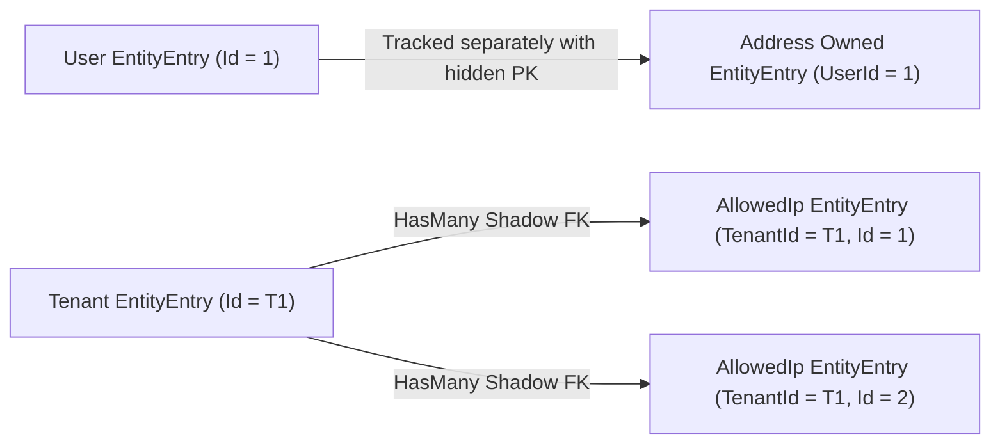
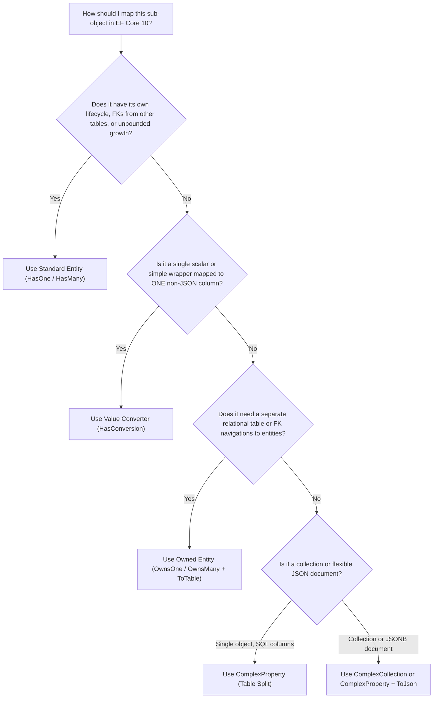

# Module 8: Owned Entities and Complex Types

In **Domain-Driven Design (DDD)**—an architectural approach that models software around the business domain rather than database tables—we separate domain objects into two fundamental categories:

* **Entities:** Objects defined by a unique **identity** (a Primary Key like `Guid Id`) that persists over time even if their attributes change (e.g., a `Tenant` or a `Document` in Normora).
* **Value Objects:** Small, cohesive objects defined purely by their attribute **values**, with **no unique identity** of their own (e.g., `Money` with `Amount` and `Currency`, or an `Address` with `Street`, `City`, and `ZipCode`). Two Value Objects with identical property values are considered interchangeable.

Entity Framework Core 10 provides two primary mechanisms to map Value Objects and tightly bound sub-objects to a relational database like PostgreSQL: **Owned Entities** (`OwnsOne` / `OwnsMany`) and **Complex Types** (`ComplexProperty` / `ComplexCollection`, introduced in EF Core 8 and matured significantly in EF Core 9 and EF Core 10).

---

## 1. The Core Problem

Imagine we have a `User` class (or a `Tenant` in Normora), and we want to store an `Address` as a clean, cohesive C# object instead of scattering `Street`, `City`, and `ZipCode` properties directly onto the parent class.

```csharp
public class User
{
    public Guid Id { get; set; }
    public string Name { get; set; } = string.Empty;

    // We want this to be a cohesive object in C#!
    public Address HomeAddress { get; set; } = new();
}

public class Address
{
    public string Street { get; set; } = string.Empty;
    public string City { get; set; } = string.Empty;
    public string ZipCode { get; set; } = string.Empty;
}
```

If we leave this unconfigured, EF Core tries to treat `Address` as a completely separate **Entity** with its own database table, and throws an `InvalidOperationException` during model building because `Address` has no Primary Key (`Id`).

We don't want a separate `Addresses` table with extra SQL `JOIN` overhead for every user read. Instead, we want the `Street`, `City`, and `ZipCode` columns to live inside the `Users` table—a relational mapping technique called **Table Splitting** (mapping multiple C# classes to a single database table).

### When NOT to Model Something as a Value Object
Before reaching for Owned Entities or Complex Types, ask whether the concept has an **independent lifecycle**:
* **Use a standard Entity (`HasOne` / `HasMany`)** if other tables need to reference it via a Foreign Key, if it is shared across multiple parent records (e.g., a `Department` assigned to many `TenantMembership` rows), or if it grows unboundedly (e.g., thousands of `DocumentChunk` vector rows).
* **Use a Value Object (Complex Type or Owned Entity)** only when the object belongs strictly to one parent **Aggregate Root** (the top-level entity that enforces business invariants, such as `Tenant`, `Document`, or `Conversation`).

### 5 Real-World Value Object Candidates in Normora

Across Normora's three modular monolith contexts (`Tenants`, `Documents`, `Conversations`), several concepts belong inside a parent table or JSON column rather than becoming standalone entity tables:

1. **`Money` on `TenantPlan` (`Tenants` module):** Subscription pricing combines `Amount` and `Currency` (`INR`, `USD`, `EUR`, etc. from `TenantPlanPricingCatalog`). Separating `Currency` from `Amount` risks mismatched calculations; grouping them as a Value Object keeps both columns atomic inside `tenants."TenantPlans"`.
2. **`StorageLocation` on `DocumentVersion` (`Documents` module):** Every uploaded file version in MinIO is identified by `BucketName`, `ObjectKey`, and `Sha256Hash`. Those three fields have no meaning outside a `DocumentVersion` and should be table-split into `documents."DocumentVersions"`.
3. **`AuditMetadata` across Entities (`Tenants` & `Documents` modules):** Grouping `CreatedAtUtc` and `CreatedByExternalUserId` (never vendor-specific names like `KeycloakUserId`) into a reusable Value Object ensures consistent auditing without duplicating configuration boilerplate in every `IEntityTypeConfiguration<T>`.
4. **`BrandPalette` on `TenantBranding` (`Tenants` module):** White-label theme colors (`PrimaryColorHex`, `AccentColorHex`, `SurfaceColorHex`) describe a workspace's visual identity without needing their own database row ID or independent table.
5. **`TokenUsage` on `ConversationMessage` (`Conversations` module):** Recording `PromptTokens`, `CompletionTokens`, and `TotalTokens` from Google Gemini per assistant reply is pure descriptive measurement attached to one message row.

---

## 2. Approach 1: Owned Entities (`OwnsOne` / `OwnsMany`)

Introduced in earlier versions of EF Core, **Owned Entities** tell EF Core that a dependent type (like `Address`) is entirely "owned" by its parent entity (the **owner**). An owned entity cannot exist independently without its owner, and it is automatically deleted when the owner is deleted.

### How to Configure `OwnsOne`

```csharp
public class UserConfiguration : IEntityTypeConfiguration<User>
{
    public void Configure(EntityTypeBuilder<User> builder)
    {
        builder.HasKey(u => u.Id);

        // Tell EF Core that User OWNS the Address
        builder.OwnsOne(u => u.HomeAddress, addressBuilder =>
        {
            // We can configure the nested properties here!
            addressBuilder.Property(a => a.Street).HasColumnName("HomeStreet").HasMaxLength(100);
            addressBuilder.Property(a => a.City).HasColumnName("HomeCity").HasMaxLength(50);
            addressBuilder.Property(a => a.ZipCode).HasColumnName("HomeZipCode").HasMaxLength(20);
        });
    }
}
```

### The Database Schema Result
By default, EF Core maps `OwnsOne` into a **single** `Users` table through **Table Splitting**:

| Id (PK) | Name | HomeStreet | HomeCity | HomeZipCode |
| :--- | :--- | :--- | :--- | :--- |
| `1` | `Sanjeev` | `123 Tech Ln` | `Delhi` | `110001` |

*(If you explicitly want the owned single object in its own table instead—for example, to isolate infrequently read large columns—you can call `addressBuilder.ToTable("UserAddresses")` inside `OwnsOne`, though table splitting is the default).*

### The `OwnsMany` Collection
Owned entities also support collections. If a user has multiple `ShippingAddresses`, you can use `.OwnsMany()`.

```csharp
public class User
{
    public Guid Id { get; set; }
    public ICollection<Address> ShippingAddresses { get; set; } = [];
}

// In Fluent API:
builder.OwnsMany(u => u.ShippingAddresses, addressBuilder =>
{
    // Because it's a collection, EF Core MUST create a separate table for this (unless mapped with .ToJson()).
    addressBuilder.ToTable("UserShippingAddresses");
    addressBuilder.WithOwner().HasForeignKey("UserId");
});
```

In a separate table, EF Core creates a **Shadow Key** (a hidden column/property managed by EF Core rather than declared on your C# class) as a composite Primary Key `(UserId, Id)` where `UserId` is the Foreign Key to `Users` and `Id` is an auto-incrementing/ordinal integer distinguishing items in the collection.

### The "Hidden Identity" Problem of Owned Entities
While `OwnsOne` looks clean on the surface, it has a major architectural quirk. EF Core's Change Tracker (the in-memory component that records every loaded entity's original values and state) is fundamentally an **Entity tracker**. Behind the scenes, **EF Core secretly assigns a hidden Primary Key** (matching the owner's PK) to every Owned Entity to track it as a separate `EntityEntry`.



Because `OwnsOne` is secretly tracked as an entity:
1. **Immutability & Reassignment Issues:** If you replace a tracked entity's owned property by assigning a brand-new instance (`user.HomeAddress = new Address(...)`), EF Core sees a deleted entity and an inserted entity sharing the *same* hidden key (`UserId`). Depending on navigation state and whether the property was originally null, this can cause unexpected `InvalidOperationException` tracking errors or unnecessary `DELETE` + `INSERT` semantics.
2. **All-Null Column Quirk:** When a table-split `OwnsOne` has all-nullable columns and every column in a database row is `NULL`, EF Core materializes the C# property as `null`—even if you didn't intend it to be optional. Conversely, if the owned property is required (`builder.Navigation(u => u.HomeAddress).IsRequired()`), EF Core enforces non-nullability.
3. **Performance & Memory Overhead:** The Change Tracker allocates extra `EntityEntry` state entries for every owned instance loaded into memory.
4. **Not True Value Objects:** In DDD, Value Objects have no identity. Owned Entities pretend they don't, but secretly do.

### When Should You Still Use Owned Entities (and When NOT To)?
* **Use `OwnsOne` / `OwnsMany` when:**
  * You need a **separate relational table** for an owned collection (`OwnsMany(...).ToTable(...)`) with SQL foreign-key or check constraints per row, and the collection is bounded/small.
  * The owned child object needs a **navigation property pointing to another Entity** (e.g., an owned `CitationSnapshot` referencing a `Document` entity via `DocumentId`), which Complex Types do not support.
  * You need a **relational index** directly via EF Core model Fluent API (`addressBuilder.HasIndex(a => a.ZipCode)`) in EF Core 10.
* **Do NOT use Owned Entities when:**
  * You are modeling pure DDD Value Objects (`Money`, `AuditMetadata`, `Coordinates`) in EF Core 10—prefer **`ComplexProperty`** instead to avoid hidden key tracking overhead.
  * The collection is **large or unbounded** (e.g., thousands of `DocumentChunk` rows)—because `OwnsMany` automatically eager-loads on every query! Use a standard `HasMany` entity relationship instead.
  * The child needs to be **shared across multiple owners** or queried independently by another aggregate.

### 5 Real-World Owned Entity Examples in Normora

Remember Normora's persistence rules from `AGENTS.md`: every configuration lives in `server/Modules/{ModuleName}/Persistence/Configurations/{Entity}Configuration.cs` as a **parameterless** `IEntityTypeConfiguration<T>` class.

1. **`Tenant` -> `OwnsMany` `AllowedIpConfiguration` (Separate Table for Bounded Security Allowlists):**
   A workspace's IP allowlist is bounded (typically 1–20 CIDR blocks), belongs strictly to one `Tenant`, and benefits from relational indexing in `tenants."TenantIpConfigurations"`.
   ```csharp
   public class Tenant
   {
       public Guid Id { get; set; }
       public string Slug { get; set; } = string.Empty;
       public ICollection<TenantIpConfiguration> AllowedIps { get; set; } = [];
   }

   public class TenantIpConfiguration
   {
       public string CidrRange { get; set; } = string.Empty;
       public string Description { get; set; } = string.Empty;
   }

   public class TenantConfiguration : IEntityTypeConfiguration<Tenant>
   {
       public void Configure(EntityTypeBuilder<Tenant> builder)
       {
           builder.ToTable("Tenants", "tenants");
           builder.HasKey(t => t.Id);

           builder.OwnsMany(t => t.AllowedIps, ip =>
           {
               ip.ToTable("TenantIpConfigurations", "tenants");
               ip.WithOwner().HasForeignKey("TenantId");
               ip.Property(i => i.CidrRange).HasMaxLength(45).IsRequired();
               ip.Property(i => i.Description).HasMaxLength(200);
               ip.HasIndex("TenantId", nameof(TenantIpConfiguration.CidrRange)).IsUnique();
           });
       }
   }
   ```

2. **`SavedAnswer` -> `OwnsMany` `SavedAnswerCitation` (Owned Collection with Entity FK Reference):**
   In the `Conversations` module, a `SavedAnswer` stores pinned citations pointing back to source `DocumentId` values. Because each item is owned by `SavedAnswer` and benefits from an indexed `DocumentId` column in its own table (`conversations."SavedAnswerCitations"`), `OwnsMany` fits naturally.
   ```csharp
   public class SavedAnswerConfiguration : IEntityTypeConfiguration<SavedAnswer>
   {
       public void Configure(EntityTypeBuilder<SavedAnswer> builder)
       {
           builder.ToTable("SavedAnswers", "conversations");
           builder.HasKey(s => s.Id);

           builder.OwnsMany(s => s.Citations, c =>
           {
               c.ToTable("SavedAnswerCitations", "conversations");
               c.WithOwner().HasForeignKey("SavedAnswerId");
               c.Property(x => x.DocumentId).IsRequired();
               c.Property(x => x.SectionBreadcrumb).HasMaxLength(300);
               c.HasIndex(x => x.DocumentId);
           });
       }
   }
   ```

3. **`Tenant` -> `OwnsOne` `WorkspaceQuotas` (Table-Split with EF Core Fluent Index):**
   If you want `QuotaSettings` table-split onto `tenants."Tenants"` *and* want an EF Core model-level `HasIndex` on one of its properties in EF Core 10, `OwnsOne` supports `HasIndex` directly inside the `OwnsOne` builder (whereas `ComplexProperty` does not support model-level `HasIndex` until EF Core 11).
   ```csharp
   builder.OwnsOne(t => t.Quotas, q =>
   {
       q.Property(x => x.MaxDocuments).HasColumnName("MaxDocuments");
       q.Property(x => x.MaxStorageBytes).HasColumnName("MaxStorageBytes");
       q.HasIndex(x => x.MaxDocuments);
   });
   ```

4. **`Document` -> `OwnsOne` `QuarantineState` (Optional Table-Split with All-Null Columns):**
   When a document fails virus/MIME validation, `QuarantineState` stores `ReasonCode` (an `ApiMessages` constant key, never raw exception traces) and `QuarantinedAtUtc`. Because `OwnsOne` treats all-`NULL` columns as a `null` reference in memory, `document.QuarantineState` is cleanly `null` for healthy documents.
   ```csharp
   builder.OwnsOne(d => d.QuarantineState, q =>
   {
       q.Property(x => x.ReasonCode).HasColumnName("QuarantineReasonCode").HasMaxLength(100);
       q.Property(x => x.QuarantinedAtUtc).HasColumnName("QuarantinedAtUtc");
   });
   ```

5. **`TenantPlan` -> `OwnsOne` `BillingWindow` (Illustrating the Reassignment Pitfall):**
   If `TenantPlan` models `BillingWindow` (`StartsAtUtc`, `EndsAtUtc`) via `OwnsOne`, renewing a plan by doing `plan.BillingWindow = new BillingWindow(newStart, newEnd)` forces EF Core to reconcile the old tracked `EntityEntry` with the new instance using the same hidden `TenantPlanId` key—which is why pure Value Objects like `BillingWindow` should migrate to EF Core 10 `ComplexProperty`!

---

## 3. Approach 2: Complex Types (EF Core 8–10)

To solve the "hidden identity" problem of Owned Entities, Microsoft introduced **Complex Types** in EF Core 8 and dramatically expanded them in EF Core 9 and **EF Core 10**.

Complex Types are **true Value Objects**. They have **no identity** (no hidden primary keys), they are not tracked as separate entities in the Change Tracker, and they map either via **Table Splitting** (multiple columns on the parent table) or, starting in **EF Core 10**, to a **JSON column** (`jsonb` in PostgreSQL).

### How to Configure a Complex Type

There are two ways to define a Complex Type.

**Method 1: Data Annotations**
```csharp
using System.ComponentModel.DataAnnotations.Schema;

// Tell EF Core this is NOT an entity, it's a Complex Type!
[ComplexType]
public class Address
{
    public string Street { get; set; } = string.Empty;
    public string City { get; set; } = string.Empty;
}
```

**Method 2: Fluent API (Preferred in Normora)**
Keeping persistence attributes out of your `Domain/` classes keeps domain models clean and puts all mapping logic inside `Persistence/Configurations/{Entity}Configuration.cs`:
```csharp
public class UserConfiguration : IEntityTypeConfiguration<User>
{
    public void Configure(EntityTypeBuilder<User> builder)
    {
        // Notice we use .ComplexProperty() instead of .OwnsOne()!
        builder.ComplexProperty(u => u.HomeAddress, addressBuilder =>
        {
            addressBuilder.Property(a => a.City).HasColumnName("HomeCity").HasMaxLength(50);
            addressBuilder.Property(a => a.Street).HasColumnName("HomeStreet").HasMaxLength(100);
        });
    }
}
```

### The "No Primary Key" Advantage (Change Tracking)
The biggest architectural difference between a Complex Type and an Owned Entity (`OwnsOne`) is that **Complex Types do not create or receive a primary key**.

Because it has no primary key, **EF Core does not track it as an entity.**

* **Owned Entities (`OwnsOne`):** Secretly have a Primary Key and create a separate `EntityEntry`. Replacing the whole object (`user.HomeAddress = new Address(...)`) can cause tracking conflicts because EF Core treats it as deleting one tracked entity and inserting another with the same key.
* **Complex Types (`ComplexProperty`):** Have NO Primary Key. EF Core treats `Address` values just like scalar properties (`string`, `int`). If you execute `user.HomeAddress = new Address { City = "Delhi", Street = "123 Tech Ln" }`, EF Core simply compares the property values and emits a clean `UPDATE` without throwing tracking exceptions. Even better, two different entities can share the exact same `Address` C# object instance in memory without throwing "already tracked" errors!

### What EF Core 10 Added to Complex Types
If you worked with EF Core 8, you may remember two major limitations: complex types could **not** be `null`, and they could **not** be used for collections. **EF Core 10 removes both limitations** and adds native value-type and JSON support:

1. **Optional (Nullable) Complex Types (EF Core 10):**
   In EF Core 8 and 9, complex properties were strictly required—assigning `null` threw an exception on save. In **EF Core 10**, complex properties can be nullable (`Address? SecondaryAddress`).
   * **The One Rule:** An optional complex type **must have at least one required property** (via C# `required` / non-nullable reference type or `.IsRequired()`). Why? If every column inside `SecondaryAddress` were nullable, EF Core could not tell the difference between a completely `null` complex object and an instantiated `new Address()` whose fields all happened to be `null`.
2. **Collections of Complex Types via `ComplexCollection` + `.ToJson()` (EF Core 10):**
   EF Core 10 introduces `.ComplexCollection()`, allowing lists of Value Objects (like `List<ToolExecutionTrace>`) without hidden shadow primary keys. On relational databases like PostgreSQL, complex collections must be mapped to a JSON column (`jsonb`) using `.ToJson()`.
3. **JSON Mapping for Single Complex Properties (`.ToJson()` in EF Core 10):**
   You can also map a single `ComplexProperty(e => e.Meta, m => m.ToJson())` to a single JSON column (`jsonb` on PostgreSQL) instead of table-splitting across multiple columns—replacing the old `OwnsOne(...).ToJson()` workaround.
4. **C# `struct` and `readonly record struct` Support (EF Core 10):**
   Single complex properties (`ComplexProperty`) can now be .NET value types (`struct` or `readonly record struct`), giving you true stack-allocated immutability with zero heap allocation. *(Note: `ComplexCollection` elements still require reference types such as `class` or `record`, not `struct`.)*
5. **Automatic Column Name Uniquification (EF Core 10):**
   When an entity has multiple complex properties sharing property names (or nested complex types), EF Core 10 automatically prefixes columns with the full property path (e.g., `PrimaryAddress_City`, `BillingAddress_City`) to prevent silent column collisions.

### Complex Types vs Owned Entities (EF Core 10 Matrix)

| Feature | Owned Entity (`OwnsOne` / `OwnsMany`) | Complex Type (`ComplexProperty` / `ComplexCollection`) |
| :--- | :--- | :--- |
| **Has an Identity (PK)?** | Yes (Secretly managed by EF Core) | **No** (True Value Object) |
| **Change Tracker Overhead** | High (Extra `EntityEntry` per instance) | **Minimal** (Tracked as parent property values) |
| **Table Splitting (Same Table)** | Yes (`OwnsOne` default) | **Yes** (`ComplexProperty` default) |
| **Separate Relational Table** | Yes (`.ToTable("...")`) | **No** (Use `OwnsOne`/`OwnsMany` or `HasOne`/`HasMany`) |
| **Supports Collections?** | Yes (`OwnsMany` -> separate table or JSON) | **Yes in EF Core 10** (`ComplexCollection().ToJson()`) |
| **Allows `null` in Memory?** | Yes (when optional) | **Yes in EF Core 10** (requires >= 1 required inner property) |
| **Supports `struct` / `record struct`?** | No (must be reference type) | **Yes in EF Core 10** (for single `ComplexProperty`) |
| **JSON Column Mapping (`.ToJson()`)** | Supported, but carries entity tracking quirks | **Recommended in EF Core 10** (pure value semantics) |
| **Navigations to Other Entities** | Yes (can have FK navigations) | **No** (strictly scalar/nested value data) |
| **Reassignment Behavior** | Can throw tracking errors on `OwnsOne` | **Flawless** (value comparison, shareable instances) |

### When NOT to Use Complex Types
* **Do NOT use `ComplexProperty` or `ComplexCollection`** if the object needs a **navigation property** to another Entity (e.g., a `Citation` referencing a `Document` navigation) or needs a database **Foreign Key constraint** on each item inside a collection.
* **Do NOT use `ComplexProperty`** if you need a **separate normalized relational table** for the sub-object (`OwnsOne().ToTable()` or `HasOne()`).
* **Do NOT use `ComplexCollection().ToJson()`** for large or unbounded lists (thousands of items) or items requiring SQL `JOIN`s and individual row updates—use a standard `HasMany` entity table.
* **Watch out for Fluent `HasIndex` in EF Core 10:** Model-level `builder.HasIndex(e => e.ComplexProp.Field)` is not supported directly on `ComplexProperty` in EF Core 10 (native support arrives in EF Core 11). If you need an index on a table-split complex column in EF Core 10, either add `CREATE INDEX` in a migration via `migrationBuilder.Sql(...)` or use `OwnsOne` / a flat scalar property.

### 5 Real-World Complex Type Examples in Normora

1. **`TenantPlan.Price` as a `readonly record struct` (`ComplexProperty`, Table-Split):**
   In `TenantsDbContext`, `TenantPlan` stores the workspace's active pricing from `TenantPlanPricingCatalog` (`INR`, `USD`, `EUR`, `GBP`, `CAD`, `AUD`, `JPY`, `SGD`). Using a `readonly record struct` gives immutability and value equality with zero tracking overhead.
   ```csharp
   public readonly record struct Money(decimal Amount, string Currency);

   public class TenantPlan
   {
       public Guid Id { get; set; }
       public Guid TenantId { get; set; }
       public Money Price { get; set; }
   }

   public class TenantPlanConfiguration : IEntityTypeConfiguration<TenantPlan>
   {
       public void Configure(EntityTypeBuilder<TenantPlan> builder)
       {
           builder.ToTable("TenantPlans", "tenants");
           builder.HasKey(p => p.Id);

           builder.ComplexProperty(p => p.Price, money =>
           {
               money.Property(m => m.Amount).HasColumnName("PriceAmount").HasPrecision(18, 2);
               money.Property(m => m.Currency).HasColumnName("PriceCurrency").HasMaxLength(3).IsRequired();
           });
       }
   }
   ```

2. **`AuditMetadata` Reused Across `Tenant` and `Department` (`ComplexProperty`, Table-Split):**
   Both `Tenant` and `Department` record who created them using `ExternalUserId` (decoupled from any vendor like Keycloak). Notice how the exact same `AuditMetadata` instance can even be reused without EF Core tracking conflicts.
   ```csharp
   public sealed record AuditMetadata
   {
       public DateTimeOffset CreatedAtUtc { get; init; }
       public string CreatedByExternalUserId { get; init; } = string.Empty;
   }

   // Inside DepartmentConfiguration (Tenants module):
   builder.ComplexProperty(d => d.Audit, audit =>
   {
       audit.Property(a => a.CreatedAtUtc).HasColumnName("CreatedAtUtc").IsRequired();
       audit.Property(a => a.CreatedByExternalUserId).HasColumnName("CreatedByExternalUserId").HasMaxLength(128).IsRequired();
   });
   ```

3. **`DocumentVersion.Storage` as a Nested Value Object (`ComplexProperty`, Table-Split):**
   In `DocumentsDbContext`, every `DocumentVersion` points to an object in MinIO (`BucketName`, `ObjectKey`, `SizeBytes`). Making `StorageLocation` a `ComplexProperty` flattens those three columns into `documents."DocumentVersions"` while keeping domain code expressive (`version.Storage.ObjectKey`).
   ```csharp
   public sealed record StorageLocation(string BucketName, string ObjectKey, long SizeBytes);

   // Inside DocumentVersionConfiguration:
   builder.ComplexProperty(v => v.Storage, storage =>
   {
       storage.Property(s => s.BucketName).HasColumnName("StorageBucket").HasMaxLength(100).IsRequired();
       storage.Property(s => s.ObjectKey).HasColumnName("StorageObjectKey").HasMaxLength(512).IsRequired();
       storage.Property(s => s.SizeBytes).HasColumnName("FileSizeBytes");
   });
   ```

4. **`DocumentProcessingOutboxMessage.Failure` as an Optional Complex Type (EF Core 10 Nullable `ComplexProperty`):**
   Remember Normora's CWE-209 security rule: outbox failure notifications must never expose raw `exception.Message` to end-users—they map failures to `ApiMessages` keys. For pending/succeeded outbox messages, `Failure` is `null`. Because `ErrorCode` is marked `IsRequired()`, EF Core 10 cleanly supports `OutboxFailureInfo? Failure`.
   ```csharp
   public sealed class OutboxFailureInfo
   {
       public required string ErrorCode { get; set; } // Required so EF Core 10 can detect null vs present!
       public DateTimeOffset? FailedAtUtc { get; set; }
       public int RetryCount { get; set; }
   }

   public class DocumentProcessingOutboxMessage
   {
       public Guid Id { get; set; }
       public Guid TenantId { get; set; }
       public OutboxFailureInfo? Failure { get; set; }
   }

   // Inside DocumentProcessingOutboxMessageConfiguration:
   builder.ComplexProperty(m => m.Failure, failure =>
   {
       failure.Property(f => f.ErrorCode).HasColumnName("FailureErrorCode").HasMaxLength(100).IsRequired();
       failure.Property(f => f.FailedAtUtc).HasColumnName("FailedAtUtc");
       failure.Property(f => f.RetryCount).HasColumnName("RetryCount");
   });
   ```

5. **`ConversationMessage.ToolTraces` as a JSONB `ComplexCollection` (EF Core 10 `.ToJson()`):**
   Normora's `Conversations` module executes up to 19 agentic tools (e.g., `documents_search`, `calculate_policy_limit`, `escalate_hr_inquiry`) and streams live tool lifecycle chips (`tool_started`, `tool_finished`). Storing the ordered list of tool traces inside a PostgreSQL `jsonb` column on `conversations."ConversationMessages"` avoids extra joins while letting EF Core 10 query into the JSON array!
   ```csharp
   public sealed class ToolExecutionTrace
   {
       public string ToolName { get; set; } = string.Empty;
       public bool Succeeded { get; set; }
       public int DurationMs { get; set; }
   }

   public class ConversationMessage
   {
       public Guid Id { get; set; }
       public Guid TenantId { get; set; }
       public List<ToolExecutionTrace> ToolTraces { get; set; } = [];
   }

   // Inside ConversationMessageConfiguration:
   builder.ComplexCollection(m => m.ToolTraces, trace =>
   {
       trace.ToJson("ToolTracesJson"); // Maps to PostgreSQL jsonb column!
   });
   ```

---

## 4. Decision Framework: Value Converters vs Complex Types vs Owned Entities vs Standard Entities

In Module 7, we learned about **Value Converters** (`HasConversion`). Now that you know Owned Entities and Complex Types, how does a senior architect choose the right mapping strategy in EF Core 10?



### Quick Architectural Comparison

| Mapping Approach | Storage in PostgreSQL | Identity / PK | Supports LINQ Queries Inside Fields? | Best Use Case |
| :--- | :--- | :--- | :--- | :--- |
| **Value Converter** (`HasConversion`) | 1 column (`varchar`, `uuid`, `jsonb`) | None | Limited (unless provider-specific) | Strongly-typed IDs (`TenantId`), `EmailAddress`, enums as strings |
| **`ComplexProperty`** (default) | Multiple columns on parent table | None | Yes (native SQL columns, `GroupBy`, `ExecuteUpdate`) | Pure Value Objects (`Money`, `AuditMetadata`, `StorageLocation`) |
| **`ComplexProperty().ToJson()`** | 1 `jsonb` column on parent table | None | Yes (SQL/JSON path queries + `ExecuteUpdate`) | Structured optional/nested metadata without column explosion |
| **`ComplexCollection().ToJson()`** | 1 `jsonb` array column on parent table | None | Yes (filtering/projecting JSON array elements) | Small/bounded value-object lists (`ToolTraces`, `LineItems`) |
| **`OwnsOne` / `OwnsMany`** (`.ToTable()`) | Separate table(s) or table-split | Hidden Shadow PK | Yes (standard SQL `JOIN`) | Bounded child tables needing entity FKs or relational `HasIndex` |
| **Standard Entity** (`HasOne` / `HasMany`) | Independent table | Explicit PK | Full SQL + explicit `.Include()` control | Aggregate roots, shared references, or large collections |

### 5 Real-World Architectural Decisions in Normora

1. **`TenantPlan.Price` (`Money`) -> `ComplexProperty` (Table-Split), NOT Value Converter:**
   Because Normora's billing metrics and subscription queries aggregate revenue and filter by `Currency` (`INR`, `USD`, `EUR`) in SQL, splitting `Money` into `PriceAmount` and `PriceCurrency` columns beats serializing it as a single opaque JSON string.
2. **`ExternalUserId` / Strongly-Typed Wrappers -> Value Converter, NOT `ComplexProperty`:**
   A single scalar wrapper like `EmailAddress` or `TenantSlug` maps to **one** `varchar` column. Using `HasConversion` avoids unnecessary complex-type nesting.
3. **`Document.Chunks` (`ICollection<DocumentChunk>`) -> Standard `HasMany` Entity, NOT `OwnsMany` or `ComplexCollection`:**
   A single PDF in Normora can produce thousands of `DocumentChunk` rows with 768/1536-dimensional `pgvector` embeddings and an HNSW index. `OwnsMany` would auto-load all chunks every time you load a `Document`, and `ComplexCollection().ToJson()` cannot hold a PostgreSQL `pgvector` HNSW index. Standard `HasMany` keeps querying selective and fast.
4. **`ConversationMessage.ToolTraces` (`List<ToolExecutionTrace>`) -> `ComplexCollection().ToJson()`, NOT `OwnsMany`:**
   Each message executes a small, fixed list of agent tools (typically 0–5 traces). Storing them in `jsonb` via `ComplexCollection().ToJson()` eliminates a `JOIN` table and avoids `OwnsMany` hidden key tracking.
5. **`SavedAnswer.Citations` -> `OwnsMany().ToTable()`, NOT `ComplexCollection().ToJson()`:**
   If you want PostgreSQL to enforce an indexed `DocumentId` column in `conversations."SavedAnswerCitations"` for fast lookup when a document is deleted or updated, `OwnsMany` with `.ToTable()` gives you a real relational index (`HasIndex(x => x.DocumentId)`).

---

## 5. Querying, Change Tracking, Bulk Updates & Multi-Tenant Filters

A common question is whether you need to use `.Include()` to fetch Owned Entities or Complex Types. **The answer is NO.**

EF Core considers Owned Types and Complex Types to be integral parts of the parent entity, not independent entities requiring explicit opt-in loading.

### 1. How Loading Works (`ComplexProperty`, `ComplexCollection`, `OwnsOne`, `OwnsMany`)
* **Table Splitting (`ComplexProperty` and default `OwnsOne`):** Because all columns live on the parent table, querying `dbContext.TenantPlans.ToListAsync()` naturally selects those columns and populates `plan.Price` automatically.
* **JSON Columns (`ComplexProperty().ToJson()` and `ComplexCollection().ToJson()`):** The `jsonb` column lives on the same parent row, so EF Core reads and deserializes it automatically without any `JOIN` or `.Include()`.
* **`OwnsMany` (Separate Tables):** Even though an `OwnsMany` collection lives in a separate table, EF Core **automatically eager-loads it** via a `LEFT JOIN` (or split query) without you ever typing `.Include()`. *(Tip: This is why `OwnsMany` is dangerous for large collections—you cannot opt out of loading it unless you use a `.Select(...)` projection!)*

### 2. Change Tracker & `AsNoTracking()` Behavior
* With **`OwnsOne`**, loading 1,000 `Tenant` rows into a tracked `DbContext` allocates **2,000** `EntityEntry` objects (1,000 for `Tenant` + 1,000 hidden entries for the owned object).
* With **`ComplexProperty`**, loading 1,000 `TenantPlan` rows allocates only **1,000** `EntityEntry` objects.
* For read-only CQRS queries (`Queries/` folder in Normora), always chain `.AsNoTracking()` on top of your query so EF Core skips snapshot allocation altogether.

### 3. `GroupBy` and `ExecuteUpdateAsync` with Complex Types (EF Core 9 & 10)
In EF Core 8, you could not group by a complex type or bulk-update its inner properties with `ExecuteUpdateAsync`. **EF Core 9 and 10 added support for both:**
* **Bulk Updates (`ExecuteUpdateAsync`):** You can update nested complex properties (both table-split and `.ToJson()`) directly in SQL without loading entities into memory.
* **Grouping (`GroupBy`) + Normora's `AGENTS.md` Rule:** You can group by a `ComplexProperty`, **but** remember Normora's strict LINQ translation rule from `AGENTS.md`: when aggregating with `GroupBy`, **always project to an anonymous type first** before mapping to C# records or DTOs in memory. Direct instantiation of a parameterized record constructor inside `GroupBy(...).Select(...)` throws an `InvalidOperationException` (which maps to HTTP 400).

### 4. Global Multi-Tenant Query Filters & Encapsulation
In Normora's modular monolith:
* `DocumentsDbContext` and `ConversationsDbContext` apply a **global `TenantId` query filter** bound dynamically to `_tenantContext.TenantId`. Because `ComplexProperty` and `OwnsOne` live inside the parent entity, they automatically inherit the parent's `TenantId` isolation—you never add a redundant `TenantId` inside a `ComplexProperty`.
* `TenantsDbContext` does **not** have an ambient global filter (because it handles workspace resolution and cross-workspace memberships). Queries against workspace-scoped entities in `TenantsDbContext` must **always** explicitly filter `.Where(x => x.TenantId == request.TenantId)`.

### 5 Real-World Querying Examples in Normora

1. **Zero-`.Include()` Read Query with `AsNoTracking()` (`Documents` module):**
   Global `TenantId` filter applies automatically, and `Storage` (`ComplexProperty`) loads in the same single `SELECT` statement.
   ```csharp
   var versions = await documentsDbContext.DocumentVersions
       .AsNoTracking()
       .Where(v => v.DocumentId == request.DocumentId)
       .Select(v => new DocumentVersionDto(v.Id, v.VersionNumber, v.Storage.BucketName, v.Storage.ObjectKey))
       .ToListAsync(cancellationToken);
   ```

2. **`GroupBy` on a Complex Type Following Normora's Anonymous-Projection Rule (`Tenants` module):**
   Note the explicit `TenantId` filter (or workspace-scoped check) and the mandatory anonymous projection in `.Select(...)` before constructing the DTO in memory!
   ```csharp
   var currencyCounts = await tenantsDbContext.TenantPlans
       .AsNoTracking()
       .Where(p => p.TenantId == request.TenantId)
       .GroupBy(p => p.Price.Currency)
       .Select(g => new
       {
           Currency = g.Key,
           PlanCount = g.Count(),
           TotalAmount = g.Sum(x => x.Price.Amount)
       })
       .ToListAsync(cancellationToken);

   var result = currencyCounts
       .Select(x => new CurrencyBillingSummaryDto(x.Currency, x.PlanCount, x.TotalAmount))
       .ToList();
   ```

3. **Bulk Updating a Table-Split `ComplexProperty` via `ExecuteUpdateAsync` (`Tenants` module):**
   Synchronizing `TenantPlan.Price.Currency` in `UpdateTenantCurrencyCommandHandler` without loading the entity first (with explicit `TenantId` filtering since `TenantsDbContext` is unscoped):
   ```csharp
   var updatedRows = await tenantsDbContext.TenantPlans
       .Where(p => p.TenantId == request.TenantId)
       .ExecuteUpdateAsync(setters => setters
           .SetProperty(p => p.Price.Currency, normalizedCurrency)
           .SetProperty(p => p.Price.Amount, catalogAmount),
           cancellationToken);
   ```

4. **Querying Inside a PostgreSQL `jsonb` `ComplexCollection` (`Conversations` module):**
   EF Core 10 translates `.Any(...)` over `ComplexCollection().ToJson()` into PostgreSQL `jsonb` queries while `ConversationsDbContext` enforces the global `TenantId` query filter automatically:
   ```csharp
   var messagesUsingDocSearch = await conversationsDbContext.ConversationMessages
       .AsNoTracking()
       .Where(m => m.ConversationId == request.ConversationId
                && m.ToolTraces.Any(t => t.ToolName == "documents_search" && t.Succeeded))
       .OrderBy(m => m.CreatedAtUtc)
       .ToListAsync(cancellationToken);
   ```

5. **Avoiding Unintended Eager Loading on `OwnsMany` via Projection (`Tenants` module):**
   Because `Tenant.AllowedIps` is mapped with `OwnsMany`, loading `tenantsDbContext.Tenants.FirstOrDefaultAsync(...)` always joins `TenantIpConfigurations`. When a query only needs the workspace slug and name, project with `.Select(...)` so EF Core omits the `OwnsMany` join:
   ```csharp
   var summary = await tenantsDbContext.Tenants
       .AsNoTracking()
       .Where(t => t.Id == request.TenantId)
       .Select(t => new TenantHeaderDto(t.Id, t.Slug, t.Name))
       .FirstOrDefaultAsync(cancellationToken);
   ```

---

## 6. Real-World Architectural Scenarios in Normora

### Scenario A: True Value Objects in DDD (`ComplexProperty` as `readonly record struct`)
In Normora's `Tenants` module, a `Money` value object combines `Amount` and `Currency` from `TenantPlanPricingCatalog`. Using a `readonly record struct` gives immutability, structural equality, and zero Change Tracker entity overhead.

```csharp
public readonly record struct Money(decimal Amount, string Currency);

public class TenantPlan
{
    public Guid Id { get; set; }
    public Guid TenantId { get; set; }
    public Money TotalPrice { get; set; }
}

// Inside TenantPlanConfiguration : IEntityTypeConfiguration<TenantPlan> (parameterless!)
builder.ComplexProperty(i => i.TotalPrice, m =>
{
    m.Property(p => p.Amount).HasPrecision(18, 2); // Maps to numeric(18,2) in PostgreSQL
    m.Property(p => p.Currency).HasMaxLength(3).IsRequired();
});
```

### Scenario B: Reusable Audit Metadata (`ComplexProperty`)
Instead of repeating `CreatedAtUtc` and `CreatedByExternalUserId` column configurations on every entity, group them into an `AuditInfo` complex type. Notice Normora's rule: always name external identity properties `ExternalUserId`, never vendor-specific names like `KeycloakUserId`.

```csharp
using System.ComponentModel.DataAnnotations.Schema;

[ComplexType]
public class AuditInfo
{
    public DateTimeOffset CreatedAtUtc { get; set; }
    public string CreatedByExternalUserId { get; set; } = string.Empty;
}

public class Tenant
{
    public Guid Id { get; set; }
    public AuditInfo Audit { get; set; } = new();
}
```
In PostgreSQL, the `tenants."Tenants"` table automatically receives `Audit_CreatedAtUtc` and `Audit_CreatedByExternalUserId` columns.

### Scenario C: Bounded Child Records in a Separate Relational Table (`OwnsMany`)
When a `Tenant` has a small, bounded list of allowed IP configurations that need unique relational constraints or foreign-key isolation inside their own table (`tenants."TenantIpConfigurations"`), use `OwnsMany`.

```csharp
public class IpConfiguration
{
    public string IpAddress { get; set; } = string.Empty;
}

public class Tenant
{
    public Guid Id { get; set; }
    // Use OwnsMany when you want a separate relational table; use ComplexCollection().ToJson() if JSONB is preferred.
    public ICollection<IpConfiguration> AllowedIps { get; set; } = [];
}

// Inside TenantConfiguration:
builder.OwnsMany(t => t.AllowedIps, ip =>
{
    ip.ToTable("TenantIpConfigurations", "tenants");
    ip.WithOwner().HasForeignKey("TenantId");
    ip.Property(i => i.IpAddress).HasMaxLength(45).IsRequired();
});
```

### Scenario D: Optional Failure Metadata on the Ingestion Outbox (EF Core 10 Nullable `ComplexProperty`)
In Normora's `Documents` module, `UploadDocumentCommandHandler` inserts a `DocumentProcessingOutboxMessage` in the same transaction as the document metadata. Most outbox messages succeed with `Failure = null`; failed ones record an `ApiMessages` error code (never raw `exception.Message`, per CWE-209).

```csharp
public sealed class OutboxFailureInfo
{
    public required string ErrorCode { get; set; } // Required so EF Core 10 distinguishes null vs empty!
    public DateTimeOffset FailedAtUtc { get; set; }
}

public class DocumentProcessingOutboxMessage
{
    public Guid Id { get; set; }
    public Guid TenantId { get; set; }
    public OutboxFailureInfo? Failure { get; set; } // Null while pending/succeeded
}
```

### Scenario E: Agent Tool Execution Traces in JSONB (EF Core 10 `ComplexCollection`)
In Normora's `Conversations` module, an AI turn may invoke several tools (`documents_search`, `workspace_create_department`, `calculate_policy_limit`). Mapping `ToolTraces` with `ComplexCollection().ToJson()` stores the ordered trace array in a single PostgreSQL `jsonb` column while preserving full LINQ queryability.

```csharp
public sealed class ToolExecutionTrace
{
    public string ToolName { get; set; } = string.Empty;
    public bool Succeeded { get; set; }
    public int DurationMs { get; set; }
}

// Inside ConversationMessageConfiguration:
builder.ComplexCollection(m => m.ToolTraces, trace =>
{
    trace.ToJson("ToolTraces");
});
```

---

## 7. Seeding Data (`HasData` vs `UseAsyncSeeding`) & Migrations

When seeding initial data for entities that contain Owned Entities or Complex Types, EF Core treats them very differently—and this is one of the biggest gotchas when upgrading to EF Core 8–10!

### 1. Seeding Entities with `ComplexProperty` or `ComplexCollection`: Why `HasData` Fails and `UseAsyncSeeding` Wins
**Important:** Unlike standard scalar properties, **`HasData()` does NOT support `ComplexProperty` or `ComplexCollection` directly.** If you pass a `ComplexProperty` inside `builder.HasData(new TenantPlan { ..., TotalPrice = new Money(...) })`, EF Core throws an `InvalidOperationException` at migration/model-build time (*"The seed entity for entity type '...' cannot be added because it has the complex property '...' set"*).

Instead, EF Core 9 and **EF Core 10** provide **`UseSeeding` / `UseAsyncSeeding`** on `DbContextOptionsBuilder`, which runs safely during Normora's ephemeral console migration pipeline (`dotnet Normora.Api.dll --migrate` via `DatabaseMigrationRunner`) using normal C# objects!

### 2. Seeding Owned Entities (`OwnsOne` / `OwnsMany`) with `HasData`
Because EF Core treats Owned Entities as separate tracked objects with a hidden Foreign Key linking them to the owner, you **cannot** nest an owned object inside the parent's `HasData(...)` call. You must seed the parent first, then seed the owned entity separately using an **anonymous object** that explicitly supplies the hidden shadow Foreign Key (and shadow `Id` for `OwnsMany`).

### 5 Real-World Seeding & Migration Examples in Normora

1. **Seeding `TenantPlan` (with `ComplexProperty` `Money`) via `UseAsyncSeeding` (`Tenants` module):**
   ```csharp
   optionsBuilder.UseNpgsql(connectionString)
       .UseAsyncSeeding(async (context, _, cancellationToken) =>
       {
           var tenantsDb = (TenantsDbContext)context;
           var starterId = Guid.Parse("11111111-1111-1111-1111-111111111111");

           if (!await tenantsDb.TenantPlans.AnyAsync(p => p.Id == starterId, cancellationToken))
           {
               tenantsDb.TenantPlans.Add(new TenantPlan
               {
                   Id = starterId,
                   TenantId = Guid.Parse("22222222-2222-2222-2222-222222222222"),
                   TotalPrice = new Money(0m, "USD") // Normal C# instantiation works cleanly!
               });
               await tenantsDb.SaveChangesAsync(cancellationToken);
           }
       });
   ```

2. **Seeding `Tenant` + `OwnsOne` `TenantBranding` via `HasData` (`Tenants` module):**
   ```csharp
   public class TenantConfiguration : IEntityTypeConfiguration<Tenant>
   {
       public void Configure(EntityTypeBuilder<Tenant> builder)
       {
           var defaultTenantId = Guid.Parse("22222222-2222-2222-2222-222222222222");

           // 1. Seed the Owner FIRST (without the owned property)
           builder.HasData(new Tenant
           {
               Id = defaultTenantId,
               Slug = "normora-demo",
               Name = "Normora Demo Workspace"
           });

           // 2. Seed the OwnsOne object SEPARATELY via an anonymous object with the hidden FK
           builder.OwnsOne(t => t.Branding, branding =>
           {
               branding.Property(b => b.PrimaryColorHex).HasMaxLength(7);
               branding.HasData(new
               {
                   TenantId = defaultTenantId, // Hidden FK linking back to Tenant!
                   PrimaryColorHex = "#6366F1"
               });
           });
       }
   }
   ```

3. **Seeding `Tenant` + `OwnsMany` `IpConfiguration` via `HasData` (`Tenants` module):**
   For `OwnsMany`, the anonymous object must supply **both** the hidden `TenantId` Foreign Key and the hidden ordinal `Id` primary key!
   ```csharp
   var defaultTenantId = Guid.Parse("22222222-2222-2222-2222-222222222222");

   builder.OwnsMany(t => t.AllowedIps, ip =>
   {
       ip.ToTable("TenantIpConfigurations", "tenants");
       ip.WithOwner().HasForeignKey("TenantId");
       ip.HasData(
           new { TenantId = defaultTenantId, Id = 1, IpAddress = "10.0.0.0/8" },
           new { TenantId = defaultTenantId, Id = 2, IpAddress = "192.168.1.0/24" }
       );
   });
   ```

4. **Seeding `AiPersonaPreset` (with `ComplexCollection().ToJson()`) via `UseAsyncSeeding` (`Conversations` module):**
   Normora's multi-agent mesh personas (`All-Rounder`, `HR & People Ops`, `Finance & Travel`, `IT & Security`) can seed a `ComplexCollection` of default starter prompts directly in `UseAsyncSeeding`:
   ```csharp
   if (!await conversationsDb.AiPersonaPresets.AnyAsync(cancellationToken))
   {
       conversationsDb.AiPersonaPresets.Add(new AiPersonaPreset
       {
           Id = Guid.NewGuid(),
           TenantId = defaultTenantId,
           Name = "HR & People Ops",
           DefaultToolTraces = [new ToolExecutionTrace { ToolName = "documents_search", Succeeded = true, DurationMs = 0 }]
       });
       await conversationsDb.SaveChangesAsync(cancellationToken);
   }
   ```

5. **Migration Workaround: Indexing a `ComplexProperty` Column in PostgreSQL (EF Core 10):**
   Because `builder.HasIndex(v => v.Storage.ObjectKey)` is not supported natively on `ComplexProperty` in EF Core 10, generate an empty migration (`dotnet ef migrations add AddStorageObjectKeyIndex --context DocumentsDbContext`) and add raw PostgreSQL DDL:
   ```csharp
   protected override void Up(MigrationBuilder migrationBuilder)
   {
       migrationBuilder.Sql("""
           CREATE INDEX ix_document_versions_storage_object_key
           ON documents."DocumentVersions" ("StorageObjectKey");
           """);
   }
   ```
   *(Also note an EF Core 10 migration breaking change: if an entity has multiple `ComplexProperty` properties of the same type, EF Core 10 automatically uniquifies column names using the full property path unless you explicitly configure `.HasColumnName(...)`—always review generated migrations before running `--migrate`!)*

---

## 8. Common Mistakes & Anti-Patterns

> [!CAUTION]
> **Anti-Pattern 1: Using `OwnsMany` for Unbounded or Large Collections**
>
> **Wrong Code:**
> ```csharp
> // DocumentsDbContext: A single PDF can have 2,000+ chunks with pgvector embeddings!
> builder.OwnsMany(d => d.Chunks, chunk =>
> {
>     chunk.ToTable("DocumentChunks", "documents");
> });
> ```
> **Why It's Wrong:** EF Core **automatically eager-loads** `OwnsMany` collections on every parent query without `.Include()`. Fetching a list of 50 `Document` headers silently loads 100,000 chunk rows and their high-dimensional vectors into memory, causing massive latency and OOM crashes.
>
> **The Fix:** Model large or independently queried collections as standard entities with `HasMany` / `WithOne`, and load them explicitly via `.Select(...)` projections or paginated queries.
> ```csharp
> builder.HasMany(d => d.Chunks)
>        .WithOne(c => c.Document)
>        .HasForeignKey(c => c.DocumentId)
>        .OnDelete(DeleteBehavior.Cascade);
> ```

> [!CAUTION]
> **Anti-Pattern 2: Reassigning a New Object Instance to a Tracked `OwnsOne` Property**
>
> **Wrong Code:**
> ```csharp
> var plan = await tenantsDbContext.TenantPlans.FirstAsync(p => p.TenantId == tenantId);
> // Replacing an OwnsOne property on a tracked entity triggers delete+insert key conflicts
> plan.BillingPeriod = new BillingPeriod(DateTimeOffset.UtcNow, DateTimeOffset.UtcNow.AddMonths(1));
> await tenantsDbContext.SaveChangesAsync();
> ```
> **Why It's Wrong:** `OwnsOne` assigns a hidden primary key (`TenantPlanId`) to `BillingPeriod` and tracks it as a separate `EntityEntry`. Replacing the object reference can confuse the Change Tracker into treating the old instance as deleted and the new instance as inserted with a colliding key.
>
> **The Fix:** Use **`ComplexProperty`** in EF Core 10 for Value Objects that get replaced as immutable units (`record` or `readonly record struct`). EF Core tracks `ComplexProperty` by structural value with zero hidden keys.
> ```csharp
> // In TenantPlanConfiguration:
> builder.ComplexProperty(p => p.BillingPeriod);
> ```

> [!CAUTION]
> **Anti-Pattern 3: Defining an Optional `ComplexProperty` (`T?`) Where Every Inner Property Is Nullable**
>
> **Wrong Code:**
> ```csharp
> public sealed class OutboxFailureInfo
> {
>     public string? ErrorCode { get; set; }      // Nullable!
>     public DateTimeOffset? FailedAtUtc { get; set; } // Nullable!
> }
>
> public class DocumentProcessingOutboxMessage
> {
>     public Guid Id { get; set; }
>     public OutboxFailureInfo? Failure { get; set; } // Optional ComplexProperty
> }
> ```
> **Why It's Wrong:** In EF Core 10, an optional `ComplexProperty` **requires at least one required inner property**. If every inner column is nullable, EF Core cannot tell from a row of `NULL`s whether `Failure` itself should be materialized as `null` or as `new OutboxFailureInfo()` with null fields, so model validation throws an exception.
>
> **The Fix:** Mark at least one discriminating inner property as `required` (and `.IsRequired()` in Fluent API):
> ```csharp
> public sealed class OutboxFailureInfo
> {
>     public required string ErrorCode { get; set; } // Non-nullable baseline column
>     public DateTimeOffset? FailedAtUtc { get; set; }
> }
> ```

> [!CAUTION]
> **Anti-Pattern 4: Calling `HasIndex` Directly on a `ComplexProperty` Path in EF Core 10**
>
> **Wrong Code:**
> ```csharp
> builder.ComplexProperty(v => v.Storage);
> // Throws ArgumentException / unsupported model configuration in EF Core 10!
> builder.HasIndex(v => v.Storage.ObjectKey);
> ```
> **Why It's Wrong:** Fluent model-level indexing over scalar properties nested inside a `ComplexProperty` is **not** supported in EF Core 10 (it arrives in EF Core 11).
>
> **The Fix:** Either add the `CREATE INDEX` statement via `migrationBuilder.Sql(...)` in a custom migration (while keeping `ComplexProperty`), or use `OwnsOne` / a top-level scalar property if Fluent index management is critical.

> [!CAUTION]
> **Anti-Pattern 5: Passing `ComplexProperty` Instances into `HasData()`**
>
> **Wrong Code:**
> ```csharp
> builder.ComplexProperty(p => p.TotalPrice);
> builder.HasData(new TenantPlan
> {
>     Id = planId,
>     TotalPrice = new Money(49m, "USD") // Throws InvalidOperationException!
> });
> ```
> **Why It's Wrong:** EF Core's migration `HasData()` engine cannot unpack `ComplexProperty` or `ComplexCollection` values when generating model snapshots.
>
> **The Fix:** Use EF Core 9/10's **`UseAsyncSeeding` / `UseSeeding`** on `DbContextOptionsBuilder` (executed cleanly in Normora's `--migrate` host), or write `migrationBuilder.InsertData(...)` in a migration.

> [!CAUTION]
> **Anti-Pattern 6: Instantiating Records Directly Inside `GroupBy().Select()` on a Complex Type**
>
> **Wrong Code:**
> ```csharp
> // Violates Normora's AGENTS.md GroupBy rule and fails EF Core LINQ translation!
> var summary = await tenantsDbContext.TenantPlans
>     .Where(p => p.TenantId == request.TenantId)
>     .GroupBy(p => p.TotalPrice.Currency)
>     .Select(g => new CurrencyBillingSummaryDto(g.Key, g.Count(), g.Sum(x => x.TotalPrice.Amount)))
>     .ToListAsync(cancellationToken);
> ```
> **Why It's Wrong:** EF Core's relational query translator cannot translate parameterized C# record constructors directly inside `GroupBy().Select(...)`, throwing an unhandled `InvalidOperationException` (mapped to 400 Bad Request).
>
> **The Fix:** Always project to an **anonymous type** in SQL first, materialize with `ToListAsync()`, and map to your DTO/record in memory:
> ```csharp
> var rows = await tenantsDbContext.TenantPlans
>     .Where(p => p.TenantId == request.TenantId)
>     .GroupBy(p => p.TotalPrice.Currency)
>     .Select(g => new { Currency = g.Key, Count = g.Count(), Total = g.Sum(x => x.TotalPrice.Amount) })
>     .ToListAsync(cancellationToken);
>
> var summary = rows.Select(r => new CurrencyBillingSummaryDto(r.Currency, r.Count, r.Total)).ToList();
> ```

> [!CAUTION]
> **Anti-Pattern 7: Injecting `ITenantContext` into `IEntityTypeConfiguration<T>` Constructors**
>
> **Wrong Code:**
> ```csharp
> public class DocumentConfiguration(ITenantContext tenantContext) : IEntityTypeConfiguration<Document>
> {
>     public void Configure(EntityTypeBuilder<Document> builder)
>     {
>         builder.ComplexProperty(d => d.Audit);
>         builder.HasQueryFilter(d => d.TenantId == tenantContext.TenantId); // Breaks assembly scanning!
>     }
> }
> ```
> **Why It's Wrong:** Per Normora's `AGENTS.md`, `ApplyConfigurationsFromAssembly` requires **parameterless** constructors on all `IEntityTypeConfiguration<T>` classes. Passing scoped services crashes startup/migration discovery.
>
> **The Fix:** Keep every `IEntityTypeConfiguration<T>` parameterless and bind global multitenant query filters dynamically to `_tenantContext.TenantId` inside `DbContext.OnModelCreating`.

---

## 9. Interview Questions

**Q1 [Junior]: What is Table Splitting in EF Core?**
> Table Splitting is a relational mapping technique where multiple C# classes are mapped to a single database table. For example, if a `TenantPlan` entity has a `Money` property mapped via `ComplexProperty` or `OwnsOne`, EF Core flattens `Amount` and `Currency` into columns on the `TenantPlans` table, avoiding an extra SQL `JOIN` on every read.

**Q2 [Junior]: Do you need to call `.Include()` to load `OwnsOne`, `OwnsMany`, `ComplexProperty`, or `ComplexCollection`?**
> No. EF Core treats owned and complex types as integral parts of the owning entity. Table-split (`ComplexProperty`, `OwnsOne`) and JSON (`ToJson()`) properties live on the same row, while `OwnsMany` separate-table collections are automatically eager-loaded by EF Core behind the scenes.

**Q3 [Junior]: When would you choose a Value Converter over a Complex Type?**
> Use a **Value Converter** (`HasConversion`) when mapping a single-value wrapper or simple object (like `EmailAddress` or `TenantSlug`) to **one** scalar database column. Use a **Complex Type** (`ComplexProperty`) when mapping a multi-property Value Object (like `Money` or `StorageLocation`) across **multiple distinct SQL columns** (or a structured JSON document via `.ToJson()`).

**Q4 [Senior]: What is the primary difference between an Owned Entity (`OwnsOne`) and a Complex Type (`ComplexProperty`) in EF Core 10?**
> The core difference is **Identity and Change Tracking**. An Owned Entity (`OwnsOne`) is secretly tracked as a separate entity with a hidden primary key (`EntityEntry`), which adds memory overhead and can trigger tracking exceptions if you reassign a new instance. A Complex Type (`ComplexProperty`) has **no identity and no hidden key**—it uses pure value semantics, supports `readonly record struct` in EF Core 10, and handles object replacement seamlessly.

**Q5 [Senior]: How did EF Core 10 change nullability and collection support for Complex Types compared to EF Core 8?**
> In EF Core 8, complex types could neither be `null` nor used in collections. **EF Core 10** introduced **optional (nullable) complex types** (`OutboxFailureInfo?`, provided the complex type has at least one required inner property so EF Core can detect presence vs `null`) and **`ComplexCollection()`**, which maps collections of complex reference types to a single JSON column (`jsonb` in PostgreSQL) via `.ToJson()`.

**Q6 [Senior]: Why did `HasData()` fail when we added a `ComplexProperty` to an entity, and how do you seed it in EF Core 10?**
> Migration-based `HasData()` does not support `ComplexProperty` or `ComplexCollection` because the model-snapshot seeding engine cannot unpack nested complex types into static migration rows. In EF Core 10, the clean solution is **`UseAsyncSeeding` / `UseSeeding`** on `DbContextOptionsBuilder` (executed during database migration) or manual `migrationBuilder.InsertData(...)` / SQL in a migration.

**Q7 [Architect]: In a multi-tenant system like Normora, when should you reject BOTH `OwnsMany` and `ComplexCollection().ToJson()` in favor of a standard `HasMany` entity?**
> Whenever the collection is **unbounded**, requires **independent pagination/filtering**, needs **foreign key references** from other tables, or uses **specialized indexes** like PostgreSQL `pgvector` HNSW (such as Normora's `Document.Chunks`). `OwnsMany` auto-eager-loads every item on parent queries, and `ComplexCollection().ToJson()` stores the whole array in one row's `jsonb` column—neither scales to thousands of searchable vector chunks.

**Q8 [Architect]: What happens if you reassign or share a Value Object instance across two tracked entities using `OwnsOne` vs `ComplexProperty`?**
> With `OwnsOne`, sharing the exact same C# instance across two tracked parents throws an `InvalidOperationException` because EF Core tries to track the same object reference under two different hidden primary keys. With `ComplexProperty`, sharing an immutable `record` or `readonly record struct` instance (such as a shared `AuditInfo` or `Money(0m, "USD")`) works without error because EF Core tracks only the scalar values inside each parent entity.

**Q9 [Architect]: What indexing and querying caveats must an architect account for when using `ComplexProperty` in EF Core 10?**
> First, EF Core 10 does not natively support Fluent `HasIndex(e => e.ComplexProp.Field)` on table-split complex types (requiring a custom migration `CREATE INDEX` SQL statement until EF Core 11). Second, while EF Core 9/10 supports `GroupBy` and `ExecuteUpdateAsync` on complex types, EF Core's relational translator still rejects parameterized record constructor calls directly inside `GroupBy().Select()`—so you must project to an anonymous type first before mapping to DTOs in memory.

---

## Summary
In this module, we explored how to map Domain-Driven Design Value Objects to relational databases in **EF Core 10**. We learned that **Owned Entities** (`OwnsOne` / `OwnsMany`) still serve important niche cases—such as bounded collections in separate relational tables or owned types needing entity foreign-key navigations—at the cost of hidden identity tracking and automatic eager loading. **Complex Types** (`ComplexProperty` and EF Core 10's `ComplexCollection().ToJson()`, optional nullable complex types, and `readonly record struct` support) provide a high-performance, true Value Object mapping model with zero hidden-key overhead.
