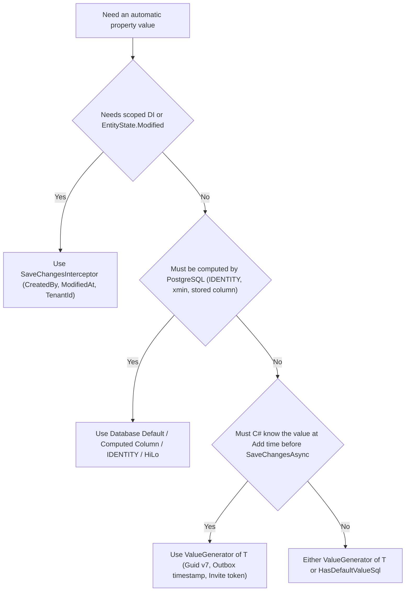
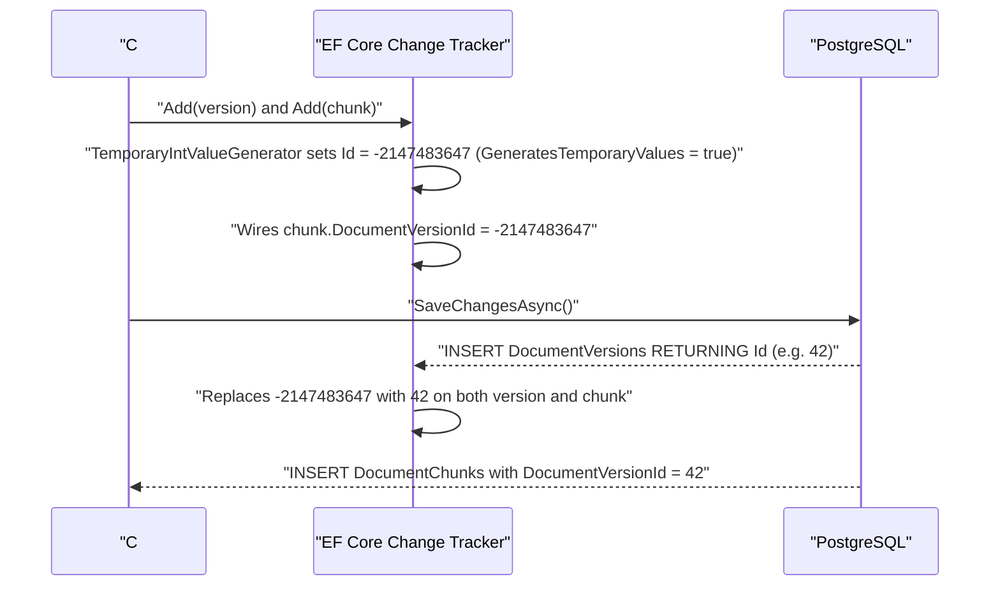

# Module 9: Value Generators in EF Core

In enterprise applications, we often need certain database columns to be populated automatically. Common examples include generating a sequential or time-ordered primary key `Id`, stamping a `CreatedAt` timestamp, setting an expiration deadline on a pending approval, or attaching an OpenTelemetry trace ID when a row is inserted.

Entity Framework Core 10 provides **Value Generators** (`ValueGenerator<T>`) to handle automatic property population strictly on the C# application side, *before* the SQL command ever reaches the database.

---

## 1. What is a Value Generator?

A **Value Generator** is a C# class that inherits from `ValueGenerator<T>` (in `Microsoft.EntityFrameworkCore.ValueGeneration`). It lets you plug custom C# logic into EF Core's **Change Tracker** (the in-memory component that tracks entity states like `Added`, `Modified`, and `Deleted`) so a property receives a value automatically when an entity is tracked as `Added`.

Instead of relying solely on the database engine to compute a value during `INSERT` (such as PostgreSQL `GENERATED BY DEFAULT AS IDENTITY` or `DEFAULT (now() AT TIME ZONE 'utc')`), **EF Core generates the value in C# memory** and explicitly includes it in the `INSERT` statement.

### Three Core Rules You Must Know First
1. **The Sentinel / CLR Default Rule:** EF Core only invokes a `ValueGenerator<T>` if the property still holds its **sentinel value** (by default, the C# type's default: `Guid.Empty`, `0`, `default(DateTime)`, or `null`). If your application code explicitly sets `document.CreatedAt = customDate` before calling `Add()`, EF Core respects your explicit value and skips the generator.
2. **Synchronous and Async Hooks:** `ValueGenerator<T>` exposes `Next(EntityEntry entry)` (used by `Add()`) and a virtual `NextAsync(EntityEntry entry, CancellationToken ct)` (used by `AddAsync()`, which defaults to calling `Next()`).
3. **Model-Scoped Singleton Lifetime (Critical):** EF Core caches each `ValueGenerator` instance **once per property per compiled model (`IModel`)**, inside EF Core's internal service provider. It is shared across every `DbContext` instance and every concurrent HTTP request. Therefore, a `ValueGenerator` **must be thread-safe and stateless** (never inject request-scoped services like `ITenantContext` or `ICurrentUserService`).

### 5 Real-World Normora Scenarios for Value Generation
Before writing code, consider where Normora (a .NET 10 modular monolith using PostgreSQL + pgvector) needs automatic values:
1. **`DocumentsDbContext` — `Document.Id` & `DocumentChunk.Id`:** Time-ordered UUIDv7 keys (`Guid.CreateVersion7()`) generated in C# before `SaveChangesAsync()` so chunks insert cleanly into PostgreSQL B-tree indexes without page splits.
2. **`DocumentsDbContext` — `DocumentProcessingOutboxMessage.CreatedAt`:** Stamping the exact UTC timestamp in C# when an upload commits metadata and an outbox record in the same transaction.
3. **`ConversationsDbContext` — `PendingApproval.ExpiresAt`:** Automatically setting a 15-minute Human-in-the-Loop (HITL) expiration window when an agent intercepts a destructive tool like `documents_delete`.
4. **`TenantsDbContext` — `AuditLog.TraceId`:** Capturing the ambient OpenTelemetry `Activity.Current?.TraceId` at insert time so every workspace audit entry correlates with distributed traces.
5. **`TenantsDbContext` — `Invitation.Token` or Reference Codes:** Generating a cryptographically random URL-safe invitation token or human-readable escalation code when a new workspace invitation is added.

---

## 2. The Architectural Alternatives (When to Use What)

Before building a Value Generator, you must understand the four architectural ways to populate automatic values in EF Core 10—and when each one is the right or wrong choice.



### Option A: Constructor / Property Initialization (The "Quick & Dirty" Way)
```csharp
public class Document
{
    public Guid Id { get; set; } = Guid.NewGuid();
    public DateTimeOffset CreatedAt { get; set; } = DateTimeOffset.UtcNow;
    public DateTimeOffset ModifiedAt { get; set; } = DateTimeOffset.UtcNow;
}
```
**Why it's flawed (Wasted CPU, Random GUID Fragmentation & State Failures):**
1. **Wasted CPU on Reads:** If you query 1,000 existing documents (`db.Documents.ToListAsync()`), EF Core must materialize 1,000 `Document` objects in memory before hydrating their columns from PostgreSQL. The property initializers run 1,000 times (allocating random GUIDs and reading the system clock), only for EF Core to immediately overwrite them with the real database values. *(Note: `AsNoTracking()` still materializes entities.)*
2. **The `ModifiedAt` Failure:** Initializers only run when `new Document()` is called. If an admin loads a document at 10:00 AM, updates its title at 10:05 AM, and calls `SaveChangesAsync()`, the constructor does NOT run again—`ModifiedAt` remains stuck at 10:00 AM.

### Option B: Database Defaults (`HasDefaultValueSql` / `IDENTITY`)
```csharp
// PostgreSQL-specific SQL default
builder.Property(d => d.CreatedAt)
    .HasDefaultValueSql("now() AT TIME ZONE 'utc'");
```
**Why it's often problematic (Pre-Commit Blindness & Provider Lock-In):**
* **Pre-Commit Blindness (Critical for Outbox & Events):** Until `SaveChangesAsync()` finishes and PostgreSQL executes `INSERT ... RETURNING "CreatedAt"` (or a second `SELECT` on older providers without `RETURNING`), your C# `Document` object does **not** know its own `Id` or `CreatedAt`. In Normora, `UploadDocumentCommandHandler` writes a `Document`, a `DocumentVersion`, and a `DocumentProcessingOutboxMessage` (containing the `DocumentId` in its JSON payload) in the *same* transaction—you cannot wait until after `INSERT` to learn the ID.
* **Provider Lock-In:** `now() AT TIME ZONE 'utc'` is PostgreSQL syntax, whereas `GETUTCDATE()` is SQL Server syntax. Switching providers or running SQLite integration tests breaks provider-specific SQL defaults.
* **When Option B *IS* Right:** When rows are also inserted directly via raw SQL scripts outside EF Core (e.g., manual DB migrations or ETL jobs), a SQL `DEFAULT` ensures the database enforces the default even without EF Core.

### Option C: The EF Core `ValueGenerator<T>` (Stateless In-Memory Generation)
By using a Value Generator, generation runs in C# *only* when an entity is added to the `ChangeTracker` and the property still equals its sentinel/default:
1. Zero wasted allocations during `SELECT` queries.
2. The generated ID or timestamp is available in C# immediately upon calling `Add()`, *before* `SaveChangesAsync()`.
3. 100% database-provider agnostic (PostgreSQL, SQLite, In-Memory tests behave identically).
4. **When NOT to use it:** Do not use `ValueGenerator<T>` for `ModifiedAt` (generators don't run automatically on `Update`), for `CreatedBy`/`TenantId` (generators are singletons and cannot safely inject scoped `ICurrentUserService` or `ITenantContext`), or for columns derived from other SQL columns (use `HasComputedColumnSql`).

### Option D: `SaveChangesInterceptor` (Context-Aware Auditing)
For values that depend on scoped services (`ICurrentUserService`, `ITenantContext`, injectable `TimeProvider`) or must run on **both** `Added` and `Modified` states (`CreatedBy`, `ModifiedAt`, `ModifiedBy`), use an EF Core `SaveChangesInterceptor` (covered in Section 6).

### 5 Real-World Normora Strategy Comparisons
1. **`DocumentsDbContext` — `Document.Id` (Use `GuidV7ValueGenerator`):** Generated in C# at `Add()` time so `UploadDocumentCommandHandler` can immediately embed `document.Id` inside `DocumentProcessingOutboxMessage.Payload` before `SaveChangesAsync()`.
2. **`DocumentsDbContext` — `Document.CreatedBy` (Use `SaveChangesInterceptor`):** Needs the scoped `ICurrentUserService.ExternalUserId` from the active HTTP request; a singleton `ValueGenerator` cannot access scoped services.
3. **`ConversationsDbContext` — `PendingApproval.ExpiresAt` (Use `ApprovalExpiryGenerator`):** Stateless 15-minute TTL calculation (`now + 15m`) on `Add()`; clean, fast, and provider-agnostic with `ValueGenerator<DateTimeOffset>`.
4. **`TenantsDbContext` — `TenantPlan` Concurrency Token `xmin` (Use PostgreSQL System Column):** Mapped with `.IsRowVersion()` (`ValueGeneratedOnAddOrUpdate`), because PostgreSQL's MVCC transaction ID (`xmin`) must be owned by the database engine.
5. **`DocumentsDbContext` — `DocumentChunk` Word/Token Count or Search Vector (`tsvector`) (Use `HasComputedColumnSql(..., stored: true)`):** Computed directly by PostgreSQL from `"Content"` (`to_tsvector('english', "Content")`) for hybrid RRF search so C# never has to keep the `tsvector` in sync manually.

---

## 3. Creating Custom Value Generators (`ValueGenerator<T>`)

Let's fulfill a real-world Normora requirement: We want `CreatedAt` on entities in `DocumentsDbContext` and `ConversationsDbContext` to automatically receive the exact UTC time when a new entity is added to the `DbContext`.

We do this by creating a custom class that inherits from `ValueGenerator<DateTimeOffset>` (or `ValueGenerator<DateTime>`).

```csharp
using Microsoft.EntityFrameworkCore.ChangeTracking;
using Microsoft.EntityFrameworkCore.ValueGeneration;

public sealed class DateTimeUtcGenerator : ValueGenerator<DateTime>
{
    /// <summary>
    /// Called by EF Core when the entity enters the Added state
    /// and the property still has its CLR default value.
    /// </summary>
    public override DateTime Next(EntityEntry entry)
    {
        // Always generate a pure UTC DateTime (Kind = DateTimeKind.Utc)
        return TimeProvider.System.GetUtcNow().UtcDateTime;
    }

    /// <summary>
    /// If true, EF Core treats this as a temporary placeholder that the database will replace.
    /// If false, EF Core knows THIS is the final value and persists it directly.
    /// Because C# generates the final timestamp, this must be false.
    /// </summary>
    public override bool GeneratesTemporaryValues => false;
}
```

> [!TIP]
> Notice `TimeProvider.System.GetUtcNow().UtcDateTime`: in .NET 8+, `TimeProvider` is the modern abstraction over `DateTime.UtcNow`. Because EF Core instantiates `ValueGenerator<T>` as a model-level singleton without scoped DI, using `TimeProvider.System` keeps your generator stateless and thread-safe. If you need injectable fake time in unit tests, use a `SaveChangesInterceptor` (Section 6) instead.

### Understanding `GeneratesTemporaryValues`
Why does `GeneratesTemporaryValues` exist? Suppose you use a database-generated `int` `IDENTITY` column in PostgreSQL (`DocumentVersion.Id`) and add a parent `DocumentVersion` together with child `DocumentChunk` rows in a single `SaveChangesAsync()` call.

EF Core needs a non-zero temporary `Id` in memory (such as `int.MinValue + 1`) to link `chunk.DocumentVersionId` to `version.Id` before the database assigns the real `IDENTITY` value:



When **your** generator produces the real, final value (like a `Guid` v7 or a UTC timestamp), always return `GeneratesTemporaryValues => false` so EF Core sends your value in the `INSERT` and does not expect PostgreSQL to overwrite it.

### 5 Real-World Normora Custom Value Generators

#### 1. `GuidV7ValueGenerator` (PostgreSQL B-Tree Friendly Primary Keys)
In .NET 9 and .NET 10, `Guid.CreateVersion7()` generates RFC 9562 time-ordered UUIDs. Unlike random UUIDv4 (`Guid.NewGuid()`), UUIDv7 values sort chronologically in PostgreSQL `uuid` B-tree indexes, dramatically reducing page splits on high-volume tables like `DocumentChunk` and `AuditLog`.

```csharp
using Microsoft.EntityFrameworkCore.ChangeTracking;
using Microsoft.EntityFrameworkCore.ValueGeneration;

public sealed class GuidV7ValueGenerator : ValueGenerator<Guid>
{
    public override bool GeneratesTemporaryValues => false;

    public override Guid Next(EntityEntry entry)
    {
        return Guid.CreateVersion7();
    }
}
```

#### 2. `ApprovalExpiryGenerator` (HITL 15-Minute TTL in `Conversations`)
In Normora, destructive agent actions (like `documents_delete`) record a `PendingApproval` in PostgreSQL with a 15-minute Time-To-Live (TTL):

```csharp
public sealed class ApprovalExpiryGenerator : ValueGenerator<DateTimeOffset>
{
    private static readonly TimeSpan ApprovalTtl = TimeSpan.FromMinutes(15);

    public override bool GeneratesTemporaryValues => false;

    public override DateTimeOffset Next(EntityEntry entry)
    {
        return TimeProvider.System.GetUtcNow().Add(ApprovalTtl);
    }
}
```

#### 3. `TraceCorrelationIdGenerator` (OpenTelemetry Trace Binding for `AuditLog`)
Because `Activity.Current` uses `AsyncLocal<T>` (ambient execution context rather than a scoped DI container), a stateless generator can safely capture the active OpenTelemetry trace ID when an `AuditLog` entry is created:

```csharp
using System.Diagnostics;

public sealed class TraceCorrelationIdGenerator : ValueGenerator<string>
{
    public override bool GeneratesTemporaryValues => false;

    public override string Next(EntityEntry entry)
    {
        return Activity.Current?.TraceId.ToString() ?? Guid.CreateVersion7().ToString("N");
    }
}
```

#### 4. `InvitationTokenGenerator` (Cryptographic Workspace Invite Tokens in `Tenants`)
When an admin invites an employee, `Invitation.Token` needs a URL-safe, cryptographically secure random token rather than a predictable sequence:

```csharp
using System.Security.Cryptography;

public sealed class InvitationTokenGenerator : ValueGenerator<string>
{
    public override bool GeneratesTemporaryValues => false;

    public override string Next(EntityEntry entry)
    {
        // 32 random bytes -> 43-character URL-safe Base64Url string
        return Convert.ToBase64String(RandomNumberGenerator.GetBytes(32))
            .Replace('+', '-')
            .Replace('/', '_')
            .TrimEnd('=');
    }
}
```

#### 5. `UtcDateTimeOffsetGenerator` (Outbox & Message Timestamps)
For PostgreSQL `timestamptz` columns mapped to `DateTimeOffset` (such as `DocumentProcessingOutboxMessage.CreatedAt`):

```csharp
public sealed class UtcDateTimeOffsetGenerator : ValueGenerator<DateTimeOffset>
{
    public override bool GeneratesTemporaryValues => false;

    public override DateTimeOffset Next(EntityEntry entry)
    {
        return TimeProvider.System.GetUtcNow();
    }
}
```

---

## 4. Applying Value Generators & Value Generation Modes

Now that we have custom Value Generators, we bind them to entity properties inside parameterless `IEntityTypeConfiguration<T>` classes (located in `server/Modules/{ModuleName}/Persistence/Configurations/` and auto-discovered via `ApplyConfigurationsFromAssembly` per Normora's architecture rules).

```csharp
public sealed class Tenant
{
    public Guid Id { get; set; }
    public string Name { get; set; } = string.Empty;
    public DateTimeOffset CreatedAt { get; set; }
}

public sealed class TenantConfiguration : IEntityTypeConfiguration<Tenant>
{
    public void Configure(EntityTypeBuilder<Tenant> builder)
    {
        builder.ToTable("Tenants", "tenants");
        builder.HasKey(t => t.Id);

        builder.Property(t => t.Id)
            .HasValueGenerator<GuidV7ValueGenerator>()
            .ValueGeneratedOnAdd();

        // Tell EF Core to use our custom generator when adding this entity
        builder.Property(t => t.CreatedAt)
            .HasValueGenerator<UtcDateTimeOffsetGenerator>()
            .ValueGeneratedOnAdd(); // Runs on INSERT only
    }
}
```

### What Happens Under the Hood?
When a CQRS command handler executes:
```csharp
var tenant = new Tenant { Name = "Normora Enterprise" };
// Id is Guid.Empty and CreatedAt is default(DateTimeOffset) — both match their CLR sentinels!

dbContext.Tenants.Add(tenant);
// EF Core intercepts Add():
// 1. Sees Id == Guid.Empty -> calls GuidV7ValueGenerator.Next()
// 2. Sees CreatedAt == default -> calls UtcDateTimeOffsetGenerator.Next()
// Both values are now populated on the C# object BEFORE SaveChangesAsync()!

await dbContext.SaveChangesAsync(cancellationToken);
```

EF Core sends this exact PostgreSQL statement:
```sql
-- EF Core explicitly inserts the values it generated in C#!
INSERT INTO tenants."Tenants" ("Id", "Name", "CreatedAt")
VALUES ('01948a1c-7b2e-7000-8a11-4f9e2c10d3a1', 'Normora Enterprise', '2026-11-20T15:30:00.0000000+00:00');
```

### The Four `ValueGenerated` Modes Explained
| Method | `ValueGenerated` Mode | Behavior |
|---|---|---|
| `.ValueGeneratedNever()` | `Never` | Neither EF Core nor the database generates a value. Your domain/handler MUST supply it (e.g., Keycloak `ExternalUserId` or lookup codes). |
| `.ValueGeneratedOnAdd()` | `OnAdd` | Generated once when the entity is `Added` (by a C# `ValueGenerator<T>` if configured, or by PostgreSQL `IDENTITY` / `DEFAULT`). Never overwritten on `UPDATE`. |
| `.ValueGeneratedOnUpdate()` | `OnUpdate` | Tells EF Core the **database** (e.g., a trigger) generates a new value on `UPDATE`, so EF Core omits it from `UPDATE` and reads it back. **Warning:** Does NOT automatically trigger a C# `ValueGenerator<T>` on `EntityState.Modified`! |
| `.ValueGeneratedOnAddOrUpdate()` | `OnAddOrUpdate` | Tells EF Core the **database** owns the value on both `INSERT` and `UPDATE` (e.g., PostgreSQL `xmin` concurrency token or `HasComputedColumnSql`). |

### Handling Non-Default Sentinels with `.HasSentinel(...)`
By default, EF Core skips a `ValueGenerator` if the property does not equal its CLR default (`0`, `false`, `Guid.Empty`). What if `0` is a **valid business value**—for example, `Conversation.MessageCount` or `Document.RetryCount` where `0` means "zero retries" and you only want a generator (or DB default) when it is unset?

EF Core 8–10 solves this with `.HasSentinel(...)`:
```csharp
builder.Property(d => d.RetryCount)
    .HasSentinel(-1) // -1 means "not explicitly set; apply default/generator"
    .HasDefaultValue(0);
```
If you set `doc.RetryCount = 0`, EF Core sees `0 != -1`, preserves `0`, and sends `0` in SQL. If `doc.RetryCount` is left at `-1`, EF Core uses the default/generator!

### Applying Value Generators Globally (Model Loop vs `ConfigureConventions`)
While `ConfigureConventions` handles global **Value Converters** and column facets (`HaveConversion<T>()`, `HaveMaxLength()`), bulk-attaching a `ValueGenerator` across all entities in a module `DbContext` is done in `OnModelCreating` (or via an `IModelFinalizingConvention`). Always filter strictly to **non-foreign-key primary keys**:
```csharp
protected override void OnModelCreating(ModelBuilder modelBuilder)
{
    modelBuilder.ApplyConfigurationsFromAssembly(typeof(DocumentsDbContext).Assembly);

    foreach (var property in modelBuilder.Model.GetEntityTypes()
        .SelectMany(e => e.GetProperties())
        .Where(p => p.ClrType == typeof(Guid) && p.IsPrimaryKey() && !p.IsForeignKey()))
    {
        property.SetValueGeneratorFactory((_, _) => new GuidV7ValueGenerator());
    }
}
```
*(Note: Skipping `!p.IsForeignKey()` is essential—you never want EF Core inventing a random key for a dependent entity's `TenantId` or `DocumentVersion.DocumentId`!)*

### 5 Real-World Normora Configuration Examples
1. **`DocumentConfiguration` (`Documents`):** Configures `Document.Id` with `.HasValueGenerator<GuidV7ValueGenerator>().ValueGeneratedOnAdd()` and `Document.CreatedAt` with `.HasValueGenerator<UtcDateTimeOffsetGenerator>().ValueGeneratedOnAdd()`.
2. **`PendingApprovalConfiguration` (`Conversations`):** Configures `PendingApproval.ExpiresAt` with `.HasValueGenerator<ApprovalExpiryGenerator>().ValueGeneratedOnAdd()` so every HITL approval automatically gets a 15-minute expiration unless overridden in a test.
3. **`AuditLogConfiguration` (`Tenants`):** Configures `AuditLog.TraceId` with `.HasValueGenerator<TraceCorrelationIdGenerator>().ValueGeneratedOnAdd()` and `AuditLog.CreatedAt` with `.HasValueGenerator<UtcDateTimeOffsetGenerator>().ValueGeneratedOnAdd()`.
4. **`TenantMembershipConfiguration` (`Tenants`):** Configures `TenantMembership.ExternalUserId` with `.ValueGeneratedNever()` because the OIDC subject ID comes strictly from Keycloak claims—EF Core must never invent one.
5. **`DocumentProcessingOutboxMessageConfiguration` (`Documents`):** Configures `OutboxMessage.AttemptCount` with `.HasSentinel(-1).HasDefaultValue(0)` so newly queued jobs explicitly start at `0` attempts without sentinel ambiguity.

---

## 5. How Value Generators Interact with Seed Data (`HasData` vs `UseAsyncSeeding`)

A very common mistake is assuming that your `DateTimeUtcGenerator` or `GuidV7ValueGenerator` will automatically fire when you seed data using `.HasData()`. **It will not.**

### Why `HasData()` Ignores Value Generators
Value Generators only run **at runtime**, inside the EF Core Change Tracker, when you call `dbContext.Add(entity)` (or `AddAsync`).

When you seed data using `.HasData()` inside `IEntityTypeConfiguration<T>`, EF Core bypasses the Change Tracker completely. At design time (`dotnet ef migrations add`), EF Core snapshots the seed objects and compiles static `migrationBuilder.InsertData(...)` calls directly into your migration files. Because no `DbContext` instance is running live inserts, custom Value Generators never execute.

### The Fix for `HasData()`: Explicit & Deterministic Values
If you omit `CreatedAt` in `.HasData()`, EF Core writes `0001-01-01` into the migration. Worse, if you put `DateTimeOffset.UtcNow` or `Guid.NewGuid()` inside `.HasData()`, EF Core's **Model Snapshot Diffing** will see a "changed" seed value every time you run `dotnet ef migrations add` and generate bogus `UpdateData` migrations!

Always hardcode deterministic values inside `.HasData()`:
```csharp
builder.HasData(
    new Tenant
    {
        Id = Guid.Parse("01948a10-0000-7000-8000-000000000001"),
        Name = "Normora Default Workspace",
        // Deterministic timestamp so migrations remain repeatable and diff-clean
        CreatedAt = DateTimeOffset.Parse("2026-01-01T00:00:00Z")
    }
);
```

### The Modern EF Core 9 & 10 Alternative: `UseSeeding` / `UseAsyncSeeding`
Introduced in EF Core 9 and standard in EF Core 10, `UseSeeding` and `UseAsyncSeeding` run **at runtime** against a live `DbContext` (during `Database.MigrateAsync()` or `Database.EnsureCreatedAsync()`). Because they add entities via `context.Set<T>().Add(...)` and call `SaveChangesAsync()`, **your `ValueGenerator<T>` implementations DO run automatically here!**

```csharp
services.AddDbContext<ConversationsDbContext>(options =>
    options.UseNpgsql(connectionString)
        .UseAsyncSeeding(async (context, _, cancellationToken) =>
        {
            var hasStarter = await context.Set<SavedAnswer>().AnyAsync(cancellationToken);
            if (!hasStarter)
            {
                // GuidV7ValueGenerator and UtcDateTimeOffsetGenerator fire automatically!
                context.Set<SavedAnswer>().Add(new SavedAnswer
                {
                    TenantId = SeedConstants.DefaultTenantId,
                    Title = "Travel Expense Policy Summary"
                });
                await context.SaveChangesAsync(cancellationToken);
            }
        }));
```

### 5 Real-World Normora Seeding Examples
1. **`TenantsDbContext` — Default `Tenant` (`HasData`):** Must hardcode deterministic `Guid.Parse(...)` and `DateTimeOffset.Parse("2026-01-01T00:00:00Z")` so `TenantsDatabaseMigrator` generates idempotent migrations.
2. **`TenantsDbContext` — `Department` Seed (`HasData`):** Seeds default departments (`HR & People Ops`, `Finance & Travel`, `IT & Security`) with explicit fixed GUIDs rather than `GuidV7ValueGenerator`.
3. **`TenantsDbContext` — `TenantPlan` Baseline (`HasData`):** Seeds deterministic plan metadata matching `TenantPlanPricingCatalog` without invoking runtime generators.
4. **`DocumentsDbContext` — Sample Onboarding Policy (`UseAsyncSeeding`):** Uses `UseAsyncSeeding` to insert an onboarding sample `Document` in dev environments; `GuidV7ValueGenerator` and `UtcDateTimeOffsetGenerator` populate `Id` and `CreatedAt` automatically.
5. **`ConversationsDbContext` — Starter Prompt Suggestions (`UseAsyncSeeding`):** Seeds workspace prompt suggestions at startup via `context.Add(...)` so `ValueGenerator<T>` stamps `Id` and `CreatedAt` cleanly without polluting migration files.

---

## 6. Built-In Generators, HiLo Sequences & Auditing with `SaveChangesInterceptor`

Before writing custom generators everywhere, know what EF Core 10 ships out of the box—and where a `SaveChangesInterceptor` beats a Value Generator.

### Built-In EF Core Value Generators
1. **`SequentialGuidValueGenerator` vs .NET 10 `Guid.CreateVersion7()`:**
   By default, EF Core automatically wires `SequentialGuidValueGenerator` to `Guid` primary keys on SQL Server. However, EF Core's `SequentialGuidValueGenerator` places the sequential bytes at the end of the 16-byte array (optimized for SQL Server `uniqueidentifier` sorting, which compares the last 6 bytes first). PostgreSQL `uuid` compares bytes **left-to-right (big-endian)**! Therefore, on PostgreSQL, using a custom `GuidV7ValueGenerator` calling `Guid.CreateVersion7()` gives true chronological B-tree locality and avoids page splits.
2. **`TemporaryIntValueGenerator` / `TemporaryLongValueGenerator`:**
   Automatically used when a primary key maps to PostgreSQL `GENERATED BY DEFAULT AS IDENTITY` (`UseIdentityByDefaultColumn()`). Generates negative temporary IDs in memory (`GeneratesTemporaryValues = true`) so EF Core can link parent-child foreign keys before `SaveChangesAsync()`.
3. **`HiLoValueGenerator` (`UseHiLo` — Best of Both Worlds for `long`/`int` Keys):**
   If you want sequential `long` IDs (smaller than 16-byte `uuid`s) *and* you want to know the ID in C# before `SaveChangesAsync()` when bulk-inserting rows, PostgreSQL HiLo sequences (`UseHiLo`) grab a block of IDs (e.g., 10 or 100) from a PostgreSQL `SEQUENCE` in a single call and allocate them in memory using thread-safe `Interlocked` increments:
   ```csharp
   // In AuditLogConfiguration: allocates IDs in blocks of 100 from a PostgreSQL sequence
   builder.Property(a => a.Id)
       .UseHiLo("audit_log_hilo_seq", "tenants");
   ```

### Complete Normora Auditing Setup: `SaveChangesInterceptor`
While `ValueGenerator<T>` is ideal for stateless `CreatedAt` or `Id` generation, it **cannot** handle:
* `ModifiedAt` / `ModifiedBy` (generators do not automatically run on `EntityState.Modified`).
* `CreatedBy` / `TenantId` (requires scoped request services like `ICurrentUserService` and `ITenantContext`).

In Normora, full auditing uses a `SaveChangesInterceptor` with a C# primary constructor (per `AGENTS.md`):

```csharp
using Microsoft.EntityFrameworkCore;
using Microsoft.EntityFrameworkCore.Diagnostics;

public sealed class AuditingSaveChangesInterceptor(
    ICurrentUserService currentUser,
    TimeProvider timeProvider) : SaveChangesInterceptor
{
    public override ValueTask<InterceptionResult<int>> SavingChangesAsync(
        DbContextEventData eventData,
        InterceptionResult<int> result,
        CancellationToken cancellationToken = default)
    {
        if (eventData.Context is null)
            return base.SavingChangesAsync(eventData, result, cancellationToken);

        var now = timeProvider.GetUtcNow();
        var actorId = currentUser.ExternalUserId; // Never KeycloakUserId!

        foreach (var entry in eventData.Context.ChangeTracker.Entries<IAuditableEntity>())
        {
            if (entry.State == EntityState.Added)
            {
                entry.Entity.CreatedAt = now;
                entry.Entity.CreatedBy = actorId;
                entry.Entity.ModifiedAt = now;
                entry.Entity.ModifiedBy = actorId;
            }
            else if (entry.State == EntityState.Modified)
            {
                entry.Entity.ModifiedAt = now;
                entry.Entity.ModifiedBy = actorId;
            }
        }

        return base.SavingChangesAsync(eventData, result, cancellationToken);
    }
}
```

### When NOT to Use a `ValueGenerator<T>`
* **Audit fields needing user/tenant context (`CreatedBy`, `ModifiedBy`, `TenantId`):** Use `SaveChangesInterceptor` or explicit command handler assignment.
* **Update-time fields (`ModifiedAt`):** Use `SaveChangesInterceptor` (or a PostgreSQL trigger if external SQL writes also occur).
* **Cross-column derived data (`tsvector`, full name, line total):** Use `HasComputedColumnSql(..., stored: true)` in PostgreSQL.
* **Optimistic concurrency tokens:** Use PostgreSQL's built-in `xmin` system column via `builder.Property<uint>("xmin").IsRowVersion()` (which automatically configures `ValueGeneratedOnAddOrUpdate()`).

### 5 Real-World Normora Examples (Built-In, HiLo & Interceptors)
1. **`DocumentsDbContext` — `DocumentChunk.Id` (`GuidV7ValueGenerator`):** Avoids random UUIDv4 index fragmentation across hundreds of thousands of pgvector chunks while keeping IDs known before batch embedding calls.
2. **`TenantsDbContext` — `AuditLog.Id` (`UseHiLo`):** Allocates sequential `bigint` IDs in batches of 100 from `tenants.audit_log_hilo_seq`, giving compact indexes without per-row round-trips.
3. **`DocumentsDbContext` — `Document` Auditing (`AuditingSaveChangesInterceptor`):** Stamps `CreatedAt`, `CreatedBy` (`ExternalUserId`), `ModifiedAt`, and `ModifiedBy` cleanly across both `Normora.Api` HTTP requests and `Normora.Worker` Hangfire jobs.
4. **`TenantsDbContext` — `TenantPlan` Concurrency (`IsRowVersion` on `xmin`):** Delegates row-versioning to PostgreSQL MVCC (`ValueGeneratedOnAddOrUpdate`) so concurrent subscription currency/cycle updates cannot silently overwrite each other.
5. **`DocumentsDbContext` — `DocumentChunk` Full-Text Vector (`HasComputedColumnSql`):** Uses PostgreSQL `to_tsvector('english', "Content")` as a stored computed column (`ValueGeneratedOnAddOrUpdate`) for hybrid RRF search alongside pgvector HNSW.

---

## 7. Value Converters vs Value Generators (Strongly-Typed IDs)

It is very common to confuse Value **Generators** with Value **Converters** (covered in Module 7), yet in a strongly-typed domain model they often **work together as a pair**.

* **Value Generator (`ValueGenerator<T>`):** *Creates* a brand-new value out of thin air when an entity is added (like `Guid.CreateVersion7()` or `DateTimeOffset.UtcNow`).
* **Value Converter (`ValueConverter<TModel, TProvider>`):** *Translates* an existing C# object into a database primitive and back (e.g., `DocumentId` to `Guid`).

### The Enterprise Pattern: Strongly-Typed IDs in Normora
In a multi-tenant platform like Normora, you pass `Guid` values everywhere: `TenantId`, `DocumentId`, `ConversationId`, `DepartmentId`. Because they are all raw `Guid`s, the C# compiler cannot stop a catastrophic parameter swap:

```csharp
public async Task<Document?> GetDocumentAsync(Guid tenantId, Guid documentId, CancellationToken ct)
{
    // FATAL SECURITY FLAW (BOLA)! The developer swapped the arguments!
    // The compiler allows it because both parameters are raw Guids.
    return await db.Documents.SingleOrDefaultAsync(
        d => d.TenantId == documentId && d.Id == tenantId, ct);
}
```

### Step 1: Define Strongly-Typed IDs (Domain-Driven Design)
We replace raw `Guid` primitives with `readonly record struct` wrappers so the compiler catches swaps at build time:

```csharp
public readonly record struct TenantId(Guid Value);
public readonly record struct DocumentId(Guid Value);
public readonly record struct ConversationId(Guid Value);

public sealed class Document
{
    public DocumentId Id { get; set; }
    public TenantId TenantId { get; set; }
    public string Title { get; set; } = string.Empty;
}
```

If someone writes `d.TenantId == documentId`, the C# compiler immediately rejects it: *"Operator '==' cannot be applied to operands of type 'TenantId' and 'DocumentId'"*.

### Step 2: Pair a Value Converter WITH a Value Generator
Here is a subtle trap many developers miss: EF Core's built-in `GuidValueGenerator` **only works on raw `Guid` properties**. Once `Document.Id` is a `DocumentId` struct, EF Core knows how to *convert* it (via `ValueConverter<DocumentId, Guid>`), but does **not** automatically know how to *generate* a new `DocumentId` on `Add()`!

You have two clean options:
1. Explicitly assign `Id = new DocumentId(Guid.CreateVersion7())` in a domain factory method and map `.ValueGeneratedNever()`.
2. Pair your `ValueConverter` with a custom `ValueGenerator<DocumentId>` so EF Core generates it automatically on `Add()`:

```csharp
// 1. Value Converter: Translates DocumentId <-> PostgreSQL uuid
public sealed class DocumentIdConverter()
    : ValueConverter<DocumentId, Guid>(id => id.Value, guid => new DocumentId(guid));

// 2. Value Generator: Creates a new DocumentId on Add() using UUIDv7
public sealed class DocumentIdGenerator : ValueGenerator<DocumentId>
{
    public override bool GeneratesTemporaryValues => false;

    public override DocumentId Next(EntityEntry entry)
        => new(Guid.CreateVersion7());
}
```

We register the converter globally in `DocumentsDbContext.ConfigureConventions` and attach the generator to primary keys in `DocumentConfiguration`:
```csharp
// In DocumentsDbContext:
protected override void ConfigureConventions(ModelConfigurationBuilder configurationBuilder)
{
    configurationBuilder.Properties<TenantId>().HaveConversion<TenantIdConverter>();
    configurationBuilder.Properties<DocumentId>().HaveConversion<DocumentIdConverter>();
}

// In DocumentConfiguration (parameterless IEntityTypeConfiguration<Document>):
public void Configure(EntityTypeBuilder<Document> builder)
{
    builder.ToTable("Documents", "documents");
    builder.HasKey(d => d.Id);

    builder.Property(d => d.Id)
        .HasValueGenerator<DocumentIdGenerator>()
        .ValueGeneratedOnAdd();

    // Foreign/partition key: MUST come from tenant context, never generated!
    builder.Property(d => d.TenantId)
        .ValueGeneratedNever();
}
```

### Step 3: Type-Safe Querying with Normora BOLA Enforcement
When `DocumentsDbContext` executes the query, the `ValueConverter` unwraps `TenantId` and `DocumentId` into PostgreSQL `uuid` parameters:

```csharp
public async Task<Document> GetDocumentAsync(TenantId tenantId, DocumentId documentId, CancellationToken ct)
{
    // 100% compile-time type safe; translated to PostgreSQL uuid equality in SQL
    var document = await db.Documents
        .SingleOrDefaultAsync(d => d.TenantId == tenantId && d.Id == documentId, ct);

    // Per Normora security rules, missing or cross-tenant access throws BolaException (404)
    return document ?? throw new BolaException(ApiMessages.NotFound);
}
```

### 5 Real-World Normora Strongly-Typed ID Examples
1. **`DocumentId` (`Documents`):** Pairs `DocumentIdConverter` + `DocumentIdGenerator` (`Guid.CreateVersion7()`) on `Document.Id`, while `DocumentVersion.DocumentId` uses only the converter with `.ValueGeneratedNever()` (since it's a foreign key).
2. **`TenantId` (`Tenants`, `Documents`, `Conversations`):** Uses `TenantIdConverter` everywhere across modules; `TenantConfiguration` attaches `TenantIdGenerator` to `Tenant.Id`, while `Document` and `Conversation` mark `TenantId` as `.ValueGeneratedNever()` (injected from `ITenantContext` or MediatR contract).
3. **`ConversationId` (`Conversations`):** Pairs `ConversationIdConverter` + `ConversationIdGenerator` so SignalR/SSE streaming handlers receive the final `ConversationId` immediately upon `Add()` before streaming tokens.
4. **`DepartmentId` (`Tenants`):** Uses `DepartmentIdConverter` + `DepartmentIdGenerator` so departmental RBAC checks cannot accidentally compare a `DepartmentId` against a `UserGroupId`.
5. **`ApprovalId` (`Conversations`):** Uses `ApprovalIdConverter` + `ApprovalIdGenerator` on `PendingApproval.Id` so the HITL approval card URL (`/api/approvals/{id}`) is strongly typed end-to-end.

---

## 8. Common Mistakes & Anti-Patterns

> [!CAUTION]
> **Anti-Pattern 1: Injecting Scoped Services (`ITenantContext` / `ICurrentUserService`) into a `ValueGenerator<T>`**
> **Wrong:**
> ```csharp
> public sealed class TenantIdGenerator(ITenantContext tenantContext) : ValueGenerator<Guid>
> {
>     public override bool GeneratesTemporaryValues => false;
>     public override Guid Next(EntityEntry entry) => tenantContext.TenantId;
> }
> ```
> **Why it's wrong:** EF Core caches `ValueGenerator` instances as **model-level singletons** inside its internal service provider. Moreover, `HasValueGenerator<T>()` instantiates `T` using EF Core's internal provider (not your application's scoped DI container). Depending on configuration, this either throws `InvalidOperationException` at runtime or captures a stale `ITenantContext` from the first request—causing a **catastrophic cross-tenant data leak**!
> **Fix:** Read ambient `AsyncLocal` context (`Activity.Current`) only if stateless, or set `TenantId` explicitly / via a scoped `SaveChangesInterceptor`.

> [!CAUTION]
> **Anti-Pattern 2: Using `DateTimeOffset.UtcNow` or `Guid.NewGuid()` Inside `HasData()`**
> **Wrong:**
> ```csharp
> builder.HasData(new Department
> {
>     Id = Guid.NewGuid(),
>     Name = "HR & People Ops",
>     CreatedAt = DateTimeOffset.UtcNow
> });
> ```
> **Why it's wrong:** `HasData()` does not run Value Generators; it compiles static values into migration files. Non-deterministic expressions (`Guid.NewGuid()`, `UtcNow`) change on every `dotnet ef migrations add` run, forcing EF Core to emit spurious `DeleteData`/`InsertData` or `UpdateData` operations in every subsequent migration.
> **Fix:** Hardcode deterministic constants (`Guid.Parse(...)`, `DateTimeOffset.Parse("2026-01-01T00:00:00Z")`) in `HasData()`, or use EF Core 9/10 `UseAsyncSeeding` where runtime `ValueGenerator<T>` instances execute normally.

> [!CAUTION]
> **Anti-Pattern 3: Expecting `ValueGeneratedOnUpdate()` to Run a C# `ValueGenerator<T>` on Updates**
> **Wrong:**
> ```csharp
> builder.Property(d => d.ModifiedAt)
>     .HasValueGenerator<UtcDateTimeOffsetGenerator>()
>     .ValueGeneratedOnUpdate();
> ```
> **Why it's wrong:** EF Core's `ChangeTracker` only runs `ValueGenerator<T>.Next()` when an entity transitions to `EntityState.Added`. Configuring `.ValueGeneratedOnUpdate()` tells EF Core's relational pipeline that the **database** will compute the value during `UPDATE`, so EF Core excludes `ModifiedAt` from the `UPDATE` SQL—leaving `ModifiedAt` unchanged in PostgreSQL unless a SQL trigger exists!
> **Fix:** Use a `SaveChangesInterceptor` (Section 6) to stamp `ModifiedAt` whenever `entry.State == EntityState.Modified`.

> [!CAUTION]
> **Anti-Pattern 4: Setting `GeneratesTemporaryValues => true` on a Final Value Generator**
> **Wrong:**
> ```csharp
> public sealed class DocumentIdGenerator : ValueGenerator<DocumentId>
> {
>     public override bool GeneratesTemporaryValues => true; // BUG!
>     public override DocumentId Next(EntityEntry entry) => new(Guid.CreateVersion7());
> }
> ```
> **Why it's wrong:** `GeneratesTemporaryValues => true` tells EF Core the generated value is a disposable placeholder that PostgreSQL will overwrite during `INSERT`. EF Core omits the property from the `INSERT` statement (expecting `IDENTITY` or a DB default), which causes a `NOT NULL` constraint violation in PostgreSQL if no DB default exists—or discards your generated UUIDv7!
> **Fix:** Always return `GeneratesTemporaryValues => false` when your C# generator produces the final value to persist.

> [!CAUTION]
> **Anti-Pattern 5: Attaching `GuidV7ValueGenerator` to All `Guid` Properties Without Filtering Out Foreign Keys**
> **Wrong:**
> ```csharp
> foreach (var property in modelBuilder.Model.GetEntityTypes()
>     .SelectMany(e => e.GetProperties())
>     .Where(p => p.ClrType == typeof(Guid)))
> {
>     property.SetValueGeneratorFactory((_, _) => new GuidV7ValueGenerator()); // BUG!
> }
> ```
> **Why it's wrong:** This attaches `GuidV7ValueGenerator` not just to primary keys (`Document.Id`), but also to **every foreign key and scalar `Guid`** (such as `TenantId` or `DocumentVersion.DocumentId`). If a developer forgets to assign `TenantId` on a new `Document`, EF Core silently invents a random `Guid` instead of failing validation—creating orphaned, unreachable tenant records!
> **Fix:** Filter strictly to `p.IsPrimaryKey() && !p.IsForeignKey()`, or use Strongly-Typed IDs (`DocumentId` vs `TenantId`) where only entity PKs have a generator.

> [!CAUTION]
> **Anti-Pattern 6: Forgetting `.HasSentinel(...)` When `0` or `false` Is a Valid Value**
> **Wrong:**
> ```csharp
> // Developer wants RetryCount = 0 to mean "0 retries", or default to 3 if unset
> builder.Property(m => m.MaxRetries).HasValueGenerator<DefaultMaxRetriesGenerator>();
> // Later in code:
> outboxMessage.MaxRetries = 0; // Explicitly disable retries!
> db.Add(outboxMessage);        // EF Core sees 0 == CLR default(int), overwrites 0 with 3!
> ```
> **Why it's wrong:** Because `0` is the CLR default for `int`, EF Core cannot distinguish "explicitly set to `0`" from "left unset", so it runs the generator and silently overwrites `0`.
> **Fix:** Configure `.HasSentinel(-1)` (and initialize unset properties to `-1`), so `0` is preserved whenever explicitly assigned.

---

## 9. Interview Questions

**Q1 (Junior): What is the difference between a `ValueGenerator<T>` and `HasDefaultValueSql`?**
> `HasDefaultValueSql` delegates generation to the database engine (e.g., PostgreSQL `now() AT TIME ZONE 'utc'`). While PostgreSQL can return the generated column in the same round-trip via `INSERT ... RETURNING`, C# still does not know the value *before* `SaveChangesAsync()` runs (breaking pre-commit outbox payloads and domain events) and the SQL expression is provider-specific. A `ValueGenerator<T>` runs in C# at `Add()` time, keeping logic database-agnostic and immediately available in memory.

**Q2 (Junior): What is the purpose of `GeneratesTemporaryValues` in `ValueGenerator<T>`?**
> It tells EF Core whether the value returned by `Next()` is final or a temporary placeholder. When `true` (such as EF Core's internal `TemporaryIntValueGenerator` for `IDENTITY` keys), EF Core uses the value in memory only to wire up parent-child foreign keys before `SaveChangesAsync()`, omits it from `INSERT`, and replaces it with the real ID returned by the database. When `false`, EF Core treats the value as final and includes it directly in the `INSERT` statement.

**Q3 (Junior): Why shouldn't you just initialize `CreatedAt = DateTimeOffset.UtcNow` directly on the entity property?**
> Property initializers execute every time an object is constructed—including when EF Core materializes thousands of existing rows from a `SELECT` query, immediately wasting CPU and allocating values that EF Core overwrites milliseconds later. Furthermore, initializers never re-run when an entity is updated, whereas Value Generators only run when an entity is added with its sentinel value.

**Q4 (Senior): Why do custom Value Generators not run during `HasData()` seeding, and what is the EF Core 10 alternative?**
> `HasData()` runs at migration design time without a `ChangeTracker`, baking literal `InsertData` values directly into migration code. Non-deterministic calls inside `HasData()` also cause migration diff churn. In EF Core 9 and 10, `UseSeeding` and `UseAsyncSeeding` execute at runtime against a live `DbContext` using `Add()` and `SaveChangesAsync()`, so custom `ValueGenerator<T>` implementations run normally there.

**Q5 (Senior): Why can't a `ValueGenerator<T>` replace a `SaveChangesInterceptor` for `CreatedBy` and `ModifiedAt`?**
> Two reasons: First, EF Core caches `ValueGenerator` instances as model-level singletons, so injecting request-scoped services like `ICurrentUserService` or `ITenantContext` causes DI scope errors or cross-tenant leaks. Second, EF Core only invokes `ValueGenerator<T>` when an entity enters `EntityState.Added`, not when an existing tracked entity is modified. A `SaveChangesInterceptor` runs per `SaveChangesAsync()` call with full access to scoped DI and all `ChangeTracker` states (`Added` and `Modified`).

**Q6 (Senior): What happens if you explicitly set a property value before calling `db.Add(entity)`—does the `ValueGenerator<T>` overwrite it? How does `.HasSentinel(...)` help?**
> No—EF Core only runs a `ValueGenerator<T>` if the property currently equals its sentinel (by default, the CLR default like `0`, `Guid.Empty`, or `default(DateTimeOffset)`). If `0` or `false` is a legitimate explicit value that must *not* trigger generation, you configure `.HasSentinel(-1)` (or another unused marker) in EF Core 8–10 so `0` is treated as explicitly set.

**Q7 (Architect): In Normora's PostgreSQL database, why is a custom `GuidV7ValueGenerator` (`Guid.CreateVersion7()`) preferred over both `Guid.NewGuid()` and EF Core's built-in `SequentialGuidValueGenerator`?**
> Random UUIDv4 (`Guid.NewGuid()`) causes severe PostgreSQL B-tree index fragmentation and WAL write amplification on large tables like `DocumentChunks`. Meanwhile, EF Core's `SequentialGuidValueGenerator` optimizes byte layout for SQL Server's `uniqueidentifier` comparison order (trailing bytes), not PostgreSQL's `uuid` lexicographical byte order. `.NET 10`'s `Guid.CreateVersion7()` puts a 48-bit millisecond timestamp in the leading bytes, giving true sequential B-tree inserts in PostgreSQL while remaining known in C# before `SaveChangesAsync()` for transactional outbox payloads.

**Q8 (Architect): If you convert `Document.Id` from `Guid` to a strongly-typed `readonly record struct DocumentId(Guid Value)` with a `ValueConverter`, will EF Core still auto-generate IDs on `Add()`?**
> No. EF Core's built-in `Guid` value generation only applies when the CLR property type itself is `Guid`. Once you introduce a `ValueConverter<DocumentId, Guid>`, EF Core knows how to serialize/deserialize `DocumentId`, but you must either assign `new DocumentId(Guid.CreateVersion7())` in a domain factory with `.ValueGeneratedNever()` or explicitly pair the converter with a custom `ValueGenerator<DocumentId>` on the primary key.

---

## Summary
Value Generators provide a clean, stateless, database-agnostic way to populate properties in C# memory at `Add()` time—making generated keys and timestamps available before `SaveChangesAsync()` without constructor overhead on reads. In a PostgreSQL-backed .NET 10 modular monolith like Normora, pairing `GuidV7ValueGenerator` and `ValueConverter<TId, Guid>` delivers B-tree-friendly strongly-typed keys, `UseHiLo` batches `bigint` sequences cleanly, `UseAsyncSeeding` replaces `HasData()` for runtime seeding, and `SaveChangesInterceptor` handles scoped multi-tenant auditing (`CreatedBy`, `ModifiedAt`, `ModifiedBy`).
