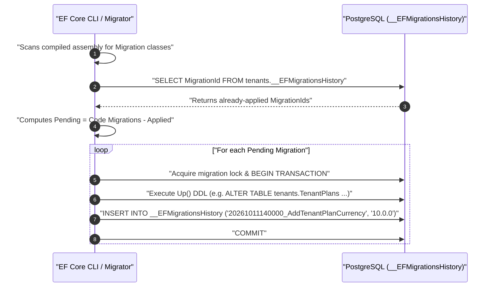
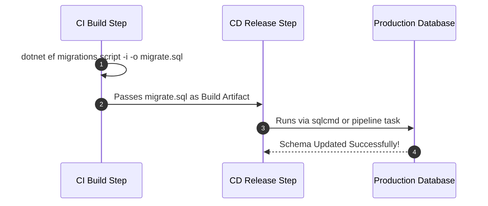
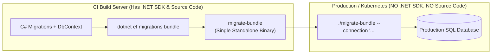
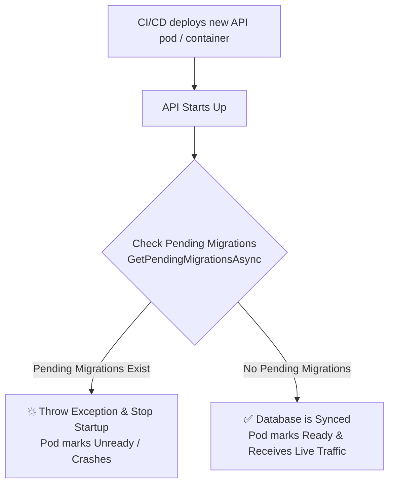

# Module 10: Database Migrations in EF Core

When you build an application with Entity Framework Core 10, your primary source of truth is your C# code (your Domain Entities and `IEntityTypeConfiguration<T>` Fluent API configurations). However, a relational database—such as **PostgreSQL** (used by **Normora** with the `pgvector` extension) or SQL Server—needs a physical **schema** (tables, columns, indexes, primary keys, and foreign keys) to store that data.

How do you keep your C# domain models and your relational database schema perfectly synchronized as your application evolves from Sprint 1 to Year 5? The answer is **Migrations**.

---

## 1. What is a Migration?

A **Migration** is an auto-generated, versioned set of instructions (written in C#) that tells EF Core exactly how to alter the database schema to match the current state of a `DbContext`.

Think of a migration as a **Git commit for your database schema**.

Every time you change your C# entity models or Fluent API mappings (for example, adding a `Currency` column to Normora's `TenantPlan` entity), you generate a new migration. EF Core compares your current C# model against a saved **Model Snapshot** of the previous state and generates a file containing **DDL** (*Data Definition Language*—SQL statements like `CREATE TABLE`, `ALTER TABLE`, and `CREATE INDEX` that define database structure rather than row data): *"To move from State A to State B, execute `ALTER TABLE tenants."TenantPlans" ADD "Currency" character varying(3) NOT NULL DEFAULT 'USD'`."*

When you apply the migration, EF Core translates those C# instructions into provider-specific SQL (PostgreSQL via `Npgsql`, SQL Server via `SqlClient`, etc.) and executes them inside a transaction.

### Real-World Normora Migration Scenarios (What Migrations Handle)
1. **Tenants Module (`TenantsDbContext`) — Billing Currency:** Adding `Currency` to `TenantPlan` so workspaces can persist `INR`, `USD`, `EUR`, or `GBP` pricing from `TenantPlanPricingCatalog`.
2. **Documents Module (`DocumentsDbContext`) — Vector Search:** Enabling the PostgreSQL `vector` extension and adding a `vector` column plus an **HNSW** (*Hierarchical Navigable Small World*, an approximate nearest-neighbor vector index) on `DocumentChunk` for semantic retrieval.
3. **Documents Module (`DocumentsDbContext`) — Transactional Outbox:** Creating the `DocumentProcessingOutboxMessages` table so `UploadDocumentCommandHandler` can atomically persist upload metadata and background-job dispatch state in one transaction.
4. **Conversations Module (`ConversationsDbContext`) — HITL Approvals:** Adding the `PendingApprovals` table with a 15-minute expiration timestamp (`ExpiresAt`) to support two-phase Human-In-The-Loop agent tool execution.
5. **Tenants Module (`TenantsDbContext`) — Vendor-Neutral Identity:** Renaming or backfilling `ExternalUserId` on `TenantMembership` so OIDC subject identifiers from Keycloak remain decoupled from vendor-specific column names.

---

## 2. WHY do we need Migrations?

Before migrations existed, developers either hand-wrote fragile SQL scripts in shared folders or wiped and recreated the database on every model change (similar to calling `Database.EnsureCreated()`).

In an enterprise multi-tenant system like Normora, neither approach survives production. We need migrations for four critical reasons:

### 1. Version Control for Your Schema
Your database schema evolves alongside your application features. Migrations create an auditable, chronological timeline from Day 1 to Year 5. Because migrations are plain `.cs` files committed to Git right next to your CQRS handlers and `IEntityTypeConfiguration<T>` classes, a specific Git commit always knows the exact database schema it expects.

### 2. Safe Team Collaboration
Imagine two engineers working on Normora concurrently:
*   Engineer A adds a `Currency` column to `tenants."TenantPlans"` in `TenantsDbContext`.
*   Engineer B adds a `Status` index on `documents."DocumentProcessingOutboxMessages"` in `DocumentsDbContext`.

Without migrations, their local PostgreSQL databases would immediately drift out of sync. With migrations, Engineer A commits a `Tenants` migration, Engineer B pulls `main`, runs `dotnet ef database update` (or Normora's `--migrate` host), and receives the exact schema change automatically.

### 3. Repeatable Promotions Across Environments
Every environment—Local Docker, CI Integration Tests, Staging, and Production—receives the exact same sequence of schema transitions, tracked in a dedicated history table (`__EFMigrationsHistory`).

### 4. Controlled Rollbacks (When Reversible)
If a newly deployed migration introduces a bad index or nullable constraint bug, you can target an earlier migration to run its `Down()` instructions and revert the schema change—provided the migration didn't permanently drop data (which is why **Zero-Downtime Expand-and-Contract**, covered in Section 6, is essential in production).

### When NOT to Use EF Core Migrations
Migrations are **not** always the right tool:
*   **Ephemeral Automated Unit/Integration Tests:** For throwaway databases created per test class (e.g., SQLite in-memory or a fresh Testcontainers database where migration history isn't being tested), `Database.EnsureCreatedAsync()` is faster because it creates the schema directly from the current model in one step.
*   **DBA-Owned Legacy Schemas:** If an external enterprise DBA team owns the database and forbids application-generated DDL (e.g., shared mainframe/ERP databases), use **Database-First scaffolding** (`dotnet ef dbcontext scaffold`) or read-only views rather than letting EF Core manage DDL.
*   **Ad-Hoc Manual Production Hotfixes:** Never bypass migrations by running manual `ALTER TABLE` commands directly in `pgAdmin` on production—doing so causes **schema drift**, breaking future migrations.

---

## 3. Which Tools are Available for Migrations?

To generate and apply migrations, you don't write the C# migration files yourself. You use command-line tooling provided by Microsoft.

There are **two toolsets** you can use. They invoke the exact same EF Core design-time engine (`Microsoft.EntityFrameworkCore.Design`) under the hood; the choice depends on your IDE and automation workflow.

### Option A: The .NET CLI (`dotnet ef`)
This is the modern, cross-platform command-line tool. You use this in VS Code, JetBrains Rider, Linux/macOS terminals, and automated CI/CD pipelines (such as GitHub Actions).

**Setup:** Install (or update to EF Core 10) globally once on your machine, and ensure your startup project (`Normora.Api`) references `Microsoft.EntityFrameworkCore.Design`:
```bash
dotnet tool install --global dotnet-ef --version 10.*
# Or update an existing installation:
dotnet tool update --global dotnet-ef --version 10.*
```

**Core CLI Commands:**
1. **Create a migration:** `dotnet ef migrations add AddTenantPlanCurrency`
2. **Apply pending migrations to local DB:** `dotnet ef database update`
3. **Remove the last unapplied migration:** `dotnet ef migrations remove`
4. **List all migrations & applied status:** `dotnet ef migrations list`
5. **Check for un-migrated model drift (CI gate):** `dotnet ef migrations has-pending-model-changes`
6. **Generate an idempotent SQL script:** `dotnet ef migrations script --idempotent --output migrate.sql`

### Option B: The Package Manager Console (Visual Studio on Windows)
This PowerShell-based tool is built directly into full Visual Studio.

**Setup:** Install `Microsoft.EntityFrameworkCore.Tools` in your startup project.

**Core PMC Commands:**
1. **Create a migration:** `Add-Migration AddTenantPlanCurrency`
2. **Apply to database:** `Update-Database`
3. **Remove the last migration:** `Remove-Migration`
4. **Generate a raw SQL script:** `Script-Migration -Idempotent`

### 5 Real-World Normora CLI Workflows
Because Normora is a Modular Monolith with multiple `DbContext` classes (`TenantsDbContext`, `DocumentsDbContext`, `ConversationsDbContext`, and the Duende BFF session store), you always pass `--context` and `--output-dir`:

1. **Add a Tenants schema migration:**
   ```bash
   dotnet ef migrations add AddTenantPlanCurrency \
     --context TenantsDbContext \
     --project server/Modules/Tenants \
     --startup-project server/Normora.Api \
     --output-dir Migrations
   ```
2. **Add a Documents pgvector index migration:**
   ```bash
   dotnet ef migrations add AddDocumentChunkHnswIndex \
     --context DocumentsDbContext \
     --project server/Modules/Documents \
     --startup-project server/Normora.Api \
     --output-dir Migrations
   ```
3. **Add a Conversations HITL approval table migration:**
   ```bash
   dotnet ef migrations add AddPendingApprovalTable \
     --context ConversationsDbContext \
     --project server/Modules/Conversations \
     --startup-project server/Normora.Api \
     --output-dir Migrations
   ```
4. **Verify no developer forgot a migration in CI (Model Drift Check):**
   ```bash
   dotnet ef migrations has-pending-model-changes \
     --context DocumentsDbContext \
     --project server/Modules/Documents \
     --startup-project server/Normora.Api
   ```
5. **Inspect which `Conversations` migrations are pending against local PostgreSQL:**
   ```bash
   dotnet ef migrations list \
     --context ConversationsDbContext \
     --project server/Modules/Conversations \
     --startup-project server/Normora.Api
   ```

---

## 4. The Anatomy of a Migration File

When you run `dotnet ef migrations add ...`, EF Core creates or updates **three files** inside the target `--output-dir`:

| Generated File | Purpose | Should You Edit Manually? |
| :--- | :--- | :--- |
| `<Timestamp>_<Name>.cs` | Contains `Up()` (apply change) and `Down()` (revert change) C# operations. | **Yes, when needed** (e.g., adding `migrationBuilder.Sql(...)` for data backfills or `CONCURRENTLY` indexes). |
| `<Timestamp>_<Name>.Designer.cs` | Holds migration metadata (`[Migration("...")]`, `[DbContext(typeof(...))]`) and a copy of the model at that exact point in time (used for rollbacks and scripts). | **Never** — auto-managed by EF Core tooling. |
| `<Context>ModelSnapshot.cs` | Represents the **current** cumulative C# model state across all migrations for that `DbContext`. | **Never** (except when resolving Git merge conflicts carefully—see Section 6). |

Inside `<Timestamp>_AddTenantPlanCurrency.cs`, you will see `Up()` and `Down()`:

```csharp
public partial class AddTenantPlanCurrency : Migration
{
    // Runs when UPGRADING the PostgreSQL schema
    protected override void Up(MigrationBuilder migrationBuilder)
    {
        migrationBuilder.AddColumn<string>(
            name: "Currency",
            schema: "tenants",
            table: "TenantPlans",
            type: "character varying(3)",
            maxLength: 3,
            nullable: false,
            defaultValue: "USD");
    }

    // Runs when ROLLING BACK to the previous migration
    protected override void Down(MigrationBuilder migrationBuilder)
    {
        migrationBuilder.DropColumn(
            name: "Currency",
            schema: "tenants",
            table: "TenantPlans");
    }
}
```

### The `__EFMigrationsHistory` Table (Database Migration History)
How does EF Core know which migrations have already been applied to your database?

The database maintains a system tracking table called **`__EFMigrationsHistory`**. The first time a migration runs for a `DbContext`, EF Core creates this table (if it does not already exist) in the configured schema.

#### 1. What the Table Looks Like
The physical structure of `__EFMigrationsHistory` is lightweight and has two columns:

| Column Name | PostgreSQL Type | SQL Server Type | Description | Example Value |
| :--- | :--- | :--- | :--- | :--- |
| **`MigrationId`** *(PK)* | `character varying(150)` | `nvarchar(150)` | UTC timestamp + Migration name | `20261011140000_AddTenantPlanCurrency` |
| **`ProductVersion`** | `character varying(32)` | `nvarchar(32)` | EF Core version that generated/applied it | `10.0.0` |

* `MigrationId` acts as the Primary Key. Because it begins with a UTC timestamp (`YYYYMMDDHHMMSS`), migrations sort naturally in chronological order.

#### 2. How EF Core Uses This Table (The Sync Lifecycle)
Whenever `dotnet ef database update`, `Database.MigrateAsync()`, or a Migration Bundle runs, EF Core synchronizes your compiled code against this table:



1. **Scan Code:** EF Core inspects the compiled assembly to discover all classes inheriting from `Migration` that carry `[DbContext(typeof(TenantsDbContext))]`.
2. **Query Database:** It reads existing `MigrationId` rows from the context's history table.
3. **Compute Diff:** Any migration in compiled code that is **absent** from `__EFMigrationsHistory` is flagged as **pending**.
4. **Lock, Apply & Record:** EF Core acquires a migration lock (Section 6), runs the migration's `Up()` SQL, and inserts a row into `__EFMigrationsHistory` inside the same database transaction (unless `suppressTransaction: true` is used). If the DDL fails, the transaction rolls back and the history table remains clean.

#### 3. How Idempotent SQL Scripts Use It
When generating SQL scripts for a DBA or automated CI/CD pipeline (`dotnet ef migrations script --idempotent`), **idempotent** means *"safe to execute multiple times without changing the result beyond the first run."* EF Core wraps every migration block with a conditional check against `__EFMigrationsHistory` (shown here for PostgreSQL):

```sql
DO $EF$
BEGIN
    IF NOT EXISTS(
        SELECT 1 FROM tenants."__EFMigrationsHistory"
        WHERE "MigrationId" = '20261011140000_AddTenantPlanCurrency'
    ) THEN
        ALTER TABLE tenants."TenantPlans"
            ADD "Currency" character varying(3) NOT NULL DEFAULT 'USD';

        INSERT INTO tenants."__EFMigrationsHistory" ("MigrationId", "ProductVersion")
        VALUES ('20261011140000_AddTenantPlanCurrency', '10.0.0');
    END IF;
END $EF$;
```

Now the script is completely safe to run against any environment—if a migration has already been executed, PostgreSQL skips it cleanly.

#### 4. Customizing the History Table (Modular Monoliths & Custom Schemas)
By default, EF Core creates `__EFMigrationsHistory` in the default schema (`public` in PostgreSQL, `dbo` in SQL Server). In a Modular Monolith where **multiple `DbContext` instances share one PostgreSQL database**, leaving all of them on the default `__EFMigrationsHistory` table mixes their histories or causes schema ownership collisions.

In Normora, each module isolates its tables **and** its migration history table into its own PostgreSQL schema (`tenants`, `documents`, `conversations`):

```csharp
// Example: Isolating Normora's module history tables per PostgreSQL schema
services.AddDbContext<TenantsDbContext>(options =>
    options.UseNpgsql(connectionString, npgsql =>
        npgsql.MigrationsHistoryTable("__EFMigrationsHistory", "tenants")));

services.AddDbContext<DocumentsDbContext>(options =>
    options.UseNpgsql(connectionString, npgsql =>
    {
        npgsql.UseVector(); // Enables pgvector column & HNSW operator support
        npgsql.MigrationsHistoryTable("__EFMigrationsHistory", "documents");
    }));

services.AddDbContext<ConversationsDbContext>(options =>
    options.UseNpgsql(connectionString, npgsql =>
        npgsql.MigrationsHistoryTable("__EFMigrationsHistory", "conversations")));
```

### 5 Real-World Normora Migration Anatomy Examples
1. **`TenantsDbContext` (`tenants.__EFMigrationsHistory`):** Adding `TenantPlan.Currency` (`character varying(3)`) and `TenantPlan.BillingCycle` (`Monthly`/`Annual`) while preserving existing tenant rows with default `'USD'`.
2. **`DocumentsDbContext` (`documents.__EFMigrationsHistory`):** Enabling `pgvector` via `migrationBuilder.AlterDatabase().Annotation("Npgsql:PostgresExtension:vector", ",,")` and creating the `vector(768)` embedding column on `DocumentChunks`.
3. **`DocumentsDbContext` (`documents.__EFMigrationsHistory`):** Adding `DocumentProcessingOutboxMessages` with an index on `(Status, NextRetryAt)` so Hangfire's `HangfireDocumentProcessingOutboxDispatcher` claims pending uploads efficiently.
4. **`ConversationsDbContext` (`conversations.__EFMigrationsHistory`):** Creating `PendingApprovals` with `ExpiresAt` and `ToolCallPayload` (`jsonb`) for two-phase HITL tool confirmation.
5. **BFF Session Store (`public` or `bff` schema):** Tracking Duende BFF `PersistedGrants` / server-side user session schema separately via `SessionDatabaseMigrator` so auth session upgrades never collide with module migrations.

#### 5. Industry Standard Across Tools
Tracking applied migrations in a dedicated database table is universal across migration engines:
* **EF Core (.NET):** `__EFMigrationsHistory`
* **DbUp (.NET):** `SchemaVersions`
* **Flyway (Java / Polyglot):** `flyway_schema_history`
* **Liquibase:** `DATABASECHANGELOG`

---

## 5. Types of Migrations in Enterprise Applications

When engineers talk about "Types of Migrations," they refer to different strategies for generating and applying schema or data changes. Here are the 5 core migration patterns you will encounter in EF Core 10:

### 1. Code-First Migrations (Schema Migrations)
This is the standard and most common type of migration in EF Core.
*   **What it is:** You modify your C# domain entities and `IEntityTypeConfiguration<T>` classes first, then run `dotnet ef migrations add ...`. EF Core generates the `Up()` and `Down()` methods automatically.
*   **Use Case:** Adding new features—such as adding `Currency` and `BillingCycle` to `TenantPlan` in `TenantsDbContext`, or adding `IsPinned` to `SavedAnswer` in `ConversationsDbContext`.

### 2. Empty Migrations & Non-Transactional DDL (`suppressTransaction: true`)
EF Core generates tables, columns, and standard B-tree indexes, but it cannot express every database-native construct via Fluent API—such as PostgreSQL triggers, custom full-text search `tsvector` expressions, materialized views, or **concurrent index builds**.
*   **What it is:** Run `dotnet ef migrations add AddChunkFtsIndex` *without changing any C# entity*. EF Core scaffolds an empty `Up()` and `Down()` where you place `migrationBuilder.Sql(...)`.
*   **PostgreSQL `suppressTransaction: true`:** By default, EF Core wraps each migration in a transaction. However, PostgreSQL **forbids** running `CREATE INDEX CONCURRENTLY` (which builds indexes without locking table writes!) inside a transaction block. You must pass `suppressTransaction: true`:

```csharp
protected override void Up(MigrationBuilder migrationBuilder)
{
    // Non-blocking production index on Normora's DocumentChunks table
    migrationBuilder.Sql(
        """
        CREATE INDEX CONCURRENTLY IF NOT EXISTS ix_document_chunks_content_fts
        ON documents."DocumentChunks" USING GIN (to_tsvector('english', "Content"));
        """,
        suppressTransaction: true);
}

protected override void Down(MigrationBuilder migrationBuilder)
{
    migrationBuilder.Sql(
        """
        DROP INDEX CONCURRENTLY IF EXISTS documents.ix_document_chunks_content_fts;
        """,
        suppressTransaction: true);
}
```
*   **When NOT to use `suppressTransaction: true`:** Do not mix multiple schema changes in the same migration with `suppressTransaction: true`. If step 2 fails after step 1 succeeds outside a transaction, PostgreSQL cannot roll back step 1 automatically, leaving the migration half-applied. Isolate `CONCURRENTLY` index statements into their own dedicated migration!

### 3. Data Migrations (Preventing Data Loss During Refactoring)
The golden rule of production migrations is **never lose customer data**. Whenever a refactor renames, splits, or transforms columns (for example, migrating Normora's legacy `KeycloakUserId` column to vendor-neutral `ExternalUserId`, or backfilling `TenantPlan.Currency`), EF Core warns you if a scaffolded `DropColumn` may lose data:
> ⚠️ **WARNING: An operation was scaffolded that may result in the loss of data. Please review the migration for accuracy.**

Instead of letting `DropColumn` destroy existing values, inject a SQL backfill step between adding the new column and dropping the old one:

```csharp
protected override void Up(MigrationBuilder migrationBuilder)
{
    // 1. Add the new vendor-neutral column (nullable initially)
    migrationBuilder.AddColumn<string>(
        name: "ExternalUserId",
        schema: "tenants",
        table: "TenantMemberships",
        type: "character varying(128)",
        nullable: true);

    // 2. Backfill existing rows safely in PostgreSQL
    migrationBuilder.Sql("""
        UPDATE tenants."TenantMemberships"
        SET "ExternalUserId" = "KeycloakUserId"
        WHERE "ExternalUserId" IS NULL;
        """);

    // 3. Enforce NOT NULL once all rows are populated
    migrationBuilder.AlterColumn<string>(
        name: "ExternalUserId",
        schema: "tenants",
        table: "TenantMemberships",
        type: "character varying(128)",
        nullable: false,
        oldClrType: typeof(string),
        oldNullable: true);

    // 4. Only drop the legacy column in a later contract migration (see Section 6)
    migrationBuilder.DropColumn(
        name: "KeycloakUserId",
        schema: "tenants",
        table: "TenantMemberships");
}
```

### 4. Data Seeding Migrations (`HasData` vs. EF Core 10 `UseSeeding` / `UseAsyncSeeding`)
There are two distinct mechanisms for seeding reference/initial data in EF Core 10:

| Approach | How It Works | Best For | When NOT to Use |
| :--- | :--- | :--- | :--- |
| **`HasData(...)`** (inside `IEntityTypeConfiguration<T>`) | Generates `migrationBuilder.InsertData(...)` / `UpdateData(...)` inside migration `.cs` files. | Static, immutable lookup tables with hardcoded PKs (e.g., system plan tiers). | **Never** use `Guid.NewGuid()` or `DateTime.UtcNow` inside `HasData`, or EF Core 10 throws `PendingModelChangesWarning`! Not suited for large datasets or runtime DB lookups. |
| **`UseSeeding` / `UseAsyncSeeding`** *(EF Core 9 & 10)* | Configured on `DbContextOptionsBuilder`. Executes automatically inside `Migrate()` / `EnsureCreated()` / `dotnet ef database update` under the migration lock. | Dynamic, idempotent startup seeding (e.g., seeding a default Normora demo workspace, checking if an admin role exists first). | Not embedded in `dotnet ef migrations script` SQL output (runs in C# runtime, not pure SQL). |

```csharp
// EF Core 10 recommended runtime seeding in Normora's DatabaseServiceExtensions:
services.AddDbContext<TenantsDbContext>(options =>
    options.UseNpgsql(connectionString, npgsql =>
            npgsql.MigrationsHistoryTable("__EFMigrationsHistory", "tenants"))
        .UseSeeding((context, _) =>
        {
            if (!context.Set<Tenant>().Any(t => t.Slug == "default"))
            {
                context.Set<Tenant>().Add(Tenant.CreateSystemDefault("default", "Normora Demo"));
                context.SaveChanges();
            }
        })
        .UseAsyncSeeding(async (context, _, ct) =>
        {
            if (!await context.Set<Tenant>().AnyAsync(t => t.Slug == "default", ct))
            {
                context.Set<Tenant>().Add(Tenant.CreateSystemDefault("default", "Normora Demo"));
                await context.SaveChangesAsync(ct);
            }
        }));
```
*(Implement **both** `UseSeeding` and `UseAsyncSeeding` with identical logic because CLI tools and certain synchronous paths invoke `UseSeeding`, while `MigrateAsync()` invokes `UseAsyncSeeding`.)*

### 5. Database-First Migrations (Reverse Engineering / Scaffolding)
When connecting EF Core to an existing database created outside EF Core (e.g., a legacy reporting database managed by DBAs), run `dotnet ef dbcontext scaffold` to inspect the live tables and generate C# entities and a `DbContext`. Once scaffolded, teams typically either keep it read-only or establish an initial baseline migration and adopt Code-First going forward.

### Bonus: "Squashed" Migrations (With Production Safety)
Over several years, a module might accumulate 200+ migration files, slowing down build times and cluttering `Migrations/`. **Squashing** collapses old migrations into a single `InitialBaseline` migration.
*   **Critical Production Catch:** You **cannot** simply delete old migration files and run a new `InitialBaseline` migration against an existing production database—PostgreSQL would fail trying to `CREATE TABLE` on tables that already exist! To squash safely in production, you must either keep a pre-squash marker or manually insert the new baseline `MigrationId` into `__EFMigrationsHistory` (and delete old rows) once all environments have passed the squash checkpoint.

### 5 Real-World Normora Examples Across Migration Types
1. **Code-First (`TenantsDbContext`):** Adding `TenantPlan.Currency` (`USD`, `INR`, `EUR`, `GBP`) and `TenantPlan.BillingCycle` columns via `AddTenantPlanCurrency`.
2. **Empty + `suppressTransaction: true` (`DocumentsDbContext`):** Creating a non-blocking `CREATE INDEX CONCURRENTLY` GIN full-text index and HNSW `vector_cosine_ops` index on `documents."DocumentChunks"` so hybrid RRF search runs without locking document uploads.
3. **Data Migration (`TenantsDbContext`):** Backfilling `tenants."TenantMemberships"."ExternalUserId"` from legacy `KeycloakUserId` rows before removing the vendor-specific column.
4. **EF Core 10 `UseAsyncSeeding` (`TenantsDbContext`):** Idempotently seeding the local development workspace (`Slug = "acme-corp"`) and pre-seeded test memberships during `dotnet Normora.Api.dll --migrate`.
5. **Empty Migration (`ConversationsDbContext`):** Creating a PostgreSQL partial index (`WHERE "Status" = 'Pending'`) on `conversations."PendingApprovals"` so active HITL expiration sweeps stay sub-millisecond.

---

## 6. Advanced Architecture: Snapshots, Deltas, and Syncing Databases

To master migrations, you must understand the underlying engine architecture and how to sync different environments (like Dev and Prod).

### Snapshot-Based vs Delta-Based Migrations
Entity Framework Core uses **both** of these concepts working together. It is a **Delta-based** migration system that is *powered* by a **Snapshot**.

1. **Snapshot-Based (State-Based):**
   A "Snapshot" represents the complete, entire state of your database at a specific moment in time. In EF Core, this is the `[YourDbContext]ModelSnapshot.cs` file. Every time you run `Add-Migration`, EF Core does *not* look at your actual SQL Server database to see what changed. Instead, it compares your current C# code against this massive Snapshot file.
2. **Delta-Based (Diff-Based):**
   "Delta" means "Difference." A Delta-based migration is a file that contains **only the changes** between State A and State B. The actual migration files EF Core generates (like `20231027_AddedAge.cs`) are Delta-based. They only contain the exact `Up()` and `Down()` instructions needed to move the database forward one step. 

**The Lifecycle:** You run `Add-Migration` -> EF Core checks the Snapshot -> Generates a Delta migration file -> Updates the Snapshot for next time.

### Syncing Production and Development Databases
Can you compare the Prod and Dev databases and bring Prod up to Dev's level? **Yes, but you don't use EF Core to do it directly.**

EF Core is designed to compare *C# Code vs a Database*. It is not designed to compare Database A vs Database B. You have two ways to sync them:

**1. The EF Core Way (The Standard CI/CD Approach)**
If your Dev database is simply 3 migrations ahead of Prod, you don't actually need to "compare" them. Because EF Core tracks history in the `__EFMigrationsHistory` table, you generate an idempotent SQL script from your migrations and apply it.

#### Clarifying the Terminology: Generating vs. Translating
* `dotnet ef migrations add <Name>` **generates the C# migration files** (`.cs`) representing schema deltas.
* `dotnet ef migrations script` **translates** those C# migrations into a **pure SQL script** so you can run it via a CI/CD pipeline, DBA review, or a container.

#### The 3 Ways to Apply Migrations in Practice

| Method | Command | Where It's Used | Needs .NET SDK on Target Server? |
| :--- | :--- | :--- | :---: |
| **1. Direct CLI Update** | `dotnet ef database update` | **Local Development Only** | **Yes** |
| **2. SQL Script** | `dotnet ef migrations script -i -o script.sql` | **CI/CD Pipelines & DBA Approvals** | **No** (runs via `sqlcmd`, SSMS, or Azure task) |
| **3. Migration Bundle** | `dotnet ef migrations bundle` | **Kubernetes Init Containers / Cloud Pipelines** | **No** (self-contained executable binary) |

---

#### Pro Tip: Always Use `--idempotent` (`-i`)
You might see developers outputting scripts via terminal redirection:
```bash
dotnet ef migrations script > script.txt
```

While redirection (`> script.txt`) technically writes a file, in enterprise CI/CD pipelines you should always use the official CLI flags:

```bash
dotnet ef migrations script --idempotent --output migrate.sql
# or shorthand:
dotnet ef migrations script -i -o migrate.sql
```

##### Why `--idempotent` (`-i`) is Critical:
* **Without `-i`:** The generated script blindly executes `CREATE TABLE` and `ALTER TABLE`. If any of those tables or columns already exist in the target database, SQL Server throws an exception and the deployment crashes.
* **With `-i`:** EF Core wraps every single migration in a safety check against `__EFMigrationsHistory`:
  ```sql
  IF NOT EXISTS (
      SELECT * FROM [__EFMigrationsHistory] 
      WHERE [MigrationId] = N'20261011_AddedUserAge'
  )
  BEGIN
      ALTER TABLE [Users] ADD [Age] int NULL;
      INSERT INTO [__EFMigrationsHistory] ([MigrationId], [ProductVersion])
      VALUES (N'20261011_AddedUserAge', N'9.0.0');
  END;
  ```
Now the script is **safe to run anytime**—it will only apply what is currently missing and safely skip what has already been applied!

---

#### How to Run This Script in a Pipeline or Container

##### A. In a CI/CD Pipeline (GitHub Actions / Azure DevOps)
In an enterprise release pipeline, the build stage creates the script as an artifact, and the deployment stage executes it against the production database:



Example GitHub Actions step:
```yaml
# Step 1: Generate the idempotent script
- name: Generate SQL Migration Script
  run: dotnet ef migrations script --idempotent --output ./migrate.sql

# Step 2: Execute script against target DB using sqlcmd (no .NET SDK needed on DB runner!)
- name: Run SQL Script on Azure SQL / SQL Server
  run: |
    sqlcmd -S "${{ secrets.DB_SERVER }}" -d "${{ secrets.DB_NAME }}" \
           -U "${{ secrets.DB_USER }}" -P "${{ secrets.DB_PASSWORD }}" \
           -i ./migrate.sql
```

##### B. In a Docker / Kubernetes Container
You have two clean approaches:

* **Option 1 (Using the SQL Script):** Use a lightweight container with `sqlcmd` installed as an **init-container** in Kubernetes. It executes `sqlcmd -i ./migrate.sql` before your main ASP.NET Core API pod spins up.
* **Option 2 (The Modern .NET Alternative — Migration Bundles):** Instead of generating a text SQL script and requiring `sqlcmd`, compile a **Migration Bundle** (explained in full detail below).

---

### Deep Dive: EF Core Migration Bundles (The Modern Cloud & Container Standard)

Introduced in EF Core 6, **Migration Bundles** solve the fundamental operational friction of deploying database migrations in modern cloud environments.

#### 1. WHAT is an EF Core Migration Bundle?
A **Migration Bundle** is a **single-file, self-contained executable binary** (e.g., `bundle.exe` on Windows or `./bundle` ELF binary on Linux) that packages:
* All your compiled C# migration classes (`.cs`)
* Your `DbContext` and Fluent API model metadata
* The internal EF Core runtime migration engine
* The compiled database provider ADO.NET driver (e.g., `Microsoft.Data.SqlClient`, `Npgsql`)

It turns your database migrations into a **portable, standalone CLI tool** that can execute against any database instance without needing external tools.



---

#### 2. WHY Was It Created? (The Problems It Solves)
Before Migration Bundles, developers only had two choices for production deployments, and both introduced friction:

* **The Problem with `dotnet ef database update` in Production:**
  * Requires the **entire .NET SDK** (hundreds of megabytes) installed on the deployment agent or runner.
  * Requires your **entire source code repository** to be present on the production runner to compile on the fly.
  * Having compilers, SDKs, and raw source code on production infrastructure violates enterprise security compliance and creates massive container images.

* **The Problem with SQL Scripts (`dotnet ef migrations script`):**
  * Requires installing and maintaining external database CLI utilities (such as `sqlcmd` for SQL Server or `psql` for PostgreSQL) on deployment runners.
  * Installing and authenticating these utilities inside minimal Linux containers (like Alpine or Distroless images) is brittle and complex.

* **The Migration Bundle Solution:**
  * Compiles once during the CI build stage.
  * Requires **zero .NET SDK, zero source code, and zero SQL client tools** on the target runner.
  * Executes directly against the database with a single command.

---

#### 3. HOW Does It Work?

##### Step 1: Generate the Bundle (in CI / Build Server)
Run this command from your terminal or CI build script:

```bash
# Standard compilation:
dotnet ef migrations bundle --output ./migrate-bundle

# In multi-project / Clean Architecture solutions:
dotnet ef migrations bundle \
  --project src/Infrastructure \
  --startup-project src/Api \
  --output ./artifacts/migrate-bundle
```

###### 💡 Cross-Platform Compiling (Developing on Windows/Mac, Deploying to Linux):
If your production infrastructure or Kubernetes pods run Linux, but you develop on Windows or macOS, cross-compile using `--target-runtime`:
```bash
dotnet ef migrations bundle --target-runtime linux-x64 --output ./migrate-bundle
```

##### Step 2: Execute the Bundle (in CD / Production)
On your deployment server or container runner, execute the binary and pass the connection string:

```bash
# Linux / macOS:
./migrate-bundle --connection "Server=sql-prod;Database=NormoraDb;User Id=sa;Password=Secret123;TrustServerCertificate=True"

# Windows:
.\migrate-bundle.exe --connection "Server=sql-prod;Database=NormoraDb;Integrated Security=True;TrustServerCertificate=True"
```

###### Passing Connection Strings via Environment Variables:
The bundle automatically reads standard ASP.NET Core environment variables without needing explicit CLI arguments:
```bash
export ConnectionStrings__DefaultConnection="Server=sql-prod;Database=NormoraDb;..."
./migrate-bundle
```

###### Previewing the SQL Before Execution (`--script`):
If a DBA or security engineer wants to inspect the exact SQL before applying:
```bash
# Outputs the raw SQL to stdout without executing it against the database!
./migrate-bundle --script
```

###### Targeting a Specific Migration or Rollback:
```bash
# Migrate up to a specific migration:
./migrate-bundle AddedInvoiceTable

# Roll back to an earlier migration:
./migrate-bundle 20261010120000_InitialCreate
```

---

#### 4. Key Benefits of Migration Bundles
1. **Zero Deployment Dependencies:** Does not require the .NET SDK or `dotnet-ef` CLI tool on deployment runners.
2. **No SQL Client Tools Needed:** Executes directly via compiled ADO.NET drivers; no need to install `sqlcmd` or `psql`.
3. **Built-in Idempotency:** Automatically inspects the `__EFMigrationsHistory` table and only applies pending migrations.
4. **Ideal for Kubernetes Init Containers:** Runs inside a lightweight pod/container that exits as soon as migrations complete, before the API pod starts.
5. **Secure & Compliance-Friendly:** No source code is deployed; only compiled MSIL/native binaries.
6. **Cross-Platform:** Cross-compile for `linux-x64`, `linux-arm64`, `win-x64`, or `osx-x64`.

---

#### 5. Comprehensive Comparison: All 3 Migration Approaches

| Feature | 1. Direct CLI (`dotnet ef database update`) | 2. SQL Script (`dotnet ef migrations script -i`) | 3. Migration Bundle (`dotnet ef migrations bundle`) |
| :--- | :--- | :--- | :--- |
| **Primary Use Case** | Local Development & Rapid Prototyping | DBA Review, Gated Approvals, Legacy Pipelines | Modern CI/CD, Docker, Kubernetes, Cloud Deployments |
| **Output Artifact** | None (direct DB execution) | A `.sql` text file | A standalone executable binary (`.exe` / ELF binary) |
| **Requires .NET SDK on Runner?** | **Yes** (mandatory) | **No** | **No** |
| **Requires Source Code on Runner?** | **Yes** (compiles project on the fly) | **No** | **No** |
| **Requires SQL Client (`sqlcmd` / `psql`)?** | No | **Yes** (to execute the script) | **No** (has built-in DB drivers) |
| **DBA Reviewability** | Zero (opaque execution) | **High** (DBA can read raw SQL before running) | Moderate (run with `--script` flag to print SQL) |
| **Idempotent by Default?** | Yes | Yes (when using `-i`) | Yes |
| **Execution Speed in Pipelines** | Slow (must rebuild project) | Fast | **Fastest** (pre-compiled binary) |
| **Container / K8s Init-Container Fit** | Terrible (bloated image needed) | Moderate (requires SQL client installation) | **Best Practice / Ideal** |

##### Architectural Recommendation:
* **For Local Dev:** Use `dotnet ef database update` for instant feedback.
* **For Strict DBA / Regulated Environments (Banking, Healthcare):** Use `dotnet ef migrations script -i -o migrate.sql` so database engineers can review every line of SQL before execution.
* **For Modern Automated CI/CD (Kubernetes, AWS ECS, Azure App Service):** Use **Migration Bundles** (`dotnet ef migrations bundle`) inside a deployment job or init-container for clean, dependency-free automation.

**2. The Schema Compare Way (The DBA Approach)**
What if someone manually logged into Prod and messed with the tables, and now Prod is broken and EF Core's history is corrupted? You must step outside of EF Core and use **Database Tooling**.
You use **Visual Studio Schema Compare (SSDT)** or **Redgate SQL Compare**. You set the Source (Dev DB) and Target (Prod DB). The tool analyzes both live databases, finds the exact differences, and generates a raw `UPDATE` script to force Prod to perfectly match Dev, bypassing EF Core entirely.

---

## 7. Enterprise Migration Commands (Microservices vs Modular Monolith)

When you move away from simple single-project applications and start building Microservices or Modular Monoliths (like Normora), running EF Core migrations becomes significantly more complex. 

Because your `DbContext`, your Migration files, and your `appsettings.json` (Connection String) are split across completely different projects/folders, you **must use specific CLI flags** to tell EF Core where to look.

### The 4 Critical CLI Flags
*   `-p` or `--project`: The project where you want the migration `.cs` files to be saved (Usually the Infrastructure project).
*   `-s` or `--startup-project`: The project that actually runs and holds your `appsettings.json` and Dependency Injection setup (Usually the Web API project).
*   `-c` or `--context`: The exact name of the `DbContext` (Crucial when you have more than one context!).
*   `-o` or `--output-dir`: The specific folder inside the `--project` where you want the files placed.

#### ⚠️ A Note on Command Formatting (Line Continuations)
Because these enterprise commands get extremely long, they are often formatted across multiple lines for readability. To tell the terminal *"this command isn't finished yet, keep reading the next line,"* you must use a **line continuation character**.
*   **Linux / Mac (Bash):** Uses a backslash (`\`)
*   **Windows (PowerShell):** Uses a backtick (`` ` ``)
*   **Windows (Command Prompt):** Uses a caret (`^`)

*(Note: The examples below use the Bash `\` syntax. If you are using Windows PowerShell, replace the `\` with a backtick `` ` `` or paste the command as one single continuous line!)*

---

### Scenario A: Microservices Architecture
In a Microservice architecture, each service is entirely isolated. It has its own database, its own API, and usually its own Solution. You almost always have **exactly one DbContext** per microservice.

#### The Folder Structure
```text
/eCommerce.CatalogService (The Solution)
  ├── /src
  │    ├── /CatalogService.Api             <-- (Startup Project: holds appsettings.json)
  │    │
  │    ├── /CatalogService.Domain
  │    │
  │    ├── /CatalogService.Infrastructure  <-- (Target Project: holds CatalogDbContext)
  │         └── /Data
  │              └── CatalogDbContext.cs
```

#### The Migration Command
Because you only have one DbContext in this solution, you don't need the `--context` flag, but you *must* specify the Project and Startup Project. Execute this from the root `/eCommerce.CatalogService` folder:
```bash
dotnet ef migrations add InitialCreate \
  --project src/CatalogService.Infrastructure \
  --startup-project src/CatalogService.Api \
  --output-dir Data/Migrations
```

**What it does:** 
1. Bootstraps the `CatalogService.Api` to read the connection string.
2. Compiles `CatalogService.Infrastructure` to find the `CatalogDbContext`.
3. Generates the migration files and saves them strictly into `CatalogService.Infrastructure/Data/Migrations/`.

---

### Scenario B: Modular Monolith Architecture (Normora)
A Modular Monolith is a single massive application (one API Host, one process) that is internally divided into strictly isolated modules (Identity, Billing, Inventory). 

Because the modules are strictly isolated, **each module has its own DbContext**, even though they all run in the same API! This means you have multiple DbContexts in the same solution, so you **must** use the `--context` flag, or EF Core will throw an error saying *"More than one DbContext was found"*.

#### The Folder Structure
```text
/Normora.Solution (The Solution)
  ├── /src
  │    ├── /Normora.Host.Api               <-- (Startup Project: runs the whole app)
  │    │
  │    ├── /Modules
  │    │    ├── /Identity
  │    │    │    └── /Normora.Module.Identity.Infrastructure
  │    │    │         └── IdentityDbContext.cs
  │    │    │
  │    │    ├── /Billing
  │    │    │    └── /Normora.Module.Billing.Infrastructure
  │    │    │         └── BillingDbContext.cs
```

#### The Migration Command
If you want to add a new column to a Billing table, you must explicitly target the Billing module's infrastructure and the `BillingDbContext`. Execute this from the root `/Normora.Solution` folder:
```bash
# Generating a migration for the BILLING module
dotnet ef migrations add AddedInvoiceTable \
  --context BillingDbContext \
  --project src/Modules/Billing/Normora.Module.Billing.Infrastructure \
  --startup-project src/Normora.Host.Api \
  --output-dir Migrations

# Generating a migration for the IDENTITY module
dotnet ef migrations add AddedUserAge \
  --context IdentityDbContext \
  --project src/Modules/Identity/Normora.Module.Identity.Infrastructure \
  --startup-project src/Normora.Host.Api \
  --output-dir Migrations
```

#### Updating the Database (`dotnet ef database update`)
When applying the migrations to the database in a Modular Monolith, you also must specify which context you are updating:
```bash
# This applies only the Billing migrations!
dotnet ef database update \
  --context BillingDbContext \
  --project src/Modules/Billing/Normora.Module.Billing.Infrastructure \
  --startup-project src/Normora.Host.Api
```

*(Note: In a true Modular Monolith, even though you have multiple DbContexts, you can choose to point them all at the exact same SQL database using different DB Schemas like `[billing].[Invoices]` and `[identity].[Users]`, or you can point them to entirely different databases!)*

---

## 8. Runtime Schema Validation: The Fail-Fast Migration Guard Pattern

In enterprise environments, calling `context.Database.Migrate()` on application startup is strictly avoided to prevent race conditions, connection pool exhaustion, and privilege escalation. However, this creates a critical operational question: **What happens if a new application version is deployed before the database migration pipeline finishes?**

If the application starts up and immediately handles user traffic against an un-migrated database, queries will fail with runtime SQL exceptions (`Invalid column name`, `Invalid object name`), returning broken HTTP 500 errors to customers.

To prevent this, production applications implement the **Fail-Fast Migration Guard** (Startup Schema Validation).

### The Operational Flow



---

### The Code Pattern & Roslyn Analyzer Warning

A developer might write the following startup check:

```csharp
var pendingMigrations = await context.Database.GetPendingMigrationsAsync();
if (pendingMigrations.Count() > 0)
    throw new Exception("Database is not fully migrated for Module...");
```

Notice the **green squiggly underline** under `pendingMigrations.Count() > 0`:

#### 1. Why the Green Squiggly? (IDE Code Analysis)
The green underline is a Roslyn performance analyzer warning (**CA1860** / **CA1829**):
> ⚠️ **Warning:** *"Avoid using Count() > 0 when checking for non-empty collections. Use Any() instead."*

* **The Cause:** `context.Database.GetPendingMigrationsAsync()` returns `IEnumerable<string>`. Calling `pendingMigrations.Count() > 0` iterates through the **entire** collection simply to check if it has at least one element.
* **The Fix:** `pendingMigrations.Any()` short-circuits and stops evaluating as soon as the first element is encountered. It is both more performant and idiomatic modern C#.

```csharp
// ❌ Slower / Triggers CA1860 analyzer warning:
if (pendingMigrations.Count() > 0)

// ✅ Clean, optimized & idiomatic C#:
if (pendingMigrations.Any())
```

---

### Production-Grade Implementations

Depending on your hosting infrastructure (standalone server vs. Kubernetes / Cloud), you implement this pattern in one of two ways:

#### Approach A: In Program.cs (Fail-Fast Startup Guard)
Before calling `app.Run()`, create a temporary DI scope to resolve your `DbContext` and verify that the schema is current:

```csharp
var app = builder.Build();

// Ensure the database is fully migrated before accepting traffic
using (var scope = app.Services.CreateScope())
{
    var context = scope.ServiceProvider.GetRequiredService<NormoraDbContext>();
    var pendingMigrations = (await context.Database.GetPendingMigrationsAsync()).ToList();

    if (pendingMigrations.Any())
    {
        var migrationList = string.Join(", ", pendingMigrations);
        throw new InvalidOperationException(
            $"Application cannot start: Database is not fully migrated! Pending migrations: [{migrationList}]");
    }
}

app.Run();
```

---

#### Approach B: As an ASP.NET Core Readiness Health Check (Kubernetes / Cloud)
Instead of terminating the container process with an unhandled exception, integrate the check with ASP.NET Core Health Checks. This allows Kubernetes to know whether the container is ready to accept network traffic:

```csharp
public class DatabaseMigrationHealthCheck : IHealthCheck
{
    private readonly NormoraDbContext _context;

    public DatabaseMigrationHealthCheck(NormoraDbContext context) => _context = context;

    public async Task<HealthCheckResult> CheckHealthAsync(
        HealthCheckContext context, 
        CancellationToken cancellationToken = default)
    {
        var pendingMigrations = await _context.Database.GetPendingMigrationsAsync(cancellationToken);

        if (pendingMigrations.Any())
        {
            return HealthCheckResult.Unhealthy(
                $"Database has {pendingMigrations.Count()} pending migration(s): {string.Join(", ", pendingMigrations)}");
        }

        return HealthCheckResult.Healthy("Database schema is fully synchronized.");
    }
}
```

In `Program.cs`:
```csharp
builder.Services.AddHealthChecks()
    .AddCheck<DatabaseMigrationHealthCheck>("database_migrations", tags: ["ready"]);

app.MapHealthChecks("/health/ready", new HealthCheckOptions
{
    Predicate = check => check.Tags.Contains("ready")
});
```

* **Result:** While the independent CI/CD migration job is running, the pod reports `/health/ready` as **503 Unhealthy**. The load balancer routes 0% traffic to it. The moment the migration job finishes, the health check passes (`200 OK`), and traffic seamlessly flows into the pod.

---

## 9. Interview Questions

**Q1: What is the difference between `EnsureCreated()` and Migrations?**
> `dbContext.Database.EnsureCreated()` completely bypasses migrations. It looks at your C# models and instantly creates the database schema from scratch. However, if the database already exists, it does nothing—it cannot *update* an existing schema. Migrations, on the other hand, allow for incremental updates to an existing database schema over time without losing data. `EnsureCreated` is for prototyping and testing; Migrations are for production.

**Q2: You just ran `Add-Migration`, but you realize you made a typo in your C# class name. You haven't updated the database yet. How do you fix it?**
> You should delete the migration by running `Remove-Migration` (PMC) or `dotnet ef migrations remove` (CLI). Then, fix the typo in your C# class, and run `Add-Migration` again. You should *never* just delete the generated `.cs` file manually from the Solution Explorer, because EF Core also updates a `ModelSnapshot.cs` file behind the scenes, and deleting the migration file manually leaves the snapshot corrupted.

**Q3: How does EF Core know which migrations to apply when you run `Update-Database`?**
> EF Core looks at the `__EFMigrationsHistory` table in the target database. It compares the list of migrations in that table against the list of migration `.cs` files in your compiled project. Any migration file that exists in the project but is *not* listed in the history table is executed in chronological order.

**Q4: Is it a good practice for your ASP.NET Core API to call `dbContext.Database.Migrate()` automatically when the app starts up?**
> In small side-projects, yes, it is convenient. In enterprise/production environments, **absolutely not**. If you run multiple instances of your API (e.g., behind a load balancer or in Kubernetes), multiple instances will race to apply migrations simultaneously, causing connection pool exhaustion, deadlocks in `__EFMigrationsHistory`, or schema corruption.
>
> Instead, migrations must be applied independently (via Migration Bundles or CI/CD pipelines). To prevent running against an out-of-sync database, use a read-only check with `GetPendingMigrationsAsync()` or an ASP.NET Core Readiness Health Check (`DatabaseMigrationHealthCheck`).

**Q5: What is an EF Core Migration Bundle, and how does it work under the hood?**
> Introduced in EF Core 6, a Migration Bundle is a single-file, self-contained executable binary that packages your compiled migrations, the `DbContext`, the EF Core runtime, and the database ADO.NET driver. Under the hood, it executes the exact same migration logic as `dotnet ef database update`, but it does not require the .NET SDK, `dotnet-ef` CLI tool, or source code on the target machine. It can be run directly on any server or container via `./migrate-bundle --connection "..."`.

**Q6: Can a DBA or security engineer review the SQL generated by a Migration Bundle before it executes in production?**
> **Yes.** You can run the bundle with the `--script` parameter:
> ```bash
> ./migrate-bundle --script --idempotent > migration_preview.sql
> ```
> This command instructs the bundle to output the exact idempotent SQL statements it would execute to standard output without actually modifying the database. This allows DBAs to inspect, audit, and approve the migration before execution.

**Q7: How do you cross-compile a Migration Bundle on a Windows developer machine to run on a Linux production container?**
> You use the `--target-runtime` (or `-r`) flag with the target Linux Runtime Identifier (RID):
> ```bash
> dotnet ef migrations bundle --target-runtime linux-x64 --output ./migrate-bundle
> ```
> This compiles a Linux ELF binary on Windows, ready to be copied into a Linux Docker image or Kubernetes deployment runner.

**Q8: How do you deploy and run Migration Bundles in Kubernetes?**
> In Kubernetes, there are two standard enterprise patterns:
> 1. **The Init-Container Pattern:** You add an `initContainers` block to your API Pod spec using a lightweight container that runs `./migrate-bundle`. Kubernetes guarantees that the init-container must successfully exit (code 0) before the main API container starts.
> 2. **The Kubernetes Job Pattern (Recommended for Large Teams):** You define a standalone Kubernetes `Job` resource in your Helm chart or deployment manifest. The CI/CD pipeline deploys and monitors the Job. Only after the Job completes successfully does the pipeline trigger the rolling update of the Deployment pods.

**Q9: How do you securely pass database connection strings to a Migration Bundle in CI/CD without hardcoding credentials?**
> You should never hardcode connection strings in commands or commit them to source control. Migration Bundles automatically read standard ASP.NET Core environment variables:
> ```bash
> export ConnectionStrings__DefaultConnection="Server=db;Database=Prod;..."
> ./migrate-bundle
> ```
> In Kubernetes or Docker, this environment variable is mapped directly from a Kubernetes Secret or HashiCorp Vault. In GitHub Actions or Azure DevOps, it is passed via encrypted pipeline secrets.

**Q10: In a Modular Monolith with multiple DbContexts, how do you handle Migration Bundles?**
> Because each `DbContext` represents an isolated module, you generate a **separate bundle for each context** using the `--context` flag:
> ```bash
> # Billing Module Bundle
> dotnet ef migrations bundle --context BillingDbContext --output ./bundle-billing
>
> # Identity Module Bundle
> dotnet ef migrations bundle --context IdentityDbContext --output ./bundle-identity
> ```
> During deployment, your pipeline executes `./bundle-billing` and `./bundle-identity` sequentially or in parallel. Because each context has a dedicated database schema and custom `__EFMigrationsHistory` table, they never collide.

**Q11: Comparing Direct CLI, Idempotent SQL Scripts, and Migration Bundles—how do you choose between them?**
> * **Direct CLI (`dotnet ef database update`):** Choose for **Local Development**. Fast and instant iteration without file artifacts.
> * **Idempotent SQL Scripts (`dotnet ef migrations script -i`):** Choose for **Strict Enterprise / DBA-Governed Environments**. Mandated when DBAs execute scripts manually, or when compliance requires raw SQL audit trails.
> * **Migration Bundles (`dotnet ef migrations bundle`):** Choose for **Automated Cloud / Container / Kubernetes Pipelines**. Eliminates the need for .NET SDK on production nodes, requires no external SQL client tools like `sqlcmd`, and executes natively with zero overhead.

---

## Summary
Migrations act as version control for your relational database schema. By using tools like the `.NET CLI` or `Package Manager Console`, you can seamlessly generate incremental updates (`Up()`) and rollbacks (`Down()`) that keep your SQL database perfectly aligned with your C# Domain Models, enabling safe teamwork and reliable production deployments.
