# Module 11: Real-World Application Integration & Production-Ready Database Management

When taking Entity Framework Core 10 from local development to production, knowing how to write LINQ queries or generate migrations is only half the battle. In real-world enterprise architectures, you must know how to integrate `DbContext` cleanly into ASP.NET Core 10 and background workers, enforce strict module boundaries, intercept and observe database behavior, test against real relational engines, and establish a rock-solid, zero-downtime deployment strategy.

A production-ready system requires a **controlled, versioned, reviewable, and repeatable database deployment process**. It does not necessarily require a separate DB Changes Repository, but it demands unambiguous schema ownership, disciplined lifecycle management, and operational safety.

---

## 1. Integrating EF Core 10 with ASP.NET Core (DI, Lifetimes & Resiliency)

In modern ASP.NET Core 10 applications, **Dependency Injection (DI)**—a pattern where the framework creates and supplies object dependencies rather than classes constructing them manually—manages the lifecycle of your `DbContext`.

A **`DbContext`** represents a session with the database that combines two foundational patterns:
* **Unit of Work:** Tracks all inserts, updates, and deletes in memory and commits them together in one atomic `SaveChangesAsync()` call.
* **Change Tracker:** An internal snapshot dictionary inside `DbContext` that remembers the original property values of entities you loaded so EF Core knows which columns actually changed when generating SQL `UPDATE` statements.

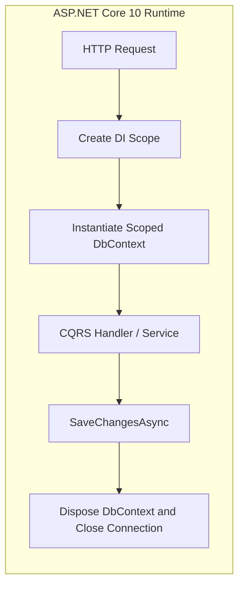

### Registering DbContext in Program.cs and Module Extensions

In a simple single-context app, you register `DbContext` in `Program.cs` using `AddDbContext<T>`. In a **.NET 10 Modular Monolith** like **Normora**, each business module encapsulates its own `DbContext` inside a module extension method (`{ModuleName}ModuleExtensions.cs` or `DatabaseServiceExtensions.cs`) backed by **PostgreSQL 15 + pgvector** via `UseNpgsql`.

```csharp
// Example: Registering a module DbContext in Normora (EF Core 10 + Npgsql + pgvector)
builder.Services.AddDbContext<DocumentsDbContext>((serviceProvider, options) =>
{
    var connectionString = builder.Configuration.GetConnectionString("DefaultConnection")
        ?? throw new InvalidOperationException(ApiMessages.DatabaseConnectionMissing);

    options.UseNpgsql(connectionString, npgsqlOptions =>
    {
        // Enable pgvector support for embedding similarity search
        npgsqlOptions.UseVector();

        // Isolate migration tracking per module schema
        npgsqlOptions.MigrationsHistoryTable("__EFMigrationsHistory_Documents", "documents");

        // Execution Strategy: automatically retry transient network/connection drops
        npgsqlOptions.EnableRetryOnFailure(
            maxRetryCount: 5,
            maxRetryDelay: TimeSpan.FromSeconds(10),
            errorCodesToAdd: null);

        // Fail slow runaway queries after 30 seconds instead of exhausting worker threads
        npgsqlOptions.CommandTimeout(30);
    });

    // Detailed diagnostics ONLY in local Development (never in Production!)
    if (builder.Environment.IsDevelopment())
    {
        options.EnableDetailedErrors();
        options.EnableSensitiveDataLogging();
    }
});
```

> [!NOTE]
> **What is an Execution Strategy (`EnableRetryOnFailure`)?**
> Cloud networks and containerized PostgreSQL instances occasionally experience brief TCP resets or transient failovers. `EnableRetryOnFailure` wraps EF Core commands in a retry policy that replays failed transient commands automatically.
>
> **When NOT to use `EnableRetryOnFailure` blindly:** If your code opens an explicit manual transaction (`await context.Database.BeginTransactionAsync()`), EF Core **throws an `InvalidOperationException`** when `EnableRetryOnFailure` is active because EF Core cannot safely replay half of a user-managed transaction. You must wrap manual transactions inside `await context.Database.CreateExecutionStrategy().ExecuteAsync(async () => { ... })` so the entire transaction block can be retried as a single unit.

### Why DbContext MUST be Scoped (and When NOT to Use Scoped)

`DbContext` is **not thread-safe**, holds mutable state in its Change Tracker, and leases an underlying database connection.
*   **Why not Singleton?** If registered as a Singleton, every concurrent HTTP request shares one instance. The Change Tracker accumulates every entity ever loaded until memory runs out, while concurrent queries throw `InvalidOperationException: A second operation was started on this context instance before a previous operation completed`.
*   **Why not Transient?** If registered as Transient, two services in the same HTTP request receive separate `DbContext` instances, opening multiple connections and splitting what should be one atomic Unit of Work into separate, inconsistent transactions.
*   **Scoped Lifetime is the Default Sweet Spot:** ASP.NET Core creates a fresh **DI Scope** per HTTP request. One `DbContext` instance per module is created on first use, shared by all handlers/interceptors in that request, and automatically disposed when the request ends.

**When NOT to rely on an HTTP Scoped `DbContext`:**
1. **Background Workers (`Normora.Worker` / Hangfire / `BackgroundService`):** There is no HTTP request scope. You must explicitly create a new `IServiceScope` per job or use `IDbContextFactory<T>`.
2. **Parallel Queries (`Task.WhenAll`):** Running two EF Core queries concurrently on the *same* scoped `DbContext` inside one request throws a concurrency exception. Run them sequentially with `await` or use separate contexts from `IDbContextFactory<T>`.
3. **Long-Lived Connections (SignalR Hubs / LLM Token Streams):** Never keep a scoped `DbContext` and its database connection alive while streaming tokens over SignalR or waiting on slow external HTTP APIs.

### Real-World Normora Examples (ASP.NET Core & DI Integration)

1. **Per-Module Registration (`DocumentsModuleExtensions`):** `DocumentsDbContext` is registered with `UseNpgsql`, `UseVector()` (for 768/1536-dimension Gemini embedding columns), `MigrationsHistoryTable("__EFMigrationsHistory_Documents", "documents")`, and `EnableRetryOnFailure`, keeping SQL Server/vendor leaks out of domain handlers.
2. **Dynamic Tenant Filter Binding vs. Unscoped Root:** `DocumentsDbContext` and `ConversationsDbContext` accept scoped `ITenantContext` in their constructors so global query filters evaluate `_tenantContext.TenantId` dynamically per request, whereas `TenantsDbContext` remains unscoped to handle tenant-slug bootstrapping and cross-workspace memberships.
3. **Execution Strategy Around Atomic Document Uploads:** In `UploadDocumentCommandHandler`, because `EnableRetryOnFailure` is active, inserting the `Document`, `DocumentVersion`, and `DocumentProcessingOutboxMessage` inside an explicit transaction uses `await db.Database.CreateExecutionStrategy().ExecuteAsync(...)` so transient PostgreSQL blips retry the full unit safely.
4. **Single Unit of Work in Conversational Turns:** When a chat turn completes in `Conversations`, the handler adds the user `Message`, assistant `Message`, and `MessageCitation` rows to the scoped `ConversationsDbContext` and commits them in one `SaveChangesAsync()` call—either all persist or none do.
5. **Redis Cache Before `TenantsDbContext`:** On every incoming HTTP request, `TenantResolutionMiddleware` checks Redis (`30s–5m` sliding cache) for the tenant slug and user RBAC permissions first, hitting `TenantsDbContext` only on a cache miss so database connections aren't wasted on repetitive auth lookups.

---

## 2. Advanced DbContext Lifecycles: Pooling (`AddDbContextPool`) & Factories (`IDbContextFactory<T>`)

For high-throughput endpoints, background workers, or concurrent workloads, EF Core provides two specialized lifecycle mechanisms beyond standard `AddDbContext<T>`.

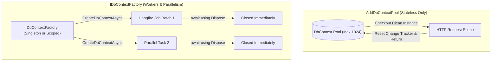

### DbContext Pooling (`AddDbContextPool`)

* **What it is:** Instead of instantiating and garbage-collecting a brand-new `DbContext` (and its internal service graph) on every request, EF Core maintains a pool of pre-allocated `DbContext` instances (default max size: `1024`).
* **Why use it:** Reduces GC pressure and object allocation overhead under extremely high request-per-second (RPS) traffic.
* **How it works:**
  ```csharp
  builder.Services.AddDbContextPool<SessionDbContext>(options =>
      options.UseNpgsql(connectionString), poolSize: 128);
  ```
  When the HTTP scope finishes, EF Core calls an internal reset routine (wiping the Change Tracker and state) and returns the instance to the pool.
* **When NOT to use `AddDbContextPool` (CRITICAL):**
  * **Never use pooling if your `DbContext` injects scoped services like `ITenantContext` or `ICurrentUserService`!** Because a pooled `DbContext` instance outlives the HTTP request and is reused across requests, EF Core **forbids** scoped constructor dependencies (throwing an `InvalidOperationException` at startup or risking catastrophic cross-tenant data leakage if stored in static/cached fields).
  * **Never store mutable instance fields** on a pooled `DbContext` that EF Core doesn't know how to reset.

### DbContext Factory (`IDbContextFactory<T>`)

* **What it is:** A factory (`IDbContextFactory<TContext>`) that creates short-lived, isolated `DbContext` instances on demand via `await using var context = await _factory.CreateDbContextAsync(ct)`.
* **Why use it:** Ideal whenever code executes outside a normal HTTP request scope or needs parallel database work without thread-safety conflicts.
* **How it works (C# Primary Constructor in `.NET 10`):**
  ```csharp
  // Registration
  builder.Services.AddDbContextFactory<DocumentsDbContext>(options =>
      options.UseNpgsql(connectionString, o => o.UseVector()));

  // Background worker in Normora.Worker using primary constructor DI
  public sealed class DocumentPurgeWorker(
      IDbContextFactory<DocumentsDbContext> contextFactory,
      ILogger<DocumentPurgeWorker> logger) : BackgroundService
  {
      protected override async Task ExecuteAsync(CancellationToken stoppingToken)
      {
          while (!stoppingToken.IsCancellationRequested)
          {
              // Short-lived, isolated context for this single batch
              await using var db = await contextFactory.CreateDbContextAsync(stoppingToken);

              var expiredDocs = await db.Documents
                  .IgnoreQueryFilters() // Worker operates across tenants explicitly
                  .Where(d => d.PurgeAfterUtc <= DateTime.UtcNow)
                  .Take(50)
                  .ToListAsync(stoppingToken);

              // Process and dispose immediately...
              logger.LogInformation("Scanned {Count} expired documents.", expiredDocs.Count);
              await Task.Delay(TimeSpan.FromMinutes(5), stoppingToken);
          }
      }
  }
  ```
* **When NOT to use `IDbContextFactory<T>`:** Do not use it inside normal single-threaded CQRS HTTP handlers just to "avoid DI"—creating multiple contexts inside one HTTP request breaks single-transaction Unit of Work guarantees and wastes connections. Also note that `AddDbContextFactory<T>` registers the factory as a **Singleton** by default, so if your `DbContext` constructor depends on a scoped `ITenantContext`, you must either pass `ServiceLifetime.Scoped` to `AddDbContextFactory` or create a new `IServiceScope` per Hangfire job and resolve the scoped `DbContext` normally.

### Real-World Normora Examples (Advanced Lifecycles)

1. **Why `DocumentsDbContext` & `ConversationsDbContext` Reject Pooling:** Both contexts inject scoped `ITenantContext` to enforce dynamic global tenant query filters (`d.TenantId == _tenantContext.TenantId`). Using `AddDbContextPool` is forbidden here because tenant state must strictly die with each request scope.
2. **Where Pooling Fits (`SessionDbContext`):** Normora's Duende BFF `SessionDbContext` (migrated via `SessionDatabaseMigrator`) manages encrypted server-side user sessions keyed by session ID without per-request tenant filter dependencies, making it a safe candidate for `AddDbContextPool`.
3. **`HangfireDocumentProcessingOutboxDispatcher` in `Normora.Worker`:** Hangfire jobs execute in `Normora.Worker` with no `HttpContext`. Each job creates an explicit DI scope (or uses `IDbContextFactory<DocumentsDbContext>`), reads the outbox message's explicit `Guid TenantId`, and performs ingestion scoped strictly to that tenant.
4. **Parallel Fan-Out Without Concurrency Crashes:** If a dashboard or maintenance job needs to aggregate independent metrics from `TenantsDbContext` and `DocumentsDbContext` simultaneously via `Task.WhenAll`, each module has its own distinct `DbContext` instance (or factory-created instance) rather than running two queries concurrently on a single `DbContext`.
5. **Protecting Connections During Gemini SSE Streaming:** In `Conversations` (`NormoraWorkplaceAgent`), `ConversationTurnPreparer` loads history and retrieves chunks via `Documents`, then releases database resources **before** streaming tokens from Google Gemini over SSE (`text/event-stream`). Only after the stream finishes does it open/use a clean unit of work to persist the final assistant message.

---

## 3. Direct DbContext, CQRS Slices & Module Encapsulation vs. Repository Pattern

A frequent architectural debate in .NET is whether to wrap EF Core in generic repositories (`IRepository<T>`).

| Aspect | Direct DbContext in CQRS Slices | Generic Repository (`IRepository<T>`) |
| :--- | :--- | :--- |
| **ORM Alignment** | Embraces EF Core as an existing Unit of Work (`DbContext`) and Repository (`DbSet<T>`). | Introduces an abstraction layer over an already existing abstraction. |
| **LINQ Support** | Full access to projections (`Select`), `AsNoTracking()`, `ExecuteUpdateAsync`, and compiled queries. | Often crippled to `IEnumerable<T>` or forces leaky abstractions with `IQueryable<T>`. |
| **Performance** | Clean projection into DTOs avoids loading entire entity trees into memory. | Frequently fetches entire entities, wasting memory and database bandwidth. |
| **Maintenance** | Zero boilerplate wrapper code; organized cleanly by vertical operation. | Substantial boilerplate across dozens of entity interfaces and classes. |

### The Verdict: CQRS Vertical Slices + 100% DbContext Encapsulation

**CQRS (Command Query Responsibility Segregation)** separates operations that mutate state (**Commands**) from operations that read state (**Queries**). In Normora, each module organizes operations into dedicated folders (`Application/{Feature}/Commands/{OperationName}/` and `Queries/{OperationName}/`) using **MediatR** (an in-process mediator library that decouples callers from handlers).

*   **Avoid Generic Repositories:** Do not write `IRepository<T>` with generic `GetAll()`, `GetById()`, and `Add()` methods. `DbContext` already implements Unit of Work, and `DbSet<T>` already implements Repository.
*   **Enforce 100% DbContext Encapsulation Across Modules:** Direct `DbContext` usage is **strictly private to the owning module**. In Normora, `Conversations` handlers must **never** inject `DocumentsDbContext` or `TenantsDbContext`, and `Normora.Api` controllers must **never** inject any `DbContext`. Cross-module communication travels exclusively over MediatR contracts in `Normora.Shared.Contracts.*` carrying an explicit `Guid TenantId`.
*   **When Abstractions Make Sense:**
    1. **Specific Domain Repositories:** Create intentional repositories only for complex domain aggregates with strict invariants that span multiple child collections.
    2. **External Provider Ports:** Wrap third-party vendor SDKs (MinIO S3, Google Gemini, PayU) behind provider-neutral interfaces (`IDocumentStorageService`, `ITextEmbeddingService`) in the module, implemented in `Normora.Infrastructure`.
*   **When NOT to Expose `IQueryable<T>`:** Never return an unevaluated `IQueryable<T>` from a service or cross-module contract. Doing so leaks EF Core persistence details, breaks encapsulation, and causes deferred execution surprises after the `DbContext` is disposed.

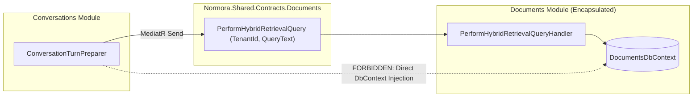

### Real-World Normora Examples (CQRS & Module Encapsulation)

1. **Direct `DocumentsDbContext` in CQRS Command Folder:** `UploadDocumentCommandHandler` (residing in `server/Modules/Documents/Application/Documents/Commands/UploadDocument/`) injects `DocumentsDbContext` directly via a C# primary constructor, avoiding redundant `IDocumentRepository` wrappers.
2. **Read-Only Query Projection on Unscoped `TenantsDbContext`:** `GetAuditLogsQueryHandler` queries `TenantsDbContext` with `.AsNoTracking()`, explicitly filters `.Where(a => a.TenantId == request.TenantId)` (because `TenantsDbContext` has no global tenant filter), and projects directly to `AuditLogDto` with pagination.
3. **Cross-Module Hybrid Search via MediatR:** When `ConversationTurnPreparer` or `SearchCompanyDocumentsTool` in `Conversations` needs document chunks, it dispatches `PerformHybridRetrievalQuery` in `Normora.Shared.Contracts.Documents` (passing `Guid TenantId`) instead of injecting `DocumentsDbContext` or `IRetrievalService`.
4. **Cross-Module MCP Tool Execution:** `McpController` inside `Documents` discovers and runs conversational agent tools via `GetMcpToolsQuery` and `ExecuteMcpToolCommand` in `Normora.Shared.Contracts.Conversations`—zero direct reference to `ConversationsDbContext`.
5. **EF Core 10 `GroupBy` Translation Rule in Metrics Handlers:** In `GetDocumentMetricsQueryHandler`, Normora projects `.GroupBy(d => d.Status).Select(g => new { Status = g.Key, Count = g.Count() })` to an anonymous type first, then maps to the C# `DocumentStatusMetricDto` record in memory—preventing EF Core's relational compiler from throwing an `InvalidOperationException` (HTTP 400) on parameterized record constructors inside `GroupBy`.

---

## 4. Interceptors, Auditing & the Transactional Outbox Pattern

Real-world applications rarely just read and write rows—they also stamp audit metadata, track slow SQL queries, and trigger reliable background work (like document chunking and embedding generation) without breaking transaction boundaries.

### EF Core Interceptors (`SaveChangesInterceptor` & `DbCommandInterceptor`)

* **What they are:** Hook classes registered with EF Core that automatically run before or after key lifecycle events—such as `SaveChangesAsync()` (`ISaveChangesInterceptor`) or SQL command execution (`IDbCommandInterceptor`).
* **Why use them:** Centralizes cross-cutting persistence concerns (like setting `CreatedAtUtc` / `UpdatedAtUtc`, enforcing soft deletes, or measuring command durations) without repeating boilerplate in every CQRS handler.
* **How it works:**
  ```csharp
  public sealed class AuditTimestampsInterceptor(TimeProvider timeProvider) : SaveChangesInterceptor
  {
      public override ValueTask<InterceptionResult<int>> SavingChangesAsync(
          DbContextEventData eventData,
          InterceptionResult<int> result,
          CancellationToken cancellationToken = default)
      {
          if (eventData.Context is null)
              return base.SavingChangesAsync(eventData, result, cancellationToken);

          var now = timeProvider.GetUtcNow().UtcDateTime;
          foreach (var entry in eventData.Context.ChangeTracker.Entries<IAuditableEntity>())
          {
              if (entry.State == EntityState.Added)
                  entry.Entity.CreatedAtUtc = now;

              if (entry.State is EntityState.Added or EntityState.Modified)
                  entry.Entity.UpdatedAtUtc = now;
          }

          return base.SavingChangesAsync(eventData, result, cancellationToken);
      }
  }
  ```
* **When NOT to use Interceptors:** Never call external network APIs (MinIO S3 uploads, Google Gemini requests, Resend emails, or SignalR broadcasts) inside `SavingChangesAsync`. If the DB commit fails or rolls back after the external call, your system is left in an inconsistent state—and holding a database transaction open during slow network calls exhausts PostgreSQL connection pools.

### The Transactional Outbox Pattern

* **What it is:** A reliability pattern where instead of committing to PostgreSQL and then immediately calling an external queue/worker (which can fail mid-flight—known as the **dual-write problem**), you insert an **Outbox Message row** into a database table *inside the exact same database transaction* as your business entity.
* **Why use it:** Guarantees **atomic consistency** ("all or nothing"). If the database commit succeeds, the outbox row is durably stored and guaranteed to be picked up by a background dispatcher even if Redis, Hangfire, or the process crashes a millisecond later.

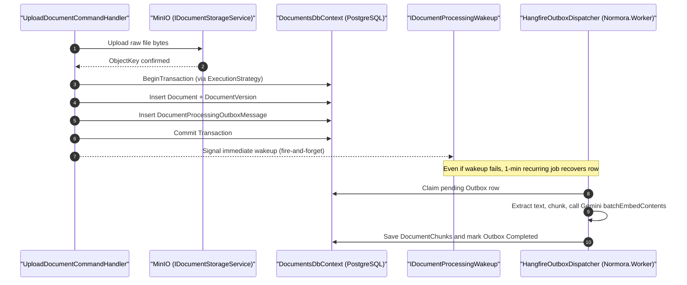

* **When NOT to use an Outbox:** Skip the outbox for simple CRUD operations with no asynchronous downstream side effects (e.g., updating a department name or branding color) or for ephemeral UI state where eventual background retry isn't needed.

### Real-World Normora Examples (Interceptors & Transactional Outbox)

1. **`AuditTimestampsInterceptor` Across Modules:** Registers as a singleton/scoped interceptor on `TenantsDbContext`, `DocumentsDbContext`, and `ConversationsDbContext` so `CreatedAtUtc` and `UpdatedAtUtc` are stamped consistently using .NET `TimeProvider` without polluting CQRS handlers.
2. **Atomic Document Upload + Outbox (`UploadDocumentCommandHandler`):** Inserts `Document`, `DocumentVersion`, and `DocumentProcessingOutboxMessage` inside a single `DocumentsDbContext` transaction, then triggers `IDocumentProcessingWakeup` asynchronously so downstream queue hiccups never fail an already-committed upload.
3. **Self-Healing Outbox Dispatch (`HangfireDocumentProcessingOutboxDispatcher`):** Runs in `Normora.Worker`, claims pending `DocumentProcessingOutboxMessage` rows, and is backed by a minutely recurring Hangfire recovery job so zero uploads are stranded after container restarts.
4. **Slow-Query `DbCommandInterceptor`:** Inspects executed SQL durations across `DocumentsDbContext` (such as pgvector cosine-distance queries) and emits structured warnings when execution exceeds thresholds—without logging raw query parameters.
5. **Two-Phase HITL Document Deletion:** When an AI agent invokes `documents_delete`, `DeleteDocumentCommandHandler` writes a `PendingApproval` record in PostgreSQL with a 15-minute TTL rather than deleting MinIO blobs immediately; only after explicit user consent via `ApprovalsController` does `Normora.Worker` purge MinIO objects and chunks asynchronously.

---

## 5. Logging, Query Diagnostics, OpenTelemetry & Security Hardening

In production systems, you cannot attach a debugger to inspect slow queries. You need structured diagnostics that expose SQL behavior without leaking tenant secrets.

### Capturing Generated SQL
EF Core integrates seamlessly with `Microsoft.Extensions.Logging`. In development, SQL queries stream to the console when enabled in `appsettings.Development.json`:

```json
{
  "Logging": {
    "LogLevel": {
      "Default": "Information",
      "Microsoft.EntityFrameworkCore.Database.Command": "Information"
    }
  }
}
```

### Console Debugging (`LogTo`) & Sensitive Data Rules
For quick diagnostics or console tools, use `LogTo`:

```csharp
optionsBuilder
    .UseNpgsql(connectionString, o => o.UseVector())
    .LogTo(Console.WriteLine, LogLevel.Information)
    .EnableSensitiveDataLogging(); // WARNING: Strictly Development ONLY!
```

> [!WARNING]
> `EnableSensitiveDataLogging()` prints actual SQL parameter values—including `ExternalUserId` subjects, email addresses, document chunk text, and tenant secrets. Enabling it in production leaks PII to centralized log aggregators (Seq, Datadog, CloudWatch) and violates compliance standards (GDPR, HIPAA, SOC 2).

### Query Tags (`TagWith` & `TagWithCallSite`)
In production environments running thousands of queries per minute, pinpointing which C# CQRS handler produced a slow PostgreSQL query in `pg_stat_statements` is hard without **Query Tags**:

```csharp
var activeTenants = await tenantsDb.Tenants
    .AsNoTracking()
    .TagWith("Tenants: LoadActiveTenantsForLookup")
    .Where(t => t.IsActive)
    .Select(t => new TenantSummaryDto(t.Id, t.Slug, t.Name))
    .ToListAsync(cancellationToken);
```

EF Core injects the tag as a SQL comment directly above the PostgreSQL query:
```sql
-- Tenants: LoadActiveTenantsForLookup

SELECT t."Id", t."Slug", t."Name"
FROM tenants."Tenants" AS t
WHERE t."IsActive" = TRUE
```
You can also chain `.TagWithCallSite()` during debugging to include the exact C# file path and line number in the SQL comment.

### OpenTelemetry & Security Hardening (CWE-209, BOLA & BFLA)
* **OpenTelemetry (`AddEntityFrameworkCoreInstrumentation`):** Traces every EF Core command inside distributed HTTP/worker spans, showing exact timing from `Normora.Api` endpoint -> MediatR handler -> `DocumentsDbContext` -> PostgreSQL without recording sensitive parameter literals by default.
* **CWE-209 (Information Exposure Through Error Messages):** Never surface `NpgsqlException.Message`, `DbUpdateException.InnerException`, or table/column names to HTTP responses, SignalR streams, or failure emails. Log full technical details internally and return standardized constants from `Normora.Shared.Constants.ApiMessages`.
* **BOLA (Broken Object Level Authorization -> 404) & BFLA (Broken Function Level Authorization -> 403):** When a tenant-filtered EF Core query returns `null`, never distinguish "does not exist" from "belongs to another tenant." Throw `BolaException()` (mapped globally to `404 Not Found` with `ApiMessages.NotFound`) to prevent resource ID enumeration. Throw `BflaException()` (`403 Forbidden` with `ApiMessages.Forbidden`) when the user lacks role permission for the operation.

### Real-World Normora Examples (Diagnostics & Hardening)

1. **Tagging Hybrid RAG Queries (`PerformHybridRetrievalQueryHandler`):** Applies `.TagWith("Documents: HybridRetrievalRRF")` to pgvector cosine-similarity and full-text keyword queries so DBAs can correlate slow vector scans in `pg_stat_statements` straight back to the RAG handler.
2. **OpenTelemetry End-to-End Trace Correlation:** `Normora.Infrastructure` configures OpenTelemetry to trace an entire `POST /api/conversations/{id}/messages` turn—linking Duende BFF auth, Redis tenant cache lookup, `PerformHybridRetrievalQuery` SQL spans, and Gemini API latency in one waterfall.
3. **Environment-Gated `EnableSensitiveDataLogging()`:** `DatabaseServiceExtensions` wraps `EnableDetailedErrors()` and `EnableSensitiveDataLogging()` in `if (environment.IsDevelopment())`, guaranteeing production containers never log document embeddings, user prompts, or invite tokens.
4. **CWE-209 Safe Failure Handling in `DocumentProcessingJob`:** If `SaveChangesAsync()` fails on a constraint or transient error in `Normora.Worker`, full stack traces go strictly to structured OpenTelemetry/Serilog logs, while admin notifications and SignalR failure events receive only `ApiMessages.DocumentProcessingFailed`.
5. **Tenant-Scoped Null Lookup Mapping to `BolaException` (404):** In `GetDocumentByIdQueryHandler`, `DocumentsDbContext` automatically applies `_tenantContext.TenantId` via global query filter; if `FirstOrDefaultAsync(...)` returns `null` (whether deleted, nonexistent, or owned by another tenant), it throws `BolaException()` rather than leaking cross-tenant existence.

---

## 5. Production-Ready Database Management: The Core Concept

A production-ready system requires a **controlled, versioned, reviewable, and repeatable database deployment process**. It does not necessarily need a separate DB Changes Repository.

A separate repository is one way to implement that process. Whether you need one depends on database ownership, the number of applications, release independence, database complexity, and organizational controls.

---

## 6. The Three Independent Decisions

To design a clean database architecture, you must separate three independent decisions that answer fundamentally different questions:

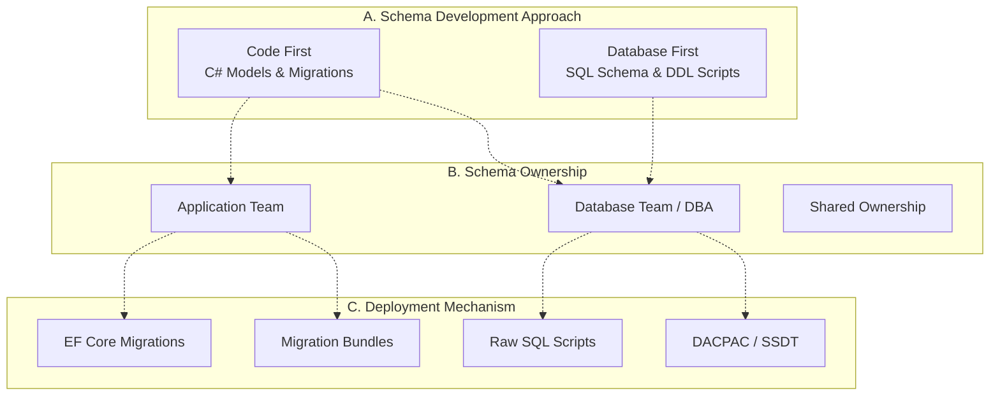

### A. Schema Development Approach
*How do developers define changes?*
*   **Code First:** C# entity models and Fluent API configurations are authoritative. Migrations generate the delta.
*   **Database First:** SQL schemas, DDL scripts, or database projects are authoritative. C# models are reverse-engineered or manually aligned.

### B. Schema Ownership
*Who is authorized to change the database?*
*   **Application Team:** Developers own features end-to-end, including schema migrations.
*   **Database Team:** Dedicated DBAs or Database Engineers review, approve, and apply all schema modifications.
*   **Shared Ownership:** Application teams author proposed changes; database teams review and gate staging/production deployments.

### C. Deployment Mechanism
*How are approved changes applied?*
*   **EF Core Migrations:** Executed in pipelines via CLI or migration bundles.
*   **Raw SQL Scripts:** Idempotent, reviewed scripts executed against target databases.
*   **Migration Bundles:** Self-contained executables compiled by EF Core containing all migrations and runtime dependencies.
*   **DACPAC:** Declarative state packages generated from Visual Studio SQL Database Projects (`.sqlproj`).

> [!NOTE]
> These decisions are not mutually exclusive. You can use **Code First** while deploying through a **separate database repository**. You can also use **Database First** while storing SQL scripts in the **backend application repository**.

---

## 7. Why Do Companies Create a Separate DB Changes Repo?

Creating a separate database changes repository is not merely about where `.sql` files live. In enterprise environments, it addresses specific organizational and architectural challenges:

### Reason 1: Database Changes Have Their Own Release Lifecycle
A backend deployment and a database deployment are related, but they are not identical.

For example, your backend application may be releasing version `2.5.0`, while the database has already received a schema update required by another service. A separate database pipeline allows the team to deploy, verify, and approve database changes independently of application deploy schedules.

### Reason 2: Multiple Applications Share the Database

Consider this common enterprise architecture:

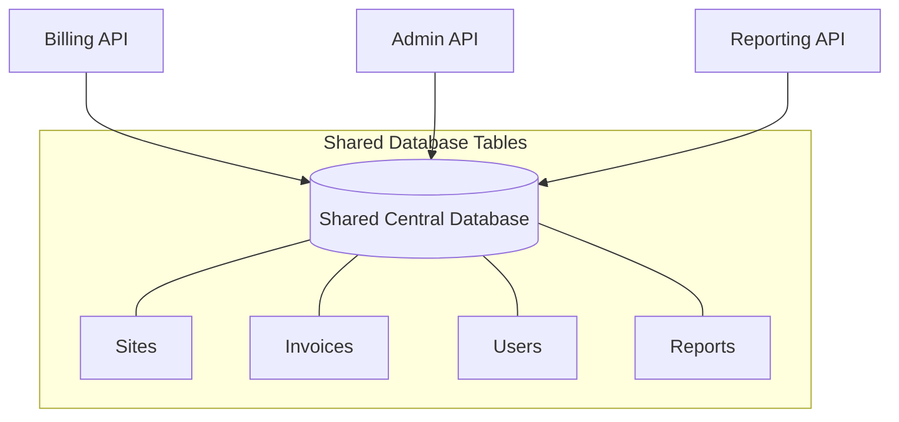

If each application independently owns EF Core migrations against the same tables, severe conflicts emerge:
1. **Conflicting Migrations:** Two teams create migrations modifying the same table simultaneously, causing checksum and history collisions.
2. **Missing Columns:** One application expects a column that another release has dropped or renamed.
3. **Version Mismatches:** Application releases require incompatible schema versions at runtime.
4. **Unintended Outages:** A deployment for Billing accidentally breaks the Reporting API due to an unexpected constraint or column rename.

A central schema owner coordinates these changes. That owner might be a dedicated DB repository, or a designated application team's repository serving as the single authority.

### Reason 3: Database Administrators Need Control
Many organizations, especially in finance, healthcare, and enterprise SaaS, mandate strict governance:
*   Changes must be reviewed by a DBA or database engineering team before reaching staging or production.
*   Changes must be examined as **pure SQL** rather than opaque C# migration code.
*   Database deployments must execute under a **restricted database identity** (least privilege), preventing applications from altering schemas at runtime.
*   Deployments must maintain strict audit trails for regulatory compliance (SOC 2, ISO 27001).

EF Core fully supports this workflow: developers generate idempotent SQL scripts (`dotnet ef migrations script`) for DBA review rather than granting application connection strings unrestricted DDL permissions.

### Reason 4: Stored Procedures and Advanced Database Objects
A database frequently contains objects that EF Core migrations do not manage natively:
*   Stored procedures and user-defined functions
*   Complex reporting views and materialized views
*   Triggers and temporal table configurations
*   Custom clustered/non-clustered indexes, filtered indexes, and partitioning schemes
*   Database roles, user permissions, and row-level security policies
*   Data backfill and patch scripts

A SQL Database Project (`.sqlproj`) manages these objects as a declarative, version-controlled schema and compiles into a **DACPAC** for automated diff-based deployment.

---

## 8. Code First vs. Database First: Production Deployment Pipelines

Both approaches require rigorous testing, approval gates, and automated deployment pipelines.

### Scenario A: Code First with EF Core

In this workflow, the application entity models and EF Core migrations drive schema evolution.

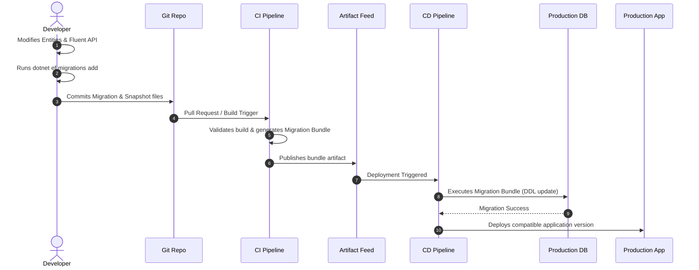

#### Step-by-Step Execution:
1. **Authoring:** Developer updates entities or Fluent API configurations.
2. **Migration Generation:** Developer generates a migration using `dotnet ef migrations add`.
3. **Verification:** Developer inspects the generated C# migration and verifies generated SQL (`dotnet ef migrations script -i`).
4. **CI Build:** The CI server compiles the code, executes unit/integration tests, and builds an executable **Migration Bundle**:
   ```bash
   dotnet ef migrations bundle --output ./artifacts/bundle --project src/Infrastructure --startup-project src/Api
   ```
5. **CD Deployment:** The CD pipeline executes the migration bundle against the target database before or in coordination with the application rollout.

*Typical Artifacts:* Migration files (`.cs`), Model Snapshot (`ModelSnapshot.cs`), Idempotent SQL scripts, Executable Migration Bundles.

---

### Scenario B: Database First / SQL-Owned Schema

In this workflow, SQL schema definitions, scripts, or database projects are authoritative.

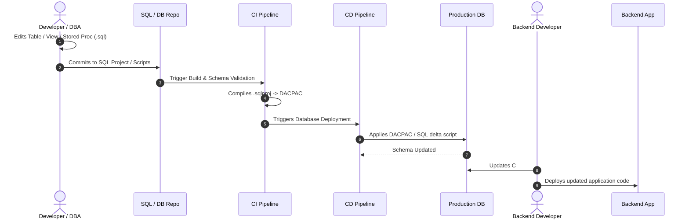

#### Step-by-Step Execution:
1. **Authoring:** Developer or DBA modifies a SQL table, stored procedure, index, or view.
2. **Commit:** Change is committed to a SQL database project (`.sqlproj`) or versioned migration scripts (e.g., Flyway, DbUp, Liquibase).
3. **CI Validation:** CI builds the project, validates SQL syntax, and checks for breaking schema errors.
4. **CD Deployment:** CD generates and deploys an approved differential script or applies the DACPAC via `sqlpackage`.
5. **Application Synchronization:** Backend developers update their C# entity classes, Fluent API configurations, or scaffold updated models via `dotnet ef dbcontext scaffold`.

*Typical Artifacts:* `.sql` DDL scripts, `.sqlproj` files, DACPAC binaries, and deployment logs.

### Key Distinction: Declarative vs. Incremental
*   **SQL Database Projects (Declarative):** Describe the **desired final state** of the entire database. The deployment engine compares the desired state with the target database and generates the necessary delta script on the fly.
*   **EF Core Migrations (Incremental):** Describe **sequential transition steps** (from Migration 01 to Migration 02). EF Core moves the database forward one migration at a time based on the `__EFMigrationsHistory` log.

---

## 9. Multiple Applications: Architectural Decision Matrix

The number of applications alone does not mandate a separate database repository. The deciding factor is **schema ownership boundaries**.

| Architecture | Recommended Migration Ownership & Strategy |
| :--- | :--- |
| **One Application, One Database** | Keep EF Core migrations in the application solution (within the Persistence or Infrastructure project). |
| **Modular Monolith, One Application & Database** | Isolate migrations by module using separate database schemas (e.g., `[billing]`, `[identity]`) or maintain a dedicated migration orchestration project. |
| **Multiple Applications, Same Tables** | Establish **one authoritative schema owner** and a single database deployment pipeline. Other applications consume the schema as read-only or match the authoritative models. |
| **Multiple Applications, Separate DB Schemas** | Each application owns its dedicated database schema (e.g., `schema_billing.*`, `schema_sites.*`). Migrations remain isolated per team with separate history tables. |
| **Legacy Database with DBA Control** | Use a dedicated Database Repository, SQL Project (`.sqlproj`), or tool like DbUp/Flyway. Application uses EF Core in Database-First mode. |
| **Shared Database with Strict Compliance** | Implement a dedicated database deployment pipeline with gated approval. A separate Git repository is often appropriate to enforce independent auditing. |

---

## 10. Modular Monolith: Persistence and Migration Design

In a .NET Modular Monolith (such as the Normora architecture), multiple business modules share a single API host and database while maintaining strict logical boundaries.

### Solution Layout
```text
MySolution/
├── src/
│   ├── Modules/
│   │   ├── Billing/
│   │   │   ├── Domain/
│   │   │   ├── Application/
│   │   │   └── Infrastructure/
│   │   │       └── Persistence/
│   │   │           ├── BillingDbContext.cs
│   │   │           └── Migrations/
│   │   └── Sites/
│   │       ├── Domain/
│   │       ├── Application/
│   │       └── Infrastructure/
│   │           └── Persistence/
│   │               ├── SitesDbContext.cs
│   │               └── Migrations/
│   └── API/
│       └── Program.cs
└── tests/
```

### Avoiding Context and History Collisions
When multiple `DbContext` instances share one physical database, you must prevent them from overwriting each other's tables and migration history.

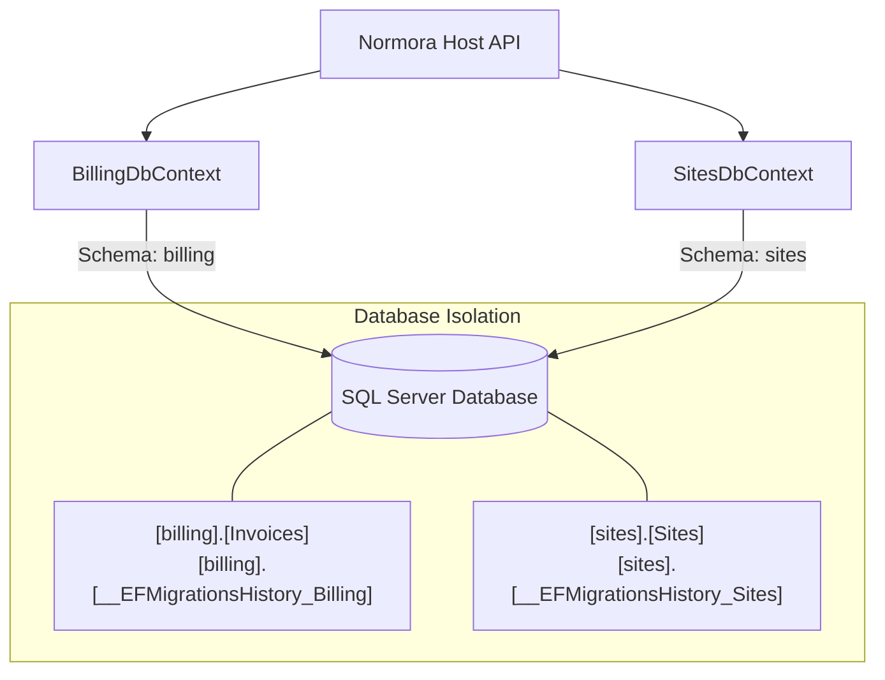

#### 1. Assign Dedicated Database Schemas
Configure each `DbContext` to place its tables into a dedicated schema:
```csharp
// Inside BillingDbContext.cs
protected override void OnModelCreating(ModelBuilder modelBuilder)
{
    modelBuilder.HasDefaultSchema("billing");
    modelBuilder.ApplyConfigurationsFromAssembly(typeof(BillingDbContext).Assembly);
}

// Inside SitesDbContext.cs
protected override void OnModelCreating(ModelBuilder modelBuilder)
{
    modelBuilder.HasDefaultSchema("sites");
    modelBuilder.ApplyConfigurationsFromAssembly(typeof(SitesDbContext).Assembly);
}
```

#### 2. Configure Custom Migration History Tables
By default, all contexts look for `__EFMigrationsHistory` in the `dbo` schema. To prevent context conflicts, configure custom history tables:
```csharp
builder.Services.AddDbContext<BillingDbContext>(options =>
    options.UseSqlServer(connectionString, sql =>
        sql.MigrationsHistoryTable("__EFMigrationsHistory_Billing", "billing")));

builder.Services.AddDbContext<SitesDbContext>(options =>
    options.UseSqlServer(connectionString, sql =>
        sql.MigrationsHistoryTable("__EFMigrationsHistory_Sites", "sites")));
```

---

## 11. Production-Readiness Checklist for EF Core

Before deploying any EF Core database migration to production, verify all nine critical operational controls:


### The 9 Production Controls:

1. **Schema Ownership:** Exactly one authoritative team, project, or pipeline owns each database object. No overlapping contexts modify the same tables.
2. **Version Control:** All migrations, model snapshots, and custom SQL scripts are checked into source control and subjected to code review.
3. **CI Validation:** Automated builds verify that:
   * Migrations compile cleanly.
   * `dotnet ef migrations has-pending-model-changes` returns zero drift.
   * Upgrade tests execute successfully against clean test databases.
4. **Controlled Deployment:** Migrations are applied via **Migration Bundles** or **reviewed SQL scripts** in an isolated CI/CD deployment job.
   > [!CAUTION]
   > Never call `dbContext.Database.Migrate()` on application startup in production. Concurrent application instances (e.g., in Kubernetes or behind load balancers) will race to apply migrations, resulting in connection pool exhaustion, deadlocks, and corrupted schemas.

   #### The Production Alternative: Fail-Fast Startup Guard (`GetPendingMigrationsAsync`)
   If the API doesn't apply migrations on startup, what happens if a deployment is rolled out before the database migration finishes? To avoid serving broken HTTP 500 errors to users, use a **read-only migration guard** at startup:

   ```mermaid
   graph TD
       Deploy[CI/CD deploys new API pod / container] --> Startup[API Starts Up]
       Startup --> Check{Check Pending Migrations<br>GetPendingMigrationsAsync}
       Check -->|Pending Migrations Exist| FailFast[💥 Throw Exception & Stop Startup<br>Pod marks Unready / Crashes]
       Check -->|No Pending Migrations| Ready[✅ Database is Synced<br>Pod marks Ready & Receives Live Traffic]
   ```

   ```csharp
   var pendingMigrations = await context.Database.GetPendingMigrationsAsync();
   if (pendingMigrations.Count() > 0) // ⚠️ Green squiggly: Roslyn CA1860/CA1829
       throw new Exception("Database is not fully migrated for Module...");
   ```

   > [!NOTE]
   > **Why the Green Squiggly on `pendingMigrations.Count() > 0`?**
   > `GetPendingMigrationsAsync()` returns `IEnumerable<string>`. Calling `.Count() > 0` causes Roslyn code analyzers to emit warning **CA1860 / CA1829** (*"Avoid using Count() > 0 when checking for non-empty collections"*), because `.Count()` traverses the entire collection rather than stopping at the first element. The clean, performant fix is `.Any()`:
   > ```csharp
   > if (pendingMigrations.Any())
   >     throw new InvalidOperationException(
   >         $"Database is not fully migrated! Pending: {string.Join(", ", pendingMigrations)}");
   > ```

   #### Approach A: Direct Guard in `Program.cs`
   ```csharp
   var app = builder.Build();

   // Ensure database schema matches compiled code before accepting requests
   using (var scope = app.Services.CreateScope())
   {
       var context = scope.ServiceProvider.GetRequiredService<NormoraDbContext>();
       var pendingMigrations = (await context.Database.GetPendingMigrationsAsync()).ToList();

       if (pendingMigrations.Any())
       {
           var migrationList = string.Join(", ", pendingMigrations);
           throw new InvalidOperationException(
               $"Application cannot start: Database is not fully migrated! Pending migrations: [{migrationList}]");
       }
   }

   app.Run();
   ```

   #### Approach B: As an ASP.NET Core Readiness Health Check (Cloud / Kubernetes)
   In modern containerized deployments, rather than crashing the pod immediately, wire this check into ASP.NET Core's Health Check pipeline. The load balancer marks the pod as `503 Unhealthy` on `/health/ready` and routes 0% traffic to it until the external migration job finishes:

   ```csharp
   public class DatabaseMigrationHealthCheck : IHealthCheck
   {
       private readonly NormoraDbContext _context;

       public DatabaseMigrationHealthCheck(NormoraDbContext context) => _context = context;

       public async Task<HealthCheckResult> CheckHealthAsync(
           HealthCheckContext context, 
           CancellationToken cancellationToken = default)
       {
           var pendingMigrations = await _context.Database.GetPendingMigrationsAsync(cancellationToken);

           if (pendingMigrations.Any())
           {
               return HealthCheckResult.Unhealthy(
                   $"Database has pending migration(s): {string.Join(", ", pendingMigrations)}");
           }

           return HealthCheckResult.Healthy("Database schema is fully synchronized.");
       }
   }
   ```

   Registering in `Program.cs`:
   ```csharp
   builder.Services.AddHealthChecks()
       .AddCheck<DatabaseMigrationHealthCheck>("database_migrations", tags: ["ready"]);

   app.MapHealthChecks("/health/ready", new HealthCheckOptions
   {
       Predicate = check => check.Tags.Contains("ready")
   });
   ```
5. **Least Privilege:** 
   * **Runtime Application User:** Granted only DML permissions (`SELECT`, `INSERT`, `UPDATE`, `DELETE`, `EXECUTE`).
   * **Migration Pipeline User:** Granted DDL permissions (`CREATE`, `ALTER`, `DROP`) only during deployment.
6. **Backward Compatibility (Expand/Contract Pattern):** Schema changes must remain compatible with the *currently running* version of the application to support zero-downtime rolling deployments.
7. **Data Safety:** Destructive operations (column drops, table renames, data type alterations) are evaluated for locks, table rewrites, and downtime risks.
8. **Recovery & Rollback:** Automated backups are verified before deployment. A forward-fix strategy is documented in case of partial deployment failures.
9. **Observability:** Migration execution times, applied versions, and failure logs are tracked in centralized telemetry (Application Insights, Datadog, Seq).

---

## 12. Zero-Downtime Deployments: The Expand/Contract Pattern

In zero-downtime rolling deployments, the old version of your application (v1) and the new version (v2) run concurrently for several minutes. If you make a breaking schema change, v1 will crash immediately upon database migration.

To guarantee zero downtime, apply the **Expand/Contract (Parallel Run)** pattern across multiple deployments:

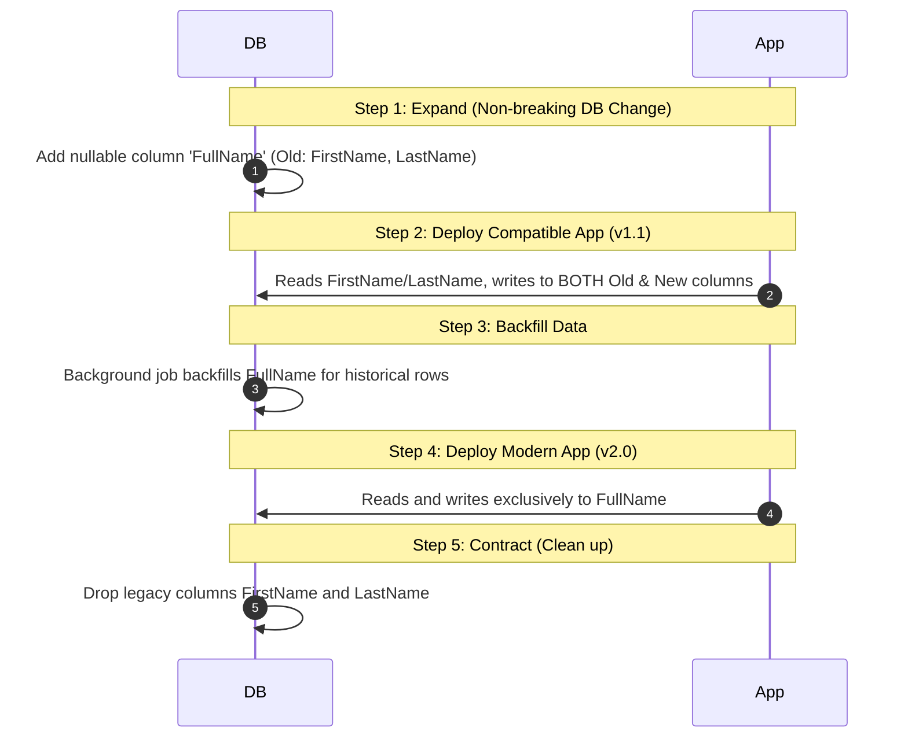

1. **Phase 1 (Expand):** Add the new column as **nullable** or with a default value. Do not delete or rename old columns.
2. **Phase 2 (Dual-Write):** Deploy application v1.1. It reads from the old structure but writes to both old and new columns.
3. **Phase 3 (Backfill):** Run a data migration script to populate the new column for historical rows.
4. **Phase 4 (Switch):** Deploy application v2.0. It reads and writes exclusively using the new structure.
5. **Phase 5 (Contract):** Once v2.0 is fully stable, deploy a final migration dropping the old columns.

---

## 13. Do All Companies Have a DB Changes Repo?

**No.** There is no universal industry requirement to have a separate DB Changes Repository.

Organizations adopt different structural models based on team size, compliance constraints, and architecture:

*   **Application-Centric Teams:** Migrations live directly in the backend repository alongside application code. Fast-moving teams with full feature ownership benefit from zero repository friction.
*   **Database Engineering Teams:** SQL changes live in a dedicated database repository or `.sqlproj` project. Dedicated DBAs review, tune, and execute all schema changes independently.
*   **Platform Engineering Teams:** Migrations are authored in application repositories, but CI/CD extracts migration bundles and routes them through a centralized, audited deployment orchestrator.
*   **Legacy Enterprise Teams:** Databases predate modern applications and serve dozens of legacy reporting tools, ETL jobs, and services. A separate DB repository or schema project is mandatory to coordinate changes across consumers.

> [!TIP]
> What matters is not whether you have a separate repository. What matters is that **schema ownership is unambiguous**, changes are **version-controlled**, deployments are **automated and auditable**, and dependent applications remain **backward-compatible**.

---

## 14. Recommended Learning Path

To master modern database management in the .NET ecosystem, develop competence across four core pillars:

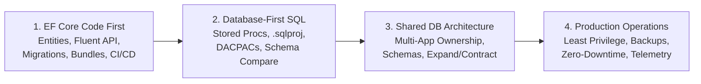

1. **EF Core Code First Mastery:**
   * Modeling entities, value converters, owned types, and value generators.
   * Generating migrations, understanding migration snapshots, and creating migration bundles (`dotnet ef migrations bundle`).
   * Authoring custom data migrations using `migrationBuilder.Sql()`.
2. **Database-First and SQL Management:**
   * Managing views, stored procedures, table-valued functions, and indexing strategies.
   * Working with Visual Studio SQL Database Projects (`.sqlproj`) and DACPAC deployments via `sqlpackage`.
   * Performing schema comparisons using SSDT Schema Compare or Redgate SQL Compare.
3. **Shared Database Architecture:**
   * Designing schema ownership boundaries in modular monoliths and multi-app environments.
   * Implementing custom database schemas (`[billing]`, `[identity]`) and distinct migration history tables.
   * Executing zero-downtime rolling migrations using the Expand/Contract pattern.
4. **Production Operations & Governance:**
   * Enforcing least privilege with separate DDL (deployment) and DML (application) connection strings.
   * Automated verification of migration drift in CI pipelines.
   * Production query diagnostics using Query Tags (`TagWith`), logging, and execution plan profiling.

---

## 15. Interview Questions & Real-World Scenarios

**Q1: Why should you avoid calling `dbContext.Database.Migrate()` at application startup in production?**
> In containerized or load-balanced environments, multiple instances of your application spin up simultaneously. If each instance calls `Migrate()` on startup, they race to apply migrations against the same database, causing connection pool exhaustion, schema corruption, and deadlocks in `__EFMigrationsHistory`. Furthermore, it violates least-privilege principles by requiring runtime application credentials to possess destructive DDL permissions (`ALTER TABLE`, `DROP COLUMN`). In production, migrations should execute as an isolated step in a CI/CD pipeline using Migration Bundles or reviewed SQL scripts.

**Q2: What is an EF Core Migration Bundle and why is it preferred over running `dotnet ef database update` in CI/CD?**
> A Migration Bundle is a single-file, self-contained executable generated via `dotnet ef migrations bundle`. It packages your compiled migrations and the EF Core runtime into an independent binary. It is preferred in CI/CD because:
> 1. It does not require the .NET SDK or `dotnet-ef` CLI tool to be installed on the deployment agent or production server.
> 2. It executes directly against the target database via a standard connection string argument (`./bundle --connection "..."`).
> 3. It can be easily executed from lightweight deployment runners, Kubernetes init containers, or deployment pipelines.

**Q3: How do you handle a zero-downtime database deployment when renaming a database column?**
> You cannot execute a direct `ALTER TABLE ... RENAME COLUMN` in a zero-downtime deployment, because old application instances still in flight will fail immediately when querying the old column name. You must use the **Expand/Contract pattern**:
> 1. **Expand:** Add the new column as nullable.
> 2. **Dual-write:** Deploy an intermediate application version that writes to both columns and reads from either.
> 3. **Backfill:** Execute an asynchronous SQL script to copy existing data from the old column to the new column.
> 4. **Cut-over:** Deploy the new application version reading and writing exclusively to the new column.
> 5. **Contract:** Deploy a final migration dropping the old column once all traffic has transitioned.

**Q4: In a Modular Monolith sharing a single database, how do you prevent migrations from different modules colliding?**
> You configure each module's `DbContext` to:
> 1. Target its own dedicated SQL schema using `modelBuilder.HasDefaultSchema("module_name")`.
> 2. Use a dedicated migration history table using `options.UseSqlServer(conn, sql => sql.MigrationsHistoryTable("__EFMigrationsHistory_ModuleName", "module_name"))`.
> This isolates both the domain tables and the migration version tracking per module within the shared physical database.

**Q5: Can a DBA or auditor inspect the raw SQL executed by a Migration Bundle before approving its execution in production?**
> **Yes.** Running `./bundle --script --idempotent > migration.sql` outputs the complete idempotent SQL script to stdout without applying any changes to the database. This allows DBAs to inspect table alters, locks, and indexing operations in staging before the bundle is executed in production.

**Q6: How do you cross-compile a Migration Bundle when developing on Windows/macOS and deploying to Linux containers?**
> Use the `--target-runtime` flag with the target Linux Runtime Identifier (RID), e.g., `dotnet ef migrations bundle --target-runtime linux-x64 --output ./migrate-bundle`. This produces a Linux-compatible ELF binary directly on a non-Linux development machine.

**Q7: Comparing Direct CLI, Idempotent SQL Scripts, and Migration Bundles—when is each approach ideal?**
> * **Direct CLI (`dotnet ef database update`):** Ideal strictly for **local development** due to rapid feedback, but prohibited in production because it requires the .NET SDK and source code on production runners.
> * **Idempotent SQL Scripts (`dotnet ef migrations script -i`):** Ideal for **DBA-governed enterprises** requiring manual script reviews and gated execution through database management tools.
> * **Migration Bundles (`dotnet ef migrations bundle`):** Ideal for **modern cloud/container automation** (Kubernetes init-containers, Azure DevOps, GitHub Actions), providing a single pre-compiled binary with built-in database drivers and zero external dependencies.

---

## Summary

* **ASP.NET Core Integration:** Always register `DbContext` with a **Scoped** lifetime to ensure thread safety, state isolation, and proper connection management. Leverage `IDbContextFactory<T>` for background workers and parallel tasks.
* **Three Independent Decisions:** Always distinguish between **Schema Development Approach** (Code First vs. DB First), **Schema Ownership** (App Team vs. DB Team), and **Deployment Mechanism** (Bundles, Scripts, DACPAC).
* **Multi-Application Boundaries:** When multiple applications share a database, establish one authoritative schema owner. In modular monoliths, isolate modules using distinct database schemas and dedicated migration history tables.
* **Controlled Deployments:** Treat database changes with the same rigor as code releases. Rely on Migration Bundles or reviewed SQL scripts executed through CI/CD pipelines, practice the Expand/Contract pattern for zero downtime, and enforce least-privilege security.
