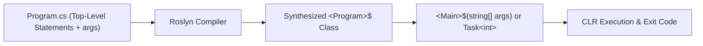
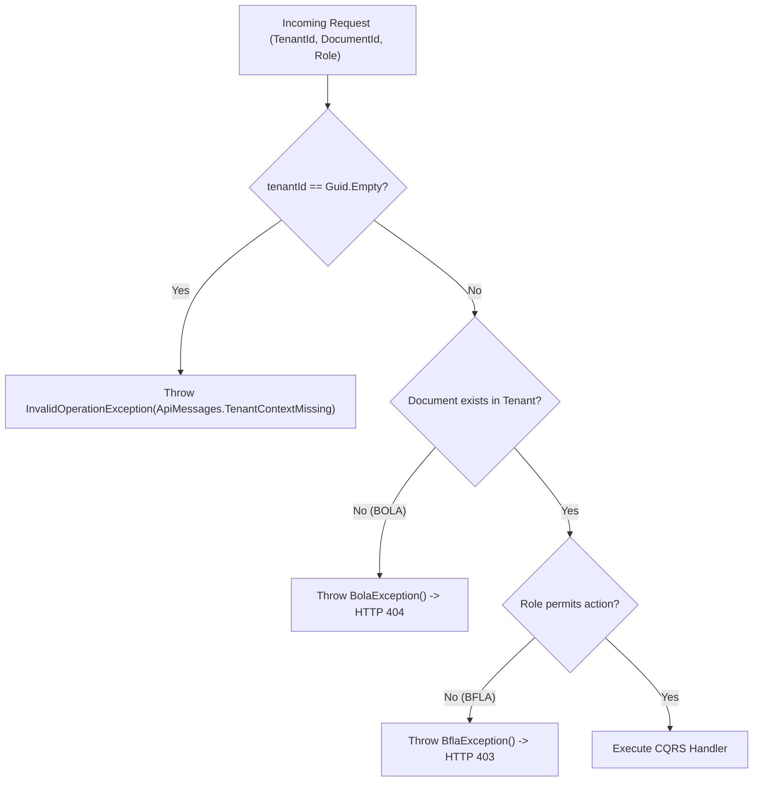
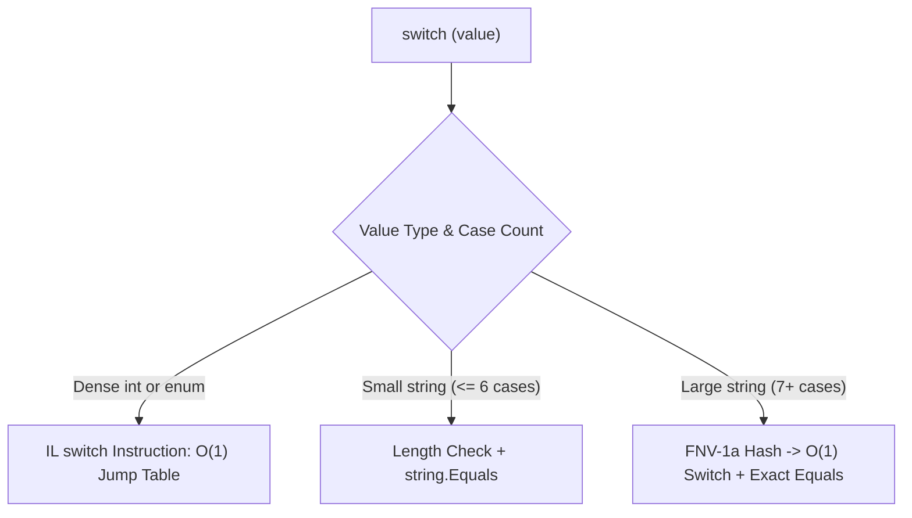

# Chapter 1: C# 14 Syntax, Variables, and Control Flow

## 1. Learning Objectives
By the end of this chapter, you will be able to:
- Structure a modern C# 14 / .NET 10 application using Top-Level Statements, file-scoped namespaces, and `global using` directives.
- Choose the right primitive, numeric, temporal, and identifier types (`decimal`, `Guid`, `DateTimeOffset`, `TimeSpan`) for enterprise domains.
- Explain how the Roslyn compiler processes `var`, target-typed `new()`, `const`, `readonly`, and `checked`/`unchecked` arithmetic.
- Write allocation-aware string code using interpolation handlers, raw string literals, `nameof`, and culture-invariant comparisons.
- Prevent `NullReferenceException` bugs using Nullable Reference Types (NRTs), null-coalescing/conditional operators (including C# 14 `?.=`), and guard clauses.
- Write clean expressions, pattern-matching `switch` expressions, loops, and `using` declarations, and understand how `switch` compiles into IL jump tables and string-hash dispatch.

## 2. Introduction

Every software architect must start at the foundation. While C# is a deep and expressive language, its syntax is designed to be approachable, sharing a lineage with C, C++, and Java.

However, in this course we do not settle for "just getting it to work." Even the most basic features of C# 14 on .NET 10—like declaring a variable, formatting a string, checking for `null`, or writing a `switch`—have profound implications for how **Roslyn** (Microsoft's open-source C# compiler) generates **Intermediate Language (IL)** (the CPU-independent bytecode stored inside `.dll` assemblies) and how the **Common Language Runtime (CLR)** (the .NET execution engine that compiles IL to machine code and manages memory) executes your program.

Throughout this course, we anchor every concept in **Normora**, an enterprise multi-tenant knowledge management and conversational-AI platform built as a **.NET 10 Modular Monolith** (an architecture where distinct business domains—`Tenants`, `Documents`, and `Conversations`—run in one deployable backend while keeping strict internal code and database boundaries). Normora uses **CQRS** (Command Query Responsibility Segregation, separating write operations called *Commands* from read operations called *Queries*), PostgreSQL with `pgvector` for semantic search, MinIO for object storage, Google Gemini for embeddings and chat, Keycloak **OIDC** (OpenID Connect, an identity layer for login) behind a **Duende BFF** (Backend-for-Frontend, a server-side security proxy that keeps authentication tokens in encrypted `HttpOnly` cookies away from the browser), SignalR for real-time updates, and OpenTelemetry for observability. You will also see how **BOLA** (Broken Object Level Authorization, accessing another tenant's resource—mapped to HTTP `404 Not Found` via `BolaException`) and **BFLA** (Broken Function Level Authorization, calling an action without role permission—mapped to HTTP `403 Forbidden` via `BflaException`) start right at basic variable checks and control flow.

Along the way, we will also retain a standalone CLI walkthrough alongside Normora's real-world backend patterns so you can practice every foundational building block from first principles.

## 3. Hello World: Modern C# Structure & Entry Points

Historically, every C# executable required significant boilerplate: a `namespace` (a logical grouping that prevents type name collisions), a `class`, and a `static void Main` method serving as the program's entry point.

```csharp
// Legacy C# Structure (C# 1.0 - 8.0)
using System;

namespace EVPlatform.Cli
{
    class Program
    {
        static void Main(string[] args)
        {
            Console.WriteLine("EV Platform Booting...");
        }
    }
}
```

### Top-Level Statements, File-Scoped Namespaces, and `global using`
Since C# 9.0, **Top-Level Statements** let you omit the enclosing `Program` class and `Main` method in your entry-point file. C# 10 added **file-scoped namespaces** (`namespace Normora.Shared.Constants;`, eliminating one level of indentation across the whole file) and **`global using` directives** (plus `<ImplicitUsings>enable</ImplicitUsings>` in `.csproj` files, which automatically imports `System`, `System.Collections.Generic`, `System.Linq`, `System.Threading.Tasks`, and host-specific namespaces). In .NET 10, you can even run standalone single-file C# scripts directly from the terminal with `dotnet run script.cs`.

```csharp
// Modern C# Structure (C# 9.0+ / .NET 10)
Console.WriteLine("Normora Host Booting...");
```

- **What it is:** Compiler-synthesized entry-point boilerplate (`<Program>$` class and `<Main>$` method) combined with file-wide namespace declarations and shared imports.
- **Why use it:** Reduces ceremony in startup files (`Normora.Api/Program.cs`, `Normora.Worker/Program.cs`), keeps attention on dependency injection and middleware wiring, and eliminates horizontal indentation drift across thousands of module files.
- **How it works internally:** When Roslyn compiles a file containing Top-Level Statements, it emits an internal class named `<Program>$` with a `<Main>$` method (returning `void`, `int`, `Task`, or `Task<int>` depending on whether you `return` an exit code or use `await`). You automatically have access to the `args` string array parameter.
- **When NOT to use it:**
  - Never put Top-Level Statements in **class libraries** (like `Normora.Shared` or `Normora.Infrastructure`), because libraries do not have an entry point.
  - Only **one** file per executable project can contain Top-Level Statements (putting them in two files causes compiler error `CS8802`).
  - Avoid `global using` for obscure or conflicting namespaces (for instance, importing two libraries that both define a `Document` class creates ambiguity across every file in the project).



*(Note: In actual IL metadata, Roslyn names the generated type `<Program>$` and method `<Main>$` with angle brackets so user code cannot accidentally collide with them.)*

### Real-World Normora Examples

**Example 1: `Normora.Api/Program.cs` — Ephemeral Migration Check via `args`**
In Normora, running `dotnet Normora.Api.dll --migrate` must run database migrations in a lean console host without booting Kestrel (ASP.NET Core's web server) or SignalR hubs, avoiding container shutdown crashes.
```csharp
// Normora.Api/Program.cs (top-level statements using implicit `args`)
if (args.Contains("--migrate"))
{
    await MigrationHostExtensions.RunMigrationsAsync(args);
    return 0;
}

var builder = WebApplication.CreateBuilder(args);
var app = builder.Build();
app.Run();
return 0;
```

**Example 2: `Normora.Worker/Program.cs` — Async Top-Level Host Startup**
Because Top-Level Statements support `await`, Roslyn automatically upgrades `<Main>$` to return `Task` when the worker boots Hangfire background jobs.
```csharp
// Normora.Worker/Program.cs
var builder = Host.CreateApplicationBuilder(args);
builder.Services.AddNormoraInfrastructure(builder.Configuration);

using var host = builder.Build();
await host.RunAsync();
```

**Example 3: File-Scoped Namespace in `Normora.Shared/Constants/ApiMessages.cs`**
Every class, record, and handler file inside Normora's modules (`Tenants`, `Documents`, `Conversations`) uses file-scoped namespaces to keep nesting shallow.
```csharp
namespace Normora.Shared.Constants;

public static class ApiMessages
{
    public const string TenantContextMissing = "Tenant context is missing.";
    public const string NotFound = "The requested resource was not found.";
    public const string Forbidden = "You do not have permission to perform this action.";
}
```

**Example 4: Module `GlobalUsings.cs` for Shared Abstractions**
Inside `Normora.Modules.Documents`, a single `GlobalUsings.cs` shares common framework namespaces without polluting other modules.
```csharp
// server/Modules/Documents/GlobalUsings.cs
global using MediatR;
global using Normora.Shared.Constants;
global using Normora.Shared.Exceptions;
```

**Example 5: Exposing Compiler-Generated `Program` for Integration Tests**
Because Top-Level Statements generate an internal `<Program>$` class by default, adding `public partial class Program { }` at the bottom of `Normora.Api/Program.cs` lets test suites reference `WebApplicationFactory<Program>`.
```csharp
app.Run();

// Makes the compiler-generated Program type visible to Normora.Architecture.Tests
public partial class Program { }
```

## 4. Variables, Data Types, Constants, and Type Inference

C# is a **statically-typed**, **strongly-typed** language. Every variable has a fixed type verified at compile time, preventing accidental mismatches such as passing a tenant's slug (`string`) where a database primary key (`Guid`) is expected.

### Core Data Types & Literals

C# aliases map directly to types in the **.NET Base Class Library (BCL)** (the standard runtime library of built-in types and utilities). Beyond numeric primitives, enterprise backends rely heavily on `Guid`, `DateTimeOffset`, and `TimeSpan`.

| C# Keyword / Type | .NET BCL Type | Size | Precision / Range | Normora Use Case |
|---|---|---|---|---|
| `byte` | `System.Byte` | 8-bit | `0` to `255` | Raw file headers, binary flags |
| `int` | `System.Int32` | 32-bit | `-2.14B` to `+2.14B` | Chunk indexes, retry counters, HTTP status codes |
| `long` | `System.Int64` | 64-bit | `±9.22 × 10^18` | Storage quota bytes, monotonic `dataVersion` |
| `float` | `System.Single` | 32-bit | ~7 digits (Base-2) | `pgvector` embedding coordinates (`float[]`) |
| `double` | `System.Double` | 64-bit | ~15-17 digits (Base-2) | RRF hybrid search scores, cosine similarity |
| `decimal` | `System.Decimal` | 128-bit | 28-29 digits (Base-10) | `TenantPlanPricingCatalog` billing (`INR`, `USD`, `EUR`) |
| `bool` | `System.Boolean` | 1 byte | `true` / `false` | Feature flags, `isAnnual`, soft-delete `IsDeleted` |
| `char` | `System.Char` | 16-bit | UTF-16 code unit | Delimiters, Markdown `#` heading level counting |
| `string` | `System.String` | Ref Type | Immutable UTF-16 text | `ExternalUserId`, tenant slugs, `ApiMessages` |
| `Guid` | `System.Guid` | 128-bit | Globally unique ID | `TenantId`, `DocumentId`, `ConversationId` |
| `DateTimeOffset` | `System.DateTimeOffset` | 128-bit | Date + time + UTC offset | Audit logs, `PendingApproval` expiration timestamps |
| `TimeSpan` | `System.TimeSpan` | 64-bit | Duration | Redis cache sliding TTL (30s–5m), approval 15m TTL |

**Literal Syntax Tips:**
- Use underscore **digit separators** (`1_000_000`) to make large quotas or byte limits readable.
- Use suffixes to control literal types: `m` for `decimal` (`29.99m`), `L` for `long` (`10_737_418_240L`), `f` for `float` (`0.85f`). Without `m`, `29.99` is a `double`!
- Use `0x` for hexadecimal (`0xFF`) and `0b` for binary bitmasks (`0b0000_0100`).

### `var`, Explicit Types, and Target-Typed `new()`

C# 3.0 introduced `var` for **compile-time type inference**, and C# 9.0 added **target-typed `new()`** so you can omit repeating the type on the right-hand side.

- **What it is:** `var` lets Roslyn deduce a local variable's static type from the right-hand expression; `new(...)` lets Roslyn deduce the constructed type from the left-hand declaration.
- **Why use it:** Reduces visual noise on long generic types (`Dictionary<string, List<Guid>>`) while keeping 100% static type safety.
- **How it works:** During Roslyn's **Semantic Analysis** phase, `var` is replaced with the exact inferred type in the compiled IL. `var` is *never* dynamic—reassigning `maxRetries = "three";` triggers compile error `CS0029`.
- **When NOT to use `var`:**
  - When the right-hand side is an opaque method call whose return type isn't obvious (`var result = await _mediator.Send(query);` can obscure whether `result` is a DTO, a nullable entity, or a `bool`).
  - When you need a wider or decimal numeric type: `var price = 20;` infers `int`, and `var rate = 0.2;` infers `double` instead of `decimal`. Declare `decimal rate = 0.2m;` explicitly.
  - Note that `var` can only be used for **local variables** (never class fields, method parameters, or return types).

### `const` vs `readonly` vs `static readonly`

- **`const`:** Must be evaluated at **compile time**. Roslyn bakes the literal value directly into the IL of every assembly that references it.
  - **When NOT to use `const`:** Never use `const` for values that change across releases if external binaries might reference your DLL without recompiling, and never use it for values computed at runtime (like `DateTimeOffset.UtcNow` or `Guid.NewGuid()`).
- **`readonly` (instance) & `static readonly`:** Evaluated at **runtime** (inline or inside a constructor/static constructor) and cannot be reassigned afterward. Use `static readonly` for shared runtime objects like `TimeSpan`, `Guid`, or `FrozenDictionary` lookup tables.

### Arithmetic Overflow: `checked` vs `unchecked`

By default, C# executes integer arithmetic in an **`unchecked`** context for raw CPU speed: adding `1` to `int.MaxValue` silently wraps around to `-2,147,483,648`. Wrapping critical calculations in a **`checked { ... }`** block (or `checked(a + b)`) forces the CLR to emit overflow-checking IL instructions (`add.ovf`) and throw an `OverflowException` instead of corrupting totals or quotas.
- **When NOT to use global `checked`:** Enabling `<CheckForOverflowUnderflow>true</CheckForOverflowUnderflow>` across an entire `.csproj` adds overflow instructions to every loop counter and index calculation; reserve `checked` for financial, billing, and quota boundaries.

### Real-World Normora Examples

**Example 1: Time-Ordered UUIDs and UTC Timestamps (`Guid.CreateVersion7`, `DateTimeOffset`, `TimeSpan`)**
Using `Guid.CreateVersion7()` (.NET 9+/10) generates sequential, time-ordered IDs that prevent PostgreSQL B-tree index fragmentation, while `DateTimeOffset.UtcNow` prevents timezone drift.
```csharp
var tenantId = Guid.CreateVersion7();
var approvalCreatedAt = DateTimeOffset.UtcNow;
TimeSpan approvalTtl = TimeSpan.FromMinutes(15); // Server-enforced HITL approval TTL
DateTimeOffset expiresAt = approvalCreatedAt.Add(approvalTtl);
```

**Example 2: Multi-Currency Billing with `decimal` (`TenantPlanPricingCatalog`)**
Financial calculations in Normora's `Tenants` module strictly use `decimal` (`m` suffix) so the 20% annual discount never suffers Base-2 floating-point drift.
```csharp
decimal monthlyPriceUsd = 49.00m;
decimal annualDiscountRate = 0.20m;
decimal discountedAnnualTotal = monthlyPriceUsd * 12 * (1.0m - annualDiscountRate); // 470.400m
```

**Example 3: Centralized `const` Constants (`ApiMessages`) vs `static readonly` Limits**
`ApiMessages` uses `const string` for zero-allocation, compile-time-constant error messages, whereas `TimeSpan` cache expirations use `static readonly` because `TimeSpan` cannot be `const`.
```csharp
public static class TenantCacheDefaults
{
    public const string KeyPrefix = "tenant:slug:";
    public static readonly TimeSpan ResolutionSlidingTtl = TimeSpan.FromMinutes(5);
}
```

**Example 4: Explicit Types vs `var` vs Target-Typed `new()` in CQRS Handlers**
Use `var` when the constructor or literal makes the type obvious, target-typed `new()` for clean collection initialization, and explicit types when clarity matters.
```csharp
// Clear from right-hand side -> var is idiomatic
var batchSize = 100; // Gemini batchEmbedContents limit
// Target-typed new() avoids repeating the long type name
Dictionary<Guid, int> chunkCountsByDocument = new();
// Explicit type clarifies what Mediator returned when reading handler code
PerformHybridRetrievalResponse retrievalResult = await _mediator.Send(query, cancellationToken);
```

**Example 5: `checked` Block for Document Quota & Token Budget Math**
When accumulating tenant storage bytes or chunk counts, `checked` catches integer wraparound before a maliciously huge payload can wrap a positive usage counter into a negative number and bypass quota enforcement.
```csharp
int currentTokenCount = 2_147_483_000;
int incomingChunkTokens = 1_500;

checked
{
    // Throws OverflowException instead of wrapping to a negative number
    int updatedTotal = currentTokenCount + incomingChunkTokens;
}
```

## 5. Strings, Nullability, and Memory-Safe Text Handling

Text processing and `null` safety are the single largest sources of runtime bugs and hidden memory allocations in enterprise web APIs. C# 14 on .NET 10 gives you expressive syntax to handle both cleanly at compile time.

### String Immutability, Interpolation, and Raw String Literals

In .NET, `string` is an **immutable reference type** (once created on the **Managed Heap**—the runtime memory area managed by the **Garbage Collector (GC)**—its characters can never change). Modifying a string with `+` allocates a brand-new `string` object every time.

- **String Interpolation (`$""`):** In C# 10+, Roslyn lowers `$"Tenant {tenantId} uploaded {count} chunks"` into a `DefaultInterpolatedStringHandler` stack struct that writes directly into a character buffer without boxing value types (`Guid`, `int`).
- **Verbatim Strings (`@""`):** Disable escape sequences (`\` is treated literally), useful for Windows paths or regexes.
- **Raw String Literals (`"""..."""`, C# 11+):** Delimited by three or more double quotes. No escaping is needed for quotes, backslashes, or JSON braces, and common leading indentation is automatically stripped by the compiler. Prefix with `$$` to require `{{...}}` for interpolation while leaving single `{...}` literal (ideal for JSON templates).
- **When NOT to use `+` concatenation:** Never concatenate strings with `+` inside a loop (such as building Markdown breadcrumbs across 500 chunks in `DocumentChunker`). Use `StringBuilder` or `string.Join`, and use `ReadOnlySpan<char>` (`AsSpan()`) when slicing without allocation.

### Culture-Invariant Comparison & `nameof`

- **Ordinal vs Culture-Sensitive Comparison:** Never compare API identifiers, currency codes, or tenant slugs with `==` after `.ToUpper()` or `.ToLower()`. Current-thread OS locale rules can break comparisons (famously the "Turkish-I" bug, where `'i'.ToUpper()` in `tr-TR` produces `'İ'` instead of `'I'`). Always use `.ToUpperInvariant()`, `.ToLowerInvariant()`, or `string.Equals(a, b, StringComparison.OrdinalIgnoreCase)`.
- **`nameof` Operator:** Resolves the unqualified string name of a symbol (`nameof(tenantId)` -> `"tenantId"`) at compile time. In **C# 14**, `nameof` also supports unbound generic types such as `nameof(List<>)` (`"List"`).
  - **When NOT to use `nameof`:** Do not use `nameof` for external API routes, database column names that must stay fixed across code refactors, or user-facing localized error messages (use `ApiMessages` constants instead).

### Nullable Reference Types (NRTs) and Null Operators

Historically, any reference variable in C# could hold `null` (a reference pointing to no object), causing `NullReferenceException` crashes at runtime. With `<Nullable>enable</Nullable>` (enabled by default in modern .NET 10 projects):
- `string` means **non-nullable** (the compiler warns if you try to assign `null` or fail to initialize it).
- `string?` means **explicitly nullable** (you must check for `null` before dereferencing).
- `int?` (`Nullable<int>`) wraps a value type so it can also represent "missing."

| Operator | Name | Behavior |
|---|---|---|
| `a ?? b` | Null-coalescing | Returns `a` if non-null; otherwise evaluates `b` |
| `a ??= b` | Null-coalescing assignment | Assigns `b` to `a` only if `a` is `null` |
| `a?.Prop` | Null-conditional access | Evaluates `Prop` if `a` is non-null; otherwise yields `null` |
| `a?.Prop = b` | **C# 14** Null-conditional assignment | Evaluates `b` and assigns `Prop` only if `a` is non-null |
| `a!` | Null-forgiving operator | Silences compiler warning **without** a runtime check |

- **When NOT to use `!` (null-forgiving):** Never slap `!` onto nullable values just to silence compiler warnings (`tenant!.Slug`). If the value is actually `null` at runtime, the CLR still crashes with `NullReferenceException`. Use pattern matching (`if (tenant is null)`) or `ArgumentNullException.ThrowIfNull(tenant)` instead.

### Real-World Normora Examples

**Example 1: Zero-Boxing Agent Session Partition Key (`NormoraAgentIsolationKeyProvider`)**
```csharp
// Compiles to DefaultInterpolatedStringHandler in .NET 10 (no int/Guid boxing)
Guid tenantId = Guid.CreateVersion7();
string externalUserId = "oidc-sub-9482a";
string sessionKey = $"{tenantId}:{externalUserId}";
```

**Example 2: Raw String Literal (`$$"""..."""`) for JSON-RPC 2.0 MCP Payloads**
Inside Normora's `McpController` (`/api/mcp`), `$$"""` embeds JSON braces cleanly while interpolating C# variables via `{{...}}`.
```csharp
string toolName = "documents_search";
string queryText = "parental leave policy";

string mcpPayload = $$"""
    {
      "jsonrpc": "2.0",
      "method": "tools/call",
      "params": {
        "name": "{{toolName}}",
        "arguments": { "query": "{{queryText}}" }
      }
    }
    """;
```

**Example 3: Culture-Invariant Currency Normalization (`UpdateTenantCurrencyCommand`)**
```csharp
string rawCurrency = "inr";
string normalizedCurrency = rawCurrency.ToUpperInvariant(); // Always "INR", regardless of server locale
bool isSupported = string.Equals(normalizedCurrency, "INR", StringComparison.Ordinal);
```

**Example 4: Guard Clauses & `nameof` (and C# 14 Unbound Generic `nameof`)**
```csharp
ArgumentException.ThrowIfNullOrWhiteSpace(externalUserId, nameof(externalUserId));
// C# 14: unbound generic type in nameof for structured OpenTelemetry logging
string handlerFamily = nameof(IRequestHandler<,>); // Evaluates to "IRequestHandler"
```

**Example 5: Nullable Value/Reference Types, `??`, and `??=` for Optional Scoping**
```csharp
Guid? departmentId = null; // Optional filter; user may query workspace-wide
string? requestedSlug = null;

// Falls back to "default" only when requestedSlug is null
string effectiveSlug = requestedSlug ?? "default";
// Assigns a default correlation ID only if none was provided
string? correlationId = null;
correlationId ??= Guid.CreateVersion7().ToString("N");
```

**Example 6: C# 14 Null-Conditional Assignment (`?.=`) on Optional Audit Metadata**
In C# 14, `?.=` avoids wrapping optional property assignments in `if (entry is not null)` blocks, and skips evaluating the right-hand side if `entry` is `null`.
```csharp
AuditEntry? pendingAudit = TryGetPendingAudit();
pendingAudit?.LastModifiedUtc = DateTimeOffset.UtcNow;
```

## 6. Operators, Expressions, and Statements

An **expression** is code that evaluates to a value (e.g., `5 + 5` or `isAnnual ? 470.40m : 49.00m`). A **statement** is a complete instruction executed by the program, usually ending in a semicolon (`;`).

### Arithmetic, Relational, and Precedence Rules
C# supports arithmetic (`+`, `-`, `*`, `/`, `%`), compound assignment (`+=`, `-=`, `*=`), increment/decrement (`++i` pre-increment vs `i++` post-increment), and relational (`==`, `!=`, `<`, `>`, `<=`, `>=`) operators.

**Integer Division Trap:** Dividing two `int` values in C# performs *integer truncation* (`7 / 2 == 3`, not `3.5`). Cast at least one operand to `double` or `decimal` (`7m / 2`) when fractional precision is needed.

```csharp
int a = 10;
int b = 3;
int sum = a + b;         // 13
int remainder = a % b;   // 1
bool isGreater = a > b;  // true
```

### Logical Operators & Short-Circuit Evaluation
Used for boolean logic: `&&` (logical AND), `||` (logical OR), `!` (logical NOT).
- **Short-Circuit Evaluation:** In `if (condition1 && condition2)`, if `condition1` is `false`, the CLR *never* evaluates `condition2`. In `condition1 || condition2`, if `condition1` is `true`, `condition2` is skipped.
- **When NOT to use `&` / `|` on booleans:** Single `&` and `|` do *not* short-circuit on booleans—they evaluate both sides unconditionally, which breaks null-guard expressions like `user != null & user.IsActive` (causing `NullReferenceException`). Reserve `&` and `|` for integer **bitwise flag** masks.

### Ternary Conditional Operator (`?:`)
A concise inline `if-else` expression: `condition ? valueIfTrue : valueIfFalse`.
- **When NOT to use `?:`:** Never nest ternary operators inside each other (`a ? b : c ? d : e`). Nested ternaries harm readability; use a `switch` expression or explicit `if/else` instead.

### Real-World Normora Examples

**Example 1: Short-Circuit Guard Before Tenant Membership Check**
```csharp
string? externalUserId = GetExternalUserId();
bool hasActiveMembership = !string.IsNullOrWhiteSpace(externalUserId) && IsWorkspaceMember(externalUserId);
```

**Example 2: Ternary Expression for Subscription Cycle Display**
```csharp
bool isAnnualCycle = true;
decimal monthlyBase = 49.00m;
decimal billedAmount = isAnnualCycle ? monthlyBase * 12 * 0.80m : monthlyBase;
```

**Example 3: Remainder (`%`) & Integer Division for Gemini Batching (`100` Chunks/Call)**
Normora's ingestion pipeline calls Gemini's `batchEmbedContents` endpoint in slices of at most `100` chunks.
```csharp
int totalChunks = 245;
int batchSize = 100;
int fullBatches = totalChunks / batchSize;      // 2
int trailingChunks = totalChunks % batchSize;   // 45
int totalRequests = (totalChunks + batchSize - 1) / batchSize; // Ceiling division = 3
```

**Example 4: Bitwise Flags (`|`, `&`) for Compact RBAC Permission Masks**
```csharp
const int ReadDocs = 0b0001;
const int UploadDocs = 0b0010;
const int DeleteDocs = 0b0100;

int editorMask = ReadDocs | UploadDocs; // 0b0011
bool canDelete = (editorMask & DeleteDocs) == DeleteDocs; // false
```

**Example 5: Compound Assignment (`+=`, `??=`) in RAG Token Budgeting**
```csharp
int usedPromptTokens = 1_200;
int retrievedChunkTokens = 450;
usedPromptTokens += retrievedChunkTokens; // 1,650

TimeSpan? customTimeout = null;
customTimeout ??= TimeSpan.FromSeconds(30); // Applies default only when null
```

## 7. Control Flow, Pattern Matching, and Loops

Control flow dictates the order in which statements execute. Modern C# blends traditional imperative branching (`if`, `switch`, loops) with concise, compiler-verified **pattern matching**.

### The `if` Statement and Guard Clauses
```csharp
int batteryPercentage = 85;

if (batteryPercentage >= 100)
{
    Console.WriteLine("Fully charged.");
}
else if (batteryPercentage > 20)
{
    Console.WriteLine("Charging in progress.");
}
else
{
    Console.WriteLine("Low battery warning!");
}
```
**Architect Pattern — Guard Clauses:** Instead of nesting happy-path logic three `if` levels deep, validate preconditions up front and return or throw immediately. In Normora, this is how `BolaException` (404) and `BflaException` (403) protect every handler before touching business state.



### The `switch` Statement and Compiler Lowering (Jump Tables vs String Hashing)

The `switch` statement dispatches execution across multiple discrete branches from a single value.

```csharp
string command = "start";

switch (command)
{
    case "start":
        Console.WriteLine("Initiating charge session.");
        break;
    case "stop":
        Console.WriteLine("Ending charge session.");
        break;
    case "reboot":
        Console.WriteLine("Restarting charger.");
        break;
    default:
        Console.WriteLine("Unknown command.");
        break;
}
```

**Compiler Internals (Why `switch` Beats Long `if-else` Chains):**
- **Contiguous Integers / Enums:** Roslyn emits an IL `switch` instruction backed by an **O(1) Jump Table**. Instead of evaluating conditions sequentially in O(n) time, the CPU calculates a memory offset and jumps straight to the matching case.
- **Strings:** For small string switches (typically <= 6 cases), Roslyn emits sequential `string.Equals` or length/character checks. For larger string switches (7+ cases), Roslyn computes a deterministic **FNV-1a hash** (`ComputeStringHash`) at runtime, jumps via an O(1) hash jump table, and verifies exact string equality to guard against hash collisions.



### `switch` Expressions and Pattern Matching (C# 8–14)

A **`switch` expression** evaluates directly to a value without `case:` or `break;` boilerplate, and pairs naturally with **pattern matching**:
- **Constant & Relational Patterns:** `>= 0 and <= 100`
- **Logical Patterns:** `is null`, `is not null`, `is "Pro" or "Enterprise"`
- **List Patterns (C# 11+):** `args is ["--migrate", ..]` checks array length and prefix elements cleanly
- **Discard Pattern (`_`):** Mandatory catch-all when cases are non-exhaustive (Roslyn emits warning `CS8509` if a switch expression misses a possible input!).
- **When NOT to use `switch`:** Do not use a `switch` statement or expression to execute arbitrary multi-step side effects or when business rules must change dynamically at runtime (use polymorphism—covered in Chapter 6—or database-driven strategy tables instead).

### Loops (`while`, `do-while`, `for`, `foreach`) & `using` Declarations

- **`while` Loop:** Evaluates condition *before* each iteration (0 or more runs).
- **`do-while` Loop:** Evaluates condition *after* each iteration (guaranteed at least 1 run).
- **`for` Loop:** Best when indexing or stepping by a fixed batch size (`i += 100`).
- **`foreach` Loop:** Iterates cleanly over collections (`arrays`, `List<T>`, `ReadOnlySpan<char>`).
  - *Compiler Internals:* Roslyn lowers `foreach` into a `while` loop calling `.GetEnumerator()`, `.MoveNext()`, and `.Current` (duck-typed pattern-based compilation). If the enumerator implements `IDisposable`, Roslyn wraps it in `try/finally` (`using`); for zero-allocation stack enumerators like `Span<T>.Enumerator`, no `try/finally` or heap allocation occurs.
  - **When NOT to use `foreach`:** Avoid `foreach` if you need to modify/remove elements from a `List<T>` mid-iteration (throws `InvalidOperationException`) or when you need explicit index arithmetic (`for` is clearer).
- **`using` Declaration (`using var`, C# 8+):** Automatically calls `Dispose()` at the end of the enclosing scope (closing file streams, HTTP responses, or `CancellationTokenSource`) without adding nested `{ ... }` braces.

```csharp
// Classic loop examples
int retries = 0;
while (retries < 3)
{
    Console.WriteLine($"Attempt {retries + 1} to connect...");
    retries++;
}

for (int i = 0; i < 5; i++)
{
    Console.WriteLine($"Pinging charger port {i}");
}

string[] chargers = { "CHG-01", "CHG-02", "CHG-03" };
foreach (string charger in chargers)
{
    Console.WriteLine($"Checking status of {charger}");
}
```

### Real-World Normora Examples

**Example 1: Guard-Clause BOLA & BFLA Authorization Check**
```csharp
if (document is null || document.TenantId != currentTenantId)
{
    // BOLA maps globally to HTTP 404 to prevent tenant resource enumeration
    throw new BolaException();
}

if (!userHasManagePermission)
{
    // BFLA maps globally to HTTP 403 Forbidden
    throw new BflaException();
}
```

**Example 2: `switch` Expression for Multi-Currency Billing Validation (`CancelSubscriptionCommandHandler`)**
```csharp
string? tier = "Free";
string errorMessage = tier switch
{
    "Free" => ApiMessages.CannotCancelFreePlan,
    "Pro" or "Enterprise" => string.Empty,
    null => ApiMessages.TenantContextMissing,
    _ => ApiMessages.NotFound
};
```

**Example 3: Relational + Logical Patterns for Document Upload Tiering**
```csharp
long fileSizeBytes = 4_200_000L;
string ingestionPriority = fileSizeBytes switch
{
    <= 0 => "Invalid",
    > 0 and <= 1_048_576 => "FastLane",       // <= 1 MB
    > 1_048_576 and <= 25_000_000 => "Standard",
    _ => "LargeChunked"
};
```

**Example 4: List Pattern Matching on CLI Arguments (`Normora.Api`)**
```csharp
bool shouldRunMigrations = args is ["--migrate"] or ["--migrate", "--verbose"];
```

**Example 5: `for` Loop Batching Chunks for Gemini `batchEmbedContents` (Max 100/Call)**
```csharp
int totalChunks = 250;
const int GeminiMaxBatchSize = 100;

for (int offset = 0; offset < totalChunks; offset += GeminiMaxBatchSize)
{
    int count = Math.Min(GeminiMaxBatchSize, totalChunks - offset);
    Console.WriteLine($"Embedding slice [{offset}..{offset + count})");
}
```

**Example 6: `foreach` + `using var` Declaration Reading Document Markdown Lines**
```csharp
using var reader = new StringReader("# Policy\n## Leave\nEmployees receive 20 days.");
string? line;
while ((line = reader.ReadLine()) is not null)
{
    if (line.StartsWith('#'))
    {
        Console.WriteLine($"Breadcrumb heading detected: {line}");
    }
}
```

## 8. Real Production Case Studies

### Case Study A: Normora Ingestion & Billing Preflight Runner
This standalone top-level script demonstrates how Normora combines nullable safety, `decimal` currency math, `checked` quota validation, `switch` expressions, and `for` batch loops in `Normora.Worker`.

```csharp
using System;

Console.WriteLine("=== Normora Tenant Ingestion & Billing Preflight ===");

// 1. Strongly-typed identifiers, UTC timestamps, and decimal billing
Guid tenantId = Guid.CreateVersion7();
string? requestedCurrency = "inr";
string normalizedCurrency = (requestedCurrency ?? "USD").ToUpperInvariant();
bool isAnnualCycle = true;
decimal monthlyBaseUsd = 49.00m;
decimal finalPrice = isAnnualCycle ? monthlyBaseUsd * 12 * 0.80m : monthlyBaseUsd;

// 2. Pattern matching & switch expression for tier validation
string subscriptionTier = "Pro";
string cancellationCheck = subscriptionTier switch
{
    "Free" => "Blocked: Cannot cancel Free tier.",
    "Pro" or "Enterprise" => "Eligible for billing cycle update.",
    _ => "Unknown tier."
};

Console.WriteLine($"Tenant {tenantId} | Currency: {normalizedCurrency} | Quote: {finalPrice:F2} | {cancellationCheck}");

// 3. Checked quota math + Gemini batchEmbedContents chunking (100/call)
int existingChunks = 1_950;
int incomingChunks = 245;
const int TenantChunkLimit = 5_000;
const int GeminiBatchMax = 100;

int newTotal = checked(existingChunks + incomingChunks);
if (newTotal > TenantChunkLimit)
{
    Console.WriteLine("Quota exceeded: Aborting ingestion.");
    return 1;
}

for (int offset = 0; offset < incomingChunks; offset += GeminiBatchMax)
{
    int batchCount = Math.Min(GeminiBatchMax, incomingChunks - offset);
    Console.WriteLine($"Dispatching Gemini embedding batch [{offset}..{offset + batchCount})");
}

return 0;
```

### Case Study B: EV Platform Admin CLI
Let's also trace a classic interactive command-line loop—the initialization routine of an EV Charger Configuration CLI—showing `while`, `Console.ReadLine()`, and a string `switch` statement working together.

```csharp
using System;

Console.WriteLine("=== EV Charger Admin CLI ===");

// Variable Initialization
var maxSupportedKw = 150m;
var isConfigured = false;
var retryCount = 0;
var maxRetries = 3;

// Control flow: Loop until configured or max retries hit
while (!isConfigured && retryCount < maxRetries)
{
    Console.Write("Enter Command (init, status, quit): ");
    var input = Console.ReadLine();

    switch (input)
    {
        case "init":
            Console.WriteLine($"Initializing charger at {maxSupportedKw} kW...");
            isConfigured = true;
            Console.WriteLine("Success: Charger is ready.");
            break;

        case "status":
            Console.WriteLine("Charger is currently unconfigured.");
            break;

        case "quit":
            Console.WriteLine("Exiting CLI.");
            retryCount = maxRetries; // Force loop exit
            break;

        default:
            Console.WriteLine("Invalid command.");
            retryCount++;
            Console.WriteLine($"Retries left: {maxRetries - retryCount}");
            break;
    }
}

if (!isConfigured)
{
    Console.WriteLine("CRITICAL: Failed to configure charger.");
}
```

## 9. Common Mistakes & Anti-Patterns

| Level | Mistake | Impact | How to Avoid |
|---|---|---|---|
| Beginner | Confusing `=` (assignment) and `==` (equality). | Logic bugs, syntax errors. | Remember `=` assigns a value, `==` compares two values. |
| Beginner | Misunderstanding `var`. | Fear of dynamic typing in a static language. | Remember `var` is strictly resolved at compile-time by Roslyn. |
| Intermediate | Using `double` for money/pricing. | Precision loss due to floating-point math (`0.1 + 0.2 != 0.3`). | Always use `decimal` for financial calculations. |
| Senior | Huge `if/else` chains instead of `switch`. | Degraded CPU performance due to sequential branching. | Use `switch` to allow the compiler to generate O(1) jump tables. |

> [!CAUTION]
> **Anti-Pattern 1: Hardcoding Magic Strings Instead of `ApiMessages`**
> **Wrong code:**
> ```csharp
> if (tenantId == Guid.Empty)
> {
>     throw new InvalidOperationException("Tenant context is missing.");
> }
> ```
> **Why it's wrong:** Scattered literal strings drift out of sync with the Angular frontend's `ApiMessages` map, leak inconsistent wording across modules, and make refactoring error payloads fragile.
> **The fix:** Reference centralized constants from `Normora.Shared.Constants.ApiMessages`:
> ```csharp
> if (tenantId == Guid.Empty)
> {
>     throw new InvalidOperationException(ApiMessages.TenantContextMissing);
> }
> ```

> [!CAUTION]
> **Anti-Pattern 2: Using `double` for Multi-Currency Billing (`TenantPlanPricingCatalog`)**
> **Wrong code:**
> ```csharp
> double monthlyUsd = 29.99;
> double annualTotal = monthlyUsd * 12 * 0.80; // 287.90400000000005 (IEEE 754 drift)
> ```
> **Why it's wrong:** `double` uses Base-2 floating-point representation. Fractions like `0.1` or `0.80` cannot be represented exactly, causing invoice totals and PayU checkout callback hashes to mismatch by fractions of a cent.
> **The fix:** Always use `decimal` with the `m` literal suffix for money:
> ```csharp
> decimal monthlyUsd = 29.99m;
> decimal annualTotal = monthlyUsd * 12 * 0.80m; // Exact Base-10: 287.9040m
> ```

> [!CAUTION]
> **Anti-Pattern 3: Culture-Sensitive String Normalization (`.ToUpper()` / `==`)**
> **Wrong code:**
> ```csharp
> string currency = inputCurrency.ToUpper();
> if (currency == "INR") { /* ... */ }
> ```
> **Why it's wrong:** `.ToUpper()` uses `CultureInfo.CurrentCulture`. Under locales like Turkish (`tr-TR`), `"inr".ToUpper()` yields `"İNR"` (dotted capital `İ`), silently breaking currency routing and tenant slug lookups in production containers.
> **The fix:** Always use invariant casing or `StringComparison.OrdinalIgnoreCase`:
> ```csharp
> string currency = inputCurrency.ToUpperInvariant();
> if (string.Equals(currency, "INR", StringComparison.Ordinal)) { /* ... */ }
> ```

> [!CAUTION]
> **Anti-Pattern 4: Silencing Null Warnings with the Null-Forgiving Operator (`!`)**
> **Wrong code:**
> ```csharp
> string? externalUserId = GetExternalUserId();
> int length = externalUserId!.Length; // Silences CS8602, still crashes at runtime!
> ```
> **Why it's wrong:** The `!` operator is purely a compile-time hint to Roslyn—it emits **zero** runtime checks. If `externalUserId` is `null` at runtime, the endpoint still throws an unhandled `NullReferenceException`.
> **The fix:** Validate explicitly with pattern matching or BCL guard helpers:
> ```csharp
> string? externalUserId = GetExternalUserId();
> ArgumentException.ThrowIfNullOrWhiteSpace(externalUserId, nameof(externalUserId));
> int length = externalUserId.Length;
> ```

> [!CAUTION]
> **Anti-Pattern 5: Leaking Raw Exception Messages (`CWE-209`) & String Concatenation in Loops**
> **Wrong code:**
> ```csharp
> // 1. Exposing raw infrastructure details in worker notifications (CWE-209)
> string userNotification = "Upload failed: " + ex.Message;
>
> // 2. Allocating N intermediate strings inside DocumentChunker
> string breadcrumb = "";
> foreach (string heading in headings)
> {
>     breadcrumb += heading + " > ";
> }
> ```
> **Why it's wrong:** Concatenating `ex.Message` into user-facing notifications leaks internal database/S3 details (violating CWE-209 and Normora's security policy), while `+=` inside a loop creates `O(N²)` character copies on the Managed Heap.
> **The fix:** Map worker failures to `ApiMessages` constants (keeping `ex` in structured logs) and use `string.Join` or `StringBuilder` for loop concatenation:
> ```csharp
> string userNotification = ApiMessages.NotFound; // Safe generic constant for user/admin UI
> string breadcrumb = string.Join(" > ", headings);
> ```

> [!CAUTION]
> **Anti-Pattern 6: Unchecked Arithmetic on Tenant Quotas & Token Budgets**
> **Wrong code:**
> ```csharp
> int currentBytes = 2_147_483_000;
> int addedBytes = 10_000;
> int totalBytes = currentBytes + addedBytes; // Silently wraps to -2,147,473,648!
> bool withinQuota = totalBytes <= 5_000_000; // Evaluates to TRUE!
> ```
> **Why it's wrong:** By default, C# integer overflow wraps silently in `unchecked` mode, turning a huge positive number into a negative number that bypasses `<=` quota checks.
> **The fix:** Use `long` (`Int64`) for byte sizes and wrap critical quota/budget arithmetic in `checked`:
> ```csharp
> long totalBytes = checked((long)currentBytes + addedBytes);
> bool withinQuota = totalBytes <= 5_000_000L; // Safely FALSE
> ```

## 9. Interview Questions

### Beginner Tier (Syntax and Basics)

**1. What is the difference between declaring a variable with a specific type versus using the `var` keyword?**
*Answer:* Declaring a specific type (e.g., `int x = 5;`) is explicit. Using `var` allows the compiler to infer the type based on the right-hand side of the assignment. `var` is statically typed; it is resolved at compile-time and cannot change type later.
*Example:*
```csharp
int explicitInt = 5; 
var inferredInt = 5; // Compiler knows this is an int
// inferredInt = "Hello"; // Compiler Error!
```

**2. What is a Top-Level Statement in C# 9+?**
*Answer:* It is a feature that allows you to write executable code without explicitly wrapping it in a `namespace`, `class`, and `static void Main` method. The compiler generates this boilerplate behind the scenes.
*Example:*
```csharp
// Just this one line is a valid C# program now:
Console.WriteLine("Hello, World!");
```

**3. Explain the difference between `==` and `=` in C#.**
*Answer:* `=` is the assignment operator (assigning a value to a variable). `==` is the equality operator (checking if two values are equal, returning a boolean).
*Example:*
```csharp
int x = 10; // Assignment
bool isTen = (x == 10); // Equality check (returns true)
```

**4. What is the purpose of the `char` data type?**
*Answer:* `char` represents a single 16-bit Unicode character. It is enclosed in single quotes, unlike a `string` which uses double quotes.
*Example:*
```csharp
char grade = 'A';
string name = "Alice";
```

**5. How do you write a single-line comment and a multi-line comment?**
*Answer:* Single-line uses `//`. Multi-line uses `/*` to start and `*/` to end.
*Example:*
```csharp
// This is a single line comment
/* 
   This is a 
   multi-line comment 
*/
```

**6. What is a `string` in C#?**
*Answer:* A `string` is a sequence of characters used to represent text. In C#, `string` is a Reference Type (allocated on the heap) and is immutable.
*Example:*
```csharp
string greeting = "Hello";
greeting += " World"; // Creates a brand new string object in memory
```

**7. How does a `while` loop differ from a `do-while` loop?**
*Answer:* A `while` loop checks its condition *before* executing the block. A `do-while` loop checks its condition *after* executing the block, guaranteeing the code runs at least once.
*Example:*
```csharp
int count = 0;
do 
{
    Console.WriteLine("Runs at least once!");
} while (count > 0);
```

### Intermediate Tier (Operators and Flow Control)

**8. Explain short-circuit evaluation in C#.**
*Answer:* In logical operations like `&&` or `||`, if the first operand determines the final result, the runtime skips evaluating the second operand.
*Example:*
```csharp
string user = null;
// The second part is NEVER executed because user != null is false.
// This prevents a NullReferenceException!
if (user != null && user.Length > 0) { }
```

**9. What is the difference between `break` and `continue`?**
*Answer:* `break` terminates the loop entirely. `continue` skips the rest of the current iteration and jumps to the next loop evaluation.
*Example:*
```csharp
for (int i = 0; i < 5; i++) {
    if (i == 2) continue; // Skips printing 2
    if (i == 4) break;    // Stops the loop completely
    Console.WriteLine(i); // Prints 0, 1, 3
}
```

**10. Why should you use `decimal` instead of `double` for financial calculations?**
*Answer:* `double` uses Base-2 binary math, which cannot accurately represent certain fractions (like 0.1), leading to rounding errors. `decimal` uses Base-10 math with 128-bit precision, making it perfectly accurate for money.
*Example:*
```csharp
double d1 = 0.1, d2 = 0.2;
Console.WriteLine(d1 + d2 == 0.3); // Prints FALSE!

decimal m1 = 0.1m, m2 = 0.2m;
Console.WriteLine(m1 + m2 == 0.3m); // Prints TRUE!
```

**11. What is a ternary operator?**
*Answer:* It is a shorthand `if-else` statement that returns a value based on a boolean condition. Syntax: `condition ? trueValue : falseValue`.
*Example:*
```csharp
int temp = 30;
string weather = temp > 25 ? "Hot" : "Cold";
```

**12. Explain the `switch` expression introduced in C# 8.**
*Answer:* It is a more concise, functional version of the `switch` statement that directly evaluates to a value, avoiding `break` statements and reducing boilerplate.
*Example:*
```csharp
int day = 3;
string dayName = day switch
{
    1 => "Monday",
    2 => "Tuesday",
    _ => "Unknown" // Default discard pattern
};
```

**13. What is the `const` keyword?**
*Answer:* It declares a constant field or local variable. The value must be known at compile-time and cannot be modified at runtime.
*Example:*
```csharp
const double Pi = 3.14159;
// Pi = 3.14; // Compiler Error!
```

**14. What is the null-coalescing operator (`??`)?**
*Answer:* It returns the left-hand operand if it is not null; otherwise, it evaluates and returns the right-hand operand.
*Example:*
```csharp
string input = null;
string result = input ?? "Default Name"; 
// result is "Default Name"
```

### Senior Tier (Compiler and Runtime Behaviors)

**15. How does the compiler handle String Interpolation (`$""`) internally?**
*Answer:* Prior to C# 10, it compiled to a `String.Format()` call, which caused boxing for value types. In C# 10+, it compiles into a `DefaultInterpolatedStringHandler` which uses `Span<char>` to construct the string with zero boxing allocations.
*Example:*
```csharp
int age = 30;
// C# 10+ compiles this into a highly optimized struct handler
string msg = $"I am {age} years old."; 
```

**16. What is the `readonly` keyword, and how does it differ from `const`?**
*Answer:* `const` is a compile-time constant baked directly into the IL of the calling assembly. `readonly` is a runtime constant; its value can be assigned in a constructor or inline, and the reference cannot be changed thereafter.
*Example:*
```csharp
public class Config {
    public const string Version = "1.0"; // Baked in
    public readonly DateTime StartTime = DateTime.Now; // Evaluated at runtime
}
```

**17. What happens if an arithmetic operation overflows an `int`?**
*Answer:* By default, C# silently overflows (wraps around to negative numbers) for performance reasons. You can catch this by wrapping the math in a `checked` block, which throws an `OverflowException`.
*Example:*
```csharp
int max = int.MaxValue;
int next = max + 1; // Evaluates to -2147483648
checked {
    // int safe = max + 1; // Throws OverflowException
}
```

**18. Explain how a `foreach` loop works under the hood.**
*Answer:* The compiler translates a `foreach` loop into a `while` loop that calls `.GetEnumerator()` on the collection, then calls `.MoveNext()` and accesses `.Current` on the returned state machine.
*Example:*
```csharp
// You write: foreach(var x in list) { }
// Compiler generates:
using (var e = list.GetEnumerator()) {
    while (e.MoveNext()) { var x = e.Current; }
}
```

**19. What is the `nameof` operator and why is it useful?**
*Answer:* It returns the string name of a variable, type, or member at compile time. It survives refactoring (if you rename the variable, the string updates), preventing magic string bugs.
*Example:*
```csharp
public void DoWork(string data) {
    if (data == null) 
        throw new ArgumentNullException(nameof(data)); // Better than "data"
}
```

**20. What is a Tuple in modern C#?**
*Answer:* Tuples (`ValueTuple`) are lightweight structures that allow you to group multiple data elements and return multiple values from a method without defining a formal `class`. They are value types stored on the stack.
*Example:*
```csharp
(string Name, int Age) GetPerson() => ("Alice", 30);

var person = GetPerson();
Console.WriteLine(person.Name);
```

**21. Explain the `using` declaration (C# 8) vs the `using` block.**
*Answer:* The `using` block requires curly braces and indents the code. The `using` declaration is a local variable declaration that automatically calls `Dispose` when the variable goes out of scope at the end of the method, flattening the code.
*Example:*
```csharp
void ReadFile() {
    using var stream = new StreamReader("file.txt");
    // stream.Dispose() is automatically called at the closing bracket of this method
}
```

### Staff Engineer Tier (IL, Memory, and Architecture)

**22. Describe exactly how the Roslyn compiler lowers a large `switch` statement.**
*Answer:* For contiguous integer cases, Roslyn emits a `switch` IL instruction which is an O(1) jump table. It calculates the memory offset and jumps directly to the case block. For string switches, it emits a highly optimized Dictionary lookup or a binary search, avoiding O(n) `if/else` branching.
*Example:*
```csharp
// If day is between 1 and 100, the compiler calculates the 
// exact memory address to jump to instantly.
switch (day) {
    case 1: break; 
    case 50: break;
}
```

**23. What are the architectural consequences of standard string manipulation (`+`, `.Substring()`) in a high-throughput API?**
*Answer:* Strings are immutable reference types. Using `+` or `Substring` allocates a brand new object on the Managed Heap. At massive scale (10,000 req/sec), this triggers Gen 0 Garbage Collection constantly, starving the CPU. Staff Engineers mandate `ReadOnlySpan<char>` for slicing and `StringBuilder` for concatenation to eliminate heap allocation.
*Example:*
```csharp
string url = "https://api.com/v1/users";
// Bad: Allocates a new string
string id = url.Substring(21); 
// Good: Zero allocation window into existing memory
ReadOnlySpan<char> fastId = url.AsSpan().Slice(21); 
```

**24. How does `string.Intern()` work and when should you use it?**
*Answer:* The CLR maintains an Intern Pool (a global hash table of strings). `string.Intern()` checks if a string exists in the pool; if so, it returns the global reference. It is useful when parsing millions of JSON objects that share identical small strings (like "status", "active"), saving massive amounts of RAM. However, interned strings are *never* garbage collected.
*Example:*
```csharp
string a = new string(new char[] {'h','i'});
string b = new string(new char[] {'h','i'});
// a == b is true (value equality)
// ReferenceEquals(a, b) is false.
string c = string.Intern(a);
```

**25. Explain the `stackalloc` keyword.**
*Answer:* It allocates a block of memory directly on the execution stack rather than the heap. This memory is automatically discarded when the method returns, making it zero-cost for the Garbage Collector. It is heavily used in high-performance parsing.
*Example:*
```csharp
// Allocates 128 bytes on the stack instantly
Span<byte> buffer = stackalloc byte[128]; 
```

**26. What is a `BitConverter` and what architectural issues arise regarding Endianness?**
*Answer:* `BitConverter` converts base data types to byte arrays. x86/x64 CPUs are Little-Endian (least significant byte first), but Network protocols (TCP/IP) are Big-Endian. A Staff Engineer must use `BinaryPrimitives.ReadInt32BigEndian` when parsing network packets to avoid hardware-dependent bugs.
*Example:*
```csharp
byte[] packet = { 0x00, 0x00, 0x00, 0x01 };
// Safely reads as 1 regardless of CPU architecture
int value = BinaryPrimitives.ReadInt32BigEndian(packet);
```

**27. What are the performance implications of the `dynamic` keyword?**
*Answer:* `dynamic` bypasses compile-time type checking. At runtime, the DLR (Dynamic Language Runtime) uses Reflection and emit caching to resolve the method call. It is incredibly slow, causes boxing, and breaks NativeAOT compilation. It should be avoided in modern C# in favor of strongly-typed generics or `System.Text.Json` nodes.
*Example:*
```csharp
dynamic obj = GetJson();
// The compiler has no idea if 'Name' exists until runtime.
Console.WriteLine(obj.Name); 
```

### Architect Tier (Language Evolution and System Design)

**28. Why did Microsoft introduce Top-Level statements, and how does it affect the Startup lifecycle of an enterprise app?**
*Answer:* It lowers the barrier to entry for beginners and scripts. Architecturally, it streamlines the `Program.cs` file in ASP.NET Core microservices, shifting the focus entirely to Dependency Injection and Middleware configuration. The compiler still generates `<Program>.<Main>`, meaning lifecycle hooks (`AppDomain.CurrentDomain.ProcessExit`) still function identically.
*Example:*
```csharp
// Program.cs in modern ASP.NET Core
var builder = WebApplication.CreateBuilder(args);
var app = builder.Build();
app.Run();
```

**29. You are designing a custom rules engine. Why would you compile C# expression trees dynamically instead of using `switch` statements?**
*Answer:* A `switch` is static; it must be compiled into the binary. A rules engine (e.g., executing user-defined discounts) requires dynamic logic at runtime. By building `System.Linq.Expressions.Expression` trees and compiling them to `Func<T>`, the CLR JIT-compiles the dynamic rule into native machine code in memory, offering near-native execution speed without recompiling the application.
*Example:*
```csharp
ParameterExpression param = Expression.Parameter(typeof(int), "x");
BinaryExpression body = Expression.GreaterThan(param, Expression.Constant(10));
var isGreaterThanTen = Expression.Lambda<Func<int, bool>>(body, param).Compile();
```

**30. How do floating-point rounding errors impact distributed financial systems, and how do you architect around it?**
*Answer:* If Service A uses `double` and Service B uses `decimal`, an invoice total might serialize as `10.0000000000001` in JSON. When hashed for a digital signature or idempotency key, the hash changes, failing the transaction. Architects mandate `decimal` for all financial properties and strict JSON serialization converters to truncate/round to physical currency limits (e.g., 2 decimal places) before transit.

**31. Explain the architectural use case for `ref` locals and `ref` returns.**
*Answer:* In extreme high-performance scenarios (like game engines or Kestrel networking), copying large structs from arrays to local variables consumes CPU cache bandwidth. `ref` returns allow a method to return a pointer directly to an array element. Modifying the `ref` local modifies the underlying array instantly without copying data.
*Example:*
```csharp
public ref int GetReferenceToElement(int[] array, int index) {
    return ref array[index];
}
```

**32. What is the difference between `checked` and `unchecked` contexts globally vs locally?**
*Answer:* By default, C# compiles in an `unchecked` context for performance. If an integer overflows, it silently wraps. You can enable global checking via `<CheckForOverflowUnderflow>true</CheckForOverflowUnderflow>` in the `.csproj`, but this adds CPU instructions to every math operation. Architects prefer local `checked { }` blocks strictly around critical financial or security calculations to balance safety and performance.

**33. How does the choice between `struct` and `class` impact L1/L2 CPU Cache utilization?**
*Answer:* Classes are reference types. An array of classes (`Customer[]`) is actually an array of pointers pointing to scattered memory addresses on the heap. Iterating this array causes constant CPU cache misses. An array of structs (`Vector3[]`) stores the data sequentially in continuous memory. The CPU pre-fetcher loads the entire array into the L1 cache, making iteration orders of magnitude faster.

**34. Describe how `readonly struct` and `in` parameters solve defensive copying.**
*Answer:* When you pass a `struct` to a method using `in`, it is passed by readonly-reference (pointer), saving the copy overhead. However, if the struct is not marked `readonly`, the compiler fears the method might mutate it, so it makes a "defensive copy" anyway, ruining the optimization. Architects strictly enforce `readonly struct` for DTOs to guarantee zero-allocation, pointer-based parameter passing.
*Example:*
```csharp
public readonly struct Point { public int X { get; } }
// Passed by 8-byte pointer, guaranteed no defensive copy!
public void Calculate(in Point p) { } 
```

## 10. Summary
In this chapter, we covered the foundational syntax of C#. We explored Top-Level Statements, strongly-typed variables, operators, and control flow mechanisms. More importantly, we peeked behind the curtain to understand how the compiler handles type inference (`var`) and optimizes branching (`switch`). In the next chapter, we will introduce Object-Oriented Programming, moving beyond simple scripts to architectural building blocks: Classes, Objects, and Methods.
