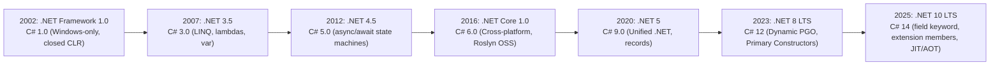
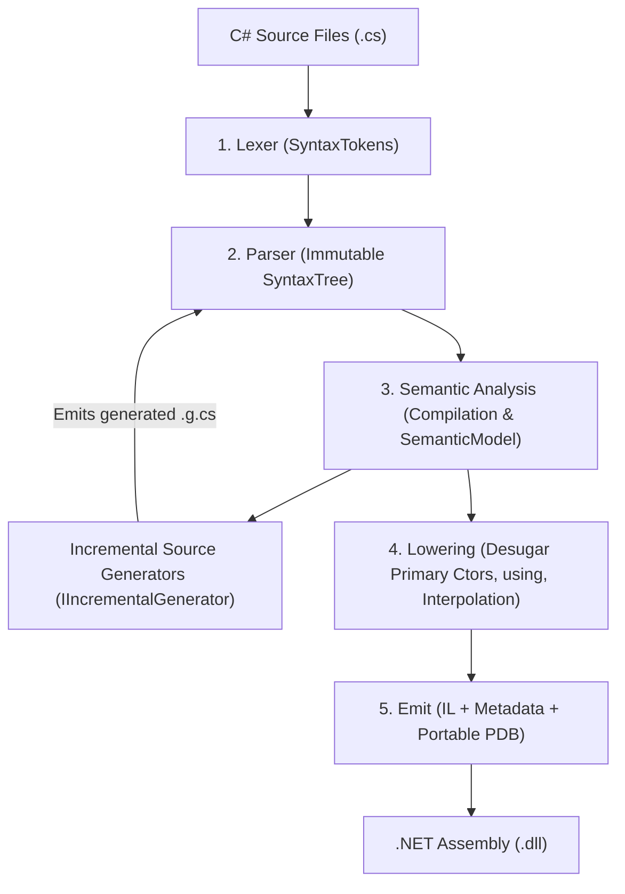
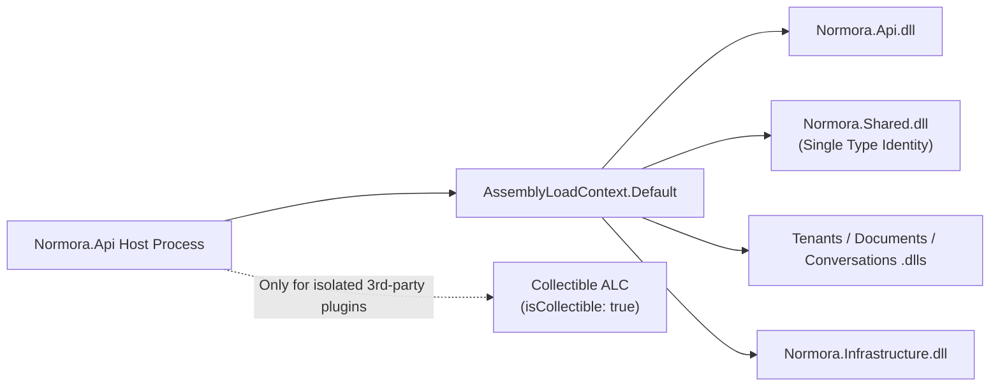

# Chapter 3: Ecosystem Evolution, Roslyn & Runtime Internals (C# 14 / .NET 10)

## 1. Learning Objectives
By the end of this chapter, you will be able to:
- Trace how C# and .NET evolved from the Windows-only .NET Framework to unified cross-platform **.NET 10 (LTS)** and **C# 14**, and evaluate Target Framework Monikers (`net10.0` vs legacy `netstandard2.0`).
- Trace the lifecycle of a C# program from source code to native CPU execution.
- Explain the internal phases of the **Roslyn** compiler (Lexing, Parsing, Semantic Analysis, Syntactic Lowering, Emit) and how **Incremental Source Generators** eliminate runtime reflection.
- Inspect the anatomy of a **.NET Assembly** (PE/COFF headers, Metadata tables, IL stream, `.pdb` symbols) and understand **AssemblyLoadContext (ALC)** isolation boundaries.
- Analyze **Intermediate Language (IL)** stack-machine instructions, including `call` vs `callvirt` vs `constrained.` dispatch and `Debug` vs `Release` output.
- Differentiate between the **Common Language Runtime (CLR)** subsystems and explain **Tiered Compilation**, **Dynamic Profile-Guided Optimization (PGO)**, **On-Stack Replacement (OSR)**, **Devirtualization**, and **SIMD**.
- Evaluate the trade-offs of **Just-In-Time (JIT)** compilation (**RyuJIT**), **ReadyToRun (R2R)**, and **NativeAOT** for enterprise workloads like **Normora**.

## 2. Introduction

When you write a C# application, you are not writing code that directly instructs the CPU. You are participating in a sophisticated, multi-staged compilation and execution pipeline refined over more than two decades. The evolution of C# from version 1.0 (a largely Windows-bound, simple object-oriented language) to **C# 14 on .NET 10** (cross-platform, cloud-native, blending object-oriented, functional, and low-allocation systems programming) required fundamental architectural rewrites of both the compiler and the runtime.

C# was created by Anders Hejlsberg at Microsoft to provide a modern, **type-safe** (memory and type rules enforced so invalid casts or uninitialized pointers cannot silently corrupt memory) language for the .NET Framework. Over time, as enterprise systems moved to Linux containers, Kubernetes, and high-throughput SaaS platforms, Microsoft rebuilt the compiler as an open-source platform (**Roslyn**) and re-engineered the runtime into cross-platform **.NET Core**—eventually unifying the ecosystem into modern **.NET** (with **.NET 10** as the Long-Term Support release).

To master C#, a Senior Software Engineer or Architect must abandon the "black box" mentality. Throughout this chapter, we will anchor every compiler and runtime concept in **Normora**—a real **.NET 10 modular monolith** (a single deployable application split internally into strictly encapsulated domain modules: `Tenants`, `Documents`, and `Conversations`, paired with a `Normora.Api` HTTP/BFF host, a `Normora.Worker` Hangfire background host, `Normora.Infrastructure`, and `Normora.Shared`). Understanding *exactly* what happens when you build and run Normora is the baseline for diagnosing production latency, avoiding deployment failures, and designing fast, safe architectures.

## 3. Evolution of C# and the .NET Platform (C# 1.0 to C# 14 / .NET 10)

### What It Is and Why It Matters
When engineers talk about ".NET," they are often referring to one of three historical eras. Knowing which era an API or library comes from prevents costly architectural mistakes:

1. **.NET Framework (1.0 – 4.8, 2002–2019):** Windows-only, closed-source runtime bundled with the OS. Uses legacy configuration (`web.config`), `AppDomain` isolation, and does **not** receive modern runtime performance features.
2. **.NET Core (1.0 – 3.1) & .NET Standard (2016–2019):** A ground-up, open-source, cross-platform (Linux, macOS, Windows) rewrite. To share libraries between .NET Framework and .NET Core during the transition years, Microsoft created **.NET Standard** (a specification of common APIs, peaking at `netstandard2.0` and `netstandard2.1`).
3. **Unified .NET (5, 6 LTS, 7, 8 LTS, 9, 10 LTS, 2020–Present):** Microsoft dropped the "Core" branding and unified server, cloud, desktop, and mobile onto one platform on an annual November release cadence:
   - **LTS (Long-Term Support)** releases (even numbers: `.NET 6`, `.NET 8`, **`.NET 10`**) receive 3 years of security and bug fixes—these are the standard choice for enterprise production systems.
   - **STS (Standard-Term Support)** releases (odd numbers: `.NET 7`, `.NET 9`) receive 18–24 months of support and introduce features early.

In parallel, the **C# language** evolved from C# 1.0 to **C# 14** in steady architectural leaps:
- **C# 2–4:** Generics (zero-boxing collections), LINQ & lambda expressions, `dynamic` interop.
- **C# 5–6:** `async`/`await` compiler state machines, **Roslyn** open-source compiler, string interpolation, expression-bodied members.
- **C# 7–9:** `Span<T>`-friendly language features (`ref struct`), pattern matching, nullable reference types, `record` types, top-level statements.
- **C# 10–12:** File-scoped namespaces, global `using`s, `required` properties, **Primary Constructors** (constructor parameters directly on the class/struct declaration), collection expressions (`[a, b, c]`).
- **C# 13–14:** `System.Threading.Lock` first-class `lock` support, `params` collections, the contextual `field` keyword (accessing a compiler-synthesized backing field without declaring one manually), **extension members** (extension properties as well as methods), null-conditional assignment (`obj?.Prop = value`), and unbound generics in `nameof(List<>)`.



### How Target Framework Monikers (TFMs) Work
Your `.csproj` `<TargetFramework>` element (for example, `<TargetFramework>net10.0</TargetFramework>`) tells the SDK which Base Class Library (BCL) surface area, runtime capabilities, and default C# language version (`14.0` for `net10.0`) are available at compile time.

### When NOT to Target Older Frameworks or `.NET Standard 2.0`
- **Do NOT target `netstandard2.0`** for internal enterprise libraries or application modules (such as `Normora.Shared` or `Normora.Infrastructure`). Targeting `netstandard2.0` restricts you to a 2017 API contract—blocking modern `Span<T>` overloads, `FrozenDictionary`, `SearchValues<T>`, `System.Threading.Lock`, and modern JIT intrinsics.
- **Only target `netstandard2.0`** if you maintain a public NuGet library that *must* still be consumed by legacy .NET Framework 4.6.1–4.8 desktop or enterprise monoliths. Otherwise, target `net10.0` directly.

### Real-World Normora Examples (C# 14 & .NET 10 Evolution)
1. **Unified `net10.0` Target Across Every Normora Project:** `Normora.Api`, `Normora.Worker`, `Normora.Infrastructure`, `Normora.Shared`, and the `Tenants`, `Documents`, and `Conversations` module assemblies all target `net10.0` (LTS). Because nothing in Normora runs on legacy .NET Framework, avoiding `netstandard2.0` lets `Normora.Shared` expose modern zero-allocation primitives and EF Core 10 contracts cleanly.
2. **Primary Constructors for Dependency Injection (`AGENTS.md` Standard):** Normora enforces C# 12+ primary constructors across all handlers and services, eliminating manual `private readonly` field boilerplate:
   ```csharp
   // server/Modules/Documents/Application/Documents/Commands/UploadDocument/UploadDocumentCommandHandler.cs
   public sealed class UploadDocumentCommandHandler(
       DocumentsDbContext dbContext,
       IDocumentStorageService storageService,
       IDocumentProcessingWakeup wakeup,
       ITenantContext tenantContext) : IRequestHandler<UploadDocumentCommand, UploadDocumentResult>
   {
       // Parameters are captured by the compiler for use across methods
   }
   ```
3. **C# 14 `field` Keyword in Domain & Options Validation:** Before C# 14, validating a property setter required declaring an explicit private backing field. In C# 14, `TenantPlan` or `GeminiOptions` can normalize inputs inline using `field`:
   ```csharp
   public sealed class TenantCurrencyPreference
   {
       public string CurrencyCode
       {
           get => field;
           set => field = string.IsNullOrWhiteSpace(value)
               ? throw new ArgumentException(ApiMessages.InvalidCurrency, nameof(value))
               : value.Trim().ToUpperInvariant();
       } = "USD";
   }
   ```
4. **Collection Expressions (`[...]`) in `TenantPlanPricingCatalog` & Architecture Tests:** Clean, compiler-optimized initialization for immutable tier/currency tables and forbidden-namespace checks in `Normora.Architecture.Tests`:
   ```csharp
   private static readonly string[] SupportedCurrencies =
       ["INR", "USD", "EUR", "GBP", "CAD", "AUD", "JPY", "SGD"];
   ```
5. **C# 13/14 `System.Threading.Lock` & Null-Conditional Assignment (`?.=`) in Infrastructure:** Modernizing in-process synchronization (without `Monitor` object-header contention) and concise null-safe updates when enriching telemetry tags in `Normora.Infrastructure`:
   ```csharp
   private readonly Lock _warmupGate = new();
   // Null-conditional assignment (C# 14): skips RHS evaluation if activity is null
   activity?.DisplayName = "documents.hybrid_retrieval";
   ```

## 4. The Compilation Pipeline: From Code to Silicon

The execution of a modern C# application involves two distinct stages separated by time and space:
1. **Compile-Time (Roslyn):** Translates C# source code into Intermediate Language (IL) and metadata, packaging it into an Assembly (`.dll` or `.exe`).
2. **Runtime (CLR/JIT):** Translates the IL into native machine code optimized specifically for the host operating system and CPU architecture.

### 4.1 Visual Diagram: The Complete Pipeline

```text
+---------------------+
|                     |
|    C# Source Code   |  (.cs files)
|                     |
+---------+-----------+
          |
          v
=========================================
  Roslyn Compiler Pipeline
=========================================
          |
    +-----v-----+
    |   Lexer   | -> Produces Syntax Tokens
    +-----+-----+
          |
    +-----v-----+
    |   Parser  | -> Produces Syntax Trees
    +-----+-----+
          |
    +-----v-----+
    |  Semantic | -> Binds Trees to Symbols & Types
    |  Analysis |    (Produces the Bound Tree)
    +-----+-----+
          |
    +-----v-----+
    |   Emit    | -> Generates IL & Metadata
    +-----+-----+
          |
          v
+---------------------+
| .NET Assembly (.dll)|  (Contains MSIL + Metadata)
+---------+-----------+
          |
          v
=========================================
  Common Language Runtime (CLR) Execution
=========================================
          |
    +-----v-----+
    | Assembly  | -> Verifies Metadata, Type Safety
    |  Loader   |
    +-----+-----+
          |
    +-----v-----+
    | RyuJIT    | -> Just-In-Time Compilation
    | Compiler  |    (Translates IL to Machine Code)
    +-----+-----+
          |
    +-----v-----+
    | Native    | -> x64 / ARM64 Instructions
    | Machine   |
    | Code      |
    +-----+-----+
          |
          v
+---------------------+
|        CPU          |
+---------------------+
```

## 5. Compiler & Runtime Internals Deep Dive

### 5.1 Phase 1: The Roslyn Compiler, Lowering & Incremental Source Generators

#### What It Is and Why It Matters
**Roslyn** (officially the `.NET Compiler Platform`) is not a monolithic "black box" binary; it is a **"Compiler as a Service"** exposing immutable data structures and APIs so IDEs, build-time analyzers, and **Source Generators** can inspect and augment your C# code during compilation.

1. **Lexical Analysis (Lexing):** The compiler reads the raw text stream and breaks it down into `SyntaxToken`s (keywords, identifiers, operators, punctuation) plus `SyntaxTrivia` (whitespace and comments, preserving full source fidelity for refactoring tools).
2. **Parsing:** The tokens are organized into a hierarchical, immutable `SyntaxTree` (implemented internally with a memory-efficient "red-green tree" so minor edits only reallocate the changed path). If you write `var x = 5;`, the parser constructs a tree representing a `LocalDeclarationStatementSyntax` containing a `VariableDeclarationSyntax` with an `EqualsValueClauseSyntax`.
3. **Semantic Analysis:** The compiler gives *meaning* to the syntax. It creates a `Compilation` object, combining the `SyntaxTree`s with referenced assemblies. A `SemanticModel` binds names to concrete `ISymbol`s—resolving `var x = 5;` to `System.Int32`, checking accessibility (`public`, `internal`), and enforcing nullability flow analysis.
4. **Syntactic Lowering (Desugaring):** Before generating IL, Roslyn lowers high-level C# syntax into simpler, canonical C# constructs. For example:
   - `using var stream = ...;` lowers to `try { ... } finally { stream?.Dispose(); }`.
   - Interpolated strings like `$"Tenant {tenantId}"` lower to `DefaultInterpolatedStringHandler` (stack-allocated formatting buffer with zero intermediate `string` allocations).
   - **Primary constructors** lower constructor parameters into synthesized private fields (if captured by methods) and emit a standard `.ctor`.
   - `async`/`await` and `yield return` lower into compiler-generated state-machine structs (examined in detail in Chapter 9).
5. **Emit:** The lowered bound tree is translated into Intermediate Language (IL) and metadata tables, then written into a Portable Executable (`.dll` / `.exe`) and `.pdb` symbol file.



#### Incremental Source Generators (`IIncrementalGenerator`)
A **Source Generator** hooks into Roslyn mid-compilation to inspect syntax/symbols and emit new `.g.cs` files that are compiled into the *same* assembly—eliminating runtime `System.Reflection` overhead and unlocking **NativeAOT** compatibility.
- Legacy **`ISourceGenerator`** (introduced in .NET 5) re-ran over the entire compilation on every keystroke, causing severe IDE lag in large solutions.
- Modern **`IIncrementalGenerator`** (.NET 6 through .NET 10) builds a memoized, node-cached pipeline (`context.SyntaxProvider.ForAttributeWithMetadataName(...)`). If you edit a controller in `Tenants`, Roslyn only re-evaluates the affected syntax nodes instead of regenerating every file in `Documents` and `Conversations`.

#### When NOT to Use Custom Source Generators or Roslyn Analyzers
- **Do NOT write a custom `IIncrementalGenerator`** when a standard generic method, interface, or built-in .NET 10 generator (`[JsonSerializable]`, `[LoggerMessage]`, `[GeneratedRegex]`, `[OptionsValidator]`) already solves the problem. Custom generators increase build-graph complexity, require separate analyzer project packaging, and are harder for teammates to debug.
- **Do NOT use Roslyn `Compilation` APIs at runtime** inside production HTTP handlers unless you are intentionally building an IDE, script runner, or REPL—loading Roslyn into `Normora.Api` would add tens of megabytes of compiler assemblies and heavy memory pressure.

#### Real-World Normora Examples (Roslyn, Lowering & Source Generators)
1. **Primary Constructor Lowering in `CancelSubscriptionCommandHandler`:**
   ```csharp
   // What you write (C# 14 primary constructor):
   public sealed class CancelSubscriptionCommandHandler(
       TenantsDbContext dbContext,
       ITenantContext tenantContext)
   {
       public async Task HandleAsync(CancellationToken ct)
       {
           var plan = await dbContext.TenantPlans
               .FirstOrDefaultAsync(p => p.TenantId == tenantContext.TenantId, ct);
           if (plan is null) throw new BolaException();
           if (plan.Tier == SubscriptionTier.Free)
               throw new InvalidOperationException(ApiMessages.CannotCancelFreePlan);
       }
   }
   ```
   During lowering, Roslyn synthesizes hidden backing fields (`<dbContext>P`, `<tenantContext>P`) only because `HandleAsync` captures them. If a primary constructor parameter is only passed to a `base(...)` constructor and never referenced inside methods, Roslyn lowers it directly without allocating a hidden field at all!
2. **Zero-Allocation `[LoggerMessage]` Source Generator in `DocumentProcessingJob`:** Instead of runtime reflection/boxing inside `ILogger.LogInformation("Chunked {Count} chunks", count)`, Normora can use `.NET`'s built-in logging generator:
   ```csharp
   public static partial class DocumentJobLog
   {
       [LoggerMessage(
           EventId = 3001,
           Level = LogLevel.Information,
           Message = "Processed document {DocumentId} for tenant {TenantId} into {ChunkCount} chunks")]
       public static partial void DocumentChunked(
           this ILogger logger, Guid documentId, Guid tenantId, int chunkCount);
   }
   ```
   Roslyn generates a strongly-typed `LoggerMessage.Define` wrapper at compile time—zero `object[]` allocations, zero `int`/`Guid` boxing, and zero runtime format-string parsing (while honoring CWE-209 by keeping stack traces strictly in structured logs).
3. **`System.Text.Json` Source Generation (`JsonSerializerContext`) for `McpController` & A2UI Cards:**
   ```csharp
   [JsonSourceGenerationOptions(PropertyNamingPolicy = JsonKnownNamingPolicy.CamelCase)]
   [JsonSerializable(typeof(McpToolCallRequest))]
   [JsonSerializable(typeof(McpToolCallResponse))]
   public partial class NormoraMcpJsonContext : JsonSerializerContext;
   ```
   Roslyn emits direct `Utf8JsonWriter`/`Utf8JsonReader` serialization code at build time, removing cold-start reflection over MCP JSON-RPC 2.0 payloads.
4. **Compile-Time `[OptionsValidator]` for `GeminiOptions` and `MinioOptions`:** Replacing runtime reflection property walks on `ValidateDataAnnotations()` with Roslyn-generated validation code triggered by `ValidateOnStart()` in `ProviderServiceExtensions.cs`.
5. **Compile-Time Roslyn Analyzers vs `Normora.Architecture.Tests`:** A Roslyn diagnostic analyzer can flag `throw new Exception("User not found")` directly with a red squiggle in the IDE when someone violates `AGENTS.md` Section 1 ("Always use `Normora.Shared.Constants.ApiMessages`"), catching magic-string errors at keystroke time before CI even runs.

### 5.2 Assemblies, PE Metadata & `AssemblyLoadContext` (ALC)

#### What It Is and Why It Matters
When Roslyn finishes emitting, it produces a **.NET Assembly**—usually a `.dll` file (plus an optional native OS launcher `.exe` called the **apphost**). Every .NET assembly follows the **Portable Executable (PE/COFF)** binary layout, containing four crucial parts:
1. **PE/COFF & CLR Header:** Tells the OS loader and `hostfxr`/`coreclr` that this binary contains managed .NET code and specifies the entry point.
2. **Assembly Manifest:** Identity metadata—assembly name, version (`1.0.0.0`), culture, public key token (if strong-named), and the list of external assemblies it depends on (`AssemblyRef`).
3. **Metadata Tables:** Compact relational tables inside the `.dll` (`TypeDef`, `MethodDef`, `Field`, `Param`, `CustomAttribute`, `MemberRef`) describing every type, method signature, and attribute. Notice how **Reflection**, EF Core's `ApplyConfigurationsFromAssembly`, and dependency injection scanners read these metadata tables without needing C# source code.
4. **CIL (IL) Stream:** The actual stack-machine bytecode for every method body.
*(Debugging symbols—mapping IL offsets back to `.cs` line numbers—live in a separate **Portable `.pdb`** file so production binaries stay lean while still allowing rich stack traces when `.pdb` files are deployed.)*

At runtime, the `.NET` host reads two JSON sidecars generated during `dotnet build`:
- **`Normora.Api.runtimeconfig.json`:** Declares the target framework (`Microsoft.NETCore.App` / `Microsoft.AspNetCore.App` `10.0.x`), GC settings, and Tiered Compilation flags.
- **`Normora.Api.deps.json`:** Maps every NuGet package and project reference to its exact `.dll` path and version.

#### `AssemblyLoadContext` (ALC): Isolation and Unloading
An **`AssemblyLoadContext`** is .NET's modern replacement for legacy .NET Framework `AppDomain`s. It controls *where* assemblies are loaded from and *which* types share identity:
- By default, every application starts in `AssemblyLoadContext.Default`.
- **Collectible ALCs** (`new AssemblyLoadContext("PluginA", isCollectible: true)`) allow you to dynamically load a third-party plugin assembly *and later unload it* so the Garbage Collector can reclaim its IL, JITted code, and metadata!
- **Critical Rule — Type Identity:** In the CLR, a type's identity is the tuple `(AssemblyLoadContext, Assembly, FullTypeName)`. If the *same* `Normora.Shared.dll` is loaded into two different ALCs, `PerformHybridRetrievalQuery` from ALC #1 is **not** assignment-compatible with `PerformHybridRetrievalQuery` from ALC #2!



#### When NOT to Use Custom `AssemblyLoadContext`s
- **Do NOT put modular monolith modules (`Tenants`, `Documents`, `Conversations`) in separate ALCs.** Normora's modules share cross-module contracts in `Normora.Shared.Contracts.*` (`PerformHybridRetrievalQuery`, `GetMcpToolsQuery`) and shared abstractions (`ITenantContext`, `BolaException`). Separating them into distinct ALCs would fracture type identity and break MediatR dispatch and DI resolution. Enforce module boundaries at compile time via project references and `Normora.Architecture.Tests` instead.

#### Real-World Normora Examples (Assemblies, Metadata & ALCs)
1. **Clean Dependency Graph in `.deps.json` (`Normora.Worker` vs `Normora.Api`):** Inspecting `Normora.Worker.deps.json` confirms that `Normora.Worker` references `Normora.Infrastructure` and `Normora.Shared`—and contains **zero** `AssemblyRef` entries for `Normora.Api` or Duende BFF. Conversely, `Normora.Modules.Documents.dll` contains zero `AssemblyRef` entries for `Minio.dll` or Google Gemini SDKs.
2. **EF Core Metadata Scanning via `ApplyConfigurationsFromAssembly`:**
   ```csharp
   // Inside DocumentsDbContext.OnModelCreating:
   modelBuilder.ApplyConfigurationsFromAssembly(typeof(DocumentsDbContext).Assembly);
   ```
   EF Core inspects the `TypeDef` metadata table of `Normora.Modules.Documents.dll`, finds every non-abstract class implementing `IEntityTypeConfiguration<T>`, and invokes its parameterless public constructor—which is why Normora strictly forbids injecting scoped services like `ITenantContext` into configuration constructors.
3. **Single Type Identity for MediatR Cross-Module Contracts:** When `Conversations` sends `PerformHybridRetrievalQuery` (defined in `Normora.Shared.dll`) via MediatR to a handler in `Documents`, both modules resolve `PerformHybridRetrievalQuery` inside `AssemblyLoadContext.Default`, guaranteeing identical `RuntimeTypeHandle` pointers.
4. **Ephemeral Migration Host (`dotnet Normora.Api.dll --migrate`):** When launched with `--migrate`, `MigrationHostExtensions.RunMigrationsAsync` constructs a minimal console host that resolves only `DatabaseMigrationRunner` and the four `IDatabaseMigrator` implementations (`Tenants`, `Documents`, `Conversations`, `Session`), intentionally never activating Kestrel, SignalR, or OpenTelemetry native listeners—preventing native teardown SIGSEGV crashes (exit code 139).
5. **Automated Boundary Enforcement in `Normora.Architecture.Tests`:** Architecture tests load the compiled module assemblies' metadata (`typeof(TenantsDbContext).Assembly.GetReferencedAssemblies()`) to verify that business modules never reference third-party vendor SDKs or another module's private `DbContext`.

### 5.3 Phase 2: The Intermediate Language (IL) & Stack-Machine Internals

#### What It Is and Why It Matters
**IL** (also called **MSIL** or **CIL**, Common Intermediate Language) is a CPU-independent, object-oriented assembly language. Instead of targeting x64 registers (`rax`, `rcx`) or ARM64 registers (`x0`, `x1`), IL operates on an **Evaluation Stack**: instructions push operands onto the stack, pop them to compute a result, and push the result back.

**C# Code:**
```csharp
public class Calculator
{
    public int Add(int a, int b)
    {
        return a + b;
    }
}
```

**Generated IL (viewed via `ildasm` or ILSpy in `Debug` mode):**
```il
.method public hidebysig instance int32 Add(int32 a, int32 b) cil managed
{
    .maxstack 2
    .locals init (
        [0] int32 V_0
    )

    IL_0000: nop
    IL_0001: ldarg.1      // Load argument 'a' onto the evaluation stack (arg 0 is 'this')
    IL_0002: ldarg.2      // Load argument 'b' onto the evaluation stack
    IL_0003: add          // Pop two values, add them, push result
    IL_0004: stloc.0      // Pop result and store in local variable 0
    IL_0005: br.s IL_0007 // Branch (jump) to IL_0007

    IL_0007: ldloc.0      // Load local variable 0 onto the stack
    IL_0008: ret          // Return the value on top of the stack
}
```

*Note: In `Release` mode, the compiler optimizes this heavily, removing the `nop`, `stloc`, and `br.s` instructions, reducing it to simply `ldarg.1`, `ldarg.2`, `add`, `ret`.*

#### Critical IL Dispatch Instructions: `call`, `callvirt`, and `constrained.`
1. **`call`:** Direct, static method call to a known compile-time target. Used for `static` methods, `base.Method()` calls, and direct calls on value types (`struct`). **Does not** perform a null check on `this`.
2. **`callvirt`:** Virtual dispatch through the object's **MethodTable (VTable)**—*and* automatically performs a null check on the target object reference (throwing `NullReferenceException` if null). **Important:** Roslyn intentionally emits `callvirt` even for *non-virtual* instance methods on reference types (`class`) specifically to guarantee a fast, hardware-assisted null check!
3. **`constrained. callvirt`:** Used in generic methods (`where T : IEquatable<T>` or calling `ToString()` on `T`). If `T` is a value type (like `Guid` or `int`) that overrides the method, the JIT avoids **boxing** (wrapping a stack value inside a heap object) and emits a direct `call`!

#### When NOT to Emit IL Dynamically (`Reflection.Emit` / `ILGenerator`)
- **Do NOT use `System.Reflection.Emit` or `DynamicMethod`** in standard application code. Hand-written IL bypasses compiler type safety checks until runtime, breaks **NativeAOT** (since there is no JIT to compile new IL), and leaks memory permanently unless hosted inside a collectible `AssemblyLoadContext`. Prefer C# generics, **Source Generators**, or compiled `Expression` trees when strictly necessary.

#### Real-World Normora Examples (IL & Stack-Machine Internals)
1. **Free Null-Safety via `callvirt` in `TenantResolutionMiddleware`:** Calling `membership.Role.ToString()` or `tenantContext.EnsureActive()` on a class instance compiles to `callvirt`. Even when `EnsureActive()` is non-virtual, `callvirt` guarantees that a `null` `tenantContext` throws `NullReferenceException` before a single instruction of `EnsureActive` runs.
2. **Direct `ldsfld` + `call` for `ApiMessages` Constants:** Writing `throw new BolaException(ApiMessages.NotFound)` compiles to `ldsfld` (load static field `ApiMessages.NotFound` onto the evaluation stack) followed by `newobj BolaException::.ctor(string)` and `throw`—zero string allocations at the call site.
3. **Zero-Boxing Generic Dispatch (`constrained.`) on `Guid` Tenant IDs:** Comparing `tenantId.Equals(request.TenantId)` where `tenantId` is a `Guid` compiles to a direct value-type `call` (`System.Guid::Equals(valuetype System.Guid)`), whereas passing `Guid` to a non-generic `object` parameter triggers an IL `box System.Guid` instruction (allocating 24+ bytes on the managed heap).
4. **Expression Trees vs Compiled IL in EF Core `GroupBy` (`AGENTS.md` Rule):**
   ```csharp
   // Compiles to an Expression Tree (data), NOT direct IL execution,
   // so EF Core's relational translator can convert it to SQL GROUP BY:
   var counts = await dbContext.Documents
       .GroupBy(d => d.Status)
       .Select(g => new { Status = g.Key, Count = g.Count() })
       .ToListAsync(ct);
   ```
   Projecting to an anonymous type creates an expression tree that EF Core translates cleanly to SQL; invoking a parameterized record constructor inside `GroupBy().Select(...)` fails SQL translation and throws `InvalidOperationException`.
5. **`Debug` `nop` Padding vs `Release` Tight IL in `DocumentChunker`:** In `Debug` builds, Roslyn emits `nop` instructions at every brace and statement boundary inside `DocumentChunker`'s Markdown heading loop so Visual Studio/VS Code breakpoints can land on empty lines. In `Release` builds, all `nop`s vanish, shrinking IL size so RyuJIT's inlining budget can inline small chunk-boundary helpers.

### Phase 3: The CLR and RyuJIT

When you execute the application, the OS bootstrapper loads the Common Language Runtime (CLR). The CLR is the heart of .NET. It provides Memory Management (Garbage Collection), Exception Handling, Thread Management, and Type Safety.

When a method is called for the *first time*, the CLR intercepts the call. It points to a "pre-stub" that invokes the **JIT (Just-In-Time) Compiler**, specifically RyuJIT.

**RyuJIT** takes the IL and translates it into native machine code. It applies aggressive optimizations based on the actual target CPU architecture (e.g., using SIMD instructions if available, inlining small methods, eliminating dead code).

Once JITed, the CLR rewrites the method table pointer to point directly to the native code. Subsequent calls bypass the JIT entirely and execute at native C++ speeds.

#### Deployment Strategies: Trade-offs
Enterprise applications require careful consideration of deployment strategies:
- **JIT Compilation:** Standard approach. Slower startup (warm-up penalty) but allows RyuJIT to optimize code based on the exact hardware at runtime.
- **ReadyToRun (R2R):** Ahead-of-Time (AOT) compilation combined with JIT. Pre-compiles much of the IL to native code for faster startup, but retains IL for fallback if the hardware differs.
- **NativeAOT:** Completely compiles the app to native OS code during the build process. Removes the JIT and most of the CLR. Results in near-instant startup and tiny memory footprints, but eliminates dynamic code generation (Reflection.Emit). Ideal for serverless microservices.

## 6. Real Production Case Study: EV Platform

Let's introduce our ongoing case study: a **Multi-Tenant EV Charging Management Platform**.

**Architecture Goal:** We need a highly available API that receives telemetry data (heartbeats, power metrics) from tens of thousands of IoT chargers concurrently.

**Chapter 1 Application:**
We will define our entry point using modern C# top-level statements and minimal APIs, leveraging the speed of RyuJIT.

```csharp
// Program.cs
using System.Text.Json;
using Microsoft.AspNetCore.Builder;
using Microsoft.AspNetCore.Http;
using Microsoft.Extensions.DependencyInjection;
using Microsoft.Extensions.Logging;

var builder = WebApplication.CreateBuilder(args);

// Register highly-optimized telemetry processor
builder.Services.AddSingleton<TelemetryProcessor>();

var app = builder.Build();

// A high-performance Minimal API endpoint for IoT ingestion
// RyuJIT will heavily inline these calls in a production build
app.MapPost("/api/v1/telemetry", async (TelemetryPayload payload, TelemetryProcessor processor) =>
{
    // Minimal overhead processing
    await processor.ProcessAsync(payload);
    return Results.Accepted();
});

app.Run();

// --- Domain Models ---

// Structs reduce Heap allocations, easing GC pressure (Covered in Chapter 2)
public readonly record struct TelemetryPayload(
    string ChargerId, 
    double Voltage, 
    double Current, 
    DateTime Timestamp);

// --- Core Logic ---

public class TelemetryProcessor
{
    private readonly ILogger<TelemetryProcessor> _logger;

    public TelemetryProcessor(ILogger<TelemetryProcessor> logger)
    {
        _logger = logger;
    }

    public ValueTask ProcessAsync(TelemetryPayload payload)
    {
        // Simulated business logic. 
        // Using ValueTask to avoid heap allocation if the operation completes synchronously.
        _logger.LogInformation(
            "Received telemetry for {ChargerId} at {Time}", 
            payload.ChargerId, payload.Timestamp);
            
        return ValueTask.CompletedTask;
    }
}
```

**Why this code matters at an architectural level:**
- We use a `record struct` for the payload to prevent heap allocations per HTTP request.
- We use `ValueTask` instead of `Task` to avoid allocating a state machine on the heap for synchronous paths.
- We utilize Minimal APIs, which generate significantly less IL and reflection overhead compared to traditional MVC controllers.

## 7. Common Mistakes

| Level | Mistake | Impact | How to Avoid |
|-------|---------|--------|--------------|
| Beginner | Thinking C# is an interpreted language like Python. | Fundamental misunderstanding of performance profiles. | Understand that C# executes as native machine code after JIT. |
| Intermediate | Building in `Debug` mode and profiling performance. | Drastically skewed performance metrics. `Debug` disables compiler optimizations. | Always profile using `Release` builds without an attached debugger. |
| Senior | Overusing Reflection heavily in hot-paths. | Reflection bypasses standard JIT optimizations and relies on slower metadata lookups. | Use Source Generators (compile-time) or cached compiled expression trees. |
| Architect | Ignoring NativeAOT constraints. | Application crashes at runtime if relying on dynamic assembly loading or heavy reflection. | Design microservices cleanly; avoid magic strings and dynamic code generation if AOT is the target. |

## 8. Interview Questions

### Beginner Tier (Compilation Basics)

**1. What is Intermediate Language (IL) and why does C# use it?**
*Answer:* IL is an object-oriented assembly language that is CPU-independent. C# compiles to IL so that the same compiled `.dll` can be distributed and executed on Windows, Linux, and macOS without needing to be recompiled for each specific operating system.
*Example:*
```csharp
// C# Code: int x = 5;
// Compiles to IL: ldc.i4.5 (Load constant integer 5)
```

**2. What is the CLR?**
*Answer:* The Common Language Runtime (CLR) is the virtual machine component of .NET. It manages the execution of .NET programs and provides core services like Memory Management (Garbage Collection), Type Safety, Exception Handling, and Thread Management.

**3. What is the Roslyn Compiler?**
*Answer:* Roslyn is the open-source C# compiler. Unlike older "black box" compilers, Roslyn provides rich APIs that allow developers and IDEs (like Visual Studio) to inspect the code's syntax tree, perform real-time code analysis, and generate code on the fly.

**4. What does the term "Managed Code" mean?**
*Answer:* Managed code is code whose execution is managed by a runtime (the CLR). The CLR takes care of memory allocation, garbage collection, and security. C++ is typically "unmanaged code" because the developer must manually allocate and free memory.

**5. What is an Assembly in .NET?**
*Answer:* An assembly is the compiled output of your C# code, typically a `.dll` (Dynamic Link Library) or `.exe` (Executable). It contains the IL code and Metadata describing the types, methods, and references.

**6. What is Metadata in a .NET Assembly?**
*Answer:* Metadata is a system of tables embedded in the assembly that describes exactly what is inside the IL: the names of classes, their properties, methods, parameter types, and return types. Reflection uses this Metadata.

**7. Why is `Debug` mode slower than `Release` mode?**
*Answer:* In `Debug` mode, the Roslyn compiler explicitly avoids optimizing the IL, and it emits `.pdb` symbols so the debugger can step through code line by line. In `Release` mode, it removes unused variables, inlines code, and allows the JIT to aggressively optimize the native CPU instructions.

### Intermediate Tier (JIT and Roslyn Phases)

**8. What are the distinct phases of the Roslyn compiler?**
*Answer:* Lexical Analysis (creating tokens), Parsing (creating Syntax Trees), Semantic Analysis (binding types and symbols), and Emit (generating the final IL and metadata into an assembly).

**9. Explain what the Just-In-Time (JIT) compiler does.**
*Answer:* When you run a .NET app, the CPU cannot understand IL. The JIT compiler (RyuJIT) reads the IL and translates it into native machine code (e.g., x64 or ARM64 instructions) *just before* the method is executed for the very first time.
*Example:*
```csharp
// IL: add
// JIT translates to x64: add eax, ecx
```

**10. What is "Warm-up Penalty" in .NET?**
*Answer:* Because the JIT compiler translates methods to machine code on the fly during the first invocation, the first time a user hits an endpoint, it will be noticeably slower. This delay is the warm-up penalty. Subsequent calls are native speed.

**11. What is Tiered Compilation?**
*Answer:* It is a feature where the JIT compiler initially compiles methods very quickly but with poor optimization (Tier 0) to ensure fast app startup. In the background, it monitors which methods are called frequently. It then recompiles those "hot" methods with aggressive, slow optimizations (Tier 1) and swaps the pointers.

**12. What is a Syntax Tree in Roslyn?**
*Answer:* It is an immutable, hierarchical representation of the source code. Every keyword, identifier, and space is a node on this tree. Analyzers use it to find patterns (e.g., finding all `if` statements).
*Example:*
```csharp
// var x = 5;
// Becomes: LocalDeclarationStatement -> VariableDeclaration -> EqualsValueClause
```

**13. What happens during Semantic Analysis?**
*Answer:* The compiler gives meaning to the Syntax Tree. It figures out that `x` is an `int` because it resolves the literal `5`. It binds identifiers to actual `TypeSymbols`.

**14. What is a Source Generator?**
*Answer:* A Source Generator hooks into the Roslyn compiler during the compilation phase. It inspects the Semantic Model of your code and can generate new C# files on the fly, which are then compiled into the final assembly. It is a zero-runtime-cost alternative to Reflection.
*Example:*
```csharp
// You write a partial class.
// The Source Generator creates the rest of the file automatically during build!
```

### Senior Tier (Memory and Native Code)

**15. Explain what happens when a method is invoked for the very first time in the CLR.**
*Answer:* The CLR intercepts the call via a "pre-stub." It invokes RyuJIT, which translates the IL of that specific method into native machine code. Finally, the CLR rewrites the method table pointer to point to the newly generated native code. Subsequent calls jump straight to native code, bypassing the JIT entirely.

**16. What is the Evaluation Stack in MSIL?**
*Answer:* MSIL operates as a stack machine, not a register machine. Instructions push values onto the evaluation stack, and operators pop values off, compute, and push the result back.
*Example:*
```il
ldc.i4.1 // Push 1
ldc.i4.2 // Push 2
add      // Pop 1 and 2, add them, Push 3
```

**17. How does JIT Inlining improve performance?**
*Answer:* Inlining takes the body of a small method and pastes it directly into the caller's method at the JIT level. This eliminates the CPU overhead of setting up a new stack frame, pushing parameters, and executing a jump instruction.
*Example:*
```csharp
public int Add(int a, int b) => a + b;
// If inlined, the caller just executes the math directly, no method call occurs.
```

**18. What is ReadyToRun (R2R) compilation?**
*Answer:* R2R is an Ahead-of-Time (AOT) compilation feature where the .NET SDK pre-compiles much of your IL into native code during `dotnet publish`. This drastically reduces the JIT warmup penalty at startup. However, the original IL is still kept in the assembly as a fallback if the host hardware differs.

**19. What is NativeAOT?**
*Answer:* NativeAOT completely compiles the C# app to native OS code (like a C++ app) during the build process. It removes the JIT compiler and most of the CLR entirely. This results in single-digit millisecond cold starts and tiny memory footprints, ideal for AWS Lambda.

**20. What are the limitations of NativeAOT?**
*Answer:* Because there is no JIT compiler at runtime, you cannot use dynamic code generation (`Reflection.Emit`). If a library relies heavily on runtime reflection to figure out generic types, it will crash at runtime under NativeAOT.

**21. What is Profile Guided Optimization (PGO)?**
*Answer:* Dynamic PGO allows the JIT compiler to instrument running code to gather data (e.g., "Which branch of this `if` statement is taken 99% of the time?"). The JIT then recompiles the method, rearranging the native assembly instructions so the "happy path" has zero branch prediction penalties on the CPU.

### Staff Engineer Tier (CLR Internals)

**22. Explain the difference between `call` and `callvirt` in IL.**
*Answer:* `call` is a static, direct invocation to a known memory address. `callvirt` looks up the object's Virtual Method Table (VTable) at runtime to resolve the correct overridden method. Critically, `callvirt` always performs a Null Check on the instance before calling, whereas `call` does not.
*Example:*
```csharp
object obj = null;
// obj.ToString() compiles to callvirt. The CLR throws NullReferenceException.
```

**23. How does the CLR guarantee Type Safety?**
*Answer:* During the JIT phase, the CLR Verification process scans the IL to ensure that pointers are valid, array bounds are respected, and objects are only cast to compatible types. If the IL is invalid or malicious, it throws a `VerificationException` before the code can ever execute.

**24. What is a SyncBlock in the CLR?**
*Answer:* Every object on the managed heap contains an 8-byte Object Header (SyncBlock) and an 8-byte MethodTable pointer. The SyncBlock is primarily used by the CLR to manage thread synchronization (when you use the `lock` statement) and store the object's HashCode.

**25. How do Value Types differ from Reference Types in the CLR Method Table?**
*Answer:* Reference types exist on the heap and have a MethodTable pointer allowing for Virtual Dispatch (Polymorphism). Value types (Structs) do not have a MethodTable pointer or SyncBlock when stored on the stack; they are just raw payloads of data. If you call an interface method on a struct, the CLR must Box it (copy it to the heap) to attach a MethodTable.

**26. Why does `Reflection.Emit` cause massive memory leaks in long-running services?**
*Answer:* `Reflection.Emit` allows you to generate new IL assemblies dynamically in memory at runtime. However, dynamically generated assemblies cannot be garbage collected unless they are loaded into a disposable `AssemblyLoadContext`. If a library emits new types per request (like a bad JSON serializer), the CLR will eventually run out of memory.

**27. What is Devirtualization?**
*Answer:* It is a JIT optimization. If the JIT proves that a class is `sealed`, or that an interface method only has one implementer in the entire application, it rewrites the `callvirt` instruction into a direct `call`. This eliminates the VTable lookup and allows the method to be inlined, massively boosting performance.

### Architect Tier (Ecosystem Strategy and Hardware)

**28. You are migrating a legacy monolithic application to a microservices architecture hosted on Kubernetes. Why might RyuJIT's tiered compilation be beneficial here?**
*Answer:* Tiered compilation initially JIT-compiles methods quickly (Tier 0) to guarantee fast startup times. In the background, it recompiles hot methods with aggressive optimizations (Tier 1). For a containerized microservice that spins up dynamically under load (HPA), this perfectly balances the need for rapid scaling (fast startup) with high throughput (optimized steady-state execution).

**29. Why might a financial trading platform architect disable Tiered Compilation (`<TieredCompilation>false</TieredCompilation>`)?**
*Answer:* In high-frequency trading (HFT), latency consistency is more important than fast startup. Tiered Compilation causes latency spikes randomly during the day when the JIT decides to recompile a hot method and swap the pointers. HFT architects disable it, forcing the JIT to fully optimize everything at startup, ensuring deterministic latency for every trade.

**30. How does CPU architecture (x64 vs ARM64) impact your C# code?**
*Answer:* Generally, the JIT abstracts this away. However, memory models differ. x64 has a strongly-ordered memory model, while ARM64 is weakly-ordered. If you write low-level, lock-free multithreaded code without proper `Volatile` barriers, it might run perfectly on Intel CPUs but experience catastrophic race conditions on AWS Graviton (ARM64) processors because the CPU reorders the memory reads.

**31. Compare the memory density of C# NativeAOT vs Node.js in a serverless environment.**
*Answer:* A Node.js Hello-World function requires loading the entire V8 JavaScript engine into memory (~40MB). A C# NativeAOT function compiles down to a raw Linux executable containing only the specific code paths used, resulting in a binary that can run in under 10MB of RAM. This allows architects to pack significantly more serverless tenants onto a single cloud node.

**32. What is the architectural danger of using `.NET Standard 2.0` class libraries today?**
*Answer:* `.NET Standard 2.0` was a compatibility bridge between legacy .NET Framework 4.8 and modern .NET Core. By targeting it, you lose access to modern performance types like `Span<T>`, default interface methods, and highly optimized hardware intrinsics. Architects should mandate targeting `net8.0` (or the latest LTS) for internal libraries to ensure maximum performance across the ecosystem.

**33. How do SIMD (Single Instruction, Multiple Data) instructions factor into C# performance?**
*Answer:* Modern CPUs have wide vector registers (e.g., AVX-512) that can process multiple integers in a single clock cycle. The .NET JIT compiler (via `System.Runtime.Intrinsics`) can automatically vectorize loops. For example, adding two arrays of 100 integers usually takes 100 cycles. With SIMD, it can take 12 cycles. Architects utilize `Vector<T>` for massive data analytics and image processing to achieve C++ level performance in C#.

**34. Why did Microsoft rewrite the ASP.NET Core web server (Kestrel) using `System.IO.Pipelines` instead of traditional `Stream`s?**
*Answer:* Traditional Streams force the developer to allocate intermediate `byte[]` arrays to read network data, which floods the Garbage Collector under heavy load. `Pipelines` provide a managed, high-performance way to access the Kestrel socket memory directly using pinned `Memory<byte>` blocks without allocating any arrays on the heap. This zero-allocation architecture is why Kestrel handles millions of requests per second on TechEmpower benchmarks.

## 9. Summary
In this chapter, we stripped away the magic of C#. We traced the code through the Roslyn lexical and semantic phases, examined the conceptual stack machine of IL, and discussed how RyuJIT translates this into optimized CPU instructions. Understanding this pipeline is the absolute baseline required to write high-performance enterprise systems. In the next chapter, we will look deep into how the CLR manages the most critical resource in your application: Memory.
