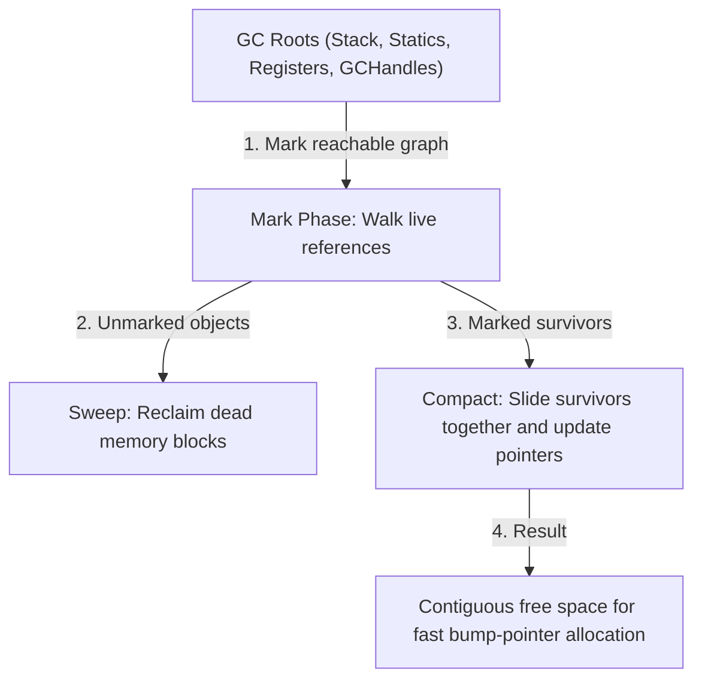
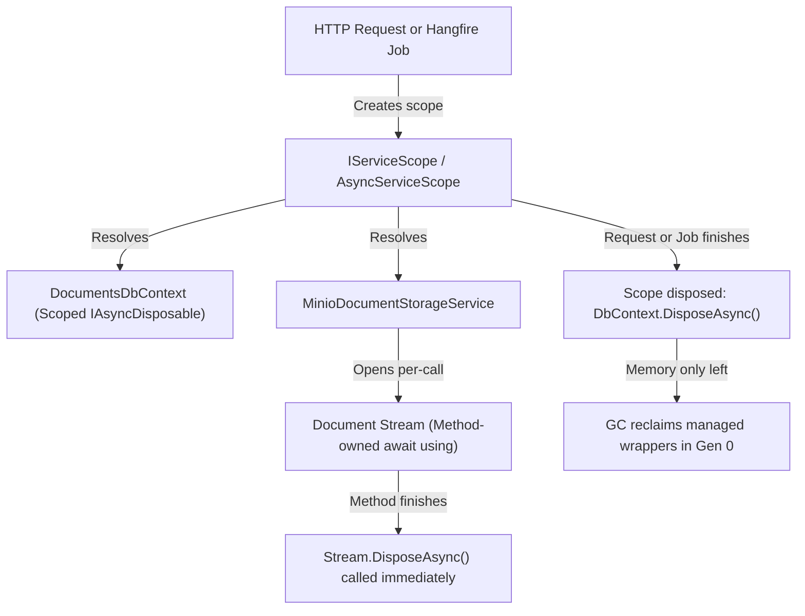

# Chapter 5: Garbage Collection and Resource Management

## 1. Learning Objectives
By the end of this chapter, you will be able to:
- Explain the Mark-and-Sweep-and-Compact algorithm, GC Roots, Write Barriers, and Card Tables.
- Describe the Generational Garbage Collection model (Gen 0, Gen 1, Gen 2), Heap Regions, and .NET 10's **DATAS** (Dynamic Adaptation To Application Sizes).
- Identify the differences between the Small Object Heap (SOH), the Large Object Heap (LOH), and the Pinned Object Heap (POH).
- Choose and configure GC modes (Server vs. Workstation, Background vs. Blocking) and measure GC pressure using .NET diagnostic tools and OpenTelemetry.
- Implement `IDisposable`, `IAsyncDisposable`, and `SafeHandle` correctly—and know when **not** to implement them.
- Understand Finalizers, the Finalization/Freachable Queues, Resurrection, `WeakReference<T>`, and `ConditionalWeakTable<TKey, TValue>`.
- Reduce GC pressure in high-throughput enterprise systems like **Normora** using `ArrayPool<T>`, `ObjectPool<T>`, `ArrayBufferWriter<byte>`, and `stackalloc`.

## 2. Introduction

In C++, developers must manually call `delete` to free memory they allocated with `new`. A single missed `delete` causes a memory leak; a double `delete` causes memory corruption and application crashes.

To eliminate these entire classes of bugs, the .NET Common Language Runtime (CLR) abstracts memory management away from the developer using a **Garbage Collector (GC)**—an automatic memory manager that tracks which objects on the managed heap are still reachable by your code and reclaims the rest. However, as an enterprise software engineer, you cannot treat the GC as a magic box. In high-performance systems—whether a Multi-Tenant EV Charging Platform processing millions of telemetry packets or **Normora** streaming multi-turn RAG responses, chunking large PDFs, and computing cosine similarities across thousands of `pgvector` embeddings—the GC is often the single largest source of unpredictable tail latency.

When the GC runs certain phases, it must ensure that memory is not mutated while object references are being inspected or moved. To do this, it triggers a **"Stop The World" (STW)** pause, briefly suspending managed application threads. A GC pause of 500 milliseconds might be invisible in a desktop utility, but it causes SSE token streams to stutter in `Conversations`, Hangfire ingestion jobs in `Normora.Worker` to miss heartbeats, and p99 HTTP latency in `Normora.Api` to spike.

You must learn to work *with* the Garbage Collector, not against it.

## 3. The Mark-and-Sweep Algorithm, GC Roots, and Card Tables

### What It Is & Why It Exists
The .NET GC is a **Tracing, Compacting Garbage Collector**. Rather than counting references on every variable assignment (reference counting, which struggles with circular references such as a `Document` referencing its `DocumentChunk`s while each chunk references its parent `Document`), the .NET GC periodically traces reachable object graphs from known starting points and reclaims everything unreachable.

### How It Works

#### Phase 1: Marking (Finding Live Objects)
The GC must determine which objects are still being used by your application. It starts at **GC Roots**—fundamental references the runtime knows are actively reachable:
- **Stack locals and parameters**: Local variables and method arguments on every active thread's call stack (including hoisted fields inside `async` state machines while an `await` is pending).
- **CPU registers**: Registers currently holding object references in executing JIT-compiled code.
- **Static fields**: `static` fields on loaded types, which live for the lifetime of the `AssemblyLoadContext` / process (in .NET 10, there is a single default `AppDomain` unless custom unloadable `AssemblyLoadContext`s are created).
- **GC Handles (`GCHandle`)**: Explicit handles created by runtime internals, pinned buffers, or interop layers.
- **Freachable Queue**: Objects awaiting execution of their finalizer (covered in Section 8).

The GC traverses the object graph starting from these roots. Every object it reaches is **marked** as alive. If object `A` has a field referencing object `B`, and `A` is marked, `B` is also marked—even if `A` and `B` reference each other in a cycle.

#### Phase 2: Sweeping and Compacting
Any object on the managed heap that was *not* marked is considered dead (unreachable). The GC reclaims the memory occupied by these dead objects.

Because objects on the Small Object Heap are allocated contiguously (one right after another via a fast bump-pointer), reclaiming scattered dead objects leaves holes in memory (**fragmentation**). To solve this, the GC **Compacts** the heap: it physically copies surviving objects down to close the gaps and updates every root and internal object reference to point to the new memory addresses.



**Visual Diagram: Heap Compaction**
```text
Before GC:
[Obj A (Live)] [Obj B (Dead)] [Obj C (Dead)] [Obj D (Live)] [Free Space ...]

After Mark & Sweep:
[Obj A (Live)] [   Empty    ] [   Empty    ] [Obj D (Live)] [Free Space ...]

After Compaction (Pointers Updated!):
[Obj A (Live)] [Obj D (Live)] [Free Space .................................]
```

#### How Gen 0 Avoids Scanning the Entire Heap: Write Barriers and Card Tables
If every quick Gen 0 collection had to scan every Gen 2 object just to see whether an old object points to a new Gen 0 object, generational GC would be slow. The CLR solves this with two low-level mechanisms:
1. **Write Barrier**: Whenever your code assigns a reference field on a heap object (`parent.Child = newChild`), the JIT emits a tiny machine-code helper (a write barrier) instead of a plain pointer store.
2. **Card Table**: A compact bitmask covering the entire managed heap (each bit—or "card"—represents a small range of memory, typically 128 bytes on 32-bit or 256 bytes on 64-bit). When a reference write occurs, the write barrier sets the bit for that memory range in the Card Table. During a Gen 0 collection, the GC only scans dirty cards in older generations instead of walking the entire Gen 2 object graph.

### When NOT to Rely on Manual Intervention
- **Never** try to "help" the GC by setting local variables to `null` at the end of a method. The .NET JIT compiler tracks variable liveness per instruction; once a local is no longer read in the method, the JIT stops reporting it as a GC Root immediately—even before the method returns (unless a debugger is attached).
- **Never** force `GC.Collect()` to "clean up" after a single request; tracing and compacting prematurely burns CPU and distorts the GC's self-tuning budgets.

### Real-World Normora Examples (Mark, Sweep & Roots)
1. **Active HTTP Request Roots (`PerformHybridRetrievalQuery`)**: While `Conversations` executes `PerformHybridRetrievalQuery` across `MediatR`, the `CancellationToken`, query record, and retrieved `HybridChunkResult` list sit on the thread stack (and inside the `async` state machine), acting as GC Roots until the SSE stream completes.
2. **Static Constants (`ApiMessages` and `RagConstants`)**: Static `string` literals and `FrozenDictionary` / `TenantPlanPricingCatalog` tables in `Normora.Shared` and `Normora.Modules.Tenants.Domain` are rooted by static type metadata for the entire process lifetime—which is intentional because they are immutable and shared across all tenants.
3. **EF Core Change Tracker Retention (`DocumentsDbContext`)**: When loading 500 `DocumentChunk` entities *without* `.AsNoTracking()` inside a read-only search query, `DocumentsDbContext.ChangeTracker` holds references to every entity. As long as the scoped `DbContext` is alive for the request, those chunks remain marked as live and cannot be swept.
4. **Card Table Dirtying on Singleton Cache Updates**: When a long-lived `HybridCache` or `IMemoryCache` entry in Gen 2 stores a newly created `TenantBrandingDto` (allocated in Gen 0) after a tenant updates its logo, the JIT write barrier marks that cache bucket's Card Table entry dirty so the next Gen 0 GC knows to treat that new DTO as live.
5. **Circular References in Domain Graphs (`Document` ↔ `DocumentVersion`)**: A `Document` navigation property pointing to its `DocumentVersion` collection, where each `DocumentVersion` holds a back-reference to `Document`, forms a cycle. Once the HTTP request finishes and the root (`DbContext`) is disposed, neither object is reachable from any GC Root, so Mark-and-Sweep reclaims the entire cycle cleanly without reference-counting leaks.

## 4. The Generational Model, Heap Regions, and DATAS (.NET 10)

### What It Is & Why It Exists
Tracing the entire heap takes time proportional to the number of live objects. To keep almost all collections under a millisecond, the .NET GC uses the **Weak Generational Hypothesis**: *"Newly created objects are likely to die quickly. Older objects are likely to survive for a long time."*

### How It Works

#### Generations (0, 1, and 2)
The Small Object Heap (SOH) is logically divided into three generations:
- **Generation 0 (Gen 0):** Where almost all new small objects are allocated (using per-thread **Thread-Local Allocation Buffers (TLABs)** so threads can allocate lock-free). Gen 0 is small enough to fit well in CPU L2/L3 cache. When Gen 0 fills up, a Gen 0 GC occurs (typically < 1 ms). Surviving objects are promoted to Gen 1.
- **Generation 1 (Gen 1):** Acts as an ephemeral shock-absorber between short-lived and long-lived objects. Objects that survive a Gen 1 collection are promoted to Gen 2. (Gen 0 and Gen 1 together are called the **ephemeral generations**.)
- **Generation 2 (Gen 2):** Contains long-lived objects (DI singletons, `IOptions<GeminiOptions>`, caches, thread pools). A Gen 2 GC traces the *entire* managed heap (including LOH and POH). Even with Background GC, parts of a Gen 2 collection require STW pauses and substantial CPU.

#### Heap Regions (Modern .NET) & DATAS (.NET 9 / .NET 10)
- **Regions Instead of Fixed Segments**: Historically, .NET allocated large contiguous virtual memory *segments* (e.g., 16 MB–4 GB). Modern .NET uses smaller, flexible **GC Regions** (typically 4 MB for SOH). Instead of physically copying Gen 1 survivors across segments to promote them to Gen 2, the GC can often simply relabel an entire region from Gen 1 to Gen 2, reducing pause times and memory waste.
- **DATAS (Dynamic Adaptation To Application Sizes)**: Enabled **by default** in .NET 9 and .NET 10 Server GC, DATAS continuously monitors actual live heap size and allocation throughput. Under low traffic, DATAS shrinks the heap count and total memory footprint so idle microservices don't hoard gigabytes of RAM; under heavy bursts, it scales heaps up automatically to maximize throughput.

#### The "Mid-Life Crisis" Anti-Pattern
An object exhibits a **mid-life crisis** when it lives *just* long enough to survive Gen 0 and Gen 1 (getting promoted to Gen 2), and then immediately dies. Because Gen 2 collections happen infrequently, these dead objects bloat Gen 2 until an expensive Full GC finally clears them.

### When NOT to Optimize for Generations
- Do **not** pool tiny, short-lived objects (like a 40-byte `Command` record or a small `ApiResponse<T>` envelope). Gen 0 allocation and collection of ephemeral objects is virtually free—often faster than the synchronization cost of returning an object to a shared pool!

### Real-World Normora Examples (Generational Model & DATAS)
1. **Gen 0 Ephemeral Request DTOs (`DocumentSummaryDto`)**: When `DocumentsController` maps query results to `DocumentSummaryDto` and serializes them via `System.Text.Json`, those DTOs die milliseconds later when the HTTP response flushes—collected effortlessly in Gen 0.
2. **Gen 1 Ephemeral Survivors (`UploadDocumentCommandHandler`)**: During a document upload, the `DocumentProcessingOutboxMessage` and multipart metadata might survive one rapid Gen 0 collection occurring concurrently on another thread, resting briefly in Gen 1 before finishing the transaction and dying.
3. **Gen 2 Long-Lived Singletons (`TenantPlanPricingCatalog` & `IAgentToolRegistry`)**: Normora's 19-tool `IAgentToolRegistry`, `IOptions<MinioOptions>`, and `TenantPlanPricingCatalog` live for the entire uptime of `Normora.Api`. They quickly settle in Gen 2 and are rarely revisited during ephemeral collections.
4. **Mid-Life Crisis in Slow AI Calls (`GeminiTextGenerationService`)**: If a handler allocates a large prompt string and raw JSON context *before* awaiting a 12-second streaming Gemini API call, those intermediate buffers survive multiple Gen 0/1 collections triggered by other concurrent tenants, getting promoted to Gen 2 right before the turn ends and they become garbage.
5. **DATAS in `Normora.Worker` Burst vs. Idle Cycles**: When a tenant uploads 200 policy PDFs at 9:00 AM, Hangfire worker threads spike allocations and DATAS expands active Server GC heaps to maintain ingestion throughput. Overnight when no uploads arrive, DATAS contracts heap memory back down automatically without restarting the container.

## 5. Special Heaps: Large Object Heap (LOH) and Pinned Object Heap (POH)

### What It Is & Why It Exists
The generational model works great for small objects because copying a 200-byte object during compaction is cheap. Copying a 10-megabyte array during compaction would stall the CPU. Therefore, the CLR routes special allocations to dedicated heaps:
- **Large Object Heap (LOH)**: Any single object **85,000 bytes or larger** is allocated directly on the LOH.
- **Pinned Object Heap (POH)** *(introduced in .NET 5)*: A dedicated heap for objects that must remain at a fixed physical memory address (pinned) for native interop or asynchronous socket I/O without fragmenting the SOH.

### How It Works

#### LOH Rules
- **Threshold**: `>= 85,000` bytes. On 64-bit .NET, a `byte[85_000]`, a `string` with ~42,500 UTF-16 `char`s, or a `float[21_250]` (4 bytes each) lands on the LOH.
- **Collection Frequency**: LOH objects are treated logically like Gen 2—they are reclaimed **only during a Gen 2 (Full) GC**.
- **Fragmentation & Compaction**: To avoid expensive memory copies, the LOH is **not compacted by default** (it uses a free-list allocator to fit new large objects into gaps). Repeatedly allocating and freeing varying-size large objects fragments the LOH, inflating process memory or even causing `OutOfMemoryException` despite free space existing in scattered holes. You can request a one-time LOH compaction when truly necessary:
  ```csharp
  GCSettings.LargeObjectHeapCompactionMode = GCLargeObjectHeapCompactionMode.CompactOnce;
  GC.Collect(); // Expensive STW pause—use only in rare maintenance windows, never per-request
  ```

#### POH Rules
Pinning a normal SOH object (via `fixed` or `GCHandle.Alloc(obj, GCHandleType.Pinned)`) acts like a boulder in the middle of the heap—the compactor must work around it, causing severe SOH fragmentation. Instead, allocate long-lived pinned buffers on the **POH**:
```csharp
// Allocated directly on the Pinned Object Heap; zero SOH fragmentation
byte[] pinnedIoBuffer = GC.AllocateArray<byte>(length: 4096, pinned: true);

// Skip zero-initialization when you will immediately overwrite every byte
byte[] fastPinnedBuffer = GC.AllocateUninitializedArray<byte>(length: 4096, pinned: true);
```

### When NOT to Use LOH or POH
- **Do NOT** allocate `>= 85 KB` buffers or huge concatenated strings per request; stream data in chunks (`< 85 KB`, typically 4 KB–64 KB) or use `ArrayPool<T>`.
- **Do NOT** use `GC.AllocateArray(..., pinned: true)` for short-lived buffers that aren't actually pinned for native/async I/O. POH objects are only collected during Gen 2 collections (though modern .NET reduces overhead, POH is still meant for long-lived or pooled I/O buffers, not throwaway objects).

### Real-World Normora Examples (LOH & POH)
1. **Batch Gemini Embeddings (`GeminiEmbeddingService`)**: A single 1536-dimensional `float[]` embedding is `1536 * 4 = 6,144` bytes (comfortably on SOH). However, materializing a contiguous 2D or flattened array for a 100-chunk `batchEmbedContents` call (`100 * 1536 * 4 = 614,400` bytes) hits the **LOH** immediately unless processed as individual pooled slices or streamed.
2. **PDF Upload Buffering (`MinioDocumentStorageService`)**: Calling `stream.CopyTo(memoryStream)` and `memoryStream.ToArray()` on a 12 MB employee handbook PDF allocates a 12 MB `byte[]` on the LOH (plus intermediate resizing arrays on the LOH as `MemoryStream` doubles in capacity!). Streaming directly from the HTTP request / `Stream` into MinIO avoids the LOH completely.
3. **Oversized RAG Prompt & Gemini JSON Strings (`ConversationTurnPreparer`)**: Concatenating 25 retrieved document chunks plus conversation history into a single 60,000-character `string` (`120,000` bytes in UTF-16) places that `string` directly onto the LOH for every chat turn. Streaming JSON via `Utf8JsonWriter` or keeping chunk assembly buffered avoids LOH bloat.
4. **Kestrel / SignalR Socket Buffers on POH (`Normora.Api`)**: When `Normora.Api` pushes real-time SSE tokens and SignalR `dataVersion` updates across thousands of concurrent WebSockets, ASP.NET Core's `PinnedBlockMemoryPool` allocates slab buffers on the **POH** so the OS network stack can write directly to fixed memory addresses without fragmenting Gen 0/1/2.
5. **Large OpenAPI / Audit Log Export Serialization**: Exporting thousands of `AuditLogs` rows into a single `JsonSerializer.Serialize(logs)` string puts a massive string on the LOH. Using `JsonSerializer.SerializeAsync(httpResponse.Body, logs)` streams UTF-8 bytes directly to the response stream in small pooled chunks.

## 6. GC Modes, Latency Tuning, and Observability in .NET 10

### What It Is & Why It Exists
The CLR ships two primary GC engines and multiple latency/concurrency modes because a background batch ETL job and an interactive low-latency API have opposite optimization goals.

### How It Works

| Mode / Setting | Behavior | Best For | Caution |
|---|---|---|---|
| **Server GC** (`ServerGarbageCollection=true`, default in ASP.NET Core) | Creates dedicated GC threads and heaps per CPU core (scaled dynamically by **DATAS** in .NET 9/10); collects in parallel. | `Normora.Api` and `Normora.Worker` multi-core web/worker hosts. | In tightly constrained containers (< 2 vCPUs or low RAM), monitor heap count; .NET 10 DATAS mitigates historical bloat. |
| **Workstation GC** (`ServerGarbageCollection=false`) | Single GC thread, single heap, tuned for minimal UI pauses and low baseline RAM. | Desktop apps, CLI tools (`Normora.Api --migrate`), tiny single-core pods. | Lower peak allocation throughput under heavy multi-core concurrency. |
| **Background (Concurrent) GC** (default `true`) | Runs Gen 2 mark/sweep concurrently on a dedicated background thread while app threads keep allocating in Gen 0/1. | Interactive APIs (`Normora.Api`) needing smooth SSE/SignalR latency. | Uses slightly more CPU and memory overhead to track mutations during collection. |
| **Non-Concurrent GC** (`ConcurrentGarbageCollection=false`) | Halts app threads for the entire Gen 2 collection. | Pure batch throughput where pause duration does not matter. | Causes multi-hundred-millisecond freezes on user-facing requests. |

#### Container Memory Limits & `DATAS`
Modern .NET (6 through 10) automatically reads Linux cgroup v1/v2 memory and CPU limits inside Docker/Kubernetes. By default, the GC sets its hard heap limit to roughly 75% of the container's memory limit (or `DOTNET_GCHeapHardLimit` if explicitly configured), preventing OOMKills (`Exit Code 137`) by triggering collections earlier when container RAM approaches capacity.

#### Latency Modes & `GC.TryStartNoGCRegion`
For ultra-critical bounded code sections (like financial matching engines), `GCSettings.LatencyMode` (`Interactive`, `SustainedLowLatency`, `Batch`) or `GC.TryStartNoGCRegion(totalSize)` temporarily suppresses blocking collections.

### When NOT to Use Latency Overrides or Manual Tuning
- **Do NOT** call `GC.TryStartNoGCRegion` in web handlers, MediatR pipelines, or EF Core queries—if an allocation exceeds the pre-reserved budget or another thread allocates concurrently, the region aborts or destabilizes latency across the process.
- **Do NOT** disable Background GC on `Normora.Api`; only consider disabling it on isolated offline batch workers if profiling proves higher throughput helps.

### Measuring & Observing GC Pressure
Before tuning anything, measure:
- **In Code (`GC.GetGCMemoryInfo()`)**: Inspect `HeapSizeBytes`, `FragmentedBytes`, `PauseDurations`, and `GenerationInfo` programmatically.
- **Per-Thread Allocation (`GC.GetAllocatedBytesForCurrentThread()`)**: Assert zero-allocation hot paths in unit/performance tests.
- **CLI Tools**:
  - `dotnet-counters monitor -p <pid> --counters System.Runtime` (live Gen 0/1/2 counts, `% Time in GC`, Allocation Rate MB/s, LOH size).
  - `dotnet-gcdump collect -p <pid>` (lightweight heap snapshot to find what is holding Gen 2 memory).
- **BenchmarkDotNet**: Add `[MemoryDiagnoser]` to microbenchmarks to see exact `Allocated` bytes and Gen 0/1/2 counts per operation.
- **OpenTelemetry (`Normora.Infrastructure`)**: Export built-in `System.Runtime` meter metrics (`dotnet.gc.collections`, `dotnet.gc.heap.total_allocated`, `dotnet.gc.pause.time`) directly to your observability dashboard.

### Real-World Normora Examples (Modes & Observability)
1. **`Normora.Api` Using Server GC + DATAS**: Under concurrent Angular SPA requests, SignalR broadcasts, and `/api/copilotkit` SSE streams, Server GC with .NET 10 DATAS parallelizes collections across cores while keeping memory footprint proportional to active tenant load.
2. **Ephemeral Migration Host (`Normora.Api --migrate`)**: Per Normora's architecture rules, schema migrations execute in a lean console host (`MigrationHostExtensions.RunMigrationsAsync`) that exits cleanly right after running the four `IDatabaseMigrator`s—Workstation GC keeps startup memory minimal for this short-lived CLI process.
3. **Container OOM Prevention in `Normora.Worker`**: Running parallel Hangfire PDF text extraction jobs inside a 1 GB Docker container relies on cgroup-aware `DOTNET_GCHeapHardLimit` so the GC aggressively reclaims Gen 2/LOH buffers before the Linux kernel OOM-kills the worker.
4. **OpenTelemetry GC Telemetry in `Normora.Infrastructure`**: Watching `dotnet.gc.pause.time` alongside `PerformHybridRetrievalQuery` trace spans immediately reveals whether a p99 latency spike came from `pgvector` HNSW search or a Full Gen 2 GC pause.
5. **Benchmarking `DocumentChunker` with `[MemoryDiagnoser]`**: Before and after optimizing Markdown heading breadcrumb concatenation, running BenchmarkDotNet with `[MemoryDiagnoser]` proves whether allocated bytes per 100 KB Markdown file dropped from 450 KB (with Gen 1 promotions) down to 18 KB (Gen 0 only).

## 7. Deterministic Cleanup: IDisposable, IAsyncDisposable, and SafeHandle

### What It Is & Why It Exists
The GC manages *managed memory*, **not** *unmanaged resources* such as OS file handles, network sockets, PostgreSQL connections, native memory pointers, or timers. Waiting for an eventual GC cycle to release a database connection or file lock would exhaust connection pools and lock files indefinitely.

`IDisposable` (synchronous) and `IAsyncDisposable` (asynchronous, introduced in C# 8) provide **deterministic cleanup**: resources are released the instant your scope finishes, even if an exception occurs.

### How It Works

#### The `using` Block and `using` Declaration
Both compile down to a `try { ... } finally { resource?.Dispose(); }` block:
```csharp
// Classic using block (explicit scope)
using (var cts = new CancellationTokenSource(TimeSpan.FromSeconds(10)))
{
    await CallExternalApiAsync(cts.Token);
} // cts.Dispose() runs here

// Modern C# 8+ using declaration (disposes at end of enclosing scope)
using var linkedCts = CancellationTokenSource.CreateLinkedTokenSource(ct);
```

#### The Full `IDisposable` Pattern (When Owning Unmanaged or Disposable State)
When a class owns disposable fields—or wraps a raw unmanaged handle—implement the full pattern so cleanup is idempotent (safe to call `Dispose()` twice), throws `ObjectDisposedException` after disposal if appropriate, and suppresses unnecessary finalization:
```csharp
public class ManagedResourceHolder : IDisposable
{
    private readonly MemoryStream _buffer = new();
    private bool _disposed;

    public void WriteBytes(ReadOnlySpan<byte> data)
    {
        ObjectDisposedException.ThrowIf(_disposed, this);
        _buffer.Write(data);
    }

    public void Dispose()
    {
        Dispose(disposing: true);
        GC.SuppressFinalize(this);
    }

    protected virtual void Dispose(bool disposing)
    {
        if (_disposed) return;

        if (disposing)
        {
            // Dispose managed IDisposable fields ONLY when disposing == true
            _buffer.Dispose();
        }

        // Release any raw unmanaged resources here (rare; prefer SafeHandle)
        _disposed = true;
    }
}
```
> [!TIP]
> If your class is `sealed` and holds **only** managed `IDisposable` fields (no raw `IntPtr` handles and no finalizer), you do **not** need `protected virtual void Dispose(bool)` or `GC.SuppressFinalize(this)`. Simply implement `public void Dispose()`, guard with `_disposed`, and dispose your fields!

#### `IAsyncDisposable` and `await using`
When releasing a resource requires asynchronous I/O (such as flushing an `NpgsqlConnection`, flushing a buffered `Stream` / `Utf8JsonWriter`, or closing a SignalR hub connection), blocking the thread in synchronous `Dispose()` risks thread-pool starvation and deadlocks. Implement `IAsyncDisposable`:
```csharp
await using var scope = scopeFactory.CreateAsyncScope();
var dbContext = scope.ServiceProvider.GetRequiredService<DocumentsDbContext>();
// dbContext.DisposeAsync() is awaited cleanly at the end of the scope
```
If a type implements *both* `IDisposable` and `IAsyncDisposable` (like `Stream` or `DbContext`), override `DisposeAsyncCore()` to share async cleanup logic cleanly.

#### `SafeHandle`: The Modern Replacement for Raw `IntPtr`
Never store a raw OS handle (`IntPtr` / `nint`) and write a custom finalizer yourself. Wrap it in a subclass of `System.Runtime.InteropServices.SafeHandle` (such as `SafeFileHandle`). `SafeHandle` inherits from `CriticalFinalizerObject`, preventing handle recycling attacks and guaranteeing the CLR executes handle release reliably even under severe runtime stress.

#### DI Lifetimes & Ownership Rule
- **Who creates it, disposes it**: If the ASP.NET Core DI container injected `DocumentsDbContext`, `HttpClient`, or `ITextEmbeddingService` into your handler's primary constructor, **the DI container owns its lifetime** and disposes it when the HTTP request scope ends. Never call `.Dispose()` on injected services inside a handler!
- **Background Workers (`Normora.Worker`)**: Hangfire jobs and `BackgroundService` loops sit outside HTTP request scopes, so they must explicitly create and `await using` an `AsyncServiceScope` via `IServiceScopeFactory.CreateAsyncScope()`.



### When NOT to Implement `IDisposable`
- **Do NOT** implement `IDisposable` on pure domain entities (`Tenant`, `Document`, `DocumentChunk`), CQRS commands/queries (`UploadDocumentCommand`), or DTOs just to "help the GC clear fields." `IDisposable` has zero effect on managed memory reclamation—it only releases unmanaged/disposable resources.
- **Do NOT** manually `Dispose()` an `HttpClient` created by `IHttpClientFactory` in a tight loop—doing so wastes pooled sockets or breaks handler rotation; let `IHttpClientFactory` manage `HttpMessageHandler` lifetimes (while still disposing each `HttpResponseMessage`!).

### Real-World Normora Examples (`IDisposable` & `IAsyncDisposable`)
1. **MinIO Streaming Download (`MinioDocumentStorageService`)**: When `Normora.Worker` pulls an uploaded PDF from MinIO for OCR/text extraction, the returned `Stream` holds an open HTTP response socket and buffer; wrapping it in `await using var docStream = await storageService.OpenReadAsync(...)` releases the socket immediately after extraction finishes.
2. **Hangfire Scope Isolation (`HangfireDocumentProcessingOutboxDispatcher`)**: Because `Normora.Worker` processes outbox messages outside an HTTP pipeline, it creates `await using var scope = scopeFactory.CreateAsyncScope();` per job so `DocumentsDbContext` and its `NpgsqlConnection` are asynchronously returned to the connection pool immediately after the job completes.
3. **Linked Timeout Tokens (`GeminiEmbeddingService`)**: Creating `using var timeoutCts = CancellationTokenSource.CreateLinkedTokenSource(ct); timeoutCts.CancelAfter(TimeSpan.FromSeconds(30));` registers internal timer queue callbacks. Disposing `timeoutCts` guarantees those timer registrations don't linger until timeout expiry.
4. **Streaming SSE Payloads (`Conversations` AG-UI / SSE Endpoint)**: Writing streamed tokens and A2UI JSON cards with `await using var writer = new Utf8JsonWriter(responseBodyStream);` flushes buffered UTF-8 bytes asynchronously without blocking Kestrel thread-pool threads.
5. **When NOT to Implement `IDisposable` (`UploadDocumentCommand` & `Document`)**: `UploadDocumentCommand`, `Document`, and `TenantMembership` hold only managed strings, `Guid`s, and collections. Implementing `IDisposable` on them adds pointless boilerplate and misleads callers into wrapping domain models in `using` statements.

## 8. Finalizers, the Finalization Queue, and Weak References

### What It Is & Why It Exists
What if a developer constructs an object holding a raw OS handle and forgets to wrap it in a `using` statement? The handle would leak forever. To provide a last-resort safety net, C# supports **Finalizers** (syntax: `~ClassName()`).

Additionally, when you need to attach metadata to objects or inspect cached instances *without* creating a strong GC Root that keeps them alive forever, .NET provides **`WeakReference<T>`** and **`ConditionalWeakTable<TKey, TValue>`**.

### How It Works

#### Fixed `NetworkStreamReader`: Finalizer + Full Dispose Pattern
*(Note: In real code, prefer `Socket` directly or `SafeHandle` rather than writing a custom finalizer.)*
```csharp
public class NetworkStreamReader : IDisposable
{
    private Socket? _socket;
    private bool _disposed;

    public NetworkStreamReader()
    {
        _socket = new Socket(AddressFamily.InterNetwork, SocketType.Stream, ProtocolType.Tcp);
    }

    public void ReadData()
    {
        ObjectDisposedException.ThrowIf(_disposed, this);
        // ... read from _socket ...
    }

    public void Dispose()
    {
        Dispose(disposing: true);
        // Tell the GC: we already cleaned up, do NOT run ~NetworkStreamReader()
        GC.SuppressFinalize(this);
    }

    protected virtual void Dispose(bool disposing)
    {
        if (_disposed) return;

        if (disposing)
        {
            // Managed disposable resources can be safely touched here
            _socket?.Dispose();
            _socket = null;
        }

        // Release raw unmanaged handles (if any) when disposing == false too
        _disposed = true;
    }

    // Finalizer (Destructor) — safety net if caller forgot Dispose()
    ~NetworkStreamReader()
    {
        Dispose(disposing: false);
    }
}
```

#### The Hidden Cost of Finalizers (Finalization Queue vs. Freachable Queue)
If an object has a finalizer (and `GC.SuppressFinalize(this)` was **not** called), the GC handles it very differently:
1. **Creation**: When the object is allocated, a pointer to it is added to the **Finalization Queue**.
2. **GC Cycle 1 (Unreachable)**: When the GC marks live objects and finds this object unreachable, it scans the Finalization Queue. Seeing the object is unmarked, it *cannot* reclaim its memory yet—it moves the pointer from the Finalization Queue to the **Freachable Queue** and marks the object (and everything it references!) as live. **The object just survived into Gen 1 or Gen 2!**
3. **Finalizer Thread**: A dedicated CLR finalizer thread drains the Freachable Queue and runs each `~Finalizer()`.
4. **GC Cycle 2**: Only on a *subsequent* GC cycle (in that higher generation!) is the object finally unreachable and reclaimed.

```mermaid
sequenceDiagram
    participant App as "Application Code"
    participant Heap as "Managed Heap (Gen 0)"
    participant FQ as "Finalization Queue"
    participant FRQ as "Freachable Queue"
    participant Fin as "CLR Finalizer Thread"

    App->>Heap: "new FinalizableResource()"
    Heap->>FQ: "Register pointer at allocation"
    alt "Caller calls Dispose()"
        App->>Heap: "Dispose() -> GC.SuppressFinalize(this)"
        Heap-->>FQ: "Unregister flag set; reclaimed in Gen 0!"
    else "Caller forgets Dispose()"
        Note over Heap,FQ: "GC #1 runs: object is unreachable"
        FQ->>FRQ: "Move to Freachable Queue (Object promoted to Gen 1!)"
        FRQ->>Fin: "Dedicated thread executes ~Finalizer()"
        Note over Heap: "GC #2 (Gen 1/2) finally reclaims memory"
    end
```

#### Resurrection and `GC.KeepAlive`
- **Resurrection**: If a finalizer assigns `this` to a `static` field (`_graveyard = this`), the object becomes reachable again ("resurrected")—along with its partially disposed fields! Never do this.
- **`GC.KeepAlive(obj)`**: Because the JIT can end an object's lifetime after its *last read* in a method (even before the method returns), if you extract a raw `IntPtr` from a wrapper object and pass that handle to a native C function, the GC could finalize the wrapper *while the native call is running*! Calling `GC.KeepAlive(wrapper)` after the native call prevents premature collection. (Using `SafeHandle` solves this automatically.)

#### `WeakReference<T>` and `ConditionalWeakTable<TKey, TValue>`
- **`WeakReference<T>`**: Holds a reference that does *not* count as a GC Root. If memory is available and no GC has collected the target, `TryGetTarget(out T? target)` succeeds; once collected, it returns `false`.
- **`ConditionalWeakTable<TKey, TValue>`**: A thread-safe dictionary whose keys are held weakly. Unlike `Dictionary<object, T>` (which leaks forever unless keys are manually removed), when a key object is collected by the GC, its entry is automatically purged from the table. (Note: `TValue` must not hold a strong reference back to `TKey`, or neither can ever be collected!)

### When NOT to Use Finalizers or `WeakReference<T>`
- **Do NOT** write a finalizer on any class that holds only managed objects (such as `DbContext`, `List<T>`, or `HttpClient`). By the time a finalizer runs, managed fields may already be finalized in arbitrary order!
- **Do NOT** use `WeakReference<T>` as a general application cache—the GC collects weak references unpredictably on every Gen 0/1/2 cycle depending on target generation, causing erratic cache hit rates. Use `IMemoryCache` / `HybridCache` (with explicit expiration & `SizeLimit`) or Redis instead.

### Real-World Normora Examples (Finalizers & Weak References)
1. **`SafeHandle` in Native PDF/OCR Extraction**: If `Normora.Infrastructure/Providers/DocumentExtraction` wraps a native C++ PDFium/Tesseract library handle, wrapping that pointer in a `SafeHandle` guarantees OS handle cleanup without fragile custom finalizers or `GC.KeepAlive` bugs.
2. **Why Domain Entities & `DbContext` Have No Finalizers**: `DocumentsDbContext`, `Document`, and `DocumentProcessingOutboxMessage` intentionally omit finalizers. `DocumentsDbContext` relies on `IDisposable`/`IAsyncDisposable` via DI scoping rather than delaying Gen 0/1 cleanup onto the Freachable Queue.
3. **Finalizer-Free `CancellationTokenSource` Usage**: Although `CancellationTokenSource` implements `IDisposable`, it does not define a finalizer—forgetting to dispose a linked or timed `CancellationTokenSource` in a Normora retry policy keeps it rooted by the internal CLR `TimerQueue` until the timeout fires!
4. **Out-of-Band Diagnostic Telemetry (`ConditionalWeakTable<Document, IngestionTimingTrace>`)**: Attaching temporary ingestion timing metadata to in-flight `Document` objects in `Normora.Worker` via `ConditionalWeakTable` avoids polluting the `Document` domain entity with infrastructure properties and automatically drops entries as soon as each `Document` is collected.
5. **Why `TenantResolutionMiddleware` Avoids `WeakReference<T>`**: Tenant slug and RBAC membership lookups in `Normora.Api` require predictable 30-second–5-minute TTLs and instant revocation across instances—so Normora uses **Redis distributed caching** (`IDistributedCache` / `HybridCache`), never `WeakReference<T>`.

## 9. Production Case Studies: Object Pooling and Low-Allocation Patterns

### What It Is & Why It Exists
When a high-throughput service allocates temporary buffers or builders thousands of times per second, even Gen 0 collections—or worse, LOH allocations—consume measurable CPU and cause latency jitter. **Pooling** (`ArrayPool<T>`, `ObjectPool<T>`) and **stack/writer primitives** (`stackalloc`, `ArrayBufferWriter<byte>`) let you reuse memory across operations so allocation rate drops near zero.

### When NOT to Pool
- **Do NOT** pool tiny short-lived classes (< a few hundred bytes) that have no internal buffers; Gen 0 TLAB allocation is faster than pool locking/returning.
- **Do NOT** pool arrays containing sensitive multi-tenant PII, JWTs, or document text **without passing `clearArray: true`** when returning them! Otherwise, Tenant B could accidentally read stale bytes left by Tenant A if a slice bounds bug occurs.

### Case Study A (EV Telemetry): `ArrayPool<byte>` for High-Frequency Socket Parsing

In our EV Platform, we parse incoming heartbeat messages. If we allocate a new `byte[]` buffer for every incoming TCP packet, we will generate massive Gen 0 pressure. If those packets arrive faster than the GC can collect them, they will be promoted to Gen 1 and Gen 2, eventually causing a Full GC pause that drops network connections.

**Solution: `ArrayPool<T>`**
Instead of allocating and discarding, we rent arrays from a shared pool:

```csharp
using System.Buffers;
using System.Net.Sockets;

public class HeartbeatListener
{
    private readonly Socket _listenSocket;

    public HeartbeatListener(Socket listenSocket)
    {
        _listenSocket = listenSocket;
    }

    public async Task ListenAsync(CancellationToken ct)
    {
        while (!ct.IsCancellationRequested)
        {
            var clientSocket = await _listenSocket.AcceptAsync(ct);
            _ = ProcessClientAsync(clientSocket, ct);
        }
    }

    private async Task ProcessClientAsync(Socket client, CancellationToken ct)
    {
        // RENT a buffer instead of allocating a new one.
        // IMPORTANT: The array returned may be LARGER than 1024 bytes!
        byte[] buffer = ArrayPool<byte>.Shared.Rent(1024);

        try
        {
            int bytesRead = await client.ReceiveAsync(buffer.AsMemory(), SocketFlags.None, ct);

            // Slice the buffer to the exact bytes read using Span
            ReadOnlySpan<byte> actualData = buffer.AsSpan(0, bytesRead);
            ParseHeartbeat(actualData);
        }
        finally
        {
            // RETURN the buffer to the pool so another thread can reuse it.
            // Forgetting this leaks buffers and forces the pool to allocate new arrays.
            ArrayPool<byte>.Shared.Return(buffer);
            client.Dispose();
        }
    }

    private void ParseHeartbeat(ReadOnlySpan<byte> data) { /* ... */ }
}
```

### Case Study B (Normora): Multi-Tenant Pooling & Zero-Allocation Patterns
1. **Multi-Tenant Safe Hashing & MinIO Upload Buffering (`ArrayPool<byte>` + `clearArray: true`)**: When `UploadDocumentCommandHandler` streams an uploaded file to compute its SHA-256 hash before dispatching to `MinioDocumentStorageService`, renting a 64 KB buffer from `ArrayPool<byte>.Shared.Rent(65_536)` avoids LOH allocations—and returning it via `ArrayPool<byte>.Shared.Return(buffer, clearArray: true)` zeroes the buffer so Tenant A's confidential document bytes never linger in the pool for Tenant B.
2. **Markdown Breadcrumb & Prompt Assembly (`ObjectPool<StringBuilder>`)**: `DocumentChunker` prepends `# > ## > ###` section breadcrumbs across thousands of chunks per document, and `ConversationTurnPreparer` assembles multi-chunk RAG prompts. Using `Microsoft.Extensions.ObjectPool.ObjectPool<StringBuilder>` (via `StringBuilderPooledObjectPolicy`) reuses internal `char[]` buffers instead of creating throwaway `StringBuilder` allocations on every chunk.
3. **Streaming Batch Embedding Payloads (`ArrayBufferWriter<byte>` + `Utf8JsonWriter`)**: When `GeminiEmbeddingService` serializes 100 chunks for `batchEmbedContents`, writing UTF-8 JSON directly into a pooled `ArrayBufferWriter<byte>` avoids building a massive intermediate UTF-16 `string` on the LOH before sending the `HttpContent`.
4. **PayU HMAC Signature Verification (`stackalloc Span<byte>`)**: In `PayUPaymentService`, verifying webhook SHA-512 signatures requires fixed small byte buffers (64 bytes for SHA-512 digest). Using `Span<byte> hashBuffer = stackalloc byte[64];` allocates **zero bytes** on the managed heap and triggers zero GC work.
5. **Hybrid Search RRF Reranking (`ArrayPool<float>`)**: When computing Reciprocal Rank Fusion scores across hundreds of candidate chunks returned from `pgvector` and full-text search, renting temporary score arrays from `ArrayPool<float>.Shared` keeps hot retrieval paths completely out of Gen 1/Gen 2.

## 9. Common Mistakes

| Level | Mistake | Impact | How to Avoid |
|-------|---------|--------|--------------|
| Beginner | Calling `GC.Collect()` manually. | Destroys GC heuristics. Pauses the application needlessly. | Never call `GC.Collect()` in production code unless you are building a memory profiler or testing framework. |
| Intermediate | Storing references to temporary objects in a `static` list. | Memory Leak. The `static` list is a GC Root that lives forever, preventing the objects from being collected. | Be extremely careful with `static` collections. Use `ConditionalWeakTable` or bounded caches. |
| Senior | Forgetting to `Dispose` HTTP clients or streams. | Port exhaustion or file locks. | Always use the `using` statement for anything implementing `IDisposable`. |
| Architect | High LOH Allocation rate (e.g. large JSON strings). | Frequent, slow Gen 2 collections. Heap fragmentation. | Stream JSON directly to objects. Use `ArrayPool<T>` for large buffers. |

## 10. Interview Questions

### Beginner Tier (GC Basics and IDisposable)

**1. What is the purpose of the Garbage Collector (GC)?**
*Answer:* The GC automatically manages application memory. It traces object references to find dead (unreachable) objects and reclaims their memory, preventing memory leaks and manual memory corruption (like use-after-free bugs).

**2. How does the GC know an object is "dead"?**
*Answer:* It uses a Mark-and-Sweep algorithm. It starts from active variables (GC Roots), follows all object references, and marks everything it finds as "alive." Anything not marked is considered dead and its memory is reclaimed.

**3. What is a Memory Leak in C#?**
*Answer:* A memory leak in C# occurs when an object is no longer needed by the application's business logic, but a reference to it is still held (often accidentally) by a GC Root, preventing the GC from ever deleting it.
*Example:*
```csharp
// The list lives forever. If you keep adding to it, memory will exhaust.
public static List<User> ActiveUsers = new List<User>(); 
```

**4. What is the `using` statement?**
*Answer:* The `using` statement ensures that unmanaged resources (like files or database connections) are released immediately when a block of code finishes, even if an exception is thrown. It automatically calls `Dispose()`.
*Example:*
```csharp
using (var stream = new FileStream("data.txt", FileMode.Open)) {
    // Read data
} // stream.Dispose() is called automatically here
```

**5. What is the `IDisposable` interface?**
*Answer:* An interface containing a single method, `Dispose()`. Classes implement it to provide a standard mechanism for releasing unmanaged resources deterministically (rather than waiting for the GC).

**6. Can the GC clean up unmanaged resources like open files?**
*Answer:* Not directly. The GC only understands Managed Memory. If you don't call `Dispose()` to close the file handle, the OS will keep the file locked until the process terminates (unless the class has a Finalizer as a fallback).

**7. Why shouldn't you call `GC.Collect()` manually?**
*Answer:* The GC is highly optimized and self-tuning. Calling `GC.Collect()` forces a Gen 2 (Full) collection, which pauses all application threads. Doing this manually destroys the GC's heuristics and ruins application performance.

### Intermediate Tier (Generations and LOH)

**8. Explain the Generational model of the .NET Garbage Collector.**
*Answer:* The GC divides the heap into three generations (0, 1, and 2) based on the heuristic that "new objects die quickly." Gen 0 is for new allocations and is collected rapidly. Survivors move to Gen 1, and then to Gen 2 (long-lived objects). Collecting Gen 2 requires a full, expensive heap trace.

**9. What is the Large Object Heap (LOH)?**
*Answer:* Objects 85,000 bytes or larger (like large arrays or strings) are allocated on a separate heap called the LOH. The LOH is collected only during a full Gen 2 GC.
*Example:*
```csharp
byte[] small = new byte[100]; // Gen 0 (Small Object Heap)
byte[] large = new byte[85000]; // Large Object Heap
```

**10. Why is the LOH prone to fragmentation?**
*Answer:* To save CPU cycles, the GC historically did not compact the LOH when objects died (moving large blocks of memory is slow). Allocating and freeing various sized large objects leaves "holes" in memory, eventually causing an `OutOfMemoryException` when a contiguous block cannot be found.

**11. What is the "Stop The World" pause?**
*Answer:* When the GC performs a collection (especially Gen 2 compaction), it must pause all application threads so that objects don't move in memory while threads are actively reading or writing to them.

**12. What is `IAsyncDisposable`?**
*Answer:* Introduced in C# 8, it allows objects holding unmanaged resources that require network or file I/O to be disposed asynchronously without blocking the calling thread.
*Example:*
```csharp
await using var connection = new AsyncDbConnection();
// connection.DisposeAsync() is awaited here
```

**13. What is the difference between Server GC and Workstation GC?**
*Answer:* Workstation GC is optimized for desktop apps (low latency, minimal UI freezing, single background thread). Server GC is optimized for high-throughput APIs; it creates dedicated GC threads and heaps for every logical CPU core to perform collections in parallel.

**14. What constitutes a GC Root?**
*Answer:* GC Roots are references the runtime knows are active. They include local variables on thread stacks, static variables, CPU registers, and objects on the Finalization queue.

### Senior Tier (Finalizers and Advanced Memory)

**15. What happens if an object implements a Finalizer (`~MyClass()`)?**
*Answer:* When created, it is added to the Finalization Queue. When the GC finds it unreachable, it moves it to the Freachable Queue. A background thread runs the finalizer. Therefore, the object survives into a higher generation (Gen 1 or 2), delaying memory reclamation until the *next* GC cycle.
*Example:*
```csharp
class FileWrapper {
    ~FileWrapper() { /* Runs in a background GC thread */ }
}
```

**16. Describe the standard IDisposable implementation pattern.**
*Answer:* It implements `Dispose()` (for deterministic cleanup), a Finalizer (as a fallback), and a protected virtual `Dispose(bool disposing)` method. If `disposing` is true, it releases managed *and* unmanaged resources. If false (called by Finalizer), it only releases unmanaged resources, because managed resources might have already been collected.

**17. What is `GC.SuppressFinalize(this)`?**
*Answer:* If a developer correctly calls `Dispose()`, we no longer need the Finalizer to run. `GC.SuppressFinalize(this)` removes the object from the Finalization Queue, preventing the object from unnecessarily surviving into Gen 1.

**18. What is a `WeakReference`?**
*Answer:* A `WeakReference` allows you to hold a reference to an object without preventing the GC from collecting it. It is useful for building Caches.
*Example:*
```csharp
WeakReference<User> cache = new WeakReference<User>(user);
if (cache.TryGetTarget(out User activeUser)) { /* Use it */ }
```

**19. How does capturing variables in lambdas cause memory leaks?**
*Answer:* If a lambda expression captures a local variable, the compiler generates a hidden closure class on the heap. If that lambda is subscribed to a long-lived event (like a UI button click or a static event), the closure and all its captured variables live forever.
*Example:*
```csharp
// If _eventAggregator is a Singleton, 'this' is now kept alive forever!
_eventAggregator.OnMessage += (msg) => this.Process(msg); 
```

**20. What is `GCSettings.LargeObjectHeapCompactionMode`?**
*Answer:* Starting in .NET Core, you can instruct the GC to compact the LOH on the next Gen 2 collection to fix fragmentation. However, this is an extremely expensive CPU operation and will cause a massive "Stop The World" pause.
*Example:*
```csharp
GCSettings.LargeObjectHeapCompactionMode = GCLargeObjectHeapCompactionMode.CompactOnce;
GC.Collect();
```

**21. Explain how pinning (`fixed`) interacts with the Garbage Collector.**
*Answer:* The `fixed` keyword tells the GC, "Do not move this object during compaction." This allows you to pass a raw memory pointer to C++ interop. However, a pinned object acts like a roadblock during compaction, fragmenting the heap and severely degrading GC performance.

### Staff Engineer Tier (Object Pooling and High-Throughput)

**22. How do you resolve high Gen 0 collection rates in a TCP socket server?**
*Answer:* High Gen 0 rates usually mean allocating a new `byte[]` for every incoming packet. I would replace `new byte[1024]` with `ArrayPool<byte>.Shared.Rent()`. Renting and returning arrays eliminates the allocations, dropping the Gen 0 collection rate to near zero.

**23. What are the dangers of forgetting to return a buffer to `ArrayPool<T>`?**
*Answer:* If you forget to call `.Return()`, the pool assumes the array is still in use. When it runs out of arrays, it allocates new ones. Eventually, you end up leaking arrays and putting massive pressure on the LOH or SOH, defeating the entire purpose of the pool.

**24. In an ASP.NET Core application, you see steady memory growth that occasionally drops by 20%, but never back to baseline. What is likely happening?**
*Answer:* This is classic Gen 2 (Full GC) behavior. Objects are surviving Gen 0 and Gen 1 (often because they are held by `async` state machines waiting on slow I/O, or cached in MemoryCache). When Gen 2 finally runs, it cleans up some memory, but the baseline remains high due to long-lived cached objects or fragmented LOH.

**25. How do `ConditionalWeakTable<TKey, TValue>` solve specific memory leaks?**
*Answer:* It allows you to attach custom data to an object without altering its class definition. Crucially, the table holds a *weak* reference to the Key. When the Key object is garbage collected by the rest of the application, the Value is automatically removed from the table, preventing the dictionary from growing infinitely.

**26. Why did Microsoft introduce the `PinnedObjectHeap` (POH) in .NET 5?**
*Answer:* Pinning objects in the normal heap causes fragmentation because the GC cannot move them. The POH is a dedicated heap for objects that *must* be pinned (like network socket buffers). The GC ignores the POH during compaction, entirely eliminating the fragmentation penalty on the SOH.
*Example:*
```csharp
byte[] pinned = GC.AllocateArray<byte>(1024, pinned: true);
```

**27. Explain the architectural trade-offs of `Server GC` in a containerized environment (Kubernetes).**
*Answer:* Server GC creates a GC thread and heap per CPU core. If you deploy a pod on a 64-core Kubernetes node, Server GC will allocate 64 heaps and consume massive amounts of base memory, even if the pod is limited to "1 CPU" via cgroups (in older .NET versions). In tight container environments, switching to Workstation GC often saves hundreds of megabytes of RAM.

### Architect Tier (Extreme Tuning and Native Memory)

**28. In a high-throughput API, you notice severe latency spikes every 5 minutes. Profiling shows frequent Gen 2 collections. How do you re-architect the application?**
*Answer:* Frequent Gen 2 collections mean short-lived objects are surviving Gen 0 and Gen 1 (often due to LOH allocations like large JSON strings, or long-running Task state machines). I would audit the hot paths for LOH allocations and replace them with `Utf8JsonReader` streamed processing. I would replace heavy byte array allocations with `ArrayPool<T>` to completely eliminate the allocation pressure.

**29. What is the impact of Thread-Local Allocation Buffers (TLABs)?**
*Answer:* To avoid locking the heap when multiple threads allocate objects, the GC gives each thread its own small chunk of Gen 0 memory (a TLAB). A thread allocates by simply moving a pointer within its TLAB. If a thread spawns massive numbers of tasks that allocate memory across different threads, it can exhaust TLABs rapidly, forcing synchronization overhead.

**30. How do you implement Zero-Garbage code using `stackalloc` and Native Memory?**
*Answer:* For temporary buffers < 1KB, use `stackalloc Span<byte>`. For massive data structures (e.g., a 2GB in-memory graph), bypass the CLR entirely using `NativeMemory.Alloc`. The architect must wrap this in an `IDisposable` container to manually call `NativeMemory.Free`. This removes the 2GB from the GC's view entirely, preventing Gen 2 pause times.

**31. Why might an architect use `<ConcurrentGarbageCollection>false</ConcurrentGarbageCollection>`?**
*Answer:* Background (Concurrent) GC runs Gen 2 collections on a separate thread, minimizing "Stop The World" pauses, but it requires more CPU and memory overhead because objects might change while it runs. In a batch processing system (like an overnight ETL job) where throughput is all that matters and latency pauses are irrelevant, disabling Concurrent GC yields higher overall raw CPU throughput.

**32. What is "Mid-Life Crisis" in garbage collection?**
*Answer:* A "mid-life crisis" occurs when objects live just long enough to survive Gen 0 and Gen 1 (being promoted to Gen 2), but die shortly after. This forces the GC to perform expensive Gen 2 collections frequently. It is often caused by in-memory caches with short expirations (e.g., 5 seconds) or long-running HTTP requests downloading large files.

**33. How does `GC.TryStartNoGCRegion` allow for ultra-low latency operations?**
*Answer:* It tells the runtime, "I am about to execute critical code (e.g., an HFT trade). Do not run the GC under any circumstances." You specify the amount of memory you need. If the GC can pre-allocate it, the region starts. If your code allocates more than requested, it breaks the region. It is extremely dangerous and used only in latency-critical bounded operations.

**34. Explain the difference between `Dispose` and `Close` patterns in the BCL.**
*Answer:* Functionally, they usually do the same thing. `Dispose` is required by the language (`IDisposable` / `using`). `Close` is a legacy convention from older .NET Framework days (like `SqlConnection.Close()`) to make APIs feel more natural. Typically, `Close()` just calls `Dispose()`. Architects should enforce standardizing on `IDisposable` across all custom libraries.

## 11. Summary
The Garbage Collector is a marvel of software engineering, but it is not magic. By understanding how the Mark-and-Sweep algorithm traverses GC Roots, and how generations separate short-lived data from long-lived data, we can architect systems that are sympathetic to the runtime. We explored how to manage unmanaged resources with `IDisposable` and how to completely eliminate buffer allocation overhead using `ArrayPool<T>`. 

In the next chapter, we return to the C# language itself, diving deep into advanced Object-Oriented paradigms, Polymorphism, and how Virtual Method Tables (VTables) function under the hood.
