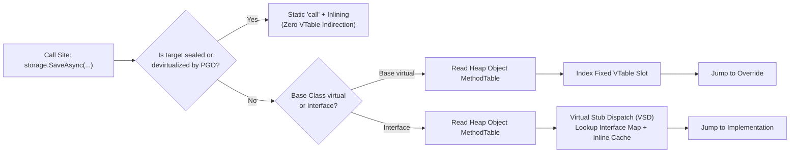

# Chapter 6: Advanced Object-Oriented and Functional Paradigms

## 1. Learning Objectives
By the end of this chapter, you will be able to:
- Explain the mechanics of Polymorphism, Virtual Method Dispatch (`callvirt`), Interface Virtual Stub Dispatch (VSD), VTables, and RyuJIT Guarded Devirtualization in .NET 10.
- Apply Composition over Inheritance, `sealed` classes, Default Interface Methods, Explicit Interface Implementation, and Variance (`in`/`out`) without falling into the Fragile Base Class trap.
- Differentiate between `class`, `struct`, `record class`, `record struct`, and `readonly record struct` regarding memory, mutability, C# 12+ Primary Constructors, C# 14 `field` accessors, and Value Equality.
- Utilize advanced Pattern Matching (including List Patterns and exhaustive `switch` expressions) and emulate Discriminated Unions via closed `abstract record` hierarchies.
- Architect Rich Domain-Driven Design (DDD) Aggregates, Entities, and Value Objects while knowing when to use functional `Result` types versus domain/security exceptions.

## 2. Introduction

Object-Oriented Programming (OOP) allows us to encapsulate state and behavior, as we saw in Chapter 2. However, encapsulation alone is not enough to build complex, extensible systems. We need mechanisms to abstract behavior (Polymorphism) so that different components can interact without knowing the exact concrete types of their dependencies.

Furthermore, as C# has evolved, Microsoft recognized that strict, mutable OOP is not always the best approach for concurrent, cloud-native systems. Starting heavily with C# 8.0, the language has absorbed numerous concepts from functional programming: immutability by default (Records) and declarative logic (Pattern Matching).

An enterprise architect must know when to use deep inheritance hierarchies and when to favor flat, immutable data structures. More importantly, they must understand the CPU cost of these abstractions.

## 3. Polymorphism, Virtual Dispatch, and VTables

Polymorphism ("many shapes") allows a method to accept an abstract base type, while executing the overridden logic of a concrete derived type at runtime.

### The C# Syntax
```csharp
public abstract class EvCharger
{
    // The 'virtual' or 'abstract' keyword tells the compiler 
    // this method can be overridden.
    public abstract void StartCharge();
}

public class FastDcCharger : EvCharger
{
    public override void StartCharge()
    {
        Console.WriteLine("Initiating 150kW DC Fast Charge...");
    }
}

public class SlowAcCharger : EvCharger
{
    public override void StartCharge()
    {
        Console.WriteLine("Initiating 7kW AC Charge...");
    }
}
```

When we iterate over a list of `EvCharger` objects, we don't need to check their specific types:

```csharp
EvCharger[] chargers = { new FastDcCharger(), new SlowAcCharger() };

foreach (var charger in chargers)
{
    charger.StartCharge(); // How does the CPU know which method to call?
}
```

### Compiler and Runtime Internals: The VTable

If a method is NOT virtual (a standard instance method), the Roslyn compiler emits a `call` IL instruction. The JIT compiler hardcodes the exact memory address of that method into the machine code. This is called **Static Dispatch**, and it is extremely fast.

If a method IS `virtual` or `abstract`, the compiler emits a `callvirt` (Call Virtual) IL instruction. This triggers **Dynamic Dispatch**.

Every type in the CLR has a **MethodTable**. If a class contains virtual methods, its MethodTable includes a **Virtual Method Table (VTable)**—an array of pointers to the actual memory addresses of the overridden methods.

When `charger.StartCharge()` is executed:
1. The CPU reads the hidden MethodTable pointer on the `charger` object instance in the Managed Heap.
2. It navigates to the VTable for that type.
3. It looks up the specific slot for `StartCharge`.
4. It jumps to the memory address stored in that slot.

**Performance Impact & RyuJIT Devirtualization:**
Virtual dispatch requires memory indirection (pointer chasing). This breaks CPU instruction pipelining and prevents RyuJIT from inlining the method. While the overhead is measured in nanoseconds, in a tight loop executing millions of times—such as scoring thousands of pgvector chunks during hybrid search—polymorphism can become a bottleneck.

However, modern .NET 10 RyuJIT fights back with **Devirtualization** and **Dynamic PGO (Profile-Guided Optimization)**:
- **Static Devirtualization**: If a class or overridden method is marked `sealed` (or is `private`/`internal` with no subclasses), RyuJIT proves at JIT time that only one target exists and replaces `callvirt` with a direct, inlineable `call`.
- **Guarded Devirtualization (GDV)**: Even when an interface or virtual method is not `sealed`, .NET 10's Tiered Compilation profiles the runtime types flowing through a call site. If 99% of calls hit `MinioDocumentStorageService`, RyuJIT emits a fast inline type check (`if (obj.MethodTable == MinioDocumentStorageService)`) and inlines the hot path, falling back to the VTable only on a miss.

### Interface Dispatch (Virtual Stub Dispatch) vs. Virtual Class Dispatch
A class only has one parent class, so every overridden method sits at a **fixed, known index** in the VTable. Interfaces are harder: a class like `MinioDocumentStorageService` can implement multiple interfaces (`IDocumentStorageService`, `IAsyncDisposable`, `IHealthCheck`), and another class implementing `IDocumentStorageService` might place those methods at completely different slot offsets.

Because there is no single fixed VTable index for an interface method, the CLR uses **Virtual Stub Dispatch (VSD)**. Instead of a fixed array lookup, `callvirt` on an interface goes through a small generated stub with an inline cache (resolving the `MethodTable` + interface map entry). That extra indirection is why interface calls are slightly slower than class virtual calls unless devirtualized by Dynamic PGO or constrained generics (`where T : IMyInterface` with structs).

### Method Hiding (`new`) vs. Overriding (`override`)
If a derived class declares a method with the same signature as a base class method using the `new` modifier instead of `override`, it **hides** the base method rather than overriding it. Method hiding does **not** enter the VTable: the method called depends on the **compile-time variable type**, not the runtime object type. Avoid `new` hiding in domain logic—it silently breaks polymorphism and violates the Liskov Substitution Principle.

### Default Interface Methods (DIM) & Explicit Interface Implementation
- **Default Interface Methods (C# 8+)**: Allow an interface to supply a default body so you can add a capability without breaking existing implementers. Use sparingly for backward-compatible library evolution or pure trait helpers; **do not** use DIMs to smuggle mutable state or complex business workflows into interfaces (interfaces cannot hold instance fields, and multiple interfaces with conflicting DIMs trigger compiler ambiguity errors).
- **Explicit Interface Implementation**: Writing `void IEntityTypeConfiguration<Document>.Configure(...)` implements a member *only* when accessed through the interface reference. This keeps the public API of a class clean while satisfying infrastructure contracts.

### When NOT to Use Polymorphism / Virtual Dispatch
- **Never mark methods `virtual` by default**: C# methods are non-virtual by default (unlike Java) so callers pay zero indirection unless polymorphism is intentional.
- **Avoid polymorphism for closed data shapes**: If the set of variants is fixed and operations change often (e.g., mapping `RetrievalOutcome` to HTTP status codes), use a `record` hierarchy and `switch` pattern matching rather than adding `ToHttpResult()` virtual methods to domain models.
- **Avoid deep inheritance trees**: More than 2–3 levels of class inheritance creates the Fragile Base Class problem; prefer `sealed` classes + interface composition.



*Enterprise Rule:* Do not make methods `virtual` by default unless you explicitly intend for them to be overridden. Seal leaf implementations (`sealed class`) so RyuJIT can devirtualize and inline them automatically.

### Real-World Normora Examples: Polymorphism & Dispatch
1. **Provider Boundary (`IDocumentStorageService` + `sealed` Adapter)**: In Normora, `Normora.Modules.Documents` defines `IDocumentStorageService`, while `Normora.Infrastructure` provides `public sealed class MinioDocumentStorageService : IDocumentStorageService`. Marking the adapter `sealed` enables RyuJIT Guarded Devirtualization while keeping the `Documents` module 100% free of the `Minio` SDK.
2. **Sequential Migration Pipeline (`IDatabaseMigrator`)**: `DatabaseMigrationRunner` iterates over `IEnumerable<IDatabaseMigrator>` containing four concrete implementations (`TenantsDatabaseMigrator`, `DocumentsDatabaseMigrator`, `ConversationsDatabaseMigrator`, `SessionDatabaseMigrator`) and calls `await migrator.MigrateAsync(ct)` polymorphically during `--migrate` startup.
3. **Template Method in AI Agent Tools (`AgentToolBase`)**: An abstract `AgentToolBase` in `Normora.Modules.Conversations` can declare `public virtual bool RequiresHitlApproval => false;` and `protected abstract Task<ToolExecutionResult> ExecuteCoreAsync(...)`, letting `DocumentsDeleteTool` override `RequiresHitlApproval => true` to trigger `PendingApproval` persistence while `DocumentsListTool` inherits the default fast path.
4. **Explicit Interface Implementation for EF Core Configurations**: Each module uses parameterless `IEntityTypeConfiguration<T>` classes (such as `DocumentConfiguration` in `Documents/Persistence/Configurations/`). Implementing `void IEntityTypeConfiguration<Document>.Configure(EntityTypeBuilder<Document> builder)` explicitly keeps EF Core wiring isolated to assembly scanning (`ApplyConfigurationsFromAssembly`).
5. **Default Interface Method for Telemetry Metadata (`IWorkspaceTraceable`)**: An internal telemetry contract `IWorkspaceTraceable` can define `Guid TenantId { get; }` plus a default method `string GetSpanKey() => $"tenant:{TenantId}";` so newly added cross-module audit events automatically work with OpenTelemetry tagging without modifying every existing contract—while avoiding DIMs on stateful services like `PayUPaymentService`.

## 4. Composition Over Inheritance, Sealing, and Polymorphic Design

Inheritance models an **"is-a"** relationship, whereas composition models a **"has-a"** relationship. In small textbook examples, inheritance feels natural; in large enterprise systems, deep class hierarchies create the **Fragile Base Class** problem—changing one protected field or `virtual` hook in a base class silently breaks subclasses across teams.

### Why Composition + `sealed` Wins in Enterprise C#
1. **Liskov Substitution Principle (LSP)**: A subtype must honor every behavioral contract and invariant of its base type without surprising callers (such as throwing `NotSupportedException` on a method the base type promises works).
2. **Interface Segregation Principle (ISP)**: Clients should not be forced to depend on methods they do not use. Small, single-purpose interfaces (`ITextGenerationService`, `ITextEmbeddingService`) let modules compose only what they need.
3. **Sealing by Default**: Mark concrete handlers, services, and infrastructure adapters `sealed`. Inheritance becomes an explicit opt-in design decision rather than an accident, and RyuJIT can statically devirtualize calls.
4. **Variance (`out` Covariance and `in` Contravariance)**:
   - **Covariance (`out T`)**: Allows a generic interface to return a *more derived* type than declared (e.g., `IReadOnlyList<AdminAuditEvent>` can be passed where `IReadOnlyList<AuditEvent>` is expected).
   - **Contravariance (`in T`)**: Allows a generic interface to *accept* a less derived type (e.g., an `IAuditEventFilter<AuditEvent>` can validate `AdminAuditEvent` instances).

### When NOT to Use Inheritance or Variance
- **Do not share code via a `BaseService` / `BaseHandler` class**: Inject shared collaborators via Primary Constructors instead.
- **Do not apply `in`/`out` variance everywhere**: Only interfaces whose generic type parameter strictly appears in output (`out`) or input (`in`) positions support variance. Mutable collections (`IList<T>`) are intentionally **invariant** so you cannot insert a `Dog` into a `List<Cat>` through a `List<Animal>` reference.

### Real-World Normora Examples: Composition, Sealing & Variance
1. **Composing AI & Retrieval Pipelines (`ConversationTurnPreparer`)**: Instead of inheriting from a monolithic `BaseConversationHandler`, Normora's `ConversationTurnPreparer` composes `IQueryRewriterService`, MediatR `ISender` (to dispatch `PerformHybridRetrievalQuery` across the module boundary), and `ITextGenerationService` via constructor injection.
2. **Interface Segregation Across AI Ports**: Rather than defining one massive `IGeminiClient` interface, `Normora.Modules.Documents` declares `ITextEmbeddingService` and `IDocumentTextExtractor`, while `Normora.Modules.Conversations` declares `ITextGenerationService`, `IQueryRewriterService`, and `ISuggestionsService`. Swapping the OCR engine never touches chat streaming.
3. **`sealed` CQRS Handlers & Adapters**: Every operation handler in Normora (such as `public sealed class UploadDocumentCommandHandler` and `public sealed class CancelSubscriptionCommandHandler`) and every external provider (`MinioBrandingStorageService`, `GeminiEmbeddingService`) is sealed so neither other modules nor tests can subclass internal workflow state, while allowing RyuJIT devirtualization.
4. **Preventing LSP Violations in `TenantPlan` Cancellation**: A `Free` tier workspace cannot be cancelled or reactivated (`InvalidOperationException(ApiMessages.CannotCancelFreePlan)`). Instead of creating a broken `FreePlan : PaidPlan` subclass that overrides `Cancel()` to throw `NotSupportedException` (an LSP violation), Normora models `TenantPlan` uniformly and governs tier rules explicitly through `TenantPlanPricingCatalog` and domain invariants.
5. **Covariance & Contravariance in Workspace Reporting**: A shared audit projection endpoint can consume `IReadOnlyList<IAuditRecord>` covariantly (`IReadOnlyList<out T>`) when receiving `IReadOnlyList<DocumentUploadAuditRecord>`, while an event sink `INotificationDispatcher<in TEvent>` declared contravariantly lets a single `INotificationDispatcher<WorkspaceEvent>` handle specialized `DocumentIndexedEvent` notifications.

## 5. Records, Primary Constructors (C# 12–14), and Value Equality

In distributed systems and modular monoliths (like Normora passing MediatR contracts between `Conversations` and `Documents`), data often represents an immutable snapshot in time.

Historically, creating immutable classes in C# required massive boilerplate:

```csharp
// Legacy C# Immutable Class
public class TelemetryData
{
    public string ChargerId { get; }
    public decimal Voltage { get; }

    public TelemetryData(string chargerId, decimal voltage)
    {
        ChargerId = chargerId;
        Voltage = voltage;
    }

    // You also had to manually override Equals(), GetHashCode(), and == operator!
}
```

### Enter the `record` Type (C# 9+)

A `record` (or `record class`) is a reference type (like a `class`), but the compiler automatically generates the boilerplate for immutability and **Value Equality**.

```csharp
// Modern C# Positional Record
public record TelemetryData(string ChargerId, decimal Voltage);
```

That single line of code instructs Roslyn to generate:
1. Public `init`-only properties for `ChargerId` and `Voltage`.
2. A constructor taking both parameters.
3. Overrides for `Equals()`, `GetHashCode()`, and `==`/`!=` that compare the *values* of the properties (plus a synthesized `EqualityContract` property so two different derived record types never falsely compare equal).
4. A human-readable `ToString()` implementation.
5. Support for non-destructive mutation via the `with` expression (backed by a compiler-generated copy constructor).
6. A `Deconstruct` method for tuple/positional pattern matching.

```csharp
var t1 = new TelemetryData("CHG-1", 240m);
var t2 = new TelemetryData("CHG-1", 240m);

// True! Because Records use Value Equality. 
// If these were standard Classes, this would be False.
bool areEqual = (t1 == t2); 

// Non-destructive mutation (creates a new object)
var t3 = t1 with { Voltage = 230m };
```

### `class` vs `record class` vs `struct` vs `record struct` vs `readonly record struct`

| Type | Memory Location | Default Equality | Default Mutability (Positional) | Supports `with` | Best Use Case in Normora |
|---|---|---|---|---|---|
| `class` | Managed Heap | Reference (`Object.ReferenceEquals`) | Mutable (`get; set;` or encapsulated) | No | EF Core Entities (`Document`, `TenantMembership`), Services, CQRS Handlers |
| `record class` (`record`) | Managed Heap | Value Equality + `EqualityContract` | Immutable (`get; init;`) | Yes | MediatR Commands/Queries, DTOs, Domain Events, Discriminated Unions |
| `struct` | Stack / Inline | Reflection-based value check (slow unless `IEquatable<T>`) | Mutable | Yes (value copy) | Low-level interop or custom `ref struct` spans |
| `record struct` | Stack / Inline | Compiler-synthesized fast `IEquatable<T>` | **Mutable (`get; set;`)** unless `readonly`! | Yes | Rarely needed; prefer `readonly record struct` |
| `readonly record struct` | Stack / Inline | Compiler-synthesized fast `IEquatable<T>` | Strictly Immutable (`get; init;`) | Yes | High-frequency Value Objects (`ChunkScore`, `Money`, `TokenBudget`) |

### Critical Distinction: C# 12+ Primary Constructors on `class` vs. `record`
C# 12 brought Primary Constructors to `class` and `struct`, and Normora's coding rules mandate Primary Constructors for dependency injection in all classes. However, **a primary constructor on a `class` behaves completely differently from one on a `record`**:
- On a **`record`**, parameters become **public `init`-only properties** participating in `Equals`/`GetHashCode`.
- On a **`class` or `struct`**, parameters are **not properties**—they are simply in-scope constructor parameters. If referenced inside methods (like an injected `ISender`), Roslyn captures them into **private compiler-synthesized mutable fields**. If you also want immutability or public exposure on a `class`, assign them explicitly to `private readonly` fields or `get`-only properties.

### Modern Property Tools: `required` (C# 11+), `field` (C# 14), and Extension Members (C# 14)
- **`required` + `init` (Nominal Records/Classes)**: When a DTO or options class has 6+ properties, positional constructors hurt readability. Combine `required` with `init` so callers must initialize every property via object-initializer syntax at compile time.
- **C# 14 `field` Keyword**: Historically, validating or normalizing a property inside `set` or `init` forced you to abandon auto-properties and declare a `private string _slug;` backing field. In C# 14, the contextual `field` keyword accesses the compiler-generated backing field directly inside the accessor, preserving encapsulation without boilerplate.
- **C# 14 Extension Members (`extension(...)`)**: Lets you attach pure functional helpers, extension properties, and operators to existing records or domain types in a static class without polluting the core domain model.

### The Shallow Immutability Trap
A `record` guarantees **shallow immutability** only. If a `record` holds a `List<string>` or `Dictionary<string, string>`, someone can still call `dto.Tags.Add("secret")`, mutating the "immutable" record and corrupting its `GetHashCode()` if used as a dictionary key! Moreover, `record` equality checks `List<T>` by **reference**, not element-by-element. Use `ImmutableArray<T>`, `IReadOnlyList<T>` (with defensive copies), or `FrozenDictionary<TKey, TValue>` for collection properties inside records.

### When NOT to Use `record`
- **Never use `record` for EF Core Entities**: EF Core's Change Tracker relies on reference identity and controlled property mutation. Two distinct rows or detached snapshots with equal property values break tracking graphs and `DbContext.Update()` semantics.
- **Never use mutable `record struct` without `readonly`**: Positional `record struct Point(int X, int Y)` generates **settable** `X` and `Y` properties—always write `readonly record struct` for value-type Value Objects.
- **Avoid huge `record struct` (> 16–24 bytes) passed by value frequently**: Structs copy on every method call unless passed via `in` / `ref readonly`.

### Real-World Normora Examples: Records, Primary Constructors & `field`
1. **Cross-Module MediatR Contract (`record`)**:
   ```csharp
   // Normora.Shared.Contracts.Documents
   public sealed record PerformHybridRetrievalQuery(
       Guid TenantId,
       string QueryText,
       int TopK,
       Guid? DepartmentId = null) : IRequest<HybridRetrievalResponse>;
   ```
   Explicitly carrying `Guid TenantId` guarantees tenant isolation across both HTTP requests and Hangfire worker jobs, while `sealed record` gives free value equality for unit test assertions.
2. **DI via C# 12+ Primary Constructor in a Normora Handler (`class`)**:
   ```csharp
   // Normora.Modules.Documents/Application/Documents/Commands/UploadDocument/
   public sealed class UploadDocumentCommandHandler(
       DocumentsDbContext dbContext,
       IDocumentStorageService storageService,
       IDocumentProcessingWakeup wakeup) : IRequestHandler<UploadDocumentCommand, UploadDocumentResult>
   {
       public async Task<UploadDocumentResult> Handle(UploadDocumentCommand request, CancellationToken ct)
       {
           // Parameters are captured privately; no manual field declarations needed.
           await storageService.UploadAsync(request.StorageKey, request.Content, ct);
           // ... persist Document, DocumentVersion, DocumentProcessingOutboxMessage atomically
           await wakeup.SignalAsync(ct);
           return new UploadDocumentResult(request.DocumentId);
       }
   }
   ```
3. **Zero-Allocation Value Object (`readonly record struct`)**:
   ```csharp
   public readonly record struct ChunkTokenBudget(int MaxContextTokens, int ReservedForSystemPrompt)
   {
       public int AvailableForChunks => Math.Max(0, MaxContextTokens - ReservedForSystemPrompt);
   }
   ```
   Used inside `ConversationTurnPreparer` for token budgeting without allocating on the GC heap.
4. **C# 14 `field` Keyword + `required` / `init` for Domain Options**:
   ```csharp
   public sealed record TenantSlugRequest
   {
       public required string Slug
       {
           get;
           init => field = string.IsNullOrWhiteSpace(value)
               ? throw new ArgumentException(ApiMessages.InvalidTenantSlug, nameof(Slug))
               : value.Trim().ToLowerInvariant();
       }
   }
   ```
   Notice how `field` validates and normalizes `Slug` in `init` without declaring a separate `_slug` field, and throws using `ApiMessages` (never magic strings).
5. **Avoiding Shallow Immutability Traps in Hybrid Search Results**:
   ```csharp
   public sealed record HybridRetrievalResponse(
       Guid TenantId,
       ImmutableArray<RetrievedChunkDto> Chunks);
   ```
   Using `ImmutableArray<RetrievedChunkDto>` ensures downstream `Conversations` callers cannot mutate the retrieved chunk list returned by `Documents`. And when updating a tenant plan snapshot in memory, `var annual = monthlyPlan with { BillingCycle = BillingCycle.Annual };` produces a clean new record without touching the original snapshot.

## 5. Pattern Matching

Functional programming relies heavily on declarative data transformations. C# has rapidly expanded its `switch` expressions and pattern matching capabilities.

Instead of writing deep `if-else` blocks or using polymorphic visitors, we can use pattern matching to inspect object shapes and properties.

```csharp
public record PaymentRequest(decimal Amount, string Currency);
public record CreditCardPayment(decimal Amount, string Currency, string Token) : PaymentRequest(Amount, Currency);
public record RfidPayment(decimal Amount, string Currency, string RfidTag) : PaymentRequest(Amount, Currency);

public class PaymentProcessor
{
    // C# 8+ Switch Expression with Pattern Matching
    public string Process(PaymentRequest request) => request switch
    {
        CreditCardPayment { Amount: > 1000 } => "Transaction too large for card.",
        CreditCardPayment card => $"Processing card token: {card.Token}",
        RfidPayment rfid when rfid.Currency == "USD" => $"Processing RFID {rfid.RfidTag}",
        null => throw new ArgumentNullException(nameof(request)),
        _ => "Unknown payment method" // Discard pattern
    };
}
```

**Compiler Internals:** 
The Roslyn compiler is incredibly smart about pattern matching. It will analyze the type hierarchy and generate an optimized IL jump table or a sequence of `isinst` (Is Instance) IL checks. Furthermore, if you use enums or closed type hierarchies, the compiler can issue a warning if your switch expression is not exhaustive (meaning you missed a possible state).

## 6. Real Production Case Study: Domain-Driven Design (DDD)

In our EV Platform, we need to model a `ChargingSession`. In a highly transactional enterprise system, we use **Domain-Driven Design (DDD)**. 

Entities must protect their invariants. A session cannot be stopped if it was never started. It cannot exceed the max kW of the charger. We will use advanced OOP encapsulation, and Records for immutable Value Objects.

```csharp
using System;
using System.Collections.Generic;

namespace EVPlatform.Domain
{
    // Value Object: Identifiable only by its data, completely immutable.
    public record MeterValue(decimal KwDelivered, DateTime Timestamp);

    // Domain Entity: Has a unique identity, mutable state, but protects its invariants.
    public class ChargingSession
    {
        public Guid SessionId { get; }
        public string ChargerId { get; }
        
        // Private state
        private readonly List<MeterValue> _meterValues = new();
        private bool _isCompleted;

        // Expose a read-only view to prevent external modification
        public IReadOnlyList<MeterValue> MeterValues => _meterValues.AsReadOnly();

        public decimal TotalKw => _meterValues.Sum(m => m.KwDelivered);

        public ChargingSession(string chargerId)
        {
            SessionId = Guid.NewGuid();
            ChargerId = chargerId ?? throw new ArgumentNullException(nameof(chargerId));
            _isCompleted = false;
        }

        // Domain Behavior
        public void RecordMeter(MeterValue value)
        {
            if (_isCompleted)
                throw new InvalidOperationException("Session is already completed.");

            if (value.Timestamp > DateTime.UtcNow)
                throw new ArgumentException("Meter timestamp cannot be in the future.");

            _meterValues.Add(value);
        }

        public void CompleteSession()
        {
            _isCompleted = true;
        }
    }
}
```

## 7. Common Mistakes

| Level | Mistake | Impact | How to Avoid |
|-------|---------|--------|--------------|
| Beginner | Misunderstanding `class` equality. | `obj1 == obj2` returns false even if their properties are identical, leading to bugs in HashSets and Dictionaries. | Use `record` for data-transfer objects where value equality is expected. |
| Intermediate | Using `record` for EF Core Entities. | EF Core Change Tracking relies on reference mutability. Records cause massive headaches with ORMs. | Use standard `class` types for EF Core Entities. Use `record` for DTOs and Value Objects. |
| Senior | Deep Inheritance Hierarchies (>3 levels). | Brittle architecture, impossible to unit test effectively. | Favor Composition over Inheritance. Extract shared behavior into interfaces or composed dependencies. |
| Architect | Virtual Dispatch in high-throughput parsing loops. | CPU stall and cache misses. | Use sealed classes, static methods, or generic constraints (`where T : IParser`) which the JIT can devirtualize. |

## 8. Interview Questions

### Beginner Tier (OOP Fundamentals)

**1. What is Polymorphism?**
*Answer:* Polymorphism means "many shapes." It allows a method to accept a base class (like `Animal`) or interface, but execute the specific, overridden behavior of the concrete derived class (like `Dog.Speak()`) at runtime.

**2. What is the difference between `abstract` and `virtual` methods?**
*Answer:* A `virtual` method provides a default implementation that a derived class *can* override. An `abstract` method has no implementation; it forces the derived class to provide the implementation. `abstract` methods can only exist in `abstract` classes.
*Example:*
```csharp
abstract class Base {
    public virtual void Opt() { /* Default code */ }
    public abstract void Req(); // Must be implemented
}
```

**3. Can a class inherit from multiple classes?**
*Answer:* No. C# does not support multiple inheritance for classes to avoid the "Diamond Problem" (ambiguity in which base method to call). However, a class can implement multiple interfaces.

**4. What does the `sealed` keyword do?**
*Answer:* When applied to a class, it prevents any other class from inheriting from it. When applied to an overridden method, it prevents further derived classes from overriding that specific method.
*Example:*
```csharp
sealed class SecuritySystem { } // Cannot be inherited
```

**5. What is the `base` keyword?**
*Answer:* The `base` keyword is used to access members (methods, properties, or constructors) of the base class from within a derived class.
*Example:*
```csharp
class Child : Parent {
    public Child() : base("Param") { } // Calls Parent constructor
}
```

**6. Explain method overloading vs method overriding.**
*Answer:* Overloading is compile-time polymorphism: having multiple methods with the same name but different parameters in the same class. Overriding is runtime polymorphism: changing the behavior of a base class's `virtual` method in a derived class using the `override` keyword.

**7. What is an Interface?**
*Answer:* An interface is a contract. It defines a set of methods, properties, or events without any implementation (prior to C# 8 default implementations). Any class that implements the interface must provide the code for those members.

### Intermediate Tier (Records and Pattern Matching)

**8. Explain the difference between a `class` and a `record`.**
*Answer:* A `class` uses reference equality by default (two objects are only equal if they point to the exact same memory address). A `record` is a reference type where the compiler automatically generates value-based equality methods. Two records are equal if all their properties contain the same values.

**9. What is a Primary Constructor in a record?**
*Answer:* A concise syntax for declaring a record and its properties on a single line. The compiler automatically generates `init`-only properties for each parameter.
*Example:*
```csharp
public record User(string Name, int Age); 
```

**10. How do you mutate a `record`?**
*Answer:* You don't mutate the original record because its properties are usually `init`-only. You use the `with` expression to create a new, distinct copy of the record with specific properties altered.
*Example:*
```csharp
var u1 = new User("Alice", 30);
var u2 = u1 with { Age = 31 }; // u1 is unchanged
```

**11. What is the `is` operator used for in Pattern Matching?**
*Answer:* It checks if an object is compatible with a specific type. In modern C#, it can also assign the casted value to a new variable in one step.
*Example:*
```csharp
if (obj is string s) {
    Console.WriteLine(s.Length); // 's' is strongly typed
}
```

**12. Show a `switch` expression using Property Pattern Matching.**
*Answer:* You can inspect the properties of an object directly inside the switch arms.
*Example:*
```csharp
string status = user switch {
    { Age: < 18 } => "Minor",
    { IsAdmin: true } => "Admin",
    _ => "Standard"
};
```

**13. What is a Positional Pattern?**
*Answer:* If a type (like a tuple or a record) has a `Deconstruct` method, you can pattern match against the deconstructed values directly.
*Example:*
```csharp
string result = point switch {
    (0, 0) => "Origin",
    (var x, var y) when x == y => "Diagonal",
    _ => "Other"
};
```

**14. What does the `new()` constraint do in Generics?**
*Answer:* It forces the generic type parameter to have a public, parameterless constructor, allowing you to instantiate it inside the generic class.
*Example:*
```csharp
class Factory<T> where T : new() {
    public T Create() => new T();
}
```

### Senior Tier (VTable and Dispatch)

**15. How does Virtual Method Dispatch work under the hood?**
*Answer:* The compiler emits a `callvirt` IL instruction. At runtime, the JIT uses the object's hidden MethodTable pointer to find the Virtual Method Table (VTable). It looks up the specific slot for the overridden method and jumps to that memory address. This pointer indirection prevents inlining.

**16. Why does `callvirt` always include a Null Check?**
*Answer:* Because dynamic dispatch relies on reading the MethodTable pointer located on the object instance in the heap. If the object reference is `null`, there is no MethodTable to read, and the CLR must throw a `NullReferenceException`. Static `call` instructions do not need the object instance to figure out the method address.

**17. What is Interface Dispatch, and why is it slower than Virtual Dispatch?**
*Answer:* Virtual dispatch looks up a slot in a fixed, linear VTable. Interface dispatch is more complex because a class can implement multiple interfaces, and the method might not be in the same VTable slot for different classes implementing the same interface. The CLR must search an interface map (Virtual Stub Dispatch), which requires slightly more CPU overhead.

**18. What is Method Hiding (the `new` keyword on methods)?**
*Answer:* If a derived class declares a method with the same name as a base class method, but uses `new` instead of `override`, it hides the base method. It does *not* participate in polymorphism. The method executed depends on the *compile-time* type of the variable, not the runtime type.
*Example:*
```csharp
class A { public void Go() {} }
class B : A { public new void Go() {} }
A obj = new B();
obj.Go(); // Calls A.Go()!
```

**19. How do Default Interface Methods (C# 8) impact architecture?**
*Answer:* They allow you to add new methods with implementations to an existing interface without breaking backward compatibility for classes that already implement the interface. It enables trait-like behavior but complicates multiple inheritance scenarios.

**20. What is Covariance and Contravariance?**
*Answer:* They allow implicit reference conversions for generic interfaces. Covariance (`out T`) allows a method to return a more derived type (e.g., returning a `Dog` when an `IEnumerable<Animal>` is expected). Contravariance (`in T`) allows a method to accept a less derived type (e.g., passing an `IComparer<Animal>` to sort a list of `Dog`s).

**21. Explain the "Fragile Base Class" problem.**
*Answer:* In deep inheritance hierarchies, changing a seemingly isolated method in a base class can have catastrophic, unforeseen side effects in derived classes that rely on the base class's internal state. This is why architects prefer Composition over Inheritance.

### Staff Engineer Tier (Compiler Internals and DDD)

**22. How does C# pattern matching (e.g., `switch` expressions) compile down into IL?**
*Answer:* Depending on complexity, Roslyn may emit a series of `isinst` (Is Instance) checks followed by conditional branches. If matching against a known closed hierarchy or specific constants, it optimizes it into IL jump tables or binary searches. It is vastly more efficient than manual `if (obj.GetType() == typeof(X))` chains.

**23. What is an exhaustive `switch` expression?**
*Answer:* The compiler analyzes the type being switched on. If it's an `enum`, `bool`, or a closed inheritance hierarchy (like a discriminated union approximation), the compiler guarantees that every possible state is handled. If a state is missed, it throws a compile-time warning (CS8509).

**24. When applying Domain-Driven Design (DDD), how do you decide whether a concept should be an Entity or a Value Object?**
*Answer:* An Entity has a distinct identity that persists over time, even if its properties change (e.g., a `User` changing their name). A Value Object has no conceptual identity; it is defined entirely by its attributes (e.g., a `Money` amount). In C#, Entities are typically encapsulated `class` types, while Value Objects are perfectly modeled as immutable `record` types.

**25. Why are ORMs like EF Core problematic with C# `record` types?**
*Answer:* EF Core Change Tracking relies heavily on object identity (reference equality) and mutability to track which fields were updated. Because records use value equality and are usually immutable (requiring `with` expressions to generate new instances), the ORM loses track of the object instance, making updates difficult or impossible without complex workarounds.

**26. How do you enforce invariants in a DDD Entity without exposing setters?**
*Answer:* You make all property setters `private` or `init`. State changes are only permitted through explicitly named business methods (e.g., `order.ApplyDiscount(10)`) that validate the input and throw exceptions if the invariant is violated, ensuring the object is never put into an invalid state.

**27. Explain the performance impact of Devirtualization.**
*Answer:* Devirtualization is a JIT optimization. If the JIT proves that a class is `sealed`, or that an interface method only has one concrete implementer at runtime, it replaces the expensive `callvirt` (VTable lookup) with a direct `call`. This eliminates pointer indirection and allows the method to be completely inlined into the caller.

### Architect Tier (Extreme Architecture and JIT Tricks)

**28. Virtual Dispatch in high-throughput parsing loops causes CPU stalls. How do you architect around this?**
*Answer:* Use "Constrained Generics" for static polymorphism. Instead of `public void Parse(IParser p)`, use `public void Parse<T>(T p) where T : IParser`. The JIT compiles a specialized, separate native code path for every struct passed as `T`. This completely devirtualizes the interface call, eliminating the VTable lookup and allowing the JIT to inline the parsing logic, achieving C++ speeds.

**29. What is the difference between an Anemic Domain Model and a Rich Domain Model?**
*Answer:* An Anemic Domain Model is an anti-pattern where Entities are just bags of public getters and setters (data), and separate "Service" classes contain all the logic. This violates OOP encapsulation. A Rich Domain Model places the business logic directly inside the Entity itself, protecting its own invariants and state.

**30. How do you emulate Discriminated Unions in C# using Pattern Matching?**
*Answer:* C# does not have native F#-style Discriminated Unions yet. Architects emulate them using an `abstract record` base class with a `private protected` constructor, ensuring no external classes can inherit from it. Then, declare the derived `record` types nested inside or in the same file. This creates a "closed" hierarchy that `switch` expressions can exhaustively match against.

**31. Explain the architectural implications of the `InternalsVisibleTo` attribute.**
*Answer:* To build true microservice boundaries within a monolith (Modular Monolith), the Core Domain should be marked `internal` so the API layer cannot accidentally bypass Application Services and mutate entities directly. `InternalsVisibleTo` is then used exclusively to allow the Unit Test project to bypass this boundary for testing.

**32. Why would an architect forbid the use of `dynamic` in an enterprise C# application?**
*Answer:* The `dynamic` keyword bypasses compile-time type checking and relies on the DLR (Dynamic Language Runtime) to resolve method calls at runtime. This requires heavy reflection, boxing, and caching mechanisms. It breaks static analysis, prevents JIT optimizations, causes severe performance penalties, and masks runtime crashes that should have been caught at compile time.

**33. How does the Liskov Substitution Principle (LSP) constrain your inheritance architecture?**
*Answer:* LSP dictates that a derived class must be seamlessly substitutable for its base class. If a consumer calls `bird.Fly()`, and the injected object is a `Penguin` that throws a `NotSupportedException`, LSP is violated. The architect must restructure the taxonomy, extracting a specific `IFlyingBird` interface rather than forcing a monolithic base class.

**34. What is the Expression Problem, and how do OOP and FP address it differently in C#?**
*Answer:* The Expression Problem is the challenge of extending a system in two dimensions: adding new Data Types or adding new Operations. OOP makes it easy to add new Data Types (just create a new derived class) but hard to add new Operations (must modify the base class and all derived classes). FP (Pattern Matching) makes it easy to add Operations (write a new `switch` statement) but hard to add new Data Types (must update every `switch` statement). A C# architect must choose the right paradigm based on which dimension is more likely to change.

## 9. Summary
Modern C# is a hybrid language. It retains the deep architectural capabilities of Object-Oriented Programming (Classes, Polymorphism, Encapsulation) while embracing the safety and predictability of Functional Programming (Records, Immutability, Pattern Matching). 

As an architect, your job is to apply these tools correctly: use standard classes for rich domain entities that mutate over time, and use records/pattern matching for the data passing between the boundaries of your system. In the next chapter, we will explore Delegates, Events, and the internal state machines that power LINQ.
