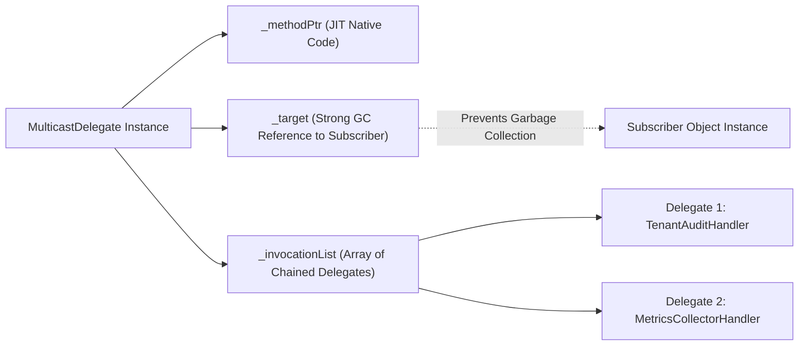
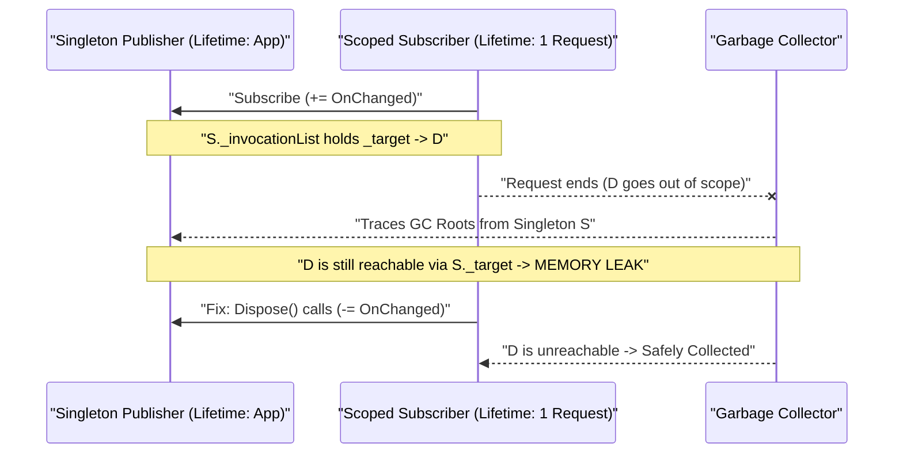

# Chapter 7: Delegates, Events, and LINQ Internals

## 1. Learning Objectives
By the end of this chapter, you will be able to:
- Understand the internal structure of `Delegate` and `MulticastDelegate` (`_target`, `_methodPtr`, `_invocationList`), delegate variance, immutability, and C# 14 lambda improvements.
- Identify and resolve memory leaks caused by C# `event` subscriptions, implement thread-safe and fault-isolated event dispatch, and know when to choose Transactional Outboxes or SignalR/MediatR over in-process events.
- Analyze the Roslyn-generated state machines behind `IEnumerable<T>`, `yield return`, `try/finally` disposal, eager argument validation, and `IAsyncEnumerable<T>` streaming.
- Distinguish `IEnumerable<T>` (LINQ to Objects) from `IQueryable<T>` (Expression Tree ASTs compiled to SQL by EF Core) and enforce clean module boundaries.
- Optimize LINQ queries in .NET 10 and C# 14 using Deferred Execution vs. Materialization, zero-allocation `static` lambdas, `TryGetNonEnumeratedCount`, `CountBy`/`AggregateBy`/`LeftJoin`, and C# 14 extension members—and recognize when to avoid LINQ entirely.

## 2. Introduction

One of the most powerful features of C# is its ability to treat functions as first-class citizens. You can assign a method to a variable, pass it as a parameter, and execute it asynchronously. This is the foundation of event-driven programming, callbacks, and Language Integrated Query (LINQ).

However, delegates and LINQ are heavily abstracted by the compiler. A simple lambda expression `x => x > 5` or a LINQ `.Where()` clause hides heap allocations, closure capture classes, expression tree Abstract Syntax Trees (ASTs), and complex compiler-generated state machines. To architect high-performance, multi-tenant .NET 10 systems like **Normora** (with strict tenant isolation, EF Core + pgvector queries, and real-time RAG streaming), you must understand both the exact mechanics under the hood and when *not* to use these abstractions.

## 3. Anatomy of a Delegate

In C/C++, you can pass a "function pointer" to another method. It is simply a raw memory address. It is fast, but it is not type-safe, and it has no concept of object state.

In C#, a **Delegate** is an object-oriented, type-safe wrapper around a method reference (or a chain of method references). It defines a strict contract: parameter types and return type.

When you declare a delegate:
```csharp
public delegate void TelemetryReceivedHandler(string chargerId, decimal voltage);
```

The Roslyn compiler actually generates a completely new `sealed` class that inherits from `System.MulticastDelegate` (which itself inherits from `System.Delegate`), exposing `Invoke`, `BeginInvoke`, and `EndInvoke` methods matching your signature.

### 3.1 Inside `MulticastDelegate` and the GC Root Chain
An instance of a delegate holds three critical internal fields (inherited from `System.Delegate` and `System.MulticastDelegate`):
1. `_methodPtr` (`IntPtr`): A pointer to the JIT-compiled (Just-In-Time compiled) native machine code of the method to execute.
2. `_target` (`object?`): A reference to the object instance on which the method should be invoked (if it is an instance method). If the target method is `static`, `_target` is `null` (or points to the delegate itself for certain static/open dispatch stubs).
3. `_invocationList` (`object?`): When multiple delegates are combined with `+` or `+=`, `MulticastDelegate` stores an array of delegates (`object[]`) representing the chained invocation pipeline.

Because `_target` holds a strong reference to an object instance, **a delegate acts as a GC Root (a reference the Garbage Collector treats as live) for every subscriber instance it points to.** This is the primary source of delegate-related memory leaks in .NET.



### 3.2 Built-in Delegates, Natural Types, and C# 14 Lambdas
To avoid declaring custom `delegate` types for every signature, .NET provides generic, built-in delegates in `System`:
- `Action` / `Action<T1, ..., T16>`: Represents a method returning `void`.
- `Func<T1, ..., T16, TResult>`: Represents a method returning a value of type `TResult`.
- `Predicate<T>`: Equivalent to `Func<T, bool>`, used by `List<T>.FindAll` and `Array.FindAll`. (LINQ uses `Func<T, bool>` instead.)
- `Comparison<T>`: Equivalent to `Func<T, T, int>`, used by `List<T>.Sort` and `Array.Sort`.
- `Converter<TInput, TOutput>`: Equivalent to `Func<TInput, TOutput>`, used by `List<T>.ConvertAll`.

**Modern C# Lambda & Method Group Enhancements:**
- **Static Lambdas (C# 9+):** Prefixing a lambda with `static` (e.g., `static x => x.IsActive`) instructs Roslyn to forbid capturing local variables or `this`. The compiler caches the delegate once for the lifetime of the AppDomain—**zero heap allocations per call**.
- **Natural Delegate Types (C# 10+):** You can assign lambdas directly to `var` (`var isAdmin = (string role) => role == "Admin";`), letting the compiler infer `Func<string, bool>`.
- **Method Group Caching (C# 11+):** Converting a static or instance method group (e.g., `chunks.Select(NormalizeChunk)`) previously allocated a new delegate object on every call in older C# versions. Since C# 11, Roslyn emits a cached static field for static method groups, eliminating hidden per-call delegate allocations.
- **Default Lambda Parameters (C# 12+):** Lambdas support optional parameters (`var formatPage = (int page, int size = 20) => ...`).
- **Simple Lambda Parameters with Modifiers (C# 14):** Prior to C# 14, adding parameter modifiers (`ref`, `in`, `out`, `scoped`, `ref readonly`) forced you to spell out every parameter type. C# 14 lets you write `(ref chunk) => ...` or `(scoped ReadOnlySpan<char> text) => ...` cleanly when the delegate type provides the parameter types.

### 3.3 Immutability, Fault Isolation, and Variance (`in` / `out`)
- **Delegates are Immutable:** Just like `System.String`, calling `Delegate.Combine` (`+=`) or `Delegate.Remove` (`-=`) does **not** mutate an existing delegate. It allocates a brand-new `MulticastDelegate` instance with a copied `_invocationList`. That immutability is why copying a delegate reference into a local variable before invoking it is thread-safe.
- **Fault Isolation via `GetInvocationList()`:** By default, invoking a multicast delegate (`pipeline?.Invoke(ctx)`) runs subscribers sequentially. If Subscriber 1 throws an exception, Subscribers 2 and 3 **never run**. In production pipelines, iterate `GetInvocationList()` inside a `try/catch` loop so one failing hook does not drop downstream telemetry or audit handlers.
- **Covariance (`out`) and Contravariance (`in`):**
  - **Covariance (`out TResult`):** A `Func<Derived>` can be assigned to a `Func<Base>` because the caller only reads a `Base`.
  - **Contravariance (`in T`):** An `Action<Base>` can be assigned to an `Action<Derived>` because a handler expecting `Base` can safely accept any `Derived`.
  - *(Note: Delegate variance only applies to reference types, not value types like `int` or `Guid`, because boxing changes binary layout.)*

### 3.4 When to Use vs. When NOT to Use Delegates
- **Use delegates when:** You need a lightweight strategy/callback (such as a scoring policy, validation predicate, or middleware step), or when composing functional transformations (`Func<T, TResult>`).
- **Do NOT use delegates when:**
  - **You have a multi-method contract or DI lifecycle:** Prefer an explicit interface (e.g., `ITextEmbeddingService` in `Normora.Modules.Documents`) so dependencies are mockable, discoverable, and constructor-injected via primary constructors.
  - **You are in an extreme zero-allocation hot loop:** Every delegate invocation goes through an indirect call stub (`_methodPtr`) and cannot normally be inlined by the JIT. In ultra-hot paths (e.g., parsing raw byte frames or SIMD vector math), prefer `static` methods, `struct` comparers (`IComparer<T>`), or C# `delegate*<...>` unmanaged/managed function pointers in `unsafe` code.

### 3.5 Normora in Action: 5 Real-World Delegate Examples

1. **Custom Domain Delegate for Audit Log Redaction (`Tenants` Module)**
   Defining a named delegate makes domain intent self-documenting when redacting sensitive payload fields before writing `AuditLogs`:
   ```csharp
   public delegate string AuditPayloadRedactor(string actionName, string rawJson);

   public sealed class AuditSanitizer
   {
       public static string RedactSensitiveFields(string actionName, string rawJson) =>
           actionName == "InviteEmployee" ? "[REDACTED_INVITE_PAYLOAD]" : rawJson;
   }

   // C# 11+ caches the static method group conversion automatically
   AuditPayloadRedactor redactor = AuditSanitizer.RedactSensitiveFields;
   ```

2. **Built-in `Func` and `Action` in Document Chunking (`Documents` Module)**
   `DocumentChunker` tracks Markdown heading breadcrumbs (`#`, `##`, `###`). Passing a `Func<string, string>` strategy decouples breadcrumb formatting from chunk splitting:
   ```csharp
   public static IEnumerable<string> BuildChunkHeaders(
       IEnumerable<string> headings,
       Func<string, string> formatBreadcrumb)
   {
       foreach (var heading in headings)
       {
           yield return formatBreadcrumb(heading);
       }
   }

   // Zero-allocation static lambda (forbids capturing local state)
   var headers = BuildChunkHeaders(
       ["Policy", "Travel", "Hotel Limits"],
       static h => h.Trim().ToUpperInvariant());
   ```

3. **Fault-Isolated Multicast Dispatch with `GetInvocationList()`**
   If multiple in-process diagnostics hooks listen after a document upload commits, a failing metrics hook must never prevent downstream logging:
   ```csharp
   public static void NotifyIngestionHooks(Action<Guid>? hooks, Guid documentId)
   {
       if (hooks is null) return;

       foreach (Action<Guid> singleHook in hooks.GetInvocationList())
       {
           try
           {
               singleHook(documentId);
           }
           catch (Exception ex)
           {
               // Log structured error; never leak internal traces to users (CWE-209)
               Console.Error.WriteLine($"Hook failed for document {documentId}: {ex.GetType().Name}");
           }
       }
   }
   ```

4. **Delegate Contravariance (`in`) & Covariance (`out`) Across Module Contracts**
   In Normora, handlers operating on base domain abstractions can seamlessly subscribe where derived types are emitted:
   ```csharp
   public record KnowledgeResource(Guid Id, Guid TenantId);
   public sealed record DocumentAsset(Guid Id, Guid TenantId, string FileName) : KnowledgeResource(Id, TenantId);

   // Contravariance: Action<KnowledgeResource> is assignable to Action<DocumentAsset>
   Action<KnowledgeResource> auditResource = static r =>
       Console.WriteLine($"Auditing resource {r.Id} for tenant {r.TenantId}");
   Action<DocumentAsset> auditDocument = auditResource;

   // Covariance: Func<DocumentAsset> is assignable to Func<KnowledgeResource>
   Func<DocumentAsset> loadDoc = static () => new(Guid.NewGuid(), Guid.NewGuid(), "handbook.pdf");
   Func<KnowledgeResource> loadResource = loadDoc;
   ```

5. **C# 14 Lambda Parameter Modifiers Without Explicit Types**
   When mutating a `ref` struct or token counter inside a delegate signature, C# 14 allows omitting redundant parameter types while keeping `ref`:
   ```csharp
   public delegate void TokenAccumulator(ref int remainingTokens, int chunkTokens);

   // C# 14: 'ref' modifier without repeating 'int'
   TokenAccumulator deductTokens = static (ref budget, cost) =>
   {
       budget = Math.Max(0, budget - cost);
   };
   ```

## 4. Events and Memory Leaks

An `event` in C# is a **publisher-subscriber encapsulation layer** over a `MulticastDelegate`. A `MulticastDelegate` maintains an invocation list of delegates. When you trigger the event, the runtime iterates through the list, calling each method sequentially.

Why not just expose a `public Action<string>?` field directly? Because a raw public delegate field lets *any* external class overwrite all other subscribers (`publisher.OnEvent = null;`) or forge an invocation (`publisher.OnEvent("fake")`). Declaring `event` restricts external callers strictly to `+=` (subscribe) and `-=` (unsubscribe). Only the declaring class can invoke or clear the delegate.

```csharp
public class EvNetwork
{
    // The compiler generates a private MulticastDelegate field,
    // and public thread-safe add/remove methods using Interlocked.CompareExchange.
    public event Action<string>? OnChargerDisconnected;

    public void TriggerDisconnect(string id)
    {
        OnChargerDisconnected?.Invoke(id);
    }
}
```

### 4.1 `EventHandler<TEventArgs>` and Custom `add`/`remove` Accessors
In .NET APIs, the standard convention uses `EventHandler<TEventArgs>` (passing `object? sender` and an immutable `EventArgs` subclass) so subscribers know which publisher instance raised the notification without creating closure captures.

Under the hood, Roslyn compiles a field-like event into a private delegate field plus lock-free `add` and `remove` methods using `Interlocked.CompareExchange` (Compare-And-Swap) so concurrent subscriptions from multiple threads never lose updates. You can also write custom `add` / `remove` accessors—for example, to store subscribers in an `EventHandlerList` (used in UI frameworks with dozens of rare events to avoid allocating 20 null delegate fields per instance) or a weak-reference registry.

### 4.2 The Event Memory Leak
Consider this scenario: A long-lived singleton `EvNetwork` exposes an event. A short-lived `DashboardUI` subscribes to it.

```csharp
public class DashboardUI
{
    public DashboardUI(EvNetwork network)
    {
        // Subscription: DashboardUI's method is added to EvNetwork's invocation list.
        network.OnChargerDisconnected += HandleDisconnect;
    }

    private void HandleDisconnect(string id) { /* update UI */ }
}
```

When the user closes the Dashboard, the `DashboardUI` object should be garbage collected. **It will not be.**

Because `EvNetwork` (a singleton) holds a `MulticastDelegate`, and that delegate holds the `_target` reference to `DashboardUI`, the GC considers `DashboardUI` to be alive. The UI is leaked. If the user opens and closes the dashboard 100 times, 100 UI objects remain in memory forever.



**The Fix:** Always unsubscribe (`-=`) when an object is disposed (`IDisposable`), or use the Weak Event Pattern (using `WeakReference<T>` or `ConditionalWeakTable`).

### 4.3 Thread-Safe Invocation and Exception Isolation
Because delegates are immutable, evaluating `OnChanged?.Invoke(...)` compiles to:
1. Copy the backing delegate field to a local variable (`var handler = OnChanged;`).
2. Check `if (handler != null) handler.Invoke(...);`.

Copying to a local prevents a classic race condition where Thread B unsubscribes the last handler *between* Thread A's `null` check and `.Invoke()`. However, if you have multiple independent subscribers and one might throw, iterate `handler.GetInvocationList()` with individual `try/catch` blocks.

### 4.4 When NOT to Use C# Events
As a senior architect, avoid C# `event` keywords in the following scenarios:
- **Across Process Boundaries (`Normora.Worker` ↔ `Normora.Api`):** C# events only exist inside a single .NET process's RAM. In Normora, background ingestion runs in `Normora.Worker`, while WebSocket clients connect to `Normora.Api`. Raising a C# event in the worker will never reach browser clients. Use **Transactional Outbox** (`DocumentProcessingOutboxMessage`) plus a **Redis SignalR backplane** (`IDocumentNotificationService` / `INotificationService`).
- **Async Domain Workflows & Cross-Module Communication:** C# events are synchronous and return `void` (forcing `async void` subscribers if awaited, which crash the process on unhandled exceptions). Inside Normora's modular monolith, cross-module actions must use **MediatR** request/notification contracts in `Normora.Shared.Contracts.*`—never raw `event` hooks.

### 4.5 Normora in Action: 5 Real-World Event Examples

1. **Standard `EventHandler<TEventArgs>` for In-Process Pipeline Diagnostics (`Documents` Module)**
   ```csharp
   public sealed class DocumentChunkedEventArgs(Guid tenantId, Guid documentId, int chunkCount) : EventArgs
   {
       public Guid TenantId { get; } = tenantId;
       public Guid DocumentId { get; } = documentId;
       public int ChunkCount { get; } = chunkCount;
   }

   public sealed class DocumentChunkingPipeline
   {
       public event EventHandler<DocumentChunkedEventArgs>? DocumentChunked;

       public void Complete(Guid tenantId, Guid documentId, int chunkCount)
       {
           DocumentChunked?.Invoke(this, new DocumentChunkedEventArgs(tenantId, documentId, chunkCount));
       }
   }
   ```

2. **Preventing a Scoped-to-Singleton Event Leak via `IDisposable` (`Tenants` Module)**
   If a scoped request observer subscribes to a singleton `TenantCacheInvalidator`, it *must* implement `IDisposable` (or `IAsyncDisposable`) so the DI container unsubscribes at the end of the HTTP request:
   ```csharp
   public sealed class ScopedTenantAuditTracker : IDisposable
   {
       private readonly TenantCacheInvalidator _invalidator;

       public ScopedTenantAuditTracker(TenantCacheInvalidator invalidator)
       {
           _invalidator = invalidator;
           _invalidator.TenantCacheEvicted += OnTenantCacheEvicted;
       }

       private void OnTenantCacheEvicted(object? sender, Guid tenantId) { /* record metric */ }

       public void Dispose() => _invalidator.TenantCacheEvicted -= OnTenantCacheEvicted;
   }
   ```

3. **Fault-Isolated Telemetry Dispatch Using `GetInvocationList()`**
   ```csharp
   public void PublishChunkMetrics(EventHandler<DocumentChunkedEventArgs>? handlers, DocumentChunkedEventArgs args)
   {
       if (handlers is null) return;

       foreach (EventHandler<DocumentChunkedEventArgs> listener in handlers.GetInvocationList())
       {
           try
           {
               listener(this, args);
           }
           catch (Exception ex)
           {
               // Isolate telemetry failures so document ingestion succeeds
               Console.Error.WriteLine($"Telemetry listener failed: {ex.Message}");
           }
       }
   }
   ```

4. **Weak Event Pattern Using `WeakReference<T>` for Long-Lived Registries**
   When subscribers cannot reliably call `Dispose()`, store weak references and prune dead targets during dispatch:
   ```csharp
   public sealed class WeakWorkspaceObserverRegistry
   {
       private readonly List<WeakReference<Action<Guid>>> _listeners = [];

       public void Subscribe(Action<Guid> callback) => _listeners.Add(new WeakReference<Action<Guid>>(callback));

       public void Notify(Guid tenantId)
       {
           for (int i = _listeners.Count - 1; i >= 0; i--)
           {
               if (_listeners[i].TryGetTarget(out var callback))
                   callback(tenantId);
               else
                   _listeners.RemoveAt(i); // Subscriber was GC'd cleanly
           }
       }
   }
   ```
   *(Caution: Avoid subscribing an inline lambda `(id) => ...` to a weak-reference registry without keeping a strong reference to the delegate elsewhere—otherwise the delegate itself has no strong root and gets collected on the very next Gen 0 GC!)*

5. **Architectural Upgrade: Replacing an In-Process Event with Transactional Outbox (`UploadDocumentCommandHandler`)**
   Instead of firing an unreliable in-memory C# `event OnDocumentUploaded` (which loses work if the pod restarts), Normora writes a `DocumentProcessingOutboxMessage` inside the same `DocumentsDbContext` transaction and signals `IDocumentProcessingWakeup` for `Normora.Worker`:
   ```csharp
   // Inside UploadDocumentCommandHandler (Documents module):
   // 1. Add Document, DocumentVersion, and DocumentProcessingOutboxMessage atomically
   // 2. await dbContext.SaveChangesAsync(cancellationToken);
   // 3. Signal durable background pickup (never a raw in-memory C# event!)
   await wakeup.NotifyAsync(cancellationToken);
   ```

## 5. Iterators and the State Machine (`yield return`)

In C#, `IEnumerable<T>` is the interface that enables the `foreach` loop. But how do you write a method that returns a sequence of data without loading the entire sequence into memory at once?

C# provides the `yield return` statement.

```csharp
public IEnumerable<int> GeneratePowerSequence()
{
    Console.WriteLine("Generating 10...");
    yield return 10;
    
    Console.WriteLine("Generating 20...");
    yield return 20;
}
```

**Compiler Internals:**
When Roslyn sees `yield return`, it completely rewrites your method. It generates a hidden, private class that implements `IEnumerator<int>`. This class is a **State Machine**.

1. When you call `GeneratePowerSequence()`, *none of your code executes*. It simply instantiates and returns the State Machine object.
2. When the caller calls `.MoveNext()` (e.g., inside a `foreach` loop), the state machine resumes execution from where it left off, runs until the next `yield return`, updates its internal `_state` integer, and pauses again.

This allows you to iterate over massive datasets (like millions of rows from a database) using almost zero memory, because you only hold one item in memory at a time.

## 6. LINQ Internals and Performance

Language Integrated Query (LINQ) is built entirely on Extension Methods, Delegates, and `IEnumerable` State Machines.

```csharp
var chargers = new List<EvCharger> { /* ... */ };

// 1. Deferred Execution
var activeChargers = chargers.Where(c => c.IsOnline).Select(c => c.Id);
```

### Deferred Execution
The code above **does not execute the query**. `.Where()` and `.Select()` simply construct a chain of state machine objects. The iteration only occurs when you force **Materialization**.

### Materialization
You materialize a query by iterating over it (`foreach`) or by calling methods like `.ToList()`, `.ToArray()`, or `.Count()`.

```csharp
// 2. Materialization
List<string> ids = activeChargers.ToList(); 
```

**The Multiple Enumeration Trap:**
```csharp
var activeChargers = chargers.Where(c => c.IsOnline);

int count = activeChargers.Count(); // Executes the Where loop
var first = activeChargers.First(); // Executes the Where loop AGAIN!
```
If that `.Where()` clause involved an expensive database call or heavy computation, you just executed it twice. If you need to use the results multiple times, materialize it to a list first.

### Closure Allocations in LINQ
When you write a lambda expression that captures a local variable, the compiler generates a hidden closure class.

```csharp
string searchRegion = "US-West";

// 'searchRegion' is captured by the lambda!
var results = chargers.Where(c => c.Region == searchRegion);
```
**Internals:** Roslyn creates a new class on the heap to store `searchRegion`, and passes a method from that class to `.Where()`. This causes a heap allocation. In high-performance hot paths, avoid capturing external variables in lambdas.

## 7. Real Production Case Study: Safe Querying

In our EV Platform, we need an administrative endpoint that returns all chargers for a specific tenant, filtered by status. We must ensure we don't accidentally materialize millions of records into RAM.

```csharp
using System;
using System.Collections.Generic;
using System.Linq;

public class ChargerRepository
{
    private readonly List<EvCharger> _databaseMock = new();

    // Returns IEnumerable to allow the caller to compose further queries
    // WITHOUT allocating a new List immediately.
    public IEnumerable<EvCharger> GetChargers(Guid tenantId)
    {
        // Deferred execution. No data is filtered yet.
        return _databaseMock.Where(c => c.TenantId == tenantId);
    }
}

public class ReportingService
{
    private readonly ChargerRepository _repo;

    public ReportingService(ChargerRepository repo)
    {
        _repo = repo;
    }

    public List<string> GenerateFaultReport(Guid tenantId)
    {
        var chargers = _repo.GetChargers(tenantId);

        // We compose more LINQ on top of the original query.
        // It remains deferred until .ToList() is called.
        // When .ToList() executes, the pipeline processes each item one by one,
        // allocating ONLY the final strings to the heap.
        return chargers
            .Where(c => c.Status == ChargerStatus.Faulted)
            .Select(c => c.ChargerId)
            .ToList();
    }
}
```

## 8. Common Mistakes

| Level | Mistake | Impact | How to Avoid |
|-------|---------|--------|--------------|
| Beginner | Modifying a collection inside a `foreach` loop. | `InvalidOperationException: Collection was modified.` | Iterate backwards with a `for` loop, or materialize the items to remove into a separate list first. |
| Intermediate| Multiple Enumeration of `IEnumerable`. | Executing expensive logic or database queries multiple times unnecessarily. | Inspect your code. If you use a LINQ result more than once, append `.ToList()` to cache the results in memory. |
| Senior | Memory leaks via long-lived Event subscriptions. | OutOfMemoryException (OOM) over time. | Implement `IDisposable` on the subscribing class and use `-=` to remove the event handler. |
| Architect | Overusing LINQ in extreme high-throughput parsers. | High GC pressure due to closure allocations and delegate invocations. | In hot paths (e.g., parsing 100k TCP packets/sec), replace LINQ with standard `for` loops and `Span<T>`. |

## 9. Interview Questions

### Beginner Tier (Delegates and Events)

**1. What is a Delegate in C#?**
*Answer:* A delegate is a type-safe object-oriented function pointer. It holds a reference to a method and (if it's an instance method) a reference to the target object, allowing methods to be passed as arguments or stored as variables.
*Example:*
```csharp
public delegate void LogHandler(string msg);
```

**2. What are `Action` and `Func` delegates?**
*Answer:* They are built-in generic delegates to avoid declaring custom ones. `Action` is for methods that return `void`. `Func` is for methods that return a value.
*Example:*
```csharp
Action<string> print = Console.WriteLine;
Func<int, int, int> add = (a, b) => a + b;
```

**3. What is a lambda expression?**
*Answer:* A lambda expression is a concise way to create anonymous functions (methods without a name) inline. It uses the `=>` operator.
*Example:*
```csharp
Func<int, bool> isEven = x => x % 2 == 0;
```

**4. What is a Predicate?**
*Answer:* `Predicate<T>` is a specialized delegate that takes one input and returns a `bool`. It is commonly used in `List<T>.FindAll`. (Note: LINQ `.Where` uses `Func<T, bool>`).

**5. How is an `event` different from a Delegate?**
*Answer:* An `event` is a wrapper around a delegate that restricts access. From outside the class, you can only subscribe (`+=`) or unsubscribe (`-=`) to an event. Only the class declaring the event can invoke it or assign it to null.
*Example:*
```csharp
public event Action OnClick; 
// External class cannot call OnClick() directly!
```

**6. What is a `MulticastDelegate`?**
*Answer:* A delegate that holds an invocation list of multiple methods. When invoked, it calls each method in the list sequentially. All C# delegates inherit from `MulticastDelegate`.

**7. How do you safely invoke an event in C#?**
*Answer:* Use the null-conditional operator `?.` to ensure the event has subscribers before invoking it, avoiding a `NullReferenceException`.
*Example:*
```csharp
OnUpdate?.Invoke(this, EventArgs.Empty);
```

### Intermediate Tier (LINQ Basics and Execution)

**8. What is Language Integrated Query (LINQ)?**
*Answer:* LINQ is a set of features that extends C# with powerful querying capabilities against any data source that implements `IEnumerable<T>` (like Lists, Arrays, or XML) or `IQueryable<T>` (like Databases).

**9. Explain Deferred Execution in LINQ.**
*Answer:* LINQ methods like `Where` and `Select` do not execute immediately. They simply build a query definition. The query only executes when you iterate over the result (e.g., using `foreach` or `.ToList()`).

**10. How do you force a LINQ query to execute immediately (Materialization)?**
*Answer:* Call a greedy operator like `.ToList()`, `.ToArray()`, `.Count()`, or `.First()`.
*Example:*
```csharp
var query = names.Where(n => n.Length > 5); // Deferred
var list = query.ToList(); // Materialized (Executes loop)
```

**11. What is the difference between `IEnumerable` and `IQueryable`?**
*Answer:* `IEnumerable` executes queries in-memory using LINQ to Objects (Func delegates). `IQueryable` builds an Expression Tree that represents the query. This tree is translated into a target language (like SQL) by a query provider (like EF Core) and executed remotely on the database server.

**12. What does the `yield return` statement do?**
*Answer:* It returns one element of a collection at a time to the caller, pausing execution of the method until the caller requests the next element. It allows you to build custom iterators without allocating memory for the entire collection.
*Example:*
```csharp
IEnumerable<int> GetNumbers() {
    yield return 1; // Pauses here until caller calls MoveNext()
    yield return 2;
}
```

**13. What is the Multiple Enumeration trap?**
*Answer:* If you run `.Count()` and then `.First()` on a deferred LINQ query, the entire pipeline (and potential database calls) executes twice. You should materialize it to a list if you need to use the data multiple times.

**14. Explain the difference between `.Any()` and `.Count() > 0`.**
*Answer:* `.Any()` stops executing the moment it finds the first matching element (O(1) best case). `.Count() > 0` forces the query to iterate through the *entire* collection just to count them before checking if it's greater than 0 (O(N) worst case). Always use `.Any()`.

### Senior Tier (Memory Leaks and Closures)

**15. Explain what causes an Event Memory Leak and how to fix it.**
*Answer:* An event is backed by a `MulticastDelegate` which holds a strong GC reference (`Target`) to the subscribing object. If a short-lived object subscribes to a long-lived object's event and fails to unsubscribe (`-=`), the GC will never collect the short-lived object. Fix this by explicitly unsubscribing, often in the `Dispose` method.

**16. What is a Closure in C#?**
*Answer:* A closure occurs when a lambda expression captures a local variable from its surrounding scope. The compiler implements this by generating a hidden class on the heap to store the variable, which can cause unexpected memory allocations and GC pressure.
*Example:*
```csharp
int id = 5;
// The compiler creates a hidden class to store 'id'
Action a = () => Console.WriteLine(id); 
```

**17. How does a captured `for` loop variable behave in older C# versions compared to `foreach`?**
*Answer:* In C# 4 and earlier, closing over a `foreach` loop variable captured the *same* variable memory space for every iteration, resulting in all lambdas printing the final value of the loop. C# 5 fixed this for `foreach`, but a `for` loop `i` variable still captures the shared reference, causing bugs unless you copy `i` to a local variable inside the loop first.

**18. What is the Weak Event Pattern?**
*Answer:* A pattern used to prevent event memory leaks. Instead of subscribing directly, the publisher holds a `WeakReference` to the subscriber's delegate. If the subscriber is garbage collected, the publisher detects the dead reference and removes it from the invocation list. WPF relies heavily on this.

**19. Why does `return myCollection.Where(x => x.IsActive);` sometimes throw an `ObjectDisposedException`?**
*Answer:* Because LINQ uses deferred execution. If `myCollection` is a database `DbContext` or a file stream, returning the query doesn't execute it. The method ends, the `using` block disposes the database context, and when the caller finally iterates the query, the context is already closed.

**20. Explain the internal State Machine generated by `yield return`.**
*Answer:* The compiler generates a private class implementing `IEnumerator`. It stores an integer state variable. When `MoveNext()` is called, a `switch` statement jumps to the last recorded state, executes code until the next `yield return`, stores the current value in a `current` field, updates the state integer, and returns `true`.

**21. What is an Expression Tree (`Expression<Func<T, bool>>`)?**
*Answer:* Instead of compiling a lambda into executable IL code, an Expression Tree compiles the lambda into an in-memory data structure (an Abstract Syntax Tree) that describes the logic. ORMs like Entity Framework traverse this tree to generate SQL queries dynamically.

### Staff Engineer Tier (Performance and IL Generation)

**22. How does deferred execution in LINQ work internally?**
*Answer:* LINQ methods like `Where` and `Select` do not execute immediately. The compiler generates a private state machine class that implements `IEnumerator`. The actual iteration and execution of the predicate delegates only occur when `.MoveNext()` is called, allowing infinite streams and extreme memory efficiency.

**23. Why is calling `.ToList()` inside a heavily nested LINQ pipeline a severe anti-pattern in enterprise systems?**
*Answer:* `.ToList()` forces immediate materialization. If called in the middle of a pipeline, it iterates the entire sequence, allocates a dynamically resizing `List<T>` on the managed heap, and copies all elements into it. If the dataset is massive, this destroys deferred execution, causes massive Gen 0/Gen 2 GC pressure, and spikes memory consumption.

**24. When should you use `Array.Sort()` vs LINQ's `.OrderBy()`?**
*Answer:* `Array.Sort()` performs an in-place sort on the existing array (mutating it). It uses no extra memory. LINQ's `.OrderBy()` is non-destructive; it allocates a completely new buffer, copies the items, and returns an `IOrderedEnumerable`. For extreme performance, mutate in-place. For functional purity, use LINQ.

**25. Explain the performance overhead of Delegate invocation.**
*Answer:* Invoking a delegate is slightly slower than a direct virtual method call because it involves checking if the invocation list has multiple targets and looping through them. More importantly, creating a delegate from a method group (e.g., `Action a = MyMethod`) allocates a new delegate object on the heap, generating GC pressure if done inside a tight loop.

**26. How do static lambdas (C# 9) improve performance?**
*Answer:* By prefixing a lambda with `static` (e.g., `static x => x > 5`), you instruct the compiler to forbid the capture of any local variables (closures). This ensures the lambda is compiled as a static method and the delegate is cached perfectly, resulting in zero heap allocations per invocation.

**27. What is `IAsyncEnumerable<T>` and how does it combine LINQ with Async/Await?**
*Answer:* Introduced in C# 8, it allows `yield return` to be combined with `await`. It returns streams of data asynchronously over time (like reading rows from a slow network database one by one). You consume it using `await foreach`, ensuring the thread is never blocked while waiting for the next item, while still maintaining minimal memory overhead.

### Architect Tier (Extreme Parsing and Code Generation)

**28. You are building a high-frequency trading parser processing 100k packets/sec. Why must you remove LINQ entirely?**
*Answer:* LINQ causes immense GC pressure. `.Where` allocates a state machine object. Passing lambdas allocates delegate objects (and closures). Iterating allocates an `IEnumerator`. In HFT, these allocations trigger Gen 0 GC pauses, destroying latency constraints. Architects replace LINQ with `for` loops, `Span<T>`, and `ref struct` state machines to achieve zero allocations.

**29. How does Entity Framework Core's query caching interact with Expression Trees?**
*Answer:* Compiling an Expression Tree to SQL is CPU intensive. EF Core caches the generated SQL based on the shape of the Expression Tree. If an architect dynamically generates vastly different Expression Trees per request using reflection, it defeats the query cache, causing massive CPU spikes and memory leaks (Query Cache bloat). Dynamic queries must use parameters, not hardcoded constants in the tree.

**30. What is `System.Linq.Expressions.Expression.Compile()` and why is it dangerous in high-load scenarios?**
*Answer:* `Compile()` takes an Expression Tree and invokes the JIT compiler at runtime (via Reflection.Emit) to generate an executable Delegate. It is incredibly slow and CPU intensive. If called per-request without caching the resulting Delegate, it will crush the server's CPU.

**31. Compare C# Source Generators to LINQ Expression Trees for building Object Mappers.**
*Answer:* Legacy mappers (like AutoMapper) use Expression Trees and `Reflection.Emit` at startup to dynamically generate mapping code, delaying app startup. Source Generators analyze the code during the Roslyn build phase and emit standard, hardcoded C# mapping files. This moves the penalty to compile-time, resulting in zero startup overhead, zero reflection, and AOT-compatibility.

**32. How do you implement a highly efficient Publish/Subscribe (PubSub) bus without causing memory leaks across micro-frontends (like Blazor)?**
*Answer:* Do not use standard C# `event` keywords for a global EventAggregator. Instead, implement a custom PubSub broker that utilizes `WeakReference<Action>` or implements `IDisposable` strongly tied to the Blazor Component lifecycle. In Blazor WebAssembly, failing to clear delegates prevents entire UI components from being garbage collected by the Mono GC.

**33. Why did Microsoft introduce the `System.Linq.Async` NuGet package?**
*Answer:* While `IAsyncEnumerable` handles asynchronous *iteration*, the standard LINQ methods (`.Where`, `.Select`) are synchronous and don't work on `IAsyncEnumerable`. The `System.Linq.Async` package provides asynchronous implementations (e.g., `WhereAwait`, `SelectAwait`), allowing architects to build fully asynchronous, deferred data pipelines that stream data from gRPC to the database without ever blocking.

**34. Explain the architectural flaw in returning `IQueryable` from a Repository layer.**
*Answer:* `IQueryable` leaks data access concerns into the Business layer. If the Business layer appends a `.Where` clause, the database query executes *later*. If the DB context is disposed, it crashes. If the specific LINQ provider (e.g., EF Core) doesn't support the specific C# method used in the `.Where`, it crashes at runtime, not compile-time. Architects restrict `IQueryable` to the Infrastructure layer, returning `IEnumerable` or materialized lists to the Domain.

## 11. Summary
Delegates and Events are the glue that holds loosely-coupled systems together, but they require careful memory management to avoid permanent leaks. LINQ and `yield return` provide an elegant, functional approach to data manipulation, powered entirely by compiler-generated state machines and deferred execution. 

In the next chapter, we will push the compiler even further. We will explore Generics, the heavy runtime costs of Reflection, and how modern C# Source Generators are revolutionizing metaprogramming.
