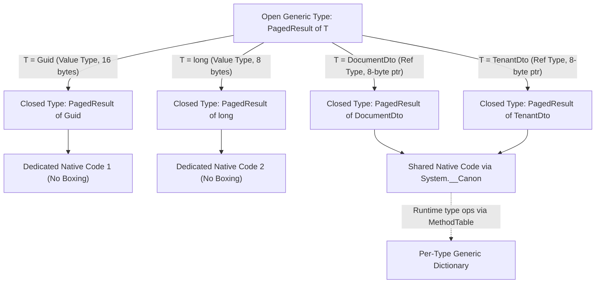
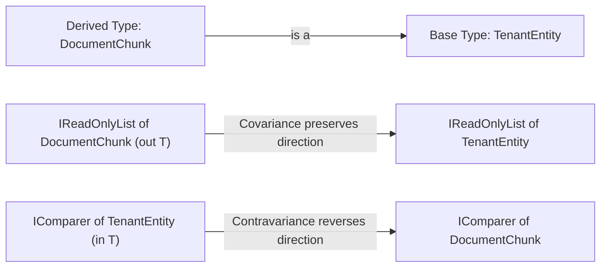

# Chapter 8: Generics, Reflection, and Metaprogramming

## 1. Learning Objectives
By the end of this chapter, you will be able to:
- Explain **Reified Generics**, open vs. closed generic types, static fields per closed type, and how **RyuJIT** specializes value types while sharing **`__Canon`** machine code for reference types.
- Design type-safe APIs using generic constraints (including C# 11+ `static abstract` members and C# 13+ `allows ref struct` anti-constraints) and generic variance (`in` / `out`).
- Diagnose the runtime cost of **Reflection** (metadata parsing, boxing, security checks, and lost JIT inlining) and accelerate unavoidable dynamic code using compiled `Expression` delegates and .NET 8–10 **`[UnsafeAccessor]`**.
- Decorate and inspect metadata cleanly using **Custom Attributes** and C# 11+ **Generic Attributes**, while respecting NativeAOT and trimming constraints.
- Architect high-performance, zero-reflection, AOT-compatible infrastructure using **`IIncrementalGenerator`** and built-in .NET 10 **Source Generators** (`System.Text.Json`, `[LoggerMessage]`, `[GeneratedRegex]`, `[OptionsValidator]`).

## 2. Introduction

Enterprise software relies heavily on reusable infrastructure: Dependency Injection (DI) containers, Object-Relational Mappers (ORMs) like Entity Framework Core, CQRS mediators like MediatR, validation pipelines like FluentValidation, and JSON serializers. These libraries cannot be hardcoded to know about Normora's specific `TenantMembership`, `Document`, `DocumentChunk`, or `ConversationTurn` classes—or any domain entity in another system. They must operate safely and quickly on types they have never seen before.

To achieve this, C# provides three complementary mechanisms across the compile-to-runtime spectrum:
1. **Generics** (compile-time and JIT-time polymorphism): Parameterizing types and methods with `<T>` so the compiler enforces type safety and the Common Language Runtime (CLR) executes specialized machine code.
2. **Reflection** (runtime metaprogramming): Inspecting assembly metadata tables, reading attributes, and invoking members dynamically at runtime when types are not known until the program runs.
3. **Source Generators** (compile-time metaprogramming): Running analyzers inside the Roslyn compiler during the build to emit strongly-typed, zero-reflection C# code before the app ever starts.

In modern .NET 10 and C# 14 systems, the ecosystem has aggressively shifted away from runtime Reflection toward **Generics** and **Incremental Source Generators**—achieving the flexibility of dynamic frameworks without sacrificing throughput, startup latency, or **NativeAOT** (Ahead-Of-Time native binary compilation) compatibility.

## 3. Generics, Reification, and CLR Internals

### What Generics Are and Why Reification Matters
Generics were introduced in C# 2.0. Before generics, reusable containers like `ArrayList` stored everything as `object`, forcing callers to cast on every read and **Box** (heap-allocate a wrapper around) every value type like `int` or `Guid`.

Unlike Java, where generics are implemented via **Type Erasure** (the compiler verifies types, then strips `<T>` away and treats everything as `Object` at runtime), C# generics are **Reified**. **Reification** means the generic type argument is preserved in the compiled **Intermediate Language (IL)** metadata and remains fully known to the CLR at runtime.

```csharp
public class Cache<T>
{
    private readonly Dictionary<string, T> _store = new();

    public void Add(string key, T value) => _store[key] = value;

    public Type StoredType => typeof(T); // Always accurate at runtime because T is reified!
}
```

### Open vs. Closed Generic Types and Static Fields
When you define `Cache<T>` without specifying `T`, it is an **open generic type** (`typeof(Cache<>)`). You cannot instantiate an open generic type directly; you must supply type arguments to create a **closed generic type** (such as `Cache<Guid>` or `Cache<DocumentSummaryDto>`).

> [!IMPORTANT]
> **Every closed generic type gets its own static fields.**
> In the CLR, `MetricCounter<UploadDocumentCommand>.Count` and `MetricCounter<PerformHybridRetrievalQuery>.Count` are two completely independent static memory slots—even though both close over reference types!

### JIT Compilation of Generics: Value Types vs. `__Canon`
When **RyuJIT** (the .NET Just-In-Time compiler) compiles a closed generic type or method, it chooses between two strategies depending on whether `T` is a **Value Type** or a **Reference Type**:

1. **Value Types (`int`, `Guid`, `DateTime`, custom `struct`):**
   Every value type can have a different byte size and memory layout (`int` is 4 bytes; `Guid` is 16 bytes). Therefore, RyuJIT generates a **completely distinct** copy of native machine code for each closed value-type instantiation (`Cache<int>`, `Cache<Guid>`, `Cache<double>`). This guarantees exact CPU register alignment, enables method inlining, and eliminates boxing completely.

2. **Reference Types (`string`, `Document`, `TenantMembership`, `EvCharger`):**
   On a 64-bit OS, every reference type variable is an 8-byte managed pointer. Because the pointer size and calling convention are identical regardless of the class, RyuJIT compiles the native machine code once using an internal placeholder type called **`System.__Canon`** (canonical reference type) and shares that single machine-code body across `Cache<string>`, `Cache<Document>`, `Cache<TenantMembership>`, and `Cache<EvCharger>`.
   To still make `typeof(T)`, `is T`, or `new T()` work accurately inside shared `__Canon` code, the CLR attaches a hidden **Generic Lookup Dictionary** to each closed type's `MethodTable` (type descriptor) and passes a runtime handle when needed.



**Architectural Rule:** Generics are the highest-performing way to write reusable code in C#. Prefer constrained Generics (`where T : class` or `where T : struct`) over `object` or weakly-typed base abstractions so RyuJIT can specialize or devirtualize dispatch.

### Generic Constraints (C# 2 through C# 14)
Without constraints, the compiler assumes `T` only supports `System.Object` members (`ToString`, `Equals`, `GetHashCode`). **Generic constraints** (`where T : ...`) restrict which types a caller can supply, unlocking richer operations at compile time:

| Constraint | Meaning | Primary Use Case |
|---|---|---|
| `where T : class` | Reference type (non-nullable under `#nullable enable`) | DTO envelopes, entities, null-checkable services |
| `where T : struct` | Non-nullable value type (excludes `Nullable<T>`) | Zero-allocation structs, IDs, metrics |
| `where T : notnull` | Non-nullable reference or value type | Dictionary keys, cache keys |
| `where T : unmanaged` | Blittable value type with no managed references | Vector buffers (`pgvector` floats), `Span<byte>` interop |
| `where T : new()` | Must expose a public parameterless constructor | Generic factories (note: emits `Activator.CreateInstance<T>()` unless paired with `static abstract`) |
| `where T : BaseType, IMyInterface` | Must inherit/implement specified contracts | CQRS handlers, domain entities |
| `where T : IMyInterface<T>` | **Curiously Recurring Template Pattern (CRTP)** / `static abstract` | Strongly-typed IDs, `IParsable<T>`, fluent builders |
| `where T : allows ref struct` | **Anti-constraint (C# 13+ / C# 14)**: permits stack-only `ref struct` types such as `Span<T>` | Zero-allocation parsers, streaming tokenizers |

> [!TIP]
> **Why `static abstract` beats `new()` in modern .NET:**
> In older C#, `where T : new()` forced the runtime to invoke `Activator.CreateInstance<T>()` under the hood. Since C# 11, an interface can declare `static abstract T Create(...)`, letting the JIT emit a direct static call with zero reflection overhead!

### Generic Variance: Covariance (`out`) and Contravariance (`in`)
By default, generic types are **invariant**: even though `DocumentUploadedEvent` derives from `DomainEvent`, `List<DocumentUploadedEvent>` is **not** assignable to `List<DomainEvent>` (otherwise someone could call `.Add(new TenantDeletedEvent())` and corrupt the list).

When an interface or delegate only **produces** or only **consumes** `T`, C# lets you declare **variance**:
- **Covariance (`out T`)**: `T` appears only in output/return positions (`IEnumerable<out T>`, `IReadOnlyList<out T>`). Preserves assignment compatibility (`IReadOnlyList<DocumentChunk>` → `IReadOnlyList<object>`).
- **Contravariance (`in T`)**: `T` appears only in input/parameter positions (`IComparer<in T>`, `Action<in T>`, `ICommandHandler<in TCommand>`). Reverses assignment compatibility (`IComparer<object>` → `IComparer<DocumentChunk>`).
- **Invariance (`T`)**: `T` is both read and written (`IList<T>`, `DbSet<T>`). No implicit conversion is allowed.



### When NOT to Use Generics
- **Do not over-abstract EF Core behind `IRepository<T>`:** Wrapping `DocumentsDbContext` or `TenantsDbContext` in a generic `IRepository<T>` hides EF Core capabilities such as `.Include()`, pgvector HNSW distance ordering, and `GroupBy` anonymous projections. Use CQRS handlers directly against the module's private `DbContext`.
- **Avoid exploding value-type permutations on cold paths:** Instantiating huge generic classes across dozens of different `struct` types multiplies JIT native code size and CPU instruction-cache pressure.
- **Do not use `T` when runtime heterogeneity is required:** A heterogeneous list of MCP tools (`IAgentTool`) belongs in an interface collection `IReadOnlyList<IAgentTool>`, not convoluted generic wrappers.

### Real-World Normora Examples: Generics in Action

#### Example 1: `ApiResponse<T>` and `PagedResult<T>` Envelopes in `Normora.Shared`
Normora returns structured JSON envelopes across `Tenants`, `Documents`, and `Conversations`. Because C# generics are reified, `ApiResponse<Guid>` does not box the `Guid`, while `ApiResponse<DocumentSummaryDto>` and `ApiResponse<ConversationSummaryDto>` share `__Canon` native code:

```csharp
namespace Normora.Shared.Models;

public sealed record ApiResponse<T>(
    bool Success,
    T? Data,
    string? Message = null)
{
    public static ApiResponse<T> Ok(T data) => new(true, data);

    // Always uses Normora.Shared.Constants.ApiMessages — never magic strings.
    public static ApiResponse<T> Failure(string message) => new(false, default, message);
}

public sealed record PagedResult<TItem>(
    IReadOnlyList<TItem> Items,
    int Page,
    int PageSize,
    int TotalCount) where TItem : notnull;
```

#### Example 2: Per-Closed-Type Static Metadata in `TenantScopedCacheKey<TResource>`
Each closed generic type has its own static `Prefix` field, computed once per type with zero dictionary lookups on subsequent cache hits in Redis:

```csharp
namespace Normora.Infrastructure.Services.Caching;

public static class TenantScopedCacheKey<TResource> where TResource : class
{
    // Computed once per closed type (e.g., TenantBranding vs TenantMembershipSummary)
    private static readonly string ResourcePrefix = typeof(TResource).Name.ToLowerInvariant();

    public static string ForTenant(Guid tenantId, string key) =>
        $"normora:tenant:{tenantId:N}:{ResourcePrefix}:{key}";
}

// Usage:
// "normora:tenant:...:tenantbranding:theme" vs "normora:tenant:...:tenantrolecache:user42"
```

#### Example 3: Constrained CQRS Pipeline Behavior Across Normora Modules
In Normora's CQRS pipeline, cross-module contracts in `Normora.Shared.Contracts.*` enforce explicit `Guid TenantId` for multi-tenant defense-in-depth. Generic constraints let a single `TenantIsolationBehavior<TRequest, TResponse>` validate every tenant-scoped MediatR request at compile time:

```csharp
using MediatR;
using Normora.Shared.Constants;

namespace Normora.Shared.Contracts;

public interface ITenantScopedRequest
{
    Guid TenantId { get; }
}

public sealed class TenantIsolationBehavior<TRequest, TResponse>(ITenantContext tenantContext)
    : IPipelineBehavior<TRequest, TResponse>
    where TRequest : IRequest<TResponse>, ITenantScopedRequest
{
    public async Task<TResponse> Handle(
        TRequest request,
        RequestHandlerDelegate<TResponse> next,
        CancellationToken cancellationToken)
    {
        if (request.TenantId == Guid.Empty || tenantContext.TenantId != request.TenantId)
        {
            throw new InvalidOperationException(ApiMessages.TenantContextMissing);
        }

        return await next(cancellationToken);
    }
}
```

#### Example 4: `static abstract` Strongly-Typed IDs (C# 11–14)
Using `static abstract` interface members, Normora can build strongly-typed IDs (`TenantId`, `DocumentId`, `ConversationId`) that support generic parsing without `Activator.CreateInstance<T>()` reflection:

```csharp
public interface IStronglyTypedId<TSelf> where TSelf : struct, IStronglyTypedId<TSelf>
{
    Guid Value { get; }
    static abstract TSelf From(Guid value);
}

public readonly record struct DocumentId(Guid Value) : IStronglyTypedId<DocumentId>
{
    public static DocumentId From(Guid value) => new(value);
}

public static class RouteIdParser
{
    // Direct static dispatch by JIT — zero boxing, zero Activator.CreateInstance!
    public static TId ParseOrThrow<TId>(string raw)
        where TId : struct, IStronglyTypedId<TId>
    {
        if (!Guid.TryParse(raw, out var parsed))
        {
            throw new BolaException(); // Mapped globally to 404 Not Found
        }

        return TId.From(parsed);
    }
}
```

#### Example 5: `allows ref struct` Anti-Constraint for Zero-Allocation Chunking (C# 13+ / C# 14)
Before C# 13, a generic method could never accept `ReadOnlySpan<char>` because `ref struct` types cannot live on the managed heap. With `allows ref struct`, `DocumentChunker` can accept stack-only slices in generic helper pipelines:

```csharp
public interface IHeadingVisitor<TContext> where TContext : allows ref struct
{
    void OnHeading(ReadOnlySpan<char> headingText, int level, ref TContext context);
}

public static class MarkdownScanner
{
    public static void ScanLine<TVisitor, TContext>(
        ReadOnlySpan<char> line,
        TVisitor visitor,
        ref TContext context)
        where TVisitor : struct, IHeadingVisitor<TContext>
        where TContext : allows ref struct
    {
        if (line.StartsWith("## "))
        {
            visitor.OnHeading(line[3..], 2, ref context);
        }
    }
}
```

#### Example 6: Contravariant Event Dispatching (`in TEvent`) for Workspace State Sync
Normora synchronizes `dataVersion` across tenants via `IWorkspaceStateSynchronizer`. A contravariant handler interface lets a general audit subscriber handle specific document or membership events seamlessly:

```csharp
public abstract record WorkspaceMutationEvent(Guid TenantId, long DataVersion);
public sealed record DocumentIngestedEvent(Guid TenantId, long DataVersion, Guid DocumentId)
    : WorkspaceMutationEvent(TenantId, DataVersion);

public interface IWorkspaceEventSink<in TEvent> where TEvent : WorkspaceMutationEvent
{
    ValueTask PublishAsync(TEvent evt, CancellationToken ct);
}

// A sink accepting any WorkspaceMutationEvent can satisfy IWorkspaceEventSink<DocumentIngestedEvent>
IWorkspaceEventSink<WorkspaceMutationEvent> globalAuditSink = new AuditWorkspaceSink();
IWorkspaceEventSink<DocumentIngestedEvent> docSink = globalAuditSink; // Valid via 'in'!
```

## 4. Reflection and Runtime Metaprogramming

Reflection allows your code to inspect its own metadata, instantiate objects, and invoke methods dynamically at runtime.

```csharp
public class ChargerConfig
{
    public int MaxKw { get; set; } = 150;
    public void Connect() { Console.WriteLine("Connected"); }
}

// Reflection Example
Type type = typeof(ChargerConfig);
object instance = Activator.CreateInstance(type); // Slower than 'new'

PropertyInfo prop = type.GetProperty("MaxKw");
int maxKw = (int)prop.GetValue(instance); // Very slow!

MethodInfo method = type.GetMethod("Connect");
method.Invoke(instance, null); // Extremely slow!
```

### The Cost of Reflection
Reflection is notoriously slow for three reasons:
1. **Metadata Parsing:** To find a property, the CLR must parse the string `"MaxKw"`, iterate through the assembly's metadata tables, and resolve the member.
2. **Boxing:** Methods like `GetValue` return `object`. If the property is an `int`, the CLR must allocate memory on the heap to Box the value before returning it.
3. **Security and Visibility Checks:** Every time you invoke a method via reflection, the CLR must verify that the caller has permission to invoke it, bypassing JIT inlining completely.

While caching `PropertyInfo` objects helps, invoking them remains significantly slower than direct code execution. 

## 5. Attributes: Decorating Metadata

Attributes allow you to attach custom metadata to classes, properties, or methods. They do nothing on their own; they must be read via Reflection (or Source Generators) to be useful.

```csharp
[AttributeUsage(AttributeTargets.Class)]
public class AuditableAttribute : Attribute { }

[Auditable]
public class PaymentTransaction
{
    public decimal Amount { get; set; }
}
```

An ORM or an Audit logger could use Reflection at startup to find all classes tagged with `[Auditable]` and automatically wire up database triggers.

## 6. Source Generators: The Death of Reflection

Because Reflection is slow and completely breaks Ahead-Of-Time (AOT) compilation (like NativeAOT), Microsoft introduced **Source Generators** in C# 9.0.

A Source Generator is a piece of code that runs *inside the Roslyn compiler during the build process*. It inspects your syntax trees and generates additional C# source code files, which are then compiled into your assembly.

Instead of an ORM using Reflection at runtime to map a database row to an object, a Source Generator writes the exact `reader.GetInt32(0)` mapping code at compile-time.

### Real Production Case Study: Compile-Time Serialization

In our EV Platform, we need to serialize telemetry to JSON. Using standard Reflection-based `JsonSerializer` can cause high CPU overhead on 10,000 requests per second. We will use the modern Source-Generated JSON Serialization.

```csharp
using System.Text.Json.Serialization;

// 1. Define our Domain Record
public record TelemetryPacket(string ChargerId, double Voltage, double Current);

// 2. Define a partial class deriving from JsonSerializerContext.
// The [JsonSerializable] attribute tells the Source Generator to inspect TelemetryPacket.
[JsonSourceGenerationOptions(WriteIndented = false)]
[JsonSerializable(typeof(TelemetryPacket))]
public partial class TelemetryJsonContext : JsonSerializerContext
{
}
```

**What Happens at Compile-Time:**
The Roslyn Source Generator detects the `JsonSerializable` attribute. It writes a hidden C# file containing highly optimized, reflection-free mapping logic specific to `TelemetryPacket`.

**Usage at Runtime:**
```csharp
var packet = new TelemetryPacket("CHG-100", 240.5, 32.1);

// We pass the Source Generated context to the serializer.
// ZERO Reflection is used. Memory allocation is minimized. Speed is equivalent to hardcoded parsing.
string json = JsonSerializer.Serialize(packet, TelemetryJsonContext.Default.TelemetryPacket);
```

## 7. Common Mistakes

| Level | Mistake | Impact | How to Avoid |
|-------|---------|--------|--------------|
| Beginner | Confusing Generics with `object` casting. | Boxing overhead and loss of compile-time type safety. | Use Generics (`List<T>`) instead of legacy collections (`ArrayList`). |
| Intermediate| Using `Activator.CreateInstance` in a loop. | Massive CPU degradation. | Use `new()`, Generics with `where T : new()`, or compiled Expression Trees. |
| Senior | Heavy reliance on Reflection for mapping (e.g., legacy AutoMapper). | High allocation rates and slow execution times. | Switch to Source Generator-based mappers like Mapperly, or write manual mapping methods. |
| Architect | Designing frameworks that rely on dynamic assembly loading (Reflection.Emit). | Incompatible with NativeAOT and iOS deployment. | Always provide a Source Generator alternative for AOT compatibility. |

## 8. Interview Questions

### Beginner Tier (Generics and Reflection Basics)

**1. What are Generics in C#, and why are they useful?**
*Answer:* Generics allow you to define classes, methods, or interfaces with a placeholder for the type (e.g., `<T>`). They provide type safety at compile time, prevent runtime casting errors, and eliminate the need for Boxing value types into `object`.

**2. Give an example of a Generic Collection.**
*Answer:* `List<T>` is the most common generic collection.
*Example:*
```csharp
List<int> numbers = new List<int>(); // 'int' replaces 'T'
numbers.Add(5); // Strongly typed
```

**3. What is Reflection?**
*Answer:* Reflection is the ability of managed code to read its own metadata (types, methods, properties) and invoke them dynamically at runtime. It is heavily used in older frameworks for Dependency Injection (scanning for constructors) and Serialization (JSON/XML).

**4. How do you get the `Type` of an object at runtime?**
*Answer:* You can use the `.GetType()` method on an instance, or the `typeof()` operator on a class name.
*Example:*
```csharp
Type t1 = myObj.GetType();
Type t2 = typeof(string);
```

**5. What is an Attribute in C#?**
*Answer:* An attribute is a declarative tag used to convey metadata to the runtime or compiler. Attributes inherit from `System.Attribute` and are enclosed in square brackets.
*Example:*
```csharp
[Obsolete("Use NewMethod instead")]
public void OldMethod() { }
```

**6. Does applying an Attribute change the behavior of the code?**
*Answer:* No. Attributes are completely passive metadata stored in the assembly. They only affect behavior if another piece of code (like an ORM, a testing framework, or a Source Generator) explicitly searches for them and takes action based on their presence.

**7. Can a method be generic?**
*Answer:* Yes, a single method can be generic even if the class it belongs to is not.
*Example:*
```csharp
public T DoSomething<T>(T item) { return item; }
```

### Intermediate Tier (Generic Constraints and Reification)

**8. Explain Generic Constraints.**
*Answer:* Generic constraints restrict the types that can be substituted for a generic parameter `T`. They are applied using the `where` keyword.
*Example:*
```csharp
// T must be a reference type and have a parameterless constructor
class Factory<T> where T : class, new() { } 
```

**9. What does the `where T : struct` constraint do?**
*Answer:* It ensures that `T` must be a Value Type (like `int`, `DateTime`, or a custom `struct`). It completely prevents the generic class from being instantiated with a Reference Type (like `string` or `object`).

**10. What does the `where T : class` constraint do?**
*Answer:* It ensures that `T` must be a Reference Type (a class, interface, delegate, or array).

**11. Explain why Java Generics (Type Erasure) differ fundamentally from C# Generics (Reified Generics).**
*Answer:* In Java, generics only exist at compile time; at runtime, all generic types are erased and boxed to `Object`, requiring implicit casting. In C#, the runtime is fully aware of generics. The CLR JIT-compiles unique native machine code for every specific Value Type used in a generic, completely eliminating Boxing.

**12. Can you use `typeof(T)` inside a generic method?**
*Answer:* Yes. Because C# Generics are reified, `T` is known at runtime. `typeof(T)` will correctly return the actual runtime type used to instantiate the generic method.

**13. What is `Activator.CreateInstance`?**
*Answer:* A Reflection method used to instantiate an object at runtime when the specific type is only known at runtime (e.g., passed in as a string or a `Type` variable).
*Example:*
```csharp
object myObj = Activator.CreateInstance(typeof(Customer));
```

**14. Why is Reflection considered slow?**
*Answer:* Reflection must parse string-based metadata tables at runtime, bypassing compile-time static analysis. Invoking methods via reflection bypasses JIT inlining, performs heavy security/visibility checks, and often forces value types to be Boxed onto the heap.

### Senior Tier (Advanced Metaprogramming)

**15. How does the JIT compiler optimize Generics for Reference Types?**
*Answer:* While the JIT compiler generates entirely distinct native machine code for each Value Type used in a generic (e.g., `List<int>` vs `List<double>`), it shares the exact same native machine code for ALL Reference Types (e.g., `List<string>` and `List<Customer>`). It does this because all reference types are identical at the machine level (just memory pointers).

**16. What is `MakeGenericType` and why is it dangerous?**
*Answer:* It is a Reflection method used to create a generic type dynamically at runtime.
*Example:* `typeof(List<>).MakeGenericType(typeof(int));`
It is dangerous because it forces the CLR to validate constraints and trigger JIT compilation at runtime. It breaks Ahead-Of-Time (AOT) compilation because the compiler cannot predict which generic types will be dynamically constructed.

**17. How do you invoke a private method using Reflection?**
*Answer:* You use `GetMethod` with specific `BindingFlags`.
*Example:*
```csharp
var method = typeof(MyClass).GetMethod("PrivateMethod", BindingFlags.NonPublic | BindingFlags.Instance);
method.Invoke(myObj, null);
```

**18. What is the Curious Recurring Template Pattern (CRTP) in C#?**
*Answer:* An architectural pattern where a class inherits from a generic base class, passing itself as the generic parameter. It allows the base class to enforce constraints or return strongly-typed instances of the derived class.
*Example:*
```csharp
public abstract class Entity<T> where T : Entity<T> { }
public class User : Entity<User> { }
```

**19. How do you retrieve custom attributes from a class?**
*Answer:* You use the `Attribute.GetCustomAttribute` or `MemberInfo.GetCustomAttributes` methods via Reflection.
*Example:*
```csharp
var attributes = typeof(User).GetCustomAttributes(typeof(TableAttribute), false);
```

**20. What is `Reflection.Emit`?**
*Answer:* A highly advanced namespace that allows you to dynamically generate raw Intermediate Language (IL) opcodes and compile new assemblies, classes, and methods directly into memory at runtime. It is used by dynamic proxies (like Moq or Entity Framework lazy loading proxies).

**21. What happens if you use `Reflection.Emit` in an iOS app or NativeAOT application?**
*Answer:* The application will crash. iOS (due to Apple's security rules) and NativeAOT explicitly forbid JIT compilation and dynamic code generation at runtime. All executable code must exist ahead of time.

### Staff Engineer Tier (Source Generators and AOT)

**22. You are upgrading a core .NET serialization library. How do you eliminate its heavy Reflection overhead?**
*Answer:* I would migrate the library to use C# Source Generators. Instead of parsing the object's properties at runtime via `Type.GetProperties()`, the Source Generator analyzes the Roslyn Syntax Tree during the build process and emits hardcoded, statically typed C# serialization logic. This reduces runtime memory allocation to zero and avoids JIT warmup penalties.

**23. What is a C# Source Generator?**
*Answer:* A piece of code that runs inside the Roslyn compiler during the compilation phase. It inspects the user's syntax trees (code) and generates new C# files that are automatically added to the compilation. It is compile-time metaprogramming.

**24. Can a Source Generator modify existing code?**
*Answer:* No. Source Generators are strictly additive. They can only generate new files or new `partial` classes/methods. They cannot rewrite or delete existing code written by the developer (unlike IL Weaving tools like Fody).

**25. How do Source Generators solve the AOT (Ahead-Of-Time) problem?**
*Answer:* AOT compilers need to know exactly what code to compile before the app runs. If an app uses Reflection to figure out how to serialize a `Customer` object, the AOT compiler doesn't know it needs to generate serialization code for `Customer`. Source Generators emit literal C# code (`writer.WriteString(customer.Name)`) during the build, allowing the AOT compiler to see it and compile it statically.

**26. How do you cache Reflection lookups for performance?**
*Answer:* If you absolutely must use Reflection, never call `GetProperty` in a loop. You should reflect once during startup, build a delegate using `Expression.Lambda.Compile()` or `Reflection.Emit`, and cache that compiled Delegate in a concurrent dictionary. The subsequent calls invoke the delegate at near-native speeds.

**27. Explain the performance impact of `typeof(T)` vs `obj.GetType()`.**
*Answer:* `typeof(T)` is resolved at compile time (or JIT time for generics) and translates to a very fast, direct metadata token lookup. `obj.GetType()` requires reading the MethodTable pointer off the object instance on the heap at runtime. `typeof(T)` is significantly faster and should be preferred when the type is known statically.

### Architect Tier (Framework Design and IL Weaving)

**28. An architect mandates the removal of all `Reflection` in a high-frequency trading application. How do you handle mapping JSON to DTOs without Reflection?**
*Answer:* I would use the new `System.Text.Json` Source Generators. By decorating a `partial` `JsonSerializerContext` class with `[JsonSerializable(typeof(MyDto))]`, Roslyn generates a fully statically-typed JSON parser at compile time, bypassing reflection entirely and achieving zero-allocation parsing using `Utf8JsonReader`.

**29. What is IL Weaving (e.g., PostSharp, Fody)?**
*Answer:* Unlike Source Generators that operate on C# syntax trees, IL Weaving modifies the compiled Intermediate Language (.dll or .exe) *after* compilation but *before* deployment. It is used for Aspect-Oriented Programming (AOP), like automatically injecting logging or `INotifyPropertyChanged` into every property setter. It is powerful but brittle and hard to debug.

**30. Why does heavily using Generics increase the memory footprint of an application?**
*Answer:* Because C# Generics are Reified, the JIT compiler generates unique native machine code for every Value Type permutation. If you create a massive generic math library and instantiate it for `int`, `uint`, `short`, `byte`, `float`, and `double`, the JIT generates six distinct copies of the entire library's machine code, significantly increasing the instruction cache footprint and base memory usage.

**31. How do you design an Extensibility/Plugin system in modern .NET without breaking AOT constraints?**
*Answer:* You cannot use `Assembly.Load` and dynamic Reflection to discover plugins at runtime in NativeAOT. The architect must design a build-time discovery mechanism. A Source Generator can scan the solution for assemblies implementing `IPlugin` and generate a static Registry class that hardcodes the instantiation of those plugins.

**32. Explain the purpose of `ref struct` generic constraints (C# 13+).**
*Answer:* Historically, generics could not accept `ref struct` types (like `Span<T>`) because `ref structs` must live strictly on the stack, and generic variables might be boxed or stored on the heap. C# 13 introduces `allows ref struct` anti-constraints, enabling developers to write high-performance generic parsers that safely operate entirely on `Span<T>` without heap allocation.

**33. How does generic covariance (`out T`) affect internal runtime type checking?**
*Answer:* When you assign an `IEnumerable<Dog>` to an `IEnumerable<Animal>` (covariance), the compiler allows it. However, if dealing with arrays (`Dog[]` to `Animal[]`), it is unsafe because a user might try to insert a `Cat` into the `Animal[]` (which is actually a `Dog[]`). The CLR must inject runtime type checks (ArrayTypeMismatchException checks) on every array insertion to maintain memory safety, degrading performance.

**34. In the context of micro-ORMs like Dapper, how did they achieve high performance before Source Generators existed?**
*Answer:* Dapper reads the SQL result set using DataReader and uses Reflection *exactly once* per type to map column names to properties. It then uses `System.Reflection.Emit` (IL Generation) to build a dynamic method that executes the mapping logic directly. It compiles this IL into a Delegate and caches it. Subsequent queries hit the cached Delegate, running at the speed of hand-written C# mapping code.

## 9. Summary
Generics allow us to write flexible, reusable code that the JIT compiler optimizes perfectly for both Reference and Value types. While Reflection allows for powerful metaprogramming, its runtime cost is too high for the critical hot-paths of enterprise systems. By mastering Source Generators, modern C# architects can push the burden of metaprogramming to the compiler, achieving the flexibility of dynamic code with the raw speed of native C++.

In the next chapter, we will confront the most transformative—and most misunderstood—feature of modern C#: The Asynchronous State Machine (`async`/`await`).
