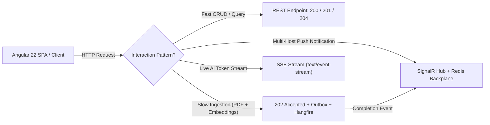

# Chapter 11: ASP.NET Core Fundamentals

## 1. Learning Objectives
By the end of this chapter, you will be able to:
- Understand the architecture of RESTful APIs, HTTP request/response anatomy, status code semantics (`1xx`–`5xx`), safety, idempotency, and when **not** to use synchronous REST.
- Define HTTP endpoints using both **ASP.NET Core Minimal APIs** (with Route Groups and Route Constraints) and **Attribute-Routed `[ApiController]` classes** (Normora's modular monolith pattern).
- Extract and validate data from HTTP requests using **Model Binding** (Route, Query, JSON Body, Headers, `[AsParameters]`, `IFormFile` streaming, and `CancellationToken`), **`System.Text.Json`**, **FluentValidation**, and **RFC 9457 Problem Details**.
- Return compile-time safe, OpenAPI-friendly HTTP responses using **`TypedResults`**, **`IResult`**, **Server-Sent Events (SSE)** in .NET 10, and Normora's BOLA (`404`) / BFLA (`403`) security envelopes.
- Configure **OpenAPI + Scalar** documentation, fail-fast **`IOptions<T>`** configuration, and endpoint-level security fundamentals (Authorization, CORS, Rate Limiting, and Duende BFF endpoints).

## 2. Introduction

In previous chapters, we focused on how C# code runs on the CPU, manages memory, and coordinates asynchronous and concurrent work. But an enterprise application does not exist in a vacuum. It must communicate with external systems—mobile apps, single-page web applications (such as Normora's Angular 22 SPA), background workers, and AI agent clients.

The universal language of modern distributed systems is **HTTP (Hypertext Transfer Protocol)**—a stateless request/response protocol layered over TCP (or QUIC for HTTP/3).
**ASP.NET Core** is the cross-platform, high-performance web framework built into .NET 10 that maps incoming HTTP requests over the network to strongly-typed C# methods in your application.

In Normora, ASP.NET Core serves two complementary roles at the HTTP boundary:
1. **`Normora.Api` (The Host & BFF)**: Hosts the Duende Backend-For-Frontend (BFF) cookie session pipeline, OpenAPI/Scalar documentation (`/scalar/v1`), SignalR hubs, and AG-UI/Minimal API host endpoints.
2. **Decentralized Module Controllers (`Modules/*/API/*Controller.cs`)**: Each bounded context (`Tenants`, `Documents`, `Conversations`) owns its own `[ApiController]` classes and delegates work to MediatR CQRS handlers.

Before we dive into the extreme performance internals of Kestrel, the Middleware pipeline, and Dependency Injection lifetimes in Chapter 12, we must master the HTTP surface: How do we cleanly, safely, and predictably expose our C# logic to the web?

## 3. RESTful API Design and HTTP Semantics

Most modern web services follow **REST (Representational State Transfer)** principles—an architectural style where server capabilities are modeled as **Resources** (such as a `Tenant`, a `Document`, a `DocumentChunk`, a `Conversation`, or an EV `Charger`) identified by **URIs (Uniform Resource Identifiers)** and manipulated through a uniform set of HTTP verbs.

### HTTP Verbs, Safety, and Idempotency
Two critical architectural properties distinguish HTTP methods:
- **Safe**: Calling the method does not modify server state (aside from logging/metrics). Safe methods can be cached and prefetched safely.
- **Idempotent**: Calling the method once or ten times in a row with the same inputs leaves the server in the exact same state (even if the response status code differs, e.g., `200` then `404` on `DELETE`). Idempotency is vital because networks drop packets and clients retry!

| Method | Purpose | Safe? | Idempotent? | Typical Success Status |
|---|---|---|---|---|
| **GET** | Retrieve a resource or collection | Yes | Yes | `200 OK` |
| **HEAD** | Retrieve response headers without a body (e.g., check existence/size) | Yes | Yes | `200 OK` / `204 No Content` |
| **POST** | Create a new resource or trigger a non-idempotent action | No | No | `201 Created` / `202 Accepted` / `200 OK` |
| **PUT** | Completely replace an existing resource (or upsert at a known URI) | No | Yes | `200 OK` / `204 No Content` |
| **PATCH** | Partially update specific fields of an existing resource | No | Usually No* | `200 OK` / `204 No Content` |
| **DELETE** | Remove (or soft-delete) a resource | No | Yes | `204 No Content` / `200 OK` |

*\*Note: A `PATCH` that sets `{ "status": "Archived" }` is idempotent, whereas `{ "incrementRetryCount": 1 }` is not.*

### The Anatomy of an HTTP Request and Response
When a client (like Postman, `curl`, or a web browser) sends a request to your server, it sends structured text over the wire:

```http
POST /api/chargers HTTP/1.1
Host: api.evplatform.com
Content-Type: application/json
Authorization: Bearer xyz123

{
    "id": "CHG-100",
    "maxKw": 150
}
```

Every HTTP message consists of three parts:
1. **Start Line**: Method + Path + HTTP version in a request (`POST /api/chargers HTTP/1.1`), or Version + Status Code + Reason Phrase in a response (`HTTP/1.1 201 Created`).
2. **Headers**: Key-value metadata such as `Content-Type` (format of the body being sent), `Accept` (format the client wants back—used in **Content Negotiation**), `Authorization` (credentials), or `Cookie` (used by Normora's Duende BFF).
3. **Body (Payload)**: Optional bytes (usually JSON, form data, or binary file streams). `GET`, `HEAD`, and `DELETE` requests conventionally do not send a body.

### HTTP Status Code Families
ASP.NET Core communicates outcomes using standardized 3-digit status codes:
- **`2xx` (Success)**: `200 OK` (data returned), `201 Created` (new resource created + `Location` header), `202 Accepted` (queued for background processing, e.g., Hangfire), `204 No Content` (succeeded, intentionally empty body).
- **`3xx` (Redirection)**: `302 Found` / `307 Temporary Redirect` (OIDC login redirects to Keycloak), `304 Not Modified` (cached resource unchanged).
- **`4xx` (Client Error)**:
  - `400 Bad Request` — Malformed JSON or failed validation (`ValidationProblem`).
  - `401 Unauthorized` — Literally means **Unauthenticated**: the client has no valid session cookie or token ("I don't know who you are").
  - `403 Forbidden` — **Authenticated, but unauthorized** ("I know who you are, but you lack the role/permission"). In Normora, this maps to **BFLA (Broken Function Level Authorization)**.
  - `404 Not Found` — Resource does not exist—or in Normora's **BOLA (Broken Object Level Authorization)** defense, the resource exists in another tenant/department and must not be revealed.
  - `409 Conflict` — State conflict (e.g., duplicate department slug or concurrent edit conflict).
  - `429 Too Many Requests` — Rate limit exceeded.
- **`5xx` (Server Error)**: `500 Internal Server Error` (unhandled bug), `502 Bad Gateway` / `503 Service Unavailable` (downstream dependency like PostgreSQL or Gemini unavailable).

### When NOT to Use Synchronous REST Endpoints
A senior architect knows when standard request/response REST is the wrong tool:
- **Long-Running Workflows (seconds to minutes)**: Parsing a 150-page PDF, chunking it, and generating Gemini vector embeddings must **not** block an HTTP request. Return `202 Accepted`, commit a transactional outbox message, process in `Normora.Worker` (Hangfire), and notify via SignalR.
- **One-Way Token Streaming**: Streaming an AI response token-by-token is a poor fit for standard buffered JSON responses; use **Server-Sent Events (SSE)** (`TypedResults.ServerSentEvents`) or SignalR.
- **Internal Cross-Module Calls in a Modular Monolith**: `Conversations` must **not** make HTTP loopback calls to `Documents` over localhost; use in-process MediatR contracts (`PerformHybridRetrievalQuery`).
- **High-Throughput Internal Binary RPC**: For chatty microservice-to-microservice calls with strict latency/bandwidth budgets, prefer **gRPC** (HTTP/2 + Protobuf) over JSON/REST.



### Real-World Normora HTTP Design Examples
1. **Read Document Metadata (`GET`)**: `GET /api/documents/{documentId}` is safe and idempotent. It returns `200 OK` with a `DocumentDetailsDto`, or `404 Not Found` (`BolaException`) if the document belongs to another tenant or restricted department.
2. **Upload Policy Document (`POST` + Async Outbox)**: `POST /api/documents/upload` is non-idempotent. It validates the file, streams bytes to MinIO, saves `Document` + `DocumentProcessingOutboxMessage` atomically, and returns `202 Accepted` with the new document ID so the UI can track ingestion progress.
3. **Update Workspace Currency (`PUT`)**: `PUT /api/subscription/currency` replaces `TenantPlan.Currency` (e.g., `"USD"` -> `"INR"`). Calling it twice with `"INR"` yields the exact same billing state (idempotent) and returns `204 No Content`.
4. **Update Workspace Branding (`PATCH`)**: `PATCH /api/tenants/branding` updates only supplied visual fields (e.g., primary hex color or display name) without wiping the existing logo URL.
5. **Delete Department (`DELETE`)**: `DELETE /api/tenants/departments/{departmentId}` requires workspace admin RBAC (otherwise `403 Forbidden` via `BflaException`). Deleting an already-deleted department does not create side effects (idempotent) and returns `204 No Content` (or `404` if hidden/absent).
6. **Idempotent Conversation Turn (`POST` + Idempotency Key)**: `POST /api/conversations/{conversationId}/messages` accepts an `X-Idempotency-Key` header so mobile/browser retries after a transient Wi-Fi drop do not duplicate the user prompt or re-trigger Gemini tool executions.

Your job as an ASP.NET Core developer is to configure the framework to listen for these HTTP messages, extract and validate the inputs, execute your domain logic, and return accurate, secure HTTP responses.

## 4. Routing and Minimal APIs

Routing is the process of mapping a specific URL (like `/api/chargers`) to a specific block of C# code. 
Since C# 10, the most efficient and readable way to do this is using **Minimal APIs**.

```csharp
using Microsoft.AspNetCore.Builder;

// 1. Initialize the Web Application
var builder = WebApplication.CreateBuilder(args);
var app = builder.Build();

// 2. Define a Route (GET request to the root URL)
app.MapGet("/", () => "Welcome to the EV Platform API!");

// 3. Start listening for incoming HTTP requests
app.Run();
```

If you run this code and navigate to `http://localhost:5000/` in your browser, the ASP.NET Core engine will match the route `/` to the lambda function `() => "Welcome..."` and return the string to the browser.

## 5. Model Binding: Extracting Data

Endpoints usually need data from the client to perform their work. Data can arrive in three primary ways:
1. **Route Parameters:** Embedded directly in the URL path.
2. **Query Strings:** Appended to the end of the URL after a `?`.
3. **Request Body:** Sent as JSON inside a POST or PUT request.

ASP.NET Core uses a feature called **Model Binding** to automatically extract this data and convert it into strongly-typed C# variables.

### Route Parameters
Route parameters are defined using curly braces `{}` in the route template.

```csharp
// URL: GET /api/chargers/CHG-100
app.MapGet("/api/chargers/{id}", (string id) => 
{
    // The framework automatically extracts "CHG-100" and passes it to 'id'
    return $"Fetching details for charger {id}";
});
```

### Query Strings
If a parameter is defined in the C# method signature but is *not* in the route template, ASP.NET Core assumes it comes from the Query String.

```csharp
// URL: GET /api/chargers?region=Europe&isActive=true
app.MapGet("/api/chargers", (string region, bool isActive) => 
{
    // The framework automatically parses the URL and converts 'true' to a boolean!
    return $"Searching chargers in {region}. Active only: {isActive}";
});
```

### JSON Request Bodies
For complex data, clients send JSON in the HTTP Body. You simply define a C# `class` or `record`, and pass it as a parameter. The framework will automatically deserialize the JSON.

```csharp
public record CreateChargerDto(string Id, decimal MaxKw);

// URL: POST /api/chargers
// Body: { "id": "CHG-200", "maxKw": 50 }
app.MapPost("/api/chargers", (CreateChargerDto newCharger) => 
{
    // 'newCharger' is a fully instantiated C# object
    Console.WriteLine($"Saving charger {newCharger.Id} to database...");
    
    return "Charger created successfully.";
});
```

## 6. Returning JSON and Status Codes

Returning plain strings is not enough for an API. You must return structured data (usually JSON) and appropriate HTTP Status Codes (e.g., 200 OK, 404 Not Found, 400 Bad Request).

ASP.NET Core uses the static `Results` class, which implements the `IResult` interface, to format responses correctly.

```csharp
app.MapGet("/api/chargers/{id}", (string id) => 
{
    if (id != "CHG-100")
    {
        // Generates an HTTP 404 Not Found response
        return Results.NotFound(new { Error = "Charger does not exist." });
    }

    // Creating an anonymous C# object
    var chargerData = new { Id = id, Status = "Online", MaxKw = 150 };

    // Generates an HTTP 200 OK response, and automatically serializes the object to JSON
    return Results.Ok(chargerData);
});
```

## 7. Real Production Case Study: EV Configuration API

Let's combine everything into a realistic segment of our EV Platform. We will create an API to manage the configuration of a specific charger. We will use asynchronous programming (`await`), routing, model binding, and proper status codes.

```csharp
using Microsoft.AspNetCore.Builder;
using Microsoft.AspNetCore.Http;
using System.Threading.Tasks;

var builder = WebApplication.CreateBuilder(args);
var app = builder.Build();

// Mock database dictionary
var _database = new System.Collections.Concurrent.ConcurrentDictionary<string, ChargerConfig>();

// GET: Retrieve configuration
app.MapGet("/api/v1/chargers/{id}/config", async (string id) =>
{
    // Simulate async database I/O
    await Task.Delay(50); 

    if (_database.TryGetValue(id, out var config))
    {
        return Results.Ok(config); // HTTP 200 with JSON payload
    }
    
    return Results.NotFound(); // HTTP 404
});

// PUT: Update or Create configuration
app.MapPut("/api/v1/chargers/{id}/config", async (string id, ChargerConfig newConfig) =>
{
    // Validation
    if (newConfig.MaxAmpLimit <= 0)
    {
        return Results.BadRequest(new { Error = "Amps must be greater than zero." }); // HTTP 400
    }

    await Task.Delay(50); // Simulate DB Write
    
    _database[id] = newConfig;

    // HTTP 204 No Content (Standard for successful PUT requests that don't return data)
    return Results.NoContent(); 
});

app.Run();

// Domain Record
public record ChargerConfig(string FirmwareVersion, int MaxAmpLimit);
```

## 8. Common Mistakes

| Level | Mistake | Impact | How to Avoid |
|-------|---------|--------|--------------|
| Beginner | Returning `null` from an endpoint when data isn't found. | Client receives an HTTP 200 OK with an empty body, causing parsing errors. | Explicitly return `Results.NotFound()` when an entity does not exist. |
| Intermediate| Trying to read the Request Body twice. | Exception thrown. The request body is a forward-only stream. | Let Model Binding handle the body extraction into a C# object, and pass that object around. |
| Senior | Putting try/catch blocks in every single endpoint. | Massive code duplication. | Use global Exception Handling Middleware (covered in Chapter 12) to catch errors and return HTTP 500 automatically. |
| Architect | Exposing internal Database Entities (EF Core classes) directly in the API return. | Leaking sensitive schema data (like passwords or internal IDs) to the public internet. | Always map Database Entities to Data Transfer Objects (DTOs) before returning them via `Results.Ok()`. |

## 9. Interview Questions

### Beginner Tier (HTTP and REST Basics)

**1. What are the most common HTTP Verbs and their purposes in a RESTful API?**
*Answer:* `GET` retrieves data (read-only). `POST` creates new data. `PUT` replaces existing data completely. `PATCH` applies partial updates. `DELETE` removes data.

**2. What is a URI / URL?**
*Answer:* A Uniform Resource Identifier/Locator is the address used to identify a specific resource on the internet (e.g., `https://api.example.com/v1/users/5`).

**3. What does an HTTP 200 status code mean?**
*Answer:* OK. The request was successful, and the response body contains the requested data.

**4. What does an HTTP 404 status code mean?**
*Answer:* Not Found. The server could not find the requested resource (e.g., querying for a User ID that doesn't exist).

**5. What is the difference between a 401 and a 403 status code?**
*Answer:* 401 Unauthorized means "I don't know who you are" (missing or invalid login token). 403 Forbidden means "I know who you are, but you don't have permission to do this" (e.g., a standard user trying to delete an admin).

**6. What is the HTTP Request Body?**
*Answer:* The body is the payload of the request. It is typically used in POST and PUT requests to send complex data (usually formatted as JSON) to the server. GET requests typically do not have a body.

**7. How do you start a basic ASP.NET Core application?**
*Answer:* By creating a `WebApplicationBuilder`, building the `WebApplication`, mapping routes, and calling `.Run()`.
*Example:*
```csharp
var app = WebApplication.CreateBuilder(args).Build();
app.MapGet("/", () => "Hello");
app.Run();
```

### Intermediate Tier (Minimal APIs and Model Binding)

**8. What are Minimal APIs in ASP.NET Core?**
*Answer:* Introduced in .NET 6, Minimal APIs are a lightweight syntax for defining HTTP endpoints without the overhead of creating Controller classes. You map routes directly to lambda functions or local methods.

**9. How does Model Binding work in ASP.NET Core?**
*Answer:* Model Binding is the process where ASP.NET Core inspects an incoming HTTP Request (the URL route, Query Strings, and JSON body) and automatically converts those raw strings into strongly typed C# variables and objects to pass into the endpoint delegate.

**10. How do you extract a parameter from the URL route?**
*Answer:* Define the parameter name in curly braces in the route template, and add a matching parameter to the delegate signature.
*Example:*
```csharp
app.MapGet("/users/{id}", (int id) => $"User {id}");
```

**11. How do you extract a Query String parameter?**
*Answer:* If a parameter in the delegate signature does not match a route parameter in the curly braces, ASP.NET Core automatically assumes it comes from the Query String.
*Example:*
```csharp
// Matches: /search?term=apple
app.MapGet("/search", (string term) => $"Searching {term}");
```

**12. Why should you return an HTTP 204 No Content instead of HTTP 200 OK after a successful PUT or DELETE request?**
*Answer:* HTTP 204 explicitly tells the client that the operation succeeded but there is no JSON payload to parse in the response body. Returning a 200 OK with an empty body can cause client-side JSON parsers to throw exceptions.

**13. What is the `IResult` interface used for?**
*Answer:* It represents the outcome of an HTTP endpoint. Using the static `Results` class (e.g., `Results.Ok()`, `Results.NotFound()`), you can easily return structured data along with specific HTTP status codes.

**14. Can Minimal APIs handle asynchronous operations?**
*Answer:* Yes. You simply mark the lambda delegate as `async` and return a `Task` or `Task<IResult>`.
*Example:*
```csharp
app.MapGet("/data", async () => await db.GetDataAsync());
```

### Senior Tier (Idempotency and Advanced Routing)

**15. Explain the concept of Idempotency in HTTP verbs.**
*Answer:* An operation is idempotent if executing it multiple times produces the exact same result as executing it once. `GET`, `PUT`, and `DELETE` are defined as idempotent. `POST` is NOT idempotent (calling it twice creates two resources).

**16. Explain the difference between `PUT` and `PATCH`.**
*Answer:* `PUT` implies replacing the entire resource. If a User has 10 fields and you `PUT` an object with only 1 field, the other 9 fields should technically be set to null. `PATCH` implies a partial update; it only modifies the specific fields included in the request payload.

**17. What is Route Constraint filtering in ASP.NET Core?**
*Answer:* Route constraints restrict how a route is matched based on the data type or value of the route parameter. If the constraint fails, it returns a 404 instead of throwing a parsing exception.
*Example:*
```csharp
app.MapGet("/users/{id:int:min(1)}", (int id) => "Valid ID");
```

**18. Explain the difference between `IResult` and throwing Exceptions for flow control.**
*Answer:* Throwing exceptions (like a `ValidationException`) is extremely slow because it requires the CLR to capture the stack trace. Exceptions should be for *exceptional* (unexpected) failures. For expected business failures (like a missing ID or invalid data), you should return a specific `IResult` (like `Results.NotFound()` or `Results.BadRequest()`), which executes instantly without stack unwinding.

**19. How do you read custom HTTP Headers in a Minimal API?**
*Answer:* You can use the `[FromHeader]` attribute in the delegate signature.
*Example:*
```csharp
app.MapGet("/data", ([FromHeader(Name = "X-Tenant-ID")] string tenant) => tenant);
```

**20. What is Content Negotiation?**
*Answer:* The process where the client and server agree on the format of the data being exchanged. The client sends an `Accept: application/json` or `Accept: application/xml` header, and the server serializes the response into that format (though Minimal APIs default heavily to JSON).

**21. How do you implement CORS (Cross-Origin Resource Sharing)?**
*Answer:* Browsers block requests from one domain (e.g., your React app) to another domain (e.g., your API) for security. You must configure CORS middleware in the ASP.NET Core pipeline to explicitly allow specific origins, methods, and headers.

### Staff Engineer Tier (Validation and DTOs)

**22. Why is it an architectural anti-pattern to return EF Core database entities directly from an endpoint?**
*Answer:* Returning internal database models couples your public API contract to your private database schema. If you rename a database column, you instantly break all mobile clients. Furthermore, it often leaks sensitive data (passwords) and causes lazy-loading serialization loops. Always map database entities to specific Data Transfer Objects (DTOs).

**23. How do you handle Validation in Minimal APIs?**
*Answer:* Unlike legacy MVC which had built-in `ModelState.IsValid` for data annotations, Minimal APIs require third-party libraries like `FluentValidation`. You configure an Endpoint Filter that intercepts the request, runs the validator, and immediately returns a `Results.ValidationProblem()` (HTTP 400) if validation fails, keeping the endpoint logic clean.

**24. What is an Endpoint Filter in .NET 7+?**
*Answer:* A way to intercept the execution of a Minimal API endpoint (similar to Action Filters in MVC). It allows you to run code before and after the endpoint executes. It is perfect for logging, validation, or transaction management.
*Example:*
```csharp
app.MapGet("/route", () => "Data").AddEndpointFilter(async (context, next) => {
    // Before
    var result = await next(context);
    // After
    return result;
});
```

**25. How do you safely accept an `IFormFile` (file upload) in a Minimal API?**
*Answer:* ASP.NET Core supports binding `IFormFile` directly. However, staff engineers must configure limits on multipart body length and read the file stream asynchronously to a temporary file on disk, rather than buffering it entirely in memory (which would cause the server to crash on large uploads).

**26. Explain the `[AsParameters]` attribute.**
*Answer:* If an endpoint has 10 query string parameters, the method signature becomes unreadable. You can create a struct containing those 10 properties, decorate the parameter with `[AsParameters]`, and the framework will bind the query strings directly to the struct properties, keeping the signature clean.

**27. What is Problem Details (RFC 7807)?**
*Answer:* A standardized JSON format for returning error details from HTTP APIs. Instead of returning a random string for an error, you return a structured JSON object containing `type`, `title`, `status`, and `detail`. ASP.NET Core natively supports this via `Results.Problem()`.

### Architect Tier (API Evolution and Scaling)

**28. How do you implement API Versioning for Minimal APIs?**
*Answer:* Architects must anticipate breaking changes. Using the `Asp.Versioning.Http` package, you define `ApiVersionSet`s and apply them to endpoints.
*Example:*
```csharp
var versionSet = app.NewApiVersionSet().HasApiVersion(1, 0).HasApiVersion(2, 0).Build();
app.MapGet("/data", () => "V1").WithApiVersionSet(versionSet).MapToApiVersion(1, 0);
```

**29. What are the architectural differences between Minimal APIs and traditional MVC Controllers?**
*Answer:* MVC Controllers use heavy Reflection at runtime to discover routes and instantiate controller classes per request. Minimal APIs map delegates directly into the routing tree during startup. This eliminates reflection, avoids class instantiation overhead, significantly reduces startup time, lowers memory allocation, and makes the application compatible with NativeAOT compilation.

**30. How do you prevent "Over-Posting" (Mass Assignment) vulnerabilities?**
*Answer:* Over-posting occurs when a client sends JSON properties that shouldn't be modifiable (e.g., `{"id": 5, "name": "Bob", "isAdmin": true}`). If you bind the JSON directly to a Database Entity, the user just made themselves an admin. Architects prevent this by strictly using minimal DTOs (`CreateUserRequest`) that only contain exactly the fields the client is allowed to send.

**31. Explain how to architect an API for Idempotent POST operations.**
*Answer:* Because POST is not idempotent, network retries (e.g., due to a dropped mobile connection) can cause duplicate charges (e.g., processing a payment twice). The architect requires the client to send a unique `X-Idempotency-Key` header. The server checks a fast distributed cache (Redis); if the key exists, it returns the cached response of the original request without re-executing the payment logic.

**32. What is Rate Limiting and how is it configured in .NET?**
*Answer:* Rate limiting prevents a single tenant or IP address from DDOSing the API. ASP.NET Core provides built-in rate limiting middleware (Token Bucket, Fixed Window, Concurrency limits). The architect configures policies at startup and applies them to specific endpoints via `.RequireRateLimiting("PolicyName")`.

**33. How does gRPC compare to REST for internal microservice communication?**
*Answer:* REST (HTTP/1.1 + JSON) is human-readable and universal but requires heavy text parsing and large payload sizes. gRPC uses HTTP/2 multiplexing and Protocol Buffers (binary serialization). gRPC is vastly faster, uses less CPU, and provides strongly-typed contracts, making it the architectural standard for *internal* microservice-to-microservice communication, while REST remains the standard for *public* external APIs.

**34. Explain the impact of Connection Pooling (Keep-Alive) on API scalability.**
*Answer:* Opening a new TCP/TLS connection for every HTTP request is extremely slow due to the 3-way handshake. HTTP/1.1 uses `Keep-Alive` to pool connections. If an architect places an L4 Load Balancer in front of the API, connections might live forever, causing uneven load distribution across API pods. The architect must configure the server (or client) to recycle connections periodically to balance the load.

## 10. Summary
In this chapter, we bridged the gap between C# logic and the web. We learned how to map URLs to C# delegates using Minimal APIs, how to automatically extract JSON payloads using Model Binding, and how to respond with correct HTTP Status Codes. 

This is the high-level, developer-friendly face of ASP.NET Core. But beneath this elegant syntax is an incredibly complex, high-performance engine. In the next chapter, we will strip away the magic and look at the underlying Architecture and Internals: Kestrel, Middleware pipelines, and the Dependency Injection container.
