# Python & FastAPI for AI Architects: The Complete Normora Masterclass

**Target Audience:** Absolute beginners to Python who want to master Python from scratch and advance all the way to building enterprise AI architectures.  
**Domain Project:** **Normora** (Enterprise Multi-Tenant Knowledge Management & AI Platform).  
**Core Technologies:** Python 3.12+, FastAPI, Pydantic v2, Asyncio, PostgreSQL + `pgvector`, Cloud LLMs (Google Gemini Flash, OpenAI), Vercel AI SDK, CopilotKit, Angular 22 Client.  

---

## Complete Course Syllabus: Zero to Architect

```mermaid
flowchart TD
    subgraph Part1["Part I: Python Fundamentals (Zero to Fluent)"]
        M1["Module 1: Python Basics, Variables & Primitive Types"]
        M2["Module 2: Conditionals, Booleans & Decision Logic"]
        M3["Module 3: Data Structures (Lists, Tuples, Dictionaries, Sets)"]
        M4["Module 4: Loops, Iteration & Comprehensions"]
        M5["Module 5: Functions, Parameters (*args, **kwargs) & Scope"]
        M6["Module 6: Object-Oriented Programming (Classes, self, Inheritance)"]
        M7["Module 7: Error Handling, Exceptions & File I/O"]
        M8["Module 8: Modern Static Type Hints & Structural Typing"]
    end

    subgraph Part2["Part II: Advanced Python & Concurrency"]
        M9["Module 9: Decorators, Context Managers & Dunder Methods"]
        M10["Module 10: Asynchronous Python (async/await, Event Loop)"]
        M11["Module 11: CPython Internals & High-Throughput Memory Architecture"]
    end

    subgraph Part3["Part III: Data Contracts & Web Architecture with FastAPI"]
        M12["Module 12: Data Validation with Pydantic v2 (Rust Engine)"]
        M13["Module 13: FastAPI Architecture, Routing & Request Handling"]
        M14["Module 14: Dependency Injection (Depends) & Security (BOLA/BFLA)"]
        M15["Module 15: Async Database Persistence (SQLAlchemy 2.0 & pgvector)"]
    end

    subgraph Part4["Part IV: Real-Time Protocols & AI Application Systems"]
        M16["Module 16: Streaming Protocols & Server-Sent Events (SSE)"]
        M17["Module 17: Production Hybrid RAG (Embeddings, Ingestion, Citations)"]
        M18["Module 18: Agentic Workflows & Tool Calling (ReAct Loop)"]
        M19["Module 19: Frontend AI Protocols (Vercel AI SDK & CopilotKit)"]
        M20["Module 20: Agent-to-UI (A2UI) Generative Component Streaming"]
        M21["Module 21: Production Hardening, Tracing & Deployment"]
    end

    Part1 --> Part2 --> Part3 --> Part4
```

---

## Detailed Module Breakdown

### Part I: Python Fundamentals (Zero to Fluent)

#### Module 1: Python Basics, Variables & Primitive Types
*   How Python executes code: The interactive REPL vs. executing `.py` scripts.
*   Variables & Assignment: Dynamically typed variables, naming conventions (`snake_case`).
*   Primitive Types: `int` (integers), `float` (decimals), `str` (strings), `bool` (`True`/`False`), `NoneType` (`None`).
*   String Mastery: String concatenation, slicing, string methods (`lower()`, `strip()`, `replace()`), and f-strings (`f"Tenant: {tenant_name}"`).
*   Arithmetic & Operators: `+`, `-`, `*`, `/`, `//` (floor division), `%` (modulo), `**` (exponentiation).
*   Console I/O: Printing formatted output (`print()`) and receiving console inputs (`input()`).
*   *Normora Exercise:* Building a tenant billing & token cost estimator script.

#### Module 2: Conditionals, Booleans & Decision Logic
*   Boolean Logic & Truthiness: What counts as `True` or `False` in Python (`0`, `""`, `[]`, `None` evaluate to `False`).
*   Comparison Operators: `==` (equals), `!=` (not equals), `>`, `<`, `>=`, `<=`.
*   Identity vs Equality: `==` (value comparison) vs `is` (memory address comparison), checking `if tenant is None:`.
*   Control Flow: `if`, `elif`, and `else` blocks.
*   Logical Operators: `and`, `or`, `not`, short-circuit evaluation.
*   Ternary Expressions: One-line conditional assignments (`status = "active" if is_paid else "suspended"`).
*   Pattern Matching: Modern Python `match` / `case` statements.
*   *Normora Exercise:* Tenant access-control gate evaluating subscription tiers and departmental roles.

#### Module 3: Core Data Structures (Lists, Tuples, Dictionaries, Sets)
*   **Lists (`list`):** Ordered, mutable collections. Appending, inserting, popping, slicing (`items[1:3]`), and sorting.
*   **Tuples (`tuple`):** Ordered, immutable records. Tuple packing, unpacking (`tenant_id, name = ("t-1", "Acme")`).
*   **Dictionaries (`dict`):** Key-value hash maps. Accessing keys, `.get()` with default values, updating, iterating over keys and values.
*   **Sets (`set`):** Unordered, unique collections. Set operations: union (`|`), intersection (`&`), difference (`-`), deduplication.
*   Mutability Pitfalls: The difference between mutating an existing list in-place vs. creating a copy.
*   *Normora Exercise:* Managing an in-memory registry of tenants, users, and document chunk IDs.

#### Module 4: Loops & Iteration
*   `for` Loops: Iterating over lists, tuples, dictionaries, and strings.
*   Generating Sequences: The `range(start, stop, step)` function.
*   Iteration Utilities: `enumerate()` (getting index and value together), `zip()` (looping over multiple lists in parallel).
*   `while` Loops: Loop conditions, infinite loops, and termination criteria.
*   Loop Control: `break` (exit early), `continue` (skip iteration), and the `else` clause in loops.
*   List, Dict, and Set Comprehensions: Elegant and performant collection transformations.
*   *Normora Exercise:* Filtering and transforming raw document chunks into formatted citations.

#### Module 5: Functions, Parameters & Scoping
*   Defining Functions: `def function_name(param1, param2):`.
*   Arguments & Parameters: Positional arguments, keyword arguments, and default parameter values.
*   Arbitrary Arguments: `*args` (variable positional arguments) and `**kwargs` (variable keyword arguments / dictionary unpacking).
*   Return Values: Returning single values, multiple values (tuples), or `None`.
*   Variable Scope (`LEGB` Rule): Local, Enclosing, Global, and Built-in scopes; the `global` keyword.
*   Lambda Functions: Anonymous one-line functions (`lambda x: x.token_count`).
*   Docstrings: Documenting functions using Google/Sphinx style.
*   *Normora Exercise:* Writing a modular document preprocessing and chunking utility.

#### Module 6: Object-Oriented Programming (OOP) from Scratch
*   Classes and Instances: The blueprint (`class`) vs the object instance.
*   The Constructor (`__init__`) and `self`: Understanding what `self` represents.
*   Instance Attributes vs Class Attributes.
*   Methods: Instance methods, `@classmethod` (factory constructors), and `@staticmethod`.
*   Encapsulation: Public attributes vs private conventions (`_protected`, `__private` name mangling).
*   Inheritance: Creating child classes, calling the parent with `super().__init__()`.
*   Polymorphism: Overriding methods in subclasses.
*   *Normora Exercise:* Building domain models: `BaseEntity`, `Tenant`, `Department`, and `DocumentChunk`.

#### Module 7: Error Handling, Exceptions & File I/O
*   What is an Exception? Syntax errors vs runtime exceptions.
*   The `try` / `except` / `else` / `finally` pipeline.
*   Catching specific exceptions: `ValueError`, `KeyError`, `IndexError`, `TypeError`.
*   Raising Exceptions: The `raise` statement.
*   Creating Custom Exception Hierarchies: Designing `NormoraException`, `BolaException` (404), and `BflaException` (403).
*   File Operations: Opening, reading, and writing files safely.
*   The `with` statement: Automatic resource management (Context Managers).
*   JSON Processing: Parsing and dumping JSON with the built-in `json` module.
*   *Normora Exercise:* Building a robust configuration file parser with custom exception handling.

#### Module 8: Modern Static Type Hints & Protocols
*   Why Types Matter in Python: From dynamic duck typing to compile-time safety with `mypy`.
*   Basic Annotations: `name: str`, `age: int`, `is_active: bool`.
*   Container Types: `list[str]`, `dict[str, Any]`, `tuple[int, str]`.
*   Optional Values & Unions: `str | None` (Python 3.10+) vs `Optional[str]`, `Union[int, float]`.
*   Type Aliases & `Literal`: Restricting inputs to specific strings (`Literal["free", "pro", "enterprise"]`).
*   Generics: `TypeVar`, `Generic[T]` for reusable data structures.
*   Structural Subtyping (`typing.Protocol`): Defining interface contracts without inheritance (Python's equivalent to C# interfaces).
*   *Normora Exercise:* Defining strict interface contracts for embedding generators and storage adapters.

---

### Part II: Advanced Python & Concurrency

#### Module 9: Decorators, Context Managers & Dunder Methods
*   Python's Special "Dunder" Methods: `__str__`, `__repr__`, `__eq__`, `__len__`, `__getitem__`.
*   Decorators Explained: Functions that wrap other functions, `@functools.wraps`.
*   Building Real Decorators: Timing execution, logging, and permission enforcement.
*   Context Managers from Scratch: Implementing `__enter__` and `__exit__`.
*   The `@contextmanager` decorator from `contextlib`.

#### Module 10: Asynchronous Python (`async` / `await` & Event Loop)
*   Synchronous vs Asynchronous: Why thread-per-request fails for slow I/O.
*   The Event Loop: How non-blocking I/O multiplexing works.
*   `async def` and `await`: Coroutines vs Functions.
*   Running Concurrent Operations: `asyncio.gather()`, `asyncio.TaskGroup`.
*   Async Generators: `async for` and `async def` with `yield` (token streaming engine).
*   The Deadly Trap: Blocking the event loop with synchronous calls and how to fix it (`asyncio.to_thread`).

#### Module 11: CPython Internals & High-Throughput Memory Architecture
*   CPython bytecode inspection (`dis`).
*   The `PyObject` C struct, heap allocations, and pointer mechanics.
*   Reference counting (`ob_refcnt`) vs Generational Cyclic GC.
*   The Global Interpreter Lock (GIL) and why hosted LLM API streaming runs at maximum speed.
*   Optimizing memory with `__slots__` for millions of document chunk objects.

---

### Part III: Data Contracts & Web Architecture with FastAPI

#### Module 12: Data Validation with Pydantic v2 (Rust Engine)
*   `BaseModel`, fields, type coercion, and schema generation.
*   `Field` configurations: validations, defaults, regex patterns, descriptions.
*   Validation pipeline: `@field_validator` and `@model_validator`.
*   Serialization: `.model_dump()`, `.model_dump_json()`, camelCase/snake_case aliases.
*   Discriminated Unions: Polymorphic payload handling for AI tool calls.
*   Settings management: `pydantic-settings` and `.env` loading.

#### Module 13: FastAPI Architecture, Routing & Request Handling
*   The ASGI Standard: How Uvicorn and FastAPI interact.
*   Building your first API: `@app.get()`, `@app.post()`, `@app.put()`, `@app.delete()`.
*   Path Parameters, Query Parameters, and Request Bodies.
*   Status codes and response models.
*   Standardizing API response envelopes across Normora endpoints.

#### Module 14: Dependency Injection (`Depends`) & Security (BOLA/BFLA)
*   How FastAPI's DI system works: Hierarchical resolution graphs.
*   Extracting Tenant Context: Multi-tenant request isolation.
*   Generator Dependencies: Managing scoped async database sessions with `yield`.
*   Implementing BOLA (`BolaException` -> 404) and BFLA (`BflaException` -> 403) security middleware.

#### Module 15: Async Database Persistence (SQLAlchemy 2.0 & pgvector)
*   Modern SQLAlchemy 2.0: Declarative models with `Mapped` and `mapped_column`.
*   Async engine setup: `create_async_engine`, `asyncpg`, connection pooling.
*   Multi-tenant database design: Tenant-scoped queries.
*   Alembic database migrations.
*   Vector persistence with `pgvector`: `Vector(768)` columns, HNSW index generation.

---

### Part IV: Real-Time Protocols & AI Application Systems

#### Module 16: Streaming Protocols & Server-Sent Events (SSE)
*   HTTP Chunked Transfer Encoding.
*   Server-Sent Events (SSE) protocol specification (`event:`, `data:`).
*   FastAPI `StreamingResponse` with asynchronous generators.
*   Handling client disconnects (`request.is_disconnected()`) to abort cloud LLM billing.

#### Module 17: Production Hybrid RAG (Embeddings, Ingestion, Citations)
*   Document ingestion: Parsing documents and recursive semantic chunking.
*   Vector embeddings: Calling Google Gemini (`text-embedding-004`) / OpenAI APIs.
*   Hybrid Retrieval: Combining semantic vector search (`pgvector` HNSW) with keyword search (PostgreSQL full-text) via Reciprocal Rank Fusion (RRF).
*   Grounded generation: Prompt templating, citation generation, and source verification.

#### Module 18: Agentic Workflows & Tool Calling (ReAct Loop)
*   The ReAct Pattern: Reasoning and Acting.
*   Tool Calling: Generating OpenAPI JSON schemas from Pydantic models.
*   The Agent Execution Loop: Invoking cloud LLM, detecting tool calls, executing Python tools (`SearchCompanyDocumentsTool`), and returning output.
*   Human-in-the-Loop (HITL) pause-and-resume workflows.

#### Module 19: Frontend AI Protocols (Vercel AI SDK & CopilotKit)
*   Vercel AI SDK Data Stream Protocol: Wire format (`0:"text"`, `9:{"tool_call"}`).
*   Building a FastAPI SSE endpoint compatible with Angular/React `useChat()`.
*   CopilotKit Remote Action endpoint: Registering actions, state hydration, and execution.

#### Module 20: Agent-to-UI (A2UI) Generative Component Streaming
*   Generative UI principles: Streaming structured JSON component specs instead of plain text.
*   Defining UI component catalogs (e.g., `DocumentSummaryCard`, `DepartmentMembersTable`).
*   Progressive component rendering on the frontend.

#### Module 21: Production Hardening, Tracing & Deployment
*   Security: JWT authentication, API keys, rate limiting.
*   Observability: OpenTelemetry distributed tracing across routes and LLM spans.
*   Docker containerization: Multi-stage slim builds, non-root users, Uvicorn worker tuning.
