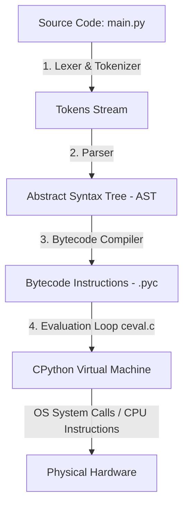
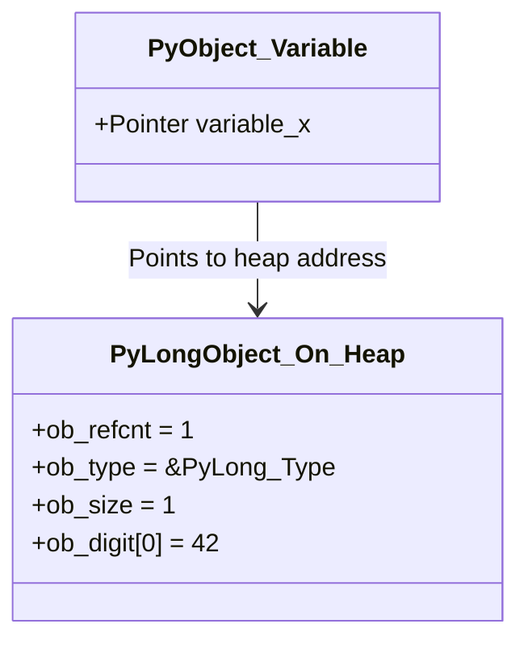
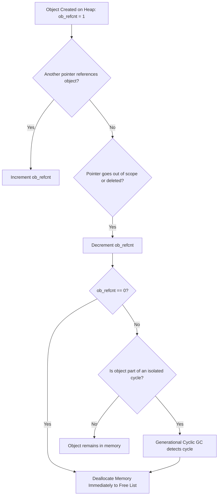
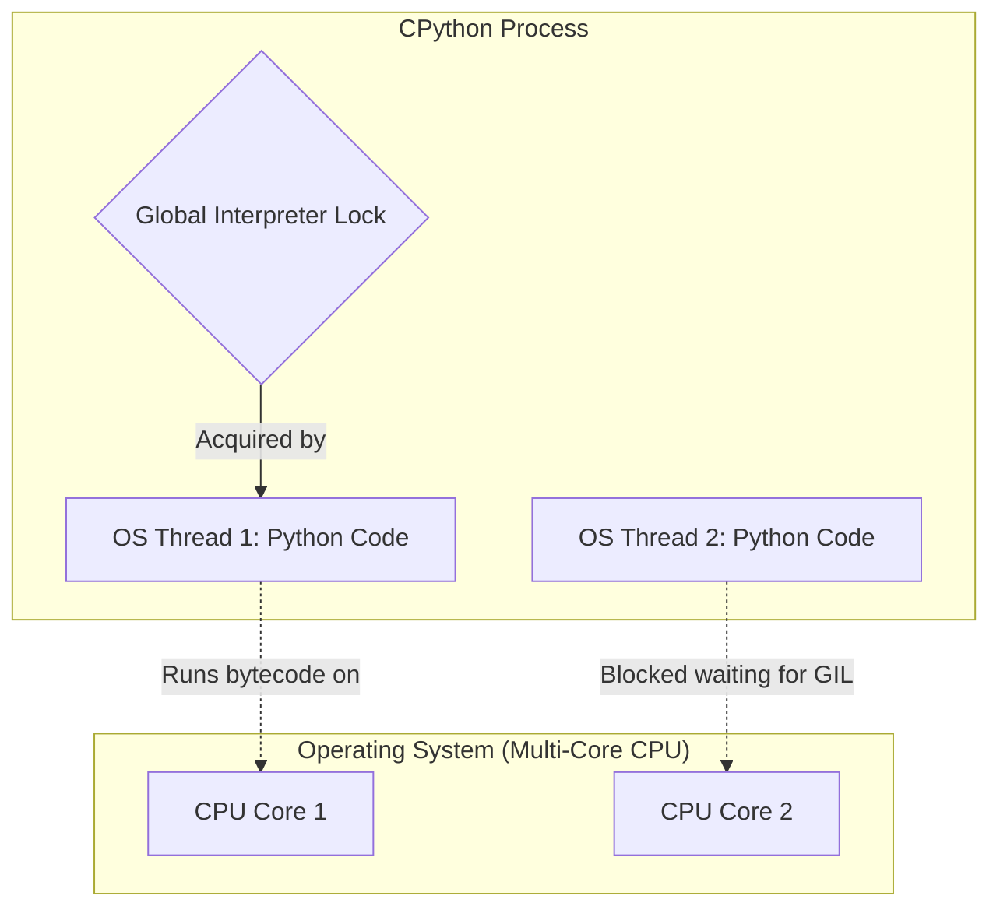

# Module 1: The Python Runtime, CPython Internals & Execution Model

Welcome to the first module of **Python & FastAPI for AI Architects**. 

To design, optimize, and debug high-performance AI backends—which routinely handle thousands of concurrent streaming connections and multi-second I/O wait times—you cannot treat Python as merely a high-level scripting language. An architect must understand the exact physical reality of what happens when the computer executes your code.

In this module, we start from absolute zero, dismantling the CPython execution engine, memory model, and concurrency mechanics from first principles.

---

## 1. The Myth of the "Interpreted Language"

A common beginner misconception is: *"Python is an interpreted language, while C# and C++ are compiled languages."*

This is architecturally inaccurate. **Python is a compiled language.** It simply compiles just-in-time before execution, rather than ahead-of-time to raw machine assembly.

### The CPython Compilation & Execution Pipeline

The standard, official implementation of Python is **CPython** (written in C). When you run a command like `python main.py`, CPython executes a 4-stage pipeline:



1. **Tokenization (Lexing):** The source text is broken down into atomic lexical tokens (keywords, identifiers, literals, operators).
2. **Parsing (AST Generation):** The token stream is converted into a hierarchical tree structure called the **Abstract Syntax Tree (AST)**, validating syntax structure.
3. **Bytecode Compilation:** CPython compiles the AST into an intermediate representation: **Python Bytecode**. These are low-level, stack-based virtual machine instructions (stored on disk in the `__pycache__/*.pyc` folder to avoid re-compiling unchanged files).
4. **The Virtual Machine Evaluation Loop:** The compiled bytecode is fed into the CPython Virtual Machine. The core of this VM is a massive loop inside the C source file `Python/ceval.c`, which iterates through bytecode instructions one by one and executes corresponding C routines.

### Inspecting Real Bytecode with the `dis` Module

To see this compilation process directly, Python provides the built-in `dis` (disassembler) module.

Consider this simple function:

```python
def compute_token_cost(tokens: int, price_per_token: float) -> float:
    total = tokens * price_per_token
    return total
```

If we disassemble this function:

```python
import dis

dis.dis(compute_token_cost)
```

The output reveals the exact stack-based virtual machine instructions:

```text
  1           0 RESUME                   0

  2           2 LOAD_FAST                0 (tokens)
              4 LOAD_FAST                1 (price_per_token)
              6 BINARY_OP                5 (*)
             10 STORE_FAST               2 (total)

  3          12 LOAD_FAST                2 (total)
             14 RETURN_VALUE
```

#### Architectural Takeaway: The Stack-Based VM
CPython is an evaluation-stack machine (identical in concept to the .NET CLR IL stack or Java JVM bytecode):
*   `LOAD_FAST`: Pushes a local variable onto the evaluation stack.
*   `BINARY_OP (*)`: Pops the top two items off the stack, performs multiplication via C function calls, and pushes the result back onto the stack.
*   `STORE_FAST`: Pops the result off the stack and stores it into the local variable slot `total`.
*   `RETURN_VALUE`: Returns the top of the stack to the caller.

Every Python operation, no matter how elegant or abstracted, ultimately maps down to these discrete VM instructions.

---

## 2. The CPython Memory Model: Everything is a `PyObject`

In languages like C#, there is a fundamental distinction between **Value Types** (stored directly on the stack or inlined in arrays/objects, e.g., `int`, `double`, `struct`) and **Reference Types** (stored on the heap, e.g., `class`, `string`).

In CPython, **there are NO primitive value types.** 
**Every single variable in Python is a pointer to a heap-allocated C structure called `PyObject`.**

### The `PyObject` C Structure

In CPython's C source code (`Include/object.h`), the base object header is defined conceptually as:

```c
typedef struct _object {
    _PyObject_HEAD_EXTRA // Double-linked list pointers for tracing GC
    Py_ssize_t ob_refcnt; // Reference count (used for memory management)
    struct _typeobject *ob_type; // Pointer to the object's type metadata
} PyObject;
```

When you define an integer in Python:
```python
x = 42
```
What physically happens in memory?



1. CPython allocates a `PyLongObject` struct on the heap (typically 28 bytes on 64-bit systems, compared to a bare 4-byte `int32` in C# or C++).
2. It sets `ob_refcnt = 1`.
3. It sets `ob_type` pointing to the `int` type descriptor (which provides all integer methods and operators).
4. It stores the value `42`.
5. The identifier `x` in your Python frame is simply a **pointer** holding the 64-bit memory address of this heap structure.

### Identity vs. Equality: `is` vs `==`

Because all Python variables are pointers, Python provides two distinct comparison operators:

1. **`==` (Value Equality):** Compares the *contents/values* of the objects. Calls the dunder method `__eq__()`.
2. **`is` (Referential Identity):** Compares the *physical memory addresses* of the two pointers. Checks if `id(a) == id(b)`.

```python
a = [1, 2, 3]
b = [1, 2, 3]

print(a == b)  # True: Their contents are identical
print(a is b)  # False: They reside at two separate heap memory addresses

print(f"Memory Address of a: {hex(id(a))}")
print(f"Memory Address of b: {hex(id(b))}")
```

### The Small Integer & String Interning Cache
To avoid heap allocation thrashing, CPython pre-allocates a singleton pool for small integers from `-5` through `256` at startup:

```python
x = 100
y = 100
print(x is y)  # True! Both point to the exact same pre-allocated PyObject singleton!

x = 1000
y = 1000
print(x is y)  # False (in interactive shell): Distinct heap objects allocated
```

---

## 3. Memory Management & Generational Garbage Collection

How does Python clean up memory when objects are no longer needed?
CPython uses a two-tier memory reclamation engine:
1. **Primary Tier:** Reference Counting (Immediate & Deterministic).
2. **Secondary Tier:** Generational Cyclic Garbage Collector (Periodic & Non-Deterministic).



### Tier 1: Reference Counting

Every `PyObject` carries `ob_refcnt`. 
*   When a new reference is assigned (`y = x`), passed to a function, or placed in a list: `ob_refcnt++`.
*   When a reference goes out of scope, is overwritten, or explicitly deleted (`del x`): `ob_refcnt--`.
*   **The moment `ob_refcnt == 0`, CPython immediately frees the memory.**

You can observe reference counts using the `sys` module:

```python
import sys

# Note: sys.getrefcount() temporarily creates 1 additional reference when passing the argument
msg = "AI Payload Data"
print(sys.getrefcount(msg))  # Output: 2 (1 for 'msg', 1 for getrefcount argument)

alias = msg
print(sys.getrefcount(msg))  # Output: 3

del alias
print(sys.getrefcount(msg))  # Output: 2
```

### Tier 2: The Fatal Flaw of Reference Counting (Cyclic References)

Reference counting has one fatal vulnerability: **Circular References**.

```python
class Node:
    def __init__(self, name: str):
        self.name = name
        self.partner = None

# Create two nodes
node_a = Node("Agent Alpha")
node_b = Node("Agent Beta")

# Create a circular reference
node_a.partner = node_b
node_b.partner = node_a

# Delete the local pointer variables
del node_a
del node_b
```

What just happened in memory?
*   `node_a` was deleted, but `node_b.partner` is still pointing to it (`ob_refcnt = 1`).
*   `node_b` was deleted, but `node_a.partner` is still pointing to it (`ob_refcnt = 1`).
*   Neither object has a reference count of 0.
*   **Both objects are completely unreachable by your application, yet reference counting alone will NEVER free them.** This would cause an insidious memory leak.

### The Cyclic Garbage Collector (Generations 0, 1, and 2)

To resolve circular references, CPython runs a background cyclic GC (available via the `gc` module).
The GC organizes container objects (lists, dictionaries, custom class instances) into 3 **Generations**:

*   **Generation 0 (Youngest):** Newly created container objects. Collected frequently (e.g., every 700 net allocations).
*   **Generation 1:** Objects that survived a Gen 0 collection. Collected less frequently.
*   **Generation 2 (Oldest):** Long-lived objects (singletons, long-running caches). Collected rarely.

The GC uses a "trial deletion" algorithm: it traverses container objects, temporarily decrements reference counts between objects within the container graph, and if an isolated cluster of objects ends up with 0 external references, it identifies the entire cluster as garbage and deallocates it.

```python
import gc

# Inspect GC thresholds (Allocations diff for Gen 0, Gen 1 frequency, Gen 2 frequency)
print(gc.get_threshold())  # Default typically: (700, 10, 10)

# Manually trigger a full cyclic collection
unreachable_count = gc.collect()
print(f"Freed unreachable cyclic objects: {unreachable_count}")
```

---

## 4. The Global Interpreter Lock (GIL) & Concurrency Architecture

No architectural discussion of Python is complete without understanding the **Global Interpreter Lock (GIL)**.

### What is the GIL?
The GIL is a mutual-exclusion lock (mutex) used by CPython to ensure that **only one native OS thread executes Python bytecode at any given moment**, even on a modern 64-core server CPU.



### Why was the GIL introduced?
In the early days of Python, C extensions (like C libraries for mathematics and networking) were easy to write because CPython did not require complex, fine-grained thread locking across its internal memory structures. Because `ob_refcnt` is modified constantly, without a global lock, multi-threaded code would cause race conditions on reference counts, resulting in crashes and memory corruption.

### The Architectural Consequence for Backend Engineers

As a system architect, you must categorize workloads into two distinct classes:

| Workload Type | Description | Python Multi-Threading Behavior | Architect's Solution |
|---|---|---|---|
| **CPU-Bound** | Heavy math, image resizing, tokenizing 100MB of text in pure Python, running raw matrix operations without C acceleration. | **Negative scaling.** Multiple threads will actively fight over the GIL, resulting in context-switching overhead and slower execution than a single thread. | Use **Multiprocessing** (`ProcessPoolExecutor`) to spin up separate OS processes, or offload to C/Rust extensions (NumPy, PyTorch). |
| **I/O-Bound** | Waiting for PostgreSQL database queries, waiting for LLM API responses (OpenAI, Anthropic, Ollama), reading from disks, network sockets. | **Excellent performance.** When a thread initiates I/O (e.g. waiting for network packets), **it releases the GIL!** Another thread can execute immediately. | Use **Asyncio** (single-threaded cooperative multitasking) or thread pools (`asyncio.to_thread`). |

> [!IMPORTANT]
> **Why AI Backend Engineering Loves Python & FastAPI:**
> In AI applications, 95% of server time is spent **waiting on network I/O** (streaming tokens from LLMs, fetching embeddings from vector databases, calling external tools). 
> Because I/O operations release the GIL, asynchronous Python handles thousands of concurrent LLM streams on a modest cloud VM without thread-locking bottlenecks.

### The Python 3.13+ Free-Threading Revolution
In Python 3.13+, CPython has introduced an experimental **free-threaded build** (`--disable-gil` or `nogil`), replacing the GIL with mimalloc-based thread-safe allocation and biased reference counting. While this allows true multi-core parallel Python execution, the async event-loop paradigm remains the gold standard for high-throughput I/O.

---

## 5. Modern Python Packaging: The `pyproject.toml` Standard & `uv`

Gone are the days of installing packages globally with `pip install` or relying on brittle `requirements.txt` files without lockfiles. Production enterprise Python uses standard declarative configuration: **`pyproject.toml` (PEP 517 / PEP 621)** and modern blazing-fast tooling like **`uv`**.

### Virtual Environments (`venv`) Demystified

What physically is a virtual environment?
A virtual environment is simply a self-contained directory containing:
1. A copy or symlink of the system Python executable.
2. An isolated `Lib/site-packages` directory where packages are installed specifically for that project.
3. A `pyvenv.cfg` configuration file telling the Python binary where to find its libraries.

When you "activate" a virtual environment, your shell simply prepends the virtual environment's `Scripts` (Windows) or `bin` (Linux/Mac) directory to your system's `PATH` environment variable.

### Production `pyproject.toml` Structure

Here is the blueprint configuration we will use for our enterprise project **NexusCore AI**:

```toml
[project]
name = "nexuscore-ai"
version = "0.1.0"
description = "Enterprise AI Gateway, Agent Platform & Streaming Backend"
readme = "README.md"
requires-python = ">=3.12"
dependencies = [
    "fastapi>=0.115.0",
    "uvicorn[standard]>=0.30.0",
    "pydantic>=2.8.0",
    "pydantic-settings>=2.4.0",
    "sqlalchemy>=2.0.32",
    "asyncpg>=0.29.0",
    "pgvector>=0.3.2",
    "httpx>=0.27.0",
    "openai>=1.40.0",
]

[project.optional-dependencies]
dev = [
    "pytest>=8.3.0",
    "pytest-asyncio>=0.24.0",
    "ruff>=0.6.0",
    "mypy>=1.11.0",
]

[build-system]
requires = ["hatchling"]
build-backend = "hatchling.build"

[tool.ruff]
line-length = 100
target-version = "py312"

[tool.mypy]
python_version = "3.12"
strict = true
```

---

## Summary & Architectural Mental Model Check

Before moving to Module 2, make sure these fundamental mental models are crystallized:
1. **Compilation:** Python compiles to bytecode (`.pyc`) before running in the CPython Virtual Machine stack.
2. **Everything is a Pointer:** Every Python variable is a pointer to an allocated `PyObject` structure on the heap.
3. **Double-layer Memory Cleanup:** Immediate deterministic reclamation via reference counting (`ob_refcnt`), complemented by a generational cyclic garbage collector for circular pointer graphs.
4. **The GIL Boundary:** The GIL restricts Python bytecode execution to 1 OS thread at a time, making async I/O the essential architecture for scalable AI servers.

In **Module 2**, we will dive into Pythonic Data Structures, Memory-Efficient Iterators/Generators, and the Modern Python Static Type System (`typing`, `Protocol`, and Generics) that powers Pydantic and FastAPI.
