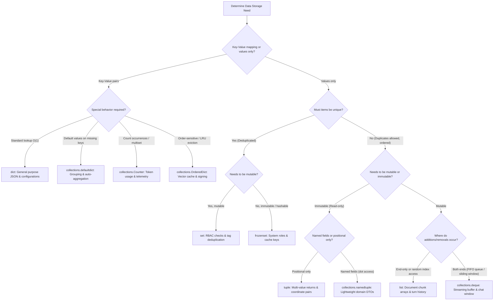

# Module 3: Python Data Structures & Collections (For the .NET Architect)

Welcome to **Module 3** of the Normora Python & AI Masterclass.

As a .NET architect, you are accustomed to the rich type hierarchy of the Common Language Runtime (CLR): `List<T>`, `Dictionary<TKey, TValue>`, `HashSet<T>`, `ValueTuple`, `ReadOnlyMemory<T>`, and LINQ. When transitioning to Python to build high-performance AI microservices, RAG pipelines, and vector processing engines, mastering Python's built-in data structures and the `collections` standard library module is paramount.

In production AI systems like **Normora** (an enterprise multi-tenant knowledge management and conversational AI platform):
* Document ingestion processes an ordered, mutable **list of text chunks**.
* Database queries and pgvector indices yield immutable **tuples of coordinates and similarity scores**.
* Self-documenting domain payloads use **named tuples** or Pydantic schemas.
* API requests, tool declarations, and Google Gemini Flash schemas are represented as nested **dictionaries**.
* Citations, user scopes, and RBAC permissions are deduplicated and mathematically evaluated using **sets** and **frozen sets**.
* Real-time streaming buffers, frequency analysis, and grouping operations rely on the high-performance `collections` module (`deque`, `Counter`, `defaultdict`, `OrderedDict`).

Every single concept in this module is explained from first principles, includes a **C#/.NET equivalent comparison**, and features **at least 5 real-world examples directly from the Normora platform codebase**.

---

## 1. The .NET Architect's Rosetta Stone & Collection Selection

In C#, collections are statically typed, specialized generic classes governed by interfaces such as `IEnumerable<T>`, `IList<T>`, and `IDictionary<TKey, TValue>`. In Python, collections are dynamically typed, highly optimized C-level structures that can hold arbitrary heterogenous objects.

### C# vs. Python Collections Rosetta Stone

| Data Structure / Concept | Python Type | C# / .NET Equivalent | Mutability | Ordering | Duplicates? | Primary Use Case in Normora |
| :--- | :--- | :--- | :--- | :--- | :--- | :--- |
| **Dynamic Array** | `list` | `List<T>` | Mutable | Ordered (Indexed) | Allowed | Document chunk pipelines, message logs |
| **Fixed Record** | `tuple` | `(T1, T2)` / `ValueTuple` | **Immutable** | Ordered (Indexed) | Allowed | Embedding dimensions, composite keys, multi-returns |
| **Named Record** | `namedtuple` | `record` / `readonly struct` | **Immutable** | Ordered (Field + Index) | Allowed | Lightweight domain DTOs (`DocumentChunk`, `TenantQuota`) |
| **Hash Map** | `dict` | `Dictionary<TKey, TValue>` | Mutable | Ordered (Insertion Order) | Unique Keys | Tenant metadata, JSON schemas, tool definitions |
| **Auto-Grouping Map**| `defaultdict` | Custom `Dictionary` or LINQ `GroupBy` | Mutable | Ordered (Insertion Order) | Unique Keys | Inverted text index, chunk-to-doc grouping |
| **Frequency Counter**| `Counter` | LINQ `GroupBy().ToDictionary()` | Mutable | Ordered (Insertion Order) | Unique Keys | Prompt token tallies, API error frequency |
| **Ordered Map** | `OrderedDict` | `OrderedDictionary` (C# 9+) | Mutable | Strictly Insertion Ordered | Unique Keys | LRU cache eviction, cryptographic signing payloads |
| **Hash Set** | `set` | `HashSet<T>` | Mutable | **Unordered** | **No Duplicates** | RBAC permission evaluation, citation deduplication |
| **Immutable Set** | `frozenset` | `ImmutableHashSet<T>` | **Immutable** | **Unordered** | **No Duplicates** | System protected roles, dictionary keys |
| **Double-Ended Queue**| `deque` | `Queue<T>` / `LinkedList<T>` | Mutable | Ordered (FIFO / LIFO) | Allowed | Real-time SignalR chunk stream, sliding chat window |

---

### Data Structure Selection Flowchart for Normora AI Architecture

The following flowchart guides your architectural decision when designing components in the Normora ingestion worker, RAG pipeline, or security layer:



---

## 2. Lists (`list`): Ordered, Mutable Sequences

In Python, a **list** is a dynamic array, directly equivalent to `List<T>` in C#. Python lists are zero-indexed, dynamically resizable, and can contain elements of mixed types (though in Normora we enforce uniform typing via Python type hints).

### Memory Architecture & Time Complexity

Behind the scenes in CPython, a `list` is an array of contiguous memory pointers to Python objects. 
* **Append (`.append()`)**: $O(1)$ amortized time. CPython over-allocates memory slots (exponential resizing: 0, 4, 8, 16, 25, 35, 46, ...), exactly like .NET's `List<T>` capacity doubling.
* **Insert/Delete at arbitrary index (`.insert()`, `.pop(0)`)**: $O(n)$ time because all subsequent pointers must be shifted in memory.
* **Indexing (`items[i]`)**: $O(1)$ direct pointer arithmetic.
* **Slicing (`items[start:stop:step]`)**: $O(k)$ where $k$ is the slice length. Slicing creates a **shallow copy** of the specified pointer range.

> [!NOTE]
> Unlike C# arrays or `List<T>`, Python supports **negative indexing** (where `-1` references the last element, `-2` the second-to-last) and slicing with stride (`[:: -1]` reverses a list).

```
Index:         0          1          2          3          4
Elements:  ["chunk-1", "chunk-2", "chunk-3", "chunk-4", "chunk-5"]
Neg Index:    -5         -4         -3         -2         -1
```

---

### 5 Real-World Normora Examples for `list`

#### Example 2.1: Appending Incoming Conversation Turns in a SignalR Bridge
In the Normora Conversations module, streaming chat interactions are accumulated as message dictionaries before persistence:

```python
# Initial conversation state retrieved from PostgreSQL
conversation_history: list[dict[str, str]] = [
    {"role": "system", "content": "You are Normora AI, an enterprise assistant."},
    {"role": "user", "content": "What is our company parental leave policy?"}
]

# When Google Gemini Flash finishes streaming, append the assistant turn:
assistant_turn: dict[str, str] = {
    "role": "assistant",
    "content": "According to the Normora 2026 Employee Handbook, employees receive 16 weeks of paid parental leave."
}
conversation_history.append(assistant_turn)

print(f"Total conversation turns: {len(conversation_history)}")
print(f"Latest role: {conversation_history[-1]['role']}")
# Output: Total conversation turns: 3
# Latest role: assistant
```

#### Example 2.2: Context Window Chunk Slicing (`ranked_chunks[:k]`)
To prevent exceeding Google Gemini Flash's token limits and optimize latency, the RAG orchestrator slices the top-$k$ document chunks:

```python
# Chunks returned from pgvector ranked by cosine similarity
ranked_chunk_ids: list[str] = [
    "chk-a101", "chk-b204", "chk-c309", "chk-d412", "chk-e555", "chk-f618"
]

# Extract only top 3 chunks for context injection
k = 3
injected_context: list[str] = ranked_chunk_ids[:k]

# Extract remaining chunks for background evaluation logging
overflow_chunks: list[str] = ranked_chunk_ids[k:]

print(f"Injected into prompt: {injected_context}")  # ['chk-a101', 'chk-b204', 'chk-c309']
print(f"Logged for evaluation: {overflow_chunks}")  # ['chk-d412', 'chk-e555', 'chk-f618']
```

#### Example 2.3: Reversing Audit Trails with Slicing Stride (`[::-1]`)
When displaying the tenant activity timeline in the Angular 22 SPA, audit logs stored in chronological order are reversed for UI display:

```python
audit_events: list[str] = [
    "TENANT_CREATED: 2026-01-10",
    "MEMBER_INVITED: 2026-01-11",
    "DOCUMENT_UPLOADED: 2026-01-12",
    "POLICY_UPDATED: 2026-01-15"
]

# Python slicing syntax: [start:stop:step]. step=-1 traverses backwards:
reverse_timeline: list[str] = audit_events[::-1]

print("Recent events first:")
for event in reverse_timeline:
    print(f"  -> {event}")
```

#### Example 2.4: Dynamic MIME Type Registration for MinIO Ingestion
The document processing pipeline validates incoming binary streams against an allowed list:

```python
allowed_mime_types: list[str] = [
    "application/pdf",
    "text/plain",
    "text/markdown"
]

# Tenant upgrade enables Office documents:
allowed_mime_types.append("application/vnd.openxmlformats-officedocument.wordprocessingml.document")

incoming_upload_mime = "application/pdf"
if incoming_upload_mime in allowed_mime_types:
    print("MIME type authorized for MinIO object ingestion.")
else:
    print("415 Unsupported Media Type.")
```

#### Example 2.5: In-Place Chunk Score Sorting with `.sort(key=...)`
The document retrieval engine sorts extracted chunks in-place by cosine similarity score:

```python
retrieved_chunks: list[dict[str, float | str]] = [
    {"chunk_id": "c1", "similarity": 0.74, "page": 12},
    {"chunk_id": "c2", "similarity": 0.93, "page": 3},
    {"chunk_id": "c3", "similarity": 0.81, "page": 7}
]

# In-place descending sort by similarity score:
retrieved_chunks.sort(key=lambda item: float(item["similarity"]), reverse=True)

print(f"Highest ranking chunk: {retrieved_chunks[0]['chunk_id']} (Score: {retrieved_chunks[0]['similarity']})")
# Output: Highest ranking chunk: c2 (Score: 0.93)
```

---

## 3. Tuples (`tuple`) & Named Tuples (`namedtuple`): Immutable Records

### Part A: Standard Tuples (`tuple`)

A **tuple** is an ordered, **immutable** sequence defined with parentheses `()`. In C#, the closest equivalent is `ValueTuple` (e.g., `(string, int)`).

#### Key Architectural Characteristics:
1. **Immutability**: Once created, elements cannot be added, removed, or reassigned. Attempting to modify a tuple raises `TypeError`.
2. **Hashability**: If all elements inside a tuple are immutable (strings, ints, floats, other tuples), the tuple itself is **hashable**. This means it can be used as a **dictionary key** or stored in a **set**. (A `list` can never be a dict key or set element).
3. **Memory Overhead**: Because tuples are immutable, Python allocates the exact required memory without over-allocation padding, making them lighter and faster than lists.

```python
# C# equivalent: (string ChunkId, double Score, int Page)
chunk_result: tuple[str, float, int] = ("chk-881", 0.942, 14)

# Tuple unpacking:
chunk_id, score, page = chunk_result
print(f"Matched chunk {chunk_id} on page {page} with score {score}")
```

---

### 5 Real-World Normora Examples for `tuple`

#### Example 3.1: Composite Cache Keys for Semantic RAG Results
In Normora's multi-tenant caching layer, cached responses must be isolated by tenant, document, and prompt hash:

```python
# Caching dictionary: tuple -> string response
rag_semantic_cache: dict[tuple[str, str, str], str] = {}

# Composite key: (tenant_id, document_id, query_hash)
cache_key: tuple[str, str, str] = ("TENANT-04", "DOC-99", "sha256_e3b0c442")

rag_semantic_cache[cache_key] = "Employees receive 16 weeks of paid parental leave."

# Fast O(1) cache lookup:
lookup_key = ("TENANT-04", "DOC-99", "sha256_e3b0c442")
if lookup_key in rag_semantic_cache:
    print(f"Cache Hit: {rag_semantic_cache[lookup_key]}")
```

#### Example 3.2: Multi-Value Return from Vector Similarity Search
FastAPI repository functions often return multiple values without the overhead of declaring a formal class:

```python
def find_nearest_chunk(vector: list[float], tenant_id: str) -> tuple[str, float, int]:
    # Simulating pgvector HNSW index search
    matched_id = "chk-502"
    cosine_similarity = 0.918
    source_page = 42
    return matched_id, cosine_similarity, source_page

# Unpack directly at call site:
chunk_id, similarity, page = find_nearest_chunk([0.021, -0.45, 0.12], "TENANT-01")
print(f"Extracted chunk {chunk_id} (Page {page}) with confidence {similarity:.3f}")
```

#### Example 3.3: Fixed Embedding Model System Configurations
System constants that must not change during microservice execution:

```python
# Format: (Model Name, Dimension Count, Max Input Tokens)
GEMINI_FLASH_EMBEDDING_CONFIG: tuple[str, int, int] = ("text-embedding-004", 768, 2048)
OPENAI_EMBEDDING_CONFIG: tuple[str, int, int] = ("text-embedding-3-small", 1536, 8191)

model, dims, max_tokens = GEMINI_FLASH_EMBEDDING_CONFIG
print(f"Embedding Provider: {model} generates vectors with {dims} dimensions.")
```

#### Example 3.4: Bounding Box Coordinates for Citation Highlighting
When the Angular frontend displays source PDF citations, highlight rectangles are passed as immutable 4-tuples:

```python
# Bounding box coordinates: (x_min, y_min, x_max, y_max)
citation_bbox: tuple[float, float, float, float] = (54.0, 120.5, 480.0, 165.2)

x0, y0, x1, y1 = citation_bbox
width = x1 - x0
height = y1 - y0
print(f"Citation box dimensions: {width}px wide by {height}px tall.")
```

#### Example 3.5: Database Composite Primary Key Authorization Checks
Preventing BOLA (Broken Object Level Authorization) by pairing tenant ID with user ID:

```python
authorized_memberships: set[tuple[str, str]] = {
    ("TENANT-ACME", "USER-101"),
    ("TENANT-ACME", "USER-102"),
    ("TENANT-GLOBEX", "USER-205")
}

def verify_tenant_access(tenant_id: str, user_id: str) -> bool:
    # O(1) membership check on tuple pair
    return (tenant_id, user_id) in authorized_memberships

if not verify_tenant_access("TENANT-ACME", "USER-205"):
    # BOLA violation: Return 404 to prevent resource enumeration
    print("404 Not Found (BOLA Prevention Triggered)")
```

---

### Part B: Named Tuples (`collections.namedtuple`)

While standard tuples use index access (`item[0]`), this can lead to unreadable code in complex enterprise architectures. `collections.namedtuple` solves this by providing **named field access with dot notation** (`item.field_name`) while retaining 100% of the tuple's immutability, low memory footprint, and tuple unpacking behavior.

> [!TIP]
> In C#, `namedtuple` is conceptually identical to a C# 9 `public readonly record struct DocumentChunk(string Id, int Page, ...);`.

```python
from collections import namedtuple

# Define the namedtuple schema:
DocumentChunk = namedtuple("DocumentChunk", ["chunk_id", "page_number", "score", "content"])

# Instantiate an immutable record:
chunk = DocumentChunk(
    chunk_id="chk-99", 
    page_number=3, 
    score=0.954, 
    content="Normora encrypts all customer vectors using AES-256."
)

# Dot access and index access both work:
print(chunk.chunk_id)    # chk-99
print(chunk[1])          # 3 (page_number)
```

---

### 5 Real-World Normora Examples for `namedtuple`

#### Example 3.6: Strongly-Typed Chunk Metadata Record
```python
from collections import namedtuple

ChunkRecord = namedtuple("ChunkRecord", ["chunk_id", "doc_id", "page_num", "token_count"])

record = ChunkRecord(chunk_id="chk-12", doc_id="doc-808", page_num=4, token_count=215)
print(f"Chunk {record.chunk_id} from Doc {record.doc_id} contains {record.token_count} tokens.")
```

#### Example 3.7: Embedding Vector Manifest for PostgreSQL pgvector Loader
```python
from collections import namedtuple

EmbeddingManifest = namedtuple("EmbeddingManifest", ["vector_id", "tenant_id", "dimensions", "is_hnsw_indexed"])

manifest = EmbeddingManifest(vector_id="vec-77", tenant_id="TENANT-01", dimensions=768, is_hnsw_indexed=True)
if manifest.is_hnsw_indexed:
    print(f"Vector {manifest.vector_id} is indexed and ready for cosine similarity search.")
```

#### Example 3.8: Tenant Subscription Quota Definition
```python
from collections import namedtuple

TenantQuota = namedtuple("TenantQuota", ["tier", "max_documents", "max_tokens_monthly", "can_use_gemini_flash"])

enterprise_plan = TenantQuota(
    tier="Enterprise",
    max_documents=50_000,
    max_tokens_monthly=50_000_000,
    can_use_gemini_flash=True
)
print(f"Tier {enterprise_plan.tier} allows {enterprise_plan.max_documents:,} documents.")
```

#### Example 3.9: Verified RAG Citation Reference for the Angular Frontend
```python
from collections import namedtuple

CitationRef = namedtuple("CitationRef", ["document_name", "page", "paragraph", "confidence"])

citation = CitationRef(document_name="SecurityPolicy.pdf", page=12, paragraph=3, confidence=0.98)
print(f"Citation: {citation.document_name} (Page {citation.page}, Para {citation.paragraph})")
```

#### Example 3.10: MediatR Cross-Module Event Audit Record
```python
from collections import namedtuple

DomainEventRecord = namedtuple("DomainEventRecord", ["event_name", "aggregate_id", "timestamp", "actor_id"])

event = DomainEventRecord(
    event_name="DocumentIngestedEvent",
    aggregate_id="doc-9921",
    timestamp="2026-03-29T10:15:00Z",
    actor_id="usr-404"
)
print(f"Audit: [{event.timestamp}] {event.event_name} triggered on {event.aggregate_id} by {event.actor_id}")
```

---

## 4. Dictionaries (`dict`): High-Performance Key-Value Hash Maps

A Python `dict` is an associative hash table mapping unique keys to arbitrary values, directly corresponding to `Dictionary<TKey, TValue>` in C#.

### Key Architectural Characteristics
1. **$O(1)$ Average Lookup, Insertion, and Deletion**: Fast hash-based indexing.
2. **Key Requirements**: Keys must be **hashable** (immutable types: `str`, `int`, `float`, `tuple`, `frozenset`). Lists and dictionaries cannot be keys.
3. **Insertion Ordering (Python 3.7+)**: Standard Python dictionaries are guaranteed to maintain the order in which keys were inserted.
4. **Safe Retrieval with `.get()`**: Accessing `d[key]` raises `KeyError` if the key is missing; `d.get(key, default)` returns the default value without throwing an exception.

```python
# C# equivalent: Dictionary<string, object>
tenant_config: dict[str, str | int | bool] = {
    "tenant_id": "T-104",
    "name": "Global Health Partners",
    "max_seats": 500,
    "is_active": True
}
```

---

### 5 Real-World Normora Examples for `dict`

#### Example 4.1: Representing Tenant Settings with Safe `.get()` Defaults
Reading optional tenant configuration flags without risking unhandled `KeyError` exceptions:

```python
tenant_settings: dict[str, bool | str] = {
    "ai_streaming_enabled": True,
    "enforce_mfa": True
}

# Read optional settings with fallback defaults:
custom_domain = tenant_settings.get("custom_domain", "app.normora.ai")
session_timeout = tenant_settings.get("session_timeout_minutes", 30)

print(f"Routing to: {custom_domain} (Session timeout: {session_timeout} mins)")
# Output: Routing to: app.normora.ai (Session timeout: 30 mins)
```

#### Example 4.2: Google Gemini Flash Tool & Function Calling Schema
Google Gemini Flash accepts tool declarations formatted as JSON Schema dictionaries:

```python
gemini_tool_declaration: dict[str, object] = {
    "name": "search_tenant_knowledge_base",
    "description": "Performs semantic vector search against indexed documents in PostgreSQL.",
    "parameters": {
        "type": "object",
        "properties": {
            "query": {
                "type": "string", 
                "description": "The search query extracted from the user prompt."
            },
            "top_k": {
                "type": "integer", 
                "description": "Number of document chunks to retrieve."
            }
        },
        "required": ["query"]
    }
}

print(f"Registered AI Tool: {gemini_tool_declaration['name']}")
```

#### Example 4.3: Tracking Real-Time Token Consumption per Tenant
Updating numeric values in a dictionary during SignalR streaming responses:

```python
tenant_token_meters: dict[str, int] = {
    "TENANT-ALPHA": 450_200,
    "TENANT-BETA": 120_800
}

# Increment tokens consumed after a 350-token Gemini Flash generation:
tenant_id = "TENANT-ALPHA"
tokens_used = 350

# Using .get() to safely initialize or increment:
tenant_token_meters[tenant_id] = tenant_token_meters.get(tenant_id, 0) + tokens_used

print(f"Updated usage for {tenant_id}: {tenant_token_meters[tenant_id]:,} tokens")
# Output: Updated usage for TENANT-ALPHA: 450,550 tokens
```

#### Example 4.4: Dynamic CQRS Command Dispatcher Mapping
In Normora's modular monolith, incoming command names are mapped to handler functions via a dispatcher dictionary (similar to MediatR):

```python
def handle_ingest_document(payload: dict) -> str:
    return f"Ingested document: {payload['file_name']}"

def handle_delete_tenant(payload: dict) -> str:
    return f"Deleted tenant: {payload['tenant_id']}"

# Dictionary acting as a function dispatch table:
command_registry: dict[str, callable] = {
    "IngestDocumentCommand": handle_ingest_document,
    "DeleteTenantCommand": handle_delete_tenant
}

incoming_command = "IngestDocumentCommand"
payload_data = {"file_name": "Q3_Financials.pdf"}

handler = command_registry.get(incoming_command)
if handler:
    result = handler(payload_data)
    print(result)  # Ingested document: Q3_Financials.pdf
```

#### Example 4.5: Iterating Over Key-Value Pairs with `.items()`
Exporting departmental document statistics for the admin dashboard:

```python
department_metrics: dict[str, int] = {
    "Legal": 184,
    "Engineering": 512,
    "Finance": 96,
    "Human Resources": 230
}

print("=== Normora Department Document Inventory ===")
for department, doc_count in department_metrics.items():
    print(f"Department: {department:<18} | Indexed Documents: {doc_count:>4}")
```

---

## 5. Sets (`set`) and Frozen Sets (`frozenset`): Unordered Unique Collections

### Part A: Mutable Sets (`set`)

A **set** is an unordered collection of unique, hashable elements defined with curly braces `{}` or the `set()` constructor. Its C# equivalent is `HashSet<T>`.

#### Key Mathematical Set Operations:
* **Union (`|` or `.union()`)**: All distinct elements across both sets.
* **Intersection (`&` or `.intersection()`)**: Elements present in both sets.
* **Difference (`-` or `.difference()`)**: Elements in set A that are not in set B.
* **Symmetric Difference (`^` or `.symmetric_difference()`)**: Elements in either set A or set B, but not both.
* **Membership Test (`in`)**: Fast $O(1)$ lookup.

---

### 5 Real-World Normora Examples for `set`

#### Example 5.1: Deduplicating Document Tags Extracted During Ingestion
LLM entity extractors often produce repetitive tags:

```python
raw_extracted_tags: list[str] = [
    "compliance", "soc2", "security", "encryption", "soc2", "compliance", "audit"
]

# Eliminate duplicates with a set:
unique_tags: set[str] = set(raw_extracted_tags)
print(f"Deduplicated tags: {sorted(unique_tags)}")
# Output: Deduplicated tags: ['audit', 'compliance', 'encryption', 'security', 'soc2']
```

#### Example 5.2: Fast $O(1)$ RBAC Permission Verification
Validating user claims against required permissions (preventing BFLA - Broken Function Level Authorization):

```python
user_permissions: set[str] = {
    "documents:read", 
    "documents:upload", 
    "conversations:start"
}

required_permission = "tenants:delete"

# O(1) membership check
if required_permission not in user_permissions:
    print("403 Forbidden: Missing 'tenants:delete' permission (BFLA Protected).")
```

#### Example 5.3: Set Intersection (`&`) to Find Shared Collaboration Scopes
Determining which shared document spaces two users have mutual access to:

```python
user_a_workspaces: set[str] = {"eng-docs", "legal-contracts", "architecture-reviews"}
user_b_workspaces: set[str] = {"legal-contracts", "compliance-audits", "hr-policies"}

# Set intersection gives mutual access:
common_workspaces: set[str] = user_a_workspaces & user_b_workspaces
print(f"Shared collaboration spaces: {common_workspaces}")
# Output: Shared collaboration spaces: {'legal-contracts'}
```

#### Example 5.4: Set Difference (`-`) to Detect Pending Ingestion Tasks
Identifying documents stored in MinIO object storage that have not yet been indexed into PostgreSQL pgvector:

```python
minio_uploaded_doc_ids: set[str] = {"doc-001", "doc-002", "doc-003", "doc-004", "doc-005"}
pgvector_indexed_doc_ids: set[str] = {"doc-001", "doc-002", "doc-004"}

# Difference: Uploaded minus Indexed = Pending
pending_ingestion_jobs: set[str] = minio_uploaded_doc_ids - pgvector_indexed_doc_ids
print(f"Background worker queued jobs: {pending_ingestion_jobs}")
# Output: Background worker queued jobs: {'doc-003', 'doc-005'}
```

#### Example 5.5: Multi-Turn Citation Source Deduplication
When Google Gemini Flash returns citations across 10 streaming chunks, duplicate source filenames must be collapsed for the UI footer:

```python
cited_sources_stream: list[str] = [
    "Handbook_2026.pdf",
    "SOC2_Report.pdf",
    "Handbook_2026.pdf",
    "Disaster_Recovery.pdf",
    "SOC2_Report.pdf"
]

distinct_citations: set[str] = set(cited_sources_stream)
print(f"Distinct sources cited: {len(distinct_citations)} files -> {distinct_citations}")
# Output: Distinct sources cited: 3 files -> {'Handbook_2026.pdf', 'SOC2_Report.pdf', 'Disaster_Recovery.pdf'}
```

---

### Part B: Immutable Sets (`frozenset`)

A `frozenset` is an **immutable** version of a set. Its C# equivalent is `ImmutableHashSet<T>`.

#### Why Does `frozenset` Exist?
Because a standard `set` is mutable, its hash value would change if elements were added or removed. Therefore:
1. A standard `set` **cannot** be used as a dictionary key or placed inside another set.
2. A `frozenset` is immutable and **hashable**, meaning it **can** be used as a dictionary key or set element.
3. It guarantees thread-safe, tamper-proof collections for security constants.

---

### 5 Real-World Normora Examples for `frozenset`

#### Example 5.6: Immutable System-Protected Security Roles
System-level roles that cannot be modified at runtime:

```python
SYSTEM_PROTECTED_ROLES: frozenset[str] = frozenset(["SuperAdmin", "TenantOwner", "SystemWorker"])

# Attempting to mutate raises an error:
# SYSTEM_PROTECTED_ROLES.add("Auditor")  --> AttributeError: 'frozenset' object has no attribute 'add'

role_to_check = "SuperAdmin"
if role_to_check in SYSTEM_PROTECTED_ROLES:
    print(f"Role '{role_to_check}' is protected and cannot be deleted by tenant admins.")
```

#### Example 5.7: Using `frozenset` as a Dictionary Key for Policy Rules
Mapping combinations of permissions to authorization policy handlers:

```python
# A dictionary key composed of multiple permission strings:
policy_handler_cache: dict[frozenset[str], str] = {
    frozenset(["documents:read"]): "ReadOnlyPolicyHandler",
    frozenset(["documents:read", "documents:write"]): "ReadWritePolicyHandler",
    frozenset(["documents:read", "documents:write", "documents:delete"]): "FullAdminPolicyHandler"
}

user_current_perms = frozenset(["documents:read", "documents:write"])
handler = policy_handler_cache.get(user_current_perms)
print(f"Assigned authorization handler: {handler}")
# Output: Assigned authorization handler: ReadWritePolicyHandler
```

#### Example 5.8: Validating Vector Distance Metrics
Whitelisting allowed pgvector distance operators:

```python
SUPPORTED_PGVECTOR_METRICS: frozenset[str] = frozenset(["cosine", "l2", "inner_product"])

requested_metric = "cosine"
if requested_metric not in SUPPORTED_PGVECTOR_METRICS:
    raise ValueError(f"Invalid metric. Must be one of {SUPPORTED_PGVECTOR_METRICS}")
print(f"Distance operator '{requested_metric}' validated for HNSW query.")
```

#### Example 5.9: Immutable State Machine Allowed Status Transitions
Document ingestion status lifecycle transitions:

```python
TERMINAL_DOCUMENT_STATES: frozenset[str] = frozenset(["Indexed", "Failed", "Quarantined"])

current_status = "Indexed"
is_done = current_status in TERMINAL_DOCUMENT_STATES
print(f"Is document lifecycle terminated? {is_done}")
```

#### Example 5.10: Whitelisted Keycloak OIDC BFF Headers
Headers permitted through the Duende BFF proxy gateway:

```python
SAFE_FORWARDED_HEADERS: frozenset[str] = frozenset([
    "x-tenant-id", 
    "x-correlation-id", 
    "authorization", 
    "content-type"
])

incoming_header = "x-tenant-id"
if incoming_header.lower() in SAFE_FORWARDED_HEADERS:
    print(f"Header '{incoming_header}' forwarded to downstream microservices.")
```

---

## 6. The `collections` Module Powerhouses

The Python standard library `collections` module provides specialized container datatypes that dramatically outperform standard lists and dictionaries for specific high-load operations.

---

### Part A: `collections.defaultdict`

In a standard `dict`, accessing a missing key throws a `KeyError`. In C#, you would write:
```csharp
if (!dict.TryGetValue(key, out var list)) {
    list = new List<string>();
    dict[key] = list;
}
list.Add(value);
```
In Python, `collections.defaultdict` takes a **factory function** (such as `list`, `int`, `set`, or `dict`) and automatically initializes missing keys on the first access.

---

### 5 Real-World Normora Examples for `defaultdict`

#### Example 6.1: Grouping Document Chunks by `document_id`
```python
from collections import defaultdict

# Automatic initialization: if key is missing, invoke list() -> []
chunks_by_document: defaultdict[str, list[str]] = defaultdict(list)

incoming_chunk_stream = [
    ("doc-100", "Chunk 1 text..."),
    ("doc-200", "Chunk A text..."),
    ("doc-100", "Chunk 2 text..."),
    ("doc-100", "Chunk 3 text..."),
    ("doc-200", "Chunk B text...")
]

for doc_id, chunk_text in incoming_chunk_stream:
    # No KeyError! Automatically appends to a newly created list if doc_id is new
    chunks_by_document[doc_id].append(chunk_text)

print(f"Doc-100 total chunks: {len(chunks_by_document['doc-100'])}")  # 3
print(f"Doc-200 total chunks: {len(chunks_by_document['doc-200'])}")  # 2
```

#### Example 6.2: Inverted Index for Hybrid BM25 Keyword Search
Mapping keyword tokens to sets of matching chunk IDs:

```python
from collections import defaultdict

keyword_inverted_index: defaultdict[str, set[str]] = defaultdict(set)

chunk_tokens = [
    ("chk-1", ["maternity", "leave", "benefits"]),
    ("chk-2", ["parental", "leave", "policy"]),
    ("chk-3", ["health", "insurance", "benefits"])
]

for chunk_id, tokens in chunk_tokens:
    for token in tokens:
        keyword_inverted_index[token].add(chunk_id)

print(f"Chunks matching 'benefits': {keyword_inverted_index['benefits']}")
# Output: Chunks matching 'benefits': {'chk-1', 'chk-3'}
```

#### Example 6.3: Multi-Tenant Token Usage Aggregator (`defaultdict(int)`)
Accumulating consumption without pre-populating tenant keys:

```python
from collections import defaultdict

# Factory function int() returns 0 by default
tenant_daily_tokens: defaultdict[str, int] = defaultdict(int)

# Stream of token usage events from background workers:
usage_events = [
    ("TENANT-A", 1500),
    ("TENANT-B", 800),
    ("TENANT-A", 2200),
    ("TENANT-C", 400)
]

for tenant_id, tokens in usage_events:
    tenant_daily_tokens[tenant_id] += tokens

print(f"Tenant-A Total: {tenant_daily_tokens['TENANT-A']}")  # 3700
print(f"Unseen Tenant-Z: {tenant_daily_tokens['TENANT-Z']}")  # 0 (Safe!)
```

#### Example 6.4: Multi-Tenant Role-to-User Mapping (`defaultdict(set)`)
```python
from collections import defaultdict

role_memberships: defaultdict[str, set[str]] = defaultdict(set)

role_memberships["Admin"].add("user-01")
role_memberships["Admin"].add("user-02")
role_memberships["Auditor"].add("user-03")

print(f"Admins: {role_memberships['Admin']}")
print(f"Billing: {role_memberships['Billing']}")  # set() (empty set, no crash)
```

#### Example 6.5: Document Processing Stage Time Tracking (`defaultdict(list)`)
Recording latency across document ingestion stages:

```python
from collections import defaultdict

stage_latencies: defaultdict[str, list[float]] = defaultdict(list)

stage_latencies["pdf_text_extraction"].append(142.5)
stage_latencies["pdf_text_extraction"].append(138.2)
stage_latencies["gemini_embedding"].append(320.1)

avg_extraction = sum(stage_latencies["pdf_text_extraction"]) / len(stage_latencies["pdf_text_extraction"])
print(f"Average PDF extraction time: {avg_extraction:.1f}ms")
```

---

### Part B: `collections.Counter`

`Counter` is a dictionary subclass designed specifically for counting hashable objects. In C#, this replaces the verbose LINQ construct `.GroupBy(x => x).ToDictionary(g => g.Key, g => g.Count())`.

#### Key Features:
* Missing keys return `0` instead of raising `KeyError`.
* `.most_common(k)`: Returns the $k$ most frequent elements in $O(n \log k)$ time.
* Supports multiset arithmetic (`+`, `-`, `&`, `|`).

---

### 5 Real-World Normora Examples for `Counter`

#### Example 6.6: Finding the Most Common Search Queries across Tenants
```python
from collections import Counter

search_queries = [
    "maternity leave", "vpn setup", "maternity leave", 
    "expense policy", "maternity leave", "vpn setup"
]

query_counter = Counter(search_queries)
top_query, count = query_counter.most_common(1)[0]
print(f"Most frequent query: '{top_query}' asked {count} times.")
# Output: Most frequent query: 'maternity leave' asked 3 times.
```

#### Example 6.7: Tracking AI Error Codes from Google Gemini Flash API
```python
from collections import Counter

api_error_events = [
    "429_RATE_LIMIT", "500_INTERNAL", "429_RATE_LIMIT", 
    "400_INVALID_ARG", "429_RATE_LIMIT", "500_INTERNAL"
]

error_stats = Counter(api_error_events)
print("--- Gemini Flash Error Breakdown ---")
for error_code, count in error_stats.most_common():
    print(f"  {error_code}: {count} occurrences")
```

#### Example 6.8: Document Term Frequency Analysis for Keyword Filtering
```python
from collections import Counter

document_chunk = "normora supports vector search pgvector index search vector similarity"
tokens = document_chunk.lower().split()

term_frequencies = Counter(tokens)
print(f"Frequency of 'vector': {term_frequencies['vector']}")  # 2
print(f"Frequency of 'absent_term': {term_frequencies['absent_term']}")  # 0 (No KeyError!)
```

#### Example 6.9: Model Tool Execution Telemetry
Tracking which AI tools the Gemini agent invokes most frequently:

```python
from collections import Counter

invoked_tools = [
    "search_docs", "calculate_mortgage", "search_docs", 
    "search_docs", "get_tenant_quota", "calculate_mortgage"
]

tool_usage = Counter(invoked_tools)
print(f"Top 2 tools used by AI agent: {tool_usage.most_common(2)}")
# Output: Top 2 tools used by AI agent: [('search_docs', 3), ('calculate_mortgage', 2)]
```

#### Example 6.10: Combining Usage Tallies Across Background Worker Nodes
Using `Counter` addition (`+`) to aggregate telemetry from two independent background workers:

```python
from collections import Counter

worker_node_1_tokens = Counter({"TENANT-1": 15000, "TENANT-2": 8000})
worker_node_2_tokens = Counter({"TENANT-1": 12000, "TENANT-3": 5000})

total_cluster_tokens = worker_node_1_tokens + worker_node_2_tokens
print(f"Cluster aggregated token tallies: {dict(total_cluster_tokens)}")
# Output: {'TENANT-1': 27000, 'TENANT-2': 8000, 'TENANT-3': 5000}
```

---

### Part C: `collections.deque` (Double-Ended Queue)

In Python, using a standard `list` as a FIFO queue with `list.pop(0)` is an **architectural anti-pattern**: popping from index 0 requires shifting all remaining pointers in memory, taking $O(n)$ time.

`collections.deque` (pronounced "deck") is implemented as a doubly-linked list of memory blocks. It provides **$O(1)$ appends and pops from both ends**.

> [!IMPORTANT]
> The optional `maxlen` parameter creates a fixed-size **sliding window buffer**: when new items are added to a full `deque`, old items are automatically discarded from the opposite side!

---

### 5 Real-World Normora Examples for `deque`

#### Example 6.11: Sliding Context Window for Chat History (`maxlen=N`)
Maintaining only the most recent 4 conversation turns in memory:

```python
from collections import deque

# Fixed-size sliding window of maximum 4 turns
chat_window: deque[str] = deque(maxlen=4)

turns = [
    "User: Hello", 
    "Bot: Hi!", 
    "User: Where is HR policy?", 
    "Bot: In the portal.", 
    "User: Thank you!"  # This will automatically evict the oldest turn ("User: Hello")
]

for turn in turns:
    chat_window.append(turn)

print(f"Current window size: {len(chat_window)}")
print(f"Active buffer: {list(chat_window)}")
# 'User: Hello' was automatically discarded!
```

#### Example 6.12: High-Throughput Document Ingestion Task Queue (FIFO)
Processing tasks in First-In, First-Out order:

```python
from collections import deque

task_queue: deque[dict[str, str]] = deque()

# Producers append tasks to the right side (O(1)):
task_queue.append({"task_id": "job-1", "action": "extract_pdf"})
task_queue.append({"task_id": "job-2", "action": "generate_embeddings"})

# Consumer pops tasks from the left side (O(1)):
active_job = task_queue.popleft()
print(f"Executing: {active_job['task_id']} ({active_job['action']})")
```

#### Example 6.13: Sliding Time-Window Rate Limiter
Tracking recent request timestamps to enforce rate limits:

```python
from collections import deque
import time

request_timestamps: deque[float] = deque()
RATE_LIMIT_PER_MINUTE = 60

def is_request_allowed() -> bool:
    now = time.time()
    # Remove timestamps older than 60 seconds from the left:
    while request_timestamps and now - request_timestamps[0] > 60:
        request_timestamps.popleft()
    
    if len(request_timestamps) < RATE_LIMIT_PER_MINUTE:
        request_timestamps.append(now)
        return True
    return False

print(f"First request allowed? {is_request_allowed()}")  # True
```

#### Example 6.14: SignalR Streaming Token Buffer for Real-Time SSE
Buffering incoming tokens before flushing in batches to the Angular client:

```python
from collections import deque

token_stream_buffer: deque[str] = deque()

incoming_tokens = ["According ", "to ", "company ", "policy, ", "all ", "employees..."]
token_stream_buffer.extend(incoming_tokens)

# Flush batch of 3 tokens to client:
batch = [token_stream_buffer.popleft() for _ in range(3)]
print(f"Flushed batch: '{''.join(batch)}'")
print(f"Remaining buffered tokens: {len(token_stream_buffer)}")
```

#### Example 6.15: Reversible Action History for Document Edit Undo/Redo
```python
from collections import deque

undo_stack: deque[str] = deque()

# User performs operations:
undo_stack.append("Added paragraph 1")
undo_stack.append("Bolded title")

# User triggers Undo (LIFO: pop from right O(1)):
last_action = undo_stack.pop()
print(f"Undid action: '{last_action}'")  # Undid action: 'Bolded title'
```

---

### Part D: `collections.OrderedDict`

Since Python 3.7, standard `dict` instances preserve insertion order. However, `OrderedDict` remains essential in enterprise architectures because:
1. **Equality Semantics**: In standard dicts, `{'a': 1, 'b': 2} == {'b': 2, 'a': 1}` is `True`. In `OrderedDict`, order matters: `OrderedDict([('a', 1), ('b', 2)]) != OrderedDict([('b', 2), ('a', 1)])`.
2. **Reordering Capabilities**: It provides `.move_to_end(key, last=True/False)`, which is the foundation of building an in-memory **LRU (Least Recently Used) cache**.

---

### 5 Real-World Normora Examples for `OrderedDict`

#### Example 6.16: In-Memory LRU Vector Cache with `move_to_end()`
```python
from collections import OrderedDict

class LruEmbeddingCache:
    def __init__(self, capacity: int = 3):
        self.capacity = capacity
        self.cache: OrderedDict[str, list[float]] = OrderedDict()

    def get(self, query: str) -> list[float] | None:
        if query not in self.cache:
            return None
        # Move accessed item to end (most recently used)
        self.cache.move_to_end(query)
        return self.cache[query]

    def put(self, query: str, vector: list[float]) -> None:
        if query in self.cache:
            self.cache.move_to_end(query)
        self.cache[query] = vector
        if len(self.cache) > self.capacity:
            # Evict least recently used item (pop from beginning)
            evicted_query, _ = self.cache.popitem(last=False)
            print(f"Evicted LRU item: '{evicted_query}'")

cache = LruEmbeddingCache(capacity=2)
cache.put("q1", [0.1, 0.2])
cache.put("q2", [0.3, 0.4])
cache.get("q1")          # q1 is now most recently used
cache.put("q3", [0.5, 0.6])  # Evicts q2!
```

#### Example 6.17: Deterministic Cryptographic Payload Signing
Generating HMAC signatures for Keycloak webhook verification where key ordering must be deterministic:

```python
from collections import OrderedDict
import hashlib

def create_deterministic_payload_string(data: list[tuple[str, str]]) -> str:
    # Strictly ordered key-value pairs
    ordered_payload = OrderedDict(data)
    return "&".join(f"{k}={v}" for k, v in ordered_payload.items())

payload_data = [("tenant_id", "T-01"), ("event", "USER_LOGIN"), ("timestamp", "1710000000")]
normalized_string = create_deterministic_payload_string(payload_data)
signature = hashlib.sha256(normalized_string.encode()).hexdigest()
print(f"Normalized: {normalized_string}")
print(f"Signature:  {signature[:16]}...")
```

#### Example 6.18: Sequential Prompt Pipeline Stage Execution
```python
from collections import OrderedDict

pipeline_stages = OrderedDict()
pipeline_stages["1_sanitize"] = lambda prompt: prompt.strip()
pipeline_stages["2_detect_pii"] = lambda prompt: f"[Scanned] {prompt}"
pipeline_stages["3_inject_tenant_context"] = lambda prompt: f"Tenant(T-1): {prompt}"

raw_user_input = "  What are the company holidays?  "
processed_prompt = raw_user_input
for stage_name, stage_fn in pipeline_stages.items():
    processed_prompt = stage_fn(processed_prompt)
    print(f"After {stage_name}: '{processed_prompt}'")
```

#### Example 6.19: Strict Configuration Precedence Resolution
```python
from collections import OrderedDict

# Configuration layers ordered from lowest to highest precedence
config_hierarchy = OrderedDict([
    ("default_system", {"retries": 3, "timeout": 30}),
    ("tenant_override", {"timeout": 45}),
    ("request_override", {"timeout": 15})
])

effective_config = {}
for layer_name, settings in config_hierarchy.items():
    effective_config.update(settings)

print(f"Effective Timeout: {effective_config['timeout']}s")  # 15s (request_override won)
```

#### Example 6.20: Priority Request Repositioning
Promoting a VIP tenant query to the front of the queue:

```python
from collections import OrderedDict

pending_generations = OrderedDict([
    ("gen-101", "Standard Tenant query"),
    ("gen-102", "VIP Tenant query"),
    ("gen-103", "Standard Tenant query")
])

# Move VIP query to the front of the execution queue:
pending_generations.move_to_end("gen-102", last=False)

first_in_line = next(iter(pending_generations.items()))
print(f"First generation to execute: {first_in_line}")
# Output: First generation to execute: ('gen-102', 'VIP Tenant query')
```

---

## 7. Comprehensions: List, Dict, and Set Comprehensions

For a .NET developer, Python **comprehensions** are the direct equivalent of **C# LINQ syntax**. Comprehensions provide a concise, expressive syntax for transforming, filtering, and constructing collections.

### LINQ vs. Python Comprehensions Rosetta Stone

| C# LINQ Equivalent | Python Comprehension Syntax |
| :--- | :--- |
| `items.Select(x => x.Id).ToList()` | `[x["id"] for x in items]` |
| `items.Where(x => x.Active).Select(x => x.Name).ToList()` | `[x["name"] for x in items if x["active"]]` |
| `items.ToDictionary(x => x.Id, x => x.Name)` | `{x["id"]: x["name"] for x in items}` |
| `items.Select(x => x.Tag).ToHashSet()` | `{x["tag"] for x in items}` |

---

### 5 Real-World Normora Examples for Comprehensions

#### Example 7.1: List Comprehension - Extracting Document IDs for pgvector HNSW
```python
raw_search_hits = [
    {"chunk_id": "c1", "doc_id": "doc-10", "score": 0.94},
    {"chunk_id": "c2", "doc_id": "doc-20", "score": 0.88},
    {"chunk_id": "c3", "doc_id": "doc-10", "score": 0.72}
]

# LINQ equivalent: rawSearchHits.Select(x => x.ChunkId).ToList()
chunk_ids: list[str] = [hit["chunk_id"] for hit in raw_search_hits]
print(f"Extracted chunk IDs: {chunk_ids}")  # ['c1', 'c2', 'c3']
```

#### Example 7.2: Filtered List Comprehension - Sanitizing Conversation History
Filtering out internal system prompts before sending messages to the Angular UI:

```python
chat_log = [
    {"role": "system", "content": "System internal instruction..."},
    {"role": "user", "content": "How do I request vacation?"},
    {"role": "assistant", "content": "Submit a request in Workday."},
    {"role": "system", "content": "Telemetry checkpoint"}
]

# LINQ equivalent: chatLog.Where(m => m.Role != "system").ToList()
ui_visible_messages = [msg for msg in chat_log if msg["role"] != "system"]
print(f"Filtered for UI display: {len(ui_visible_messages)} messages")  # 2
```

#### Example 7.3: Dict Comprehension - Building a Chunk Lookup Table
Converting a list of chunk dictionaries into an ID-keyed dictionary for $O(1)$ lookups:

```python
chunks = [
    {"chunk_id": "chk-1", "text": "Normora architecture Overview..."},
    {"chunk_id": "chk-2", "text": "PostgreSQL pgvector configuration..."},
    {"chunk_id": "chk-3", "text": "Keycloak OIDC integration..."}
]

# LINQ equivalent: chunks.ToDictionary(c => c.ChunkId, c => c.Text)
chunk_lookup: dict[str, str] = {c["chunk_id"]: c["text"] for c in chunks}

print(f"Direct lookup for chk-2: '{chunk_lookup['chk-2'][:25]}...'")
```

#### Example 7.4: Set Comprehension - Collecting Distinct Author Domains
```python
tenant_documents = [
    {"filename": "Policy.pdf", "author_email": "sanjeev@normora.ai"},
    {"filename": "Guide.pdf", "author_email": "alice@partner.com"},
    {"filename": "Arch.pdf", "author_email": "bob@normora.ai"}
]

# LINQ equivalent: tenantDocuments.Select(d => d.Email.Split('@')[1]).ToHashSet()
distinct_domains: set[str] = {doc["author_email"].split("@")[1] for doc in tenant_documents}
print(f"Unique author domains: {distinct_domains}")
# Output: Unique author domains: {'partner.com', 'normora.ai'}
```

#### Example 7.5: Nested Comprehension - Flattening Document Chunk Batches
Flattening a list of multi-page document chunks into a single list:

```python
# List of documents, each containing a list of page chunks:
document_batches: list[list[str]] = [
    ["doc1-chunk1", "doc1-chunk2"],
    ["doc2-chunk1"],
    ["doc3-chunk1", "doc3-chunk2", "doc3-chunk3"]
]

# LINQ equivalent: documentBatches.SelectMany(batch => batch).ToList()
flattened_chunks: list[str] = [chunk for batch in document_batches for chunk in batch]
print(f"Total flattened chunks for embedding: {len(flattened_chunks)}")  # 6
```

---

## 8. Unpacking Operators (`*` and `**`) & Advanced Manipulation

Python provides powerful unpacking operators:
* `*` (Single asterisk): Unpacks sequences (lists, tuples, sets) into individual arguments or elements.
* `**` (Double asterisk): Unpacks dictionaries into keyword arguments or merges key-value pairs.
* `|` (Union operator, Python 3.9+): Merges two dictionaries cleanly.

---

### 5 Real-World Normora Examples for Unpacking

#### Example 8.1: Constructing Gemini Prompt Messages with `*` Unpacking
Injecting conversation history between system instructions and the latest user turn:

```python
system_message = {"role": "system", "content": "You are Normora AI."}
archived_history = [
    {"role": "user", "content": "What is our 401k match?"},
    {"role": "assistant", "content": "Normora matches 5% of employee contributions."}
]
latest_user_prompt = {"role": "user", "content": "When does it vest?"}

# Using * to unpack the list directly inside the new list:
full_prompt_payload = [
    system_message,
    *archived_history,
    latest_user_prompt
]

print(f"Total payload turns: {len(full_prompt_payload)}")  # 4
```

#### Example 8.2: Merging Default Tenant Settings with Overrides (`**` and `|`)
```python
default_tenant_settings = {
    "max_monthly_tokens": 1_000_000,
    "allowed_file_types": ["pdf"],
    "streaming": True,
    "theme": "dark"
}

enterprise_custom_overrides = {
    "max_monthly_tokens": 100_000_000,
    "allowed_file_types": ["pdf", "docx", "xlsx"]
}

# Method 1: Using ** unpacking
effective_settings_1 = {**default_tenant_settings, **enterprise_custom_overrides}

# Method 2: Using Python 3.9+ dictionary union operator (|)
effective_settings_2 = default_tenant_settings | enterprise_custom_overrides

print(f"Effective Token Limit: {effective_settings_2['max_monthly_tokens']:,}")
# Output: Effective Token Limit: 100,000,000
```

#### Example 8.3: Extended Unpacking for Chunk Streams (`first, *rest, last`)
Separating header metadata and final citation summaries from intermediate streaming chunks:

```python
stream_packets = [
    "HEADER:Session-441", 
    "Token: The", 
    "Token: policy", 
    "Token: states...", 
    "FOOTER:Citation-Doc9"
]

# Extended unpacking:
header, *body_tokens, footer = stream_packets

print(f"Header: {header}")
print(f"Intermediate stream content ({len(body_tokens)} chunks): {body_tokens}")
print(f"Footer: {footer}")
```

#### Example 8.4: Dynamically Passing AI Tool Parameters with `**kwargs`
Executing tool functions where parameters are returned as a dictionary from Gemini Flash:

```python
def search_documents(query: str, department: str = "General", top_k: int = 5) -> str:
    return f"Searching '{query}' in department '{department}' (top {top_k})"

# Arguments dictionary generated by Google Gemini Flash:
ai_generated_args = {
    "query": "maternity leave",
    "department": "Human Resources",
    "top_k": 3
}

# Unpack dictionary as keyword arguments:
execution_result = search_documents(**ai_generated_args)
print(execution_result)
# Output: Searching 'maternity leave' in department 'Human Resources' (top 3)
```

#### Example 8.5: Combining pgvector Filter Clauses
```python
tenant_filter = {"tenant_id": "T-101"}
classification_filter = {"classification": "confidential", "is_deleted": False}

# Combine into a single query filter dictionary:
pgvector_query_filters = {**tenant_filter, **classification_filter}
print(f"Combined filters: {pgvector_query_filters}")
# Output: Combined filters: {'tenant_id': 'T-101', 'classification': 'confidential', 'is_deleted': False}
```

---

## 9. Advanced Iteration & Sorting: `sorted()`, `.sort()`, `zip()`, `enumerate()`, `reversed()`

### `.sort()` vs. `sorted()`
* **`list.sort()`**: In-place sort. Modifies the original list directly and **returns `None`**. Only works on lists.
* **`sorted(iterable)`**: Pure function. Does **not** modify the original data; returns a **new sorted list**. Works on any iterable (tuples, sets, dict keys).

---

### 5 Real-World Normora Examples for Iteration & Sorting

#### Example 9.1: Multi-Criteria Sorting with `key=lambda`
Sorting document chunks first by similarity score (descending), and second by page number (ascending):

```python
chunks = [
    {"id": "c1", "similarity": 0.85, "page": 12},
    {"id": "c2", "similarity": 0.92, "page": 4},
    {"id": "c3", "similarity": 0.85, "page": 2}
]

# Sort key tuple: (-score for descending, page for ascending)
ranked_chunks = sorted(
    chunks, 
    key=lambda c: (-float(c["similarity"]), int(c["page"]))
)

for c in ranked_chunks:
    print(f"Chunk: {c['id']} | Score: {c['similarity']} | Page: {c['page']}")
# Output: c2 (0.92, p4) -> c3 (0.85, p2) -> c1 (0.85, p12)
```

#### Example 9.2: Numbered Citation Generation with `enumerate(..., start=1)`
Formatting citations for the Angular 22 chat interface with 1-based indexing:

```python
cited_files = ["Employee_Handbook_2026.pdf", "Travel_Policy.pdf", "Code_Of_Conduct.pdf"]

print("--- Sources Cited ---")
for index, filename in enumerate(cited_files, start=1):
    print(f"[{index}] {filename}")
# Output:
# [1] Employee_Handbook_2026.pdf
# [2] Travel_Policy.pdf
# [3] Code_Of_Conduct.pdf
```

#### Example 9.3: Lockstep Parallel Iteration with `zip()`
Pairing extracted text chunks with their newly generated embedding vectors:

```python
chunk_texts: list[str] = [
    "Normora encrypts vectors at rest.",
    "PostgreSQL pgvector uses HNSW indexing.",
    "Keycloak handles multi-tenant OIDC."
]

embedding_vectors: list[list[float]] = [
    [0.12, -0.44, 0.91],
    [0.05, 0.88, -0.23],
    [-0.31, 0.15, 0.67]
]

# zip pairs elements from both lists in lockstep:
database_records: list[dict] = []
for text, vector in zip(chunk_texts, embedding_vectors):
    database_records.append({
        "content": text,
        "embedding": vector,
        "dim": len(vector)
    })

print(f"Created {len(database_records)} database payload records.")
```

#### Example 9.4: Chronological Audit Inspection with `reversed()`
Traversing an audit log backwards without mutating the original list or creating a slice copy:

```python
chronological_audit_log = [
    "09:00 - User logged in",
    "09:05 - Query: 'maternity leave'",
    "09:06 - Document doc-99 viewed",
    "09:10 - User logged out"
]

print("Recent events (reverse chronological):")
for event in reversed(chronological_audit_log):
    print(f"  * {event}")
```

#### Example 9.5: Sorting Dictionary Entries by Value
Ranking tenants by storage consumption:

```python
tenant_storage_mb = {
    "Tenant-Acme": 4120,
    "Tenant-Globex": 12800,
    "Tenant-Initech": 940
}

# Sort dictionary items by value descending:
sorted_by_storage = sorted(
    tenant_storage_mb.items(), 
    key=lambda item: item[1], 
    reverse=True
)

for tenant, mb in sorted_by_storage:
    print(f"{tenant:<16}: {mb:>6} MB")
```

---

## 10. Nested Data Structures & Production State Management

In enterprise Python architectures, real-world data is rarely a flat list or dictionary. It consists of nested structures:
* **List of Dictionaries**: Tabular datasets, database query results, and API payloads.
* **Dictionary of Lists**: Grouped entities (e.g., documents grouped by category).
* **Dictionary of Dictionaries**: Multi-tenant state trees, RBAC permission matrices.

---

### 5 Real-World Normora Examples for Nested Data Structures

#### Example 10.1: List of Dictionaries - pgvector Search Result Payloads
```python
search_results: list[dict[str, object]] = [
    {
        "chunk_id": "c101",
        "document": {"id": "doc-5", "title": "Employee Handbook"},
        "metrics": {"similarity": 0.941, "tokens": 180}
    },
    {
        "chunk_id": "c102",
        "document": {"id": "doc-8", "title": "Benefits Summary"},
        "metrics": {"similarity": 0.892, "tokens": 140}
    }
]

# Traversing nested structures:
for result in search_results:
    doc_title = result["document"]["title"]
    score = result["metrics"]["similarity"]
    print(f"Document: '{doc_title}' | Confidence: {score}")
```

#### Example 10.2: Dictionary of Lists - Tenant Document Categorization
```python
tenant_catalog: dict[str, list[str]] = {
    "Legal": ["NDA_Template.pdf", "Master_Services_Agreement.pdf"],
    "Security": ["SOC2_Type_II.pdf", "ISO_27001_Audit.pdf"],
    "Engineering": ["Architecture_RFC.md"]
}

# Add a document to Security category:
tenant_catalog["Security"].append("Penetration_Test_2026.pdf")

print(f"Total Security documents: {len(tenant_catalog['Security'])}")
```

#### Example 10.3: Dictionary of Dictionaries - Multi-Tenant RBAC Matrix
```python
# Tenant -> Role -> Permission Set
rbac_matrix: dict[str, dict[str, set[str]]] = {
    "TENANT-ALPHA": {
        "Admin": {"docs:read", "docs:write", "users:manage"},
        "Member": {"docs:read"}
    },
    "TENANT-BETA": {
        "Admin": {"docs:read", "docs:write"},
        "Member": {"docs:read"}
    }
}

def user_has_permission(tenant_id: str, role: str, permission: str) -> bool:
    tenant_roles = rbac_matrix.get(tenant_id, {})
    role_perms = tenant_roles.get(role, set())
    return permission in role_perms

print("Can Alpha Admin manage users?", user_has_permission("TENANT-ALPHA", "Admin", "users:manage"))  # True
print("Can Beta Admin manage users?", user_has_permission("TENANT-BETA", "Admin", "users:manage"))   # False
```

#### Example 10.4: Nested Gemini Flash Function Calling Tool Declaration
```python
gemini_complex_tool = {
    "name": "generate_report",
    "description": "Compiles tenant analytics report.",
    "parameters": {
        "type": "object",
        "properties": {
            "tenant_id": {"type": "string"},
            "filters": {
                "type": "object",
                "properties": {
                    "start_date": {"type": "string"},
                    "categories": {"type": "array", "items": {"type": "string"}}
                }
            }
        },
        "required": ["tenant_id"]
    }
}

# Inspect nested parameter properties:
print("Filters schema:", gemini_complex_tool["parameters"]["properties"]["filters"]["type"])
```

#### Example 10.5: Nested Conversation Sessions Tree
Mapping users to conversations to ordered lists of turns:

```python
# User ID -> Conversation ID -> List of Message Dicts
conversation_sessions: dict[str, dict[str, list[dict[str, str]]]] = {
    "user-101": {
        "conv-001": [
            {"role": "user", "content": "Hello Normora"},
            {"role": "assistant", "content": "How can I assist you?"}
        ]
    }
}

# Add turn to existing conversation:
conversation_sessions["user-101"]["conv-001"].append({
    "role": "user", 
    "content": "Where is the security policy?"
})

print(f"Turns in conv-001: {len(conversation_sessions['user-101']['conv-001'])}")  # 3
```

---

## 11. Mutability, Memory References, and Shallow vs. Deep Copies

Understanding object identity and reference semantics in Python is critical to avoiding high-severity bugs in enterprise microservices.

### Reference Semantics
In Python, variables are names bound to memory references (pointers).
* Assigning `b = a` **never** copies the data; it simply creates a second reference to the exact same object in memory.
* To check if two variables point to the exact same object in memory, use `is` (identity check).
* To check if two variables have equal content, use `==` (equality check).

```python
list_a = [1, 2, 3]
list_b = list_a  # Both point to the exact same list in memory!
list_b.append(4)

print(list_a)  # [1, 2, 3, 4] -> list_a was mutated!
print(list_a is list_b)  # True
```

---

### Shallow Copy vs. Deep Copy

* **Shallow Copy (`.copy()`, `list()`, `dict()`, `[:]`)**: Creates a new outer collection, but the elements inside still point to the same nested objects.
* **Deep Copy (`copy.deepcopy()`)**: Recursively copies the outer collection and all nested objects inside it.

```
SHALLOW COPY:
Original:  [Ptr1, Ptr2, Ptr_Nested]  ----->  Nested Dict { "active": True }
                ^                                  ^
Copy:      [Ptr3, Ptr4, Ptr_Nested]  --------------| (Shared reference!)

DEEP COPY:
Original:  [Ptr1, Ptr2, Ptr_NestedA] ----->  Nested Dict A { "active": True }
Copy:      [Ptr3, Ptr4, Ptr_NestedB] ----->  Nested Dict B { "active": True } (Independent!)
```

---

### 5 Real-World Normora Examples for Mutability & Copies

#### Example 11.1: The Shallow Copy Trap in Tenant Configuration Templates
```python
# Tenant template with a nested list of roles:
default_tenant_template = {
    "tier": "Standard",
    "roles": ["Admin", "Member"]
}

# ❌ Shallow copy:
tenant_acme = default_tenant_template.copy()
tenant_acme["roles"].append("Auditor")  # Mutates the nested list inside the template!

print("Default template roles:", default_tenant_template["roles"])
# Output: ['Admin', 'Member', 'Auditor'] (Corrupted the system template!)

# ✅ The Architect's Solution: Use copy.deepcopy()
import copy
default_template_safe = {"tier": "Standard", "roles": ["Admin", "Member"]}
tenant_globex = copy.deepcopy(default_template_safe)
tenant_globex["roles"].append("SecurityLead")

print("Safe template roles:", default_template_safe["roles"])  # ['Admin', 'Member']
print("Globex roles:", tenant_globex["roles"])                # ['Admin', 'Member', 'SecurityLead']
```

#### Example 11.2: In-Place Mutation in Service Layers
Passing a dictionary to a background helper mutates the caller's state directly:

```python
def enrich_token_telemetry(metrics: dict, tokens_used: int) -> None:
    # Mutates the dictionary in-place:
    metrics["total_tokens"] = metrics.get("total_tokens", 0) + tokens_used
    metrics["last_updated"] = "2026-03-29"

session_metrics = {"total_tokens": 1000}
enrich_token_telemetry(session_metrics, 250)

print(session_metrics["total_tokens"])  # 1250
```

#### Example 11.3: Immutability of Strings Protecting Endpoint URLs
Unlike lists, Python strings are immutable:

```python
base_api_url = "https://api.normora.ai/v1"
# Calling .replace() or .upper() creates a NEW string; it never mutates the original:
modified_url = base_api_url.replace("v1", "v2")

print(base_api_url)   # "https://api.normora.ai/v1" (Unchanged!)
print(modified_url)   # "https://api.normora.ai/v2"
```

#### Example 11.4: Safe Function Default Arguments (`None` Pattern)
Never use mutable default arguments like `tags: list = []` (see Anti-Patterns section):

```python
# ✅ Correct Enterprise Pattern: Default to None
def register_tenant(name: str, allowed_extensions: list[str] | None = None) -> dict:
    if allowed_extensions is None:
        allowed_extensions = ["pdf"]  # Fresh list created on every call
    return {"tenant_name": name, "extensions": allowed_extensions}

t1 = register_tenant("Acme")
t2 = register_tenant("Globex")
t1["extensions"].append("docx")

print("T1:", t1["extensions"])  # ['pdf', 'docx']
print("T2:", t2["extensions"])  # ['pdf'] (Completely independent!)
```

#### Example 11.5: Freezing Security Policies with `frozenset`
```python
def create_immutable_policy(permissions: list[str]) -> frozenset[str]:
    # Returns an immutable frozen set that cannot be mutated downstream:
    return frozenset(permissions)

read_only_policy = create_immutable_policy(["documents:read", "chat:read"])
# read_only_policy.add("documents:delete")  --> AttributeError!
print(f"Policy successfully frozen with {len(read_only_policy)} permissions.")
```

---

## 12. Common Mistakes & Anti-Patterns in Python Collections

As a senior .NET developer, be vigilant about the following Python pitfalls that do not exist in the C# CLR.

### Anti-Pattern 1: The Deadly Mutable Default Argument
> [!CAUTION]
> In Python, default parameter values are evaluated **once** when the function is defined at file load time, **not** each time the function is called! If you use a mutable object (`[]`, `{}`) as a default argument, all function invocations that omit the argument will share the exact same object in memory!

```python
# ❌ DEADLY BUG:
def create_conversation(tenant_id: str, messages: list = []):
    messages.append("System: Initialized")
    return {"tenant": tenant_id, "messages": messages}

c1 = create_conversation("TENANT-1")
c2 = create_conversation("TENANT-2")

print(c2["messages"])  
# Output: ['System: Initialized', 'System: Initialized'] (TENANT-2 inherited TENANT-1's state!)

# ✅ ENTERPRISE ARCHITECT FIX:
def create_conversation_safe(tenant_id: str, messages: list | None = None):
    if messages is None:
        messages = []
    messages.append("System: Initialized")
    return {"tenant": tenant_id, "messages": messages}
```

---

### Anti-Pattern 2: Modifying a Collection While Iterating Over It
> [!CAUTION]
> Mutating a `list` or `dict` (adding or deleting elements) while iterating directly over it causes Python's internal index pointer to skip items or raise `RuntimeError: dictionary changed size during iteration`.

```python
# ❌ BUG: Modifying list during iteration skips elements!
chunks = ["chk-1", "bad-chunk", "bad-chunk-2", "chk-2"]
for chunk in chunks:
    if "bad" in chunk:
        chunks.remove(chunk)  # Modifying list in-place shifts indices!

print(chunks)  # ['chk-1', 'bad-chunk-2', 'chk-2'] -> 'bad-chunk-2' was skipped!

# ✅ FIX: Iterate over a shallow copy slice [:] or use a list comprehension:
chunks = ["chk-1", "bad-chunk", "bad-chunk-2", "chk-2"]
chunks = [c for c in chunks if "bad" not in c]
print(chunks)  # ['chk-1', 'chk-2'] (Clean!)
```

---

### Anti-Pattern 3: Using `list` Instead of `set` for Frequent Membership Checks
> [!CAUTION]
> Checking membership (`if item in collection`) on a `list` performs a linear $O(n)$ scan. If your collection contains 10,000 permissions or document IDs, doing this in a loop results in an $O(n^2)$ performance catastrophe. Always use a `set` or `frozenset` for $O(1)$ membership checks.

```python
# ❌ SLOW: O(n) search per check
allowed_users_list = [f"user_{i}" for i in range(50_000)]
if "user_49999" in allowed_users_list:  # Scans 50,000 elements!
    pass

# ✅ FAST: O(1) hash lookup
allowed_users_set = set(allowed_users_list)
if "user_49999" in allowed_users_set:   # Instant nanosecond hash lookup!
    pass
```

---

### Anti-Pattern 4: Using `list.pop(0)` Instead of `collections.deque.popleft()`
> [!CAUTION]
> Using `list.pop(0)` to implement a FIFO queue has $O(n)$ complexity because every remaining pointer in the list must be shifted left in memory. For message queues, background workers, or chunk streaming, always use `collections.deque` ($O(1)$).

```python
from collections import deque

# ❌ SLOW: list.pop(0) is O(n)
work_list = ["job1", "job2", "job3"]
current = work_list.pop(0)  # Shifting all remaining elements!

# ✅ FAST: deque.popleft() is O(1)
work_deque = deque(["job1", "job2", "job3"])
current = work_deque.popleft()  # Instant O(1) pointer adjustment!
```

---

### Anti-Pattern 5: Confusing `.sort()` and `sorted()`
> [!CAUTION]
> `list.sort()` sorts in-place and returns `None`. A common beginner bug is writing `items = items.sort()`, which completely destroys the variable by setting it to `None`!

```python
# ❌ DEADLY BUG:
chunks = ["chk-3", "chk-1", "chk-2"]
chunks = chunks.sort()  # chunks is now None!
print(chunks)           # Output: None

# ✅ FIX: Either call .sort() without reassigning, or use sorted():
chunks = ["chk-3", "chk-1", "chk-2"]
chunks.sort()          # In-place, chunks is now sorted
# OR:
sorted_chunks = sorted(chunks)  # Returns a new sorted list
```

---

### Anti-Pattern 6: Accessing Dictionary Keys Directly Without `.get()`
> [!CAUTION]
> In microservices parsing external JSON or database rows, writing `val = dict["optional_key"]` crashes with `KeyError` if the key is missing. Always use `dict.get("key", default)` or handle missing keys explicitly.

```python
# ❌ FRAGILE: Crashes if key is absent
user_payload = {"user_id": "usr-1"}
# tenant = user_payload["tenant_id"]  --> KeyError!

# ✅ RESILIENT:
tenant = user_payload.get("tenant_id", "DEFAULT_TENANT")
```

---

## 13. C#/.NET vs. Python Architectural Comparison (Rosetta Stone)

| Dimension | C# / .NET 10 | Python 3.12+ | Architectural Implication in Normora |
| :--- | :--- | :--- | :--- |
| **Typing System** | Static, nominal, checked at compile-time | Dynamic, gradual with type hints (`typing`) | Python code must use Pydantic models for validation at boundaries. |
| **Memory Allocation** | Explicit Value Types (`struct`) vs Reference Types (`class`) | Everything is an object (`PyObject*` on heap) | Even integers and booleans are heap-allocated objects in Python. |
| **Equality Check** | `==` (operator overload) and `.Equals()` | `==` (checks equality) and `is` (checks identity / pointer) | Never use `is` for value comparison (`a is 100` is an anti-pattern). Use `is` only for `None`, `True`, `False`. |
| **Dynamic Array** | `List<T>` | `list` | Over-allocation strategy is identical; Python lists hold heterogenous pointers. |
| **Hash Map** | `Dictionary<TKey, TValue>` | `dict` | Python 3.7+ dicts preserve insertion order by default; C# dictionaries do not guarantee order. |
| **Thread Safety** | Collections require locks or `System.Collections.Concurrent` | GIL (Global Interpreter Lock) makes some operations atomic, but thread-safe queues (`queue.Queue`) are needed for concurrency. | Background ingestion workers use `asyncio.Queue` or `multiprocessing`. |
| **Transformation Syntax** | LINQ (`.Select()`, `.Where()`) | Comprehensions (`[expr for x in iterable if cond]`) | Comprehensions compile to specialized fast bytecode loops. |
| **Immutable Records** | `record`, `readonly struct` | `tuple`, `namedtuple`, `frozenset` | Use `namedtuple` for lightweight internal DTOs; use Pydantic for API schemas. |

---

## 14. Senior Technical Interview Questions & Answers

### Question 1: Explain the time and space complexity of appending to a Python `list` versus inserting at index 0. How does CPython manage memory under the hood?
**Answer:** Appending to a Python list has an amortized time complexity of $O(1)$. CPython over-allocates memory slots using an exponential growth curve $(0, 4, 8, 16, 25, 35, 46, \dots)$. As long as there is spare allocated capacity, appending merely writes an object pointer to the next slot and increments the size. In contrast, inserting at index 0 (`list.insert(0, item)`) has $O(n)$ complexity because all existing $n$ item pointers in the contiguous array must be shifted one memory address to the right. In memory-constrained or high-throughput architectures like Normora's ingestion worker, queue operations must use `collections.deque` ($O(1)$) instead of `list.insert(0)` or `list.pop(0)`.

---

### Question 2: Why can a Python `tuple` be used as a dictionary key, but a Python `list` cannot?
**Answer:** In Python, dictionary keys must be **hashable** (implementing the `__hash__()` magic method) and **immutable**. When an object is hashed, its hash value must remain constant throughout its lifecycle so the hash table can locate its bucket. A `tuple` is immutable; if all elements inside it are also immutable, the tuple's hash is fixed, making it valid as a key. A `list` is mutable; its contents can change at any time via `append()` or `pop()`. If a mutable list were permitted as a key, mutating it would alter its hash, causing the hash map to lose track of the bucket and corrupting lookup invariants.

---

### Question 3: How does `collections.defaultdict` differ from `dict.setdefault()`? In an enterprise RAG pipeline, when would you choose one over the other?
**Answer:** `collections.defaultdict` takes a callable factory function at instantiation and automatically invokes it whenever *any* non-existent key is accessed via `dd[key]`. In contrast, `dict.setdefault(key, default)` is called on standard dictionaries per access. The critical difference is performance and semantics: `dict.setdefault()` evaluates the default expression on *every single invocation*, even when the key already exists (e.g., `d.setdefault(k, [])` instantiates a new empty list object every time, which is immediately garbage-collected if the key exists). In a high-throughput Normora inverted index or chunk grouping pipeline, `defaultdict(list)` is significantly faster, avoids unnecessary allocations, and produces cleaner code.

---

### Question 4: What is the architectural difference between a shallow copy and a deep copy in Python? Give an example where a shallow copy caused a critical production defect.
**Answer:** A shallow copy (`copy.copy()`, `dict.copy()`, or `list[:]`) creates a new outer collection container, but populates it with references to the exact same objects held by the original collection. A deep copy (`copy.deepcopy()`) recursively traverses the entire object graph and instantiates new copies of both the outer container and all nested objects. 
In Normora, if a tenant configuration template dictionary contains a nested list of roles `{"tier": "Standard", "roles": ["Admin", "Member"]}`, performing a shallow copy `tenant_a = template.copy()` results in `tenant_a["roles"]` referencing the template's list. When `tenant_a["roles"].append("Auditor")` is called, it mutates the system template itself, inadvertently granting the "Auditor" role to all subsequent tenants.

---

### Question 5: Compare Python's `set` operations (`&`, `|`, `-`) with LINQ equivalents (`Intersect()`, `Union()`, `Except()`). What are the performance considerations?
**Answer:** Python sets implement mathematical set theory directly in C using hash tables. Set operations like intersection (`set_a & set_b`), union (`set_a | set_b`), and difference (`set_a - set_b`) run in $O(\min(len(A), len(B)))$ or $O(len(A) + len(B))$ time using raw C loops. In C#, LINQ's `.Intersect()`, `.Union()`, and `.Except()` yield deferred execution iterables (`IEnumerable<T>`) that construct an internal `Set<T>` during iteration. In Python, set operations return a newly allocated `set` immediately. For high-frequency security policy evaluations (such as checking multi-department RBAC scopes in Normora), Python set algebra executes orders of magnitude faster than iterating lists or chaining generator expressions.

---

### Question 6: What is the difference between `==` and `is` in Python? When is it acceptable to use `is`?
**Answer:** `==` tests for **value equality** (calling the `__eq__()` method to determine if two objects represent the same data). `is` tests for **object identity** (checking whether two variables point to the exact same memory address, equivalent to `object.ReferenceEquals(a, b)` in C#). 
In Python, you should **only** use `is` when comparing against singletons: `item is None`, `flag is True`, or `flag is False`. Using `is` to compare integers, strings, or collections (e.g., `if status_code is 200:`) is a severe anti-pattern because small integers (-5 to 256) and interned strings are cached by CPython as an internal optimization, leading to code that appears to work in tests but fails unpredictably in production when numbers exceed the cached range.

---

### Question 7: When should an architect choose `collections.deque` over a standard Python `list`?
**Answer:** A `list` should be chosen when the primary operations are random index access ($O(1)$ by index `items[i]`), iteration, or appending/popping from the right end only. A `collections.deque` should be chosen whenever the system requires First-In, First-Out (FIFO) queue semantics, additions or removals from both ends (`appendleft()`, `popleft()`), or a fixed-capacity sliding window (`maxlen`). In Normora's conversational AI streaming pipeline, maintaining a rolling buffer of the last 10 conversation turns with `deque(maxlen=10)` ensures that adding new tokens automatically discards older ones in $O(1)$ time with zero manual slice copying.

---

### Question 8: How do list comprehensions differ from generator expressions in terms of memory utilization and execution?
**Answer:** A list comprehension `[transform(x) for x in stream]` immediately executes the loop in its entirety, eagerly evaluates all elements, and allocates memory for the full list in RAM. A generator expression `(transform(x) for x in stream)` evaluates lazily, producing one element at a time on demand via the iterator protocol (identical to `IEnumerable<T>` with `yield return` in C#). If the Normora ingestion worker is processing 100,000 document text chunks, a list comprehension would allocate hundreds of megabytes of RAM all at once, whereas a generator expression consumes virtually zero memory by streaming chunks one by one through the pgvector embedding model.

---

## 15. Summary & Next Step

In this module, you have acquired a comprehensive architectural foundation in Python data structures and collections from the perspective of an enterprise .NET architect:

1. **Lists (`list`)**: Dynamic arrays for ordered, mutable collections like document chunks and message logs.
2. **Tuples (`tuple`) & Named Tuples (`namedtuple`)**: Immutable, hashable records for coordinates, database composite keys, and lightweight domain DTOs.
3. **Dictionaries (`dict`)**: High-performance $O(1)$ hash maps for tenant profiles, JSON payloads, and AI tool declarations.
4. **Sets (`set`) & Frozen Sets (`frozenset`)**: Deduplicated unique collections providing fast membership checks and mathematical set algebra for RBAC authorization.
5. **The `collections` Module**:
   * `defaultdict`: Auto-initializing map for grouping chunks and building inverted keyword indices.
   * `Counter`: Multiset tallying for token consumption and API error telemetry.
   * `deque`: High-throughput double-ended queue for sliding context windows and FIFO task processing.
   * `OrderedDict`: Predictable ordering and LRU cache eviction.
6. **Comprehensions**: The Python equivalent of C# LINQ (`.Select()`, `.Where()`, `.ToDictionary()`).
7. **Unpacking (`*`, `**`) & Iteration**: Elegant parameter forwarding, dictionary merging, and lockstep iteration with `zip()` and `enumerate()`.
8. **Memory Realities**: Avoiding mutable default arguments, reference aliasing, and shallow copy traps.

Now, let's proceed to **Module 4: Functions, Parameters (*args, **kwargs) & Variable Scope**!
