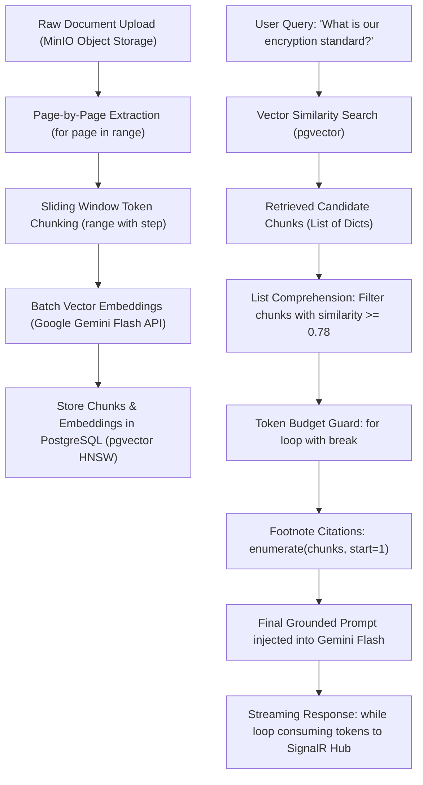
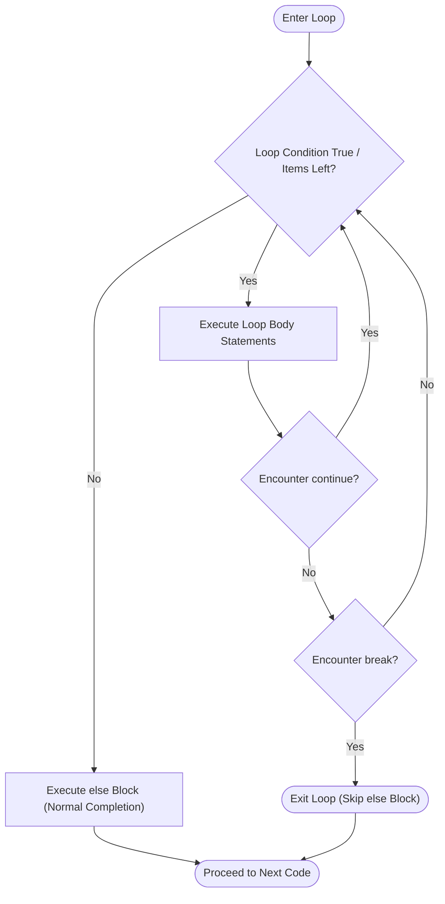

# Module 4: Loops, Iteration & Comprehensions

Welcome to **Module 4** of the Normora Python & AI Masterclass.

In production enterprise AI platforms like **Normora**, iteration is the operational engine behind every critical capability:
* **RAG Retrieval & Ranking:** Iterating over retrieved vector chunks, pruning low-scoring noise, and capping tokens before injecting into prompts.
* **Token Streaming & Telemetry:** Ingesting real-time streaming tokens emitted by Google Gemini Flash and accumulating latency metrics.
* **Batch Document Ingestion:** Slicing 100-page enterprise compliance handbooks into semantic chunks and generating vector embeddings in parallel batches.
* **Multi-Tenant Authorization & RBAC:** Evaluating role-based access control (RBAC), verifying departmental boundaries, and defending against Broken Object Level Authorization (BOLA) and Broken Function Level Authorization (BFLA).
* **Data Transformation:** Converting raw PostgreSQL/pgvector tuples into typed DTOs and clean JSON responses consumed by our Angular 22 SPA.

In this module, you will learn Python's iteration architecture from absolute scratch. Coming from C#/.NET, you will discover how Python's iterator protocol compares to `IEnumerable<T>`, how comprehensions replace C# LINQ with superior execution speed and conciseness, and how generator expressions prevent Out-Of-Memory (OOM) crashes when processing gigabytes of enterprise documents.

Every concept in this module includes **at least 5 real-world Normora examples**, accompanied by C# comparisons, architectural diagrams, caution alerts, and interview preparation questions.

---

## The Iteration Architecture in Normora

Before writing loops, let's visualize where iteration fits into Normora's document ingestion and RAG query pipeline:



---

## 1. The `for` Loop: Iterating Over Sequences and Collections

In Python, a `for` loop is fundamentally a **for-each iterator**. Unlike C-style loops (`for (int i = 0; i < n; i++)`), Python's `for` loop operates directly on any **iterable** object (lists, dictionaries, strings, sets, tuples, or custom generators).

### How It Works Under the Hood (The Iterator Protocol)
When you write `for item in collection:`, Python executes the following two steps behind the scenes:
1. Calls `iter(collection)` to obtain an **iterator** object (which implements the `__iter__()` method).
2. Repeatedly calls `next(iterator)` (which invokes `__next__()`) to fetch each item until the iterator raises a `StopIteration` exception, which Python catches internally to terminate the loop cleanly.

> [!NOTE]
> For .NET architects: Python's iterator protocol is the exact equivalent of C#'s `IEnumerable<T>.GetEnumerator()` and `IEnumerator<T>.MoveNext()` / `Current`.

### 5 Real-World Normora Examples:

#### Example 1.1: Iterating Over Retrieved Document Chunks (Lists of Dictionaries)
When pgvector returns semantic search matches, we iterate over the chunk collection to inspect metadata and extract clean preview snippets:
```python
retrieved_chunks = [
    {"chunk_id": "chk-101", "document": "Security_Policy.pdf", "page": 12, "similarity": 0.92},
    {"chunk_id": "chk-102", "document": "Employee_Handbook.pdf", "page": 4, "similarity": 0.86},
    {"chunk_id": "chk-103", "document": "IT_Disaster_Recovery.pdf", "page": 29, "similarity": 0.79}
]

for chunk in retrieved_chunks:
    print(f"Inspecting Chunk [{chunk['chunk_id']}] from '{chunk['document']}' (Page {chunk['page']})")
    print(f" -> Cosine Similarity Score: {chunk['similarity']:.2f}")
```

#### Example 1.2: Iterating Over Tenant Configurations Using `.items()` (Dictionaries)
Dictionaries provide three iteration methods: `.keys()` (keys only), `.values()` (values only), and `.items()` (both key and value as a tuple). In Normora, we iterate over tenant quota configurations to enforce plan boundaries:
```python
tenant_quotas = {
    "max_documents": 5000,
    "max_monthly_tokens": 10_000_000,
    "max_concurrent_chats": 50,
    "allowed_file_types": 8
}

# Iterating over key-value pairs simultaneously:
for quota_name, quota_limit in tenant_quotas.items():
    formatted_name = quota_name.replace("_", " ").title()
    print(f"Quota Policy: {formatted_name:<22} -> Limit: {quota_limit:,}")
```

#### Example 1.3: Iterating Over Conversation Message History to Calculate Total Tokens
To prevent overflowing the LLM context window, we iterate over past conversation turns and compute cumulative token usage:
```python
conversation_history = [
    {"role": "system", "content": "You are Normora's AI enterprise assistant.", "tokens": 15},
    {"role": "user", "content": "What is our data retention policy?", "tokens": 8},
    {"role": "assistant", "content": "Company records must be retained for 7 years.", "tokens": 12},
    {"role": "user", "content": "Does this apply to draft emails?", "tokens": 7}
]

total_prompt_tokens = 0
for message in conversation_history:
    total_prompt_tokens += message["tokens"]
    print(f"Turn [{message['role']:<9}]: {message['tokens']} tokens | Running total: {total_prompt_tokens}")

print(f"\nFinal Context Consumption: {total_prompt_tokens} tokens")
```

#### Example 1.4: Character-by-Character Inspection for Tenant Slug Sanitization (Strings)
Strings are immutable sequences of characters. In Normora, tenant vanity URLs (slugs) must consist strictly of lowercase alphanumeric characters and hyphens:
```python
candidate_slug = "Acme-Corp_2026!"
sanitized_chars = []

for char in candidate_slug:
    if char.isalnum() or char == "-":
        sanitized_chars.append(char.lower())
    else:
        print(f"Warning: Stripping invalid character '{char}' from slug.")

valid_tenant_slug = "".join(sanitized_chars)
print(f"Sanitized Tenant Slug: '{valid_tenant_slug}'")
```

#### Example 1.5: Iterating Over Keycloak JWT Claim Roles for Departmental BFLA Access Control
When an authenticated user invokes an administrative MediatR command, we iterate over their decoded Keycloak token roles to verify authorization:
```python
jwt_roles = ["tenant_member", "documents_viewer", "legal_compliance_auditor"]
required_permission = "legal_compliance_auditor"

has_permission = False
for role in jwt_roles:
    if role == required_permission:
        has_permission = True
        print(f"Access Granted: Found matching claim '{role}'.")
        break

if not has_permission:
    print("BFLA Violation: HTTP 403 Forbidden - Missing required role.")
```

---

## 2. Generating Sequences with `range()`

The built-in `range()` function generates an immutable sequence of integers on demand. It is **lazy**—it does not pre-allocate millions of numbers in RAM, making it $O(1)$ in memory regardless of size.

### Syntax Variations
* `range(stop)`: Generates numbers from `0` up to `stop - 1`.
* `range(start, stop)`: Generates numbers from `start` up to `stop - 1` (stop is always **exclusive**).
* `range(start, stop, step)`: Generates numbers from `start`, incrementing by `step` each turn.

> [!NOTE]
> C# Equivalent: C#'s `Enumerable.Range(start, count)` takes a `count` as its second argument, whereas Python's `range(start, stop)` takes the **exclusive upper bound** `stop`. In C#: `Enumerable.Range(1, 5)` yields 1, 2, 3, 4, 5. In Python: `range(1, 5)` yields 1, 2, 3, 4.

### 5 Real-World Normora Examples:

#### Example 2.1: Exponential Backoff Retry Loop for Google Gemini Flash API
When external AI cloud APIs encounter transient HTTP 429 (rate limit) or 503 (service unavailable) responses, we retry with exponential backoff:
```python
max_retries = 4

for attempt in range(1, max_retries + 1):
    backoff_delay = 2 ** attempt
    print(f"Calling Google Gemini Flash (Attempt {attempt} of {max_retries})...")
    # Simulate API failure on first 2 attempts
    if attempt < 3:
        print(f"  -> Rate limited (HTTP 429). Backing off for {backoff_delay} seconds...")
    else:
        print("  -> Success: Received 200 OK from Gemini Flash!")
        break
```

#### Example 2.2: Paginating Multi-Page PDF Documents During Ingestion
When a background worker extracts text from an enterprise contract, we loop through all page indices:
```python
total_document_pages = 6

# Page numbering in business documents starts at 1:
for page_number in range(1, total_document_pages + 1):
    print(f"Worker Job [DOC-882]: Extracting text & OCR tables from Page {page_number}/{total_document_pages}")
```

#### Example 2.3: Sliding-Window Chunking with Step Overlap
In Normora's document module, large texts are chunked with a sliding token window (e.g., 500 tokens per chunk with 100 tokens of overlap, meaning a step size of 400):
```python
total_tokens = 1500
chunk_size = 500
overlap = 100
step_size = chunk_size - overlap  # 400 tokens forward per step

for start_offset in range(0, total_tokens, step_size):
    end_offset = min(start_offset + chunk_size, total_tokens)
    print(f"Generated Chunk: Token window [{start_offset} : {end_offset}] (Length: {end_offset - start_offset})")
```

#### Example 2.4: Batch Vector Upsert Slicing into PostgreSQL pgvector
PostgreSQL performs best when embedding vectors are inserted in batches (e.g., 50 chunks at a time) rather than single-row queries:
```python
total_embeddings = 135
batch_size = 50

for batch_start in range(0, total_embeddings, batch_size):
    batch_end = min(batch_start + batch_size, total_embeddings)
    print(f"Executing pgvector batch upsert: Chunks {batch_start} to {batch_end - 1} ({batch_end - batch_start} rows)")
```

#### Example 2.5: Generating Tenant Audit Log Partition Keys Across Rolling 30-Day Windows
Normora partitions high-volume audit logs into monthly tables. We generate partition boundaries using step intervals:
```python
# Slicing a 90-day compliance retention window into 30-day blocks:
for day_offset in range(0, 90, 30):
    start_day = day_offset
    end_day = day_offset + 30
    print(f"PostgreSQL Partition: audit_logs_p_day_{start_day}_to_{end_day}")
```

---

## 3. Essential Iteration Power Tools: `enumerate()`

In traditional languages, developers often maintain a manual counter variable (`int i = 0; i++`) or write `for i in range(len(items)):`. In Python, **manual index counters are an anti-pattern**. 

Use `enumerate()`: it takes any iterable and returns an iterator of tuples containing the current index and the item.

### Syntax
```python
enumerate(iterable, start=0)
```
The optional `start` parameter lets you start numbering from 1 (or any integer) instead of 0!

> [!NOTE]
> C# Equivalent: C#'s LINQ method `.Select((item, index) => ...)` produces index-item pairings, but creates delegate overhead. Python's `enumerate()` is a built-in C-level generator with zero allocation penalty.

### 5 Real-World Normora Examples:

#### Example 3.1: Formatting 1-Based Citation Footnotes for Gemini Flash RAG Answers
In Normora's conversational AI responses, every grounding citation must be clearly numbered `[1]`, `[2]`, etc.:
```python
verified_sources = [
    "HR_Benefits_Guide_2026.pdf (Page 14)",
    "Corporate_Travel_Policy.pdf (Page 3)",
    "Remote_Work_Security_Standard.pdf (Page 9)"
]

print("--- Gemini Flash Response Citations ---")
for index, source in enumerate(verified_sources, start=1):
    print(f"[{index}] {source}")
```

#### Example 3.2: Assigning Sequential Chunk Ordinals Within a Document
When splitting a contract into vector embeddings, every chunk must record its sequential position (`chunk_ordinal`) for reconstructed document viewing:
```python
extracted_paragraphs = [
    "Section 1: Mutual Non-Disclosure Obligations.",
    "Section 2: Proprietary Information Definitions.",
    "Section 3: Term of Agreement and Exclusions."
]

for ordinal, paragraph_text in enumerate(extracted_paragraphs, start=1):
    chunk_record = {
        "document_id": "DOC-9921",
        "ordinal": ordinal,
        "content": paragraph_text
    }
    print(f"Indexed Chunk #{chunk_record['ordinal']}: '{chunk_record['content'][:35]}...'")
```

#### Example 3.3: Step-by-Step Progress Logging in Background Ingestion Workers
Background workers emit OpenTelemetry traces and SignalR progress notifications for each pipeline stage:
```python
ingestion_pipeline_stages = [
    "MinIO Object Storage Ingestion",
    "MIME Validation & Virus Scanning",
    "PyPDF Layout & Table Extraction",
    "Semantic Chunk Boundary Splitting",
    "Google Gemini Embedding Generation",
    "PostgreSQL HNSW Index Commit"
]

total_stages = len(ingestion_pipeline_stages)
for step_num, stage_name in enumerate(ingestion_pipeline_stages, start=1):
    percent_complete = (step_num / total_stages) * 100
    print(f"Stage {step_num}/{total_stages} ({percent_complete:.0f}%): {stage_name}")
```

#### Example 3.4: Generating Numbered Conversation Audit Transcripts
For SOC 2 compliance, Normora generates numbered audit transcripts of user-AI interactions:
```python
chat_dialogue = [
    ("User", "Can I export customer financial records to CSV?"),
    ("Assistant", "No. Under Normora Data Loss Prevention rules, financial exports require Admin approval."),
    ("User", "Who is the compliance administrator for Finance?"),
    ("Assistant", "The compliance administrator is Sarah Chen (sarah.chen@normora.internal).")
]

for line_no, (speaker, utterance) in enumerate(chat_dialogue, start=1):
    print(f"Turn #{line_no:02d} [{speaker}]: {utterance}")
```

#### Example 3.5: Computing Mean Reciprocal Rank (MRR) from Vector Search Rankings
In RAG evaluation, Mean Reciprocal Rank assesses how high the first truly relevant document chunk ranked:
```python
retrieved_chunk_ids = ["chk-502", "chk-109", "chk-304", "chk-771"]
ground_truth_relevant_id = "chk-304"

for rank, chunk_id in enumerate(retrieved_chunk_ids, start=1):
    if chunk_id == ground_truth_relevant_id:
        reciprocal_rank = 1.0 / rank
        print(f"Ground truth chunk found at Rank {rank}! Reciprocal Rank: {reciprocal_rank:.4f}")
        break
```

---

## 4. Parallel Iteration with `zip()`

When you have two or more independent collections of related data, `zip()` pairs their corresponding elements into tuples. Iteration stops as soon as the shortest collection is exhausted.

### Safe Zipping in Python 3.10+: `strict=True`
If your collections are expected to have the exact same length (such as chunk IDs and similarity scores), pass `strict=True`. If the collections differ in length, Python raises a `ValueError` instead of silently dropping data!

> [!NOTE]
> C# Equivalent: C#'s `collectionA.Zip(collectionB, (a, b) => new { A = a, B = b })`. Python's `zip()` accepts an arbitrary number of iterables: `zip(a, b, c, d)`.

### 5 Real-World Normora Examples:

#### Example 4.1: Pairing Retrieved Chunk IDs with Similarity Scores and Source Files
When vector search results return separate parallel lists from database columns:
```python
chunk_ids = ["chk-01", "chk-02", "chk-03"]
similarity_scores = [0.942, 0.887, 0.812]
source_documents = ["Compliance.pdf", "Security.pdf", "Employee_Guide.pdf"]

# Safely combine all three lists in lockstep:
for cid, score, doc in zip(chunk_ids, similarity_scores, source_documents, strict=True):
    print(f"Chunk ID: {cid} | Score: {score:.3f} | Source: {doc}")
```

#### Example 4.2: Combining User IDs with Keycloak Roles and Department Assignments
Synchronizing incoming Keycloak tenant user sync payloads:
```python
user_ids = ["usr-101", "usr-102", "usr-103"]
assigned_roles = ["TenantAdmin", "Member", "Auditor"]
departments = ["Engineering", "Human Resources", "Legal"]

for uid, role, dept in zip(user_ids, assigned_roles, departments, strict=True):
    print(f"Assigning User [{uid}] -> Department: {dept:<16} | Role: {role}")
```

#### Example 4.3: Correlating Gemini Flash Stream Tokens with Latency Timestamps
Measuring inter-token latency during streaming AI responses:
```python
streamed_tokens = ["All", " company", " data", " must", " be", " encrypted."]
elapsed_ms = [45, 78, 110, 142, 175, 210]

for token, timestamp in zip(streamed_tokens, elapsed_ms, strict=True):
    print(f"T+{timestamp:03d}ms: Received token '{token}'")
```

#### Example 4.4: Parallel Verification of Original Text Against OCR Extracted Text
Verifying that OCR extraction did not truncate or distort critical legal terms:
```python
original_headings = ["1. Definitions", "2. Scope of Service", "3. Indemnification"]
ocr_extracted_headings = ["1. Definitions", "2. Scope of Service", "3. Indemnification"]

all_matched = True
for expected, actual in zip(original_headings, ocr_extracted_headings, strict=True):
    if expected != actual:
        print(f"Mismatch detected! Expected: '{expected}', Got: '{actual}'")
        all_matched = False

if all_matched:
    print("OCR Integrity Check Passed: All headings match verbatim.")
```

#### Example 4.5: Unzipping Collections with `zip(*matrix)`
You can reverse a zip operation using the unpack operator `*`. This is useful for separating chunk coordinates and embeddings:
```python
# Combined records from a database query:
chunk_records = [
    ("chk-1", 0.95, "Engineering"),
    ("chk-2", 0.89, "Legal"),
    ("chk-3", 0.77, "Finance")
]

# Unpack back into three distinct tuples:
ids, scores, depts = zip(*chunk_records)

print(f"Chunk IDs:    {ids}")
print(f"Scores:       {scores}")
print(f"Departments:  {depts}")
```

---

## 5. The `while` Loop & Loop Control Flow (`break`, `continue`, `else`)

A `while` loop continues executing as long as its condition evaluates to `True`. It is ideal for polling asynchronous background tasks, reading streaming network sockets, or running tasks with uncertain iteration counts.

### Control Statements
* **`break`**: Terminates the loop immediately and jumps to the code following the loop.
* **`continue`**: Skips the remaining statements in the *current* iteration and jumps immediately to the next evaluation.
* **`else` clause (Python's Unique Loop Feature)**: The `else` block attached to a loop executes **only if the loop completed normally without hitting a `break`**. If the loop terminates via `break`, the `else` block is completely skipped!

### Loop Control Flow Architecture


> [!IMPORTANT]
> The `for...else` and `while...else` construct is unique to Python. In C#, you must declare a boolean flag (`bool found = false; ... if (!found) { ... }`). In Python, the `else` clause cleanly eliminates the need for temporary boolean flags!

### 5 Real-World Normora Examples:

#### Example 5.1: Polling Background Ingestion Worker Status in MinIO/PostgreSQL
When a document is uploaded, we poll the background worker status until completed or timed out:
```python
poll_attempt = 0
MAX_POLL_ATTEMPTS = 5
job_status = "PROCESSING"

while job_status != "COMPLETED":
    poll_attempt += 1
    print(f"Polling Document Job [DOC-771] (Check #{poll_attempt})... Status: {job_status}")
    
    if poll_attempt == 3:
        job_status = "COMPLETED"  # Worker finishes on attempt 3
        print(f"Worker finished processing in {poll_attempt} attempts.")
        break
    
    if poll_attempt >= MAX_POLL_ATTEMPTS:
        print("Timeout Error: Ingestion worker exceeded maximum polling window.")
        break
```

#### Example 5.2: Accumulating Chunks into Gemini Prompt with Token Budget Guard
We iterate through candidate chunks, skipping low-quality ones (`continue`) and terminating as soon as our prompt token budget is filled (`break`):
```python
candidate_chunks = [
    {"id": "chk-1", "tokens": 350, "quality": "HIGH"},
    {"id": "chk-2", "tokens": 40,  "quality": "LOW"},    # Low quality -> Skip
    {"id": "chk-3", "tokens": 400, "quality": "HIGH"},
    {"id": "chk-4", "tokens": 500, "quality": "HIGH"},   # Would exceed budget -> Stop
    {"id": "chk-5", "tokens": 200, "quality": "HIGH"}
]

MAX_PROMPT_BUDGET = 900
accumulated_tokens = 0
injected_chunk_ids = []

for chunk in candidate_chunks:
    # 1. Skip unhelpful or low-quality chunks:
    if chunk["quality"] == "LOW":
        print(f"Skipping {chunk['id']}: Quality is below threshold.")
        continue

    # 2. Halt immediately if this chunk pushes us over budget:
    if accumulated_tokens + chunk["tokens"] > MAX_PROMPT_BUDGET:
        print(f"Budget limit reached ({accumulated_tokens} tokens). Halting at {chunk['id']}.")
        break

    injected_chunk_ids.append(chunk["id"])
    accumulated_tokens += chunk["tokens"]

print(f"Selected Chunks: {injected_chunk_ids} | Total Tokens: {accumulated_tokens}/{MAX_PROMPT_BUDGET}")
```

#### Example 5.3: Consuming Streaming Tokens from Gemini Flash Until Sentinel
Consuming streaming tokens emitted from an AI generator until reaching the `[DONE]` sentinel:
```python
incoming_stream_tokens = ["Normora", " uses", " pgvector", " for", " HNSW", " indexing.", "[DONE]"]

stream_index = 0
assembled_response = []

while stream_index < len(incoming_stream_tokens):
    token = incoming_stream_tokens[stream_index]
    stream_index += 1
    
    if token == "[DONE]":
        print("\nStream End-Of-Message sentinel received.")
        break
        
    assembled_response.append(token)
    print(token, end="", flush=True)

print(f"\nFinal Assembled Text: '{''.join(assembled_response)}'")
```

#### Example 5.4: Unique `for...else` Search: Finding Exact Match or Triggering Fallback
Search for a high-confidence exact match chunk (similarity >= 0.95). If none is found, the `else` block executes to trigger a broader hybrid fallback search:
```python
search_results = [
    {"chunk_id": "c1", "similarity": 0.82},
    {"chunk_id": "c2", "similarity": 0.89},
    {"chunk_id": "c3", "similarity": 0.91}
]

EXACT_MATCH_THRESHOLD = 0.95

for result in search_results:
    if result["similarity"] >= EXACT_MATCH_THRESHOLD:
        print(f"Direct Hit! Serving chunk {result['chunk_id']} without LLM synthesis.")
        break
else:
    # This executes ONLY if the loop finishes without breaking:
    print("No direct high-confidence match found. Fallback: Triggering full RAG prompt synthesis.")
```

#### Example 5.5: Unique `while...else` Retry: Exhausting Retries Without Success
Attempt to acquire a distributed Redis lock for document processing; if all retries are exhausted, raise an alert:
```python
connection_attempts = 0
MAX_ATTEMPTS = 3
lock_acquired = False

while connection_attempts < MAX_ATTEMPTS:
    connection_attempts += 1
    print(f"Attempting to acquire distributed lock (Attempt {connection_attempts})...")
    # Simulate failed lock acquisition
    if lock_acquired:
        print("Lock successfully acquired.")
        break
else:
    # Executes only if the loop never hit 'break'
    print("Alert: Failed to acquire distributed lock after all attempts. Queueing job for dead-letter retry.")
```

---

## 6. Nested Loops & Multi-Dimensional Processing

Nested loops occur when a loop runs inside the body of another loop. While powerful for multi-dimensional data (e.g., iterating over tenants, then their documents, then each document's chunks), keep algorithmic complexity in mind: nested loops are $O(N \times M)$.

### 5 Real-World Normora Examples:

#### Example 6.1: Iterating Over Multi-Tenant Workspaces and Document Libraries
Auditing all documents across multiple active tenant accounts:
```python
tenants = [
    {"tenant_id": "T-01", "name": "Acme Corp", "documents": ["Security.pdf", "OrgChart.docx"]},
    {"tenant_id": "T-02", "name": "HealthGlobal", "documents": ["HIPAA_Guide.pdf", "Consent.pdf", "Audit.xlsx"]}
]

for tenant in tenants:
    print(f"\nAuditing Tenant: {tenant['name']} ({tenant['tenant_id']})")
    for doc in tenant["documents"]:
        print(f"  -> Verifying encryption at rest for: {doc}")
```

#### Example 6.2: Comparing Cross-Document Chunk Similarities for Duplicate Detection
Detecting redundant text chunks across newly uploaded versions of an employee policy:
```python
doc_a_chunks = ["All employees receive 15 days PTO.", "Working hours are 9 AM to 5 PM."]
doc_b_chunks = ["All employees receive 15 days PTO.", "Health insurance starts on Day 1."]

duplicates_found = []
for idx_a, text_a in enumerate(doc_a_chunks):
    for idx_b, text_b in enumerate(doc_b_chunks):
        if text_a == text_b:
            duplicates_found.append((idx_a, idx_b, text_a))

for idx_a, idx_b, dup_text in duplicates_found:
    print(f"Duplicate found between Doc A (Chunk {idx_a}) and Doc B (Chunk {idx_b}): '{dup_text}'")
```

#### Example 6.3: Multi-Department RBAC Role and Permission Matrix Validation
Validating that all departmental roles possess their required baseline security permissions:
```python
department_roles = {
    "Legal": ["read_contracts", "export_audit", "sign_approvals"],
    "Engineering": ["read_docs", "write_code", "deploy_service"],
    "HR": ["read_profiles", "manage_benefits"]
}

MANDATORY_BASE_PERMISSIONS = ["read_docs", "read_contracts", "read_profiles"]

for department, permissions in department_roles.items():
    print(f"Checking Department: {department}")
    for perm in permissions:
        if perm in MANDATORY_BASE_PERMISSIONS:
            print(f"  [PASS] Verified read permission: '{perm}'")
```

#### Example 6.4: Flattening Multi-Page PDF Table Cells into Structured Records
Extracting structured cell values from multiple pages of an uploaded financial balance sheet:
```python
pdf_pages_tables = [
    [["Asset Name", "Valuation"], ["Office Lease", "$120,000"]],
    [["Server Hardware", "$45,000"], ["Software Licenses", "$18,000"]]
]

flat_table_records = []
for page_index, table in enumerate(pdf_pages_tables, start=1):
    for row in table:
        flat_table_records.append({"page": page_index, "column_1": row[0], "column_2": row[1]})

for record in flat_table_records:
    print(f"Page {record['page']}: {record['column_1']:<20} -> {record['column_2']}")
```

#### Example 6.5: Batching Multiple Document Queries Against Vector Partition Namespaces
Querying multiple departmental vector namespaces with user search queries:
```python
search_queries = ["maternity leave policy", "401k match"]
target_departments = ["hr_documents", "legal_documents"]

for query in search_queries:
    print(f"\nExecuting Hybrid Search for: '{query}'")
    for dept_namespace in target_departments:
        print(f"  -> Scanning pgvector namespace: '{dept_namespace}' with HNSW index")
```

---

## 7. List Comprehensions: Expressive Sequence Transformation

A **list comprehension** is Python's signature construct for transforming, mapping, and filtering collections in a single, concise line.

### Syntax
```python
[expression for item in iterable if condition]
```

### Why Use List Comprehensions?
1. **Performance:** List comprehensions run at C-speed in CPython because the loop bytecode and `.append()` call are optimized into a specialized opcode (`LIST_APPEND`).
2. **Readability:** Replaces 4-5 lines of boilerplate accumulator loops with one clear declaration.

### Transformation vs. Filtering vs. Ternary Expressions
* **Filtering (`if` at the end):** `[x for x in list if x > 10]` (includes only matching elements).
* **Transformation with Ternary (`if-else` before `for`):** `[x if x > 10 else 0 for x in list]` (keeps all elements, transforming matching ones).

> [!NOTE]
> C# Equivalent: 
> * Python: `[x.strip() for x in titles if len(x) > 5]`
> * C# LINQ: `titles.Where(x => x.Length > 5).Select(x => x.Trim()).ToList()`

### 5 Real-World Normora Examples:

#### Example 7.1: Filtering Vector Search Results by Cosine Similarity Threshold
Extracting only high-relevance chunks to inject into the Google Gemini context:
```python
raw_search_results = [
    {"chunk_id": "c-1", "similarity": 0.94},
    {"chunk_id": "c-2", "similarity": 0.62},  # Low relevance noise
    {"chunk_id": "c-3", "similarity": 0.88},
    {"chunk_id": "c-4", "similarity": 0.45}   # Low relevance noise
]

SIMILARITY_THRESHOLD = 0.78

# Filter using list comprehension:
qualified_chunks = [
    chunk["chunk_id"] 
    for chunk in raw_search_results 
    if chunk["similarity"] >= SIMILARITY_THRESHOLD
]
print(f"Qualified chunks for context window: {qualified_chunks}")  # ['c-1', 'c-3']
```

#### Example 7.2: Normalizing and Cleaning Raw Document Titles from MinIO
Sanitizing dirty filenames uploaded by end users:
```python
raw_filenames = ["  Q3_Security_Audit.PDF  ", "employee-handbook.pdf  ", "  TERMS_OF_SERVICE.md"]

# Strip whitespace and convert to lowercase:
clean_filenames = [filename.strip().lower() for filename in raw_filenames]
print(f"Normalized Filenames: {clean_filenames}")
# ['q3_security_audit.pdf', 'employee-handbook.pdf', 'terms_of_service.md']
```

#### Example 7.3: Extracting Token Lengths Across Conversation Messages
Calculating token lengths of all user messages to analyze average prompt size:
```python
messages = [
    {"role": "user", "text": "What is our vacation policy?"},
    {"role": "assistant", "text": "Employees receive 20 days paid vacation."},
    {"role": "user", "text": "Does unused vacation roll over to next year?"}
]

# Approximate token count: 1 token ≈ 4 characters
user_token_estimates = [len(m["text"]) // 4 for m in messages if m["role"] == "user"]
print(f"User message token estimates: {user_token_estimates}")  # [7, 11]
```

#### Example 7.4: Formatting Citations with Conditional Prefix Tagging (Ternary Expression)
Tagging citations with `[VERIFIED]` if similarity is above 0.90, or `[SUPPORTING]` otherwise:
```python
chunks = [
    {"doc": "Legal_Charter.pdf", "score": 0.95},
    {"doc": "Draft_Notes.docx", "score": 0.82}
]

# Ternary if-else placed before the 'for' loop:
citation_labels = [
    f"[VERIFIED] {c['doc']}" if c["score"] >= 0.90 else f"[SUPPORTING] {c['doc']}"
    for c in chunks
]
print(citation_labels)
# ['[VERIFIED] Legal_Charter.pdf', '[SUPPORTING] Draft_Notes.docx']
```

#### Example 7.5: Flattening a 2D List of Departmental Document Chunks into a 1D Batch
Comprehensions can include multiple `for` clauses to flatten nested lists:
```python
departmental_chunks = [
    ["chk-legal-1", "chk-legal-2"],
    ["chk-hr-1"],
    ["chk-eng-1", "chk-eng-2", "chk-eng-3"]
]

# Read from left to right: for each sublist in departmental_chunks, for each chunk in sublist
flattened_batch = [chunk for sublist in departmental_chunks for chunk in sublist]
print(f"Flattened Batch for Embedding API: {flattened_batch}")
# ['chk-legal-1', 'chk-legal-2', 'chk-hr-1', 'chk-eng-1', 'chk-eng-2', 'chk-eng-3']
```

---

## 8. Dictionary Comprehensions: Dynamic Hash Maps

A **dictionary comprehension** builds a new dictionary by evaluating key-value expressions over an iterable.

### Syntax
```python
{key_expression: value_expression for item in iterable if condition}
```

> [!NOTE]
> C# Equivalent: C#'s LINQ `.ToDictionary(k => ..., v => ...)`.

### 5 Real-World Normora Examples:

#### Example 8.1: Creating a Fast $O(1)$ User-to-Role Lookup Map
Transforming a list of Keycloak user records into a direct lookup dictionary:
```python
user_records = [
    {"user_id": "usr-1", "name": "Alice", "role": "TenantAdmin"},
    {"user_id": "usr-2", "name": "Bob", "role": "Member"},
    {"user_id": "usr-3", "name": "Charlie", "role": "Auditor"}
]

user_role_map = {u["user_id"]: u["role"] for u in user_records}
print(user_role_map)
# {'usr-1': 'TenantAdmin', 'usr-2': 'Member', 'usr-3': 'Auditor'}
print(f"Alice's Role: {user_role_map.get('usr-1')}")
```

#### Example 8.2: Inverting a Department-to-Tenant Mapping for Reverse Lookup
Inverting a mapping to enable fast lookups of which tenant owns a given department:
```python
dept_to_tenant = {
    "dept-eng": "tenant-alpha",
    "dept-legal": "tenant-alpha",
    "dept-finance": "tenant-beta"
}

# Reverse mapping:
tenant_to_dept = {tenant: dept for dept, tenant in dept_to_tenant.items()}
print(tenant_to_dept)
```

#### Example 8.3: Aggregating Token Usage Totals Keyed by Tenant ID
Converting raw billing usage logs into a summary dictionary:
```python
tenant_usage_logs = [
    {"tenant_id": "T-100", "daily_tokens": 450_000},
    {"tenant_id": "T-200", "daily_tokens": 1_200_000},
    {"tenant_id": "T-300", "daily_tokens": 80_000}
]

# Calculate estimated cost at $0.002 per 1K tokens:
tenant_cost_map = {
    log["tenant_id"]: (log["daily_tokens"] / 1000) * 0.002 
    for log in tenant_usage_logs
}
print(f"Tenant Billing Estimates: {tenant_cost_map}")
# {'T-100': 0.9, 'T-200': 2.4, 'T-300': 0.16}
```

#### Example 8.4: Filtering Active Tenant Configs from a Global Registry
Filtering out suspended tenants from memory:
```python
tenant_registry = {
    "T-101": {"name": "Acme Corp", "status": "ACTIVE"},
    "T-102": {"name": "Beta Labs", "status": "SUSPENDED"},
    "T-103": {"name": "Gamma Health", "status": "ACTIVE"}
}

active_tenants = {
    tid: data["name"] 
    for tid, data in tenant_registry.items() 
    if data["status"] == "ACTIVE"
}
print(f"Active Tenants: {active_tenants}")
# {'T-101': 'Acme Corp', 'T-103': 'Gamma Health'}
```

#### Example 8.5: Mapping Chunk IDs to pgvector Coordinates
Creating a lookup table from chunk IDs to their source page coordinates:
```python
chunk_metadata = [
    {"id": "chk-1", "bbox": (50, 100, 400, 150)},
    {"id": "chk-2", "bbox": (50, 200, 400, 250)},
    {"id": "chk-3", "bbox": (50, 300, 400, 350)}
]

chunk_coordinate_index = {c["id"]: c["bbox"] for c in chunk_metadata}
print(f"Highlight bounding box for chk-2: {chunk_coordinate_index['chk-2']}")
```

---

## 9. Set Comprehensions: Unique Collections on the Fly

A **set comprehension** constructs an unordered collection of unique elements, automatically eliminating duplicates.

### Syntax
```python
{expression for item in iterable if condition}
```

> [!NOTE]
> C# Equivalent: C#'s LINQ `.Select(...).ToHashSet()`.

### 5 Real-World Normora Examples:

#### Example 9.1: Extracting Unique Departments Cited Across Retrieved Chunks
Determining which departments are referenced in an AI response to display departmental badge filters in Angular:
```python
cited_chunks = [
    {"doc": "Handbook.pdf", "dept": "HR"},
    {"doc": "Security.pdf", "dept": "Engineering"},
    {"doc": "Benefits.pdf", "dept": "HR"},
    {"doc": "Remote_Work.pdf", "dept": "Engineering"},
    {"doc": "Audit_Report.pdf", "dept": "Legal"}
]

# Set comprehension automatically removes duplicate "HR" and "Engineering":
cited_departments = {c["dept"] for c in cited_chunks}
print(f"Unique Departments Cited: {cited_departments}")
# {'HR', 'Engineering', 'Legal'}
```

#### Example 9.2: Collecting Unique File Extensions Among Pending Uploads
Validating file extensions across a batch document upload:
```python
uploaded_files = ["policy.pdf", "contract.docx", "appendix.pdf", "notes.txt", "scan.PDF"]

# Normalize and deduplicate:
unique_extensions = {file.split(".")[-1].lower() for file in uploaded_files}
print(f"Unique File Types Uploaded: {unique_extensions}")
# {'pdf', 'docx', 'txt'}
```

#### Example 9.3: Deduplicating Participant Emails in a Tenant Discussion Thread
Extracting unique participant emails for sending notification digests:
```python
thread_turns = [
    {"sender": "alice@normora.ai", "text": "Can we approve this NDA?"},
    {"sender": "bob@normora.ai", "text": "Reviewing now."},
    {"sender": "alice@normora.ai", "text": "Thanks Bob!"},
    {"sender": "legal-bot@normora.ai", "text": "Automated scan clean."}
]

# Deduplicate human participants (exclude automated bots):
human_participants = {
    turn["sender"] 
    for turn in thread_turns 
    if not turn["sender"].startswith("legal-bot")
}
print(f"Notification Recipients: {human_participants}")
# {'alice@normora.ai', 'bob@normora.ai'}
```

#### Example 9.4: Finding Distinct Permission Scopes Required by an AI Toolset
Compiling the comprehensive list of OAuth permission scopes needed by an AI agent:
```python
agent_tools = [
    {"tool": "search_docs", "scopes": ["docs:read"]},
    {"tool": "create_ticket", "scopes": ["tickets:write", "users:read"]},
    {"tool": "fetch_user_profile", "scopes": ["users:read"]}
]

# Flatten and deduplicate scopes:
required_scopes = {scope for tool in agent_tools for scope in tool["scopes"]}
print(f"Total Unique Scopes Needed: {required_scopes}")
# {'docs:read', 'tickets:write', 'users:read'}
```

#### Example 9.5: Identifying Unique Tenants with Degraded Document Ingestion Status
Scanning worker health logs to isolate impacted tenants:
```python
worker_job_logs = [
    {"tenant_id": "T-10", "status": "FAILED"},
    {"tenant_id": "T-20", "status": "COMPLETED"},
    {"tenant_id": "T-10", "status": "RETRYING"},
    {"tenant_id": "T-30", "status": "FAILED"}
]

degraded_tenants = {
    log["tenant_id"] 
    for log in worker_job_logs 
    if log["status"] in ("FAILED", "RETRYING")
}
print(f"Alert: Degraded Tenants Requiring Intervention: {degraded_tenants}")
# {'T-10', 'T-30'}
```

---

## 10. Generator Expressions vs. List Comprehensions: Memory Efficiency & Lazy Evaluation

Understanding the difference between **List Comprehensions** and **Generator Expressions** is what separates junior coders from enterprise AI architects.

### The Syntax Difference
* **List Comprehension:** Uses square brackets `[...]` -> **Eager Evaluation** (allocates the entire list in memory immediately).
* **Generator Expression:** Uses parentheses `(...)` -> **Lazy Evaluation** (produces items one at a time on demand).

### Memory Comparison
Let's measure the physical RAM consumption of processing 1,000,000 document embedding token counts using Python's standard `sys.getsizeof()`:

```python
import sys

# List Comprehension: Eagerly builds 1,000,000 integers in RAM
list_comp = [x * 2 for x in range(1_000_000)]
print(f"List Comprehension RAM: {sys.getsizeof(list_comp):,} bytes")
# ~8,448,728 bytes (~8.4 MB)

# Generator Expression: Allocates ONLY the generator state machine
gen_expr = (x * 2 for x in range(1_000_000))
print(f"Generator Expression RAM: {sys.getsizeof(gen_expr):,} bytes")
# ~200 bytes!
```

> [!IMPORTANT]
> The generator expression consumes just **200 bytes** whether you iterate over 10 items or 100,000,000 items! In high-throughput AI pipelines processing gigabytes of text chunks, using a list comprehension where a generator expression suffices can trigger Out-Of-Memory (OOM) pod crashes in Kubernetes.

### Built-In Aggregators That Consume Generators
Functions like `sum()`, `max()`, `min()`, `any()`, and `all()` accept generator expressions directly without requiring enclosing parentheses:
`sum(chunk["tokens"] for chunk in chunks)`

> [!NOTE]
> C# Equivalent: C#'s `IEnumerable<T>` with `yield return` or LINQ queries without `.ToList()`.

### 5 Real-World Normora Examples:

#### Example 10.1: Calculating Total Token Count Across 100,000 Chunks Using `sum()`
Computing token totals without pre-allocating an intermediate list in memory:
```python
# Simulating chunks retrieved from database
chunks = [{"id": f"chk-{i}", "tokens": 450} for i in range(1000)]

# Notice: No double parentheses needed inside sum()!
total_tokens = sum(c["tokens"] for c in chunks)
print(f"Total Indexed Tokens: {total_tokens:,}")  # 450,000
```

#### Example 10.2: BOLA Security Audit Using `any()` with Short-Circuit Evaluation
Checking if any retrieved document belongs to a different tenant. Because `any()` is lazy, it stops evaluating the instant it finds the first violation:
```python
current_tenant_id = "TENANT-42"

retrieved_docs = [
    {"doc_id": "D-1", "tenant_id": "TENANT-42"},
    {"doc_id": "D-2", "tenant_id": "TENANT-42"},
    {"doc_id": "D-3", "tenant_id": "TENANT-99"},  # BOLA VIOLATION!
    {"doc_id": "D-4", "tenant_id": "TENANT-42"}
]

# Short-circuits immediately at D-3:
has_cross_tenant_leak = any(doc["tenant_id"] != current_tenant_id for doc in retrieved_docs)

if has_cross_tenant_leak:
    print("CRITICAL SECURITY ALERT: BOLA violation detected! Aborting response (HTTP 404).")
```

#### Example 10.3: Finding the Highest Similarity Score with `max()`
Finding the top-scoring vector similarity score across a generator:
```python
scored_chunks = [
    {"id": "chk-1", "score": 0.812},
    {"id": "chk-2", "score": 0.945},
    {"id": "chk-3", "score": 0.760}
]

highest_score = max(c["score"] for c in scored_chunks)
print(f"Peak Cosine Similarity: {highest_score:.3f}")  # 0.945
```

#### Example 10.4: Verifying That All Tenant Memberships Are Active Using `all()`
Ensuring all users invited to a confidential legal workspace have completed onboarding:
```python
workspace_members = [
    {"user": "alice@normora.ai", "is_active": True},
    {"user": "bob@normora.ai", "is_active": True},
    {"user": "carol@normora.ai", "is_active": False}
]

is_workspace_fully_onboarded = all(m["is_active"] for m in workspace_members)
print(f"All members active: {is_workspace_fully_onboarded}")  # False
```

#### Example 10.5: Streaming Massive MinIO Document Text Line-by-Line
Filtering lines from a multi-gigabyte log file or document stream without loading the whole file into RAM:
```python
raw_log_stream = [
    "2026-11-18 INFO Ingestion started",
    "2026-11-18 ERROR Connection to MinIO timed out",
    "2026-11-18 INFO Retrying connection",
    "2026-11-18 ERROR pgvector lock contention"
]

# Lazy generator yields matching error lines on demand:
error_stream = (line for line in raw_log_stream if "ERROR" in line)

for error_line in error_stream:
    print(f"Forwarding to OpenTelemetry Alert: {error_line}")
```

---

## 11. Advanced Iteration with the `itertools` Module

Python's standard library includes `itertools`, an ultra-fast, memory-efficient collection of iterator building blocks written in C.

### Key `itertools` Functions
1. **`itertools.chain(*iterables)`**: Concatenates multiple collections into one continuous stream without copying elements.
2. **`itertools.product(*iterables)`**: Computes the Cartesian product (cross-join) of multiple iterables.
3. **`itertools.combinations(iterable, r)`**: Produces all unique subsets of length $r$ (order does not matter; no replacement).
4. **`itertools.permutations(iterable, r)`**: Produces all possible ordered arrangements of length $r$.
5. **`itertools.groupby(iterable, key=func)`**: Groups consecutive elements by a key. **Crucial:** The iterable must be sorted by the key first!

### 5 Real-World Normora Examples:

#### Example 11.1: `itertools.chain()`: Merging Hot Cache & Cold Storage Document Chunks
Combining cached in-memory chunks with database archive chunks into a single stream:
```python
import itertools

hot_cache_chunks = [{"id": "chk-1", "src": "Redis"}, {"id": "chk-2", "src": "Redis"}]
cold_db_chunks = [{"id": "chk-3", "src": "PostgreSQL"}, {"id": "chk-4", "src": "MinIO"}]

# Seamlessly iterate across both collections without allocating a new merged list:
for chunk in itertools.chain(hot_cache_chunks, cold_db_chunks):
    print(f"Processing chunk {chunk['id']} from source: {chunk['src']}")
```

#### Example 11.2: `itertools.product()`: Generating Comprehensive RBAC Test Matrices
Generating a full Cartesian matrix of tenant roles and API actions for automated unit testing:
```python
import itertools

roles = ["Owner", "Admin", "Member"]
endpoints = ["/api/v1/documents", "/api/v1/tenants/billing"]

# Cartesian product (Cross Join):
test_matrix = list(itertools.product(roles, endpoints))

print(f"Total Security Test Cases: {len(test_matrix)}")
for role, endpoint in test_matrix:
    print(f"  -> Testing Role '{role:<6}' against Endpoint: {endpoint}")
```

#### Example 11.3: `itertools.combinations()`: Pairwise Semantic Duplicate Detection
Generating every unique pair of document chunks to measure cosine similarity between them:
```python
import itertools

chunk_ids = ["chk-10", "chk-20", "chk-30", "chk-40"]

# Generate all unique pairs (4 choose 2 = 6 pairs):
pairwise_comparisons = list(itertools.combinations(chunk_ids, 2))

for c1, c2 in pairwise_comparisons:
    print(f"Evaluating Cosine Distance between: ({c1} <-> {c2})")
```

#### Example 11.4: `itertools.permutations()`: Testing Agent Tool Execution Ordering
Evaluating how Google Gemini Flash tool-calling plans handle permutations of tool calls:
```python
import itertools

agent_tools = ["search_knowledge_base", "verify_permissions", "compile_pdf"]

# Test all 6 sequential execution orders:
for step_order in itertools.permutations(agent_tools):
    execution_plan = " -> ".join(step_order)
    print(f"Plan Permutation: {execution_plan}")
```

#### Example 11.5: `itertools.groupby()`: Grouping Chunks by Document for Grounded Prompts
Grouping retrieved chunks by their parent document to format organized context blocks:
```python
import itertools

retrieved_chunks = [
    {"doc": "Compliance_Guide.pdf", "text": "All data encrypted."},
    {"doc": "Compliance_Guide.pdf", "text": "Audits conducted quarterly."},
    {"doc": "HR_Policy.pdf", "text": "Employees receive 15 days PTO."},
    {"doc": "Security_Standard.pdf", "text": "MFA mandatory for VPN."}
]

# Note: Data must be sorted by the grouping key first!
retrieved_chunks.sort(key=lambda x: x["doc"])

# Group chunks by document name:
for doc_name, group in itertools.groupby(retrieved_chunks, key=lambda x: x["doc"]):
    chunks_in_doc = list(group)
    print(f"\nDocument: {doc_name} ({len(chunks_in_doc)} chunks)")
    for c in chunks_in_doc:
        print(f"  * {c['text']}")
```

---

## 12. Python Loops & Comprehensions vs. C# / .NET LINQ

Coming from a .NET 10 background with C# Primary Constructors and LINQ, here is how Python iteration constructs translate:

| Feature / Concept | C# (.NET 10) Equivalent | Python Idiomatic Equivalent | Behavioral Differences |
|---|---|---|---|
| **Basic Iteration** | `foreach (var item in collection)` | `for item in collection:` | Python requires no type annotations or parentheses around the condition. |
| **Indexed Iteration** | `foreach (var (item, index) in items.Index())` (C# 9+) or `.Select((x, i) => ...)` | `for index, item in enumerate(items, start=0):` | Python's `enumerate()` allows setting custom starting index (`start=1`). |
| **Parallel Iteration** | `listA.Zip(listB, (a, b) => (a, b))` | `zip(listA, listB, strict=True)` | Python's `zip()` accepts 2+ collections and offers `strict=True` safety in 3.10+. |
| **Numeric Sequence** | `Enumerable.Range(start, count)` | `range(start, stop, step)` | Python takes `stop` (exclusive upper bound), C# takes `count`. |
| **Filtering & Mapping** | `items.Where(x => cond).Select(x => f(x)).ToList()` | `[f(x) for x in items if cond]` | List comprehension is faster and more readable than chained methods in Python. |
| **Dictionary Creation** | `items.ToDictionary(x => x.Id, x => x.Name)` | `{x["id"]: x["name"] for x in items}` | Dict comprehensions provide native conditional filtering. |
| **Set Deduplication** | `items.Select(x => x.Dept).ToHashSet()` | `{x["dept"] for x in items}` | Set comprehensions deduplicate automatically. |
| **Lazy Pipelines** | `IEnumerable<T>` (deferred execution) | Generator expressions: `(f(x) for x in items)` | Both stream $O(1)$ memory on demand. |
| **Collection Concatenation** | `listA.Concat(listB)` | `itertools.chain(listA, listB)` | Python does not copy elements or allocate intermediate memory. |
| **Cartesian Join** | `from a in listA from b in listB select (a, b)` | `itertools.product(listA, listB)` | Cleaner syntax for generating test and permission matrices. |
| **Loop-Else Clause** | No equivalent (requires `bool found = false; ... if (!found)`) | `for ... in ...: break else:` | Python's `else` executes only when loop completes without a `break`. |

---

## 13. Common Mistakes & Anti-Patterns

> [!CAUTION]
> ### Anti-Pattern 1: Mutating a List While Iterating Over It
> Modifying (deleting or appending to) a list while iterating over it causes the internal index pointer to shift, silently skipping elements or causing infinite loops:
> ```python
> # ❌ BUG: Skips elements because indices shift when items are deleted!
> chunks = ["chk-1", "chk-bad", "chk-bad", "chk-2"]
> for chunk in chunks:
>     if "bad" in chunk:
>         chunks.remove(chunk)
> print(chunks)  # Output: ['chk-1', 'chk-bad', 'chk-2'] -> chk-bad was skipped!
> 
> # ✅ FIX: Use a list comprehension to build a clean filtered copy:
> clean_chunks = [c for c in chunks if "bad" not in c]
> ```

> [!CAUTION]
> ### Anti-Pattern 2: Using a List Comprehension When a Generator Expression is Needed
> Using square brackets `[...]` inside aggregating functions creates a temporary list in memory that is immediately discarded:
> ```python
> # ❌ MEMORY WASTE: Allocates a 10,000,000-element list in RAM before summing!
> total_tokens = sum([chunk["tokens"] for chunk in ten_million_chunks])
> 
> # ✅ ARCHITECT FIX: Use a generator expression (parentheses omitted inside function call):
> total_tokens = sum(chunk["tokens"] for chunk in ten_million_chunks)  # Zero RAM overhead!
> ```

> [!CAUTION]
> ### Anti-Pattern 3: Forgetting That `itertools.groupby()` Requires Sorted Input
> Unlike SQL `GROUP BY` or LINQ `.GroupBy()`, Python's `itertools.groupby()` only aggregates **consecutive** matching items. If the collection is not pre-sorted by the grouping key, it creates multiple disjoint groups for the same key:
> ```python
> import itertools
> # ❌ BUG: "Engineering" appears twice separated by "Legal"
> docs = [{"dept": "Engineering"}, {"dept": "Legal"}, {"dept": "Engineering"}]
> 
> # Groups produced: [Engineering (1)], [Legal (1)], [Engineering (1)] -> WRONG!
> 
> # ✅ FIX: Always sort by the key before calling itertools.groupby:
> docs.sort(key=lambda x: x["dept"])
> # Now properly groups into [Engineering (2)] and [Legal (1)]
> ```

> [!CAUTION]
> ### Anti-Pattern 4: Misinterpreting the `for...else` Construct
> Many developers assume the `else` block runs when the loop condition is false, or when `break` is encountered. In Python, the `else` block runs **ONLY IF NO `break` WAS EXECUTED**.
> ```python
> # ❌ MISTAKE: Expecting else to run after a break
> for chunk in chunks:
>     if chunk["id"] == target_id:
>         break
> else:
>     # This runs ONLY when the item was NOT found!
>     print("Item not found!")
> ```

> [!CAUTION]
> ### Anti-Pattern 5: Deeply Nested, Unreadable Comprehensions
> While Python allows triple-nested comprehensions with complex condition chains, readability is a core Python philosophy (PEP 20: "Readability counts"):
> ```python
> # ❌ UNREADABLE COMPREHENSION:
> res = [c["id"] for t in tenants for d in t["docs"] for c in d["chunks"] if c["score"] > 0.8 and t["active"]]
> 
> # ✅ ARCHITECT FIX: Write a clean multi-line generator function or clear loops when nesting exceeds 2 levels.
> ```

> [!CAUTION]
> ### Anti-Pattern 6: Writing `for i in range(len(items)):`
> Index-based indexing is a vestige of C/Java. It is slower, less readable, and unpythonic:
> ```python
> # ❌ ANTI-PATTERN:
> for i in range(len(citations)):
>     print(f"{i + 1}: {citations[i]}")
> 
> # ✅ IDIOMATIC PYTHON:
> for index, citation in enumerate(citations, start=1):
>     print(f"{index}: {citation}")
> ```

---

## 14. Hands-On Project: Normora Enterprise Grounded Context Builder for Google Gemini Flash

Let's synthesize everything we have mastered—`for` loops, `range()`, `enumerate()`, `zip()`, list comprehensions, generator expressions, and `itertools`—into a production-grade component: the **Normora Grounded Context & Citation Builder**.

### The Architecture
1. **Deduplicate & Validate Chunks:** Filter candidate chunks by cosine similarity and tenant ID (BOLA guard).
2. **Sort & Group:** Group chunks by parent document name using `itertools.groupby()`.
3. **Cap Token Budget:** Iteratively accumulate chunks until reaching the prompt token ceiling (`break`).
4. **Format Footnotes:** Number citations sequentially using `enumerate(..., start=1)`.
5. **Stream Preparation:** Package into markdown ready for Google Gemini Flash.

Create `grounded_context_builder.py` and run it:

```python
# =====================================================================
# Normora Conversational AI Engine: Production Grounded Context Builder
# Module: Normora.Conversations.Domain.ContextBuilder
# =====================================================================

import itertools
import sys

# 1. Incoming Candidate Chunks from pgvector HNSW Query
raw_retrieved_chunks = [
    {
        "chunk_id": "chk-101",
        "tenant_id": "TENANT-42",
        "doc_name": "Employee_Handbook_2026.pdf",
        "page": 14,
        "department": "HR",
        "text": "Full-time employees receive 16 weeks of fully paid parental leave.",
        "tokens": 120,
        "similarity": 0.94
    },
    {
        "chunk_id": "chk-102",
        "tenant_id": "TENANT-42",
        "doc_name": "Cafeteria_Menu.pdf",
        "page": 1,
        "department": "Operations",
        "text": "Friday pizza is served on the second-floor kitchen at 12:00 PM.",
        "tokens": 45,
        "similarity": 0.38  # Irrelevant noise -> Filter out!
    },
    {
        "chunk_id": "chk-103",
        "tenant_id": "TENANT-42",
        "doc_name": "Employee_Handbook_2026.pdf",
        "page": 15,
        "department": "HR",
        "text": "Parental leave must be requested at least 30 days prior to commencement.",
        "tokens": 95,
        "similarity": 0.89
    },
    {
        "chunk_id": "chk-104",
        "tenant_id": "TENANT-42",
        "doc_name": "Remote_Work_Security_Standard.pdf",
        "page": 3,
        "department": "Engineering",
        "text": "All remote developer workstations must utilize hardware-backed FIDO2 security keys.",
        "tokens": 110,
        "similarity": 0.82
    }
]

CURRENT_TENANT_ID = "TENANT-42"
SIMILARITY_THRESHOLD = 0.75
MAX_PROMPT_TOKEN_BUDGET = 300

print("=" * 70)
print(" NORMORA RAG CONTEXT COMPILER FOR GOOGLE GEMINI FLASH")
print("=" * 70)

# Step 1: BOLA Tenant Boundary Security Check (Generator with any())
if any(c["tenant_id"] != CURRENT_TENANT_ID for c in raw_retrieved_chunks):
    raise PermissionError("BOLA Alert: Cross-tenant data leak detected in retrieved chunks!")

# Step 2: Filter by Similarity Threshold using List Comprehension
qualified_chunks = [
    chunk for chunk in raw_retrieved_chunks 
    if chunk["similarity"] >= SIMILARITY_THRESHOLD
]
print(f"[*] Similarity Filter: Kept {len(qualified_chunks)}/{len(raw_retrieved_chunks)} candidate chunks.")

# Step 3: Token Budget Enforcement with Loop & Break
selected_chunks = []
accumulated_tokens = 0

for chunk in qualified_chunks:
    if accumulated_tokens + chunk["tokens"] > MAX_PROMPT_TOKEN_BUDGET:
        print(f"[!] Token ceiling reached ({accumulated_tokens} tokens). Halting context inclusion.")
        break
    selected_chunks.append(chunk)
    accumulated_tokens += chunk["tokens"]

print(f"[*] Final Budget: {accumulated_tokens}/{MAX_PROMPT_TOKEN_BUDGET} tokens utilized.")

# Step 4: Extract Unique Cited Departments using Set Comprehension
cited_departments = {c["department"] for c in selected_chunks}
print(f"[*] Departments Cited: {', '.join(sorted(cited_departments))}")

# Step 5: Format Citations & Context Blocks using enumerate()
context_blocks = []
citations_registry = []

for index, chunk in enumerate(selected_chunks, start=1):
    citation_badge = f"[{index}] {chunk['doc_name']} (Page {chunk['page']})"
    citations_registry.append(citation_badge)
    
    block = f"""--- Source Chunk {index}: {citation_badge} ---
Department: {chunk['department']} | Relevance: {chunk['similarity']:.1%}
Content: "{chunk['text']}" """
    context_blocks.append(block)

# Step 6: Group by Source Document using itertools.groupby()
# Pre-sort by document name for groupby:
selected_chunks.sort(key=lambda x: x["doc_name"])

print("\n" + "=" * 70)
print(" CHUNKS GROUPED BY PARENT DOCUMENT (itertools.groupby):")
print("=" * 70)
for doc_name, group in itertools.groupby(selected_chunks, key=lambda x: x["doc_name"]):
    items = list(group)
    print(f"  Document '{doc_name}' -> {len(items)} chunk(s) included.")

# Step 7: Assemble Final Markdown Prompt Context
final_prompt_context = "\n\n".join(context_blocks)
citations_markdown = "\n".join(f"  * {cite}" for cite in citations_registry)

print("\n" + "=" * 70)
print(" GROUNDED PROMPT INJECTED INTO GOOGLE GEMINI FLASH:")
print("=" * 70)
print(final_prompt_context)

print("\n" + "=" * 70)
print(" CITATION FOOTNOTES FOR ANGULAR 22 SPA:")
print("=" * 70)
print(citations_markdown)
print("=" * 70)
```

### Script Execution Output
```text
======================================================================
 NORMORA RAG CONTEXT COMPILER FOR GOOGLE GEMINI FLASH
======================================================================
[*] Similarity Filter: Kept 3/4 candidate chunks.
[!] Token ceiling reached (215 tokens). Halting context inclusion.
[*] Final Budget: 215/300 tokens utilized.
[*] Departments Cited: HR

======================================================================
 CHUNKS GROUPED BY PARENT DOCUMENT (itertools.groupby):
======================================================================
  Document 'Employee_Handbook_2026.pdf' -> 2 chunk(s) included.

======================================================================
 GROUNDED PROMPT INJECTED INTO GOOGLE GEMINI FLASH:
======================================================================
--- Source Chunk 1: [1] Employee_Handbook_2026.pdf (Page 14) ---
Department: HR | Relevance: 94.0%
Content: "Full-time employees receive 16 weeks of fully paid parental leave." 

--- Source Chunk 2: [2] Employee_Handbook_2026.pdf (Page 15) ---
Department: HR | Relevance: 89.0%
Content: "Parental leave must be requested at least 30 days prior to commencement." 

======================================================================
 CITATION FOOTNOTES FOR ANGULAR 22 SPA:
======================================================================
  * [1] Employee_Handbook_2026.pdf (Page 14)
  * [2] Employee_Handbook_2026.pdf (Page 15)
======================================================================
```

---

## 15. Architectural Interview Questions & Answers

### Q1: How does Python's `for` loop work under the hood, and how does it differ from a C-style index loop?
**Answer:** A Python `for` loop is a pure iterator consumer governed by the **Python Iterator Protocol**. Under the hood, Python calls `iter(obj)` to obtain an iterator, then repeatedly calls `next(iterator)` until a `StopIteration` exception is raised. Unlike C or C# index loops (`for (int i = 0; i < n; i++)`), Python never uses an integer counter behind the scenes. This eliminates out-of-bounds indexing errors and allows identical iteration syntax across lists, dictionaries, database cursors, and streaming network sockets.

### Q2: When should an enterprise architect choose a generator expression over a list comprehension?
**Answer:** Use a **generator expression** `(...)` when:
1. The dataset is large (e.g., thousands of document vectors or streaming log lines) and loading it all into memory would risk Out-Of-Memory (OOM) errors.
2. The consumer is an aggregating function (`sum()`, `max()`, `min()`, `any()`, `all()`) that only needs one item at a time.
3. You want early-exit short-circuiting (e.g., `any()` halts on the first `True` without computing the remaining items).

Use a **list comprehension** `[...]` when you need the complete collection immediately, intend to index into it (`items[0]`), iterate over it multiple times, or pass it to an API that requires a materialized list.

### Q3: Explain Python's `for...else` construct. What problem does it solve in backend services?
**Answer:** The `else` clause attached to a loop executes **only if the loop completes all iterations without encountering a `break`**. If a `break` is executed, the `else` block is bypassed. It solves the common search/validation pattern where a service looks for a target item (e.g., searching candidate document chunks for an exact match) and needs to execute a fallback action (e.g., falling back to broad hybrid RAG) if no match was found, completely eliminating temporary boolean tracking flags (`bool found = false;`).

### Q4: Why is mutating a list while iterating over it dangerous in Python, and how should it be avoided?
**Answer:** In CPython, iterating over a list relies on an internal integer index counter. If you delete or insert elements during iteration (e.g., `.remove()` or `.pop()`), the remaining elements shift positions, but the internal counter continues incrementing. This causes subsequent items to be skipped silently without throwing an exception. To safely filter a collection, use a list comprehension (`[x for x in items if valid(x)]`) or iterate over a shallow copy (`for x in items[:]:`).

### Q5: How does `itertools.groupby()` differ from SQL `GROUP BY` or C# LINQ `.GroupBy()`?
**Answer:** C# LINQ `.GroupBy()` and SQL `GROUP BY` ingest the entire dataset into an internal hash table or sorting buffer to aggregate non-contiguous rows sharing the same key. In contrast, Python's `itertools.groupby()` is a streaming, $O(1)$ memory iterator that **only groups consecutive elements**. If elements sharing a key are separated by a different key, `itertools.groupby()` creates multiple disjoint groups. Therefore, the input sequence **must be sorted by the grouping key first** before calling `groupby()`.

### Q6: What is the benefit of using `zip(..., strict=True)` introduced in Python 3.10+?
**Answer:** By default, `zip()` silently terminates as soon as the shortest iterable is exhausted, discarding leftover elements in longer collections without warning. In production AI ingestion (e.g., pairing chunk IDs with embedding vectors and metadata), a length mismatch indicates data corruption or dropped network packets. Passing `strict=True` forces Python to validate equal lengths and raise a `ValueError` immediately upon disparity, preventing silent partial data ingestion.

### Q7: Why are list comprehensions faster than traditional `for` loops with `.append()` in CPython?
**Answer:** In a traditional `for` loop with `.append()`, CPython must perform two operations on every iteration: a global or local attribute lookup for the `.append` method, followed by a Python function call. In a list comprehension, CPython detects the comprehension pattern at compile time and emits the specialized C-level bytecode opcode `LIST_APPEND`. This bypasses method resolution and avoids Python function call frame overhead, resulting in 20% to 35% faster execution.

---

## Summary & Next Step

In this module, you mastered:
1. **The `for` Loop & Iterator Protocol:** Direct sequence iteration across lists, dictionaries (`.items()`), strings, and JWT claims.
2. **`range()` Generator:** Lazy, memory-efficient numeric sequencing for retry loops, sliding windows, and database batching.
3. **`enumerate()` & `zip()`:** Idiomatic 1-based index tracking and multi-collection lockstep iteration with `strict=True`.
4. **`while` Loops & Control Flow:** Asynchronous worker polling, token budget guards (`break`, `continue`), and the unique `for...else` construct.
5. **Comprehensions:** Declarative list, dictionary, and set transformations with filtering and inline ternary logic.
6. **Generator Expressions:** $O(1)$ memory pipelines preventing OOM crashes in large-scale AI data transformations.
7. **`itertools` Mastery:** Enterprise stream chaining, Cartesian test matrices, pairwise chunk comparisons, and consecutive grouping.
8. **C#/.NET Mental Alignment:** Mapping C# LINQ, `foreach`, and deferred execution directly to Python idioms.

Now, let's proceed to **Module 5: Functions, Parameters (*args, **kwargs) & Variable Scope**, where we will encapsulate these iteration patterns into clean, modular, production-grade business functions!
