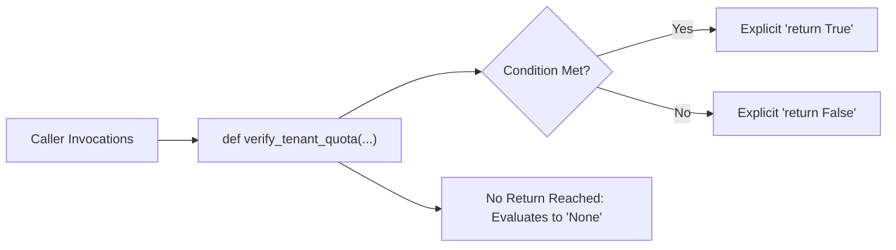
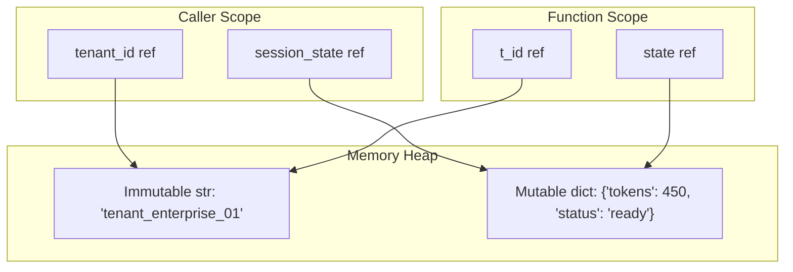
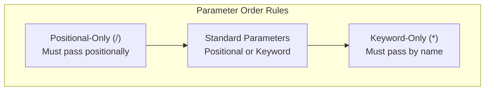
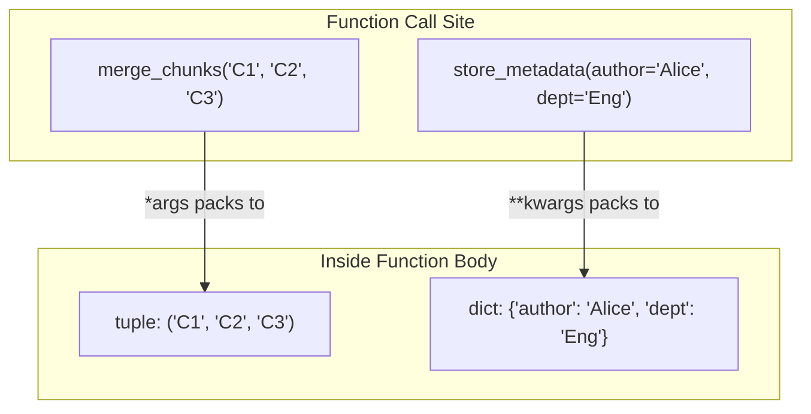
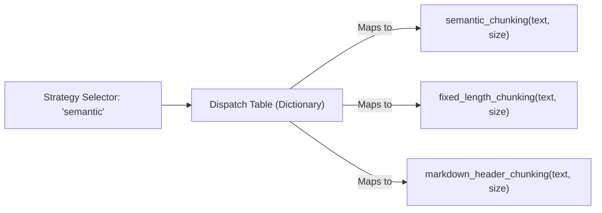
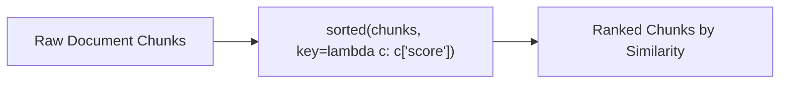
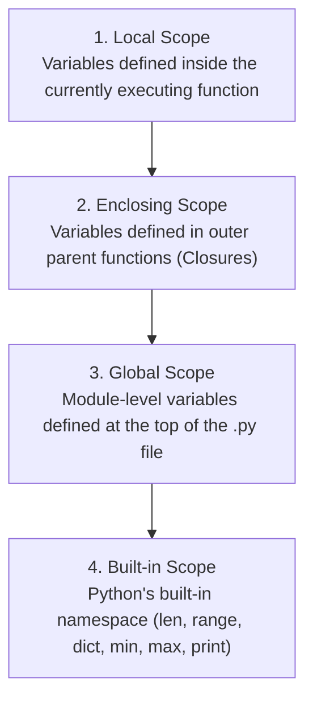
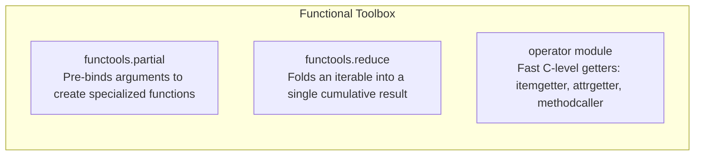
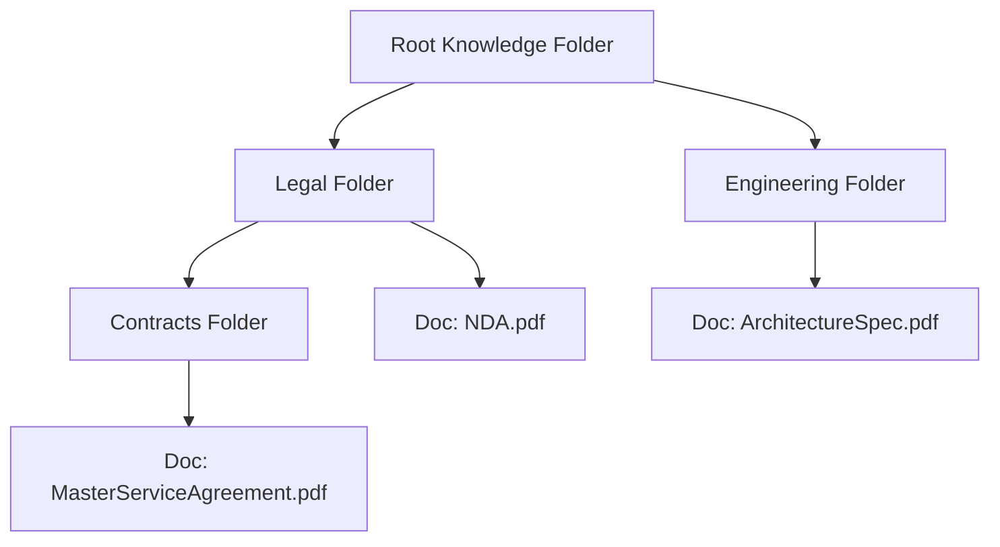
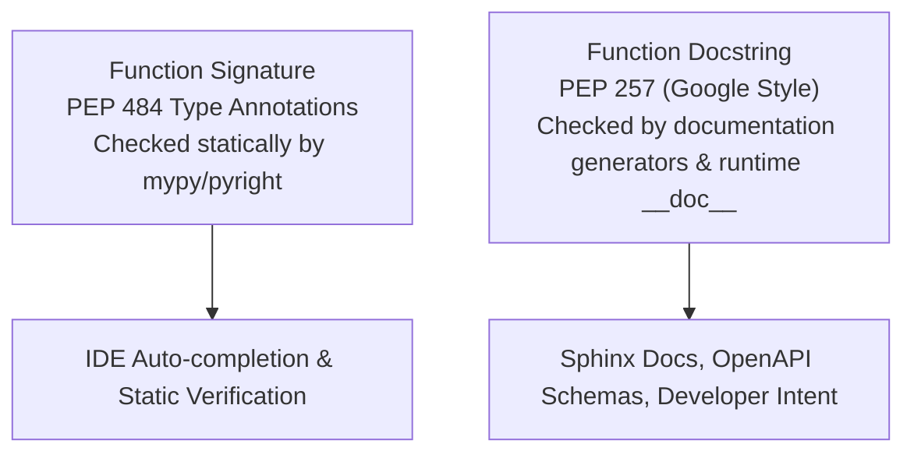

# Module 5: Functions, Parameters (*args, **kwargs), Variable Scope & Functional Architecture

Welcome to **Module 5** of the Python & FastAPI AI Architect Masterclass.

In enterprise software engineering, functions are the foundational units of procedural abstraction, encapsulation, and composability. In **Normora**—our multi-tenant knowledge management and conversational AI platform—functions govern critical architectural paths: validating Broken Object-Level Authorization (BOLA), calculating cosine similarity against PostgreSQL pgvector indexes, chunking multi-page PDF documents, invoking hosted cloud AI models (Google Gemini Flash and OpenAI GPT-4o), and transforming CQRS MediatR payloads.

As a senior .NET developer transitioning to Python, you already understand methods, parameters, and delegates (`Func<T>`, `Action<T>`). However, Python treats functions as **first-class citizens** with dynamic argument binding (`*args`, `**kwargs`), positional-only and keyword-only boundaries (`/` and `*`), the **LEGB** scoping hierarchy, lexical closures, and functional utilities (`functools`, `operator`) that operate differently from the C# Common Language Runtime (CLR).

This module teaches Python functions from zero knowledge to cloud-architect depth. Every concept is backed by **at least 5 production-grade Normora examples**, C#/.NET comparison tables, Mermaid architectural diagrams, common anti-patterns with `> [!CAUTION]` alerts, and senior interview questions.

---

## 1. Defining Functions, Return Values & Memory Semantics

### 1.1 Anatomy of a Python Function
In Python, a function is declared using the `def` keyword, followed by the function name in `snake_case`, parameter parentheses `()`, and a trailing colon `:`. The function body is defined strictly by consistent **4-space indentation**.

Unlike C#, where every method must belong to a `class` or `struct`, Python functions can exist at the module level (top-level of a `.py` file) as standalone, reusable procedures.

```python
def function_name(parameter_1: str, parameter_2: int) -> bool:
    """Optional docstring describing what the function does."""
    # 4-space indented block
    result = True
    return result
```



### 1.2 Return Values and Multiple Return Packing
- **Explicit Return:** The `return` statement immediately halts function execution and hands the evaluated value back to the caller.
- **Implicit Return:** If a function finishes without encountering a `return` statement, Python automatically returns `None` (analogous to returning `null` or a `void` method completing in C#).
- **Multiple Values (Tuple Packing/Unpacking):** Python functions can return multiple values separated by commas. Under the hood, Python packs them into a single immutable `tuple`, which the caller can unpack in a single statement.

### 1.3 Memory Semantics: Pass-by-Object-Reference
Python uses **pass-by-object-reference** (also known as *call-by-sharing*):
1. When you pass an argument to a function, the parameter variable receives a copy of the **memory address reference** pointing to the existing object.
2. If the object is **immutable** (e.g., `int`, `float`, `str`, `tuple`, `bool`), modifying the variable inside the function rebinds it to a new object in memory; the caller's variable remains unchanged.
3. If the object is **mutable** (e.g., `list`, `dict`, `set`), mutating the object inside the function (e.g., `metadata["processed"] = True`) directly modifies the caller's instance.



### 1.4 C#/.NET vs. Python: Function Foundations
| Feature | C# (.NET 10) | Python 3.12+ | Architectural Implication |
| :--- | :--- | :--- | :--- |
| **Declaration** | `public bool VerifyTenant(string id)` | `def verify_tenant(id: str) -> bool:` | Python functions are standalone module citizens. |
| **Return Mechanism** | `return value;` or `void` | `return value` or implicit `None` | All Python functions return an object (`None` if omitted). |
| **Multiple Returns** | `(bool Success, string Error) Get()` or `out` | `return success, error` | Native tuple packing/unpacking without `Tuple<T1, T2>`. |
| **Parameter Passing** | Value by default; explicit `ref`, `out`, `in` | Pass-by-object-reference | Mutability of the object dictates modification behavior. |
| **Docstrings** | XML comments `<summary>` | Multiline strings `"""docstring"""` | Docstrings are inspectable at runtime via `fn.__doc__`. |

---

### 5 Real-World Normora Examples:

#### Example 1.1: Calculating Tenant Storage Utilization & Enforcing Quota
```python
def calculate_storage_percentage(used_bytes: int, quota_bytes: int) -> float:
    """Computes tenant MinIO storage usage percentage against tier quota."""
    if quota_bytes <= 0:
        return 0.0
    percentage = (used_bytes / quota_bytes) * 100.0
    return round(percentage, 2)

# Execution
enterprise_used = 42_949_672_960    # 40 GiB
enterprise_quota = 107_374_182_400  # 100 GiB
utilization = calculate_storage_percentage(enterprise_used, enterprise_quota)
print(f"Tenant MinIO Utilization: {utilization}%")
# Output: Tenant MinIO Utilization: 40.0%
```

#### Example 1.2: Normalizing and Sanitizing Search Queries for RAG Retrieval
```python
def normalize_search_query(raw_query: str) -> str:
    """Cleans raw user queries before semantic vector search."""
    if not raw_query:
        return ""
    cleaned = raw_query.strip().lower()
    for punctuation in ["?", "!", ".", ",", ";", ":", "\"", "'"]:
        cleaned = cleaned.replace(punctuation, "")
    # Collapse multiple whitespace characters into single space
    return " ".join(cleaned.split())

# Execution
user_prompt = "  Where can I find the 2026 Travel Reimbursement Policy?!  "
cleaned_prompt = normalize_search_query(user_prompt)
print(f"Normalized RAG Query: '{cleaned_prompt}'")
# Output: Normalized RAG Query: 'where can i find the 2026 travel reimbursement policy'
```

#### Example 1.3: Evaluating BOLA Ownership (Strict 404 Prevention Rule)
```python
def verify_tenant_ownership(request_tenant_id: str, document_tenant_id: str) -> bool:
    """Validates tenant tenancy boundary to prevent Broken Object Level Authorization (BOLA).
    
    In Normora, failing this test produces an HTTP 404 Not Found (not 403)
    to completely prevent tenant resource enumeration attacks.
    """
    return request_tenant_id == document_tenant_id

# Execution
authenticated_tenant = "tenant_acme_corp"
target_doc_tenant = "tenant_globex_corp"

has_access = verify_tenant_ownership(authenticated_tenant, target_doc_tenant)
if not has_access:
    print("Security Check: Resource not found (404 sent to protect tenant privacy)")
# Output: Security Check: Resource not found (404 sent to protect tenant privacy)
```

#### Example 1.4: Computing Google Gemini Flash Token Billing Invoices
```python
def calculate_gemini_token_cost(
    prompt_tokens: int,
    completion_tokens: int,
    cached_tokens: int = 0
) -> float:
    """Calculates billing charge for Gemini 1.5 Flash API calls in USD.
    
    Pricing model:
    - Input: $0.075 per 1M tokens ($0.01875 if cached)
    - Output: $0.30 per 1M tokens
    """
    input_rate_per_million = 0.075
    cached_rate_per_million = 0.01875
    output_rate_per_million = 0.300

    uncached_input = max(0, prompt_tokens - cached_tokens)
    cost_input = (uncached_input / 1_000_000) * input_rate_per_million
    cost_cached = (cached_tokens / 1_000_000) * cached_rate_per_million
    cost_output = (completion_tokens / 1_000_000) * output_rate_per_million

    total_cost = cost_input + cost_cached + cost_output
    return round(total_cost, 6)

# Execution
invoice_item = calculate_gemini_token_cost(
    prompt_tokens=150_000,
    completion_tokens=4_200,
    cached_tokens=100_000
)
print(f"Gemini Flash Ingestion Cost: ${invoice_item:.6f}")
# Output: Gemini Flash Ingestion Cost: $0.006885
```

#### Example 1.5: Document Chunk Inspector Returning Multiple Metrics (Tuple Packing)
```python
def inspect_document_chunk(chunk_text: str) -> tuple[int, int, bool]:
    """Inspects chunk payload and returns (char_count, estimated_tokens, exceeds_limit).
    
    Standard approximation: 1 token ~= 4 characters for English prose.
    """
    char_count = len(chunk_text)
    estimated_tokens = char_count // 4
    exceeds_limit = estimated_tokens > 512
    # Returns an immutable tuple: (int, int, bool)
    return char_count, estimated_tokens, exceeds_limit

# Execution with Tuple Unpacking
sample_chunk = (
    "Normora enforces zero-trust tenant isolation at the database layer. "
    "Every PostgreSQL query includes an explicit WHERE tenant_id = :tenant_id clause."
)
characters, tokens, is_oversized = inspect_document_chunk(sample_chunk)
print(f"Metrics -> Chars: {characters}, Estimated Tokens: {tokens}, Oversized: {is_oversized}")
# Output: Metrics -> Chars: 147, Estimated Tokens: 36, Oversized: False
```

---

## 2. Positional, Keyword, Default, Positional-Only (`/`), and Keyword-Only (`*`) Parameters

Python provides fine-grained control over how arguments are bound to parameters during function invocation.



### 2.1 The Five Parameter Binding Modes
1. **Positional Arguments:** Matched strictly by relative index from left to right.
2. **Keyword Arguments:** Matched explicitly by name (`param_name=value`). Callers can specify them in any order.
3. **Default Parameters:** Fallback values applied when the caller omits an argument. All parameters with default values must appear *after* parameters without default values.
4. **Positional-Only Parameters (`/`):** Introduced in Python 3.8. Any parameters declared *before* the slash `/` **must** be passed positionally. Callers cannot pass them by name.
5. **Keyword-Only Parameters (`*`):** Any parameters declared *after* a bare asterisk `*` **must** be passed using keyword syntax (`name=value`).

```python
def configure_vector_index(
    metric: str, dimension: int, /,        # Positional-only
    table_name: str = "document_chunks",   # Standard positional or keyword
    *,
    ef_construction: int = 128,            # Keyword-only
    m: int = 16                            # Keyword-only
) -> str:
    return f"HNSW on {table_name} using {metric} ({dimension} dims, ef={ef_construction}, m={m})"
```

> [!NOTE]
> Why use positional-only (`/`)?
> 1. It allows you to rename internal parameter names in future library versions without breaking callers who might have passed them as keyword arguments.
> 2. It signals that parameter names carry no semantic meaning beyond their ordinal position (e.g., mathematical coordinates or binary buffers).

> [!IMPORTANT]
> Why use keyword-only (`*`)?
> 1. It eliminates "boolean blindness" (e.g., `index_doc("d1", "text", True, False)` vs `index_doc("d1", "text", is_confidential=True, async_indexing=False)`).
> 2. It protects security-sensitive flags from being accidentally flipped by an errant positional integer or string.

### 2.2 The Mutable Default Argument Trap
In Python, default parameter expressions are evaluated **once**, at module load time when the `def` statement executes—**not** every time the function is called.

```python
# ❌ DANGEROUS ANTI-PATTERN:
def register_tenant(tenant_id: str, tags: list[str] = []):
    tags.append(tenant_id)
    return tags

# Both calls mutate and share the exact same list instance in memory!
print(register_tenant("tenant_1"))  # ['tenant_1']
print(register_tenant("tenant_2"))  # ['tenant_1', 'tenant_2'] -> DATA LEAK!
```

```python
# ✅ THE ARCHITECT'S SAFE DEFAULT PATTERN:
def register_tenant(tenant_id: str, tags: list[str] | None = None) -> list[str]:
    """Use None as sentinel, then instantiate a fresh container inside the call."""
    if tags is None:
        tags = []
    tags.append(tenant_id)
    return tags
```

---

### 5 Real-World Normora Examples:

#### Example 2.1: Semantic Search Retrieval with Default Limit & Filters
```python
def search_vector_store(
    query_text: str,
    tenant_id: str,
    top_k: int = 5,
    similarity_threshold: float = 0.75
) -> dict:
    """Executes pgvector query with architectural fallback defaults."""
    return {
        "query": query_text,
        "tenant_id": tenant_id,
        "top_k": top_k,
        "threshold": similarity_threshold,
        "results": [f"chunk_result_{idx}" for idx in range(top_k)]
    }

# Call 1: Relying on defaults
default_run = search_vector_store("annual leave policy", "tenant_alpha")
print(f"Default Top K: {default_run['top_k']}")  # 5

# Call 2: Overriding specific parameters by keyword
high_precision_run = search_vector_store(
    "annual leave policy",
    "tenant_alpha",
    similarity_threshold=0.88,
    top_k=2
)
print(f"Custom Run: {high_precision_run['top_k']} chunks at threshold {high_precision_run['threshold']}")
# Output: Custom Run: 2 chunks at threshold 0.88
```

#### Example 2.2: Safe `None` Default Pattern for Tenant Allowed File Types
```python
def configure_tenant_ingestion_policy(
    tenant_id: str,
    allowed_extensions: list[str] | None = None,
    max_file_size_mb: int = 25
) -> dict:
    """Configures MinIO file upload rules using safe None default instantiation."""
    if allowed_extensions is None:
        # Created fresh in local scope on every invocation
        allowed_extensions = ["pdf", "docx", "txt", "md"]
    
    return {
        "tenant_id": tenant_id,
        "extensions": allowed_extensions,
        "max_size_mb": max_file_size_mb
    }

tenant_legal = configure_tenant_ingestion_policy("tenant_legal")
tenant_finance = configure_tenant_ingestion_policy("tenant_finance", allowed_extensions=["xlsx", "csv"])

# Ensure no shared reference pollution
tenant_legal["extensions"].append("pptx")
print("Legal Extensions:", tenant_legal["extensions"])
print("Finance Extensions:", tenant_finance["extensions"])
# Output:
# Legal Extensions: ['pdf', 'docx', 'txt', 'md', 'pptx']
# Finance Extensions: ['xlsx', 'csv']
```

#### Example 2.3: Invoking Cloud LLM with Keyword Precision (Gemini Flash vs. GPT-4o)
```python
def invoke_hosted_llm(
    prompt: str,
    *,
    model: str = "gemini-1.5-flash",
    temperature: float = 0.2,
    max_output_tokens: int = 2048,
    system_instruction: str = "You are Normora AI, an enterprise assistant."
) -> dict:
    """Enforces keyword-only syntax for LLM hyper-parameters to avoid accidental misconfiguration."""
    return {
        "model": model,
        "system_instruction": system_instruction,
        "temperature": temperature,
        "max_output_tokens": max_output_tokens,
        "prompt": prompt
    }

# Explicit invocation prevents parameter misalignment
response = invoke_hosted_llm(
    "Summarize ISO 27001 audit obligations.",
    model="gemini-1.5-flash",
    temperature=0.0,
    max_output_tokens=1024
)
print(f"Target Model: {response['model']}, Temperature: {response['temperature']}")
# Output: Target Model: gemini-1.5-flash, Temperature: 0.0
```

#### Example 2.4: Positional-Only (`/`) for Low-Level Cosine Distance Computation
```python
import math

def calculate_cosine_similarity(
    vector_a: list[float],
    vector_b: list[float],
    /
) -> float:
    """Calculates cosine similarity between two embedding vectors.
    
    The '/' ensures callers cannot call calculate_cosine_similarity(vector_a=v1, vector_b=v2).
    This mimics C-level speed and prevents coupling to internal variable names.
    """
    dot_product = sum(a * b for a, b in zip(vector_a, vector_b))
    magnitude_a = math.sqrt(sum(a * a for a in vector_a))
    magnitude_b = math.sqrt(sum(b * b for b in vector_b))
    
    if magnitude_a == 0.0 or magnitude_b == 0.0:
        return 0.0
    return dot_product / (magnitude_a * magnitude_b)

# Execution
v_query = [0.045, 0.120, -0.870, 0.330]
v_chunk = [0.040, 0.118, -0.865, 0.320]
sim = calculate_cosine_similarity(v_query, v_chunk)
print(f"Vector Cosine Similarity: {sim:.4f}")
# Output: Vector Cosine Similarity: 0.9998
```

#### Example 2.5: Keyword-Only (`*`) for Security-Sensitive RBAC & BFLA Checks
```python
def authorize_action(
    user_id: str,
    tenant_id: str,
    action: str,
    *,
    required_role: str,
    allow_system_admin_override: bool = False
) -> bool:
    """Validates Broken Function Level Authorization (BFLA).
    
    Keywords prevent callers from inadvertently passing allow_system_admin_override as a positional arg.
    """
    user_role = "TenantMember"  # Retrieved from Keycloak JWT claims
    
    if allow_system_admin_override and user_role == "SystemAdmin":
        return True
    
    return user_role == required_role

# Execution: Must pass 'required_role' by keyword
is_allowed = authorize_action(
    "usr_4821",
    "tenant_sales",
    "documents:delete",
    required_role="TenantAdmin",
    allow_system_admin_override=False
)
print(f"BFLA Authorization Decision: {is_allowed}")
# Output: BFLA Authorization Decision: False
```

---

## 3. Arbitrary Arguments: `*args`, `**kwargs` & Unpacking Mechanics

In enterprise architectures, you frequently write wrappers, logging interceptors, dynamic CQRS dispatchers, and decorators that must accept variable numbers of arguments without knowing their names in advance.



### 3.1 Unpacking Mechanics
- **`*args` (Positional Arbitrary Arguments):** Gathers any excess positional arguments into an immutable `tuple`.
- **`**kwargs` (Keyword Arbitrary Arguments):** Gathers any excess named keyword arguments into a mutable `dict`.
- **Call-Site Unpacking (`*` and `**`):**
  - Prefixing an iterable with `*` unpacks its elements as distinct positional arguments.
  - Prefixing a dictionary with `**` unpacks its key-value pairs as distinct keyword arguments.

### 3.2 Canonical Parameter Ordering
When combining all argument forms in a single signature, Python strictly requires the following sequence:

```python
def complete_signature(
    pos_only_1, /,               # 1. Positional-only
    standard_param,               # 2. Standard positional/keyword
    default_param="normora",      # 3. Default parameter
    *args,                        # 4. Arbitrary positional args (tuple)
    kw_only_1,                    # 5. Keyword-only parameter
    kw_only_default=True,         # 6. Keyword-only with default
    **kwargs                      # 7. Arbitrary keyword args (dict)
):
    pass
```

---

### 5 Real-World Normora Examples:

#### Example 3.1: Combining Arbitrary Document Chunks with `*args`
```python
def combine_rag_context_blocks(*chunks: str, header: str = "CONTEXT SOURCES:") -> str:
    """Concatenates an arbitrary number of document chunk strings into an LLM prompt block."""
    if not chunks:
        return f"{header}\nNo relevant context found."
    
    formatted_chunks = [f"[{idx + 1}] {chunk.strip()}" for idx, chunk in enumerate(chunks)]
    return f"{header}\n" + "\n\n".join(formatted_chunks)

# Passing 3 chunk strings positionally
prompt_block = combine_rag_context_blocks(
    "Normora encrypts all customer embeddings at rest using AES-256.",
    "PostgreSQL pgvector indexes are partitioned by tenant_id.",
    "Keycloak tokens are validated at the Duende BFF gateway layer."
)
print(prompt_block)
# Output:
# CONTEXT SOURCES:
# [1] Normora encrypts all customer embeddings at rest using AES-256.
# [2] PostgreSQL pgvector indexes are partitioned by tenant_id.
# [3] Keycloak tokens are validated at the Duende BFF gateway layer.
```

#### Example 3.2: Dynamic Metadata Storage in PostgreSQL pgvector with `**kwargs`
```python
def build_vector_record(chunk_id: str, embedding: list[float], **metadata) -> dict:
    """Builds a pgvector ingestion dictionary storing arbitrary metadata in a JSONB column."""
    return {
        "chunk_id": chunk_id,
        "embedding_dimensions": len(embedding),
        "embedding": embedding,
        "metadata_jsonb": metadata  # Captured kwargs as dict
    }

record = build_vector_record(
    "chk_9921",
    [0.05, -0.12, 0.88],
    source_file="architecture_spec.pdf",
    page_number=14,
    tenant_id="tenant_fintech",
    is_confidential=True,
    department="Security"
)
print(f"Record JSONB keys: {list(record['metadata_jsonb'].keys())}")
# Output: Record JSONB keys: ['source_file', 'page_number', 'tenant_id', 'is_confidential', 'department']
```

#### Example 3.3: MediatR-Style CQRS Handler Invoker with Forwarded `*args` & `**kwargs`
```python
def execute_cqrs_pipeline(command_name: str, handler_func, *args, **kwargs) -> dict:
    """Simulates a MediatR Send() pipeline that logs audit telemetry and forwards parameters."""
    print(f"[Telemetry Audit] Dispatching command: '{command_name}'")
    # Perfectly forward arguments to the target handler
    result = handler_func(*args, **kwargs)
    print(f"[Telemetry Audit] Command '{command_name}' completed successfully.")
    return result

def ingest_document_handler(tenant_id: str, document_title: str, chunk_count: int) -> dict:
    return {"status": "INGESTED", "tenant": tenant_id, "title": document_title, "chunks": chunk_count}

response = execute_cqrs_pipeline(
    "IngestDocumentCommand",
    ingest_document_handler,
    "tenant_healthcare",
    "hipaa_compliance.pdf",
    chunk_count=42
)
print("Pipeline Output:", response)
# Output:
# [Telemetry Audit] Dispatching command: 'IngestDocumentCommand'
# [Telemetry Audit] Command 'IngestDocumentCommand' completed successfully.
# Pipeline Output: {'status': 'INGESTED', 'tenant': 'tenant_healthcare', 'title': 'hipaa_compliance.pdf', 'chunks': 42}
```

#### Example 3.4: Chat Turn Message Builder with Dynamic Annotations
```python
def build_chat_message(role: str, content: str, **annotations) -> dict:
    """Builds an enterprise chat message payload for Google Gemini Flash streaming."""
    message = {
        "role": role,
        "content": content,
        "timestamp_epoch": 1718000000
    }
    if annotations:
        message["annotations"] = annotations
    return message

# Invocation with dynamic citation payload
message_payload = build_chat_message(
    role="assistant",
    content="According to the security policy, passwords must rotate every 90 days.",
    citations=["doc_sec_01.pdf#page=4", "doc_sec_02.pdf#page=12"],
    confidence_score=0.982,
    model="gemini-1.5-flash"
)
print("Message Keys:", list(message_payload.keys()))
print("Citations Attached:", message_payload["annotations"]["citations"])
# Output:
# Message Keys: ['role', 'content', 'timestamp_epoch', 'annotations']
# Citations Attached: ['doc_sec_01.pdf#page=4', 'doc_sec_02.pdf#page=12']
```

#### Example 3.5: Call-Site Unpacking (`*` and `**`) for Tenant Branding Setup
```python
def apply_tenant_theme(tenant_id: str, primary_color: str, secondary_color: str, font_family: str) -> str:
    """Applies UI branding configurations to tenant frontend portal."""
    return f"Tenant '{tenant_id}' -> CSS: {primary_color}!important, {secondary_color}!important, font: {font_family}"

# Configuration payload received from Keycloak / DB
theme_props = {
    "primary_color": "#0ea5e9",
    "secondary_color": "#1e293b",
    "font_family": "Inter, sans-serif"
}

# Unpack the dictionary directly into the function call
applied_css = apply_tenant_theme("tenant_healthcare", **theme_props)
print(applied_css)
# Output: Tenant 'tenant_healthcare' -> CSS: #0ea5e9!important, #1e293b!important, font: Inter, sans-serif
```

---

## 4. First-Class Functions & Strategy Dispatch Patterns

In Python, functions are **first-class citizens** (`first-class objects`). This means functions can be:
1. Assigned to variables.
2. Stored inside data structures (`list`, `dict`, `set`).
3. Passed as arguments into other functions (higher-order functions).
4. Returned as values from other functions.

### 4.1 Replacing C# Strategy Pattern with Function Dispatch Tables
In C#, implementing the Strategy Pattern requires an interface (`IChunkingStrategy`), several concrete classes (`RecursiveChunker : IChunkingStrategy`), and dependency injection.

In Python, functions satisfy the Strategy Pattern directly without class boilerplate. We map string tokens directly to callable function references inside a standard dictionary:



---

### 5 Real-World Normora Examples:

#### Example 4.1: Chunking Strategy Dispatch Table
```python
def fixed_length_chunker(text: str, chunk_size: int = 500) -> list[str]:
    return [text[i:i + chunk_size] for i in range(0, len(text), chunk_size)]

def sentence_delimiter_chunker(text: str, chunk_size: int = 500) -> list[str]:
    sentences = text.split(". ")
    return [s.strip() + "." for s in sentences if s.strip()]

def paragraph_chunker(text: str, chunk_size: int = 500) -> list[str]:
    return [p.strip() for p in text.split("\n\n") if p.strip()]

# Dispatch Table: Maps strategy key directly to function objects
CHUNKING_STRATEGIES = {
    "fixed": fixed_length_chunker,
    "sentence": sentence_delimiter_chunker,
    "paragraph": paragraph_chunker
}

def split_document(text: str, strategy_name: str) -> list[str]:
    strategy_fn = CHUNKING_STRATEGIES.get(strategy_name)
    if not strategy_fn:
        raise ValueError(f"Unknown strategy: '{strategy_name}'. Valid options: {list(CHUNKING_STRATEGIES.keys())}")
    return strategy_fn(text)

raw_doc = "Section 1: Architecture. Normora is modular.\n\nSection 2: Security. BOLA returns 404."
chunks = split_document(raw_doc, strategy_name="paragraph")
print(f"Generated {len(chunks)} chunks using strategy 'paragraph'.")
# Output: Generated 2 chunks using strategy 'paragraph'.
```

#### Example 4.2: Document Ingestion Pipeline with Pluggable Sanitizers
```python
from typing import Callable

def remove_control_chars(text: str) -> str:
    return "".join(ch for ch in text if ch.isprintable())

def mask_email_addresses(text: str) -> str:
    import re
    return re.sub(r"[\w\.-]+@[\w\.-]+\.\w+", "[REDACTED_EMAIL]", text)

def strip_excess_whitespace(text: str) -> str:
    return " ".join(text.split())

def sanitize_document_content(raw_text: str, sanitizers: list[Callable[[str], str]]) -> str:
    """Executes a pipeline of pluggable sanitizer functions sequentially."""
    current_text = raw_text
    for sanitizer in sanitizers:
        current_text = sanitizer(current_text)
    return current_text

# Pipeline assembly
pipeline = [remove_control_chars, mask_email_addresses, strip_excess_whitespace]
input_text = "Contact admin at security@normora.ai for    immediate access.\x00"
sanitized = sanitize_document_content(input_text, pipeline)
print(f"Sanitized: '{sanitized}'")
# Output: Sanitized: 'Contact admin at [REDACTED_EMAIL] for immediate access.'
```

#### Example 4.3: RAG Response Post-Processor Chain
```python
def append_disclaimer(content: str) -> str:
    return f"{content}\n\n*Generated by Normora AI. Verify with source docs.*"

def enforce_character_budget(content: str, max_chars: int = 120) -> str:
    return content[:max_chars] + "..." if len(content) > max_chars else content

def build_post_processor(add_disclaimer: bool, max_length: int):
    """Higher-order function returning a tailored post-processing function."""
    def process(text: str) -> str:
        res = enforce_character_budget(text, max_length)
        if add_disclaimer:
            res = append_disclaimer(res)
        return res
    return process

processor = build_post_processor(add_disclaimer=True, max_length=60)
answer = "Normora uses PostgreSQL with pgvector for HNSW vector searches."
formatted_output = processor(answer)
print(formatted_output)
# Output:
# Normora uses PostgreSQL with pgvector for HNSW vector searches...
#
# *Generated by Normora AI. Verify with source docs.*
```

#### Example 4.4: Dynamic Query Rewriter Pipeline
```python
def expand_acronyms(query: str) -> str:
    acronym_map = {"rag": "retrieval augmented generation", "rbac": "role based access control"}
    words = query.split()
    return " ".join(acronym_map.get(w.lower(), w) for w in words)

def lowercase_transformer(query: str) -> str:
    return query.lower()

def apply_query_rewriters(query: str, *rewriters) -> str:
    for rewriter in rewriters:
        query = rewriter(query)
    return query

expanded_query = apply_query_rewriters("Explain RAG and RBAC policies", lowercase_transformer, expand_acronyms)
print("Rewritten Query:", expanded_query)
# Output: Rewritten Query: explain retrieval augmented generation and role based access control policies
```

#### Example 4.5: Event Handler Registry for Document Processing Lifecycle
```python
EVENT_REGISTRY: dict[str, list] = {
    "DocumentUploaded": [],
    "DocumentIndexed": [],
    "DocumentDeleted": []
}

def register_listener(event_name: str, handler):
    if event_name in EVENT_REGISTRY:
        EVENT_REGISTRY[event_name].append(handler)

def emit_event(event_name: str, payload: dict):
    for handler in EVENT_REGISTRY.get(event_name, []):
        handler(payload)

# Define handlers as pure functions
def notify_user_via_signalr(payload: dict):
    print(f"[SignalR] Notifying user: Document {payload['doc_id']} is indexed!")

def record_audit_log(payload: dict):
    print(f"[Audit Log] DocumentIndexed event logged for tenant {payload['tenant_id']}.")

# Register and emit
register_listener("DocumentIndexed", notify_user_via_signalr)
register_listener("DocumentIndexed", record_audit_log)

emit_event("DocumentIndexed", {"doc_id": "doc_101", "tenant_id": "tenant_fintech"})
# Output:
# [SignalR] Notifying user: Document doc_101 is indexed!
# [Audit Log] DocumentIndexed event logged for tenant tenant_fintech.
```

---

## 5. Lambda Functions (Anonymous Functions) in Depth

A **lambda** function is an inline, anonymous function restricted to a **single expression**.

Syntax:
```python
lambda parameter_1, parameter_2: expression
```

### 5.1 Architecture & Limitations of Lambdas
1. **Single Expression Only:** A lambda cannot contain multi-line statements, `return`, `pass`, assignments (`=`), or `try/except` blocks.
2. **Implicit Return:** The evaluated result of the single expression is returned automatically.
3. **Primary Use Case:** Short, transient helper functions passed as the `key=` argument to `sorted()`, `min()`, `max()`, or supplied to `filter()` and `map()`.



---

### 5 Real-World Normora Examples:

#### Example 5.1: Multi-Attribute Compound Sorting for RAG Chunks
Sort candidate chunks primarily by **similarity score descending**, and secondarily by **page number ascending**:
```python
retrieved_chunks = [
    {"chunk_id": "chk_1", "similarity": 0.89, "page": 4},
    {"chunk_id": "chk_2", "similarity": 0.94, "page": 12},
    {"chunk_id": "chk_3", "similarity": 0.94, "page": 3},  # Equal score, earlier page
    {"chunk_id": "chk_4", "similarity": 0.78, "page": 1}
]

# Using a tuple key: (-similarity, page)
# Negative float reverses the sort for similarity without reversing page number!
sorted_chunks = sorted(retrieved_chunks, key=lambda c: (-c["similarity"], c["page"]))

for rank, item in enumerate(sorted_chunks, 1):
    print(f"Rank {rank}: {item['chunk_id']} (Sim: {item['similarity']}, Page: {item['page']})")
# Output:
# Rank 1: chk_3 (Sim: 0.94, Page: 3)
# Rank 2: chk_2 (Sim: 0.94, Page: 12)
# Rank 3: chk_1 (Sim: 0.89, Page: 4)
# Rank 4: chk_4 (Sim: 0.78, Page: 1)
```

#### Example 5.2: Filtering Active Subscriptions and High-Volume Tenants
```python
tenants = [
    {"id": "t_01", "name": "Acme Legal", "is_active": True, "monthly_spend": 1250.0},
    {"id": "t_02", "name": "Beta Health", "is_active": False, "monthly_spend": 0.0},
    {"id": "t_03", "name": "Omni Corp", "is_active": True, "monthly_spend": 4800.0},
    {"id": "t_04", "name": "Apex Finance", "is_active": True, "monthly_spend": 450.0}
]

# Filter for active tenants spending over $1,000/month
vip_tenants = list(filter(lambda t: t["is_active"] and t["monthly_spend"] >= 1000.0, tenants))
print("VIP Tenants:", [t["name"] for t in vip_tenants])
# Output: VIP Tenants: ['Acme Legal', 'Omni Corp']
```

#### Example 5.3: Mapping and Normalizing Tenant Tag Collections
```python
raw_tags = ["  Security ", "FINANCE", "  Compliance-iso27001  ", "hr  "]

# Inline normalization via map and lambda
cleaned_tags = list(map(lambda tag: tag.strip().lower().replace(" ", "_"), raw_tags))
print("Cleaned Tags:", cleaned_tags)
# Output: Cleaned Tags: ['security', 'finance', 'compliance-iso27001', 'hr']
```

#### Example 5.4: Finding the Maximum Token Consumption Turn in a Conversation
```python
conversation_history = [
    {"turn": 1, "role": "user", "tokens": 45},
    {"turn": 2, "role": "assistant", "tokens": 820},
    {"turn": 3, "role": "user", "tokens": 120},
    {"turn": 4, "role": "assistant", "tokens": 1450}
]

peak_turn = max(conversation_history, key=lambda turn: turn["tokens"])
print(f"Peak Turn: #{peak_turn['turn']} with {peak_turn['tokens']} tokens")
# Output: Peak Turn: #4 with 1450 tokens
```

#### Example 5.5: Scoring and Ranking RAG Citations with Threshold Filtering
```python
citations = [
    {"doc": "soc2.pdf", "confidence": 0.62},
    {"doc": "gdpr.pdf", "confidence": 0.91},
    {"doc": "pci_dss.pdf", "confidence": 0.84},
    {"doc": "internal_memo.txt", "confidence": 0.45}
]

# Pipeline: filter citations >= 0.70, then sort by confidence descending
approved_citations = sorted(
    filter(lambda c: c["confidence"] >= 0.70, citations),
    key=lambda c: c["confidence"],
    reverse=True
)
print("Qualified Citations:", approved_citations)
# Output: Qualified Citations: [{'doc': 'gdpr.pdf', 'confidence': 0.91}, {'doc': 'pci_dss.pdf', 'confidence': 0.84}]
```

---

## 6. Variable Scope, The LEGB Rule, Closures & `nonlocal`

Python resolves identifiers using a strict 4-tier hierarchy known as the **LEGB Rule**:



### 6.1 The Four Scopes Explained
1. **Local (L):** Names assigned inside a function body. Created upon function invocation and destroyed upon return.
2. **Enclosing (E):** Names in the local scope of any enclosing (nested) function definitions, from innermost to outermost.
3. **Global (G):** Names assigned at the top level of the current module file, or declared using the `global` keyword.
4. **Built-in (B):** Pre-assigned built-in names in Python (e.g., `open`, `str`, `list`, `Exception`).

### 6.2 Closures and the `nonlocal` Keyword
A **closure** occurs when a nested function references a variable from its enclosing parent scope, and the parent function returns the nested function. The inner function retains access to the captured enclosing variables even after the parent function has finished executing!

- `global variable_name`: Tells Python to bind assignments to the module-level global scope.
- `nonlocal variable_name`: Tells Python to bind assignments to the immediate **enclosing** function's scope, allowing state modification across invocations.

---

### 5 Real-World Normora Examples:

#### Example 6.1: Local Scope Isolation in Vector Distance Math
```python
def calculate_manhattan_distance(coord_a: list[float], coord_b: list[float]) -> float:
    # 'distance_accumulator' exists strictly within this Local scope
    distance_accumulator = sum(abs(a - b) for a, b in zip(coord_a, coord_b))
    return distance_accumulator

result = calculate_manhattan_distance([1.0, 2.0], [4.0, 6.0])
print(f"Distance: {result}")
# print(distance_accumulator)  --> NameError: name 'distance_accumulator' is not defined
```

#### Example 6.2: Tenant-Scoped Filter Factory (Closure Preserving `tenant_id`)
```python
def make_tenant_document_filter(target_tenant_id: str):
    """Enclosing scope captures 'target_tenant_id'.
    
    Returns a specialized filter function that permanently remembers target_tenant_id.
    """
    def document_filter(documents: list[dict]) -> list[dict]:
        # 'target_tenant_id' is resolved from Enclosing scope
        return [doc for doc in documents if doc.get("tenant_id") == target_tenant_id]
    
    return document_filter

# Create two isolated filter closures
filter_acme = make_tenant_document_filter("tenant_acme")
filter_globex = make_tenant_document_filter("tenant_globex")

corpus = [
    {"doc_id": "d1", "tenant_id": "tenant_acme", "title": "Acme Q3 Report"},
    {"doc_id": "d2", "tenant_id": "tenant_globex", "title": "Globex Strategy"},
    {"doc_id": "d3", "tenant_id": "tenant_acme", "title": "Acme Handbook"}
]

print("Acme Docs:", [d["title"] for d in filter_acme(corpus)])
print("Globex Docs:", [d["title"] for d in filter_globex(corpus)])
# Output:
# Acme Docs: ['Acme Q3 Report', 'Acme Handbook']
# Globex Docs: ['Globex Strategy']
```

#### Example 6.3: Stateful Rate-Limiter / Token Budget Counter with `nonlocal`
```python
def create_token_rate_limiter(max_budget: int):
    """Factory creating a rate-limiter that tracks usage state across requests without a class."""
    consumed_tokens = 0  # Enclosing variable

    def consume(tokens_requested: int) -> bool:
        nonlocal consumed_tokens  # Allows modifying outer 'consumed_tokens'
        if consumed_tokens + tokens_requested > max_budget:
            return False  # Rate limit exceeded
        consumed_tokens += tokens_requested
        print(f"Consumed: {tokens_requested} | Total: {consumed_tokens}/{max_budget}")
        return True

    return consume

tenant_limiter = create_token_rate_limiter(max_budget=2000)
print("Request 1 Allowed:", tenant_limiter(800))   # Consumed: 800 | Total: 800/2000 -> True
print("Request 2 Allowed:", tenant_limiter(900))   # Consumed: 900 | Total: 1700/2000 -> True
print("Request 3 Allowed:", tenant_limiter(500))   # Exceeds 2000 -> False
# Output:
# Consumed: 800 | Total: 800/2000
# Request 1 Allowed: True
# Consumed: 900 | Total: 1700/2000
# Request 2 Allowed: True
# Request 3 Allowed: False
```

#### Example 6.4: Module-Level Global Configuration with Safe Read Access
```python
# Module-level Globals (Constants)
DEFAULT_EMBEDDING_MODEL = "text-embedding-004"
MAX_CONCURRENT_CHUNKING_TASKS = 8

def get_pipeline_telemetry() -> dict:
    """Reads directly from Global scope (G).
    
    Reading global variables is safe and common; modifying them is an anti-pattern.
    """
    return {
        "active_model": DEFAULT_EMBEDDING_MODEL,
        "worker_concurrency": MAX_CONCURRENT_CHUNKING_TASKS
    }

print("Pipeline Telemetry:", get_pipeline_telemetry())
# Output: Pipeline Telemetry: {'active_model': 'text-embedding-004', 'worker_concurrency': 8}
```

#### Example 6.5: Embedding Vector Cache Memoization using Closures
```python
def create_embedding_memoizer():
    """Builds an in-memory cache closure for expensive embedding calls."""
    cache: dict[str, list[float]] = {}  # Enclosing variable

    def get_or_compute_embedding(text_key: str, embedding_generator) -> list[float]:
        nonlocal cache
        if text_key not in cache:
            print(f"--> Cache MISS for '{text_key}'. Computing embedding...")
            cache[text_key] = embedding_generator(text_key)
        else:
            print(f"--> Cache HIT for '{text_key}'. Returning stored vector.")
        return cache[text_key]

    return get_or_compute_embedding

memoizer = create_embedding_memoizer()
dummy_generator = lambda text: [0.1, 0.2, 0.3]

v1 = memoizer("security policy", dummy_generator)
v2 = memoizer("security policy", dummy_generator)
# Output:
# --> Cache MISS for 'security policy'. Computing embedding...
# --> Cache HIT for 'security policy'. Returning stored vector.
```

---

## 7. Advanced Functional Utilities: `functools.partial`, `functools.reduce` & `operator` Module

Python's standard library provides functional programming modules that replace verbose wrapper boilerplate with high-performance C-optimized utilities.



### 7.1 `functools.partial` — Specializing Generic Functions
`partial(func, *args, **kwargs)` freezes a subset of a function's arguments or keywords, producing a new callable with a simpler signature.

### 7.2 `functools.reduce` — Aggregation & Folding Patterns
`reduce(func, iterable, [initializer])` applies a two-argument function cumulatively to items in a sequence, folding the sequence down to a single value. It is Python's direct equivalent of LINQ's `.Aggregate()` in C#.

### 7.3 The `operator` Module — High-Performance Lambdas
Writing `lambda x: x["key"]` or `lambda x: x.attribute` forces Python to execute an interpreted bytecode frame for every element. The `operator` module provides C-level compiled callables:
- `operator.itemgetter("key")` replaces `lambda x: x["key"]`
- `operator.attrgetter("attribute")` replaces `lambda x: x.attribute`
- `operator.methodcaller("strip")` replaces `lambda x: x.strip()`

---

### 5 Real-World Normora Examples:

#### Example 7.1: Pre-Binding Gemini Flash with `functools.partial` for Low-Temperature Extraction
```python
from functools import partial

def generate_ai_completion(
    model: str,
    temperature: float,
    system_instruction: str,
    prompt: str
) -> dict:
    """Generic AI completion gateway."""
    return {
        "model": model,
        "temperature": temperature,
        "system_instruction": system_instruction,
        "prompt": prompt
    }

# Create a specialized, pre-configured JSON extraction function
# Freezing model, temperature=0.0, and extraction system prompt
extract_metadata_json = partial(
    generate_ai_completion,
    "gemini-1.5-flash",
    0.0,
    "You are a strict metadata extraction engine. Return ONLY valid JSON."
)

# Callers only need to provide the dynamic user prompt!
extraction_call = extract_metadata_json(prompt="Extract author and date from: Ingested by Alice on 2026-04-12.")
print("Partial Invocation Configuration:")
print(f"Model: {extraction_call['model']}, Temp: {extraction_call['temperature']}")
print(f"System: {extraction_call['system_instruction']}")
# Output:
# Partial Invocation Configuration:
# Model: gemini-1.5-flash, Temp: 0.0
# System: You are a strict metadata extraction engine. Return ONLY valid JSON.
```

#### Example 7.2: Aggregating Compound RBAC Permissions using `functools.reduce` & `operator.or_`
```python
from functools import reduce
import operator

# Binary permission bitmasks in Normora
READ_DOCS   = 0b0001  # 1
WRITE_DOCS  = 0b0010  # 2
DELETE_DOCS = 0b0100  # 4
ADMIN_USERS = 0b1000  # 8

# List of permission bitmasks granted to a user across multiple Keycloak groups
assigned_role_permissions = [READ_DOCS, WRITE_DOCS, ADMIN_USERS]

# Fold the permissions using bitwise OR (operator.or_)
# Equivalent to C#: assigned_role_permissions.Aggregate(0, (acc, perm) => acc | perm)
combined_permissions = reduce(operator.or_, assigned_role_permissions, 0)

print(f"Combined Bitmask: {bin(combined_permissions)} ({combined_permissions})")

def has_permission(user_mask: int, required_mask: int) -> bool:
    return (user_mask & required_mask) == required_mask

print("Can Read Docs:", has_permission(combined_permissions, READ_DOCS))      # True
print("Can Delete Docs:", has_permission(combined_permissions, DELETE_DOCS))  # False
# Output:
# Combined Bitmask: 0b1011 (11)
# Can Read Docs: True
# Can Delete Docs: False
```

#### Example 7.3: High-Performance Chunk Sorting with `operator.itemgetter`
```python
from operator import itemgetter

vector_results = [
    {"chunk_id": "c1", "score": 0.82, "source": "handbook.pdf"},
    {"chunk_id": "c2", "score": 0.96, "source": "security.pdf"},
    {"chunk_id": "c3", "score": 0.88, "source": "api_docs.pdf"}
]

# itemgetter('score') compiles down to direct C-level struct lookups (faster than lambda)
vector_results.sort(key=itemgetter("score"), reverse=True)
print("Top Result:", vector_results[0])
# Output: Top Result: {'chunk_id': 'c2', 'score': 0.96, 'source': 'security.pdf'}
```

#### Example 7.4: Extracting Attributes from Domain Objects with `operator.attrgetter`
```python
from operator import attrgetter

class DocumentEntity:
    def __init__(self, doc_id: str, tenant_id: str, byte_size: int):
        self.doc_id = doc_id
        self.tenant_id = tenant_id
        self.byte_size = byte_size

documents = [
    DocumentEntity("doc_01", "tenant_a", 204_800),
    DocumentEntity("doc_02", "tenant_b", 1_048_576),
    DocumentEntity("doc_03", "tenant_a", 512_000)
]

# Sort by byte_size descending using attrgetter
largest_docs = sorted(documents, key=attrgetter("byte_size"), reverse=True)
print(f"Largest Document ID: {largest_docs[0].doc_id} ({largest_docs[0].byte_size} bytes)")
# Output: Largest Document ID: doc_02 (1048576 bytes)
```

#### Example 7.5: Cascading Content Redaction via `functools.reduce`
```python
from functools import reduce

def redact_ssn(text: str) -> str:
    import re
    return re.sub(r"\d{3}-\d{2}-\d{4}", "[REDACTED_SSN]", text)

def redact_credit_cards(text: str) -> str:
    import re
    return re.sub(r"\b(?:\d{4}[- ]?){3}\d{4}\b", "[REDACTED_CC]", text)

def redact_internal_ips(text: str) -> str:
    import re
    return re.sub(r"10\.\d{1,3}\.\d{1,3}\.\d{1,3}", "[REDACTED_INTERNAL_IP]", text)

redaction_pipeline = [redact_ssn, redact_credit_cards, redact_internal_ips]

raw_log = "User with SSN 000-12-3456 accessed server 10.240.12.4 using card 4532-1234-5678-9012."

# Fold text through each redaction transform in succession
# reduce(lambda current_text, fn: fn(current_text), redaction_pipeline, raw_log)
sanitized_log = reduce(lambda acc_text, transform: transform(acc_text), redaction_pipeline, raw_log)
print("Sanitized Audit Log:")
print(sanitized_log)
# Output:
# Sanitized Audit Log:
# User with SSN [REDACTED_SSN] accessed server [REDACTED_INTERNAL_IP] using card [REDACTED_CC].
```

---

## 8. Recursive Functions in Enterprise Knowledge Systems

Recursion occurs when a function calls itself to solve smaller subproblems of the same structure.

### 8.1 Key Pillars of Recursion
1. **Base Case:** A conditional test that halts recursion immediately without making further calls.
2. **Recursive Step:** The division of work where the function calls itself with a strictly smaller or simpler input.
3. **Call Stack Limit:** Python enforces a stack recursion depth safeguard (typically 1,000 frames) accessible via `sys.getrecursionlimit()`. Exceeding this limit raises `RecursionError`.



---

### 5 Real-World Normora Examples:

#### Example 8.1: Recursive Traversal of Hierarchical Document Knowledge Folders
```python
def extract_all_documents(folder_node: dict) -> list[str]:
    """Recursively traverses nested folder tree nodes to collect all document IDs."""
    collected_docs = []
    
    # 1. Base step: Collect documents in current folder
    if "documents" in folder_node:
        collected_docs.extend(folder_node["documents"])
    
    # 2. Recursive step: Iterate over sub-folders
    for subfolder in folder_node.get("subfolders", []):
        collected_docs.extend(extract_all_documents(subfolder))
        
    return collected_docs

# Nested folder taxonomy in Normora
knowledge_tree = {
    "folder_name": "Root",
    "documents": ["doc_root_01.pdf"],
    "subfolders": [
        {
            "folder_name": "Compliance",
            "documents": ["doc_soc2.pdf", "doc_hipaa.pdf"],
            "subfolders": [
                {
                    "folder_name": "Audits_2026",
                    "documents": ["audit_q1.pdf", "audit_q2.pdf"]
                }
            ]
        },
        {
            "folder_name": "Human Resources",
            "documents": ["employee_handbook.pdf"]
        }
    ]
}

all_docs = extract_all_documents(knowledge_tree)
print(f"Discovered {len(all_docs)} documents across hierarchy:")
print(all_docs)
# Output:
# Discovered 6 documents across hierarchy:
# ['doc_root_01.pdf', 'doc_soc2.pdf', 'doc_hipaa.pdf', 'audit_q1.pdf', 'audit_q2.pdf', 'employee_handbook.pdf']
```

#### Example 8.2: Recursive Markdown Header Splitting for Document Chunking
```python
def recursive_markdown_splitter(text: str, header_levels: list[str]) -> list[str]:
    """Recursively splits markdown by heading hierarchy (#, ##, ###)."""
    if not header_levels or not text.strip():
        # Base case: no more delimiters left
        return [text.strip()] if text.strip() else []
    
    current_delimiter = header_levels[0]
    remaining_delimiters = header_levels[1:]
    
    raw_sections = text.split(current_delimiter)
    chunks = []
    
    for section in raw_sections:
        if not section.strip():
            continue
        # If the split section is still long, recurse to the next sub-header level
        if len(section) > 100 and remaining_delimiters:
            sub_chunks = recursive_markdown_splitter(section, remaining_delimiters)
            chunks.extend(sub_chunks)
        else:
            chunks.append(section.strip())
            
    return chunks

markdown_doc = """
# Enterprise Security
Overview of platform security.
## Authentication Protocols
Keycloak provides OpenID Connect. Duende BFF handles session tokens.
### Token Expiry
Access tokens expire in 15 minutes. Refresh tokens rotate every 24 hours.
## Vector Encryption
Embeddings stored in PostgreSQL pgvector are encrypted via transparent data encryption.
"""

split_sections = recursive_markdown_splitter(markdown_doc, ["# ", "## ", "### "])
print(f"Generated {len(split_sections)} recursive chunks.")
# Output: Generated 4 recursive chunks.
```

#### Example 8.3: Resolving Nested Tenant Department Hierarchies / Sub-Tenants
```python
def find_tenant_department_path(dept_tree: dict, target_dept_id: str, current_path: str = "") -> str | None:
    """Recursively locates a department ID and returns its breadcrumb path."""
    node_id = dept_tree.get("id")
    node_name = dept_tree.get("name", "")
    full_path = f"{current_path}/{node_name}" if current_path else node_name
    
    # Base Case: Found the target node
    if node_id == target_dept_id:
        return full_path
    
    # Recursive Case: Search children
    for child in dept_tree.get("children", []):
        path = find_tenant_department_path(child, target_dept_id, full_path)
        if path is not None:
            return path
            
    return None

hierarchy = {
    "id": "dept_root", "name": "Global Operations", "children": [
        {"id": "dept_tech", "name": "Technology", "children": [
            {"id": "dept_sec", "name": "Cybersecurity", "children": [
                {"id": "dept_iam", "name": "Identity & Access Management"}
            ]}
        ]},
        {"id": "dept_hr", "name": "People Operations"}
    ]
}

breadcrumb = find_tenant_department_path(hierarchy, "dept_iam")
print("Department Breadcrumb:", breadcrumb)
# Output: Department Breadcrumb: Global Operations/Technology/Cybersecurity/Identity & Access Management
```

#### Example 8.4: Recursive Tool Call Dependency Resolution in AI Agents
```python
def resolve_tool_execution_plan(tool_node: dict) -> list[str]:
    """Recursively builds an execution graph sequence for AI agent tool dependencies."""
    plan = []
    
    # 1. Resolve sub-dependencies first (Depth-First Search)
    for dependency in tool_node.get("depends_on", []):
        plan.extend(resolve_tool_execution_plan(dependency))
    
    # 2. Append current tool action
    plan.append(tool_node["tool_name"])
    return plan

# AI Agent decides it needs to generate a final summary report
agent_goal = {
    "tool_name": "compile_final_summary",
    "depends_on": [
        {
            "tool_name": "vector_search",
            "depends_on": [
                {"tool_name": "generate_query_embedding", "depends_on": []}
            ]
        },
        {
            "tool_name": "fetch_tenant_metadata",
            "depends_on": []
        }
    ]
}

execution_sequence = resolve_tool_execution_plan(agent_goal)
print("Agent Tool Plan:", " -> ".join(execution_sequence))
# Output: Agent Tool Plan: generate_query_embedding -> vector_search -> fetch_tenant_metadata -> compile_final_summary
```

#### Example 8.5: Flattening Nested JSON Metadata from MinIO Object Headers
```python
def flatten_json_metadata(nested_dict: dict, parent_key: str = "", separator: str = ".") -> dict:
    """Recursively flattens deeply nested MinIO document metadata into key-value pairs."""
    items = {}
    for key, value in nested_dict.items():
        new_key = f"{parent_key}{separator}{key}" if parent_key else key
        if isinstance(value, dict):
            # Recurse into nested dictionary
            items.update(flatten_json_metadata(value, new_key, separator=separator))
        else:
            items[new_key] = value
    return items

raw_minio_metadata = {
    "file_info": {
        "format": "pdf",
        "dimensions": {"pages": 12, "scanned": False}
    },
    "tenant": {
        "id": "tenant_101",
        "compliance": {"gdpr": True, "hipaa": False}
    }
}

flattened = flatten_json_metadata(raw_minio_metadata)
for k, v in flattened.items():
    print(f"  {k}: {v}")
# Output:
#   file_info.format: pdf
#   file_info.dimensions.pages: 12
#   file_info.dimensions.scanned: False
#   tenant.id: tenant_101
#   tenant.compliance.gdpr: True
#   tenant.compliance.hipaa: False
```

---

## 9. Function Annotations, Type Hints vs. Docstrings Best Practices

In modern enterprise Python, function signatures combine **PEP 484/PEP 585/PEP 604 Type Annotations** with **Google Style Docstrings (PEP 257)**.



### 9.1 Type Annotations vs. Runtime Type Enforcement
> [!IMPORTANT]
> Python type annotations (`def func(name: str) -> int:`) are **metadata hints only**.
> Python's runtime does NOT check types or raise `TypeError` at execution time!
> For compile-time safety similar to C#, teams run static type checkers like **mypy** or **pyright** in their CI/CD pipelines.

### 9.2 The Google Docstring Convention
A production-grade docstring should clearly delineate:
1. One-line high-level summary.
2. Detailed explanation if necessary.
3. `Args:` with parameter types and semantic explanations.
4. `Returns:` with type and structure.
5. `Raises:` with specific exception classes raised by the function.
6. `Example:` demonstrating runnable usage.

---

### 5 Real-World Normora Examples:

#### Example 9.1: Fully Annotated & Google-Style Document Ingestion Pipeline Function
```python
def ingest_document_stream(
    tenant_id: str,
    file_bytes: bytes,
    file_name: str,
    *,
    chunk_size: int = 512,
    enable_ocr: bool = False
) -> dict[str, str | int]:
    """Ingests raw document bytes into MinIO storage and queues chunking jobs.

    This function enforces tenant storage quotas, stores the binary payload in
    MinIO S3 storage, and dispatches a background MediatR event for vectorization.

    Args:
        tenant_id: Unique UUID string identifying the tenant account.
        file_bytes: Raw binary stream of the uploaded document.
        file_name: Original file name including extension (e.g., 'handbook.pdf').
        chunk_size: Target token count per chunk. Defaults to 512.
        enable_ocr: Flag to force Optical Character Recognition for scanned images.

    Returns:
        A dictionary containing ingestion telemetry:
            - 'document_id': Generated document UUID.
            - 'tenant_id': Owner tenant ID.
            - 'bytes_stored': Total payload size written to MinIO.
            - 'status': Initial processing status string ('QUEUED').

    Raises:
        ValueError: If file_bytes is empty or file_name contains invalid characters.
        PermissionError: If tenant_id exceeds their monthly storage quota.
    """
    if not file_bytes:
        raise ValueError("Cannot ingest empty byte stream.")
    
    return {
        "document_id": "doc_99a8b1",
        "tenant_id": tenant_id,
        "bytes_stored": len(file_bytes),
        "status": "QUEUED"
    }

telemetry = ingest_document_stream("tenant_acme", b"%PDF-1.4...", "sec_handbook.pdf")
print("Ingestion Telemetry:", telemetry)
# Output: Ingestion Telemetry: {'document_id': 'doc_99a8b1', 'tenant_id': 'tenant_acme', 'bytes_stored': 11, 'status': 'QUEUED'}
```

#### Example 9.2: BOLA-Compliant Vector Search Query Function with Comprehensive Annotations
```python
from typing import Sequence

def query_tenant_vectors(
    query_vector: Sequence[float],
    tenant_id: str,
    limit: int = 5,
    min_confidence: float = 0.70
) -> list[dict[str, float | str]]:
    """Performs an HNSW index lookup in PostgreSQL pgvector strictly bound to a tenant.

    Args:
        query_vector: 768 or 1536-dimensional floating point embedding sequence.
        tenant_id: Identifier of the authenticated tenant.
        limit: Maximum number of chunks to return. Defaults to 5.
        min_confidence: Cosine threshold cutoff (0.0 to 1.0). Defaults to 0.70.

    Returns:
        A list of chunk records with similarity scores and chunk identifiers.
    """
    return [
        {"chunk_id": f"chk_{i}", "similarity": 0.85 + (i * 0.02)}
        for i in range(min(limit, 2))
    ]

results = query_tenant_vectors([0.1, -0.2, 0.4], "tenant_fintech", limit=2)
print("Vector Results:", results)
# Output: Vector Results: [{'chunk_id': 'chk_0', 'similarity': 0.85}, {'chunk_id': 'chk_1', 'similarity': 0.87}]
```

#### Example 9.3: Conversation Turn Streaming Generator with Annotations
```python
from typing import Generator

def stream_ai_conversation_turn(
    session_id: str,
    prompt: str
) -> Generator[str, None, None]:
    """Streams token chunks from Google Gemini Flash via Server-Sent Events (SSE).

    Args:
        session_id: Active conversational thread ID.
        prompt: User input prompt.

    Yields:
        Individual string tokens as they arrive from the hosted cloud model.
    """
    simulated_tokens = ["Normora ", "enforces ", "strict ", "tenant ", "isolation."]
    for token in simulated_tokens:
        yield token

# Consuming the annotated generator
stream = stream_ai_conversation_turn("sess_101", "Describe tenant isolation.")
print("SSE Stream Output: ", end="")
for token_chunk in stream:
    print(token_chunk, end="", flush=True)
print()
# Output: SSE Stream Output: Normora enforces strict tenant isolation.
```

#### Example 9.4: Embedding Generator Function with Explicit Exception Raising Specs
```python
def generate_text_embedding(
    text: str,
    *,
    model: str = "text-embedding-004",
    dimensions: int = 768
) -> list[float]:
    """Generates a dense vector representation using Google Gemini's embedding API.

    Args:
        text: Input string to embed. Must not exceed 2048 tokens.
        model: Hosted embedding model name.
        dimensions: Output dimensionality. Defaults to 768.

    Returns:
        A list of floats representing the normalized embedding vector.

    Raises:
        ConnectionError: If the remote Google Cloud AI endpoint is unreachable.
        ValueError: If input text is empty or whitespace-only.
    """
    if not text.strip():
        raise ValueError("Cannot generate embedding for blank text.")
    # Returns simulated unit vector of requested dimensions
    return [0.0] * dimensions

vector = generate_text_embedding("Compliance guidelines")
print(f"Generated Vector Dimension: {len(vector)}")
# Output: Generated Vector Dimension: 768
```

#### Example 9.5: MinIO File Storage Upload with Type Aliases & Structural Contracts
```python
# Type Aliases for domain clarity
TenantId = str
MinioObjectPath = str

def upload_to_minio_bucket(
    tenant_id: TenantId,
    bucket_name: str,
    object_name: str,
    content_stream: bytes,
    content_type: str = "application/pdf"
) -> MinioObjectPath:
    """Persists document binaries into MinIO S3 object storage.

    Args:
        tenant_id: Tenant isolation identifier prefix.
        bucket_name: MinIO target bucket (e.g., 'normora-documents').
        object_name: Target path key inside the bucket.
        content_stream: Raw file bytes.
        content_type: MIME header. Defaults to 'application/pdf'.

    Returns:
        The canonical MinIO URI path for database storage.
    """
    storage_path: MinioObjectPath = f"s3://{bucket_name}/{tenant_id}/{object_name}"
    return storage_path

stored_uri = upload_to_minio_bucket(
    "tenant_legal",
    "normora-docs",
    "contracts/2026_service_agreement.pdf",
    b"binary payload"
)
print("Stored MinIO URI:", stored_uri)
# Output: Stored MinIO URI: s3://normora-docs/tenant_legal/contracts/2026_service_agreement.pdf
```

---

## 10. C# / .NET 10 Developer Transition Guide (Comparison Matrix)

For a .NET developer accustomed to C# 10, 11, or 12, Python functions offer immense agility but operate under different underlying rules:

| Architectural Feature | C# (.NET 10) | Python 3.12+ | Architectural Guidance for .NET Devs |
| :--- | :--- | :--- | :--- |
| **First-Class Functions** | `Func<T, TResult>`, `Action<T>` | Native functions, `Callable` | Python functions require no delegate wrapper; pass them directly. |
| **Variable Arguments** | `params object[] args` | `*args` (tuple) and `**kwargs` (dict) | Python captures named arguments cleanly into `**kwargs` without reflection. |
| **Optional / Defaults** | `void Ingest(int limit = 5)` | `def ingest(limit: int = 5):` | **Watch out:** In Python, mutable defaults (`list`, `dict`) are shared globally. Use `= None`. |
| **Call-by-Reference** | `ref`, `out`, `in` modifiers | Pass-by-object-reference | Return a tuple `(success, error)` instead of C#'s `bool TryGet(out string val)`. |
| **Extension Methods** | `this string text` static methods | Monkey patching or wrapper functions | Python favors utility functions or custom wrapper classes. |
| **Anonymous Functions** | `(x, y) => x + y` (Multi-line permitted) | `lambda x, y: x + y` (Single expression only) | Use `def` for multi-line logic; never try to force complex logic into a lambda. |
| **Scoping & Closures** | Block-scoped `{ ... }` | Function-scoped / LEGB | Variables in `if` blocks or `for` loops leak into the surrounding function scope! |
| **Stateful Closures** | Captured variables in lambda classes | `nonlocal` keyword | Use `nonlocal` to mutate outer enclosing variables without creating a class. |
| **Functional Folding** | `items.Aggregate(seed, (acc, x) => ...)` | `functools.reduce(fn, items, seed)` | Identical operational semantics. |
| **Property Extractors** | `x => x.Property` | `operator.attrgetter("property")` | Faster C-level attribute extraction in sorting and mapping. |

---

## 11. Common Mistakes & Anti-Patterns

> [!CAUTION]
> ### Anti-Pattern 1: The Mutable Default Argument Bug
> **The Problem:** Setting a default parameter to a mutable object (`[]`, `{}`). Because Python evaluates default expressions once at definition time, every caller shares the exact same collection instance in memory.
> ```python
> # ❌ CATASTROPHIC BUG: Cross-tenant data leakage!
> def queue_chunk_for_embedding(chunk_id: str, batch_list: list[str] = []):
>     batch_list.append(chunk_id)
>     return batch_list
> ```
> **The Fix:** Always use `None` as the sentinel default value.
> ```python
> # ✅ ARCHITECTURAL STANDARD:
> def queue_chunk_for_embedding(chunk_id: str, batch_list: list[str] | None = None) -> list[str]:
>     if batch_list is None:
>         batch_list = []
>     batch_list.append(chunk_id)
>     return batch_list
> ```

> [!CAUTION]
> ### Anti-Pattern 2: Overusing `global` Instead of Encapsulation
> **The Problem:** Modifying module-level state inside functions using the `global` keyword. This destroys testability, prevents thread-safe concurrent chunk processing, and creates hard-to-trace bugs.
> ```python
> # ❌ ANTI-PATTERN:
> ACTIVE_TENANT = "default"
> def set_tenant(new_tenant: str):
>     global ACTIVE_TENANT
>     ACTIVE_TENANT = new_tenant
> ```
> **The Fix:** Pass state explicitly as arguments, encapsulate in a class, or use Python's `contextvars` for thread/async-safe request state.

> [!CAUTION]
> ### Anti-Pattern 3: Shadowing Python Built-ins
> **The Problem:** Naming function arguments or local variables after built-in Python types or keywords (e.g., `id`, `type`, `list`, `min`, `max`, `filter`). Once shadowed, calls to the built-in function will fail with a `TypeError`.
> ```python
> # ❌ ANTI-PATTERN:
> def fetch_tenant_metadata(id: str, type: str, list: list):
>     # Built-in id() and type() are now inaccessible inside this function!
>     pass
> ```
> **The Fix:** Use descriptive domain names: `tenant_id`, `document_type`, `item_list`.

> [!CAUTION]
> ### Anti-Pattern 4: Late Binding in Closures and Lambdas Inside Loops
> **The Problem:** Python closures bind variables by reference, not by value. When creating lambdas or nested functions in a loop, all created functions resolve the variable at call time, seeing only the final value of the loop!
> ```python
> # ❌ LATE BINDING BUG:
> handlers = []
> for step_id in [1, 2, 3]:
>     handlers.append(lambda: f"Processing step {step_id}")
>
> # Calling them later:
> for h in handlers:
>     print(h())  # Prints "Processing step 3" three times!
> ```
> **The Fix:** Use default argument capture (`step=step_id`) to freeze the value at definition time:
> ```python
> # ✅ FIXED VIA DEFAULT ARGUMENT CAPTURE:
> handlers = [lambda step=step_id: f"Processing step {step}" for step_id in [1, 2, 3]]
> ```

> [!CAUTION]
> ### Anti-Pattern 5: Unconstrained `*args` and `**kwargs` Catch-Alls
> **The Problem:** Slapping `*args, **kwargs` onto every function signature "just in case". This obscures the API contract, blinds IDE autocompletion, prevents static type checkers (`mypy`) from verifying code, and breaks API documentation tools.
> **The Fix:** Declare explicit, typed parameters. Reserve `*args` and `**kwargs` exclusively for true decorators, telemetry proxies, and dynamic CQRS dispatch pipelines.

---

## 12. Senior Architectural Interview Questions & Answers

### Q1: What happens under the hood when a mutable default parameter is defined in Python, and why does this differ from C#?
**Answer:** In Python, functions are first-class objects created at execution time when the module loads. Parameter default values are evaluated once when the `def` statement is interpreted and stored in the function object's `__defaults__` tuple. In C#, optional parameters must be compile-time constants (e.g., `null`, `5`), and the C# compiler injects those constant values at the caller site. Because Python shares the single instantiated mutable object across all subsequent function calls, modifying it mutates the object in `__defaults__`, causing cross-request state contamination.

### Q2: How does Python resolve identifiers using the LEGB rule, and how does the `nonlocal` keyword change variable binding?
**Answer:** Python checks four scopes in strict order: **Local** (inside the active function), **Enclosing** (inside enclosing outer functions for closures), **Global** (module-level namespace), and **Built-in** (Python's built-in namespace). If an identifier is assigned to inside a function without declaration, Python marks it as Local. The `nonlocal` keyword instructs Python that a variable assignment in a nested function should rebind an identifier in the nearest enclosing parent scope, enabling stateful closures without polluting module globals or needing a full class.

### Q3: Why did Python 3.8 introduce Positional-Only parameters (`/`), and how do they benefit enterprise API architecture?
**Answer:** Positional-only parameters (declared before `/`) forbid callers from using keyword argument syntax. This provides two key architectural benefits:
1. **API Decoupling:** Library authors can refactor internal parameter names without breaking external callers who would otherwise couple to parameter names via kwargs.
2. **Performance & Consistency:** It aligns with C-extension APIs (like `math.sin` or `len`) that expect parameters solely by ordinal position, preventing caller errors and reducing argument-parsing overhead.

### Q4: How does `functools.partial` differ from a lambda wrapper in terms of runtime introspection and performance?
**Answer:** A lambda creates a new interpreted function object with a fresh execution frame and bytecode overhead on every invocation. In contrast, `functools.partial` returns a specialized C-based object (`functools.partial`) that stores the original function reference, frozen positional `args`, and `keywords` directly in C-level attributes (`.func`, `.args`, `.keywords`). It allows inspection of pre-bound parameters at runtime and evaluates faster than an interpreted Python lambda.

### Q5: In an enterprise RAG pipeline, how does using a First-Class Function dispatch table compare to the classic OOP Strategy Pattern?
**Answer:** The classic OOP Strategy Pattern requires defining an abstract interface, multiple concrete classes, and instantiating strategy objects through a factory or DI container. In Python, because functions are first-class callable objects, a dictionary mapping strategy names (e.g., `"semantic"`, `"recursive"`) directly to function references (`CHUNKING_STRATEGIES[name]`) provides identical polymorphism without class boilerplate, memory overhead, or inheritance hierarchies.

### Q6: What is late binding in Python closures, and what are two idiomatic techniques to prevent it?
**Answer:** Late binding means variables used in nested functions are looked up at the time the inner function is called, not when it is created. If closures are created inside a loop, all closures reference the identical loop variable, which holds the final iteration's value when invoked later. Two ways to prevent this are:
1. Using a default argument to capture the loop variable at definition time: `lambda val=item: process(val)`.
2. Using a helper factory function: `def make_handler(val): return lambda: process(val)`.

### Q7: Explain Python's "Pass-by-Object-Reference" model. If a function reassigns a parameter, does the caller see the change? What if it mutates the parameter?
**Answer:** Python passes references to existing heap objects. If a function reassigns a parameter (e.g., `param = [1, 2]`), it simply rebinds the local name to a new object; the caller's reference remains pointed to the original object. However, if the object is mutable (such as a `list` or `dict`) and the function mutates it in place (e.g., `param.append(1)` or `param["status"] = "OK"`), the caller sees the change immediately because both variables reference the identical underlying heap object.

---

## Summary & Masterclass Navigation

In this module, you mastered:
1. Defining modular functions with explicit return semantics and tuple packing/unpacking.
2. Positional, keyword, default, positional-only (`/`), and keyword-only (`*`) parameter contracts.
3. Managing arbitrary arguments with `*args` and `**kwargs`, and dynamic call-site unpacking.
4. Using functions as first-class citizens in Strategy Pattern dispatch tables.
5. In-depth anonymous functions (`lambda`) for multi-attribute sorting and data filtering.
6. The LEGB scope hierarchy, lexical closures, and state modification via `nonlocal`.
7. High-performance functional utilities with `functools.partial`, `functools.reduce`, and the `operator` module.
8. Recursive tree traversal for hierarchical document repositories and nested JSON metadata.
9. Type annotations vs. Google-style docstrings for enterprise maintainability.
10. The .NET vs. Python function mental model transition and critical anti-pattern safeguards.

### Next Step:
Proceed to **[Module 6: Object-Oriented Programming (Classes, self, Constructors, and Inheritance)](06_Module_6_OOP_Classes_and_Objects.md)** to learn how Normora builds scalable domain entities, encapsulates tenant business logic, and harnesses Python's dunder methods!
