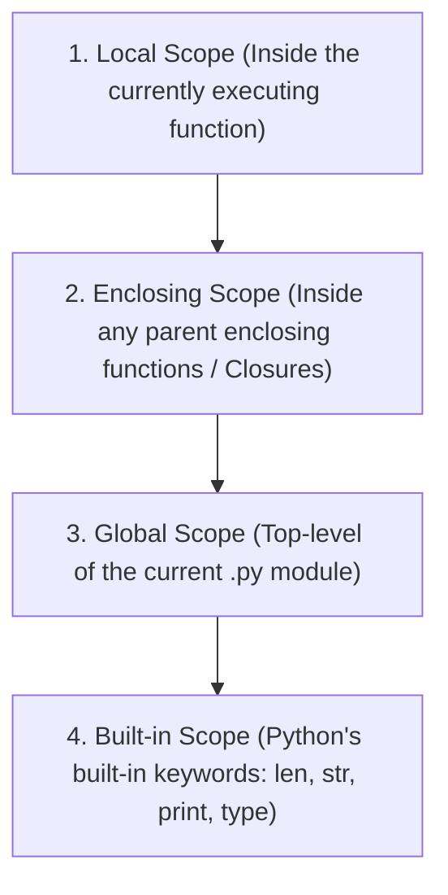

# Module 5: Functions, Parameters (*args, **kwargs) & Variable Scope

Welcome to **Module 5** of the Normora Python & AI Masterclass.

Functions are the core building blocks of clean software engineering. In an enterprise platform like **Normora**, functions allow us to encapsulate document chunking logic, sign JWT access tokens, compute cosine similarities, and execute AI tool calls reliably without code duplication.

In this module, you will master function syntax, parameter passing modes, default arguments, arbitrary arguments (`*args` and `**kwargs`), keyword-only constraints, the Python `LEGB` scoping hierarchy, and closures.

Every concept is followed by **at least 5 real-world examples from the Normora platform**.

---

## 1. Defining Functions & Return Values

A function is defined using the `def` keyword, followed by the function name, parentheses `()` for parameters, and a colon `:`. Code inside the function is indented.

Functions return data using the `return` statement. If a function reaches its end without an explicit `return`, it automatically returns `None`.

### 5 Real-World Normora Examples:

#### Example 1.1: Calculating Tenant Storage Utilization Percentage
```python
def calculate_storage_percentage(used_bytes: int, quota_bytes: int) -> float:
    if quota_bytes <= 0:
        return 0.0
    return (used_bytes / quota_bytes) * 100.0

percent = calculate_storage_percentage(2_500_000_000, 10_000_000_000)
print(f"Tenant storage used: {percent:.1f}%")  # 25.0%
```

#### Example 1.2: Normalizing Search Queries for RAG Retrieval
```python
def normalize_search_query(raw_query: str) -> str:
    cleaned = raw_query.strip().lower()
    # Remove leading question marks or common noise:
    cleaned = cleaned.replace("?", "").replace("!", "")
    return cleaned

query = normalize_search_query("  What is our Travel Reimbursement Policy?  ")
print(f"Normalized query: '{query}'")  # 'what is our travel reimbursement policy'
```

#### Example 1.3: Evaluating BOLA Tenant Ownership
```python
def verify_tenant_ownership(request_tenant_id: str, resource_tenant_id: str) -> bool:
    return request_tenant_id == resource_tenant_id

is_valid = verify_tenant_ownership("T-101", "T-101")
print(f"Ownership valid: {is_valid}")  # True
```

#### Example 1.4: Formatting Token Consumption Invoices
```python
def calculate_token_charge(tokens_used: int, rate_per_1k: float = 0.002) -> float:
    return (tokens_used / 1000) * rate_per_1k

charge = calculate_token_charge(450_000)
print(f"Token charge: ${charge:.2f}")  # $0.90
```

#### Example 1.5: Function Returning Multiple Values via Tuple Packing
```python
def inspect_document_chunk(chunk_text: str) -> tuple[int, int]:
    character_count = len(chunk_text)
    # Estimate tokens (~4 characters per token for English text):
    estimated_tokens = character_count // 4
    return character_count, estimated_tokens

chars, tokens = inspect_document_chunk("The employee handbook defines standard working hours.")
print(f"Characters: {chars}, Estimated Tokens: {tokens}")
```

---

## 2. Positional vs. Keyword Arguments & Default Parameters

* **Positional Arguments:** Matched based on their order in the function call.
* **Keyword Arguments:** Passed explicitly by name (`param_name=value`), allowing arguments to be passed in any order.
* **Default Parameters:** Provide fallback values when the caller omits an argument.

### 5 Real-World Normora Examples:

#### Example 2.1: Semantic Search Retrieval with Default Limit
```python
def search_chunks(query: str, tenant_id: str, limit: int = 5) -> list[str]:
    print(f"Querying vector database for '{query}' in tenant {tenant_id} (Limit: {limit})")
    return [f"result-{i}" for i in range(limit)]

# Using default limit (5):
search_chunks("maternity leave", "TENANT-42")

# Overriding default limit using a keyword argument:
search_chunks("security compliance", "TENANT-42", limit=10)
```

#### Example 2.2: The Safe `None` Default Pattern (Avoiding Mutable Default Traps)
```python
# ✅ The Architect's Standard: Use None as the default for mutable lists or dictionaries
def register_department(name: str, allowed_file_types: list[str] | None = None) -> dict:
    if allowed_file_types is None:
        allowed_file_types = ["pdf", "docx"]  # Fresh list created per call!
    return {"department": name, "formats": allowed_file_types}

dept_a = register_department("Engineering")
dept_b = register_department("Legal", allowed_file_types=["pdf"])
print(dept_a["formats"])  # ['pdf', 'docx']
print(dept_b["formats"])  # ['pdf']
```

#### Example 2.3: Invoking Cloud LLM with Temperature Defaults
```python
def call_gemini_flash(prompt: str, temperature: float = 0.2, max_output_tokens: int = 2048):
    print(f"Invoking Gemini Flash (Temp: {temperature}, MaxTokens: {max_output_tokens})")

# Calling with keyword arguments for clarity:
call_gemini_flash(
    prompt="Summarize the cybersecurity guidelines.",
    temperature=0.0,
    max_output_tokens=1000
)
```

#### Example 2.4: Keyword-Only Arguments Using `*`
Placing an asterisk `*` in the signature forces all subsequent arguments to be passed by keyword, preventing subtle bugs:
```python
# The '*' forces 'department' and 'is_confidential' to be named explicitly:
def index_document(document_id: str, text: str, *, department: str, is_confidential: bool = False):
    print(f"Indexing {document_id} into {department} (Confidential: {is_confidential})")

# ✅ Correct:
index_document("DOC-1", "Text content...", department="Legal", is_confidential=True)

# ❌ Calling with positional args will raise a TypeError:
# index_document("DOC-1", "Text content...", "Legal", True)  --> TypeError!
```

#### Example 2.5: Formatting API Error Envelopes with Default Status Code
```python
def build_error_response(error_message: str, error_code: str = "VALIDATION_FAILED", status: int = 400) -> dict:
    return {
        "success": False,
        "error": {
            "code": error_code,
            "message": error_message,
            "status_code": status
        }
    }

err = build_error_response("Tenant ID must not be empty.")
print(err)
```

---

## 3. Arbitrary Arguments: `*args` and `**kwargs`

* **`*args`** (Positional Arbitrary Arguments): Gathers extra positional arguments into a **tuple**.
* **`**kwargs`** (Keyword Arbitrary Arguments): Gathers extra named keyword arguments into a **dictionary**.

### 5 Real-World Normora Examples:

#### Example 3.1: Combining Multiple Document Chunks with `*args`
```python
def merge_chunk_texts(*chunks: str) -> str:
    print(f"Received {len(chunks)} chunks to concatenate.")
    return "\n---\n".join(chunks)

combined = merge_chunk_texts("Policy 1: Password rules", "Policy 2: MFA rules", "Policy 3: VPN rules")
print(combined)
```

#### Example 3.2: Passing Dynamic Metadata Attributes to pgvector with `**kwargs`
```python
def store_vector_record(chunk_id: str, embedding: list[float], **metadata):
    print(f"Storing chunk {chunk_id} with dimension {len(embedding)}")
    print(f"Arbitrary metadata attributes stored in JSONB: {metadata}")

store_vector_record(
    "chk-99",
    [0.12, 0.45, -0.22],
    department="Human Resources",
    author="Jane Doe",
    page_number=12,
    confidential=False
)
```

#### Example 3.3: Wrapper Function Forwarding Arguments to an External API
```python
def log_and_execute_tool(tool_name: str, *args, **kwargs):
    print(f"[AUDIT LOG] Executing tool '{tool_name}' with args={args}, kwargs={kwargs}")
    # Forward the exact arguments to the target handler:
    if tool_name == "search":
        print(f"Searching for query: {kwargs.get('query')}")

log_and_execute_tool("search", query="work from home", tenant_id="T-101")
```

#### Example 3.4: Dynamic Message Builder for Chat Turns
```python
def create_chat_turn(role: str, content: str, **annotations) -> dict:
    turn = {"role": role, "content": content}
    if annotations:
        turn["annotations"] = annotations
    return turn

turn = create_chat_turn("assistant", "Here is your policy answer.", confidence=0.96, model="gemini-flash")
print(turn)
```

#### Example 3.5: Argument Unpacking (`*` and `**` on Call Sites)
You can unpack an existing list into `*args` or a dictionary into `**kwargs`:
```python
def configure_tenant_branding(tenant_id: str, primary_color: str, secondary_color: str):
    print(f"Tenant {tenant_id}: Primary={primary_color}, Secondary={secondary_color}")

branding_config = {
    "primary_color": "#0ea5e9",
    "secondary_color": "#1e293b"
}

# Unpack the dictionary directly into the function call:
configure_tenant_branding("TENANT-55", **branding_config)
```

---

## 4. Variable Scope & The LEGB Rule

In Python, the order in which variable names are resolved follows the **LEGB Rule**:



### 5 Real-World Normora Examples:

#### Example 4.1: Local Scope Isolation
Variables created inside a function are completely invisible to the outside code:
```python
def calculate_retrieval_discount():
    discount_multiplier = 0.85  # Local variable
    return discount_multiplier

calculate_retrieval_discount()
# print(discount_multiplier)  --> NameError! Not accessible outside the function
```

#### Example 4.2: Enclosing Scope & Closures (Factory Functions)
A function defined inside another function retains access to the outer function's variables (a **closure**):
```python
def create_tenant_filter(tenant_id: str):
    # 'tenant_id' is in the enclosing scope
    def filter_documents(documents: list[dict]) -> list[dict]:
        # Inner function remembers 'tenant_id' even after create_tenant_filter finishes!
        return [doc for doc in documents if doc["tenant_id"] == tenant_id]
    return filter_documents

# Create a specialized filter function locked to TENANT-99:
tenant_99_filter = create_tenant_filter("TENANT-99")

raw_docs = [
    {"doc_id": "1", "tenant_id": "TENANT-99"},
    {"doc_id": "2", "tenant_id": "TENANT-12"},
    {"doc_id": "3", "tenant_id": "TENANT-99"}
]

print(tenant_99_filter(raw_docs))  # Returns only doc 1 and 3!
```

#### Example 4.3: Module-Level Global Scope for Constants
```python
# Global Constants (Safe to read anywhere in the module)
DEFAULT_MAX_TOKENS = 4096
DEFAULT_EMBEDDING_MODEL = "text-embedding-004"

def get_model_specs() -> dict:
    # Reads directly from Global scope
    return {"model": DEFAULT_EMBEDDING_MODEL, "max_tokens": DEFAULT_MAX_TOKENS}

print(get_model_specs())
```

#### Example 4.4: Modifying Enclosing Scope with `nonlocal`
In stateful generators or counters, `nonlocal` allows modifying a variable in the enclosing parent function:
```python
def make_token_counter():
    total_tokens = 0  # Enclosing variable

    def consume(count: int) -> int:
        nonlocal total_tokens  # Allows modifying the outer total_tokens variable
        total_tokens += count
        return total_tokens

    return consume

counter = make_token_counter()
print(counter(500))   # 500
print(counter(300))   # 800
print(counter(1200))  # 2000
```

#### Example 4.5: Avoiding Shadowing Python's Built-in Scope
Never name a parameter or variable after Python built-ins like `id`, `type`, `list`, or `format`:
```python
# ❌ Bad: Shadows built-in 'id()' function
# def fetch_tenant(id: str): pass

# ✅ Good: Descriptive names
def fetch_tenant(tenant_id: str) -> dict:
    return {"tenant_id": tenant_id}
```

---

## 5. Lambda Functions (Anonymous Functions)

A **lambda** function is an inline, anonymous function defined with the syntax: `lambda params: expression`.  
Lambdas are commonly used for short, throwaway operations like sorting and mapping.

### 5 Real-World Normora Examples:

#### Example 5.1: Sorting Document Chunks by Recency
```python
chunks = [
    {"id": "c1", "timestamp": 1718000000},
    {"id": "c2", "timestamp": 1718900000},
    {"id": "c3", "timestamp": 1718200000}
]

# Sort newest first using a lambda:
sorted_chunks = sorted(chunks, key=lambda c: c["timestamp"], reverse=True)
print(f"Newest chunk: {sorted_chunks[0]['id']}")  # c2
```

#### Example 5.2: Mapping Department Names to Uppercase
```python
depts = ["engineering", "legal", "hr"]
upper_depts = list(map(lambda d: d.upper(), depts))
print(upper_depts)  # ['ENGINEERING', 'LEGAL', 'HR']
```

#### Example 5.3: Filtering Suspended Tenant Accounts
```python
tenants = [
    {"name": "Acme", "is_active": True},
    {"name": "BetaCorp", "is_active": False},
    {"name": "GammaLLC", "is_active": True}
]

active_tenants = list(filter(lambda t: t["is_active"], tenants))
print([t["name"] for t in active_tenants])  # ['Acme', 'GammaLLC']
```

#### Example 5.4: Custom Key for Multi-Attribute Sorting
Sort first by similarity score (descending), then by page number (ascending):
```python
candidates = [
    {"id": "c1", "similarity": 0.90, "page": 5},
    {"id": "c2", "similarity": 0.90, "page": 2},
    {"id": "c3", "similarity": 0.85, "page": 1}
]

# Tuple key: (-similarity, page)
candidates.sort(key=lambda x: (-x["similarity"], x["page"]))
print(candidates[0]["id"])  # c2 (Page 2 comes before Page 5 for identical scores)
```

#### Example 5.5: Instant Arithmetic Callback for Pricing Multipliers
```python
get_adjusted_price = lambda base_price, multiplier: base_price * multiplier
print(f"Discounted tier price: ${get_adjusted_price(199.00, 0.80):.2f}")  # $159.20
```

---

## Summary & Next Step

You have mastered:
1. Writing modular functions with explicit return types.
2. Positional vs keyword arguments and default parameter safety.
3. Arbitrary argument collection with `*args` and `**kwargs`.
4. The `LEGB` scoping hierarchy, closures, and `nonlocal`.
5. Anonymous one-line `lambda` functions.

In **Module 6**, we will learn how to design reusable domain entities using **Object-Oriented Programming (Classes, `self`, Constructors, and Inheritance)**!
