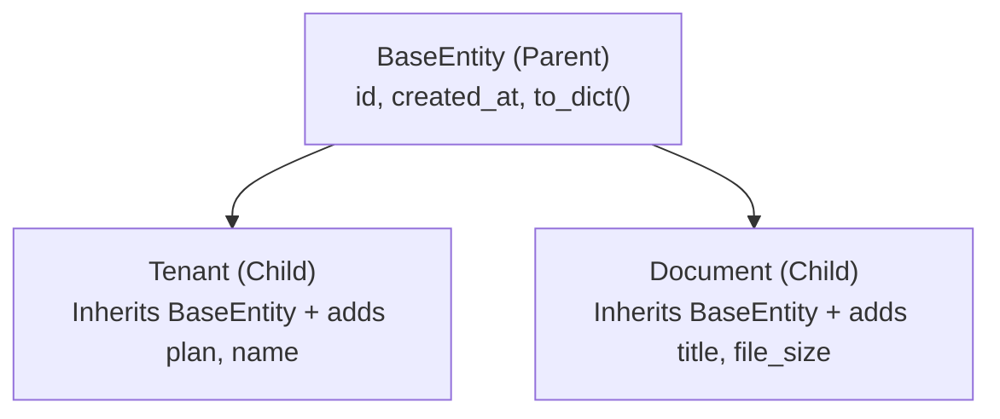

# Module 6: Object-Oriented Programming (OOP) from Scratch

Welcome to **Module 6** of the Normora Python & AI Masterclass.

In production architectures, data and behaviors must be bundled together into cohesive, reusable domain models. In **Normora**, entities such as `Tenant`, `DocumentChunk`, `UserMembership`, and `GeminiEmbeddingEngine` are designed as **Classes**.

In this module, you will learn Object-Oriented Programming (OOP) in Python completely from the ground up:
* The difference between a class (blueprint) and an object (instance).
* The constructor (`__init__`) and what `self` physically represents.
* Instance attributes vs. class attributes.
* Instance methods, `@classmethod` (factory constructors), and `@staticmethod`.
* Encapsulation and the `@property` decorator (getters and setters).
* Inheritance, `super()`, and Polymorphism (method overriding).

Every concept is followed by **at least 5 real-world Normora examples**.

---

## 1. Classes, Instances & The `__init__` Constructor

A **Class** is a blueprint defining the properties (attributes) and actions (methods) that an object has. An **Instance** is a concrete object created from that blueprint.

When you instantiate a class (e.g. `tenant = Tenant(...)`), Python executes the special `__init__` method (the **constructor**) to initialize the new object's attributes.

### What is `self`?
In Python, `self` represents the **specific instance** of the class currently being created or operated on. When you call `tenant.suspend()`, Python automatically converts it behind the scenes to `Tenant.suspend(tenant)`. Passing `self` as the first argument gives the method access to that specific instance's attributes.

### 5 Real-World Normora Examples:

#### Example 1.1: The `Tenant` Domain Model
```python
class Tenant:
    def __init__(self, tenant_id: str, name: str, plan: str):
        self.tenant_id = tenant_id  # Instance attribute
        self.name = name
        self.plan = plan
        self.is_active = True

# Instantiate two distinct tenant objects:
tenant_1 = Tenant("T-101", "Acme Health", "Enterprise")
tenant_2 = Tenant("T-102", "Fintech Labs", "Pro")

print(f"Tenant 1: {tenant_1.name} ({tenant_1.plan})")
print(f"Tenant 2: {tenant_2.name} ({tenant_2.plan})")
```

#### Example 1.2: The `DocumentChunk` Vector Model
```python
class DocumentChunk:
    def __init__(self, chunk_id: str, document_name: str, content: str, page_number: int):
        self.chunk_id = chunk_id
        self.document_name = document_name
        self.content = content
        self.page_number = page_number
        self.embedding = []  # Will hold 768 float numbers

chunk = DocumentChunk("chk-99", "Security_Policy.pdf", "Encrypt all data at rest.", 4)
print(f"Created chunk {chunk.chunk_id} from {chunk.document_name} (Page {chunk.page_number})")
```

#### Example 1.3: The `TenantMembership` Model
```python
class TenantMembership:
    def __init__(self, user_id: str, tenant_id: str, role: str):
        self.user_id = user_id
        self.tenant_id = tenant_id
        self.role = role  # "Owner", "Admin", "Member"

membership = TenantMembership("USR-44", "T-101", "Admin")
print(f"User {membership.user_id} holds role '{membership.role}' in {membership.tenant_id}")
```

#### Example 1.4: The `ChatMessage` Model
```python
class ChatMessage:
    def __init__(self, role: str, text: str):
        self.role = role      # "user", "assistant", "system"
        self.text = text
        self.citations = []   # List of source document names

msg = ChatMessage("user", "What is the paid leave policy?")
print(f"[{msg.role.upper()}]: {msg.text}")
```

#### Example 1.5: The `Department` Entity
```python
class Department:
    def __init__(self, department_id: str, name: str, tenant_id: str):
        self.department_id = department_id
        self.name = name
        self.tenant_id = tenant_id
        self.member_count = 0

dept = Department("D-1", "Engineering", "T-101")
print(f"Department: {dept.name} belongs to Tenant: {dept.tenant_id}")
```

---

## 2. Instance Attributes vs. Class Attributes

* **Instance Attributes:** Owned by a specific instance of the class (defined inside `__init__` via `self.x = ...`). Every object has its own copy.
* **Class Attributes:** Owned by the class itself (defined directly inside the class body, outside any methods). **Shared by all instances of that class.**

### 5 Real-World Normora Examples:

#### Example 2.1: Default Embedding Model Configuration
```python
class EmbeddingGenerator:
    # Class Attributes (Shared across all instances):
    PROVIDER = "Google Gemini"
    MODEL_NAME = "text-embedding-004"
    DIMENSION = 768

    def __init__(self, api_key: str):
        # Instance Attribute (Unique per instance):
        self.api_key = api_key

gen_1 = EmbeddingGenerator("key_123")
gen_2 = EmbeddingGenerator("key_456")

print(gen_1.MODEL_NAME)  # "text-embedding-004"
print(gen_2.MODEL_NAME)  # "text-embedding-004"
print(EmbeddingGenerator.DIMENSION)  # 768 (Can access directly from class!)
```

#### Example 2.2: Global Document Size Limits
```python
class DocumentUploader:
    MAX_FILE_SIZE_MB = 25  # Class attribute: System-wide limit

    def __init__(self, tenant_id: str):
        self.tenant_id = tenant_id

print(f"System max upload size: {DocumentUploader.MAX_FILE_SIZE_MB} MB")
```

#### Example 2.3: Tracking Total Instantiated Conversation Sessions
```python
class ConversationSession:
    total_sessions_created = 0  # Class attribute counter

    def __init__(self, session_id: str, tenant_id: str):
        self.session_id = session_id
        self.tenant_id = tenant_id
        ConversationSession.total_sessions_created += 1

s1 = ConversationSession("s-1", "T-101")
s2 = ConversationSession("s-2", "T-101")
s3 = ConversationSession("s-3", "T-102")

print(f"Active session count: {ConversationSession.total_sessions_created}")  # 3
```

#### Example 2.4: Standard API Error Messages
```python
class ApiErrors:
    # Class attributes acting as centralized constants (No magic strings!)
    TENANT_NOT_FOUND = "The requested workspace does not exist."
    FORBIDDEN_BFLA = "Insufficient permissions to execute this operation."
    TOKEN_QUOTA_EXCEEDED = "Monthly AI token budget has been exhausted."

print(ApiErrors.FORBIDDEN_BFLA)
```

#### Example 2.5: Allowed Document MIME Types
```python
class DocumentValidator:
    SUPPORTED_EXTENSIONS = [".pdf", ".docx", ".txt", ".md"]

    def __init__(self, filename: str):
        self.filename = filename

    def is_supported(self) -> bool:
        # Check against the shared class attribute:
        return any(self.filename.endswith(ext) for ext in DocumentValidator.SUPPORTED_EXTENSIONS)

validator = DocumentValidator("Compliance.pdf")
print(f"Is supported: {validator.is_supported()}")  # True
```

---

## 3. Instance Methods, `@classmethod`, and `@staticmethod`

Python classes support 3 distinct types of methods:
1. **Instance Method (`def method(self)`):** Operates on an individual instance. Can read/modify `self`.
2. **Class Method (`@classmethod`, `def method(cls)`):** Operates on the class itself. Often used as **Factory Constructors** to instantiate objects from different formats (like JSON).
3. **Static Method (`@staticmethod`, `def method()`):** A utility function placed inside the class namespace. Does not receive `self` or `cls`.

### 5 Real-World Normora Examples:

#### Example 3.1: Instance Method Modifying State
```python
class TenantAccount:
    def __init__(self, tenant_id: str, balance_usd: float):
        self.tenant_id = tenant_id
        self.balance_usd = balance_usd
        self.is_suspended = False

    # Instance method:
    def deduct_ai_charges(self, amount: float):
        self.balance_usd -= amount
        if self.balance_usd < 0:
            self.is_suspended = True
            print(f"Tenant {self.tenant_id} balance depleted. Account suspended.")

account = TenantAccount("T-99", 10.00)
account.deduct_ai_charges(15.00)
print(f"Suspended: {account.is_suspended}")  # True
```

#### Example 3.2: `@classmethod` as a Factory Constructor (From JSON Dict)
```python
class DocumentMetadata:
    def __init__(self, document_id: str, title: str, department: str):
        self.document_id = document_id
        self.title = title
        self.department = department

    @classmethod
    def from_api_json(cls, payload: dict):
        # Factory method parsing an external API dictionary:
        return cls(
            document_id=payload["id"],
            title=payload["name"].strip(),
            department=payload.get("dept", "General")
        )

# Constructing from an API response:
api_data = {"id": "DOC-77", "name": "  IT Guidelines 2026.pdf  ", "dept": "Security"}
doc_meta = DocumentMetadata.from_api_json(api_data)
print(f"Created metadata object: '{doc_meta.title}' in {doc_meta.department}")
```

#### Example 3.3: `@classmethod` Factory for Default Free Tier Tenants
```python
class TenantPlan:
    def __init__(self, plan_name: str, token_limit: int, max_docs: int):
        self.plan_name = plan_name
        self.token_limit = token_limit
        self.max_docs = max_docs

    @classmethod
    def create_free_tier(cls):
        return cls(plan_name="Free", token_limit=100_000, max_docs=5)

    @classmethod
    def create_enterprise_tier(cls):
        return cls(plan_name="Enterprise", token_limit=50_000_000, max_docs=10_000)

free_plan = TenantPlan.create_free_tier()
print(f"Plan: {free_plan.plan_name}, Limit: {free_plan.token_limit:,} tokens")
```

#### Example 3.4: `@staticmethod` for Text Sanitization Utility
```python
class TextCleaner:
    @staticmethod
    def clean_chunk_whitespace(text: str) -> str:
        # A utility function that doesn't need any state:
        return " ".join(text.split())

cleaned = TextCleaner.clean_chunk_whitespace("Policy    Clause 1:    All    employees...")
print(cleaned)  # "Policy Clause 1: All employees..."
```

#### Example 3.5: `@staticmethod` for Generating Document Slug
```python
class SlugGenerator:
    @staticmethod
    def to_slug(title: str) -> str:
        return title.lower().replace(" ", "-").replace(".pdf", "")

slug = SlugGenerator.to_slug("Annual Financial Audit 2026.pdf")
print(f"Generated slug: {slug}")  # "annual-financial-audit-2026"
```

---

## 4. Encapsulation & The `@property` Decorator

In languages like C#, you write properties with `get` and `set`.  
In Python, we achieve this using the **`@property`** decorator. It allows an instance method to be accessed just like an attribute (without parentheses `()`), enabling validation, computed attributes, and read-only properties.

### 5 Real-World Normora Examples:

#### Example 4.1: Computed Read-Only Property for Full Name
```python
class UserProfile:
    def __init__(self, first_name: str, last_name: str):
        self.first_name = first_name
        self.last_name = last_name

    @property
    def full_name(self) -> str:
        # Computed dynamically whenever accessed:
        return f"{self.first_name} {self.last_name}"

user = UserProfile("Sanjeev", "Kumar")
print(user.full_name)  # "Sanjeev Kumar" (Accessed as an attribute, no parentheses!)
```

#### Example 4.2: Protected Attribute with Validation Setter
```python
class TokenBudget:
    def __init__(self, max_tokens: int):
        self._max_tokens = max_tokens  # Leading underscore means 'protected'

    @property
    def max_tokens(self) -> int:
        return self._max_tokens

    @max_tokens.setter
    def max_tokens(self, new_limit: int):
        if new_limit < 0:
            raise ValueError("Token limit cannot be negative.")
        print(f"Updating token budget to {new_limit:,}")
        self._max_tokens = new_limit

budget = TokenBudget(500_000)
budget.max_tokens = 1_000_000  # Calls the setter automatically!
print(f"New limit: {budget.max_tokens:,}")
```

#### Example 4.3: Read-Only Check for Over-Budget State
```python
class BillingCycle:
    def __init__(self, used: int, limit: int):
        self.used = used
        self.limit = limit

    @property
    def is_over_budget(self) -> bool:
        return self.used > self.limit

cycle = BillingCycle(1_200_000, 1_000_000)
print(f"Alert needed: {cycle.is_over_budget}")  # True
```

#### Example 4.4: Formatting Storage Bytes as Megabytes
```python
class DocumentFile:
    def __init__(self, filename: str, size_in_bytes: int):
        self.filename = filename
        self.size_in_bytes = size_in_bytes

    @property
    def size_mb(self) -> float:
        return round(self.size_in_bytes / (1024 * 1024), 2)

doc = DocumentFile("Handbook.pdf", 14_500_000)
print(f"{doc.filename} is {doc.size_mb} MB")  # Handbook.pdf is 13.83 MB
```

#### Example 4.5: Read-Only Authorization Guard
```python
class TenantSecurityContext:
    def __init__(self, tenant_id: str, role: str):
        self._tenant_id = tenant_id
        self._role = role

    @property
    def can_delete_workspace(self) -> bool:
        # Only Tenant Owners can delete
        return self._role == "Owner"

context = TenantSecurityContext("T-10", "Admin")
print(f"Can delete workspace: {context.can_delete_workspace}")  # False
```

---

## 5. Inheritance, `super()`, and Polymorphism

* **Inheritance:** A child class (subclass) inherits attributes and methods from a parent class (base class).
* **`super()`:** Calls the parent class's constructor or methods.
* **Polymorphism:** A child class can override a parent class method with its own specialized behavior.



### 5 Real-World Normora Examples:

#### Example 5.1: `BaseEntity` with Timestamp Inheritance
```python
import time

class BaseEntity:
    def __init__(self, entity_id: str):
        self.entity_id = entity_id
        self.created_at = time.time()

    def get_audit_info(self) -> str:
        return f"Entity {self.entity_id} created at epoch {self.created_at:.0f}"

class Tenant(BaseEntity):
    def __init__(self, tenant_id: str, company_name: str):
        # Call the parent BaseEntity constructor:
        super().__init__(entity_id=tenant_id)
        self.company_name = company_name

tenant = Tenant("T-500", "Acme Logistics")
print(tenant.company_name)
print(tenant.get_audit_info())  # Inherited from BaseEntity!
```

#### Example 5.2: Polymorphism with Vector Retrieval Engines
Different retrieval strategies override a common `retrieve()` method:
```python
class BaseRetriever:
    def __init__(self, tenant_id: str):
        self.tenant_id = tenant_id

    def retrieve(self, query: str) -> list[str]:
        raise NotImplementedError("Subclasses must implement retrieve()")

class SemanticVectorRetriever(BaseRetriever):
    def retrieve(self, query: str) -> list[str]:
        # Overrides parent method with dense vector logic:
        return [f"Vector match for '{query}' using pgvector cosine distance."]

class KeywordBM25Retriever(BaseRetriever):
    def retrieve(self, query: str) -> list[str]:
        # Overrides parent method with keyword search:
        return [f"BM25 lexical match for '{query}' using PostgreSQL tsvector."]

# Polymorphic usage:
retrievers: list[BaseRetriever] = [
    SemanticVectorRetriever("T-1"),
    KeywordBM25Retriever("T-1")
]

for r in retrievers:
    print(r.retrieve("vacation policy"))
```

#### Example 5.3: Extending Document Parsers
```python
class BaseDocumentParser:
    def __init__(self, file_path: str):
        self.file_path = file_path

    def extract_text(self) -> str:
        return "Base text extraction"

class PdfDocumentParser(BaseDocumentParser):
    def extract_text(self) -> str:
        # Overrides with specialized PDF parsing:
        return f"Extracted raw text and OCR tables from PDF: {self.file_path}"

class MarkdownParser(BaseDocumentParser):
    def extract_text(self) -> str:
        return f"Extracted headers and bullet points from Markdown: {self.file_path}"

parser = PdfDocumentParser("/storage/docs/handbook.pdf")
print(parser.extract_text())
```

#### Example 5.4: Base Exception Class Inheritance (Custom Normora Exceptions)
```python
class NormoraException(Exception):
    """Base exception for all Normora application errors."""
    def __init__(self, message: str, status_code: int):
        super().__init__(message)
        self.status_code = status_code

class BolaException(NormoraException):
    """Raised when an object is requested that the user does not own."""
    def __init__(self, resource: str = "Resource"):
        # Map globally to 404 to prevent resource ID enumeration:
        super().__init__(message=f"{resource} not found.", status_code=404)

class BflaException(NormoraException):
    """Raised when a user lacks required permissions."""
    def __init__(self, action: str = "Action"):
        super().__init__(message=f"Forbidden: Cannot execute {action}.", status_code=403)

# Test custom exceptions:
err = BolaException("Document")
print(f"Error: {err}, HTTP Status: {err.status_code}")  # Document not found. (Status: 404)
```

#### Example 5.5: Base AI Tool Calling Class
```python
class BaseAiTool:
    name: str = "base_tool"
    description: str = "Base description"

    def execute(self, **kwargs) -> dict:
        raise NotImplementedError()

class SearchDocumentsTool(BaseAiTool):
    name = "search_company_documents"
    description = "Searches internal company knowledge base."

    def execute(self, **kwargs) -> dict:
        query = kwargs.get("query", "")
        return {"status": "success", "results": [f"Chunk matching '{query}'"]}

tool = SearchDocumentsTool()
print(f"Tool: {tool.name}")
print(tool.execute(query="security policies"))
```

---

## Summary & Next Step

You have mastered:
1. Creating classes, instances, and using the `__init__` constructor and `self`.
2. Differentiating instance attributes from shared class attributes.
3. Defining instance methods, `@classmethod` factories, and `@staticmethod` utilities.
4. Clean encapsulation using the `@property` decorator for getters and setters.
5. Inheriting common behavior with `super()` and implementing polymorphic overrides.

In **Module 7**, we will master **Error Handling, Exception Hierarchies & File I/O**, learning how to handle crashes gracefully and safely parse JSON and documents!
