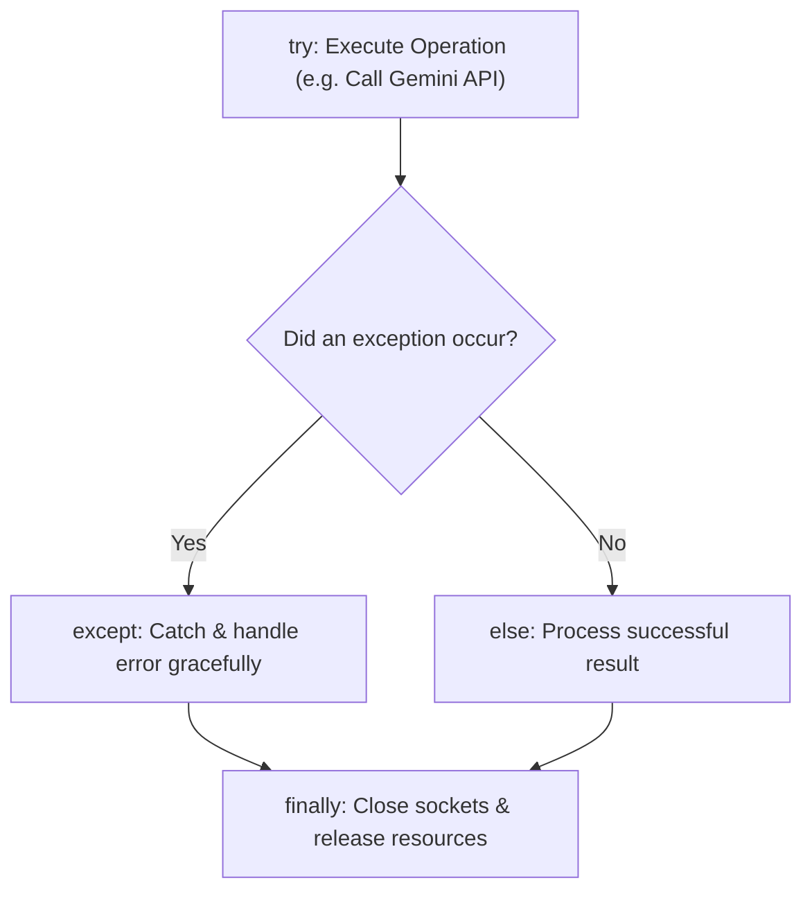

# Module 7: Error Handling, Exceptions & File I/O

Welcome to **Module 7** of the Normora Python & AI Masterclass.

In production AI backends, failures are inevitable:
* A tenant requests a document ID that belongs to another organization (**BOLA attack**).
* An external cloud API (like Google Gemini) experiences a transient rate-limit or network timeout.
* An uploaded document contains malformed JSON or corrupted PDF bytes.
* An unauthenticated user attempts an admin-only operation (**BFLA attack**).

An architect designs systems that fail **defensively, cleanly, and predictably**. In this module, you will master Python's exception handling mechanics, custom exception hierarchies, safe file I/O, context managers, and JSON data processing.

Every concept is followed by **at least 5 real-world Normora examples**.

---

## 1. The `try`, `except`, `else`, and `finally` Pipeline

When an error occurs in Python, an **Exception** is raised. If unhandled, the program halts with a crash and stack trace. 

The `try` / `except` block intercepts these exceptions gracefully:
* **`try`**: Run code that might fail.
* **`except SpecificException as e`**: Execute fallback logic if that specific error occurs.
* **`else`**: Run code **only** if the `try` block succeeded with zero errors.
* **`finally`**: **Always** run this cleanup code, regardless of whether an exception occurred or not.



### 5 Real-World Normora Examples:

#### Example 1.1: Catching Invalid Port or Quota String Conversion
```python
raw_user_quota = "unlimited"  # User provided text instead of an integer

try:
    quota = int(raw_user_quota)
    print(f"Configured quota: {quota}")
except ValueError as e:
    print(f"Input error: '{raw_user_quota}' is not a valid number. Defaulting to 100,000.")
    quota = 100_000
```

#### Example 1.2: Safely Reading a JSON Configuration Key
```python
tenant_payload = {"tenant_id": "T-101", "name": "Acme Corp"}

try:
    # Attempting to read an unindexed key:
    webhook_url = tenant_payload["webhook_endpoint"]
except KeyError:
    print("Warning: 'webhook_endpoint' missing. Webhook notifications disabled.")
    webhook_url = None
```

#### Example 1.3: Simulating an API Call with `else` and `finally`
```python
def query_gemini_api(is_network_healthy: bool):
    try:
        print("[1] Opening outbound HTTPS connection to Google Gemini API...")
        if not is_network_healthy:
            raise ConnectionError("Connection reset by peer.")
        response_text = "Here is the summarized company policy."
    except ConnectionError as err:
        print(f"[2] Error caught: {err}. Retrying in 2 seconds...")
    else:
        # Executes ONLY if try succeeded:
        print(f"[3] Success! Tokens generated: '{response_text}'")
    finally:
        # ALWAYS executes:
        print("[4] Closing HTTP connection pool socket.")

query_gemini_api(is_network_healthy=True)
print("-" * 40)
query_gemini_api(is_network_healthy=False)
```

#### Example 1.4: Safe Division for Token Cost Averaging
```python
total_tokens = 0
total_queries = 0

try:
    avg_tokens_per_query = total_tokens / total_queries
except ZeroDivisionError:
    avg_tokens_per_query = 0.0
    print("No queries logged yet. Average tokens set to 0.0.")
```

#### Example 1.5: Catching Multiple Specific Exceptions
```python
raw_data = {"score": "0.95"}

try:
    # Two potential points of failure: KeyError and ValueError
    value = float(raw_data["similarity"])
except KeyError:
    print("Error: 'similarity' key is absent.")
except ValueError:
    print("Error: 'similarity' value could not be converted to float.")
except Exception as unhandled:
    print(f"Unexpected error: {unhandled}")
```

---

## 2. Raising Exceptions & Custom Exception Hierarchies

In enterprise backends, you should never throw raw generic exceptions (`raise Exception("Error")`).  
Instead, you create **domain-specific custom exception classes** that communicate exact semantic meaning to HTTP middleware.

### Normora Security Architecture:
* **`BolaException` (Broken Object Level Authorization):** When a user requests a resource they don't own, we raise `BolaException`. Our global error middleware catches this and maps it to **`404 Not Found`** (instead of 403) to prevent malicious actors from enumerating valid resource IDs!
* **`BflaException` (Broken Function Level Authorization):** When a user lacks permission for an endpoint, we raise `BflaException` which maps to **`403 Forbidden`**.

### 5 Real-World Normora Examples:

#### Example 2.1: Defining the Normora Domain Exception Tree
```python
class NormoraException(Exception):
    """Root base exception for all Normora application errors."""
    def __init__(self, message: str, status_code: int = 400):
        super().__init__(message)
        self.message = message
        self.status_code = status_code

class BolaException(NormoraException):
    """Raised when an object is requested across tenant boundaries."""
    def __init__(self, resource_name: str = "Resource"):
        # Map to 404 to avoid ID enumeration!
        super().__init__(message=f"{resource_name} not found.", status_code=404)

class BflaException(NormoraException):
    """Raised when a user lacks required permissions."""
    def __init__(self, action: str):
        super().__init__(message=f"Forbidden: Insufficient permissions for {action}.", status_code=403)

class QuotaExceededException(NormoraException):
    """Raised when tenant exceeds monthly token allowance."""
    def __init__(self, current_usage: int, limit: int):
        super().__init__(
            message=f"AI Token Quota Exceeded ({current_usage:,} / {limit:,} tokens).",
            status_code=429
        )
```

#### Example 2.2: Enforcing BOLA Protection on Document Retrieval
```python
def get_document(document_id: str, requesting_tenant_id: str) -> dict:
    # Simulated database record:
    stored_doc = {"id": "DOC-99", "tenant_id": "TENANT-ALPHA", "title": "Payroll.pdf"}

    # Defense check:
    if stored_doc["tenant_id"] != requesting_tenant_id:
        # ❌ Do NOT return 403 or "Access Denied" (which confirms the doc exists!)
        # ✅ Raise BolaException -> Maps to 404
        raise BolaException("Document")

    return stored_doc

try:
    get_document("DOC-99", requesting_tenant_id="TENANT-BETA")
except BolaException as e:
    print(f"HTTP Response: {e.status_code} - {e.message}")  # 404 - Document not found.
```

#### Example 2.3: Enforcing BFLA Protection on Departmental Role
```python
def delete_department(dept_name: str, user_role: str):
    if user_role not in ["Owner", "Admin"]:
        raise BflaException("department deletion")
    print(f"Department '{dept_name}' deleted.")

try:
    delete_department("Legal", user_role="Member")
except BflaException as e:
    print(f"HTTP Response: {e.status_code} - {e.message}")  # 403 - Forbidden
```

#### Example 2.4: Enforcing Monthly AI Token Budget
```python
def check_token_budget(tenant_usage: int, tenant_limit: int):
    if tenant_usage >= tenant_limit:
        raise QuotaExceededException(tenant_usage, tenant_limit)
    print("Token budget healthy. Generating embeddings...")

try:
    check_token_budget(1_050_000, 1_000_000)
except QuotaExceededException as e:
    print(f"HTTP Response: {e.status_code} - {e.message}")  # 429 - Quota Exceeded
```

#### Example 2.5: Validating File Extension Before Ingestion
```python
class UnsupportedDocumentFormat(NormoraException):
    def __init__(self, extension: str):
        super().__init__(message=f"Unsupported file format: '{extension}'. Only PDF and DOCX supported.", status_code=415)

def validate_file_format(filename: str):
    if not (filename.endswith(".pdf") or filename.endswith(".docx")):
        ext = filename.split(".")[-1]
        raise UnsupportedDocumentFormat(ext)
    print(f"File '{filename}' validated.")

try:
    validate_file_format("malicious_script.exe")
except UnsupportedDocumentFormat as e:
    print(f"HTTP Response: {e.status_code} - {e.message}")  # 415 - Unsupported
```

---

## 3. Safe File I/O & The `with` Statement (Context Managers)

When working with files on disk, you must ensure that file descriptors are always closed, even if an exception occurs mid-operation.

In Python, the **`with` statement** guarantees automatic file closure (implementing the **Context Manager** protocol).

```python
# ✅ The Architect's Standard:
with open("filepath.txt", "r", encoding="utf-8") as f:
    data = f.read()
# The file is automatically closed here, even if reading failed!
```

### 5 Real-World Normora Examples:

#### Example 3.1: Writing Extracted Document Chunks to Disk
```python
import os

chunks = [
    "Chunk 1: Password complexity requirements...",
    "Chunk 2: Two-factor authentication guidelines..."
]

temp_path = "extracted_chunks.txt"

# Write chunks to disk using 'w' mode (overwrite):
with open(temp_path, "w", encoding="utf-8") as file:
    for chunk in chunks:
        file.write(chunk + "\n")

print(f"Wrote {len(chunks)} chunks to {temp_path}")
```

#### Example 3.2: Reading a Document Line-by-Line (Memory Efficient)
When reading a huge 500MB log or CSV file, never call `file.read()` all at once. Iterate line-by-line:
```python
with open(temp_path, "r", encoding="utf-8") as file:
    for line_number, line in enumerate(file, start=1):
        print(f"Line {line_number}: {line.strip()}")
```

#### Example 3.3: Appending to a Multi-Tenant Audit Log
Use `"a"` mode (append) to add records without overwriting:
```python
audit_log_path = "tenant_audit.log"

def log_audit_event(tenant_id: str, action: str):
    with open(audit_log_path, "a", encoding="utf-8") as log_file:
        log_file.write(f"TENANT: {tenant_id} | ACTION: {action}\n")

log_audit_event("T-101", "USER_INVITED_ALICE")
log_audit_event("T-101", "DOCUMENT_UPLOADED_SECURITY_PDF")
```

#### Example 3.4: Reading Binary Files (PDFs / Images)
When reading raw files for upload to MinIO S3 storage, use binary mode (`"rb"`):
```python
# Reading binary bytes:
with open(temp_path, "rb") as binary_file:
    raw_bytes = binary_file.read()
    print(f"Read {len(raw_bytes)} raw binary bytes.")
```

#### Example 3.5: Handling Missing Files Gracefully with `FileNotFoundError`
```python
def load_tenant_branding_stylesheet(tenant_id: str) -> str:
    path = f"custom_themes/{tenant_id}.css"
    try:
        with open(path, "r", encoding="utf-8") as f:
            return f.read()
    except FileNotFoundError:
        print(f"Theme file '{path}' missing. Loading default Normora dark theme.")
        return "/* Default Normora Theme */"

css = load_tenant_branding_stylesheet("T-NONEXISTENT")
print(css)
```

---

## 4. JSON Serialization & Deserialization (`json` Module)

In FastAPI and AI development, data travels as JSON (JavaScript Object Notation).
Python provides the built-in `json` module:
* **`json.loads(json_string)`**: Parses a JSON string into a Python dictionary/list (**Deserialize**).
* **`json.dumps(python_obj)`**: Converts a Python dictionary/list into a JSON string (**Serialize**).
* **`json.load(file_handle)`**: Reads JSON directly from an open file.
* **`json.dump(python_obj, file_handle)`**: Writes JSON directly into an open file.

### 5 Real-World Normora Examples:

#### Example 4.1: Deserializing Incoming Webhook JSON Payload
```python
import json

raw_json_str = '{"event": "subscription.renewed", "tenant_id": "T-404", "seats": 50}'

payload_dict = json.loads(raw_json_str)
print(type(payload_dict))  # <class 'dict'>
print(f"Event: {payload_dict['event']} for Tenant {payload_dict['tenant_id']}")
```

#### Example 4.2: Serializing an AI Tool Output to JSON for Frontend
```python
tool_result = {
    "tool_name": "search_company_documents",
    "query": "remote work policy",
    "matches_found": 2,
    "top_chunks": ["chk-12", "chk-15"]
}

# Serialize with clean indentation:
json_output = json.dumps(tool_result, indent=2)
print("Serialized JSON response:")
print(json_output)
```

#### Example 4.3: Saving and Loading Tenant Configuration Files
```python
tenant_config = {
    "tenant_id": "T-88",
    "name": "Apex Finance",
    "settings": {
        "mfa_enforced": True,
        "allowed_ips": ["192.168.1.1", "10.0.0.1"]
    }
}

# Save to file:
with open("tenant_88_config.json", "w", encoding="utf-8") as f:
    json.dump(tenant_config, f, indent=2)

# Load back from file:
with open("tenant_88_config.json", "r", encoding="utf-8") as f:
    loaded_config = json.load(f)

print(f"MFA Enforced: {loaded_config['settings']['mfa_enforced']}")
```

#### Example 4.4: Handling JSON Decode Errors Gracefully
When a client sends malformed JSON:
```python
malformed_json = '{"name": "Normora", "status": }'  # Invalid JSON syntax!

try:
    parsed = json.loads(malformed_json)
except json.JSONDecodeError as err:
    print(f"400 Bad Request: Malformed JSON at character {err.pos}: {err.msg}")
```

#### Example 4.5: Formatting Vercel AI SDK Data Stream Packets
The Vercel AI SDK data stream uses specific line-prefixed JSON packets (e.g. `2:[{"data": ...}]`):
```python
custom_data_payload = [{"citation": "Handbook.pdf", "page": 4}]

# Format as Vercel AI SDK custom data line:
sdk_stream_line = f"2:{json.dumps(custom_data_payload)}\n"
print(f"Raw wire packet: {sdk_stream_line.strip()}")
```

---

## Clean Up Scratch Files
```python
# Clean up temporary scratch files created in demonstration:
for f in ["extracted_chunks.txt", "tenant_audit.log", "tenant_88_config.json"]:
    if os.path.exists(f):
        os.remove(f)
```

---

## Summary & Next Step

You have mastered:
1. The full `try` / `except` / `else` / `finally` pipeline.
2. Building domain-specific exception hierarchies (`NormoraException`, `BolaException`, `BflaException`).
3. Safe file handling using the `with` context manager statement.
4. Parsing, serializing, and handling errors with the `json` module.

In **Module 8**, we will explore **Modern Static Type Hints & Protocols (`typing`, Generics, and Structural Subtyping)**—the critical foundation for Pydantic v2 and FastAPI!
