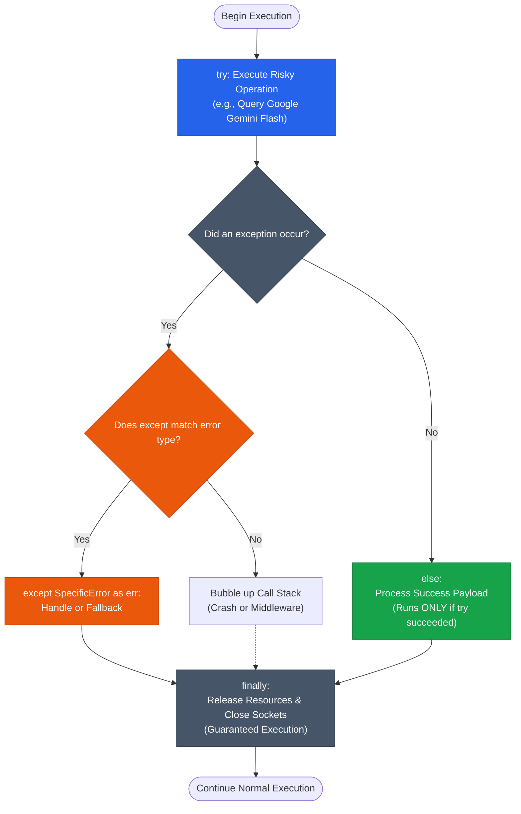
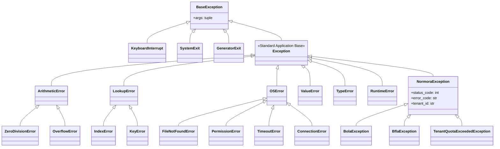
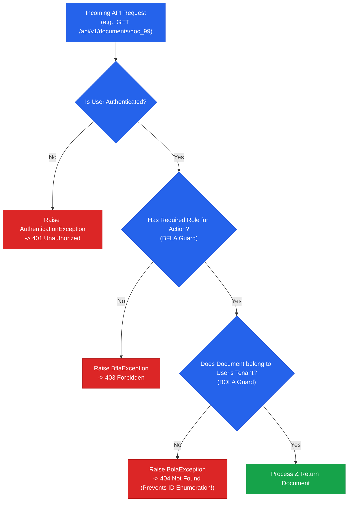
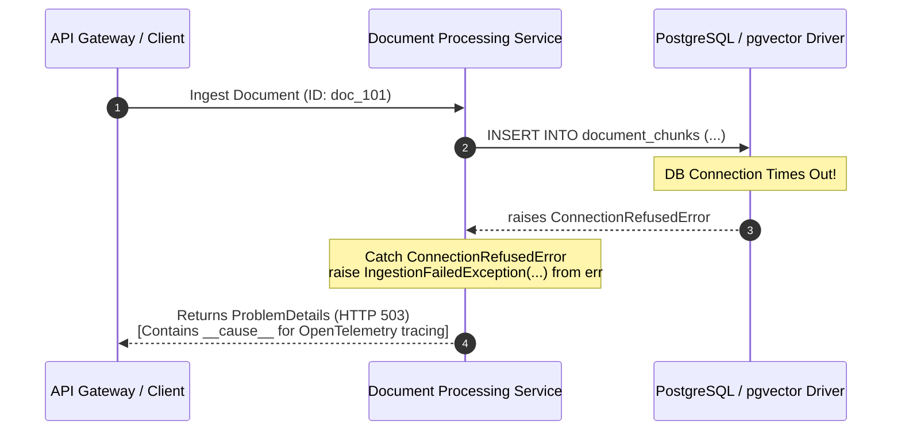
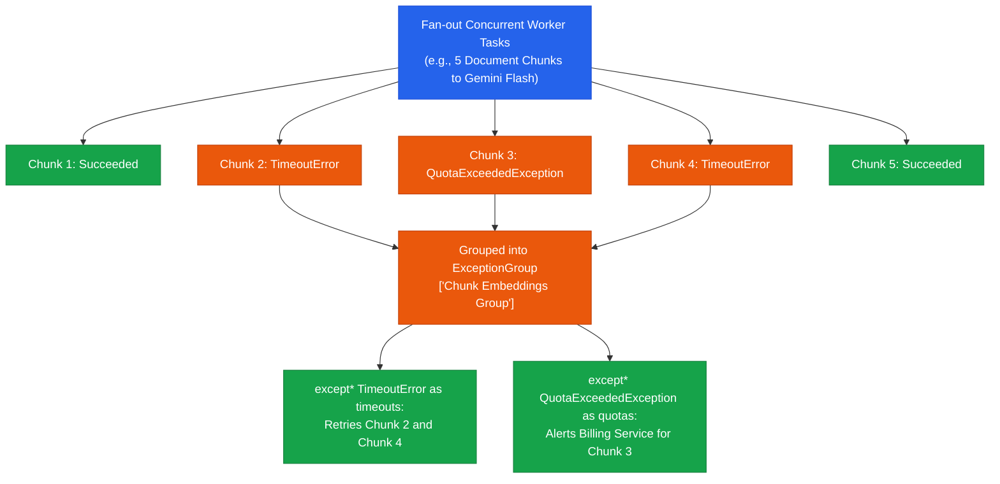
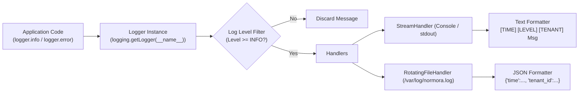

# Module 7: Error Handling, Exceptions & Modern File I/O

Welcome to **Module 7** of the Normora Python & AI Masterclass.

As an enterprise .NET architect transitioning to Python and FastAPI, you already understand that production distributed systems fail constantly and unpredictably:
* A tenant requests a document identifier that belongs to another organization (**Broken Object Level Authorization / BOLA**).
* An external cloud AI provider like **Google Gemini Flash** experiences a transient HTTP 429 rate limit or network socket timeout.
* An uploaded corporate policy document contains malformed JSON metadata or corrupted PDF bytes.
* A user with standard membership attempts to alter tenant-wide vector indexing parameters (**Broken Function Level Authorization / BFLA**).
* A background ingestion worker runs out of file descriptors because file handles were not deterministically closed.

In C# and .NET 10, you rely on `try / catch / finally`, `using` statements (`IDisposable`), `System.IO.Path`, `AggregateException`, and `ILogger<T>`. Python provides an equally robust, highly expressive toolset—including modern constructs like `pathlib.Path`, explicit exception chaining (`raise ... from ...`), `ExceptionGroup` with `except*` (Python 3.11+), `contextlib.suppress`, non-fatal `warnings`, and built-in structured `logging`.

In this module, you will master defensive programming and resilient I/O in Python from the ground up, with every concept anchored in the **Normora** multi-tenant knowledge management and conversational AI platform.

---

## The .NET Architect's Mental Model: LBYL vs. EAFP

In the .NET ecosystem, developers traditionally lean toward **LBYL ("Look Before You Leap")**:
```csharp
// C# LBYL Pattern: Check state before executing
if (File.Exists(filePath))
{
    var content = File.ReadAllText(filePath);
}

if (tenantDictionary.ContainsKey(tenantId))
{
    var tenant = tenantDictionary[tenantId];
}
```

While clean, LBYL suffers from a critical flaw in high-concurrency distributed systems: **TOCTOU (Time-of-Check to Time-of-Use) race conditions**. Between the moment `File.Exists(filePath)` returns `true` and `File.ReadAllText()` executes, a background worker could delete or lock the file.

Python embraces **EAFP ("Easier to Ask for Forgiveness than Permission")**:
```python
# Python EAFP Pattern: Attempt the operation directly, handle failure defensively
try:
    content = path.read_text(encoding="utf-8")
except FileNotFoundError:
    content = ""
```

EAFP is not sloppy; it is atomic, eliminates redundant hash table lookups, avoids filesystem race conditions, and is a core Python performance optimization.

---

## 1. The `try`, `except`, `else`, and `finally` Pipeline

In Python, errors trigger **Exceptions**. If an exception is not intercepted, the runtime halts execution and unwinds the call stack with a `Traceback`.

The full exception handling construct consists of four distinct blocks:
1. **`try`**: Wraps the minimal block of code that might raise an exception.
2. **`except ExceptionType as err`**: Intercepts matching exceptions. You can catch specific types or tuples of types.
3. **`else`**: **Executes ONLY if the `try` block completed without raising any exceptions.** (This has no direct keyword equivalent in C# and is vital for avoiding accidental bug masking).
4. **`finally`**: **Always executes**, regardless of whether an exception occurred, was caught, or was re-raised. Used for deterministic resource cleanup.



> [!TIP]
> **Why the `else` block matters to architects:**  
> In C#, developers often place post-processing logic inside the `try` block. If that post-processing code raises an exception of the same type being caught (e.g., `KeyError` or `InvalidOperationException`), your catch block may mistakenly handle its own bug as if the primary operation failed! Placing post-processing code inside `else` ensures that exceptions raised during result processing bubble up cleanly.

### 5 Real-World Normora Examples

#### Example 1.1: Parsing Tenant AI Quota with Type and Value Guards
When a tenant admin updates their monthly Gemini token limit via the Normora API, the payload may arrive as an invalid string, empty value, or negative integer.
```python
def parse_tenant_token_quota(raw_quota_input: str) -> int:
    """Parses and validates a tenant's configured token quota.
    
    Falls back to the default tier allocation (500,000 tokens) if input is invalid.
    """
    default_quota: int = 500_000
    
    try:
        quota: int = int(raw_quota_input)
        if quota < 0:
            raise ValueError(f"Quota cannot be negative: {quota}")
    except (ValueError, TypeError) as err:
        print(f"[Normora Billing] Invalid quota value '{raw_quota_input}' ({err}). Applying default: {default_quota:,}")
        return default_quota
    else:
        print(f"[Normora Billing] Tenant quota successfully updated to {quota:,} tokens.")
        return quota
    finally:
        print("[Normora Billing] Quota validation audit check completed.")

# Test executions:
parse_tenant_token_quota("1500000")  # Success path -> triggers else and finally
parse_tenant_token_quota("unlimited") # Error path -> triggers except and finally
```

#### Example 1.2: Safe Keycloak JWT Claim Extraction
Normora validates incoming Keycloak OIDC Bearer tokens. We extract the tenant ID and user roles safely without causing runtime crashes if optional claims are absent.
```python
def extract_tenant_context(jwt_claims: dict) -> dict:
    """Extracts required tenant identification and roles from decoded JWT claims."""
    tenant_context = {}
    
    try:
        # Mandatory claim:
        tenant_context["tenant_id"] = jwt_claims["normora_tenant_id"]
        # Mandatory claim:
        tenant_context["user_id"] = jwt_claims["sub"]
    except KeyError as missing_claim:
        print(f"[Security Warning] Missing mandatory security claim: {missing_claim}")
        tenant_context["tenant_id"] = "ANONYMOUS"
        tenant_context["user_id"] = "ANONYMOUS"
    else:
        # Optional claim handled in else:
        tenant_context["roles"] = jwt_claims.get("roles", ["Member"])
        print(f"[Auth Service] Context established for Tenant: {tenant_context['tenant_id']}")
    finally:
        tenant_context["authenticated"] = tenant_context["tenant_id"] != "ANONYMOUS"
        
    return tenant_context

claims = {"sub": "usr_9921", "normora_tenant_id": "tenant_apex", "roles": ["Admin"]}
print(extract_tenant_context(claims))
```

#### Example 1.3: Google Gemini Flash API Query with Guaranteed Socket Teardown
Simulating a cloud AI streaming request where HTTP sockets must be closed in `finally` and metrics recorded in `else`.
```python
def query_gemini_flash(prompt: str, simulate_network_drop: bool = False) -> str:
    """Invokes Google Gemini Flash to generate RAG conversational responses."""
    http_socket_open = False
    response_payload = ""
    
    try:
        print(f"[Gemini Client] Opening TLS connection pool for prompt: '{prompt[:30]}...'")
        http_socket_open = True
        
        if simulate_network_drop:
            raise ConnectionResetError("Remote server closed connection unexpectedly.")
            
        response_payload = "Based on company policy (Section 4), remote work is permitted on Fridays."
    except ConnectionResetError as net_err:
        print(f"[Gemini Client] Network failure: {net_err}. Routing to standby region.")
        response_payload = "SERVICE_UNAVAILABLE"
    else:
        token_count = len(response_payload.split()) * 2
        print(f"[Gemini Client] Query succeeded. Generated ~{token_count} tokens.")
    finally:
        if http_socket_open:
            print("[Gemini Client] Closing connection socket and releasing pool semaphore.")
            http_socket_open = False
            
    return response_payload

query_gemini_flash("What is the remote work policy?", simulate_network_drop=False)
print("-" * 50)
query_gemini_flash("What is the remote work policy?", simulate_network_drop=True)
```

#### Example 1.4: Safe Division for RAG Citation Relevance Scoring
When computing average cosine similarity across retrieved document chunks, a query matching zero chunks must not throw `ZeroDivisionError`.
```python
def calculate_average_citation_score(chunk_scores: list[float]) -> float:
    """Calculates mean similarity score for chunks retrieved from pgvector HNSW index."""
    try:
        total_score: float = sum(chunk_scores)
        match_count: int = len(chunk_scores)
        average_score: float = total_score / match_count
    except ZeroDivisionError:
        print("[RAG Pipeline] Zero matching chunks retrieved. Setting average confidence to 0.0.")
        return 0.0
    else:
        print(f"[RAG Pipeline] Mean citation confidence calculated: {average_score:.4f}")
        return round(average_score, 4)
    finally:
        print("[RAG Pipeline] Citation relevance telemetry logged.")

calculate_average_citation_score([0.892, 0.941, 0.785])
calculate_average_citation_score([])
```

#### Example 1.5: Intercepting Multiple Granular Exceptions During Vector Extraction
Extracting pgvector embeddings from raw database tuples where multiple distinct errors can arise.
```python
def parse_vector_embedding(raw_record: dict) -> list[float]:
    """Extracts a 768-dimensional float embedding array from a raw database dictionary."""
    try:
        # Potential KeyError if column missing:
        raw_embedding = raw_record["embedding"]
        # Potential TypeError if None, or ValueError if string cannot convert to float:
        vector = [float(val) for val in raw_embedding]
    except KeyError:
        print("[pgvector Error] Record is missing 'embedding' vector column.")
        return []
    except (ValueError, TypeError) as conv_err:
        print(f"[pgvector Error] Corrupted vector payload ({conv_err}).")
        return []
    except Exception as unexpected:
        print(f"[pgvector Critical] Unhandled exception during vector deserialization: {unexpected}")
        raise
    else:
        print(f"[pgvector] Successfully extracted vector with dimension: {len(vector)}")
        return vector

parse_vector_embedding({"id": "doc_10", "embedding": ["0.12", "-0.45", "0.99"]})
parse_vector_embedding({"id": "doc_11", "embedding": ["0.12", "corrupt_data"]})
```

---

## 2. Python's Built-in Exception Hierarchy

Every exception in Python is a class derived from `BaseException`. In enterprise backends, understanding this hierarchy is critical to prevent fatal bugs like accidentally catching process termination signals.



> [!IMPORTANT]
> **Never Catch `BaseException`:**  
> When you write `except BaseException:`, you intercept `KeyboardInterrupt` (Ctrl+C / SIGINT) and `SystemExit` (container termination / `sys.exit()`). This prevents Kubernetes or Docker from shutting down your container worker gracefully! Always catch `Exception` or a specific subclass.

### 5 Real-World Normora Examples

#### Example 2.1: Defending the Background Document Ingestion Worker Loop
The ingestion worker pulls jobs from a queue. It must handle application errors without terminating, but must allow `KeyboardInterrupt` or `SystemExit` to stop the service cleanly.
```python
import sys

def run_document_chunking_worker(job_queue: list[dict]):
    """Simulates background worker processing document embedding tasks."""
    print("[Worker] Document indexing worker active. Press Ctrl+C to shut down.")
    
    for job in job_queue:
        try:
            if job.get("simulate_sigterm"):
                print("[Worker] SIGTERM received from Kubernetes.")
                sys.exit(0)  # Raises SystemExit (inherits from BaseException)
                
            doc_id = job["doc_id"]
            print(f"[Worker] Processing document chunking for: {doc_id}")
            
            if job.get("corrupted"):
                raise ValueError("Encountered null byte in text chunk stream.")
                
        except Exception as app_err:
            # Catches ValueError, KeyError, OSError, etc., but NOT SystemExit or KeyboardInterrupt:
            print(f"[Worker Error] Job failed cleanly: {app_err}. Moving to dead-letter queue.")
            
        print("[Worker] Worker loop ready for next job.")

# This worker survives application errors:
test_jobs = [
    {"doc_id": "doc_hr_01", "corrupted": True},
    {"doc_id": "doc_hr_02", "corrupted": False}
]
run_document_chunking_worker(test_jobs)
```

#### Example 2.2: Intercepting `TypeError` on Binary PDF Chunking Input
Ensuring that raw unextracted PDF bytes are not accidentally passed into text chunking tokenizers.
```python
def chunk_document_text(text_content: str, chunk_size: int = 500) -> list[str]:
    """Splits plain text into overlapping token windows for vector embeddings."""
    try:
        # String slicing requires string, passing bytes will raise TypeError:
        return [text_content[i:i + chunk_size] for i in range(0, len(text_content), chunk_size)]
    except TypeError as type_err:
        print(f"[Chunker Error] Expected str, received {type(text_content).__name__}: {type_err}")
        print("[Chunker Error] Ensure PDF is processed via text extraction filter before chunking.")
        return []

chunk_document_text("Section 1: Data Retention Guidelines...", chunk_size=20)
chunk_document_text(b"\x25\x50\x44\x46\x2d\x31\x2e\x35", chunk_size=20) # Raw PDF bytes
```

#### Example 2.3: Catching `IndexError` on Citation Chunk Boundary Lookups
Handling out-of-bounds citations when a generated LLM answer references an invalid chunk index.
```python
def resolve_citation_reference(chunks: list[dict], citation_index: int) -> dict:
    """Locates the source document chunk corresponding to an LLM footnote citation [1]."""
    try:
        # User citation indices are 1-based [1], convert to 0-based:
        target_chunk = chunks[citation_index - 1]
    except IndexError:
        print(f"[Citation Service] Invalid citation reference [{citation_index}]. Total available chunks: {len(chunks)}.")
        return {"source": "Unknown Document", "page": 0, "text": "Citation unavailable."}
    else:
        return target_chunk

sample_chunks = [
    {"source": "Employee_Handbook.pdf", "page": 12, "text": "PTO policy details..."},
    {"source": "Security_Protocols.pdf", "page": 3, "text": "MFA requirements..."}
]

print(resolve_citation_reference(sample_chunks, 1)) # Valid
print(resolve_citation_reference(sample_chunks, 5)) # Out-of-bounds
```

#### Example 2.4: Catching `TimeoutError` During High-Load pgvector Index Queries
When pgvector HNSW searches exceed SLA limits due to high concurrent read operations.
```python
def query_pgvector_hnsw(embedding: list[float], timeout_ms: int = 500) -> list[str]:
    """Simulates an HNSW vector similarity search with timeout protection."""
    try:
        print(f"[pgvector] Executing HNSW search with timeout budget: {timeout_ms}ms")
        if timeout_ms < 100:
            raise TimeoutError("Database query timed out waiting for HNSW index lock.")
        return ["chunk_9918", "chunk_9919"]
    except TimeoutError as timeout_err:
        print(f"[pgvector Alert] {timeout_err}. Falling back to degraded keyword search.")
        return ["chunk_fallback_keyword"]

print(query_pgvector_hnsw([0.1, 0.2], timeout_ms=50))
```

#### Example 2.5: Catching `PermissionError` on MinIO Local Mount Staging Files
When a document ingestion service lacks file system write permissions in the temporary staging directory.
```python
def stage_upload_buffer(temp_file_path: str, payload_bytes: bytes):
    """Stages uploaded document bytes prior to MinIO S3 object push."""
    try:
        # Simulating permission failure on root filesystem:
        if temp_file_path.startswith("/etc") or temp_file_path.startswith("C:\\Windows"):
            raise PermissionError("Access denied: Staging path requires administrative privilege.")
        print(f"[Staging] Successfully wrote {len(payload_bytes)} bytes to {temp_file_path}")
    except PermissionError as perm_err:
        print(f"[Security Alert] File staging blocked: {perm_err}")
        print("[Security Alert] Ensure MinIO worker container runs under unprivileged UID 10001.")

stage_upload_buffer("C:\\Windows\\system32\\document.pdf", b"test")
```

---

## 3. Custom Exception Hierarchies & Normora Security Architecture

In an enterprise modular monolith or microservices architecture, you must **never** throw generic exceptions (`raise Exception("Invalid user")`). Instead, you design domain-driven exception hierarchies that map cleanly to HTTP status codes, OpenTelemetry trace attributes, and centralized security invariants.

### Normora Security Principles: BOLA & BFLA Defense
1. **BOLA (Broken Object Level Authorization):**  
   If User A from `tenant_alpha` requests document `doc_99` belonging to `tenant_beta`, a naive system returns `403 Forbidden`. **This is an information disclosure vulnerability** because the 403 confirms to the attacker that `doc_99` exists!  
   Normora raises `BolaException`, which our global error handler translates to **`404 Not Found`**, completely preventing resource enumeration.
2. **BFLA (Broken Function Level Authorization):**  
   If a user with standard `Member` role attempts an administrative operation (e.g., deleting a tenant or modifying vector index configurations), Normora raises `BflaException`, which maps to **`403 Forbidden`**.



### 5 Real-World Normora Examples

#### Example 3.1: Defining the Normora Enterprise Exception Hierarchy
Here is the production-grade base class structure for Normora's error domain:
```python
from datetime import datetime, timezone

class NormoraException(Exception):
    """Root base exception for all domain and security errors across Normora modules."""
    def __init__(self, message: str, status_code: int = 400, error_code: str = "GENERIC_ERROR", tenant_id: str | None = None):
        super().__init__(message)
        self.message = message
        self.status_code = status_code
        self.error_code = error_code
        self.tenant_id = tenant_id or "SYSTEM"
        self.timestamp = datetime.now(timezone.utc).isoformat()

    def to_problem_details(self) -> dict:
        """Converts exception to RFC 7807 ProblemDetails specification format."""
        return {
            "type": f"https://api.normora.ai/errors/{self.error_code.lower()}",
            "title": self.error_code,
            "status": self.status_code,
            "detail": self.message,
            "tenant_id": self.tenant_id,
            "timestamp": self.timestamp
        }

class BolaException(NormoraException):
    """Raised when an object lookup fails cross-tenant authorization checks.
    
    Security Guarantee: Maps to 404 Not Found to prevent resource enumeration.
    """
    def __init__(self, resource_type: str, resource_id: str, tenant_id: str):
        # We deliberately report 'not found' rather than 'access denied':
        super().__init__(
            message=f"{resource_type} with ID '{resource_id}' was not found.",
            status_code=404,
            error_code="RESOURCE_NOT_FOUND",
            tenant_id=tenant_id
        )

class BflaException(NormoraException):
    """Raised when a user lacks required functional permissions for an operation."""
    def __init__(self, action: str, required_role: str, user_role: str, tenant_id: str):
        super().__init__(
            message=f"Access denied: Action '{action}' requires '{required_role}', but caller holds '{user_role}'.",
            status_code=403,
            error_code="INSUFFICIENT_PERMISSIONS",
            tenant_id=tenant_id
        )

class TenantQuotaExceededException(NormoraException):
    """Raised when a tenant exceeds monthly token consumption limits."""
    def __init__(self, tenant_id: str, current_usage: int, limit: int):
        super().__init__(
            message=f"Monthly AI token budget exhausted ({current_usage:,} / {limit:,} tokens).",
            status_code=429,
            error_code="QUOTA_EXCEEDED",
            tenant_id=tenant_id
        )
```

#### Example 3.2: Enforcing BOLA Protection on Document Retrieval
Simulating the retrieval of a confidential document in the `Documents` module.
```python
def retrieve_tenant_document(doc_id: str, requesting_tenant_id: str) -> dict:
    """Simulates repository fetch with strict BOLA isolation."""
    # Simulated database record:
    documents_table = {
        "doc_alpha_payroll": {"tenant_id": "tenant_alpha", "title": "2026_Executive_Payroll.pdf"},
        "doc_beta_roadmap": {"tenant_id": "tenant_beta", "title": "Product_Roadmap_Q3.pdf"}
    }
    
    document = documents_table.get(doc_id)
    
    # Defense Rule: If document doesn't exist OR belongs to another tenant, raise BolaException!
    if document is None or document["tenant_id"] != requesting_tenant_id:
        raise BolaException(resource_type="Document", resource_id=doc_id, tenant_id=requesting_tenant_id)
        
    return document

try:
    # Tenant Beta attempts to access Tenant Alpha's payroll:
    retrieve_tenant_document("doc_alpha_payroll", requesting_tenant_id="tenant_beta")
except BolaException as bola_err:
    print(f"HTTP Status: {bola_err.status_code}")
    print(f"Response Body: {bola_err.to_problem_details()}")
```

#### Example 3.3: Enforcing BFLA Protection on System Prompt Configuration
Restricting modifications of conversation system prompts to `Admin` and `Owner` roles.
```python
def update_system_prompt(tenant_id: str, user_role: str, new_prompt: str):
    """Updates conversational AI instructions for a tenant."""
    allowed_roles = {"Admin", "Owner"}
    if user_role not in allowed_roles:
        raise BflaException(
            action="update_system_prompt",
            required_role="Admin or Owner",
            user_role=user_role,
            tenant_id=tenant_id
        )
    print(f"[Conversations] System prompt updated for tenant '{tenant_id}': '{new_prompt}'")

try:
    update_system_prompt(tenant_id="tenant_apex", user_role="Member", new_prompt="You are a helpful assistant.")
except BflaException as bfla_err:
    print(f"HTTP Status: {bfla_err.status_code}")
    print(f"Problem Details: {bfla_err.to_problem_details()}")
```

#### Example 3.4: Enforcing Monthly Token Budget Before Gemini Streaming
Validating tenant balance before initiating an expensive generative AI query.
```python
def guard_ai_generation_budget(tenant_id: str, current_usage: int, monthly_limit: int):
    """Pre-flight check preventing API invocation if tenant token allowance is depleted."""
    if current_usage >= monthly_limit:
        raise TenantQuotaExceededException(
            tenant_id=tenant_id,
            current_usage=current_usage,
            limit=monthly_limit
        )
    print(f"[Billing Guard] Budget verified. Remaining tokens: {monthly_limit - current_usage:,}")

try:
    guard_ai_generation_budget("tenant_globex", current_usage=1_050_000, monthly_limit=1_000_000)
except TenantQuotaExceededException as quota_err:
    print(f"HTTP Status: {quota_err.status_code}")
    print(f"Client Alert: {quota_err.message}")
```

#### Example 3.5: Validating pgvector Vector Dimensions
Validating that an embedding model output matches the PostgreSQL table schema (e.g., 768 dimensions for Google Gemini text-embedding-004 vs. 1536 for OpenAI text-embedding-3-small).
```python
class VectorDimensionMismatchException(NormoraException):
    def __init__(self, expected_dim: int, actual_dim: int, tenant_id: str):
        super().__init__(
            message=f"Vector dimension mismatch: pgvector column expects {expected_dim}-d, but embedding vector is {actual_dim}-d.",
            status_code=422,
            error_code="INVALID_VECTOR_DIMENSION",
            tenant_id=tenant_id
        )

def insert_chunk_embedding(chunk_id: str, vector: list[float], tenant_id: str):
    EXPECTED_DIM = 768
    if len(vector) != EXPECTED_DIM:
        raise VectorDimensionMismatchException(expected_dim=EXPECTED_DIM, actual_dim=len(vector), tenant_id=tenant_id)
    print(f"[pgvector] Chunk '{chunk_id}' inserted successfully.")

try:
    # Mistakenly passing 3-dimensional mock vector instead of 768:
    insert_chunk_embedding("chunk_001", [0.1, 0.4, -0.2], tenant_id="tenant_delta")
except VectorDimensionMismatchException as vec_err:
    print(f"Error Code: {vec_err.error_code} | Details: {vec_err.message}")
```

---

## 4. Exception Chaining: `raise ... from ...`, `__cause__`, and `__context__`

In modern enterprise architectures, you frequently translate low-level technical errors (like a PostgreSQL timeout, MinIO S3 socket drop, or JSON decode crash) into high-level domain exceptions.

In C#, you wrap exceptions using inner exceptions:
```csharp
// C# Inner Exception Pattern
try {
    await dbContext.SaveChangesAsync();
} catch (SqlException ex) {
    throw new TenantRepositoryException("Failed to save tenant changes", ex);
}
```

Python provides two distinct mechanisms for chaining:
1. **Explicit Chaining (`raise HighLevelException(...) from low_level_err`)**:  
   Sets the `__cause__` attribute on the new exception. Indicates that the second exception was deliberately raised as a direct result of the first.
2. **Implicit Chaining**:  
   If an exception occurs inside an `except` block without using `from`, Python automatically links the original exception as `__context__`.
3. **Context Suppression (`raise HighLevelException(...) from None`)**:  
   **Critical for security.** Strips both `__cause__` and `__context__` from the traceback. This prevents leaking sensitive infrastructure details (e.g., database connection strings, MinIO credentials, internal server IP addresses) to API clients or logs!



### 5 Real-World Normora Examples

#### Example 4.1: Explicit Chaining from PostgreSQL Driver to Domain Repository Error
Wrapping a low-level database socket failure into a domain exception while preserving the technical root cause for OpenTelemetry telemetry.
```python
class TenantRepositoryException(NormoraException):
    pass

def save_tenant_metadata(tenant_id: str, data: dict):
    try:
        print(f"[PostgreSQL] Executing SQL: UPDATE tenants SET metadata = ... WHERE id = '{tenant_id}'")
        # Simulating low-level asyncpg / psycopg network failure:
        raise ConnectionRefusedError("Unable to connect to PostgreSQL server at 10.0.12.44:5432")
    except ConnectionRefusedError as db_err:
        # Explicit chaining preserves db_err as __cause__:
        raise TenantRepositoryException(
            message=f"Database persistence failed for tenant '{tenant_id}'.",
            status_code=503,
            error_code="DATABASE_UNAVAILABLE",
            tenant_id=tenant_id
        ) from db_err

try:
    save_tenant_metadata("tenant_acme", {"plan": "Enterprise"})
except TenantRepositoryException as ex:
    print(f"Domain Error: {ex.message}")
    print(f"Original Technical Cause: {ex.__cause__}")
```

#### Example 4.2: Suppressing Context with `from None` to Prevent Information Disclosure
When handling authorization or security failures, never let database stack traces leak.
```python
def check_document_access_sanitized(doc_id: str, tenant_id: str):
    try:
        # Low-level query that might fail with internal DB details:
        raise TimeoutError("FATAL: database query execution exceeded 30000ms on shard_04.normora.internal")
    except TimeoutError:
        # ✅ from None suppresses the internal DB traceback!
        raise BolaException(
            resource_type="Document",
            resource_id=doc_id,
            tenant_id=tenant_id
        ) from None

try:
    check_document_access_sanitized("doc_secret_99", "tenant_stranger")
except BolaException as ex:
    print(f"Sanitized Message: {ex.message}")
    print(f"Underlying Cause Suppressed? {ex.__cause__ is None}")
    print(f"Context Suppressed? {ex.__suppress_context__}")
```

#### Example 4.3: Wrapping MinIO S3 SDK Storage Failure into Storage Service Exception
Handling object storage outages when uploading raw PDF documents.
```python
class ObjectStorageException(NormoraException):
    pass

def upload_document_to_minio(bucket: str, object_name: str, payload: bytes):
    try:
        print(f"[MinIO S3] PUT /{bucket}/{object_name} ({len(payload)} bytes)")
        # Simulating S3 SDK client crash:
        raise OSError("S3 API endpoint 'http://minio.storage.internal:9000' timed out.")
    except OSError as s3_err:
        raise ObjectStorageException(
            message=f"Failed to persist document to object storage bucket '{bucket}'.",
            status_code=502,
            error_code="STORAGE_SERVICE_ERROR"
        ) from s3_err

try:
    upload_document_to_minio("normora-documents", "tenant_alpha/doc_1.pdf", b"%PDF-...")
except ObjectStorageException as ex:
    print(f"Application Alert: {ex.message} (Root Cause: {ex.__cause__})")
```

#### Example 4.4: Wrapping Google Gemini Flash Rate Limit into AI Gateway Exception
Capturing an external API HTTP 429 response and wrapping it with retry semantics.
```python
class AiServiceThrottledException(NormoraException):
    def __init__(self, tenant_id: str, retry_after_seconds: int):
        super().__init__(
            message=f"Google Gemini Flash rate limit reached. Retry after {retry_after_seconds}s.",
            status_code=429,
            error_code="AI_PROVIDER_RATE_LIMITED",
            tenant_id=tenant_id
        )
        self.retry_after = retry_after_seconds

def call_gemini_with_chaining(prompt: str, tenant_id: str):
    try:
        # Simulating external SDK raising rate-limit:
        raise RuntimeError("Google API: ResourceExhausted 429 - Quota exceeded for model gemini-1.5-flash")
    except RuntimeError as sdk_err:
        raise AiServiceThrottledException(tenant_id=tenant_id, retry_after_seconds=5) from sdk_err

try:
    call_gemini_with_chaining("Summarize this text", "tenant_zeta")
except AiServiceThrottledException as ex:
    print(f"{ex.message} (Retry-After: {ex.retry_after}s) [Caused by: {ex.__cause__}]")
```

#### Example 4.5: Wrapping Corrupted PDF Extraction Crash
Translating a low-level binary parsing exception into an ingestion failure.
```python
class DocumentExtractionException(NormoraException):
    pass

def extract_pdf_pages(file_bytes: bytes) -> list[str]:
    try:
        if not file_bytes.startswith(b"%PDF"):
            raise ValueError("Magic bytes mismatch: Header is not a valid PDF signature.")
        return ["Page 1 text...", "Page 2 text..."]
    except ValueError as parse_err:
        raise DocumentExtractionException(
            message="Uploaded document cannot be parsed. The file may be corrupt or encrypted.",
            status_code=422,
            error_code="DOCUMENT_PARSING_FAILED"
        ) from parse_err

try:
    extract_pdf_pages(b"NOT_A_PDF_STREAM")
except DocumentExtractionException as ex:
    print(f"Ingestion Alert: {ex.message} -> {ex.__cause__}")
```

---

## 5. Python 3.11+ `ExceptionGroup` and `except*` for Concurrent AI Workflows

In high-throughput RAG systems, you frequently fan out concurrent operations:
* Generating embeddings for 10 document chunks in parallel via Google Gemini Flash.
* Broadcasting conversational tokens across multiple SignalR or WebSocket client channels.
* Dispatching tenant webhooks concurrently.

In older Python versions (and basic `try / except`), if 3 concurrent tasks fail simultaneously, the runtime could only raise **one** exception—discarding or burying the other two!

Python 3.11 introduced:
1. **`ExceptionGroup`**: A composite exception containing a collection of sub-exceptions (equivalent to .NET's `AggregateException`).
2. **`except* SpecificType`**: A pattern-matching construct that allows you to handle **subsets** of concurrent errors without swallowing or losing unrelated failures!



### 5 Real-World Normora Examples

#### Example 5.1: Parallel Chunk Embedding Generation Failures
Simulating parallel Gemini Flash embedding generation where multiple chunks fail for different reasons.
```python
def process_chunks_parallel():
    # In Python 3.11+, asyncio.TaskGroup or concurrent pools raise ExceptionGroup:
    errors = [
        TimeoutError("Gemini endpoint timed out on Chunk 2"),
        ValueError("Chunk 4 text contains invalid UTF-16 surrogate bytes"),
        TimeoutError("Gemini endpoint timed out on Chunk 5")
    ]
    raise ExceptionGroup("Batch embedding generation failed for 3 chunks", errors)

try:
    process_chunks_parallel()
except* TimeoutError as timeouts:
    # Catches ONLY the two TimeoutErrors (Chunk 2 and Chunk 5):
    print(f"[Retry Handler] Caught {len(timeouts.exceptions)} timeout failures:")
    for err in timeouts.exceptions:
        print(f"   -> Scheduling retry: {err}")
except* ValueError as val_errs:
    # Catches ONLY the ValueError (Chunk 4):
    print(f"[Dead-Letter Queue] Caught {len(val_errs.exceptions)} data validation errors:")
    for err in val_errs.exceptions:
        print(f"   -> Marking chunk as permanently unprocessable: {err}")
```

#### Example 5.2: Multi-Tenant Webhook Broadcast Dispatcher
Dispatching an event notification (`document.ingested`) to 4 registered subscriber URLs concurrently.
```python
def broadcast_tenant_webhook():
    raise ExceptionGroup("Webhook broadcast delivery errors", [
        ConnectionRefusedError("https://tenant-alpha.com/webhook: Connection refused"),
        TimeoutError("https://tenant-beta.io/api/events: Read timed out after 5000ms"),
        ConnectionRefusedError("https://tenant-internal.net/hook: 502 Bad Gateway")
    ])

try:
    broadcast_tenant_webhook()
except* ConnectionRefusedError as conn_errs:
    print(f"[Webhook Manager] {len(conn_errs.exceptions)} endpoints refused connection. Flagging endpoints as UNREACHABLE.")
except* TimeoutError as timeout_errs:
    print(f"[Webhook Manager] {len(timeout_errs.exceptions)} endpoints timed out. Re-queuing with exponential backoff.")
```

#### Example 5.3: Bulk Document Upload Batch Ingestion Validation
Validating a batch of 10 uploaded policy files, isolating format errors from file-size quota violations.
```python
class FileSizeLimitExceeded(NormoraException):
    pass

class UnsupportedFormatError(NormoraException):
    pass

def validate_bulk_uploads():
    raise ExceptionGroup("Bulk upload batch validation errors", [
        FileSizeLimitExceeded("Compliance_2026.pdf exceeds max 50MB limit.", status_code=413),
        UnsupportedFormatError("Archive.rar is not a supported document format.", status_code=415),
        FileSizeLimitExceeded("Raw_Video_Logs.mp4 exceeds max 50MB limit.", status_code=413)
    ])

try:
    validate_bulk_uploads()
except* FileSizeLimitExceeded as size_errs:
    print(f"[Ingestion Validator] Found {len(size_errs.exceptions)} oversize documents. Notifying tenant admin to upgrade tier.")
except* UnsupportedFormatError as format_errs:
    print(f"[Ingestion Validator] Found {len(format_errs.exceptions)} invalid file formats. Prompting user for PDF/DOCX.")
```

#### Example 5.4: Infrastructure Health Check Fan-Out
Executing concurrent probes against PostgreSQL, MinIO, Keycloak, and Google Gemini API.
```python
def check_infrastructure_health():
    raise ExceptionGroup("Infrastructure health check degraded", [
        ConnectionError("Keycloak OIDC provider unresponsive at auth.normora.internal"),
        TimeoutError("MinIO health probe ping timed out")
    ])

try:
    check_infrastructure_health()
except* ConnectionError as auth_errs:
    print("[Health Monitor CRITICAL] Authentication infrastructure down! Routing traffic to secondary identity provider.")
except* TimeoutError as storage_errs:
    print("[Health Monitor WARNING] Storage infrastructure latency spike detected.")
```

#### Example 5.5: Multi-Modal Attachment Parsing
Extracting audio transcripts and visual OCR attachments from a composite enterprise document.
```python
def extract_multimodal_document():
    raise ExceptionGroup("Multimodal extraction partially failed", [
        RuntimeError("OCR engine failed to initialize GPU context for Page 4 image"),
        ValueError("Audio stream sample rate 8000Hz is below minimum 16000Hz requirement")
    ])

try:
    extract_multimodal_document()
except* RuntimeError as ocr_errs:
    print(f"[OCR Worker] Image OCR failed: {ocr_errs.exceptions}. Using raw text layer only.")
except* ValueError as audio_errs:
    print(f"[Audio Worker] Audio invalid: {audio_errs.exceptions}. Skipping audio transcription.")
```

---

## 6. Clean Error Suppression with `contextlib.suppress`

In enterprise software, you frequently encounter expected, non-actionable exceptions where the only logical response is to silently ignore them.

A common Python anti-pattern is writing boilerplate `try / except` blocks:
```python
# ❌ Cluttered and repetitive:
try:
    temp_file.unlink()
except FileNotFoundError:
    pass
```

The standard library `contextlib.suppress` context manager provides a declarative, expressive replacement:
```python
from contextlib import suppress

# ✅ Declarative, readable, Pythonic:
with suppress(FileNotFoundError):
    temp_file.unlink()
```

> [!CAUTION]
> **Never Suppress Broad Exceptions:**  
> Only suppress specific, expected error types (e.g., `FileNotFoundError`, `KeyError`). Writing `with suppress(Exception):` or `with suppress(BaseException):` creates catastrophic silent failures by swallowing syntax errors, null references, and security checks!

### 5 Real-World Normora Examples

#### Example 6.1: Idempotent Deletion of Temporary Ingestion Staging Files
After chunking and embedding generation completes, clean up local scratch files. If another worker already deleted the file, ignore it.
```python
from contextlib import suppress
from pathlib import Path

def purge_staging_buffer(scratch_file_path: Path):
    """Deletes temporary document chunk files idempotently."""
    with suppress(FileNotFoundError):
        scratch_file_path.unlink()
        print(f"[Cleanup] Purged staging file: {scratch_file_path}")

purge_staging_buffer(Path("temp_scratch_nonexistent.txt")) # Executes silently without crashing!
```

#### Example 6.2: Evicting Tenant In-Memory Session Cache
When a user logs out from Keycloak, remove their active session token from the local memory cache.
```python
from contextlib import suppress

active_sessions = {
    "usr_alpha_1": {"tenant": "tenant_alpha", "token": "jwt_token_abc"},
    "usr_alpha_2": {"tenant": "tenant_alpha", "token": "jwt_token_xyz"}
}

def terminate_user_session(user_id: str):
    """Removes user from active session dictionary if present."""
    with suppress(KeyError):
        del active_sessions[user_id]
        print(f"[Auth Cache] Successfully evicted session for: {user_id}")

terminate_user_session("usr_alpha_1")  # Evicts and prints
terminate_user_session("usr_alpha_99") # Key does not exist; suppressed safely
```

#### Example 6.3: Graceful SignalR Socket Disconnect Handling
When streaming conversational tokens to an Angular frontend, if the user closes their browser tab mid-stream, client sockets reset.
```python
from contextlib import suppress

def push_streaming_token_to_client(client_id: str, token: str, simulate_tab_close: bool = False):
    """Streams a token chunk over WebSocket / SignalR channel."""
    with suppress(ConnectionResetError, BrokenPipeError):
        if simulate_tab_close:
            raise ConnectionResetError("Client closed browser tab during token generation.")
        print(f"[SignalR Hub] Pushed token '{token}' to client {client_id}")

push_streaming_token_to_client("client_conn_88", "Hello", simulate_tab_close=False)
push_streaming_token_to_client("client_conn_88", "world!", simulate_tab_close=True)
print("[SignalR Hub] Server streaming worker continued execution smoothly.")
```

#### Example 6.4: Releasing Unacquired Locks During Ingestion Rollback
When rolling back a multi-tenant document transaction, attempting to release a lock that was never acquired or already expired should not halt the rollback.
```python
from contextlib import suppress

class MockDistributedLock:
    def release(self):
        raise RuntimeError("Cannot release un-acquired lock for resource 'doc_chunk_lock'")

lock = MockDistributedLock()

def rollback_ingestion_transaction():
    print("[Rollback] Reverting database state...")
    with suppress(RuntimeError):
        lock.release()
    print("[Rollback] Rollback completed cleanly.")

rollback_ingestion_transaction()
```

#### Example 6.5: Removing Tenant Export Archive After Streaming Download
Once a tenant admin downloads an export archive of their conversation history, remove the temporary ZIP file from the local export directory.
```python
from contextlib import suppress
from pathlib import Path

def finalize_tenant_export_download(archive_path: Path):
    """Removes exported ZIP archive from disk post-download."""
    with suppress(FileNotFoundError, PermissionError):
        archive_path.unlink()
        print(f"[Data Export] Purged temporary export archive: {archive_path}")

finalize_tenant_export_download(Path("exports/tenant_apex_export_2026.zip"))
```

---

## 7. Non-Fatal Diagnostics with the `warnings` Module

In enterprise APIs and SDKs, not all issues warrant an application crash:
* A tenant uses a deprecated v1 prompt template.
* An administrator configures suboptimal vector search parameters (e.g., setting HNSW `ef_search` too low).
* A configuration setting will be removed in the next major API release.

In C#, you might use `[Obsolete]` attributes (evaluated at compile time) or write warning logs. Python provides the **`warnings`** module for runtime diagnostics that can be filtered, suppressed, or turned into fatal exceptions during CI/CD test runs.

```python
import warnings

# Emitting a warning:
warnings.warn("Legacy prompt format used.", category=DeprecationWarning)
```

### Warning Categories
* **`UserWarning`**: General application-level advisory.
* **`DeprecationWarning`**: Feature is obsolete and will be removed in a future release.
* **`FutureWarning`**: Behavior of a feature will change in an upcoming version.
* **`ResourceWarning`**: Unclosed files, dangling sockets, or un-awaited coroutines.

> [!NOTE]
> **CI/CD Quality Gate:**  
> In your GitHub Actions or Azure DevOps pipeline, run tests with `python -W error -m pytest`. This forces all warnings to be treated as fatal exceptions, preventing deprecated code or leaking resources from entering production!

### 5 Real-World Normora Examples

#### Example 7.1: Deprecating Legacy v1 RAG Prompt Templates
Advising tenant developers that v1 unstructured prompts are deprecated in favor of v2 structured JSON schema templates.
```python
import warnings

def format_rag_prompt(user_query: str, chunks: list[str], template_version: str = "v1") -> str:
    """Constructs prompt for Google Gemini Flash with deprecation detection."""
    if template_version == "v1":
        warnings.warn(
            "RAG Prompt Template 'v1' is deprecated and will be removed in Normora v2.5. "
            "Migrate to 'v2' to support real-time citation streaming.",
            category=DeprecationWarning,
            stacklevel=2
        )
        return f"Context: {' '.join(chunks)}\nQuestion: {user_query}"
        
    return f"[NORMORA_V2_PROMPT]\nContext: {chunks}\nQuery: {user_query}"

# Triggering the warning:
prompt = format_rag_prompt("What is our SLA?", ["SLA is 99.9%"], template_version="v1")
print(f"Generated Prompt:\n{prompt}")
```

#### Example 7.2: Warning on Sub-Optimal HNSW Index Configuration
Alerting database administrators when tenant vector search parameters compromise retrieval recall.
```python
import warnings

def configure_pgvector_hnsw_index(m_connections: int, ef_construction: int):
    """Validates PostgreSQL HNSW vector index build parameters."""
    if m_connections < 16:
        warnings.warn(
            f"HNSW 'm' value set to {m_connections}. Normora recommends m >= 16 for high-accuracy "
            "768-dimensional semantic search. Low values may degrade RAG recall.",
            category=UserWarning,
            stacklevel=2
        )
    print(f"[pgvector] Index configured with m={m_connections}, ef_construction={ef_construction}")

configure_pgvector_hnsw_index(m_connections=8, ef_construction=64)
```

#### Example 7.3: Warning on Upcoming Tenant Billing API Contract Changes
Advising clients that query string tenant filtering will be deprecated in favor of header-based OIDC claims.
```python
import warnings

def get_tenant_billing_summary(request_params: dict) -> dict:
    if "tenant_id" in request_params:
        warnings.warn(
            "Passing 'tenant_id' as a query string parameter is deprecated. "
            "In Normora v3.0, tenant context must be provided exclusively via the Keycloak Bearer JWT claim.",
            category=FutureWarning,
            stacklevel=2
        )
    return {"billing_cycle": "November 2026", "amount_due": "$1,250.00"}

get_tenant_billing_summary({"tenant_id": "tenant_omega"})
```

#### Example 7.4: Warning on Large Document Upload Exceeding Recommended Chunk Window
Alerting users when an un-chunked document will consume disproportionate Gemini Flash context window tokens.
```python
import warnings

def analyze_document_token_density(document_text: str):
    token_estimate = len(document_text.split()) * 1.3
    if token_estimate > 30_000:
        warnings.warn(
            f"Uploaded document contains ~{token_estimate:,.0f} tokens. Processing single documents "
            "over 30,000 tokens without pre-chunking increases latency and cost.",
            category=UserWarning,
            stacklevel=2
        )
    print(f"[Analysis] Document token estimate: {token_estimate:,.0f}")

analyze_document_token_density("sample word " * 35_000)
```

#### Example 7.5: Programmatically Filtering Warnings in Production
Configuring the warning filter to ensure deprecation warnings log once per process without cluttering production stdout.
```python
import warnings

def configure_production_warning_filters():
    """Configures warning filtering rules for the Normora production environment."""
    # Always display UserWarnings:
    warnings.filterwarnings("always", category=UserWarning)
    # Log DeprecationWarnings only once per call site to prevent log flooding:
    warnings.filterwarnings("once", category=DeprecationWarning)
    # Ignore internal third-party library import warnings:
    warnings.filterwarnings("ignore", category=ImportWarning)
    print("[Normora Runtime] Warning filters applied successfully.")

configure_production_warning_filters()
```

---

## 8. Enterprise Logging Fundamentals (`logging` Module)

In enterprise architectures, `print()` statements are **strictly prohibited** in production code:
* `print()` has no concept of severity levels (`DEBUG`, `INFO`, `WARNING`, `ERROR`, `CRITICAL`).
* `print()` cannot output structured JSON formatted for Datadog, Elasticsearch, or OpenTelemetry.
* `print()` lacks process IDs, thread identifiers, timestamps, and module names.
* `print()` is synchronous and can block under heavy standard output redirection.

Python's standard **`logging`** module is an enterprise logging subsystem conceptually identical to .NET's `ILogger<T>` or Serilog.



### 5 Real-World Normora Examples

#### Example 8.1: Configuring an Enterprise Multi-Tenant Logger
Setting up a structured logger that embeds module names, timestamps, and tenant contexts.
```python
import logging
import sys

def get_normora_logger(module_name: str) -> logging.Logger:
    """Creates a configured logger instance with production formatters."""
    logger = logging.getLogger(module_name)
    logger.setLevel(logging.DEBUG)
    
    # Avoid adding duplicate handlers if already configured:
    if not logger.handlers:
        console_handler = logging.StreamHandler(sys.stdout)
        console_handler.setLevel(logging.INFO)
        
        # Enterprise format: ISO timestamp | Level | Module | Message
        formatter = logging.Formatter(
            fmt="%(asctime)s [%(levelname)s] [%(name)s] [Thread:%(thread)d]: %(message)s",
            datefmt="%Y-%m-%d %H:%M:%S"
        )
        console_handler.setFormatter(formatter)
        logger.addHandler(console_handler)
        
    return logger

audit_logger = get_normora_logger("Normora.Security.Audit")
audit_logger.info("Authentication successful for tenant user 'usr_admin_01'.")
```

#### Example 8.2: Logging Gemini Flash Latency and Token Usage Metrics
Logging granular operational metrics at `INFO` and `DEBUG` levels.
```python
import logging
import time

logger = logging.getLogger("Normora.AI.GeminiGateway")
logger.setLevel(logging.DEBUG)

def track_gemini_inference(prompt: str, tenant_id: str):
    logger.debug("Dispatching request to Gemini Flash API. Prompt length: %d chars", len(prompt))
    start_time = time.perf_counter()
    
    # Simulate API work:
    time.sleep(0.05)
    duration_ms = (time.perf_counter() - start_time) * 1000
    tokens_consumed = 142
    
    logger.info(
        "Gemini inference complete | Tenant: %s | Latency: %.2fms | Tokens: %d | Cost: $%.6f",
        tenant_id,
        duration_ms,
        tokens_consumed,
        tokens_consumed * 0.00000015
    )

track_gemini_inference("Explain RAG architectures.", "tenant_quantum")
```

#### Example 8.3: Logging Full Traceback with `logger.exception()`
When handling caught exceptions in API handlers, `logger.exception()` automatically captures and logs the entire call stack at `ERROR` level (equivalent to `logger.error("...", exc_info=True)`).
```python
import logging

logger = logging.getLogger("Normora.Documents.Ingestion")

def process_untrusted_document(doc_id: str, raw_payload: bytes):
    try:
        if len(raw_payload) == 0:
            raise ValueError("Zero-byte payload received. Ingestion aborted.")
    except ValueError as err:
        # ✅ Automatically appends the complete traceback to the log entry:
        logger.exception("Failed to process document '%s' due to payload corruption.", doc_id)

process_untrusted_document("doc_corrupt_001", b"")
```

#### Example 8.4: Dedicated Security Audit Log File Handler
Directing all BOLA and BFLA security violation events to a dedicated, tamper-evident security audit log file.
```python
import logging

def setup_security_audit_logger() -> logging.Logger:
    sec_logger = logging.getLogger("Normora.Security.Enforcement")
    sec_logger.setLevel(logging.WARNING)
    
    if not sec_logger.handlers:
        file_handler = logging.FileHandler("security_violations.log", encoding="utf-8")
        file_handler.setLevel(logging.WARNING)
        
        audit_formatter = logging.Formatter(
            fmt="%(asctime)s | SECURITY_EVENT | %(levelname)s | %(message)s"
        )
        file_handler.setFormatter(audit_formatter)
        sec_logger.addHandler(file_handler)
        
    return sec_logger

sec_log = setup_security_audit_logger()
sec_log.warning("BOLA_ATTEMPT_DETECTED | Tenant: tenant_beta | Attempted ID: doc_alpha_payroll | Source IP: 198.51.100.23")
```

#### Example 8.5: Rotating File Handler for Background Embedding Workers
Background embedding workers process hundreds of thousands of chunks daily. A `RotatingFileHandler` prevents log files from consuming infinite disk space.
```python
import logging
from logging.handlers import RotatingFileHandler

def setup_worker_rotating_logger() -> logging.Logger:
    worker_logger = logging.getLogger("Normora.Workers.EmbeddingGenerator")
    worker_logger.setLevel(logging.INFO)
    
    if not worker_logger.handlers:
        # Max file size 10MB, retain 5 historical backup files:
        rotating_handler = RotatingFileHandler(
            filename="embedding_worker.log",
            maxBytes=10 * 1024 * 1024,
            backupCount=5,
            encoding="utf-8"
        )
        formatter = logging.Formatter("%(asctime)s [%(levelname)s] %(message)s")
        rotating_handler.setFormatter(formatter)
        worker_logger.addHandler(rotating_handler)
        
    return worker_logger

w_logger = setup_worker_rotating_logger()
w_logger.info("Worker batch 401 finished: 50 chunks embedded and indexed into pgvector.")
```

---

## 9. Modern File System Operations with `pathlib.Path`

In legacy Python code (and older tutorials), file path manipulation used the `os.path` module:
```python
# ❌ Legacy, clumsy string manipulation:
import os
full_path = os.path.join(os.path.dirname(__file__), "data", "tenants", tenant_id + ".json")
```

Modern Python uses **`pathlib.Path`** (built into the standard library since Python 3.4). It provides an object-oriented, cross-platform file system abstraction with intuitive operator overloading using the division operator (`/`).

### `pathlib.Path` vs. `System.IO.Path` Cheat Sheet
* **Path Joining**: `base_path / "tenants" / tenant_id` (in C#: `Path.Combine(basePath, "tenants", tenantId)`)
* **Create Directory**: `path.mkdir(parents=True, exist_ok=True)` (in C#: `Directory.CreateDirectory(path)`)
* **File Check**: `path.exists()` / `path.is_file()` (in C#: `File.Exists(path)`)
* **Read Text**: `path.read_text(encoding="utf-8")` (in C#: `File.ReadAllText(path)`)
* **Write Text**: `path.write_text("content", encoding="utf-8")` (in C#: `File.WriteAllText(path, "content")`)
* **File Suffix**: `path.suffix` (in C#: `Path.GetExtension(path)`)
* **File Stem**: `path.stem` (in C#: `Path.GetFileNameWithoutExtension(path)`)
* **Parent Dir**: `path.parent` (in C#: `Path.GetDirectoryName(path)`)
* **Search / Glob**: `path.glob("*.pdf")` (in C#: `Directory.GetFiles(path, "*.pdf")`)

### 5 Real-World Normora Examples

#### Example 9.1: Building Structured Tenant Workspace Directories
Creating isolated tenant storage trees (`data/tenants/{tenant_id}/documents`) safely and idempotently.
```python
from pathlib import Path

def initialize_tenant_storage(base_dir: Path, tenant_id: str) -> dict[str, Path]:
    """Provisions isolated filesystem directory structure for a new tenant."""
    tenant_root = base_dir / "tenants" / tenant_id
    
    subdirs = {
        "raw_uploads": tenant_root / "raw_uploads",
        "chunks": tenant_root / "chunks",
        "exports": tenant_root / "exports"
    }
    
    for folder_name, folder_path in subdirs.items():
        # parents=True creates intermediate directories; exist_ok=True prevents error if already exists:
        folder_path.mkdir(parents=True, exist_ok=True)
        print(f"[Provisioning] Created directory: {folder_path}")
        
    return subdirs

storage = initialize_tenant_storage(Path("normora_storage_test"), "tenant_apex")
print(f"Raw uploads path: {storage['raw_uploads'].resolve()}")
```

#### Example 9.2: Path Inspection and Sanitization
Extracting file extensions and base names to validate uploaded files before document extraction.
```python
from pathlib import Path

def inspect_document_path(upload_filename: str) -> dict:
    """Inspects file path properties using pathlib attributes."""
    file_path = Path(upload_filename)
    
    ALLOWED_EXTENSIONS = {".pdf", ".docx", ".txt", ".json"}
    is_valid = file_path.suffix.lower() in ALLOWED_EXTENSIONS
    
    return {
        "original_name": file_path.name,
        "extension": file_path.suffix.lower(),
        "base_stem": file_path.stem,
        "is_supported": is_valid,
        "parent_directory": str(file_path.parent)
    }

print(inspect_document_path("tenant_uploads/annual_compliance_report.2026.PDF"))
print(inspect_document_path("tenant_uploads/malicious_payload.exe"))
```

#### Example 9.3: Recursive Directory Scanning with `rglob`
Scanning all nested tenant folders to find all un-indexed PDF documents for batch ingestion.
```python
from pathlib import Path

def discover_tenant_documents(tenant_folder: Path) -> list[Path]:
    """Recursively locates all PDF documents within a tenant's directory tree."""
    if not tenant_folder.exists():
        print(f"[Scanner] Directory '{tenant_folder}' does not exist.")
        return []
        
    # rglob searches recursively down the entire directory hierarchy:
    discovered_pdfs = list(tenant_folder.rglob("*.pdf"))
    print(f"[Scanner] Found {len(discovered_pdfs)} PDF documents in '{tenant_folder}'.")
    return discovered_pdfs

# Mock run on root:
docs = discover_tenant_documents(Path("normora_storage_test"))
```

#### Example 9.4: Atomic Read and Write Operations
Using `.read_text()` and `.write_text()` for quick, clean file transactions without manual file handle management.
```python
from pathlib import Path

def write_and_read_tenant_policy(tenant_id: str, policy_text: str):
    policy_file = Path("normora_storage_test") / f"{tenant_id}_policy.txt"
    
    # Atomic write with explicit UTF-8 encoding:
    policy_file.write_text(policy_text, encoding="utf-8")
    print(f"[Storage] Saved {policy_file.stat().st_size} bytes to {policy_file.name}")
    
    # Atomic read:
    retrieved_content = policy_file.read_text(encoding="utf-8")
    print(f"[Storage] Verified content: '{retrieved_content[:40]}...'")

write_and_read_tenant_policy("tenant_apex", "Normora Security Standard: Encryption at rest enforced via AES-256-GCM.")
```

#### Example 9.5: Defending Against Path Traversal (Directory Traversal Attacks)
Attackers frequently submit filenames like `../../../../etc/passwd` or `..\\..\\Windows\\System32\\cmd.exe`. Use `Path.resolve()` to prevent traversal outside tenant boundaries.
```python
from pathlib import Path

class PathTraversalAttackException(NormoraException):
    pass

def resolve_safe_tenant_path(base_storage_dir: Path, tenant_id: str, user_supplied_filename: str) -> Path:
    """Resolves and validates that a target file path remains strictly inside the tenant boundary."""
    tenant_root = (base_storage_dir / "tenants" / tenant_id).resolve()
    target_path = (tenant_root / user_supplied_filename).resolve()
    
    # Verify that target_path starts with tenant_root:
    try:
        target_path.relative_to(tenant_root)
    except ValueError:
        raise PathTraversalAttackException(
            message=f"Path traversal detected! Path '{user_supplied_filename}' escapes tenant sandbox.",
            status_code=400,
            error_code="ILLEGAL_PATH_TRAVERSAL",
            tenant_id=tenant_id
        )
        
    return target_path

sandbox = Path("normora_storage_test")
# Safe lookup:
safe_path = resolve_safe_tenant_path(sandbox, "tenant_apex", "documents/policy.pdf")
print(f"Safe resolved path: {safe_path}")

# Malicious lookup:
try:
    resolve_safe_tenant_path(sandbox, "tenant_apex", "../../passwords.txt")
except PathTraversalAttackException as attack_err:
    print(f"[SECURITY BLOCKED] {attack_err.message}")
```

---

## 10. Safe File I/O, Encodings & Context Managers

When interacting with persistent disks or network-attached storage, managing OS file handles is paramount. Leaked file descriptors can crash an entire FastAPI container process under load.

The Python **`with`** statement implements the **Context Manager** protocol (`__enter__` and `__exit__`), guaranteeing that files are closed immediately upon exiting the block, even if an unhandled exception or crash occurs.

```python
# ✅ The Architect's Standard:
with open("filepath.txt", "r", encoding="utf-8") as file:
    data = file.read()
# Guaranteed closed here!
```

> [!CAUTION]
> **The Windows Encoding Trap (`encoding="utf-8"` is Mandatory):**  
> On Linux, Python's default encoding is UTF-8. On Windows, Python defaults to legacy code pages like `cp1252` or `Windows-1252`! If an uploaded document contains smart quotes, em-dashes (`—`), or non-English characters, omitting `encoding="utf-8"` will trigger runtime `UnicodeDecodeError` crashes on Windows servers. **Always specify `encoding="utf-8"` explicitly.**

### 5 Real-World Normora Examples

#### Example 10.1: Memory-Efficient Line-by-Line Document Processing
When processing a 500MB regulatory compliance document, never call `file.read()` or `file.readlines()` (which slurps the entire file into RAM). Iterate line-by-line as a generator.
```python
from pathlib import Path

def stream_and_index_large_log(log_path: Path):
    """Processes large log files line-by-line with minimal memory overhead."""
    total_lines = 0
    error_events = 0
    
    # Ensure file exists for demonstration:
    log_path.write_text("INFO: System ready\nERROR: Auth token expired\nINFO: Heartbeat OK\n", encoding="utf-8")
    
    # Line-by-line streaming:
    with open(log_path, mode="r", encoding="utf-8") as stream:
        for line_number, raw_line in enumerate(stream, start=1):
            total_lines += 1
            cleaned_line = raw_line.strip()
            if cleaned_line.startswith("ERROR:"):
                error_events += 1
                print(f"[Log Parser] Found issue on line {line_number}: {cleaned_line}")
                
    print(f"[Log Parser] Processed {total_lines} lines with {error_events} error events.")

stream_and_index_large_log(Path("normora_storage_test/audit_stream.log"))
```

#### Example 10.2: Writing Binary Serialized pgvector Embeddings
Writing raw vector arrays or binary attachments to disk requires binary mode (`"wb"`).
```python
import struct
from pathlib import Path

def write_binary_vector_cache(cache_path: Path, vector: list[float]):
    """Writes float vector embeddings to disk as raw 32-bit IEEE 754 binary bytes."""
    # Pack list of floats into binary representation:
    packed_bytes = struct.pack(f"{len(vector)}f", *vector)
    
    with open(cache_path, mode="wb") as bin_file:
        bin_file.write(packed_bytes)
        
    print(f"[Binary Cache] Wrote {len(packed_bytes)} bytes ({len(vector)} floats) to {cache_path.name}")

sample_vector = [0.123, -0.456, 0.789, 0.012]
write_binary_vector_cache(Path("normora_storage_test/chunk_01.vec"), sample_vector)
```

#### Example 10.3: Appending Multi-Tenant Audit Events
Using append mode (`"a"`) to log audit events without overwriting historical records.
```python
from datetime import datetime, timezone
from pathlib import Path

def append_audit_trail(audit_file: Path, tenant_id: str, action: str, actor_id: str):
    """Appends security audit event record atomically."""
    timestamp = datetime.now(timezone.utc).isoformat()
    log_entry = f"{timestamp} | TENANT:{tenant_id} | ACTOR:{actor_id} | ACTION:{action}\n"
    
    with open(audit_file, mode="a", encoding="utf-8") as log_stream:
        log_stream.write(log_entry)
        
    print(f"[Audit Logged] {action} for {tenant_id}")

audit_path = Path("normora_storage_test/tenant_audit.log")
append_audit_trail(audit_path, "tenant_apex", "KEYCLOAK_LOGIN_SUCCESS", "usr_991")
append_audit_trail(audit_path, "tenant_apex", "DOCUMENT_UPLOAD_PDF", "usr_991")
```

#### Example 10.4: Custom Context Manager for Temporary Tenant Scratch Directories
Writing custom context managers using `@contextlib.contextmanager` to ensure temporary workspaces are guaranteed to be cleaned up.
```python
import shutil
from contextlib import contextmanager
from pathlib import Path

@contextmanager
def temporary_tenant_workspace(tenant_id: str):
    """Provisions a temporary scratch directory and guarantees its destruction upon exit."""
    workspace_dir = Path("normora_storage_test") / f"temp_{tenant_id}"
    workspace_dir.mkdir(parents=True, exist_ok=True)
    print(f"[Context Manager] Staging workspace created: {workspace_dir}")
    try:
        # Yield directory to the with block:
        yield workspace_dir
    finally:
        # Guaranteed cleanup regardless of exceptions inside the with block:
        if workspace_dir.exists():
            shutil.rmtree(workspace_dir)
            print(f"[Context Manager] Staging workspace destroyed: {workspace_dir}")

# Using the custom context manager:
with temporary_tenant_workspace("tenant_speed") as temp_dir:
    test_file = temp_dir / "draft_chunk.txt"
    test_file.write_text("Temporary chunk text.", encoding="utf-8")
    print(f"Inside with block: file exists? {test_file.exists()}")

# File is already destroyed here:
print(f"Outside with block: directory exists? {(Path('normora_storage_test') / 'temp_tenant_speed').exists()}")
```

#### Example 10.5: Custom Performance Stopwatch Context Manager for Gemini API
Measuring and recording execution duration of critical AI operations.
```python
import time
from contextlib import contextmanager

@contextmanager
def monitor_ai_latency(operation_name: str):
    """Measures and logs execution latency for cloud AI calls."""
    start_time = time.perf_counter()
    try:
        yield
    finally:
        elapsed_ms = (time.perf_counter() - start_time) * 1000
        print(f"[Telemetry] '{operation_name}' completed in {elapsed_ms:.2f}ms")

with monitor_ai_latency("Google Gemini Flash Stream Token Generation"):
    time.sleep(0.08) # Simulating API latency
```

---

## 11. Enterprise JSON Serialization & Deserialization (`json` Module)

In FastAPI and conversational AI architectures, data travels over the wire as JSON:
* API request and response bodies.
* Keycloak JWT token payloads and decoded claims.
* Google Gemini Flash structured tool call declarations and execution results.
* Real-time citation metadata streamed to frontend clients.

The standard library **`json`** module provides four core functions:
1. **`json.loads(str)`**: **Load String** -> Deserializes JSON string to Python dictionary or list.
2. **`json.dumps(obj)`**: **Dump String** -> Serializes Python dictionary or list to JSON string.
3. **`json.load(file_stream)`**: Deserializes JSON directly from an open file handle.
4. **`json.dump(obj, file_stream)`**: Serializes Python object directly into an open file handle.

### 5 Real-World Normora Examples

#### Example 11.1: Deserializing Keycloak JWT Token Claims with Malformed Guards
Safely decoding JSON claim strings received from the Duende BFF or Keycloak gateway.
```python
import json

def parse_keycloak_claim_payload(raw_json_str: str) -> dict:
    """Deserializes raw JSON JWT claim string with syntax validation."""
    try:
        claims = json.loads(raw_json_str)
        print(f"[Keycloak Auth] Claims parsed successfully for Subject: {claims.get('sub')}")
        return claims
    except json.JSONDecodeError as err:
        print(f"[Security Error] Malformed JWT JSON at line {err.lineno}, col {err.colno}: {err.msg}")
        return {}

valid_json = '{"sub": "usr_77", "iss": "https://auth.normora.ai", "roles": ["Admin"]}'
corrupt_json = '{"sub": "usr_77", "iss": "https://auth.normora.ai", "roles": }' # Syntax error

parse_keycloak_claim_payload(valid_json)
parse_keycloak_claim_payload(corrupt_json)
```

#### Example 11.2: Serializing Gemini Flash Tool Call Definitions
Converting Python tool definitions into the exact JSON schema required by Google Gemini Flash function calling.
```python
import json

def get_gemini_tool_declaration() -> str:
    """Generates JSON declaration for Normora's knowledge base search tool."""
    tool_spec = {
        "function_declarations": [
            {
                "name": "search_knowledge_base",
                "description": "Performs semantic vector search across tenant documents.",
                "parameters": {
                    "type": "OBJECT",
                    "properties": {
                        "query": {"type": "STRING", "description": "The search query."},
                        "top_k": {"type": "INTEGER", "description": "Number of chunks to retrieve."}
                    },
                    "required": ["query"]
                }
            }
        ]
    }
    # Serialize with 2-space indentation for readability:
    return json.dumps(tool_spec, indent=2)

print(get_gemini_tool_declaration())
```

#### Example 11.3: Custom JSON Encoder for UUID, Datetime, and Decimal Objects
Standard `json.dumps()` crashes with `TypeError` when serializing Python `datetime`, `UUID`, or `Decimal` objects. Provide a custom `default` handler.
```python
import json
from datetime import datetime, timezone
from decimal import Decimal
from uuid import UUID, uuid4

def normora_json_serializer(obj):
    """Custom serializer function for non-standard JSON types."""
    if isinstance(obj, datetime):
        return obj.isoformat()
    if isinstance(obj, UUID):
        return str(obj)
    if isinstance(obj, Decimal):
        return float(obj)
    raise TypeError(f"Object of type {type(obj).__name__} is not JSON serializable")

tenant_invoice = {
    "invoice_id": uuid4(),
    "tenant_id": "tenant_apex",
    "issued_at": datetime.now(timezone.utc),
    "amount_due": Decimal("499.50"),
    "services": ["Gemini Flash Tokens", "pgvector Storage"]
}

# Serialize using the custom default serializer:
serialized_invoice = json.dumps(tenant_invoice, default=normora_json_serializer, indent=2)
print("Serialized Invoice:")
print(serialized_invoice)
```

#### Example 11.4: Loading and Saving Tenant Configuration Files
Using `json.dump()` and `json.load()` directly with file streams.
```python
import json
from pathlib import Path

def save_and_reload_tenant_config(config_file: Path, config_data: dict) -> dict:
    """Demonstrates json.dump and json.load with pathlib and with statement."""
    # Write directly to file stream:
    with open(config_file, mode="w", encoding="utf-8") as write_stream:
        json.dump(config_data, write_stream, indent=2)
        
    print(f"[Config] Saved JSON settings to {config_file.name}")
    
    # Read directly from file stream:
    with open(config_file, mode="r", encoding="utf-8") as read_stream:
        reloaded = json.load(read_stream)
        
    return reloaded

cfg_path = Path("normora_storage_test/tenant_apex_config.json")
data = {
    "tenant_id": "tenant_apex",
    "vector_index": {"hnsw_m": 16, "distance": "cosine"},
    "ai_model": "google/gemini-1.5-flash"
}
loaded = save_and_reload_tenant_config(cfg_path, data)
print(f"Verified loaded AI model: {loaded['ai_model']}")
```

#### Example 11.5: Formatting Vercel AI SDK Real-Time Citation Stream Packets
The Vercel AI SDK data stream protocol formats custom metadata lines using prefixed JSON packets (e.g. `2:[{"citation": ...}]`).
```python
import json

def format_citation_stream_packet(citations: list[dict]) -> str:
    """Formats retrieved RAG citations as a Vercel AI SDK custom data stream packet."""
    # Prefix '2:' denotes custom metadata in Vercel AI protocol:
    serialized_payload = json.dumps(citations, separators=(",", ":"))
    return f"2:{serialized_payload}\n"

sample_citations = [
    {"doc_title": "Employee_Handbook.pdf", "chunk_id": "chk_81", "page": 4},
    {"doc_title": "Security_Standard.docx", "chunk_id": "chk_102", "page": 1}
]

stream_line = format_citation_stream_packet(sample_citations)
print(f"Wire packet: {repr(stream_line)}")
```

---

## 12. Common Mistakes & Anti-Patterns

> [!CAUTION]
> ### Anti-Pattern 1: The "Catch-All Pokemon" Anti-Pattern (`except Exception: pass`)
> ```python
> # ❌ CATASTROPHIC ANTI-PATTERN:
> try:
>     tenant_doc = repository.get_document(doc_id)
>     vector = embedding_service.generate(tenant_doc.text)
> except: # Or except Exception:
>     pass # Silent swallowing!
> ```
> **Why it's disastrous:** Catching broad exceptions and doing nothing (`pass`) completely blinds your operations team. If the database crashes, network drops, or a `NameError` occurs due to a typo, the system continues silently in a corrupt state.  
> **The Fix:** Catch specific exceptions, log with `logger.exception()`, and re-raise or return a structured domain error.

> [!CAUTION]
> ### Anti-Pattern 2: The Windows UTF-8 Trap (Omitting `encoding="utf-8"`)
> ```python
> # ❌ DANGEROUS: Works on macOS/Linux, crashes in production Windows Server!
> with open("regulatory_compliance.txt", "r") as f:
>     content = f.read()
> ```
> **Why it's disastrous:** On Windows, Python defaults to `cp1252`. When parsing international documents or characters like `“`, `”`, `—`, or `€`, Python throws `UnicodeDecodeError: 'charmap' codec can't decode byte 0x9d`.  
> **The Fix:** Always specify `encoding="utf-8"`: `open(path, "r", encoding="utf-8")`.

> [!CAUTION]
> ### Anti-Pattern 3: String Concatenation for Paths Instead of `pathlib.Path`
> ```python
> # ❌ BRITTLE & INSECURE:
> upload_path = base_folder + "/" + tenant_id + "/" + filename
> ```
> **Why it's disastrous:** String concatenation fails when running across mixed operating systems (Windows `\` vs Linux `/`), does not sanitize relative path elements (`../`), and is vulnerable to directory traversal attacks.  
> **The Fix:** Use `pathlib.Path`: `Path(base_folder) / tenant_id / filename` combined with `.resolve()`.

> [!CAUTION]
> ### Anti-Pattern 4: Naked `open()` without the `with` Statement
> ```python
> # ❌ RESOURCE LEAK:
> file_handle = open("huge_document.pdf", "rb")
> data = file_handle.read()
> # If an exception occurs here, file_handle is never closed!
> file_handle.close()
> ```
> **Why it's disastrous:** In a high-throughput microservice, unclosed file descriptors accumulate rapidly, leading to OS `OSError: [Errno 24] Too many open files` crashes.  
> **The Fix:** Always use `with open(...) as file:`.

> [!CAUTION]
> ### Anti-Pattern 5: Swallowing Exceptions without Re-raising or Chaining
> ```python
> # ❌ LOSES ROOT CAUSE:
> try:
>     query_db()
> except ConnectionError as err:
>     raise TenantRepositoryException("Database error") # Underlying err lost!
> ```
> **Why it's disastrous:** OpenTelemetry and APM tools lose the original root cause, making post-mortem incident diagnosis nearly impossible.  
> **The Fix:** Use explicit chaining: `raise TenantRepositoryException(...) from err`.

> [!CAUTION]
> ### Anti-Pattern 6: Leaking Database Details in API Error Responses (BOLA / InfoSec Failure)
> ```python
> # ❌ SECURITY VULNERABILITY:
> except Exception as err:
>     return {"error": str(err)}, 500 # Leaks connection strings, table schemas!
> ```
> **Why it's disastrous:** Returning raw exception messages exposes internal infrastructure topology, connection strings, and database query syntax to attackers.  
> **The Fix:** Catch raw errors, log them securely internally, and return sanitized RFC 7807 `ProblemDetails` with `from None`.

> [!CAUTION]
> ### Anti-Pattern 7: Slurping Entire Large Files into RAM with `.read()`
> ```python
> # ❌ OUT-OF-MEMORY RISK:
> with open("500MB_document.txt", "r", encoding="utf-8") as f:
>     all_lines = f.readlines() # Slurps entire 500MB into memory list
> ```
> **Why it's disastrous:** High concurrency on large documents will trigger the Linux OOM (Out Of Memory) killer to terminate your application pod.  
> **The Fix:** Iterate line-by-line: `for line in f: process(line)`.

---

## 13. C# / .NET 10 Architect Comparison Matrix

| Concept | C# 12 / .NET 10 Implementation | Modern Python 3.12+ Implementation | Architect Notes & Gotchas |
| :--- | :--- | :--- | :--- |
| **Exception Pipeline** | `try { } catch (Exception ex) { } finally { }` | `try: ... except Exception as ex: ... else: ... finally:` | Python's `else` block executes **only** if `try` did not raise an exception. C# has no direct keyword equivalent. |
| **Throwing Exceptions** | `throw new InvalidOperationException("msg");` | `raise ValueError("msg")` | `raise` keyword replaces C#'s `throw`. |
| **Inner Exceptions / Chaining** | `throw new CustomException("msg", innerEx);` | `raise CustomException("msg") from inner_ex` | `from inner_ex` sets `__cause__`. Un-chained errors set `__context__`. |
| **Traceback Suppression** | N/A (requires manual stack rewriting) | `raise CustomException("msg") from None` | Strips `__cause__` and `__context__` for security / anti-enumeration. |
| **Ignoring Specific Errors** | `try { File.Delete(p); } catch (FileNotFoundException) { }` | `with contextlib.suppress(FileNotFoundError): Path(p).unlink()` | Eliminates empty catch blocks with clean declarative syntax. |
| **Concurrent Errors** | `AggregateException` (Task.WhenAll) | `ExceptionGroup` and `except*` | Python 3.11+ allows selective handling of sub-exceptions via `except*`. |
| **Resource Disposal** | `using var stream = new FileStream(...);` | `with open(...) as stream:` | Implemented via `__enter__` and `__exit__` dunder methods. |
| **File Path Operations** | `System.IO.Path.Combine()`, `FileInfo`, `DirectoryInfo` | `pathlib.Path` (`path / "child" / "file.txt"`) | `pathlib.Path` uses operator overloading (`/`) and is strictly object-oriented. |
| **Non-Fatal Diagnostics** | `[Obsolete]` or `logger.LogWarning()` | `warnings.warn("...", DeprecationWarning)` | Runtime warning subsystem that can be promoted to fatal via `-W error` in CI. |
| **Logging Subsystem** | `ILogger<T>` / `Microsoft.Extensions.Logging` / Serilog | `logging.getLogger(__name__)` | Standard library logging with handlers, formatters, and level filtering. |
| **JSON Operations** | `System.Text.Json.JsonSerializer.Deserialize<T>()` | `json.loads()` / `json.dumps()` | Standard library handles basic dicts/lists. Pydantic handles typed models. |

---

## 14. Comprehensive Architectural Lab: Resilient Multi-Tenant Document Ingestion Pipeline

To consolidate everything you have learned, here is a complete, runnable, production-quality pipeline. It showcases:
1. Custom domain exception hierarchy with BOLA / BFLA security mapping.
2. `pathlib.Path` directory construction and Path Traversal defense.
3. Safe UTF-8 file reading with the `with` context manager.
4. Explicit exception chaining (`from err`).
5. Structured logging with error tracebacks.
6. Clean temporary resource suppression with `contextlib.suppress`.
7. JSON metadata generation.

```python
import json
import logging
import sys
from contextlib import suppress
from datetime import datetime, timezone
from pathlib import Path
from uuid import uuid4

# ---------------------------------------------------------
# 1. Structured Logging Setup
# ---------------------------------------------------------
logger = logging.getLogger("Normora.IngestionEngine")
logger.setLevel(logging.INFO)

if not logger.handlers:
    handler = logging.StreamHandler(sys.stdout)
    formatter = logging.Formatter("%(asctime)s [%(levelname)s] [%(name)s]: %(message)s")
    handler.setFormatter(formatter)
    logger.addHandler(handler)

# ---------------------------------------------------------
# 2. Domain Exception Hierarchy
# ---------------------------------------------------------
class NormoraException(Exception):
    def __init__(self, message: str, status_code: int = 500, error_code: str = "INTERNAL_ERROR"):
        super().__init__(message)
        self.message = message
        self.status_code = status_code
        self.error_code = error_code

class BolaSecurityException(NormoraException):
    def __init__(self, resource_id: str, tenant_id: str):
        super().__init__(
            message=f"Document '{resource_id}' not found.",
            status_code=404,
            error_code="RESOURCE_NOT_FOUND"
        )

class DocumentValidationException(NormoraException):
    def __init__(self, details: str):
        super().__init__(message=details, status_code=422, error_code="VALIDATION_FAILED")

class IngestionPipelineException(NormoraException):
    def __init__(self, message: str):
        super().__init__(message=message, status_code=500, error_code="INGESTION_FAILED")

# ---------------------------------------------------------
# 3. Resilient Ingestion Pipeline Class
# ---------------------------------------------------------
class DocumentIngestionPipeline:
    def __init__(self, base_storage_root: Path):
        self.storage_root = base_storage_root.resolve()
        self.storage_root.mkdir(parents=True, exist_ok=True)

    def _resolve_tenant_sandbox(self, tenant_id: str, relative_path: str) -> Path:
        """Guards against Path Traversal attacks."""
        tenant_root = (self.storage_root / tenant_id).resolve()
        tenant_root.mkdir(parents=True, exist_ok=True)
        
        target = (tenant_root / relative_path).resolve()
        try:
            target.relative_to(tenant_root)
        except ValueError as err:
            raise DocumentValidationException(f"Illegal path traversal attempt: '{relative_path}'") from err
            
        return target

    def ingest_document(self, tenant_id: str, caller_tenant_id: str, filename: str, content: str) -> dict:
        """Executes defensive end-to-end ingestion flow."""
        # BOLA Security Guard:
        if tenant_id != caller_tenant_id:
            logger.warning("BOLA Attempt blocked! Caller '%s' tried accessing '%s'", caller_tenant_id, tenant_id)
            raise BolaSecurityException(resource_id=filename, tenant_id=caller_tenant_id)

        scratch_path = None
        try:
            logger.info("Starting ingestion of '%s' for Tenant: '%s'", filename, tenant_id)
            
            # Resolve safe target path:
            target_file = self._resolve_tenant_sandbox(tenant_id, filename)
            
            # Validate extension:
            if target_file.suffix.lower() not in {".txt", ".md", ".json"}:
                raise DocumentValidationException(f"Unsupported format '{target_file.suffix}'. Only .txt, .md, .json supported.")

            # Stage temporary scratch file:
            scratch_path = self.storage_root / f"temp_{uuid4().hex}.tmp"
            scratch_path.write_text(content, encoding="utf-8")
            logger.info("Staged %d bytes in temporary buffer: %s", len(content), scratch_path.name)

            # Process chunks from scratch buffer:
            chunks = []
            with open(scratch_path, mode="r", encoding="utf-8") as stream:
                for line_no, line in enumerate(stream, start=1):
                    cleaned = line.strip()
                    if cleaned:
                        chunks.append({"chunk_index": line_no, "text": cleaned, "chars": len(cleaned)})

            # Write finalized metadata manifest:
            manifest = {
                "document_id": str(uuid4()),
                "filename": filename,
                "tenant_id": tenant_id,
                "ingested_at": datetime.now(timezone.utc).isoformat(),
                "total_chunks": len(chunks),
                "chunks": chunks
            }
            
            manifest_file = target_file.with_suffix(".json")
            with open(manifest_file, mode="w", encoding="utf-8") as manifest_stream:
                json.dump(manifest, manifest_stream, indent=2)

        except (DocumentValidationException, BolaSecurityException):
            # Propagate domain security errors directly:
            raise
        except Exception as unhandled_err:
            logger.exception("Unexpected failure during document ingestion for tenant '%s'", tenant_id)
            # Explicit chaining preserves root cause:
            raise IngestionPipelineException("Internal document ingestion failure.") from unhandled_err
        else:
            logger.info("Successfully ingested '%s'. Manifest saved to %s", filename, manifest_file.name)
            return manifest
        finally:
            # Deterministic, safe cleanup using contextlib.suppress:
            if scratch_path:
                with suppress(FileNotFoundError):
                    scratch_path.unlink()
                    logger.info("Purged temporary scratch file: %s", scratch_path.name)

# ---------------------------------------------------------
# 4. Pipeline Execution & Verification
# ---------------------------------------------------------
pipeline = DocumentIngestionPipeline(Path("normora_lab_storage"))

print("\n--- TEST 1: Valid Document Ingestion ---")
manifest = pipeline.ingest_document(
    tenant_id="tenant_omega",
    caller_tenant_id="tenant_omega",
    filename="remote_policy.txt",
    content="Rule 1: VPN required for all remote connections.\nRule 2: Passwords must be 16+ characters.\n"
)
print(f"Result: Ingested {manifest['total_chunks']} chunks successfully.")

print("\n--- TEST 2: BOLA Attack Prevention ---")
try:
    pipeline.ingest_document(
        tenant_id="tenant_omega",
        caller_tenant_id="tenant_attacker", # Mismatched tenant
        filename="secret_payroll.txt",
        content="Confidential"
    )
except BolaSecurityException as bola:
    print(f"Result Caught: HTTP {bola.status_code} - {bola.message} (Enumeration Blocked)")

print("\n--- TEST 3: Path Traversal Attack Prevention ---")
try:
    pipeline.ingest_document(
        tenant_id="tenant_omega",
        caller_tenant_id="tenant_omega",
        filename="../../escape.txt",
        content="Attack"
    )
except DocumentValidationException as val_err:
    print(f"Result Caught: HTTP {val_err.status_code} - {val_err.message}")

# Clean up lab storage:
import shutil
if Path("normora_lab_storage").exists():
    shutil.rmtree("normora_lab_storage")
if Path("normora_storage_test").exists():
    shutil.rmtree("normora_storage_test")
with suppress(FileNotFoundError):
    Path("security_violations.log").unlink()
    Path("embedding_worker.log").unlink()
print("\n[Lab Cleanup] Temporary laboratory storage purged successfully.")
```

---

## 15. Interview Questions & Architectural Scenarios

### Q1: What is the fundamental difference between LBYL and EAFP, and why is EAFP preferred in high-concurrency Python systems?
**Answer:**  
LBYL ("Look Before You Leap") verifies pre-conditions prior to performing an action (e.g., `if (dict.ContainsKey(key))` or `if (File.Exists(path))`). In contrast, EAFP ("Easier to Ask for Forgiveness than Permission") executes the operation directly inside a `try` block and handles failure in an `except` block.  
In high-concurrency systems, LBYL introduces **TOCTOU (Time-of-Check to Time-of-Use)** race conditions (e.g., a file exists when checked, but is deleted or locked by another worker before read). Furthermore, EAFP is faster in Python because successful lookups avoid redundant checks or double-hashing operations.

### Q2: What is the difference between `__cause__` and `__context__` in Python exception chaining, and when should you use `raise ... from None`?
**Answer:**  
* **`__cause__`**: Set when explicit chaining is used (`raise HighLevelException() from low_level_err`). Indicates deliberate translation of a lower-level error into a domain exception.
* **`__context__`**: Set automatically by Python when an exception is raised inside an `except` block without using `from`. Represents implicit chaining.
* **`raise ... from None`**: Deliberately suppresses both `__cause__` and `__context__`. It is critical in enterprise security (e.g., BOLA defense) to avoid exposing sensitive internal infrastructure details, database connection strings, or system paths in the traceback returned to API clients.

### Q3: What is the purpose of the `else` clause in a `try / except` block, and why is it superior to placing code at the end of the `try` block?
**Answer:**  
The `else` block executes **only if the `try` block completed without raising any exceptions**.  
If post-processing logic is placed inside the `try` block, it might raise an unexpected exception of the same type being caught (e.g., a `KeyError` or `ValueError` in downstream processing). The `except` block would mistakenly catch its own downstream bug and treat it as a primary operation failure. Moving post-processing code into `else` guarantees that errors in result processing bubble up cleanly.

### Q4: Why must enterprise Python applications running on Windows always specify `encoding="utf-8"` in file operations?
**Answer:**  
On Linux, Python defaults to UTF-8. On Windows, Python defaults to legacy regional code pages (such as `cp1252` or `Windows-1252`). When an application reads or writes documents containing non-ASCII characters (e.g., smart quotes `“`, em-dashes `—`, or non-Latin scripts), the operation will throw a fatal `UnicodeDecodeError` or silently corrupt data on Windows. Specifying `encoding="utf-8"` guarantees cross-platform consistency.

### Q5: How do Python 3.11 `ExceptionGroup` and `except*` differ from traditional `except` blocks, and what is the .NET equivalent?
**Answer:**  
In concurrent architectures (such as `asyncio.TaskGroup` or parallel thread workers), multiple tasks can fail simultaneously. Traditional `except` blocks can only intercept a single exception, discarding all others.  
An `ExceptionGroup` aggregates multiple concurrent exceptions (identical to .NET's `AggregateException`). The `except*` syntax enables **selective pattern matching**, allowing developers to handle subsets of errors (e.g., retrying timeouts via `except* TimeoutError`) while allowing unhandled errors to propagate upward without being swallowed.

### Q6: In multi-tenant systems, why should an authorization failure on resource access raise an exception mapped to HTTP 404 rather than 403?
**Answer:**  
Returning `403 Forbidden` confirms to an attacker that the requested resource ID exists, allowing them to enumerate valid object IDs across tenants (**BOLA attack**). Returning `404 Not Found` hides the resource's existence entirely, preventing enumeration while preserving tenant isolation.

### Q7: How does `pathlib.Path.resolve()` defend against directory traversal attacks in document upload and ingestion endpoints?
**Answer:**  
Attackers often pass filenames containing relative navigation sequences (e.g., `../../../../etc/shadow`). `Path.resolve()` resolves all symbolic links and normalizes relative path elements (`..`). By verifying that `target_path.resolve().relative_to(tenant_sandbox.resolve())` succeeds, the system mathematically proves that the resolved path does not escape the tenant's designated directory boundary.

---

## Summary & Next Step

You have mastered enterprise-grade error handling and file I/O in Python:
1. **The Full Pipeline**: `try`, `except`, `else`, and `finally` execution mechanics.
2. **Exception Hierarchy**: Why catching `BaseException` is dangerous and how to structure custom domain exceptions.
3. **Enterprise Security**: Mapping BOLA to 404 and BFLA to 403 with `NormoraException`.
4. **Exception Chaining**: Explicit chaining with `from err`, implicit chaining, and sanitizing tracebacks with `from None`.
5. **Concurrent Errors**: Managing parallel worker failures with Python 3.11+ `ExceptionGroup` and `except*`.
6. **Error Suppression**: Clean, declarative exception suppression using `contextlib.suppress`.
7. **Diagnostics & Logging**: Emitting non-fatal `warnings` and configuring enterprise structured `logging`.
8. **Modern File I/O**: Cross-platform path handling with `pathlib.Path` and atomic read/write operations.
9. **JSON Mastery**: Streaming, encoding, and decoding data with custom type serializers.

In **Module 8**, we will explore **Modern Static Type Hints & Protocols (`typing`, Generics, and Structural Subtyping)**—the fundamental bedrock that powers Pydantic v2 and FastAPI!