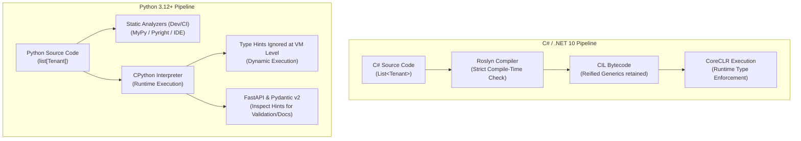
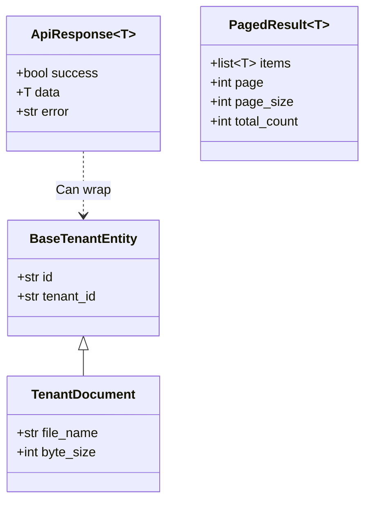
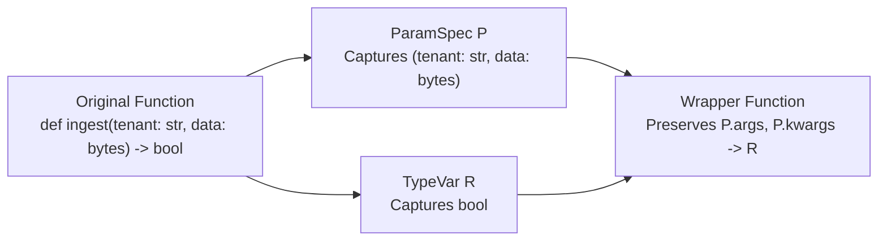
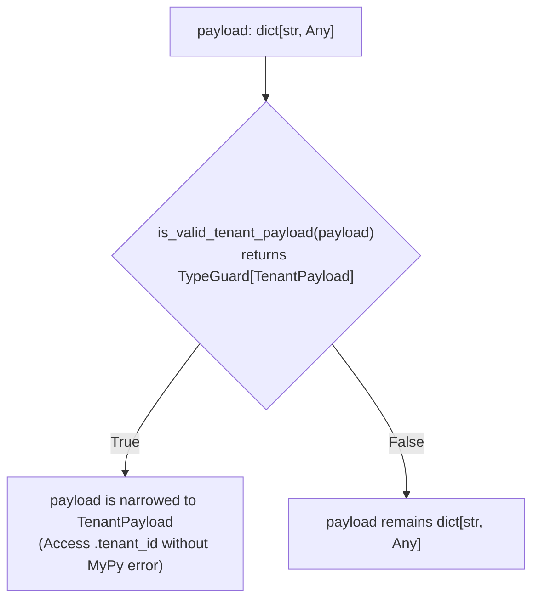
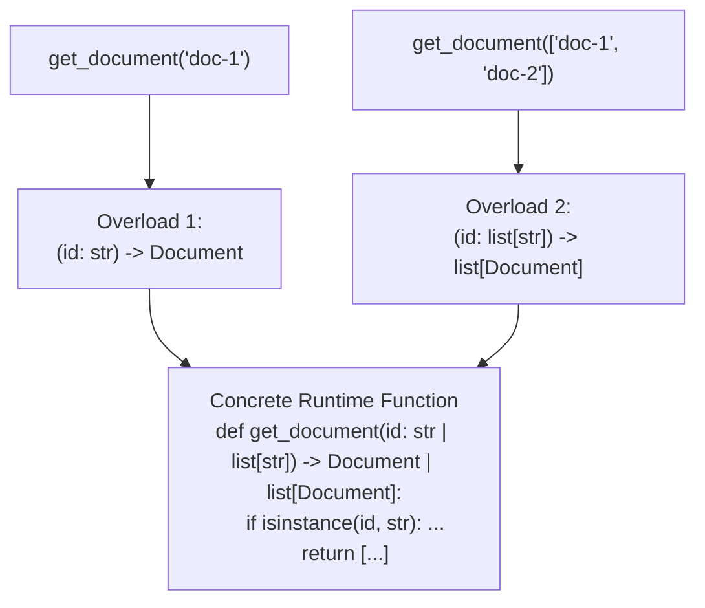
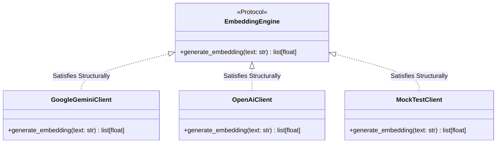
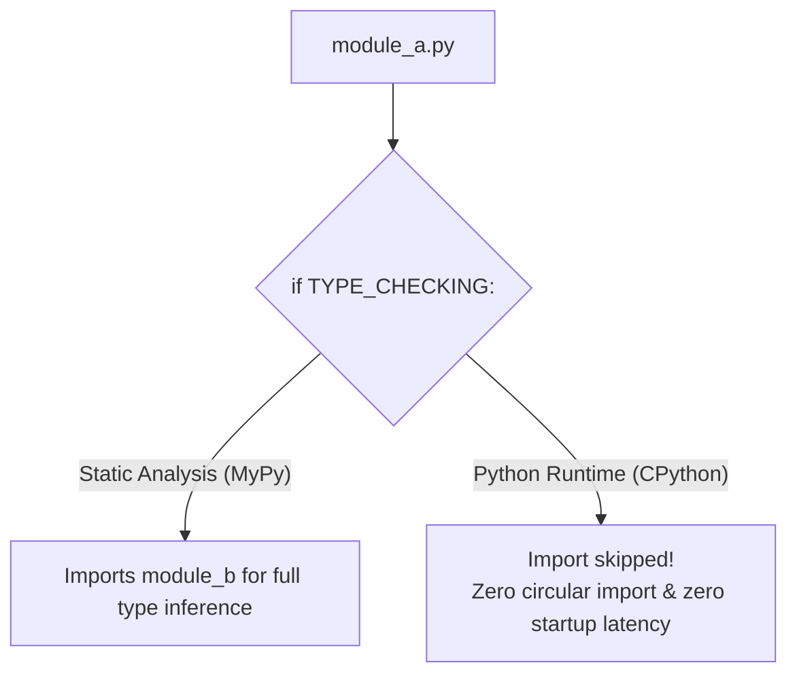

# Module 8: Modern Static Type Hints & Protocols

Welcome to **Module 8** of the Python & FastAPI AI Architect Masterclass.

Coming from a C# and .NET background, you are accustomed to a strongly typed, statically compiled language where types are checked at compile time by Roslyn, enforced at runtime by the Common Language Runtime (CLR), and reified in bytecode. In that world, an `int` can never masquerade as a `string`, and generic parameters like `List<T>` retain their full identity inside memory.

Historically, Python was known as a dynamically typed, interpreted language where types were only discovered when code executed. However, in modern enterprise engineering—and specifically in **FastAPI**, **Pydantic v2**, and AI orchestration—type annotations are not decorative comments: **they are the executable source code that drives runtime schema validation, serialization, dependency injection, and automatic OpenAPI documentation**.

In this module, you will master Python's type system from the ground up, starting from absolute basics and scaling to enterprise structural subtyping:
* **The Foundation**: Basic and container type annotations (PEP 484, PEP 585).
* **Nullability and Unions**: Modern pipe syntax (`|`), `Optional`, and union handling (PEP 604).
* **Domain Guardrails**: `Literal` types, `TypeAlias` (PEP 613), and PEP 695 `type` statements.
* **Generics**: `TypeVar`, bounds, constraints, and generic classes (`ApiResponse[T]`, `PagedResult[T]`).
* **Higher-Order Typing**: `Callable`, `ParamSpec` (PEP 612), and `Concatenate` for enterprise decorators.
* **Advanced Narrowing**: `TypeGuard` (PEP 647) and `TypeIs` (PEP 742).
* **Control-Flow Guarantees**: `Never` and `NoReturn` for security barriers and exhaustive checks.
* **Function Overloading**: Static dispatch via `@overload`.
* **Structural Subtyping**: `typing.Protocol` and `@runtime_checkable` (compile-time interfaces and duck typing).
* **Architecture & Tooling**: Resolving circular dependencies with `TYPE_CHECKING`.
* **C# vs. Python**: A complete architectural comparison between CLR static typing and Python static analysis.

Every single concept is illustrated with **at least 5 real-world examples** derived from **Normora**, our enterprise multi-tenant conversational AI and knowledge management platform.

---

## Architectural Comparison: Python Type Hints vs. C# Static Typing

Before writing code, let us contrast how C# and Python treat types under the hood:



### Key Differences at a Glance

| Feature | C# (.NET 10) | Modern Python (3.10 - 3.12+) |
| :--- | :--- | :--- |
| **Type Checking Phase** | Compile time (Roslyn) | Static analysis time (MyPy, Pyright) + IDE linting |
| **Runtime Enforcement** | Enforced by the CLR; throws `InvalidCastException` | Types are **erased** at runtime by CPython; no native `TypeError` thrown unless validated by libraries like Pydantic |
| **Generics Implementation** | **Reified Generics**: `typeof(List<Tenant>) != typeof(List<Document>)` | **Type Erasure**: `list[Tenant]` and `list[Document]` are both just `list` at runtime |
| **Subtyping Philosophy** | **Nominal Subtyping**: A class must explicitly declare `: ITenantStore` | **Structural Subtyping**: Classes satisfy a `Protocol` implicitly by shape |
| **Nullability Handling** | C# 8+ Nullable Reference Types (`Tenant?`, compiler warnings) | First-class union types (`Tenant | None` via PEP 604) |
| **Overloading** | Native method overloading compiled into distinct CLR signatures | `@overload` decorator; static analyzer only; runtime uses single implementation |
| **Meta-Programming** | Reflection (`System.Reflection`), Source Generators, Attributes | Introspection (`__annotations__`), Decorators, Metaclasses |

> [!IMPORTANT]
> In Python, adding `: int` to a parameter **does not** automatically stop someone from passing a string at runtime if they invoke the function directly. To achieve C#-like runtime safety, modern enterprise applications combine static type checkers (**MyPy** / **Pyright**) in CI/CD with runtime validators (**Pydantic v2**) in FastAPI boundaries.

---

## 1. Basic & Built-in Container Annotations (PEP 585)

### Understanding the Syntax from Scratch
In Python, type hints are declared using a colon (`:`) after the parameter or variable name, and the return type is designated with an arrow (`->`):

```python
# C# equivalent: public string FormatTenantId(int rawId) { ... }
def format_tenant_id(raw_id: int) -> str:
    return f"TENANT-{raw_id:05d}"
```

Historically (Python 3.5 to 3.8), you had to import capitalized types from the `typing` module:
```python
# Legacy (Python <= 3.8):
from typing import List, Dict, Tuple, Set
def process_tags(tags: List[str]) -> Dict[str, int]: ...
```

Starting in **Python 3.9+ (PEP 585)**, Python standard built-in collections support generic parameterization directly:
```python
# Modern Python 3.9+:
def process_tags(tags: list[str]) -> dict[str, int]: ...
```

### C# Collection Mappings

| C# Type | Modern Python Type (3.9+) | Legacy Python (`typing`) |
| :--- | :--- | :--- |
| `string` | `str` | `str` |
| `int` / `long` | `int` (arbitrary precision) | `int` |
| `double` / `float` | `float` (IEEE 754 double precision) | `float` |
| `bool` | `bool` | `bool` |
| `byte[]` | `bytes` | `bytes` |
| `List<T>` | `list[T]` | `List[T]` |
| `Dictionary<TKey, TValue>` | `dict[TKey, TValue]` | `Dict[TKey, TValue]` |
| `HashSet<T>` | `set[T]` | `Set[T]` |
| `(T1, T2)` (ValueTuple) | `tuple[T1, T2]` | `Tuple[T1, T2]` |
| `IEnumerable<T>` | `collections.abc.Iterable[T]` | `typing.Iterable[T]` |

---

### 5 Real-World Normora Examples

#### Example 1.1: Annotating Function Parameters and Return Types
In Normora's Tenant module, each tenant undergoes verification. This function takes primitive strings and booleans to construct a standardized header for logging and audit traces:

```python
def format_tenant_audit_header(tenant_id: str, is_enterprise: bool, seat_count: int) -> str:
    tier_label: str = "ENTERPRISE" if is_enterprise else "STANDARD"
    return f"[{tier_label}] Tenant: {tenant_id} | Allocated Seats: {seat_count}"

header: str = format_tenant_audit_header("tenant-corp-042", True, 250)
print(header)
# Output: [ENTERPRISE] Tenant: tenant-corp-042 | Allocated Seats: 250
```

#### Example 1.2: Annotating Document Chunk Lists (`list[dict[str, str]]`)
When Normora processes a policy PDF, it breaks the document into text chunks with associated department metadata. We annotate both the input list and output list:

```python
def filter_chunks_by_department(
    chunks: list[dict[str, str]], 
    target_department: str
) -> list[dict[str, str]]:
    filtered: list[dict[str, str]] = []
    for chunk in chunks:
        if chunk.get("department") == target_department:
            filtered.append(chunk)
    return filtered

raw_chunks: list[dict[str, str]] = [
    {"chunk_id": "chk-001", "department": "Legal", "text": "Confidentiality clause..."},
    {"chunk_id": "chk-002", "department": "Engineering", "text": "Deployment guidelines..."},
    {"chunk_id": "chk-003", "department": "Legal", "text": "Liability limitations..."}
]

legal_chunks: list[dict[str, str]] = filter_chunks_by_department(raw_chunks, "Legal")
print(f"Retrieved {len(legal_chunks)} legal chunks.")
# Output: Retrieved 2 legal chunks.
```

#### Example 1.3: Vector Embedding Arrays for Google Gemini Flash (`list[float]`)
Google Gemini Flash produces 768-dimensional dense vector embeddings. We annotate the vector mathematical calculation:

```python
import math

def calculate_cosine_similarity(vector_a: list[float], vector_b: list[float]) -> float:
    if len(vector_a) != len(vector_b):
        raise ValueError("Vectors must have identical dimensions.")
    
    dot_product: float = sum(a * b for a, b in zip(vector_a, vector_b))
    magnitude_a: float = math.sqrt(sum(a * a for a in vector_a))
    magnitude_b: float = math.sqrt(sum(b * b for b in vector_b))
    
    if magnitude_a == 0.0 or magnitude_b == 0.0:
        return 0.0
        
    return dot_product / (magnitude_a * magnitude_b)

# Simulating 4-dimensional slices for illustration:
vec_query: list[float] = [0.12, 0.84, -0.22, 0.51]
vec_chunk: list[float] = [0.10, 0.82, -0.20, 0.49]
score: float = calculate_cosine_similarity(vec_query, vec_chunk)
print(f"Gemini Cosine Score: {score:.4f}")
# Output: Gemini Cosine Score: 0.9997
```

#### Example 1.4: Tenant Token Quota Registry (`dict[str, int]`)
Normora tracks the number of Gemini Flash tokens consumed by each tenant in an in-memory counter:

```python
def record_token_consumption(
    registry: dict[str, int], 
    tenant_id: str, 
    consumed_tokens: int
) -> int:
    current_total: int = registry.get(tenant_id, 0)
    new_total: int = current_total + consumed_tokens
    registry[tenant_id] = new_total
    return new_total

tenant_registry: dict[str, int] = {
    "tenant-alpha": 450_000,
    "tenant-beta": 1_200_000
}

updated_total: int = record_token_consumption(tenant_registry, "tenant-alpha", 15_000)
print(f"Tenant Alpha Total Tokens: {updated_total}")
# Output: Tenant Alpha Total Tokens: 465000
```

#### Example 1.5: Fixed-Length Database Tuples from pgvector (`tuple[...]`)
When querying PostgreSQL + pgvector directly via asyncpg or psycopg, raw rows are returned as fixed-length tuples. In Python typing:
* `tuple[str, int, float]`: A tuple of **exactly 3 items** with respective types (like C# `(string, int, double)`).
* `tuple[str, ...]`: A homogeneous tuple of **variable length**.

```python
# Row tuple structure: (document_id, chunk_index, similarity_distance)
def parse_pgvector_row(row: tuple[str, int, float]) -> dict[str, str | int | float]:
    doc_id, chunk_idx, distance = row
    return {
        "document_id": doc_id,
        "chunk_index": chunk_idx,
        "similarity_score": round(1.0 - distance, 4)
    }

raw_db_row: tuple[str, int, float] = ("doc-uuid-8891", 4, 0.1245)
parsed_result = parse_pgvector_row(raw_db_row)
print(parsed_result)
# Output: {'document_id': 'doc-uuid-8891', 'chunk_index': 4, 'similarity_score': 0.8755}
```

---

## 2. Optional Values & Modern Union Types (PEP 604)

### The Pipe Operator (`|`) vs. `Optional`
In C#, reference types can be marked nullable with `?` (e.g. `string? logoUrl`). In Python 3.5 to 3.9, you wrote `Optional[str]` or `Union[str, None]`.

Starting in **Python 3.10 (PEP 604)**, you use the standard bitwise pipe operator (`|`) for unions:
* `str | None`: Value can be a `str` OR `None` (identical to `Optional[str]`).
* `int | float`: Value can be either an integer or floating-point number.
* `Tenant | User | ApiKey`: Value can be one of three types.

> [!NOTE]
> `Optional[T]` in Python does **not** mean the argument has a default value! It only means the value can be `None`. If a parameter is typed `x: str | None` without an `= None` assignment, caller code **must still pass `None` explicitly**.

```python
# WRONG assumption: x is optional to pass
def bad_func(x: str | None): pass
# bad_func()  <-- Throws TypeError: missing 1 required positional argument

# CORRECT: Optional type WITH default value
def good_func(x: str | None = None): pass
good_func()  # Valid
```

---

### 5 Real-World Normora Examples

#### Example 2.1: Optional Custom Tenant Logo URL with MinIO Fallback
Tenants in Normora can optionally configure a custom logo. If `None` is provided, the platform returns the default MinIO CDN asset:

```python
def resolve_tenant_logo_url(custom_logo_url: str | None = None) -> str:
    if custom_logo_url is not None and custom_logo_url.strip():
        return custom_logo_url.strip()
    return "https://minio.normora.internal/assets/default-tenant-brand.svg"

print(resolve_tenant_logo_url("https://s3.tenant.com/logo.png"))
# Output: https://s3.tenant.com/logo.png
print(resolve_tenant_logo_url(None))
# Output: https://minio.normora.internal/assets/default-tenant-brand.svg
```

#### Example 2.2: Numeric Token Cost Supporting `int | float`
Billing transactions may represent token costs as either whole token integers or fractional dollar amounts:

```python
def calculate_billing_credit(
    current_balance: int | float, 
    debit_amount: int | float
) -> float:
    return float(current_balance) - float(debit_amount)

balance_after_tokens: float = calculate_billing_credit(1000, 45.50)
print(f"Remaining Account Balance: ${balance_after_tokens:.2f}")
# Output: Remaining Account Balance: $954.50
```

#### Example 2.3: Document Retrieval Returning `dict | None` (BOLA Prevention)
In Normora's Documents module, when a document is not found or does not belong to the requesting tenant, we return `None` (which the API layer translates to a 404 to prevent ID enumeration):

```python
def find_tenant_document(
    tenant_id: str, 
    document_id: str, 
    mock_db: dict[str, dict[str, str]]
) -> dict[str, str] | None:
    doc = mock_db.get(document_id)
    if doc is None or doc.get("tenant_id") != tenant_id:
        # BOLA Security Rule: Return None to force 404 Not Found
        return None
    return doc

db_records: dict[str, dict[str, str]] = {
    "doc-1": {"tenant_id": "T-10", "title": "SecurityPolicy.pdf"},
    "doc-2": {"tenant_id": "T-20", "title": "Payroll.pdf"}
}

# Cross-tenant access attempt:
result = find_tenant_document("T-10", "doc-2", db_records)
print(f"Document accessible: {result is not None}")
# Output: Document accessible: False
```

#### Example 2.4: Union of Acceptable Query Input Formats
A RAG search query can be submitted as a plain string or as a structured dictionary containing metadata filters:

```python
def parse_search_query(
    query_input: str | dict[str, str | list[str]]
) -> dict[str, str | list[str]]:
    if isinstance(query_input, str):
        return {"query_text": query_input, "departments": []}
    return query_input

simple_query = parse_search_query("vacation rollover policy")
complex_query = parse_search_query({
    "query_text": "vacation rollover", 
    "departments": ["HR", "Benefits"]
})

print("Simple:", simple_query)
# Output: Simple: {'query_text': 'vacation rollover policy', 'departments': []}
print("Complex:", complex_query)
# Output: Complex: {'query_text': 'vacation rollover', 'departments': ['HR', 'Benefits']}
```

#### Example 2.5: Hierarchical Document Folder Node with Optional Parent
Normora allows tenants to organize uploaded documents into hierarchical folders:

```python
class DocumentFolderNode:
    def __init__(
        self, 
        folder_id: str, 
        name: str, 
        parent_id: str | None = None
    ) -> None:
        self.folder_id: str = folder_id
        self.name: str = name
        self.parent_id: str | None = parent_id

root_folder = DocumentFolderNode(folder_id="f-001", name="Company Vault", parent_id=None)
sub_folder = DocumentFolderNode(folder_id="f-002", name="Finance", parent_id="f-001")

print(f"Root Parent: {root_folder.parent_id} | Sub Parent: {sub_folder.parent_id}")
# Output: Root Parent: None | Sub Parent: f-001
```

---

## 3. `Literal` Types & Modern Type Aliases (PEP 586, PEP 613, PEP 695)

### Restricting Domain Values with `Literal`
In C#, you declare an `enum` to constrain values to a fixed set:
```csharp
public enum SubscriptionTier { Free, Starter, Pro, Enterprise }
```
In Python, while the `enum.Enum` class exists, modern FastAPI and Pydantic architectures heavily prefer **`typing.Literal`**. A `Literal` restricts a parameter to exact primitive values without the overhead of creating and casting enum instances:

```python
from typing import Literal

SubscriptionTier = Literal["Free", "Starter", "Pro", "Enterprise"]
```

### The Evolution of Type Aliases
Type aliases give meaningful domain names to complex types:

1. **Simple Assignment (Pre-Python 3.10)**:
   ```python
   Embedding = list[float]  # Ambiguous: Is this a variable or a type?
   ```
2. **Explicit `TypeAlias` (PEP 613, Python 3.10+)**:
   ```python
   from typing import TypeAlias
   Embedding: TypeAlias = list[float]
   ```
3. **The `type` Statement (PEP 695, Python 3.12+)**:
   ```python
   type Embedding = list[float]
   type VectorMap[K] = dict[K, list[float]]  # Supports inline generics!
   ```

---

### 5 Real-World Normora Examples

#### Example 3.1: Enforcing Subscription Tiers with `Literal`
Normora limits maximum indexed documents depending on subscription tier. Static analyzers will flag invalid tier strings immediately:

```python
from typing import Literal

SubscriptionTier = Literal["Free", "Starter", "Pro", "Enterprise"]

def get_tenant_document_limit(tier: SubscriptionTier) -> int:
    match tier:
        case "Free":
            return 25
        case "Starter":
            return 250
        case "Pro":
            return 2_500
        case "Enterprise":
            return 100_000

print("Pro Limit:", get_tenant_document_limit("Pro"))
# Output: Pro Limit: 2500
# get_tenant_document_limit("Ultimate")  <-- MyPy Error: Argument 1 to "get_tenant_document_limit" has incompatible type "Literal['Ultimate']"
```

#### Example 3.2: RBAC Role Gates for API Security
Normora enforces Broken Function Level Authorization (BFLA) checks by testing user roles:

```python
from typing import Literal

UserRole = Literal["TenantOwner", "TenantAdmin", "KnowledgeManager", "DocumentViewer"]

def can_delete_document_index(role: UserRole) -> bool:
    # Only TenantOwner and TenantAdmin have destructive privileges
    allowed_roles: set[UserRole] = {"TenantOwner", "TenantAdmin"}
    return role in allowed_roles

print("Admin can delete:", can_delete_document_index("TenantAdmin"))
# Output: Admin can delete: True
print("Viewer can delete:", can_delete_document_index("DocumentViewer"))
# Output: Viewer can delete: False
```

#### Example 3.3: Chat Message Roles in Conversational AI
Conversations sent to Google Gemini Flash or OpenAI GPT-4o require explicit message role tags:

```python
from typing import Literal

ChatRole = Literal["system", "user", "assistant", "tool"]

def format_chat_payload(role: ChatRole, message_text: str) -> dict[str, str]:
    return {
        "role": role,
        "content": message_text
    }

msg = format_chat_payload("assistant", "The travel reimbursement policy allows up to $75/day.")
print(msg)
# Output: {'role': 'assistant', 'content': 'The travel reimbursement policy allows up to $75/day.'}
```

#### Example 3.4: Hosted Cloud AI Provider Selection
Normora strictly uses hosted cloud AI providers (never local models):

```python
from typing import Literal

HostedAiProvider = Literal["google-gemini-flash", "openai-gpt4o"]

def resolve_model_dimension(provider: HostedAiProvider) -> int:
    if provider == "google-gemini-flash":
        return 768
    elif provider == "openai-gpt4o":
        return 1536
    raise ValueError(f"Unsupported provider: {provider}")

print("Gemini Dim:", resolve_model_dimension("google-gemini-flash"))
# Output: Gemini Dim: 768
```

#### Example 3.5: PEP 695 Semantic Type Aliases for RAG Pipelines
Using Python 3.12+'s `type` keyword, we define domain aliases for vector chunks and tenant mappings:

```python
from typing import TypeAlias

# Python 3.10/3.11 TypeAlias syntax (compatible across all modern versions):
TenantId: TypeAlias = str
ChunkId: TypeAlias = str
VectorEmbedding: TypeAlias = list[float]
TenantVectorRegistry: TypeAlias = dict[TenantId, dict[ChunkId, VectorEmbedding]]

registry: TenantVectorRegistry = {
    "tenant-acme": {
        "chunk-01": [0.05, -0.12, 0.88],
        "chunk-02": [0.14, 0.33, -0.55]
    }
}

print(f"Loaded tenant: {list(registry.keys())[0]} with {len(registry['tenant-acme'])} vectors.")
# Output: Loaded tenant: tenant-acme with 2 vectors.
```

---

## 4. Generic Types: `TypeVar`, Generic Classes & Constraints

### Generics in Python vs. C#
In C#, generic classes are declared directly with angle brackets:
```csharp
public class ApiResponse<T> {
    public bool Success { get; set; }
    public T? Data { get; set; }
}
```
In Python, because angle brackets are comparison operators, generics are implemented via:
1. `TypeVar`: A type variable placeholder.
2. `Generic[T]`: A base class indicating that the class accepts generic parameters.

```python
from typing import TypeVar, Generic

T = TypeVar("T")  # Declares an unconstrained generic type parameter

class ApiResponse(Generic[T]):
    def __init__(self, success: bool, data: T | None = None) -> None:
        self.success: bool = success
        self.data: T | None = data
```

### TypeVar Constraints vs. Bounds

| Concept | C# Equivalent | Python Syntax | Meaning |
| :--- | :--- | :--- | :--- |
| **Unconstrained** | `<T>` | `T = TypeVar("T")` | Can be any type |
| **Constrained** | `<T> where T : class` | `T = TypeVar("T", str, bytes)` | Must be **exactly** one of the listed types |
| **Bounded** | `<T> where T : BaseEntity` | `T = TypeVar("T", bound=BaseEntity)` | Can be `BaseEntity` or **any subclass** of it |



---

### 5 Real-World Normora Examples

#### Example 4.1: The Standard Normora `ApiResponse[T]` Envelope
Every API endpoint in Normora returns a standardized envelope matching our .NET MediatR responses:

```python
from typing import TypeVar, Generic

T = TypeVar("T")

class ApiResponse(Generic[T]):
    def __init__(
        self, 
        success: bool, 
        data: T | None = None, 
        error_message: str | None = None
    ) -> None:
        self.success: bool = success
        self.data: T | None = data
        self.error_message: str | None = error_message

    def unwrap(self) -> T:
        if not self.success or self.data is None:
            raise RuntimeError(f"API Error: {self.error_message}")
        return self.data

# Envelope wrapping a dictionary:
resp_tenant: ApiResponse[dict[str, str]] = ApiResponse(
    success=True, 
    data={"tenant_id": "T-100", "company": "Acme Corp"}
)
print("Unwrapped:", resp_tenant.unwrap()["company"])
# Output: Unwrapped: Acme Corp
```

#### Example 4.2: Generic Paginated Result Envelope (`PagedResult[T]`)
Normora returns paginated search and document chunks:

```python
from typing import TypeVar, Generic

T = TypeVar("T")

class PagedResult(Generic[T]):
    def __init__(
        self, 
        items: list[T], 
        page: int, 
        page_size: int, 
        total_count: int
    ) -> None:
        self.items: list[T] = items
        self.page: int = page
        self.page_size: int = page_size
        self.total_count: int = total_count

    @property
    def total_pages(self) -> int:
        return (self.total_count + self.page_size - 1) // self.page_size

paged_titles: PagedResult[str] = PagedResult(
    items=["Handbook.pdf", "IT_Policy.pdf", "Travel_Guide.pdf"],
    page=1,
    page_size=10,
    total_count=23
)

print(f"Total Pages: {paged_titles.total_pages} | Current Items: {len(paged_titles.items)}")
# Output: Total Pages: 3 | Current Items: 3
```

#### Example 4.3: Thread-Safe Generic Cache Store (`CacheStore[T]`)
Caching prompt templates and embedding vectors in memory:

```python
from typing import TypeVar, Generic

T = TypeVar("T")

class CacheStore(Generic[T]):
    def __init__(self) -> None:
        self._storage: dict[str, T] = {}

    def set(self, key: str, value: T) -> None:
        self._storage[key] = value

    def get(self, key: str) -> T | None:
        return self._storage.get(key)

# Specifically typed for strings:
system_prompt_cache: CacheStore[str] = CacheStore[str]()
system_prompt_cache.set("tenant-default", "You are Normora's Enterprise AI Assistant.")
print(system_prompt_cache.get("tenant-default"))
# Output: You are Normora's Enterprise AI Assistant.
```

#### Example 4.4: CQRS Result Pattern (`Result[T, E]`)
Normora avoids throwing exceptions for predictable domain errors (like duplicate tenant keys), using a two-parameter generic result:

```python
from typing import TypeVar, Generic

T = TypeVar("T")
E = TypeVar("E")

class Result(Generic[T, E]):
    def __init__(self, value: T | None, error: E | None, is_ok: bool) -> None:
        self._value: T | None = value
        self._error: E | None = error
        self.is_ok: bool = is_ok

    @classmethod
    def ok(cls, value: T) -> "Result[T, E]":
        return cls(value=value, error=None, is_ok=True)

    @classmethod
    def fail(cls, error: E) -> "Result[T, E]":
        return cls(value=None, error=error, is_ok=False)

    def value(self) -> T:
        if not self.is_ok or self._value is None:
            raise ValueError("Cannot access value of a failed Result.")
        return self._value

    def error(self) -> E:
        if self.is_ok or self._error is None:
            raise ValueError("Cannot access error of a successful Result.")
        return self._error

cmd_result: Result[str, str] = Result.ok("tenant-created-uuid-123")
print("Command Succeeded:", cmd_result.is_ok, "| ID:", cmd_result.value())
# Output: Command Succeeded: True | ID: tenant-created-uuid-123
```

#### Example 4.5: Bounded Generic Repository with `bound=BaseTenantEntity`
Restricting a generic repository so it can **only** operate on entities that inherit from `BaseTenantEntity`:

```python
from typing import TypeVar, Generic

class BaseTenantEntity:
    def __init__(self, entity_id: str, tenant_id: str) -> None:
        self.entity_id: str = entity_id
        self.tenant_id: str = tenant_id

# Bounded TypeVar: Must be BaseTenantEntity or a subclass of it:
TEntity = TypeVar("TEntity", bound=BaseTenantEntity)

class TenantScopedRepository(Generic[TEntity]):
    def __init__(self) -> None:
        self._entities: list[TEntity] = []

    def add(self, item: TEntity) -> None:
        self._entities.append(item)

    def find_by_tenant(self, tenant_id: str) -> list[TEntity]:
        # Guaranteed that item has .tenant_id because TEntity is bounded!
        return [item for item in self._entities if item.tenant_id == tenant_id]

class KnowledgeDocument(BaseTenantEntity):
    def __init__(self, entity_id: str, tenant_id: str, title: str) -> None:
        super().__init__(entity_id, tenant_id)
        self.title: str = title

repo: TenantScopedRepository[KnowledgeDocument] = TenantScopedRepository[KnowledgeDocument]()
repo.add(KnowledgeDocument("d1", "tenant-alpha", "NDA.pdf"))
repo.add(KnowledgeDocument("d2", "tenant-beta", "Salaries.pdf"))

results = repo.find_by_tenant("tenant-alpha")
print(f"Found {len(results)} document: {results[0].title}")
# Output: Found 1 document: NDA.pdf
```

---

## 5. Function Signatures, Callables & Decorator Preservation (`Callable`, `ParamSpec`, `Concatenate`)

### The Challenge with Typing Decorators
In C#, cross-cutting concerns are handled via ASP.NET Core Action Filters, MediatR pipeline behaviors, or Castle DynamicProxy. In Python, we use **decorators**.

However, simple decorators typed with `Callable[..., Any]` create a massive problem in enterprise code: **they destroy IDE IntelliSense and static type safety for the decorated function!**

```python
# NAIVE APPROACH - Destroys function signature!
def bad_decorator(func: Callable[..., Any]) -> Callable[..., Any]:
    def wrapper(*args, **kwargs):
        return func(*args, **kwargs)
    return wrapper

@bad_decorator
def calculate_cost(tokens: int, rate: float) -> float: ...

# The IDE now sees calculate_cost as: (*args: Any, **kwargs: Any) -> Any
```

### The Solution: `ParamSpec` and `Concatenate` (PEP 612)
`ParamSpec` captures the exact parameter types and return type of the wrapped function:



* `Callable[[Param1, Param2], ReturnType]`: Type hint for a function or lambda.
* `ParamSpec("P")`: Captures `*args` and `**kwargs` specification.
* `Concatenate[FirstArg, P]`: Prepends or modifies parameters (e.g. injecting `TenantContext`).

---

### 5 Real-World Normora Examples

#### Example 5.1: Document Stream Transformation Pipeline (`Callable`)
Higher-order function applying chunk cleaning rules:

```python
from collections.abc import Callable

def clean_and_normalize(
    raw_chunk: str, 
    transform: Callable[[str], str]
) -> str:
    cleaned = raw_chunk.strip()
    return transform(cleaned)

def remove_internal_citations(text: str) -> str:
    return text.replace("[INTERNAL_USE_ONLY]", "").strip()

result: str = clean_and_normalize(
    "  [INTERNAL_USE_ONLY] Employee Salary Bands 2026  ", 
    remove_internal_citations
)
print("Normalized:", result)
# Output: Normalized: Employee Salary Bands 2026
```

#### Example 5.2: SignalR Streaming Event Callback (`Callable[[str, int], None]`)
Simulating a SignalR token streaming hub callback that notifies subscribers on each generated token chunk:

```python
from collections.abc import Callable

def stream_gemini_tokens(
    prompt: str, 
    on_token_received: Callable[[str, int], None]
) -> None:
    # Simulating token arrival from Google Gemini Flash:
    tokens = ["Normora", " uses", " pgvector", " for", " HNSW", " search."]
    for index, token in enumerate(tokens):
        on_token_received(token, index)

def signalr_broadcast_handler(token: str, sequence_idx: int) -> None:
    print(f"SignalR Hub -> Packet #{sequence_idx}: '{token}'")

stream_gemini_tokens("Tell me about Normora architecture", signalr_broadcast_handler)
# Output:
# SignalR Hub -> Packet #0: 'Normora'
# SignalR Hub -> Packet #1: ' uses'
# SignalR Hub -> Packet #2: ' pgvector'
# ...
```

#### Example 5.3: Audit Logging Decorator Using `ParamSpec`
Preserving the exact function signature and return type of decorated MediatR query handlers:

```python
from typing import TypeVar, ParamSpec
from collections.abc import Callable
import functools

P = ParamSpec("P")
R = TypeVar("R")

def audit_log(func: Callable[P, R]) -> Callable[P, R]:
    @functools.wraps(func)
    def wrapper(*args: P.args, **kwargs: P.kwargs) -> R:
        print(f"[AUDIT] Calling operation: '{func.__name__}'")
        result: R = func(*args, **kwargs)
        print(f"[AUDIT] Completed '{func.__name__}' successfully.")
        return result
    return wrapper

@audit_log
def calculate_tenant_bill(tenant_id: str, active_users: int) -> float:
    return active_users * 15.0

# IDE retains full signature: calculate_tenant_bill(tenant_id: str, active_users: int) -> float
total = calculate_tenant_bill("tenant-corp-99", 10)
print(f"Bill Total: ${total:.2f}")
# Output:
# [AUDIT] Calling operation: 'calculate_tenant_bill'
# [AUDIT] Completed 'calculate_tenant_bill' successfully.
# Bill Total: $150.00
```

#### Example 5.4: Injecting Tenant Context with `Concatenate` and `ParamSpec`
In Normora, security middleware extracts the `TenantContext` from Keycloak JWT claims and injects it as the first parameter into handlers:

```python
from typing import TypeVar, ParamSpec, Concatenate
from collections.abc import Callable
import functools

class TenantSecurityContext:
    def __init__(self, tenant_id: str, user_id: str) -> None:
        self.tenant_id: str = tenant_id
        self.user_id: str = user_id

P = ParamSpec("P")
R = TypeVar("R")

# Transforms a function needing TenantSecurityContext into a function called from HTTP without it:
def require_tenant(
    func: Callable[Concatenate[TenantSecurityContext, P], R]
) -> Callable[P, R]:
    @functools.wraps(func)
    def wrapper(*args: P.args, **kwargs: P.kwargs) -> R:
        # Extracted from Keycloak OIDC token in production:
        injected_context = TenantSecurityContext(tenant_id="tenant-acme", user_id="user-007")
        return func(injected_context, *args, **kwargs)
    return wrapper

@require_tenant
def delete_document_index(ctx: TenantSecurityContext, document_id: str) -> str:
    return f"Deleted {document_id} for tenant {ctx.tenant_id} by {ctx.user_id}"

# Note: The caller does NOT pass `ctx`; the decorator injects it!
status: str = delete_document_index("doc-888")
print(status)
# Output: Deleted doc-888 for tenant tenant-acme by user-007
```

#### Example 5.5: Execution Timing and OpenTelemetry Tracing Decorator
Measuring Gemini Flash response latency while preserving async or sync signatures:

```python
from typing import TypeVar, ParamSpec
from collections.abc import Callable
import time
import functools

P = ParamSpec("P")
R = TypeVar("R")

def measure_telemetry(operation_name: str) -> Callable[[Callable[P, R]], Callable[P, R]]:
    def decorator(func: Callable[P, R]) -> Callable[P, R]:
        @functools.wraps(func)
        def wrapper(*args: P.args, **kwargs: P.kwargs) -> R:
            start_time = time.perf_counter()
            try:
                return func(*args, **kwargs)
            finally:
                elapsed_ms = (time.perf_counter() - start_time) * 1000
                print(f"[OpenTelemetry] Span: '{operation_name}' completed in {elapsed_ms:.2f}ms")
        return wrapper
    return decorator

@measure_telemetry("GeminiEmbeddingGeneration")
def mock_gemini_embed(text: str) -> list[float]:
    time.sleep(0.05)  # Simulate 50ms network round-trip
    return [0.1] * 768

embedding = mock_gemini_embed("Executive Summary")
print("Vector length:", len(embedding))
# Output:
# [OpenTelemetry] Span: 'GeminiEmbeddingGeneration' completed in 50.xxms
# Vector length: 768
```

---

## 6. Advanced Type Narrowing: `TypeGuard` and `TypeIs` (PEP 647, PEP 742)

### Why `isinstance` Is Not Always Enough
In C#, pattern matching allows type testing and casting in a single step:
```csharp
if (obj is TenantDocument doc) {
    Console.WriteLine(doc.FileName);
}
```
In Python, when working with raw JSON payloads, dictionaries, or dynamic structures, `isinstance(data, dict)` only tells the type checker that the object is a dictionary—it cannot verify what keys are inside!

**`TypeGuard[T]` (Python 3.10+)** and **`TypeIs[T]` (Python 3.13+)** allow you to write custom boolean predicate functions. When a `TypeGuard` returns `True`, the static type checker automatically narrows the variable to type `T` within that conditional branch!



---

### 5 Real-World Normora Examples

#### Example 6.1: Narrowing Untyped JWT Claims into a Valid `TenantContext`
Verifying Keycloak token claims:

```python
from typing import TypeGuard, Any

class TenantContextPayload:
    def __init__(self, tenant_id: str, user_email: str) -> None:
        self.tenant_id: str = tenant_id
        self.user_email: str = user_email

def is_valid_tenant_context(claims: dict[str, Any]) -> TypeGuard[dict[str, str]]:
    """TypeGuard verifying that claims contain required non-empty string fields."""
    return (
        isinstance(claims.get("tenant_id"), str) and
        isinstance(claims.get("user_email"), str) and
        bool(claims["tenant_id"]) and
        bool(claims["user_email"])
    )

raw_claims: dict[str, Any] = {"tenant_id": "tenant-99", "user_email": "admin@normora.ai", "exp": 1735689600}

if is_valid_tenant_context(raw_claims):
    # Inside this block, MyPy knows raw_claims values for those keys are str:
    print(f"Authenticated: {raw_claims['user_email']} for {raw_claims['tenant_id']}")
else:
    print("Invalid claims structure.")
# Output: Authenticated: admin@normora.ai for tenant-99
```

#### Example 6.2: Distinguishing RAG Search Citations from Error Responses
In conversational AI streaming, packets can be citation data or API error messages:

```python
from typing import TypeGuard, Any

CitationPayload = dict[str, str | int]
ErrorPayload = dict[str, str]

def is_citation_payload(packet: dict[str, Any]) -> TypeGuard[CitationPayload]:
    return "chunk_id" in packet and "page_number" in packet

packet: dict[str, Any] = {"chunk_id": "chk-101", "page_number": 12, "source": "Manual.pdf"}

if is_citation_payload(packet):
    print(f"Citation verified: Chunk {packet['chunk_id']} on Page {packet['page_number']}")
else:
    print("Unknown packet type.")
# Output: Citation verified: Chunk chk-101 on Page 12
```

#### Example 6.3: Validating Gemini Flash Tool Execution Call Payloads
When Google Gemini Flash requests a tool execution (function calling), we narrow the payload:

```python
from typing import TypeGuard, Any

ToolCallPayload = dict[str, str | dict[str, Any]]

def is_tool_call(response: dict[str, Any]) -> TypeGuard[ToolCallPayload]:
    return response.get("type") == "tool_call" and "tool_name" in response and "arguments" in response

gemini_resp: dict[str, Any] = {
    "type": "tool_call",
    "tool_name": "search_company_documents",
    "arguments": {"query": "parental leave policy"}
}

if is_tool_call(gemini_resp):
    print(f"Execute tool: {gemini_resp['tool_name']} with args {gemini_resp['arguments']}")
# Output: Execute tool: search_company_documents with args {'query': 'parental leave policy'}
```

#### Example 6.4: Guard for MinIO S3 Object Upload Metadata
Narrowing raw dictionary metadata from an S3 bucket:

```python
from typing import TypeGuard, Any

DocumentMetadata = dict[str, str]

def is_complete_doc_metadata(meta: dict[str, Any]) -> TypeGuard[DocumentMetadata]:
    required_keys = {"content-type", "tenant-id", "uploaded-by"}
    return required_keys.issubset(meta.keys()) and all(isinstance(v, str) for v in meta.values())

raw_meta: dict[str, Any] = {
    "content-type": "application/pdf",
    "tenant-id": "T-404",
    "uploaded-by": "service-worker"
}

if is_complete_doc_metadata(raw_meta):
    print("Metadata valid. Storing in PostgreSQL...")
# Output: Metadata valid. Storing in PostgreSQL...
```

#### Example 6.5: Type Narrowing for Role-Based Authorization
Validating user membership dictionaries:

```python
from typing import TypeGuard, Any

AdminMembership = dict[str, str]

def is_admin_membership(membership: dict[str, Any]) -> TypeGuard[AdminMembership]:
    return (
        membership.get("role") in {"TenantOwner", "TenantAdmin"} and
        isinstance(membership.get("user_id"), str) and
        membership.get("status") == "ACTIVE"
    )

user_session: dict[str, Any] = {"user_id": "u-42", "role": "TenantOwner", "status": "ACTIVE"}

if is_admin_membership(user_session):
    print(f"Access granted to admin panel for user {user_session['user_id']}")
# Output: Access granted to admin panel for user u-42
```

---

## 7. Functions That Never Return: `Never` and `NoReturn`

### Distinguishing `None` vs. `NoReturn` vs. `Never`
In C#, methods that throw exceptions unconditionally are decorated with `[DoesNotReturn]`:
```csharp
[DoesNotReturn]
public static void ThrowBolaNotFound() => throw new KeyNotFoundException();
```

In Python:
* `def foo() -> None:` The function returns normally, and its return value is the singleton object `None`.
* `def foo() -> NoReturn:` (PEP 484) The function **never returns normally**. It either raises an unhandled exception or terminates the process.
* `Never` (PEP 654 / Python 3.11+): The bottom type of the type lattice (a type with zero possible values). Used for **exhaustive pattern matching**.

> [!TIP]
> Modern Python code uses `Never` and `assert_never()` to guarantee that every single enum or `Literal` branch is handled in a `match / case` statement!

---

### 5 Real-World Normora Examples

#### Example 7.1: BOLA Security Trap Function (Always Raises 404)
To prevent tenant ID enumeration, any cross-tenant unauthorized request is terminated with a 404:

```python
from typing import NoReturn

class ResourceNotFoundException(Exception):
    """Normalized 404 exception."""
    pass

def raise_bola_not_found(resource_type: str, resource_id: str) -> NoReturn:
    # Centralized security log:
    print(f"[SECURITY ALERT] BOLA probe detected for {resource_type} [{resource_id}]. Suppressing to 404.")
    raise ResourceNotFoundException("Resource not found or access denied.")

# Static analyzers understand that execution stops here:
def access_document(tenant_id: str, doc_owner_tenant_id: str) -> str:
    if tenant_id != doc_owner_tenant_id:
        raise_bola_not_found("Document", "doc-999")
    return "Document content..."
```

#### Example 7.2: BFLA Authorization Violation Handler (Always Raises 403)
Centralized authorization denial:

```python
from typing import NoReturn

class ForbiddenPrivilegeException(Exception):
    pass

def raise_bfla_forbidden(action_name: str, required_role: str) -> NoReturn:
    raise ForbiddenPrivilegeException(
        f"Forbidden: Action '{action_name}' requires role '{required_role}'."
    )

try:
    raise_bfla_forbidden("rebuild_pgvector_index", "TenantOwner")
except ForbiddenPrivilegeException as ex:
    print(ex)
# Output: Forbidden: Action 'rebuild_pgvector_index' requires role 'TenantOwner'.
```

#### Example 7.3: Infinite Background Worker for Document Ingestion
Document workers listen indefinitely to MinIO S3 bucket notification queues:

```python
from typing import NoReturn
import time

def start_minio_ingestion_listener(queue_name: str) -> NoReturn:
    print(f"Worker listening on queue: {queue_name}...")
    while True:
        # Polling MinIO queue event:
        time.sleep(0.01)
        # Process events...
        # In this educational snippet, we break to avoid an infinite test loop:
        break
    raise RuntimeError("Listener terminated unexpectedly.")

# Type checkers know code after this call is unreachable.
```

#### Example 7.4: Exhaustive `match` Check Using `assert_never`
Ensuring all Normora subscription tiers are handled. If a new tier is added to `SubscriptionTier` without updating this function, MyPy will raise a compile-time error:

```python
from typing import Literal, Never, assert_never

SubscriptionTier = Literal["Free", "Starter", "Pro", "Enterprise"]

def calculate_monthly_quota(tier: SubscriptionTier) -> int:
    match tier:
        case "Free":
            return 10_000
        case "Starter":
            return 100_000
        case "Pro":
            return 1_000_000
        case "Enterprise":
            return 50_000_000
        case _ as unhandled:
            # If a new tier like "Ultimate" is added, MyPy flags unhandled as not Never:
            assert_never(unhandled)

print("Pro Quota:", calculate_monthly_quota("Pro"))
# Output: Pro Quota: 1000000
```

#### Example 7.5: Unrecoverable Database Connection Panic Function
Terminating the process if PostgreSQL + pgvector is unreachable at boot time:

```python
import sys
from typing import NoReturn

def panic_database_unreachable(connection_string: str, reason: str) -> NoReturn:
    print(f"[FATAL ERROR] Cannot connect to PostgreSQL: {reason}", file=sys.stderr)
    print(f"Terminating Normora service container. Host: {connection_string}", file=sys.stderr)
    sys.exit(1)

# Usage in database startup probe:
# panic_database_unreachable("postgres://normora-db:5432", "Connection refused")
```

---

## 8. Function Overloading with `@overload`

### The Problem in Python
In C#, method overloading is built into the language and resolved by the compiler:
```csharp
public Document Get(string id) { ... }
public List<Document> Get(List<string> ids) { ... }
```
In Python, if you define two functions with the exact same name, **the second one completely overwrites the first one**! There is only one function at runtime.

### The Solution: `typing.overload`
Python solves this by using `@overload` decorators for the static type checker, followed by a **single concrete implementation** that handles all cases using `isinstance()` checks:



> [!IMPORTANT]
> The `@overload` signatures must contain only `...` (an ellipsis) in their bodies. They are **never executed at runtime**. The concrete implementation that follows does **not** have the `@overload` decorator.

---

### 5 Real-World Normora Examples

#### Example 8.1: Document Retrieval by Single ID vs. Batch IDs
Overloading `get_documents` to return either a single document dictionary or a list of dictionaries:

```python
from typing import overload

@overload
def get_documents(doc_ids: str) -> dict[str, str]: ...

@overload
def get_documents(doc_ids: list[str]) -> list[dict[str, str]]: ...

# Concrete implementation:
def get_documents(
    doc_ids: str | list[str]
) -> dict[str, str] | list[dict[str, str]]:
    mock_db = {
        "d1": {"id": "d1", "title": "Security.pdf"},
        "d2": {"id": "d2", "title": "Architecture.pdf"}
    }
    if isinstance(doc_ids, str):
        return mock_db.get(doc_ids, {"id": doc_ids, "title": "Unknown"})
    return [mock_db.get(i, {"id": i, "title": "Unknown"}) for i in doc_ids]

# MyPy knows single_doc is dict[str, str]:
single_doc = get_documents("d1")
print("Single:", single_doc["title"])
# Output: Single: Security.pdf

# MyPy knows batch_docs is list[dict[str, str]]:
batch_docs = get_documents(["d1", "d2"])
print("Batch count:", len(batch_docs))
# Output: Batch count: 2
```

#### Example 8.2: Google Gemini Flash Embedding Generator (Single Text vs. Batch)
Generating a single vector or a batch of vectors:

```python
from typing import overload

@overload
def generate_embeddings(content: str) -> list[float]: ...

@overload
def generate_embeddings(content: list[str]) -> list[list[float]]: ...

def generate_embeddings(
    content: str | list[str]
) -> list[float] | list[list[float]]:
    if isinstance(content, str):
        # Return single 768-dim mock vector:
        return [0.15] * 768
    # Return batch of vectors:
    return [[0.15] * 768 for _ in content]

v_single = generate_embeddings("Executive Summary")
v_batch = generate_embeddings(["Chunk 1", "Chunk 2", "Chunk 3"])
print("Single dim:", len(v_single))
# Output: Single dim: 768
print("Batch size:", len(v_batch))
# Output: Batch size: 3
```

#### Example 8.3: MinIO S3 Object Reader (Bytes vs. Text)
Reading an object as raw binary bytes or decoded UTF-8 string:

```python
from typing import overload, Literal

@overload
def read_s3_artifact(key: str, as_bytes: Literal[True]) -> bytes: ...

@overload
def read_s3_artifact(key: str, as_bytes: Literal[False] = False) -> str: ...

def read_s3_artifact(key: str, as_bytes: bool = False) -> bytes | str:
    raw_content = b"PDF_HEADER_NORMORA_ENCRYPTED_PAYLOAD"
    if as_bytes:
        return raw_content
    return raw_content.decode("utf-8", errors="replace")

content_bytes: bytes = read_s3_artifact("doc-1", as_bytes=True)
content_str: str = read_s3_artifact("doc-1", as_bytes=False)
print("Bytes type:", type(content_bytes).__name__)
# Output: Bytes type: bytes
print("Str type:", type(content_str).__name__)
# Output: Str type: str
```

#### Example 8.4: Tenant Configuration Lookup with Typed Default
When a configuration key is missing, return the default value with matching type:

```python
from typing import overload, TypeVar

T = TypeVar("T")

@overload
def get_tenant_config(key: str, default: None = None) -> str | None: ...

@overload
def get_tenant_config(key: str, default: T) -> str | T: ...

def get_tenant_config(key: str, default: object = None) -> object:
    configs: dict[str, str] = {"rag_top_k": "5", "theme": "dark"}
    return configs.get(key, default)

val_str: str | None = get_tenant_config("missing_key")
val_int: str | int = get_tenant_config("rag_top_k", default=10)
print("Missing:", val_str)
# Output: Missing: None
print("Found:", val_int)
# Output: Found: 5
```

#### Example 8.5: Conversational AI Response Generator (Streaming vs. Buffered)
Returning either an iterator of stream chunks or a complete final string:

```python
from typing import overload, Literal
from collections.abc import Iterator

@overload
def invoke_normora_chat(query: str, stream: Literal[True]) -> Iterator[str]: ...

@overload
def invoke_normora_chat(query: str, stream: Literal[False] = False) -> str: ...

def invoke_normora_chat(query: str, stream: bool = False) -> Iterator[str] | str:
    full_response = "Normora uses PostgreSQL with pgvector for HNSW indexing."
    if stream:
        def generator():
            for word in full_response.split():
                yield word + " "
        return generator()
    return full_response

buffered_resp: str = invoke_normora_chat("How does Normora store vectors?", stream=False)
print("Buffered:", buffered_resp)
# Output: Buffered: Normora uses PostgreSQL with pgvector for HNSW indexing.

stream_iter: Iterator[str] = invoke_normora_chat("How does Normora store vectors?", stream=True)
print("Streaming chunks:", list(stream_iter)[:3])
# Output: Streaming chunks: ['Normora ', 'uses ', 'PostgreSQL ']
```

---

## 9. Structural Subtyping: `typing.Protocol` & `@runtime_checkable`

### Nominal Subtyping (C#) vs. Structural Subtyping (Python)
In C# or Java, polymorphism requires **Nominal Subtyping**. A class must explicitly inherit from or implement an interface:
```csharp
public interface IEmbeddingEngine {
    List<float> GenerateEmbedding(string text);
}

// C# requires explicit declaration ": IEmbeddingEngine"
public class GeminiService : IEmbeddingEngine { ... }
```

In Python, we use **Structural Subtyping** (formalized duck typing) via **`typing.Protocol`** (PEP 544).  
If a class implements the attributes and methods declared by a `Protocol`, it automatically satisfies the interface **without needing to inherit from it!**



### The `@runtime_checkable` Decorator
By default, `Protocol` is only checked by static tools like MyPy. If you attempt `isinstance(obj, MyProtocol)` at runtime, Python will throw a `TypeError`.

Decorating the protocol with `@runtime_checkable` allows `isinstance()` checks at runtime:

```python
from typing import Protocol, runtime_checkable

@runtime_checkable
class Auditable(Protocol):
    def get_audit_id(self) -> str: ...
```

---

### 5 Real-World Normora Examples

#### Example 9.1: The `EmbeddingEngine` Protocol
Defining an interface for cloud embedding services. Notice that neither service inherits from `EmbeddingEngine`:

```python
from typing import Protocol

class EmbeddingEngine(Protocol):
    """Protocol for any vector embedding service."""
    def generate_embedding(self, text: str) -> list[float]:
        ...

# Production Gemini Implementation (No inheritance!):
class GoogleGeminiService:
    def generate_embedding(self, text: str) -> list[float]:
        print(f"Calling Google Gemini API for: '{text[:25]}...'")
        return [0.12] * 768

# Test / Mock Implementation (No inheritance!):
class MockEmbeddingService:
    def generate_embedding(self, text: str) -> list[float]:
        return [0.0] * 768

# Consumer depends strictly on the Protocol:
def index_document_chunk(engine: EmbeddingEngine, chunk_text: str) -> list[float]:
    return engine.generate_embedding(chunk_text)

gemini = GoogleGeminiService()
vector = index_document_chunk(gemini, "Normora Security Architecture Overview")
print(f"Generated Vector Dimension: {len(vector)}")
# Output:
# Calling Google Gemini API for: 'Normora Security Architec...'
# Generated Vector Dimension: 768
```

#### Example 9.2: The `StorageBackend` Protocol for MinIO and Azure
Decoupling document persistence from specific object storage SDKs:

```python
from typing import Protocol

class StorageBackend(Protocol):
    def upload_file(self, tenant_id: str, file_name: str, payload: bytes) -> str:
        ...

class MinioStorageService:
    def upload_file(self, tenant_id: str, file_name: str, payload: bytes) -> str:
        return f"s3://normora-vault/{tenant_id}/{file_name}"

class AzureBlobStorageService:
    def upload_file(self, tenant_id: str, file_name: str, payload: bytes) -> str:
        return f"https://normora.blob.core.windows.net/{tenant_id}/{file_name}"

def persist_tenant_contract(storage: StorageBackend, tenant_id: str, name: str) -> str:
    return storage.upload_file(tenant_id, name, b"PDF_DATA")

uri = persist_tenant_contract(MinioStorageService(), "tenant-99", "MasterServicesAgreement.pdf")
print("Uploaded to:", uri)
# Output: Uploaded to: s3://normora-vault/tenant-99/MasterServicesAgreement.pdf
```

#### Example 9.3: The `TenantContext` Protocol with `@property`
Protocols can enforce getters, setters, and properties:

```python
from typing import Protocol

class TenantContext(Protocol):
    @property
    def tenant_id(self) -> str: ...
    @property
    def user_id(self) -> str: ...

class RequestHeaderTenantContext:
    def __init__(self, tenant_id: str, user_id: str) -> None:
        self._tenant_id = tenant_id
        self._user_id = user_id

    @property
    def tenant_id(self) -> str:
        return self._tenant_id

    @property
    def user_id(self) -> str:
        return self._user_id

def log_tenant_audit_event(ctx: TenantContext, action: str) -> None:
    print(f"[AUDIT] Tenant: {ctx.tenant_id} | User: {ctx.user_id} | Action: {action}")

ctx = RequestHeaderTenantContext("tenant-alpha", "usr-889")
log_tenant_audit_event(ctx, "DELETE_DOCUMENT")
# Output: [AUDIT] Tenant: tenant-alpha | User: usr-889 | Action: DELETE_DOCUMENT
```

#### Example 9.4: The `AiToolExecutable` Protocol for Agent Function Calling
In Normora's conversational AI module, the assistant can execute dynamic tools:

```python
from typing import Protocol, Any

class AiToolExecutable(Protocol):
    @property
    def name(self) -> str: ...
    def execute(self, **kwargs: Any) -> dict[str, Any]: ...

class DocumentSearchTool:
    name: str = "search_company_documents"
    def execute(self, **kwargs: Any) -> dict[str, Any]:
        query = kwargs.get("query", "")
        return {"matches": [f"Found result for: {query}"]}

class CalculatorTool:
    name: str = "perform_financial_calculation"
    def execute(self, **kwargs: Any) -> dict[str, Any]:
        return {"result": 42_000.00}

def dispatch_agent_tool(tool: AiToolExecutable, **params: Any) -> dict[str, Any]:
    print(f"Agent invoking tool: {tool.name}")
    return tool.execute(**params)

res = dispatch_agent_tool(DocumentSearchTool(), query="PTO rollover")
print(res)
# Output:
# Agent invoking tool: search_company_documents
# {'matches': ['Found result for: PTO rollover']}
```

#### Example 9.5: The `@runtime_checkable` `NotificationSender` Protocol
Testing protocol conformance at runtime in SignalR event hubs:

```python
from typing import Protocol, runtime_checkable

@runtime_checkable
class NotificationSender(Protocol):
    def send_notification(self, tenant_id: str, message: str) -> bool:
        ...

class SignalRHubSender:
    def send_notification(self, tenant_id: str, message: str) -> bool:
        print(f"SignalR Hub broadcast to {tenant_id}: '{message}'")
        return True

class IncompatibleEmailSender:
    # Does not match the protocol signature:
    def send_email(self, address: str) -> None: pass

hub = SignalRHubSender()
email = IncompatibleEmailSender()

# Safe runtime checks via @runtime_checkable:
print("SignalR satisfies Protocol:", isinstance(hub, NotificationSender))
# Output: SignalR satisfies Protocol: True
print("Email satisfies Protocol:", isinstance(email, NotificationSender))
# Output: Email satisfies Protocol: False
```

---

## 10. Circular Imports & Performance Guard: `TYPE_CHECKING`

### The Circular Import Trap
In C#, two classes in different files can reference each other without issue because the Roslyn compiler builds the symbol table in two passes:
```csharp
// Tenant.cs
public class Tenant { public List<Document> Documents { get; set; } }

// Document.cs
public class Document { public Tenant Owner { get; set; } }
```

In Python, module files are **executed imperatively from top to bottom at import time**. If module `A` imports module `B`, and module `B` imports module `A`, Python hits a circular import deadlock:
```
ImportError: cannot import name 'Document' from partially initialized module 'normora.documents'
```

### The Solution: `from typing import TYPE_CHECKING`
Python provides the `TYPE_CHECKING` constant:
* During normal runtime execution, `TYPE_CHECKING` is **`False`**. The import is skipped completely!
* During static analysis (MyPy, Pyright, IDE), `TYPE_CHECKING` evaluates to **`True`**.

To prevent Python from failing when evaluating type annotations at runtime, we either quote the type string (`'Document'`) or include `from __future__ import annotations` (PEP 563) at the very top of the file:



---

### 5 Real-World Normora Examples

#### Example 10.1: Mutual Dependency Between Tenant and Membership
A tenant contains memberships; each membership points back to its tenant:

```python
from __future__ import annotations
from typing import TYPE_CHECKING

if TYPE_CHECKING:
    # Only imported during static analysis:
    from typing import List

class TenantEntity:
    def __init__(self, tenant_id: str) -> None:
        self.tenant_id: str = tenant_id
        self.memberships: list[MembershipEntity] = []

    def add_member(self, member: MembershipEntity) -> None:
        self.memberships.append(member)

class MembershipEntity:
    def __init__(self, user_id: str, tenant: TenantEntity) -> None:
        self.user_id: str = user_id
        self.tenant: TenantEntity = tenant

t = TenantEntity("tenant-01")
m = MembershipEntity("user-99", t)
t.add_member(m)
print(f"Tenant {t.tenant_id} has {len(t.memberships)} member(s).")
# Output: Tenant tenant-01 has 1 member(s).
```

#### Example 10.2: Cross-Module Document and Conversation Citation References
A conversational RAG session references document chunks, and chunks link to sessions:

```python
from __future__ import annotations
from typing import TYPE_CHECKING

if TYPE_CHECKING:
    # Avoids importing the heavy ConversationSession module at runtime:
    from typing import Any

class DocumentChunkReference:
    def __init__(self, chunk_id: str, session: ConversationSession | None = None) -> None:
        self.chunk_id: str = chunk_id
        self.session: ConversationSession | None = session

class ConversationSession:
    def __init__(self, session_id: str) -> None:
        self.session_id: str = session_id
        self.referenced_chunks: list[DocumentChunkReference] = []

session = ConversationSession("sess-42")
chunk = DocumentChunkReference("chk-888", session)
session.referenced_chunks.append(chunk)
print(f"Session {session.session_id} citation count: {len(session.referenced_chunks)}")
# Output: Session sess-42 citation count: 1
```

#### Example 10.3: Preventing Heavy AI SDK Imports at Application Startup
The `google.genai` SDK takes hundreds of milliseconds to import. By guarding it under `TYPE_CHECKING`, unit tests and CLI utilities start instantly:

```python
from __future__ import annotations
from typing import TYPE_CHECKING

if TYPE_CHECKING:
    # Static analyzers see the real Google SDK type:
    import google.genai as genai

class GeminiEmbeddingProvider:
    def __init__(self, client: genai.Client | None = None) -> None:
        # At runtime, we only instantiate the client when actually called:
        self._client = client

    def get_status(self) -> str:
        return "Initialized" if self._client else "LazyPending"

provider = GeminiEmbeddingProvider()
print("Provider status:", provider.get_status())
# Output: Provider status: LazyPending
```

#### Example 10.4: CQRS MediatR Request Handlers Referencing Domain Entities
Separating the CQRS handler from deep domain entity definitions:

```python
from __future__ import annotations
from typing import TYPE_CHECKING

if TYPE_CHECKING:
    class TenantAggregate:
        tenant_id: str
        is_active: bool

class GetTenantQuery:
    def __init__(self, tenant_id: str) -> None:
        self.tenant_id: str = tenant_id

class GetTenantQueryHandler:
    def handle(self, query: GetTenantQuery) -> TenantAggregate | None:
        # Runtime code retrieves data without importing Domain module directly:
        print(f"Retrieving tenant {query.tenant_id}...")
        return None

handler = GetTenantQueryHandler()
result = handler.handle(GetTenantQuery("tenant-corp"))
print("Handler executed. Found:", result)
# Output:
# Retrieving tenant tenant-corp...
# Handler executed. Found: None
```

#### Example 10.5: Guarding Complex Generics and Type Aliases
Keeping module import graphs clean:

```python
from __future__ import annotations
from typing import TYPE_CHECKING

if TYPE_CHECKING:
    from typing import TypeAlias
    ComplexVectorStore: TypeAlias = dict[str, list[tuple[str, list[float]]]]

def inspect_store_keys(store: ComplexVectorStore) -> list[str]:
    return list(store.keys())

data = {"tenant-a": [("chk-1", [0.1, 0.2])]}
print("Store keys:", inspect_store_keys(data))
# Output: Store keys: ['tenant-a']
```

---

## 11. Common Mistakes & Anti-Patterns in Python Typing

> [!CAUTION]
> ### 1. Expecting Type Hints to Automatically Enforce Types at Runtime
> Unlike C#, Python does **not** validate types when code runs. If you pass an invalid type, Python will happily execute until an unsupported operation is encountered.
>
> ```python
> # ANTI-PATTERN: Assuming this raises a TypeError on bad input:
> def calculate_fee(seats: int) -> float:
>     return seats * 12.50
> 
> # Passes at runtime! Python multiplies the string 3 times:
> result = calculate_fee("3")  # Returns "333" instead of raising an error!
> ```
> **Enterprise Fix**: Use **Pydantic v2** or explicit `isinstance()` / `TypeGuard` validations at API boundaries.

---

> [!CAUTION]
> ### 2. The Mutable Default Argument Trap (`def func(items: list[str] = [])`)
> In Python, default arguments are evaluated **once when the module is imported**, not every time the function is called!
>
> ```python
> # CRITICAL BUG: The list is shared across ALL invocations and ALL tenants!
> def register_tenant_tags(tenant_id: str, tags: list[str] = []) -> list[str]:
>     tags.append(tenant_id)
>     return tags
> 
> print(register_tenant_tags("tenant-A"))  # ['tenant-A']
> print(register_tenant_tags("tenant-B"))  # ['tenant-A', 'tenant-B'] -> DATA LEAK!
> ```
> **Enterprise Fix**: Always use `None` as the default value:
> ```python
> def register_tenant_tags(tenant_id: str, tags: list[str] | None = None) -> list[str]:
>     if tags is None:
>         tags = []
>     tags.append(tenant_id)
>     return tags
> ```

---

> [!CAUTION]
> ### 3. Overuse of `Any` (The "Escape Hatch" Anti-Pattern)
> Typing parameters or returns as `Any` completely disables static analysis for that expression and any downstream code consuming it.
>
> ```python
> # ANTI-PATTERN: Disables all type safety
> def query_rag(context: Any) -> Any:
>     return context.get_vectors()
> ```
> **Enterprise Fix**: If the type is truly unknown, use `object` (which forces explicit casting or narrowing) or define a `Protocol`.

---

> [!CAUTION]
> ### 4. Misordering `@overload` Signatures
> Python static checkers match `@overload` signatures in the order they are defined. If a generic or union overload is placed before a specific overload, the specific overload will never trigger:
>
> ```python
> # ANTI-PATTERN: Union placed before specific type!
> @overload
> def process_input(val: int | str) -> str: ...
> @overload
> def process_input(val: int) -> int: ...  # NEVER REACHED by MyPy!
> ```
> **Enterprise Fix**: Always declare the most specific overloads first, followed by more general ones.

---

> [!CAUTION]
> ### 5. Modifying Invariant Generic Collections (Covariance Trap)
> In C#, `IEnumerable<T>` is covariant (`out T`), while `List<T>` is invariant. In Python, `list[T]` is strictly **invariant**.
>
> ```python
> class BaseDocument: pass
> class LegalDocument(BaseDocument): pass
> 
> def archive_documents(docs: list[BaseDocument]) -> None:
>     docs.append(BaseDocument())
> 
> legal_docs: list[LegalDocument] = [LegalDocument()]
> # MyPy Error: Argument 1 to "archive_documents" has incompatible type "list[LegalDocument]"; expected "list[BaseDocument]"
> # archive_documents(legal_docs)
> ```
> **Enterprise Fix**: If a function only reads from a collection, annotate it using `collections.abc.Sequence[T]` (which is covariant), not `list[T]`.

---

## 12. Python Type Hints vs. C# Static Typing: The Comprehensive Architect Reference

| Dimension | C# 10 / .NET 10 | Modern Python (3.10 - 3.12+) | Architectural Impact |
| :--- | :--- | :--- | :--- |
| **Type Verification** | Roslyn compiler produces IL bytecode. Fails compilation on mismatch. | Static analyzers (MyPy, Pyright, Ruff). Zero effect on raw bytecode execution. | Python CI/CD pipelines **must** run `mypy --strict` as a gate. |
| **Generics Reification** | **Reified**: Generics exist in CLR memory. `typeof(T)` is inspectable. | **Erased**: `list[str]` becomes `list` at runtime. Generic type info is not retained. | You cannot write `isinstance(x, list[str])` at runtime in Python. |
| **Interfaces / Contracts** | **Nominal**: `class Service : IService`. Explicit inheritance required. | **Structural**: `Protocol`. Any class with matching signatures satisfies it. | Highly decoupled architectures; zero interface dependency between modules. |
| **Nullability** | Nullable Reference Types (`string?`). Compiler warning if unchecked. | Modern Unions (`str \| None`). Strict static check; explicit `None` handling. | Eliminates `NullReferenceException` equivalents when verified by MyPy. |
| **Function Overloading** | Multiple concrete methods with distinct signatures in bytecode. | Multiple `@overload` type stubs, single runtime method with `isinstance` branches. | C# resolves at compile time; Python routes dynamically in one method body. |
| **Decorator Types** | Attributes + Castle DynamicProxy / Roslyn Source Generators. | First-class functions. `ParamSpec` preserves parameter types. | Dynamic behavior with full IDE autocompletion preserved. |
| **Circular Imports** | Handled transparently by two-pass compilation across namespaces. | Must use `if TYPE_CHECKING:` guards to prevent module import deadlocks. | Explicit separation of compile-time types from runtime dependencies. |

---

## 13. Enterprise Interview Questions & Practical Answers

### Q1: What is the difference between Nominal Typing in C# and Structural Typing via `Protocol` in Python?
> **Answer**:  
> In C# (Nominal Typing), type compatibility is determined strictly by explicit declaration: a class must explicitly implement an interface (`class GeminiService : IEmbeddingEngine`) for the compiler to accept it as that type.  
> In Python (Structural Typing via `typing.Protocol`), compatibility is determined by shape: if a class implements the methods and properties specified by a `Protocol`, it is statically and structurally compatible without ever inheriting from or importing the protocol. This enables complete decoupling across modules and effortless mocking in unit tests.

---

### Q2: Why is `ParamSpec` required when writing enterprise decorators in Python?
> **Answer**:  
> Prior to PEP 612 (`ParamSpec`), decorator wrappers were typically annotated with `Callable[..., R]`. While this preserved the return type `R`, it erased all parameter types, causing IDEs and static analyzers to see decorated functions as `(*args: Any, **kwargs: Any)`.  
> `ParamSpec` captures the exact argument types (`P.args`, `P.kwargs`) of the decorated function and transfers them to the wrapper, preserving full type safety, autocomplete, and static validation for callers of the decorated function.

---

### Q3: What is the architectural difference between `TypeGuard[T]` and a standard function returning `bool`?
> **Answer**:  
> A standard function returning `bool` only produces a runtime boolean value; static type checkers (MyPy/Pyright) have no understanding of what the boolean signifies.  
> A function returning `TypeGuard[T]` (PEP 647) instructs the static type checker that if the function evaluates to `True`, the variable passed to it is safely narrowed to type `T` within that conditional scope, allowing immediate access to `T`'s attributes without type errors or manual casts.

---

### Q4: When should you use `Never` vs. `NoReturn` in enterprise code?
> **Answer**:  
> `NoReturn` (PEP 484) is used exclusively as a function return type annotation to designate functions that never return control to the caller (such as functions that unconditionally throw security exceptions like BOLA/BFLA traps, or run infinite event loops).  
> `Never` (PEP 654 / Python 3.11+) represents the bottom type of the type lattice (a set containing zero values). It is used for exhaustive static type analysis, particularly with `assert_never(val)` inside `match / case` blocks to ensure that every possible branch of a `Literal` or union has been handled.

---

### Q5: How does `from typing import TYPE_CHECKING` resolve circular dependencies, and what is its performance benefit?
> **Answer**:  
> Python executes module imports imperatively at startup. If module A imports module B and vice versa, a circular import error occurs.  
> `TYPE_CHECKING` is a boolean flag that is statically evaluated as `True` by static type checkers (MyPy/Pyright) but is `False` at runtime. Enclosing imports inside `if TYPE_CHECKING:` allows static analyzers to resolve symbols without causing Python to execute those imports at runtime. Furthermore, deferring heavy library imports (like `google.genai` or database drivers) significantly improves container startup time.

---

### Q6: If Python type hints are erased at runtime, how does FastAPI use them for automatic validation?
> **Answer**:  
> While the standard CPython virtual machine does not enforce type annotations during execution, it does **not** discard them completely. Instead, Python stores them in the `__annotations__` dictionary on functions and classes.  
> At application startup, **FastAPI** and **Pydantic v2** inspect this `__annotations__` dictionary via runtime reflection. Pydantic uses these hints to dynamically generate compiled Rust-based deserializers and validators, converting incoming HTTP JSON strings into strongly typed Python primitives, raising HTTP 422 errors on mismatches, and generating the OpenAPI schema.

---

### Q7: When should you use `@runtime_checkable` on a `Protocol`, and what is its major caveat?
> **Answer**:  
> You should use `@runtime_checkable` when your application needs to verify that an object adheres to a `Protocol` at runtime using `isinstance(obj, MyProtocol)` (for example, in dynamic plugin loaders or dependency injection factories).  
> **Caveat**: `@runtime_checkable` only checks that the required method or property **names** exist on the target object. It does **not** inspect method signatures, parameter types, or return types at runtime. For example, if a protocol defines `foo(x: int) -> str` and a class defines `foo(a: str, b: str) -> None`, `isinstance` will still return `True`. Full type verification must be performed by static analysis.

---

## Summary & Roadmap to Module 9

In this module, you mastered the modern static typing tools essential for building enterprise AI architectures:
1. **Primitive & Container Types (PEP 585)**: Declaring clean, modern annotations (`list[T]`, `dict[K, V]`, `tuple[T, ...]`) without legacy imports.
2. **Nullable & Union Types (PEP 604)**: Eliminating null-reference ambiguities using the pipe syntax (`T | None`).
3. **Domain Constraints**: Enforcing valid subscription tiers, RBAC roles, and chat message roles using `Literal` and semantic `TypeAlias` / `type` definitions.
4. **Generics (`Generic[T]`, `TypeVar`)**: Designing reusable enterprise envelopes (`ApiResponse[T]`, `PagedResult[T]`, `Result[T, E]`).
5. **Advanced Function Typing**: Preserving decorator signatures with `ParamSpec` and `Concatenate`.
6. **Custom Narrowing**: Crafting `TypeGuard` predicates for dynamic payloads.
7. **Control-Flow Safety**: Enforcing security stops and exhaustive matching with `NoReturn` and `Never`.
8. **Static Overloading**: Resolving multi-signature methods using `@overload`.
9. **Decoupled Contracts**: Implementing compile-time structural subtyping with `typing.Protocol` and `@runtime_checkable`.
10. **Architecture Optimization**: Eliminating circular imports and accelerating startup latency using `TYPE_CHECKING`.

In **Module 9**, we will explore **Decorators, Context Managers & Special Dunder Methods**, unlocking Python's metaprogramming capabilities to build custom logging pipelines, database transaction scopes, and resource managers!
