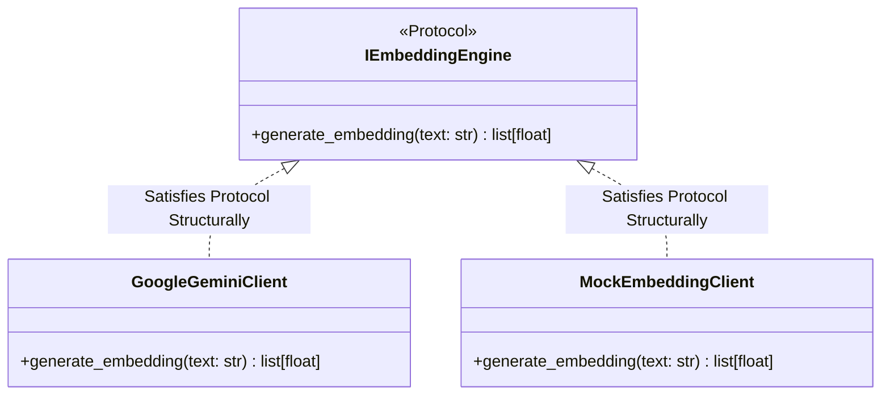

# Module 8: Modern Static Type Hints & Protocols

Welcome to **Module 8** of the Normora Python & AI Masterclass.

Historically, Python was known as a dynamically typed language where types were only verified at runtime. However, in modern enterprise engineering—and especially in **FastAPI** and **Pydantic v2**—type annotations are not optional comments: **they are the executable source code that drives runtime data validation, dependency injection, and automatic OpenAPI documentation**.

In this module, you will master Python's static type system:
* Basic and container type annotations.
* Optional values and Union operators (`|`).
* `Literal` types and Type Aliases.
* Generic types (`TypeVar`, `Generic[T]`) for standard response envelopes.
* Structural Subtyping with **`typing.Protocol`** (Python's compile-time interfaces).

Every concept is followed by **at least 5 real-world Normora examples**.

---

## 1. Basic & Container Type Annotations

In Python 3.9+, you can use standard built-in collections (`list`, `dict`, `tuple`, `set`) directly for type annotations without needing to import `List` or `Dict`.

### 5 Real-World Normora Examples:

#### Example 1.1: Annotating Function Parameters and Return Types
```python
def format_tenant_header(tenant_id: str, is_verified: bool) -> str:
    status = "VERIFIED" if is_verified else "PENDING"
    return f"[{status}] Tenant {tenant_id}"

result: str = format_tenant_header("T-99", True)
print(result)
```

#### Example 1.2: Annotating Document Chunk Lists
```python
def filter_chunks_by_department(chunks: list[dict], target_dept: str) -> list[dict]:
    return [c for c in chunks if c.get("department") == target_dept]

raw_chunks: list[dict] = [
    {"id": "c1", "department": "Legal"},
    {"id": "c2", "department": "Engineering"}
]
legal_chunks: list[dict] = filter_chunks_by_department(raw_chunks, "Legal")
print(legal_chunks)
```

#### Example 1.3: Annotating Vector Embedding Arrays
Vector embeddings for Google Gemini Flash are lists of 768 floating-point numbers:
```python
def cosine_similarity(vector_a: list[float], vector_b: list[float]) -> float:
    dot_product: float = sum(a * b for a, b in zip(vector_a, vector_b))
    return dot_product

score: float = cosine_similarity([0.1, 0.2], [0.1, 0.2])
print(f"Similarity: {score}")
```

#### Example 1.4: Annotating Dictionaries with Typed Keys and Values
```python
# A map of tenant_id (str) to token_count (int):
tenant_token_registry: dict[str, int] = {
    "T-101": 450_000,
    "T-102": 1_200_000
}

def record_tokens(registry: dict[str, int], tenant_id: str, count: int) -> None:
    registry[tenant_id] = registry.get(tenant_id, 0) + count

record_tokens(tenant_token_registry, "T-101", 500)
print(tenant_token_registry["T-101"])  # 450500
```

#### Example 1.5: Fixed-Length Database Tuple Annotations
```python
# Tuple of exactly 3 types: (tenant_id, active_seats, monthly_fee)
tenant_record: tuple[str, int, float] = ("T-88", 25, 375.00)
print(f"Tenant: {tenant_record[0]}, Seats: {tenant_record[1]}, Fee: ${tenant_record[2]}")
```

---

## 2. Optional Values & Union Types (`|`)

In modern Python (3.10+), we use the pipe operator (`|`) for unions instead of importing `Union` or `Optional`.
* `str | None`: Represents a string that can also be `None` (identical to `Optional[str]`).
* `int | float`: Accepts either an integer or a floating-point number.

### 5 Real-World Normora Examples:

#### Example 2.1: Optional Custom Tenant Logo URL
```python
def resolve_branding_logo(custom_logo_url: str | None) -> str:
    if custom_logo_url is not None:
        return custom_logo_url
    return "https://cdn.normora.ai/default-logo.svg"

print(resolve_branding_logo(None))
print(resolve_branding_logo("https://custom.cdn/logo.png"))
```

#### Example 2.2: Numeric Token Cost Supporting `int` or `float`
```python
def apply_credit(balance: int | float, credit_amount: int | float) -> float:
    return float(balance + credit_amount)

print(apply_credit(100, 25.50))  # 125.5
```

#### Example 2.3: Finding a Document by ID (May Return `None`)
```python
def find_document_by_id(doc_id: str) -> dict | None:
    db = {"doc-1": {"title": "Handbook.pdf"}}
    return db.get(doc_id)

found = find_document_by_id("doc-1")
missing = find_document_by_id("doc-999")
print(f"Found: {found is not None}, Missing: {missing is None}")
```

#### Example 2.4: Union of Acceptable Query Input Formats
A RAG search endpoint can receive a plain text string query or a structured filter dictionary:
```python
def dispatch_query(query_input: str | dict[str, str]) -> str:
    if isinstance(query_input, str):
        return f"Searching raw string: '{query_input}'"
    return f"Searching with filters: {query_input.get('text')}"

print(dispatch_query("travel expense limit"))
print(dispatch_query({"text": "travel expense limit", "dept": "Finance"}))
```

#### Example 2.5: Optional Parent Department for Tree Hierarchies
```python
class DepartmentNode:
    def __init__(self, name: str, parent_id: str | None = None):
        self.name: str = name
        self.parent_id: str | None = parent_id

root_dept = DepartmentNode("Global Organization", parent_id=None)
sub_dept = DepartmentNode("Engineering", parent_id="DEPT-ROOT")
print(f"Root parent: {root_dept.parent_id}, Sub parent: {sub_dept.parent_id}")
```

---

## 3. `Literal` Types & Type Aliases

* **`Literal`**: Restricts a variable or parameter to an exact set of allowed literal values (similar to a C# enum).
* **Type Alias**: Gives a descriptive name to a complex type signature.

### 5 Real-World Normora Examples:

#### Example 3.1: Enforcing Normora Subscription Tiers with `Literal`
```python
from typing import Literal

# Type alias:
SubscriptionTier = Literal["Free", "Starter", "Pro", "Enterprise"]

def configure_tier(tier: SubscriptionTier) -> int:
    match tier:
        case "Free": return 5
        case "Starter": return 50
        case "Pro": return 500
        case "Enterprise": return 10_000

print(f"Pro max documents: {configure_tier('Pro')}")
# configure_tier("InvalidTier")  --> MyPy/IDE catches this error instantly!
```

#### Example 3.2: User Roles Access Gate
```python
UserRole = Literal["Owner", "Admin", "Member", "Guest"]

def can_manage_billing(role: UserRole) -> bool:
    return role in ["Owner", "Admin"]

print(f"Can Member manage billing: {can_manage_billing('Member')}")  # False
```

#### Example 3.3: Chat Message Roles
```python
MessageRole = Literal["system", "user", "assistant", "tool"]

def create_message(role: MessageRole, text: str) -> dict:
    return {"role": role, "content": text}

msg = create_message("assistant", "Policy verified.")
print(msg)
```

#### Example 3.4: Embedding Provider Selector
```python
EmbeddingProvider = Literal["google-gemini", "openai"]

def get_dimension(provider: EmbeddingProvider) -> int:
    return 768 if provider == "google-gemini" else 1536

print(f"Gemini dimensions: {get_dimension('google-gemini')}")
```

#### Example 3.5: Type Alias for Vector Embeddings and Chunk IDs
```python
# Create clear, semantic type aliases for the entire codebase:
ChunkId = str
EmbeddingVector = list[float]
VectorRegistry = dict[ChunkId, EmbeddingVector]

vectors: VectorRegistry = {
    "chk-1": [0.12, -0.44, 0.88],
    "chk-2": [0.05, 0.91, -0.12]
}
print(f"Loaded {len(vectors)} embedding vectors.")
```

---

## 4. Generic Types (`TypeVar`, `Generic[T]`)

In C#, you write generic classes like `ApiResponse<T>`.  
In Python, we use **`typing.TypeVar`** and **`typing.Generic`** to create reusable, type-safe data containers.

### 5 Real-World Normora Examples:

#### Example 4.1: The Standard Normora `ApiResponse[T]` Envelope
Every API endpoint in Normora returns a consistent envelope containing data of type `T`:
```python
from typing import TypeVar, Generic

T = TypeVar("T")

class ApiResponse(Generic[T]):
    def __init__(self, success: bool, data: T | None = None, error: str | None = None):
        self.success: bool = success
        self.data: T | None = data
        self.error: str | None = error

# Specialized with Tenant dictionary:
response_tenant: ApiResponse[dict] = ApiResponse(success=True, data={"tenant_id": "T-10"})
print(f"Success: {response_tenant.success}, Data: {response_tenant.data}")

# Specialized with an integer token count:
response_tokens: ApiResponse[int] = ApiResponse(success=True, data=45000)
print(f"Tokens: {response_tokens.data}")
```

#### Example 4.2: Generic Paginated Result List (`PagedList[T]`)
```python
class PagedList(Generic[T]):
    def __init__(self, items: list[T], page: int, page_size: int, total_count: int):
        self.items: list[T] = items
        self.page: int = page
        self.page_size: int = page_size
        self.total_count: int = total_count

paged_docs: PagedList[str] = PagedList(
    items=["Handbook.pdf", "Security.pdf"],
    page=1,
    page_size=10,
    total_count=42
)
print(f"Page {paged_docs.page}: {len(paged_docs.items)} of {paged_docs.total_count} documents.")
```

#### Example 4.3: Generic In-Memory Cache Store
```python
class CacheStore(Generic[T]):
    def __init__(self):
        self._store: dict[str, T] = {}

    def set(self, key: str, value: T) -> None:
        self._store[key] = value

    def get(self, key: str) -> T | None:
        return self._store.get(key)

# A cache specifically for strings:
prompt_cache: CacheStore[str] = CacheStore[str]()
prompt_cache.set("system_prompt", "You are Normora AI.")
print(prompt_cache.get("system_prompt"))
```

#### Example 4.4: Generic Search Candidate Wrapper
```python
class SearchCandidate(Generic[T]):
    def __init__(self, item: T, score: float):
        self.item: T = item
        self.score: float = score

candidate: SearchCandidate[dict] = SearchCandidate({"title": "Policy.pdf"}, 0.94)
print(f"Candidate: {candidate.item['title']} (Score: {candidate.score})")
```

#### Example 4.5: Generic Repository Protocol Return Types
```python
def fetch_first_or_none(items: list[T]) -> T | None:
    return items[0] if items else None

first_score: float | None = fetch_first_or_none([0.98, 0.85, 0.72])
print(f"Top score: {first_score}")
```

---

## 5. Structural Subtyping: `typing.Protocol` (Python Interfaces)

In C# or Java, polymorphism requires **Nominal Subtyping**—a class must explicitly declare that it implements an interface (`class GeminiClient : IEmbeddingEngine`).

In Python, we use **Structural Subtyping** (Duck Typing with compiler safety) via **`typing.Protocol`**.  
If a class implements the methods defined in a `Protocol`, it automatically satisfies the interface **without needing to inherit from it!**



### 5 Real-World Normora Examples:

#### Example 5.1: The `EmbeddingEngine` Protocol
```python
from typing import Protocol

class EmbeddingEngine(Protocol):
    """Interface for any vector embedding service."""
    def generate_embedding(self, text: str) -> list[float]:
        ...

# Production Gemini implementation (Notice: No inheritance!):
class GeminiEmbeddingService:
    def generate_embedding(self, text: str) -> list[float]:
        print(f"Calling Google Gemini API for: '{text[:20]}...'")
        return [0.12] * 768

# Test/Mock implementation:
class MockEmbeddingService:
    def generate_embedding(self, text: str) -> list[float]:
        return [0.0] * 768

# Function depends strictly on the Protocol:
def index_text_chunk(engine: EmbeddingEngine, text: str) -> list[float]:
    return engine.generate_embedding(text)

gemini = GeminiEmbeddingService()
vector = index_text_chunk(gemini, "Normora Security Rules")
print(f"Generated vector length: {len(vector)}")
```

#### Example 5.2: The `TenantStorageBackend` Protocol
```python
class StorageBackend(Protocol):
    def upload(self, tenant_id: str, filename: str, data: bytes) -> str:
        ...

class MinioStorage:
    def upload(self, tenant_id: str, filename: str, data: bytes) -> str:
        return f"s3://normora-vault/{tenant_id}/{filename}"

class AzureBlobStorage:
    def upload(self, tenant_id: str, filename: str, data: bytes) -> str:
        return f"https://normora.blob.core.windows.net/{tenant_id}/{filename}"

def persist_document(storage: StorageBackend, tenant_id: str, name: str, data: bytes) -> str:
    return storage.upload(tenant_id, name, data)

uri = persist_document(MinioStorage(), "T-10", "Handbook.pdf", b"PDF_BYTES")
print(f"Document stored at: {uri}")
```

#### Example 5.3: The `TenantResolutionContext` Protocol
```python
class TenantContext(Protocol):
    @property
    def tenant_id(self) -> str:
        ...

class RequestTenantContext:
    def __init__(self, tenant_id: str):
        self._tenant_id = tenant_id

    @property
    def tenant_id(self) -> str:
        return self._tenant_id

def log_tenant_action(ctx: TenantContext, action: str):
    print(f"AUDIT LOG: [Tenant: {ctx.tenant_id}] -> {action}")

ctx = RequestTenantContext("TENANT-ALPHA")
log_tenant_action(ctx, "QUERY_RAG_DOCUMENT")
```

#### Example 5.4: The `AiToolExecutable` Protocol
```python
class AiTool(Protocol):
    @property
    def name(self) -> str:
        ...
    def execute(self, **kwargs) -> dict:
        ...

class SearchTool:
    name: str = "search_company_documents"
    def execute(self, **kwargs) -> dict:
        return {"matches": ["Policy A"]}

def run_tool(tool: AiTool, **params) -> dict:
    print(f"Executing tool: {tool.name}")
    return tool.execute(**params)

print(run_tool(SearchTool(), query="vacation"))
```

#### Example 5.5: The `NotificationSender` Protocol
```python
class NotificationSender(Protocol):
    def send(self, recipient_email: str, message: str) -> bool:
        ...

class EmailService:
    def send(self, recipient_email: str, message: str) -> bool:
        print(f"Email sent to {recipient_email}: {message}")
        return True

def notify_admin(notifier: NotificationSender, email: str, msg: str):
    notifier.send(email, msg)

notify_admin(EmailService(), "admin@normora.ai", "Quota warning: 90% reached.")
```

---

## Summary & Next Step

You have mastered:
1. Primitive and container annotations (`list[T]`, `dict[K, V]`, `tuple[T1, T2]`).
2. Optional values and Union operators (`str | None`, `int | float`).
3. `Literal` types for domain constraints and type aliases for readable code.
4. Generic types (`TypeVar`, `Generic[T]`) for reusable response wrappers.
5. Structural subtyping using **`typing.Protocol`** to build decoupled, testable interfaces.

In **Module 9**, we will explore **Decorators, Context Managers & Special Dunder Methods**!
