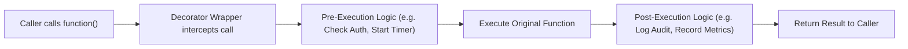

# Module 9: Decorators, Context Managers & Dunder Methods

Welcome to **Module 9** of the Normora Python & AI Masterclass.

In this module, we step into intermediate-to-advanced Python engineering. You will learn the mechanics behind three patterns that drive frameworks like FastAPI, SQLAlchemy, and Pydantic:
1. **Dunder (Double Underscore) Methods:** Customizing how your objects interact with Python's built-in operators.
2. **Decorators:** Metaprogramming constructs that wrap and intercept function execution (used for route registration, auth guards, execution timing, and error handling).
3. **Context Managers (`with` blocks):** Managing resource lifecycles (database transactions, temporary scoped tenant states, and socket connections).

Every concept is followed by **at least 5 real-world Normora examples**.

---

## 1. Special "Dunder" Methods (The Python Data Model)

"Dunder" methods (`__init__`, `__repr__`, `__str__`, `__eq__`, `__len__`, `__getitem__`) allow your custom classes to integrate seamlessly with Python's core syntax and operators.

### 5 Real-World Normora Examples:

#### Example 1.1: `__str__` and `__repr__` for `Tenant` Domain Model
* `__str__`: User-friendly string representation (used by `print()`).
* `__repr__`: Unambiguous developer/debugging representation.
```python
class Tenant:
    def __init__(self, tenant_id: str, name: str, plan: str):
        self.tenant_id = tenant_id
        self.name = name
        self.plan = plan

    def __str__(self) -> str:
        return f"{self.name} ({self.plan} Tier)"

    def __repr__(self) -> str:
        return f"Tenant(tenant_id='{self.tenant_id}', name='{self.name}', plan='{self.plan}')"

tenant = Tenant("T-10", "Normora Health", "Enterprise")
print(str(tenant))   # "Normora Health (Enterprise Tier)"
print(repr(tenant))  # "Tenant(tenant_id='T-10', name='Normora Health', plan='Enterprise')"
```

#### Example 1.2: `__eq__` for Comparing `DocumentChunk` Objects
Define when two document chunks are considered equal (matching chunk ID and tenant ID):
```python
class DocumentChunk:
    def __init__(self, chunk_id: str, tenant_id: str, content: str):
        self.chunk_id = chunk_id
        self.tenant_id = tenant_id
        self.content = content

    def __eq__(self, other: object) -> bool:
        if not isinstance(other, DocumentChunk):
            return False
        return self.chunk_id == other.chunk_id and self.tenant_id == other.tenant_id

c1 = DocumentChunk("chk-1", "T-1", "Security rule.")
c2 = DocumentChunk("chk-1", "T-1", "Security rule updated.")
c3 = DocumentChunk("chk-2", "T-1", "Password rule.")

print(c1 == c2)  # True (Same chunk_id and tenant_id)
print(c1 == c3)  # False
```

#### Example 1.3: `__len__` for a `ConversationThread` Collection
Allows using the built-in `len()` function directly on your custom class:
```python
class ConversationThread:
    def __init__(self, session_id: str):
        self.session_id = session_id
        self.messages: list[dict] = []

    def add_message(self, role: str, text: str):
        self.messages.append({"role": role, "content": text})

    def __len__(self) -> int:
        return len(self.messages)

thread = ConversationThread("sess-99")
thread.add_message("user", "Hello")
thread.add_message("assistant", "Hi, how can I help you?")

print(f"Total turns in thread: {len(thread)}")  # 2
```

#### Example 1.4: `__getitem__` for Subscripting Chunks by Index (`thread[0]`)
Enables square-bracket indexing directly on your class:
```python
class ChunkBatch:
    def __init__(self, chunks: list[str]):
        self._chunks = chunks

    def __getitem__(self, index: int) -> str:
        return self._chunks[index]

batch = ChunkBatch(["Chunk A: Intro", "Chunk B: Architecture", "Chunk C: Citations"])
print(batch[0])   # "Chunk A: Intro"
print(batch[-1])  # "Chunk C: Citations"
```

#### Example 1.5: `__call__` to Make Class Instances Callable Like Functions
Implementing `__call__` turns an instance into a callable object:
```python
class TokenCostEstimator:
    def __init__(self, price_per_1k: float):
        self.price_per_1k = price_per_1k

    def __call__(self, token_count: int) -> float:
        return (token_count / 1000) * self.price_per_1k

# Instantiate estimator:
estimate_gemini_cost = TokenCostEstimator(price_per_1k=0.002)

# Call the instance directly:
cost = estimate_gemini_cost(50_000)
print(f"Cost for 50k tokens: ${cost:.2f}")  # $0.10
```

---

## 2. Decorators Demystified

A **Decorator** is a function that takes another function as an argument, extends its behavior, and returns a modified function.

To preserve the original function's name and docstring, always use **`@functools.wraps`**.



### 5 Real-World Normora Examples:

#### Example 2.1: Execution Timing Decorator for Gemini API Latency
```python
import time
import functools

def measure_latency(func):
    @functools.wraps(func)
    def wrapper(*args, **kwargs):
        start_time = time.time()
        result = func(*args, **kwargs)
        duration = time.time() - start_time
        print(f"[METRIC] '{func.__name__}' executed in {duration:.4f} seconds")
        return result
    return wrapper

@measure_latency
def call_gemini_flash(prompt: str) -> str:
    time.sleep(0.05)  # Simulate network latency
    return "AI completion response text."

response = call_gemini_flash("Explain Normora security architecture.")
```

#### Example 2.2: Audit Logging Decorator for Tenant Operations
```python
def audit_log(func):
    @functools.wraps(func)
    def wrapper(*args, **kwargs):
        print(f"[AUDIT LOG] Invoking operation: '{func.__name__}' with kwargs={kwargs}")
        result = func(*args, **kwargs)
        print(f"[AUDIT LOG] '{func.__name__}' completed successfully.")
        return result
    return wrapper

@audit_log
def update_tenant_tier(tenant_id: str, new_tier: str):
    print(f"Upgrading tenant {tenant_id} to {new_tier} in database.")

update_tenant_tier(tenant_id="T-402", new_tier="Enterprise")
```

#### Example 2.3: Parameterized Decorator: Role-Based Access Control (RBAC)
When a decorator takes arguments (e.g. `@require_role("Admin")`), we add one more layer of wrapping:
```python
def require_role(required_role: str):
    def decorator(func):
        @functools.wraps(func)
        def wrapper(user_role: str, *args, **kwargs):
            if user_role != required_role:
                print(f"403 Forbidden: Operation '{func.__name__}' requires '{required_role}' (Caller has '{user_role}').")
                return None
            return func(user_role, *args, **kwargs)
        return wrapper
    return decorator

@require_role("Admin")
def delete_document(user_role: str, document_id: str):
    print(f"Document '{document_id}' successfully deleted by Admin.")

delete_document("Member", "doc-101")  # Denied!
delete_document("Admin", "doc-101")   # Authorized!
```

#### Example 2.4: Retry Decorator for Transient Network Failures
```python
def retry_transient_failure(max_retries: int = 3):
    def decorator(func):
        @functools.wraps(func)
        def wrapper(*args, **kwargs):
            for attempt in range(1, max_retries + 1):
                try:
                    return func(*args, **kwargs)
                except ConnectionError as err:
                    print(f"Attempt {attempt} failed: {err}")
                    if attempt == max_retries:
                        print("Max retries exceeded. Raising exception.")
                        raise
            return None
        return wrapper
    return decorator

@retry_transient_failure(max_retries=2)
def fetch_remote_embeddings():
    raise ConnectionError("Timeout connecting to embedding host.")

try:
    fetch_remote_embeddings()
except ConnectionError:
    print("Caught final retry failure.")
```

#### Example 2.5: In-Memory Caching Decorator for RAG Queries
```python
def memoize_rag_query(func):
    cache: dict[str, str] = {}

    @functools.wraps(func)
    def wrapper(query: str):
        if query in cache:
            print(f"[CACHE HIT] Returning saved answer for: '{query}'")
            return cache[query]
        print(f"[CACHE MISS] Calling LLM for query: '{query}'")
        result = func(query)
        cache[query] = result
        return result
    return wrapper

@memoize_rag_query
def ask_policy_bot(query: str) -> str:
    return f"Official answer for {query}"

ask_policy_bot("vacation days")  # Cache Miss
ask_policy_bot("vacation days")  # Cache Hit!
```

---

## 3. Context Managers from Scratch (`__enter__` and `__exit__`)

A **Context Manager** manages setup and teardown logic using the `with` statement.
* `__enter__(self)`: Executes before the `with` block starts. Its return value is bound to the `as` variable.
* `__exit__(self, exc_type, exc_val, exc_tb)`: Executes when the `with` block exits (even if an exception was raised!).

### 5 Real-World Normora Examples:

#### Example 3.1: Scoped Tenant Context Boundary
Ensures that all operations inside the block are executed within a specific tenant context, and automatically resets when leaving the block:
```python
class AmbientTenantContext:
    current_tenant_id: str | None = None

    def __init__(self, tenant_id: str):
        self.tenant_id = tenant_id
        self.previous_tenant_id = None

    def __enter__(self):
        self.previous_tenant_id = AmbientTenantContext.current_tenant_id
        AmbientTenantContext.current_tenant_id = self.tenant_id
        print(f"--> [ENTER] Activated Tenant Context: '{self.tenant_id}'")
        return self

    def __exit__(self, exc_type, exc_val, exc_tb):
        AmbientTenantContext.current_tenant_id = self.previous_tenant_id
        print(f"<-- [EXIT] Restored Tenant Context to: '{self.previous_tenant_id}'")
        return False  # Do not suppress exceptions

# Usage:
with AmbientTenantContext("TENANT-ACME"):
    print(f"Inside block active tenant: {AmbientTenantContext.current_tenant_id}")

print(f"Outside block active tenant: {AmbientTenantContext.current_tenant_id}")
```

#### Example 3.2: Database Transaction Unit of Work Simulation
Rollback automatically if an error occurs inside the block:
```python
class DatabaseTransaction:
    def __enter__(self):
        print("BEGIN TRANSACTION;")
        return self

    def __exit__(self, exc_type, exc_val, exc_tb):
        if exc_type is not None:
            print(f"ROLLBACK TRANSACTION; (Reason: {exc_val})")
            return False  # Propagate exception
        print("COMMIT TRANSACTION;")
        return True

# Successful transaction:
with DatabaseTransaction():
    print("INSERT INTO documents (title) VALUES ('Handbook.pdf');")

print("-" * 40)

# Failed transaction:
try:
    with DatabaseTransaction():
        print("INSERT INTO documents (title) VALUES ('Corrupted.pdf');")
        raise ValueError("Invalid document checksum!")
except ValueError:
    print("Caught transaction rollback.")
```

#### Example 3.3: Execution Timer as a Context Manager
```python
class CodeProfiler:
    def __init__(self, task_name: str):
        self.task_name = task_name

    def __enter__(self):
        self.start = time.time()
        return self

    def __exit__(self, exc_type, exc_val, exc_tb):
        elapsed = time.time() - self.start
        print(f"[PROFILER] Task '{self.task_name}' took {elapsed:.4f}s")

with CodeProfiler("Vector Similarity Index Search"):
    time.sleep(0.02)  # Simulating search work
```

#### Example 3.4: The `@contextmanager` Decorator (`contextlib`)
Instead of writing a full class with `__enter__` and `__exit__`, you can use Python's built-in `@contextmanager` generator:
```python
from contextlib import contextmanager

@contextmanager
def temporary_token_boost(tenant_id: str, extra_tokens: int):
    print(f"Granting temporary boost of {extra_tokens:,} tokens to {tenant_id}...")
    try:
        # yield gives control back to the 'with' block:
        yield extra_tokens
    finally:
        # Cleanup code runs when the block finishes:
        print(f"Revoking temporary token boost for {tenant_id}.")

with temporary_token_boost("T-101", 500_000) as boost:
    print(f"Executing batch document ingestion with +{boost:,} bonus tokens.")
```

#### Example 3.5: Temporary File Cleanup Manager
Creates a temporary file and guarantees it is deleted from disk when done:
```python
import os

@contextmanager
def temp_extracted_file(filename: str, content: str):
    with open(filename, "w", encoding="utf-8") as f:
        f.write(content)
    try:
        yield filename
    finally:
        if os.path.exists(filename):
            os.remove(filename)
            print(f"Temporary file '{filename}' safely deleted.")

with temp_extracted_file("temp_page_1.txt", "Page 1 raw OCR text...") as path:
    print(f"Processing temporary file: {path}")
```

---

## Summary & Next Step

You have mastered:
1. Customizing object behaviors with special dunder methods (`__str__`, `__repr__`, `__eq__`, `__len__`, `__call__`).
2. Authoring function decorators, parameterized RBAC decorators, and timing hooks.
3. Building robust Context Managers using class-based `__enter__`/`__exit__` and `@contextlib.contextmanager`.

In **Module 10**, we step into the true engine of FastAPI: **Asynchronous Python (`async` / `await` and the Asyncio Event Loop)**!
