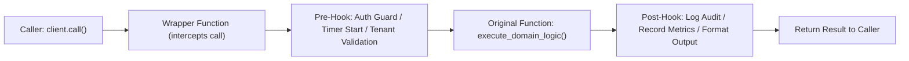
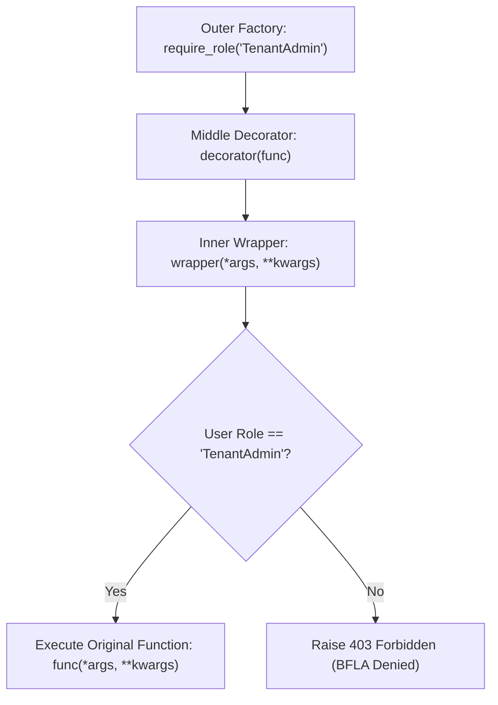
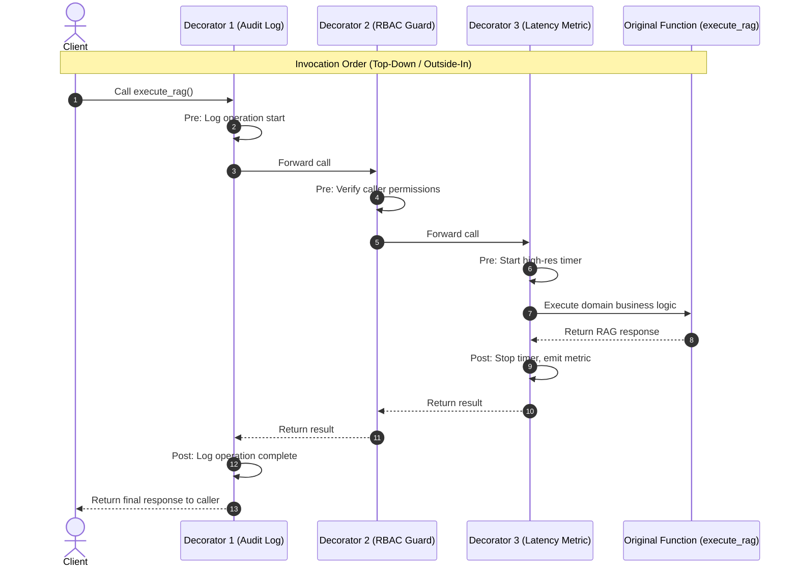
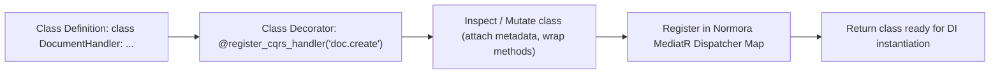
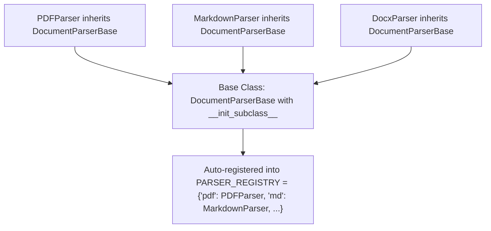
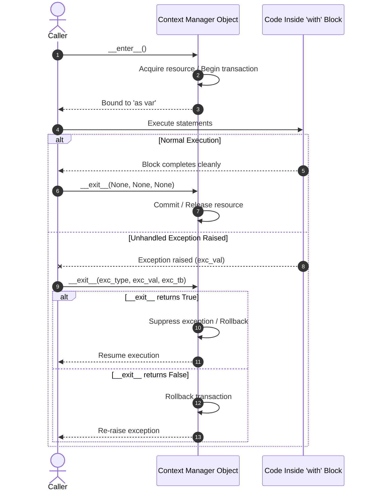
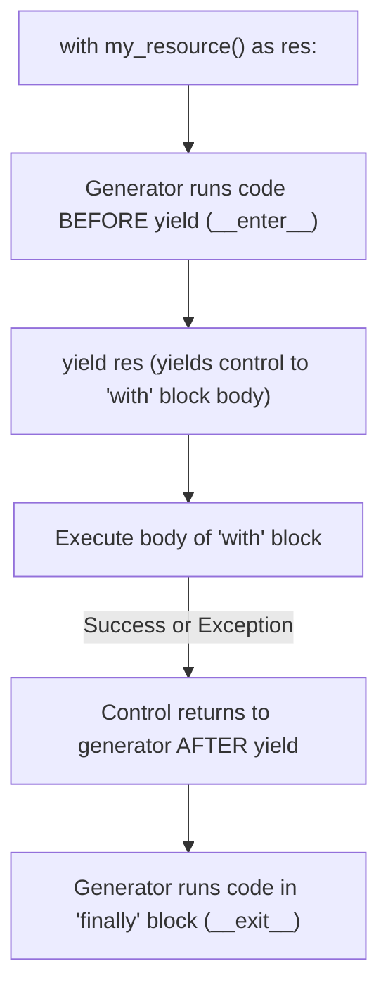
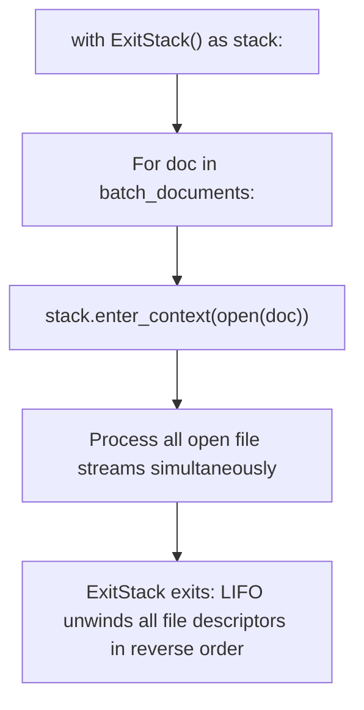

# Module 9: Decorators, Context Managers & Metaprogramming

Welcome to **Module 9** of the Normora Python & AI Masterclass. 

As a .NET architect, you are familiar with compile-time metaprogramming using C# Attributes (`[Authorize]`, `[HttpGet]`), Roslyn Source Generators, MediatR Pipeline Behaviors (`IPipelineBehavior<TRequest, TResponse>`), ASP.NET Core Middleware pipelines, and deterministic resource disposal with `IDisposable` / `using` statements.

In Python, the equivalent patterns are **Decorators**, **Context Managers**, and **Dunder Protocols**. However, because Python is dynamic and treats functions and classes as first-class runtime objects, these mechanisms do not rely on reflection or ahead-of-time code generation. Instead, they operate through dynamic function wrapping, closure encapsulation, runtime class modification, and context protocol hooks.

This module deconstructs these patterns from absolute scratch, comparing them directly to .NET equivalents and demonstrating their direct application across the **Normora** multi-tenant conversational AI architecture (Tenants, Documents, pgvector embeddings, Keycloak OIDC, MinIO storage, and Google Gemini Flash RAG pipelines).

---

## Architecture Alignment: Python vs .NET

| Concept | C# / .NET 10 | Python 3.12+ | Purpose in Normora |
| :--- | :--- | :--- | :--- |
| **Cross-Cutting Concerns** | Attributes (`[Authorize]`, `[HttpGet]`) + Action Filters | Function Decorators (`@require_role`, `@app.get`) | Route registration, BFLA RBAC authorization, telemetry |
| **Pipeline Interception** | MediatR `IPipelineBehavior<TRequest, TResponse>` | Stacked Decorators (`@audit`, `@latency`, `@retry`) | Wrapping CQRS commands/queries with logging, timing, transactions |
| **Deterministic Teardown** | `using (var s = new Stream())` (`IDisposable`) | `with open(...) as s:` (`__enter__` / `__exit__`) | Scoping tenant contexts, DB transactions, temporary files |
| **Async Resource Cleanup** | `await using (var client = new HttpClient())` (`IAsyncDisposable`) | `async with get_session() as s:` (`__aenter__` / `__aexit__`) | Async pgvector sessions, Gemini Flash streaming connections |
| **Dynamic Resource Stacks** | `CompositeDisposable` / manual collection disposal | `contextlib.ExitStack` / `AsyncExitStack` | Coordinating dynamic batch file streams and multi-tenant locks |
| **In-Memory Memoization** | `IMemoryCache` / Redis cache layer | `functools.lru_cache` / `functools.cache` | Caching OIDC JWKS public keys, tenant tier configs |
| **Subclass Metaprogramming** | Roslyn Analyzers, Abstract Base Classes, Reflection Assembly Scanning | `__init_subclass__` class hooks | Auto-registering document parsers, agent tools, CQRS handlers |
| **Class Augmentation** | PostSharp / Castle DynamicProxy / Source Generators | Class Decorators (`@register_cqrs_handler`) | Enriching domain entity classes with metadata and trace hooks |

---

## 1. Special "Dunder" Methods (The Python Data Model)

In C#, your objects inherit from `System.Object` and you override virtual methods like `ToString()`, `Equals()`, and `GetHashCode()`, or implement standard interfaces such as `IComparable<T>`, `IEnumerable<T>`, or `IDisposable`.

In Python, the language does not use nominal interfaces. Instead, Python uses the **Data Model**—a set of special method names surrounded by double underscores (colloquially called **"dunder" methods**). When you implement a dunder method on a class, Python's built-in operators and syntax invoke it automatically. This is Python's formal realization of **Duck Typing** ("protocols").

### Core Dunder Methods Reference
* `__init__(self, ...)`: Constructor / initializer (analogous to C# constructor).
* `__str__(self)`: Human-readable string representation (used by `print()`, `str()`).
* `__repr__(self)`: Unambiguous developer/debugging string representation (used by debuggers and REPLs).
* `__eq__(self, other)`: Equality operator (`==`). Analogous to `IEquatable<T>.Equals`.
* `__hash__(self)`: Generates integer hash for dictionary keys and set members. Analogous to `GetHashCode()`.
* `__len__(self)`: Collection length (`len(obj)`). Analogous to `ICollection.Count`.
* `__getitem__(self, key)`: Indexer/subscript syntax (`obj[key]`). Analogous to C# indexer `this[int index]`.
* `__contains__(self, item)`: Membership test (`item in obj`). Analogous to `Contains()`.
* `__call__(self, *args, **kwargs)`: Makes an instance callable like a function (invoked via `instance()`). Analogous to a C# delegate or `Invoke()`.

### 5 Real-World Normora Examples

#### Example 1.1: `__str__` and `__repr__` for `Tenant` Domain Model
In Normora, developers need clean debugging output in OpenTelemetry logs (`repr`), while end users require friendly tenant labels (`str`).
```python
class Tenant:
    def __init__(self, tenant_id: str, name: str, plan: str):
        self.tenant_id = tenant_id
        self.name = name
        self.plan = plan

    def __str__(self) -> str:
        """User-friendly display format."""
        return f"{self.name} ({self.plan} Tier)"

    def __repr__(self) -> str:
        """Unambiguous debugging representation that reconstructs the instance."""
        return f"Tenant(tenant_id='{self.tenant_id}', name='{self.name}', plan='{self.plan}')"

tenant = Tenant("T-10", "Normora Health", "Enterprise")
print(str(tenant))   # "Normora Health (Enterprise Tier)"
print(repr(tenant))  # "Tenant(tenant_id='T-10', name='Normora Health', plan='Enterprise')"
```

#### Example 1.2: `__eq__` and `__hash__` for Value-Object Deduplication in `DocumentChunk`
When performing hybrid search in Normora, chunks retrieved from PostgreSQL full-text search and pgvector HNSW index must be deduplicated using Python `set` collections. A class must define both `__eq__` and `__hash__` to be stored in sets or used as dictionary keys.
```python
class DocumentChunk:
    def __init__(self, chunk_id: str, tenant_id: str, content: str, score: float = 0.0):
        self.chunk_id = chunk_id
        self.tenant_id = tenant_id
        self.content = content
        self.score = score

    def __eq__(self, other: object) -> bool:
        if not isinstance(other, DocumentChunk):
            return False
        # Chunks are equal if they belong to the same tenant and share the same chunk_id
        return (self.chunk_id, self.tenant_id) == (other.chunk_id, other.tenant_id)

    def __hash__(self) -> int:
        # Combined hash matches the equality tuple
        return hash((self.chunk_id, self.tenant_id))

chunk_a = DocumentChunk("chk-100", "T-1", "HIPAA Compliance Policy", score=0.92)
chunk_b = DocumentChunk("chk-100", "T-1", "HIPAA Compliance Policy (Updated)", score=0.88)
chunk_c = DocumentChunk("chk-200", "T-1", "Password Complexity Policy", score=0.75)

# Deduplication in a Python set works because of __eq__ and __hash__:
unique_chunks = {chunk_a, chunk_b, chunk_c}
print(f"Unique chunks count: {len(unique_chunks)}")  # 2 (chunk_b merged with chunk_a)
```

#### Example 1.3: `__len__` and `__bool__` for `ConversationThread` State
Python uses `__bool__` to evaluate truthiness in `if thread:` checks. If `__bool__` is not defined, Python falls back to `__len__() != 0`.
```python
class ConversationThread:
    def __init__(self, session_id: str, tenant_id: str):
        self.session_id = session_id
        self.tenant_id = tenant_id
        self.messages: list[dict[str, str]] = []

    def add_message(self, role: str, content: str) -> None:
        self.messages.append({"role": role, "content": content})

    def __len__(self) -> int:
        return len(self.messages)

    def __bool__(self) -> bool:
        """Thread evaluates to True only if it contains messages."""
        return len(self.messages) > 0

thread = ConversationThread("sess-404", "T-Enterprise")
if not thread:
    print("Thread is currently empty. Prompting user for first query.")

thread.add_message("user", "Explain BOLA protection in Normora.")
if thread:
    print(f"Thread active with {len(thread)} turns.")  # 1 turn
```

#### Example 1.4: `__getitem__` and `__contains__` for `CitationCatalog`
Enables square-bracket indexing (`catalog["cite-1"]`) and membership testing (`"cite-1" in catalog`) directly on domain collections.
```python
class CitationCatalog:
    def __init__(self):
        self._citations: dict[str, dict[str, str]] = {}

    def register(self, citation_id: str, source_doc: str, snippet: str) -> None:
        self._citations[citation_id] = {"source": source_doc, "snippet": snippet}

    def __getitem__(self, citation_id: str) -> dict[str, str]:
        if citation_id not in self._citations:
            raise KeyError(f"Citation '{citation_id}' not found in active catalog.")
        return self._citations[citation_id]

    def __contains__(self, citation_id: str) -> bool:
        return citation_id in self._citations

catalog = CitationCatalog()
catalog.register("cit-1", "Security_Architecture.pdf", "BOLA returns 404 to block enumeration.")

print("cit-1" in catalog)                 # True
print(catalog["cit-1"]["source"])        # "Security_Architecture.pdf"
```

#### Example 1.5: `__call__` for Callable Service Instances (`GeminiCostEstimator`)
Implementing `__call__` allows an instance to be passed wherever a callable (such as a standard function) is expected, encapsulating configurable state inside an object.
```python
class GeminiCostEstimator:
    def __init__(self, model_name: str, input_cost_per_1m: float, output_cost_per_1m: float):
        self.model_name = model_name
        self.input_cost_per_1m = input_cost_per_1m
        self.output_cost_per_1m = output_cost_per_1m

    def __call__(self, input_tokens: int, output_tokens: int) -> float:
        input_total = (input_tokens / 1_000_000) * self.input_cost_per_1m
        output_total = (output_tokens / 1_000_000) * self.output_cost_per_1m
        return round(input_total + output_total, 6)

# Instantiate the estimator once with model pricing (e.g. Gemini 1.5 Flash):
estimate_flash_cost = GeminiCostEstimator(
    model_name="gemini-1.5-flash",
    input_cost_per_1m=0.075,
    output_cost_per_1m=0.30
)

# Call the instance directly like a regular Python function:
query_cost = estimate_flash_cost(input_tokens=125_000, output_tokens=1_200)
print(f"Total query cost: ${query_cost:.6f}")  # $0.009735
```

---

## 2. Function Decorators from Absolute Scratch

In Python, **functions are first-class citizens**. This means:
1. Functions can be assigned to variables.
2. Functions can be passed as arguments to other functions.
3. Functions can be defined inside other functions (closures).
4. Functions can return other functions.

A **Decorator** is simply a callable that takes a function as an argument, wraps it with additional behavior (pre-processing, interception, post-processing), and returns the wrapped function.

### The `@` Syntactic Sugar
Writing:
```python
@my_decorator
def calculate_hash(data: str) -> str:
    ...
```
is byte-for-byte identical to:
```python
def calculate_hash(data: str) -> str:
    ...
calculate_hash = my_decorator(calculate_hash)
```

### The Role of `functools.wraps`
When a decorator replaces the original function with an inner wrapper function, metadata like `__name__`, `__doc__`, and type annotations (`__annotations__`) are lost. The wrapper takes on the name `"wrapper"`.

This breaks FastAPI route introspection, Swagger documentation, and logging. `@functools.wraps(func)` copies all original metadata from `func` onto the inner wrapper.



### 5 Real-World Normora Examples

#### Example 2.1: Execution Timing & Latency Telemetry for Gemini Flash API
Measures call duration and emits OpenTelemetry-compliant metrics.
```python
import time
import functools
from typing import Callable, Any

def measure_gemini_latency(func: Callable[..., Any]) -> Callable[..., Any]:
    @functools.wraps(func)
    def wrapper(*args: Any, **kwargs: Any) -> Any:
        start_time = time.perf_counter()
        result = func(*args, **kwargs)
        elapsed = time.perf_counter() - start_time
        print(f"[METRIC] '{func.__name__}' duration: {elapsed * 1000:.2f}ms")
        return result
    return wrapper

@measure_gemini_latency
def call_gemini_flash(prompt: str, tenant_id: str) -> str:
    # Simulated HTTP call to Gemini Flash
    time.sleep(0.045)
    return f"Synthesized answer for tenant {tenant_id}"

response = call_gemini_flash("Summarize privacy policy", "T-Alpha")
```

#### Example 2.2: Centralized Audit Logging for Tenant Administration
Records who invoked an administrative action, the parameters, and whether it succeeded.
```python
import functools
from typing import Callable, Any

def audit_tenant_operation(func: Callable[..., Any]) -> Callable[..., Any]:
    @functools.wraps(func)
    def wrapper(*args: Any, **kwargs: Any) -> Any:
        tenant_id = kwargs.get("tenant_id") or (args[0] if args else "UNKNOWN")
        print(f"[AUDIT] Starting operation '{func.__name__}' for Tenant: {tenant_id}")
        try:
            result = func(*args, **kwargs)
            print(f"[AUDIT] Succeeded '{func.__name__}' for Tenant: {tenant_id}")
            return result
        except Exception as ex:
            print(f"[AUDIT ERROR] Failed '{func.__name__}' for Tenant: {tenant_id}. Reason: {ex}")
            raise
    return wrapper

@audit_tenant_operation
def update_tenant_storage_quota(tenant_id: str, quota_gb: int) -> bool:
    print(f"Persisting {quota_gb} GB quota for tenant {tenant_id} to PostgreSQL.")
    return True

update_tenant_storage_quota(tenant_id="T-402", quota_gb=500)
```

#### Example 2.3: Security BOLA Shield (Masking Errors to 404)
In Normora, Broken Object Level Authorization (BOLA) attempts must return `404 Not Found` rather than `403 Forbidden` to prevent malicious actors from enumerating valid document IDs across tenants.
```python
import functools
from typing import Callable, Any

class ResourceNotFoundError(Exception):
    pass

class UnauthorizedAccessError(Exception):
    pass

def bola_protection_shield(func: Callable[..., Any]) -> Callable[..., Any]:
    """Intercepts unauthorized tenant access and transforms it into 404 Not Found."""
    @functools.wraps(func)
    def wrapper(*args: Any, **kwargs: Any) -> Any:
        try:
            return func(*args, **kwargs)
        except UnauthorizedAccessError:
            # Mask the BOLA violation as a 404 to prevent resource enumeration
            raise ResourceNotFoundError("Resource does not exist or has been deleted.")
    return wrapper

@bola_protection_shield
def fetch_document_content(tenant_id: str, document_id: str) -> str:
    if tenant_id != "T-Enterprise" and document_id == "doc-secret-99":
        raise UnauthorizedAccessError("Tenant cannot access this document!")
    return "Confidential RAG Document Content"

try:
    fetch_document_content("T-Malicious", "doc-secret-99")
except ResourceNotFoundError as ex:
    print(f"Client received response: {ex}")  # Masked as 404!
```

#### Example 2.4: Ambient Tenant Context Verification
Validates that an active tenant ID is present on the incoming request before executing tenant-scoped operations.
```python
import functools
from typing import Callable, Any

def require_active_tenant(func: Callable[..., Any]) -> Callable[..., Any]:
    @functools.wraps(func)
    def wrapper(tenant_id: str | None, *args: Any, **kwargs: Any) -> Any:
        if not tenant_id or not tenant_id.strip():
            raise ValueError("BFLA Violation: Tenant identifier is missing from ambient context.")
        return func(tenant_id, *args, **kwargs)
    return wrapper

@require_active_tenant
def purge_vector_embeddings(tenant_id: str, document_id: str) -> None:
    print(f"Purging pgvector HNSW embeddings for doc '{document_id}' under tenant '{tenant_id}'.")

purge_vector_embeddings("T-10", "doc-88")
```

#### Example 2.5: Circuit Breaker Feature Flag Guard
Conditionally enables or disables advanced RAG features (such as experimental tool execution) without altering the inner handler logic.
```python
import functools
from typing import Callable, Any

ACTIVE_FEATURE_FLAGS = {"citations_v2": True, "agent_tool_exec": False}

def feature_flag_gate(flag_name: str) -> Callable:
    def decorator(func: Callable[..., Any]) -> Callable[..., Any]:
        @functools.wraps(func)
        def wrapper(*args: Any, **kwargs: Any) -> Any:
            if not ACTIVE_FEATURE_FLAGS.get(flag_name, False):
                print(f"[FEATURE FLAG] Feature '{flag_name}' is disabled. Returning fallback.")
                return {"status": "disabled", "message": f"Feature '{flag_name}' is not enabled for this tenant."}
            return func(*args, **kwargs)
        return wrapper
    return decorator

@feature_flag_gate("agent_tool_exec")
def execute_sql_search_tool(query: str) -> dict:
    return {"status": "success", "result": f"Executed query: {query}"}

result = execute_sql_search_tool("SELECT COUNT(*) FROM documents")
print(result)
```

---

## 3. Parameterized Decorators (Decorators with Arguments)

When a decorator requires arguments (such as `@require_role("TenantAdmin")` or `@retry(max_attempts=3)`), a standard 2-layer decorator is insufficient. We must introduce a **decorator factory**—a 3-layer nested structure:

1. **Outer Factory**: Accepts decorator parameters (`required_role`). Returns the decorator.
2. **Middle Decorator**: Accepts the target function (`func`). Returns the wrapper.
3. **Inner Wrapper**: Accepts the function's arguments (`*args, **kwargs`). Implements the interception logic and invokes `func`.



### 5 Real-World Normora Examples

#### Example 3.1: Broken Function Level Authorization (BFLA) Role Guard
Validates that the authenticated caller holds the required role before granting access to sensitive tenant commands.
```python
import functools
from typing import Callable, Any

def require_role(required_role: str):
    def decorator(func: Callable[..., Any]) -> Callable[..., Any]:
        @functools.wraps(func)
        def wrapper(user_role: str, *args: Any, **kwargs: Any) -> Any:
            if user_role != required_role:
                print(f"[SECURITY 403] BFLA blocked: Role '{user_role}' denied '{func.__name__}' (Requires '{required_role}')")
                return {"error": "Forbidden", "code": 403}
            return func(user_role, *args, **kwargs)
        return wrapper
    return decorator

@require_role("TenantAdmin")
def delete_document_index(user_role: str, tenant_id: str, index_name: str) -> dict:
    return {"status": "deleted", "index": index_name, "tenant": tenant_id}

# Standard user attempt:
print(delete_document_index("Member", "T-Alpha", "idx_legal_hnsw"))
# Admin user attempt:
print(delete_document_index("TenantAdmin", "T-Alpha", "idx_legal_hnsw"))
```

#### Example 3.2: Exponential Backoff Retry for Gemini Flash API Calls
Handles transient network timeouts or rate limit (HTTP 429) errors gracefully.
```python
import time
import functools
from typing import Callable, Any

def retry_transient_failure(max_retries: int = 3, initial_delay: float = 0.05, backoff_factor: float = 2.0):
    def decorator(func: Callable[..., Any]) -> Callable[..., Any]:
        @functools.wraps(func)
        def wrapper(*args: Any, **kwargs: Any) -> Any:
            delay = initial_delay
            for attempt in range(1, max_retries + 1):
                try:
                    return func(*args, **kwargs)
                except (ConnectionError, TimeoutError) as ex:
                    print(f"[RETRY] Attempt {attempt}/{max_retries} failed for '{func.__name__}': {ex}")
                    if attempt == max_retries:
                        print("[RETRY EXHAUSTED] Maximum retries exceeded. Propagating error.")
                        raise
                    time.sleep(delay)
                    delay *= backoff_factor
        return wrapper
    return decorator

attempt_count = 0

@retry_transient_failure(max_retries=3, initial_delay=0.01)
def fetch_gemini_embedding(text: str) -> list[float]:
    global attempt_count
    attempt_count += 1
    if attempt_count < 3:
        raise ConnectionError("503 Service Unavailable: Gemini API Gateway handshake timeout.")
    return [0.012, -0.453, 0.881]

vector = fetch_gemini_embedding("Normora multi-tenancy model")
print(f"Retrieved embedding vector of length: {len(vector)}")
```

#### Example 3.3: Rate Limiting & Quota Throttling per Tenant Tier
Enforces rate limits depending on whether the caller is on the "Standard" or "Enterprise" tier.
```python
import functools
from typing import Callable, Any

TENANT_CALL_COUNTS: dict[str, int] = {}

def rate_limit(max_calls: int):
    def decorator(func: Callable[..., Any]) -> Callable[..., Any]:
        @functools.wraps(func)
        def wrapper(tenant_id: str, *args: Any, **kwargs: Any) -> Any:
            current_calls = TENANT_CALL_COUNTS.get(tenant_id, 0)
            if current_calls >= max_calls:
                raise RuntimeError(f"429 Too Many Requests: Tenant '{tenant_id}' exceeded quota of {max_calls} requests.")
            TENANT_CALL_COUNTS[tenant_id] = current_calls + 1
            return func(tenant_id, *args, **kwargs)
        return wrapper
    return decorator

@rate_limit(max_calls=2)
def ask_gemini_flash(tenant_id: str, prompt: str) -> str:
    return f"Response for {prompt}"

ask_gemini_flash("T-Starter", "Turn 1")
ask_gemini_flash("T-Starter", "Turn 2")
try:
    ask_gemini_flash("T-Starter", "Turn 3")  # Exceeds quota!
except RuntimeError as err:
    print(err)
```

#### Example 3.4: MinIO File Upload Mime-Type Guard
Ensures uploaded document buffers conform to authorized document types prior to ingestion.
```python
import functools
from typing import Callable, Any

def validate_mime_types(allowed_types: list[str]):
    def decorator(func: Callable[..., Any]) -> Callable[..., Any]:
        @functools.wraps(func)
        def wrapper(tenant_id: str, filename: str, mime_type: str, *args: Any, **kwargs: Any) -> Any:
            if mime_type not in allowed_types:
                raise ValueError(
                    f"Invalid document type '{mime_type}'. Tenant '{tenant_id}' only permitted to upload {allowed_types}."
                )
            return func(tenant_id, filename, mime_type, *args, **kwargs)
        return wrapper
    return decorator

@validate_mime_types(allowed_types=["application/pdf", "text/markdown"])
def ingest_document_to_minio(tenant_id: str, filename: str, mime_type: str) -> str:
    return f"s3://normora-tenants/{tenant_id}/{filename}"

print(ingest_document_to_minio("T-1", "contract.pdf", "application/pdf"))
# Ingesting an executable (.exe) will raise a ValueError immediately.
```

#### Example 3.5: Response Caching with Key Prefixing
Enables parameterized in-memory caching for expensive queries with custom cache namespaces.
```python
import functools
from typing import Callable, Any

GLOBAL_CACHE: dict[str, Any] = {}

def response_cache(key_prefix: str):
    def decorator(func: Callable[..., Any]) -> Callable[..., Any]:
        @functools.wraps(func)
        def wrapper(tenant_id: str, *args: Any, **kwargs: Any) -> Any:
            cache_key = f"{key_prefix}:{tenant_id}:{args}:{kwargs}"
            if cache_key in GLOBAL_CACHE:
                print(f"[CACHE HIT] Returning cached answer for key: '{cache_key}'")
                return GLOBAL_CACHE[cache_key]
            print(f"[CACHE MISS] Executing '{func.__name__}' for key: '{cache_key}'")
            result = func(tenant_id, *args, **kwargs)
            GLOBAL_CACHE[cache_key] = result
            return result
        return wrapper
    return decorator

@response_cache(key_prefix="tenant_summary")
def get_tenant_statistics(tenant_id: str) -> dict[str, int]:
    return {"total_docs": 142, "total_embeddings": 8500, "storage_mb": 420}

get_tenant_statistics("T-100")  # Cache Miss
get_tenant_statistics("T-100")  # Cache Hit
```

---

## 4. Stacking Multiple Decorators & Execution Order

In enterprise architectures like Normora, functions are often decorated with multiple concerns: authentication, authorization, latency measurement, audit logging, and database transactions.

Understanding the **execution order of stacked decorators** is critical.

### The Golden Rule:
> **Decorators are applied from the BOTTOM UP at definition time (wrapping), but executed from the OUTSIDE IN (TOP DOWN) at runtime.**

Consider this stacking:
```python
@decorator_one
@decorator_two
@decorator_three
def target():
    pass
```
This is evaluated by Python at module load time as:
```python
target = decorator_one(decorator_two(decorator_three(target)))
```

When `target()` is called at runtime:
1. `decorator_one` wrapper runs first (pre-processing).
2. It calls `decorator_two` wrapper.
3. `decorator_two` wrapper calls `decorator_three` wrapper.
4. `decorator_three` wrapper calls the original `target()`.
5. Post-processing unwinds in reverse order: `decorator_three` -> `decorator_two` -> `decorator_one`.



### 5 Real-World Normora Examples

#### Example 4.1: Stacking Audit, Latency, and Role Verification on Document Deletion
```python
import time
import functools
from typing import Callable, Any

def audit_log(func: Callable[..., Any]) -> Callable[..., Any]:
    @functools.wraps(func)
    def wrapper(*args: Any, **kwargs: Any) -> Any:
        print(f"--> [AUDIT] Entering: {func.__name__}")
        result = func(*args, **kwargs)
        print(f"<-- [AUDIT] Exiting: {func.__name__}")
        return result
    return wrapper

def measure_latency(func: Callable[..., Any]) -> Callable[..., Any]:
    @functools.wraps(func)
    def wrapper(*args: Any, **kwargs: Any) -> Any:
        t0 = time.perf_counter()
        result = func(*args, **kwargs)
        dt = time.perf_counter() - t0
        print(f"  [TIMER] {func.__name__} took {dt * 1000:.3f}ms")
        return result
    return wrapper

def require_role(role: str):
    def decorator(func: Callable[..., Any]) -> Callable[..., Any]:
        @functools.wraps(func)
        def wrapper(user_role: str, *args: Any, **kwargs: Any) -> Any:
            if user_role != role:
                print(f"  [SECURITY] Role '{user_role}' denied.")
                return None
            print(f"  [SECURITY] Role '{user_role}' authorized.")
            return func(user_role, *args, **kwargs)
        return wrapper
    return decorator

# Stacked: Top = outermost (audit), Middle = security, Bottom = timer (closest to func)
@audit_log
@require_role("Admin")
@measure_latency
def delete_tenant_document(user_role: str, document_id: str) -> str:
    time.sleep(0.01)
    return f"Document '{document_id}' purged from MinIO."

print("--- Test 1: Authorized Deletion ---")
delete_tenant_document("Admin", "doc-101")

print("\n--- Test 2: Unauthorized Deletion ---")
delete_tenant_document("Member", "doc-101")
```

#### Example 4.2: Stacking Validation, Retry, and Latency for Gemini Embeddings
```python
@audit_log
@retry_transient_failure(max_retries=2)
@measure_latency
def generate_gemini_vector(text: str) -> list[float]:
    return [0.12, 0.45, 0.78]

generate_gemini_vector("Semantic chunk text")
```

#### Example 4.3: MediatR-Style Pipeline Behaviors for CQRS Commands
In C# with MediatR, you register `IPipelineBehavior<TRequest, TResponse>` in `Program.cs`. In Python, you achieve the exact same execution pipeline by stacking decorators:
```python
def validation_behavior(func: Callable[..., Any]) -> Callable[..., Any]:
    @functools.wraps(func)
    def wrapper(command: dict, *args: Any, **kwargs: Any) -> Any:
        if "tenant_id" not in command or not command["tenant_id"]:
            raise ValueError("Validation failed: tenant_id is required.")
        return func(command, *args, **kwargs)
    return wrapper

def transaction_behavior(func: Callable[..., Any]) -> Callable[..., Any]:
    @functools.wraps(func)
    def wrapper(*args: Any, **kwargs: Any) -> Any:
        print("[TX] BEGIN TRANSACTION")
        try:
            res = func(*args, **kwargs)
            print("[TX] COMMIT TRANSACTION")
            return res
        except Exception:
            print("[TX] ROLLBACK TRANSACTION")
            raise
    return wrapper

@audit_log
@transaction_behavior
@validation_behavior
def handle_create_tenant_command(command: dict) -> str:
    print(f"Executing CreateTenantCommand for: {command['tenant_id']}")
    return f"Created tenant {command['tenant_id']}"

handle_create_tenant_command({"tenant_id": "T-101", "name": "Normora FinTech"})
```

#### Example 4.4: Stacking Feature Flag, Cache, and Metrics on RAG Turn Execution
```python
@feature_flag_gate("citations_v2")
@response_cache(key_prefix="rag_turn")
@measure_latency
def execute_rag_turn(tenant_id: str, query: str) -> dict:
    return {"query": query, "answer": "Synthesized knowledge base answer."}

execute_rag_turn("T-01", "What is the backup SLA?")
```

#### Example 4.5: Stacking BOLA Shield, Tenant Verification, and Audit Logging
```python
@audit_log
@bola_protection_shield
@require_active_tenant
def read_confidential_document(tenant_id: str, doc_id: str) -> str:
    return f"Content of {doc_id} under {tenant_id}"

read_confidential_document("T-Secure", "doc-42")
```

---

## 5. Class Decorators (Decorating Entire Classes)

While function decorators intercept method invocations, a **Class Decorator** accepts a class definition as an argument, inspects or modifies the class attributes and methods, and returns either the modified class or a proxy wrapper.

In C#, class-level attributes like `[ApiController]` or `[Authorize]` require reflection at runtime or Roslyn source generators at compile time. In Python, class decorators execute **at the exact moment the class is loaded into memory**.



### 5 Real-World Normora Examples

#### Example 5.1: CQRS Handler Registry Decorator
In Normora's modular monolith, each CQRS command handler is marked with `@cqrs_handler`. The class decorator registers the handler in a central dictionary used by the in-memory mediator.
```python
from typing import Type, Any

CQRS_REGISTRY: dict[str, Type[Any]] = {}

def cqrs_handler(command_name: str):
    def decorator(cls: Type[Any]) -> Type[Any]:
        CQRS_REGISTRY[command_name] = cls
        cls.command_name = command_name
        print(f"[CQRS] Registered handler '{cls.__name__}' for command '{command_name}'")
        return cls
    return decorator

@cqrs_handler("tenants.create")
class CreateTenantHandler:
    def handle(self, payload: dict) -> str:
        return f"Tenant {payload.get('name')} created."

@cqrs_handler("documents.chunk")
class ChunkDocumentHandler:
    def handle(self, payload: dict) -> str:
        return f"Document {payload.get('doc_id')} chunked into 12 parts."

# Mediator dispatch lookup:
handler_class = CQRS_REGISTRY["tenants.create"]
instance = handler_class()
print(instance.handle({"name": "Normora AI"}))
```

#### Example 5.2: Multi-Tenant Schema Validation & Auditing Decorator
Validates that every domain entity contains mandatory multi-tenant audit columns (`tenant_id`, `created_at`, `is_deleted`).
```python
from typing import Type, Any

def multi_tenant_entity(cls: Type[Any]) -> Type[Any]:
    original_init = cls.__init__

    def new_init(self, *args: Any, **kwargs: Any):
        original_init(self, *args, **kwargs)
        if not hasattr(self, "tenant_id") or not self.tenant_id:
            raise TypeError(f"Entity '{cls.__name__}' violates multi-tenancy rules: missing 'tenant_id'.")
        self.is_deleted = False

    cls.__init__ = new_init
    cls.__is_multi_tenant__ = True
    return cls

@multi_tenant_entity
class KnowledgeArticle:
    def __init__(self, tenant_id: str, title: str):
        self.tenant_id = tenant_id
        self.title = title

article = KnowledgeArticle("T-10", "Vector HNSW Configuration Guide")
print(f"Article: {article.title}, Multi-Tenant: {article.__is_multi_tenant__}, Deleted: {article.is_deleted}")
```

#### Example 5.3: Automated OpenTelemetry Tracing on All Public Class Methods
Wraps every public method of a service class with latency and telemetry logging automatically.
```python
import time
import functools
from typing import Type, Any, Callable

def trace_service(cls: Type[Any]) -> Type[Any]:
    for attr_name, attr_value in list(cls.__dict__.items()):
        if callable(attr_value) and not attr_name.startswith("_"):
            # Wrap public method
            @functools.wraps(attr_value)
            def make_wrapper(func: Callable) -> Callable:
                def wrapper(self, *args: Any, **kwargs: Any) -> Any:
                    t0 = time.perf_counter()
                    res = func(self, *args, **kwargs)
                    dt = time.perf_counter() - t0
                    print(f"[OTEL SPAN] {cls.__name__}.{func.__name__} took {dt * 1000:.3f}ms")
                    return res
                return wrapper

            setattr(cls, attr_name, make_wrapper(attr_value))
    return cls

@trace_service
class DocumentExtractionService:
    def parse_pdf(self, doc_id: str) -> str:
        time.sleep(0.01)
        return f"Raw text of {doc_id}"

    def extract_tables(self, doc_id: str) -> list[str]:
        time.sleep(0.005)
        return ["Table 1: Financials"]

extractor = DocumentExtractionService()
extractor.parse_pdf("doc-99")
extractor.extract_tables("doc-99")
```

#### Example 5.4: Singleton Client Enforcer (MinIO Object Storage Client)
Ensures only one instance of an expensive SDK client connection exists across the application.
```python
import functools
from typing import Type, Any

def singleton(cls: Type[Any]) -> Type[Any]:
    instances: dict[Type[Any], Any] = {}

    @functools.wraps(cls)
    def get_instance(*args: Any, **kwargs: Any) -> Any:
        if cls not in instances:
            instances[cls] = cls(*args, **kwargs)
        return instances[cls]
    return get_instance  # Note: returns the factory function

@singleton
class MinIOStorageClient:
    def __init__(self, endpoint: str):
        self.endpoint = endpoint
        print(f"[MinIO] Established pooled connection to {self.endpoint}")

client_1 = MinIOStorageClient("s3.normora.internal:9000")
client_2 = MinIOStorageClient("s3.normora.internal:9000")
print(f"Are clients identical instances? {client_1 is client_2}")  # True
```

#### Example 5.5: Immutable Domain Value Object Decorator
Enforces immutability on domain value objects (such as `VectorCoordinate` or `TenantId`) by preventing attribute reassignment after instantiation.
```python
from typing import Type, Any

def immutable_value_object(cls: Type[Any]) -> Type[Any]:
    def __setattr__(self, name: str, value: Any):
        if hasattr(self, "_initialized") and self._initialized:
            raise AttributeError(f"Immutable Value Object '{cls.__name__}' cannot be modified after creation.")
        super(cls, self).__setattr__(name, value)

    cls.__setattr__ = __setattr__
    original_init = cls.__init__

    def new_init(self, *args: Any, **kwargs: Any):
        original_init(self, *args, **kwargs)
        self._initialized = True

    cls.__init__ = new_init
    return cls

@immutable_value_object
class TenantId:
    def __init__(self, value: str):
        self.value = value

tid = TenantId("T-Enterprise-1")
print(f"Tenant ID: {tid.value}")
try:
    tid.value = "T-Hacked"  # Raises AttributeError!
except AttributeError as err:
    print(f"Caught immutability violation: {err}")
```

---

## 6. Subclass Registration with `__init_subclass__`

In legacy Python, developers used **Metaclasses** (classes that inherit from `type`) to intercept class creation. Metaclasses are complex, hard to debug, and conflict when combined.

In modern Python (Python 3.6+), Python introduced **`__init_subclass__`**. It is a clean, built-in hook that executes whenever a class is subclassed, replacing 90% of metaclass use cases.

### C# Analogy
In C#, when you want to discover all plugins or MediatR handlers, you scan the loaded assemblies at startup using reflection:
```csharp
builder.Services.AddMediatR(cfg => cfg.RegisterServicesFromAssembly(typeof(Program).Assembly));
```
In Python, `__init_subclass__` allows base classes to automatically register subclasses into a registry **at the exact instant each subclass is imported**, with zero reflection and zero assembly scanning.



### 5 Real-World Normora Examples

#### Example 6.1: Extensible Document Parser Plugin Registry
Automatically registers format-specific document parsers as soon as they are defined.
```python
from typing import Type

DOCUMENT_PARSERS: dict[str, Type["DocumentParserBase"]] = {}

class DocumentParserBase:
    supported_extension: str = ""

    def __init_subclass__(cls, extension: str, **kwargs):
        super().__init_subclass__(**kwargs)
        if not extension:
            raise ValueError(f"Class '{cls.__name__}' must specify an 'extension' parameter in inheritance.")
        cls.supported_extension = extension
        DOCUMENT_PARSERS[extension.lower()] = cls
        print(f"[REGISTRY] Registered document parser '{cls.__name__}' for file format: .{extension}")

    def parse(self, raw_bytes: bytes) -> str:
        raise NotImplementedError

class PDFParser(DocumentParserBase, extension="pdf"):
    def parse(self, raw_bytes: bytes) -> str:
        return "Extracted PDF text via PyMuPDF."

class MarkdownParser(DocumentParserBase, extension="md"):
    def parse(self, raw_bytes: bytes) -> str:
        return "Extracted Markdown AST tokens."

class DocxParser(DocumentParserBase, extension="docx"):
    def parse(self, raw_bytes: bytes) -> str:
        return "Extracted OpenXML Word paragraphs."

# Dispatcher dynamically resolves parser:
def parse_document(file_ext: str, data: bytes) -> str:
    parser_cls = DOCUMENT_PARSERS.get(file_ext.lower())
    if not parser_cls:
        raise ValueError(f"No parser registered for .{file_ext}")
    return parser_cls().parse(data)

print(parse_document("pdf", b"%PDF-1.4..."))
```

#### Example 6.2: Agent Tool Calling Registry for Gemini Conversational Engine
Registers tools that the Gemini 1.5 Flash conversational agent can call during RAG reasoning.
```python
from typing import Type, Any

AGENT_TOOLS: dict[str, Type["AgentToolBase"]] = {}

class AgentToolBase:
    tool_name: str = ""
    description: str = ""

    def __init_subclass__(cls, name: str, description: str, **kwargs):
        super().__init_subclass__(**kwargs)
        cls.tool_name = name
        cls.description = description
        AGENT_TOOLS[name] = cls

    def execute(self, tenant_id: str, **kwargs) -> Any:
        raise NotImplementedError

class VectorSearchTool(AgentToolBase, name="vector_search", description="Performs pgvector HNSW similarity search."):
    def execute(self, tenant_id: str, query: str = "", limit: int = 5) -> list[str]:
        return [f"Match 1 for '{query}' in tenant {tenant_id}"]

class CitationLookupTool(AgentToolBase, name="citation_lookup", description="Retrieves document citation metadata."):
    def execute(self, tenant_id: str, citation_id: str = "") -> dict:
        return {"citation_id": citation_id, "doc": "Handbook.pdf"}

print(f"Available Agent Tools: {list(AGENT_TOOLS.keys())}")
```

#### Example 6.3: Multi-Cloud Embedding Provider System
Allows Normora to switch between hosted embedding providers (Google Gemini Flash, OpenAI `text-embedding-3-small`, etc.) cleanly.
```python
EMBEDDING_PROVIDERS: dict[str, Type["EmbeddingProviderBase"]] = {}

class EmbeddingProviderBase:
    def __init_subclass__(cls, provider_id: str, **kwargs):
        super().__init_subclass__(**kwargs)
        EMBEDDING_PROVIDERS[provider_id] = cls

    def generate_embedding(self, text: str) -> list[float]:
        raise NotImplementedError

class GeminiEmbeddingProvider(EmbeddingProviderBase, provider_id="google-gemini"):
    def generate_embedding(self, text: str) -> list[float]:
        return [0.01, 0.02, 0.03]  # 768-dim vector

class OpenAIEmbeddingProvider(EmbeddingProviderBase, provider_id="openai-text-3"):
    def generate_embedding(self, text: str) -> list[float]:
        return [0.05, 0.06, 0.07]  # 1536-dim vector

print(f"Configured Providers: {list(EMBEDDING_PROVIDERS.keys())}")
```

#### Example 6.4: Background Worker Domain Event Consumer Registry
Registers async background consumers for MediatR domain events emitted by the modular monolith.
```python
EVENT_CONSUMERS: dict[str, list[Type["DomainEventConsumerBase"]]] = {}

class DomainEventConsumerBase:
    def __init_subclass__(cls, event_type: str, **kwargs):
        super().__init_subclass__(**kwargs)
        if event_type not in EVENT_CONSUMERS:
            EVENT_CONSUMERS[event_type] = []
        EVENT_CONSUMERS[event_type].append(cls)

    def consume(self, event_data: dict) -> None:
        raise NotImplementedError

class DocumentUploadedNotifyWorker(DomainEventConsumerBase, event_type="DocumentUploadedEvent"):
    def consume(self, event_data: dict) -> None:
        print(f"[WORKER] Queuing embedding generation for doc: {event_data['document_id']}")

class DocumentUploadedAuditWorker(DomainEventConsumerBase, event_type="DocumentUploadedEvent"):
    def consume(self, event_data: dict) -> None:
        print(f"[AUDIT] Document {event_data['document_id']} logged in compliance ledger.")

# Emitting event:
event = {"document_id": "doc-55", "tenant_id": "T-1"}
for consumer_cls in EVENT_CONSUMERS["DocumentUploadedEvent"]:
    consumer_cls().consume(event)
```

#### Example 6.5: FluentValidation-Style Command Validator Registry
Enforces schema validation rules for CQRS commands before they reach domain handlers.
```python
COMMAND_VALIDATORS: dict[str, Type["CommandValidatorBase"]] = {}

class CommandValidatorBase:
    def __init_subclass__(cls, command_name: str, **kwargs):
        super().__init_subclass__(**kwargs)
        COMMAND_VALIDATORS[command_name] = cls

    def validate(self, payload: dict) -> list[str]:
        raise NotImplementedError

class CreateTenantValidator(CommandValidatorBase, command_name="CreateTenantCommand"):
    def validate(self, payload: dict) -> list[str]:
        errors = []
        if not payload.get("tenant_id"):
            errors.append("tenant_id must not be empty.")
        if len(payload.get("name", "")) < 3:
            errors.append("name must be at least 3 characters.")
        return errors

validator = COMMAND_VALIDATORS["CreateTenantCommand"]()
errors = validator.validate({"tenant_id": "", "name": "AB"})
print(f"Validation errors: {errors}")
```

---

## 7. Built-in Performance Decorators: `functools.cache` & `functools.lru_cache`

In high-throughput RAG systems, repeatedly fetching static configuration, public keys, or prompt templates incurs unnecessary latency and database/network overhead.

Python's `functools` module provides built-in memoization decorators:
* **`@functools.lru_cache(maxsize=128)`**: Least-Recently-Used cache. Evicts the least recently accessed item when cache reaches `maxsize`. Prevents unbounded memory growth.
* **`@functools.cache`** (Python 3.9+): Unbounded cache. Faster than `lru_cache` (simpler C implementation), but will grow infinitely if parameters have high cardinality.

### Critical Requirement: Hashability
Both decorators store results in an internal Python dictionary using the function arguments as the dictionary key:
```python
cache_key = (args, tuple(sorted(kwargs.items())))
```
Therefore, **all arguments passed to a cached function must be hashable** (strings, ints, floats, tuples, frozensets). Passing mutable arguments (`dict`, `list`) raises `TypeError: unhashable type: 'list'`.

### 5 Real-World Normora Examples

#### Example 7.1: Caching OIDC / Keycloak JWKS Public Keys
Keycloak issues JSON Web Key Sets (JWKS) to verify JWT signatures. These keys rotate infrequently, making them ideal candidates for LRU caching.
```python
import functools
import time

@functools.lru_cache(maxsize=10)
def get_keycloak_public_keys(realm: str) -> dict[str, str]:
    print(f"[NETWORK] Fetching JWKS public keys from Keycloak for realm: '{realm}'...")
    time.sleep(0.05)  # Simulate HTTP network call
    return {
        "rsa-key-1": "MIIBIjANBgkqhkiG9w0BAQEFAAOCAQ8AMIIBCgKCAQEA0...",
        "realm": realm
    }

# Call 1: Network fetch executed
keys1 = get_keycloak_public_keys("normora-prod")
# Call 2: Instantly resolved from cache
keys2 = get_keycloak_public_keys("normora-prod")

print(f"Cache Statistics: {get_keycloak_public_keys.cache_info()}")
# CacheInfo(hits=1, misses=1, maxsize=10, currsize=1)
```

#### Example 7.2: Caching Compiled System Prompts for Gemini Flash
Compiling large system prompts with persona guidelines, safety guardrails, and citation format templates is expensive.
```python
import functools

@functools.lru_cache(maxsize=32)
def compile_system_prompt(tenant_tier: str, enable_citations: bool) -> str:
    print(f"[COMPILER] Compiling system prompt for Tier='{tenant_tier}', Citations={enable_citations}")
    rules = [
        "You are Normora AI Assistant.",
        "Always enforce multi-tenant boundaries.",
        f"Tenant Tier SLA: {tenant_tier}."
    ]
    if enable_citations:
        rules.append("Append citation tags in format [Doc-ID:Page].")
    return "\n".join(rules)

# Compilation happens once:
p1 = compile_system_prompt("Enterprise", True)
p2 = compile_system_prompt("Enterprise", True)  # Cache hit
```

#### Example 7.3: Caching Tenant Quotas with Manual Invalidation (`cache_clear`)
When tenant administrators upgrade their subscription plan, the cached quota must be purged immediately.
```python
import functools

@functools.lru_cache(maxsize=1024)
def get_tenant_plan_limits(plan_type: str) -> dict[str, int]:
    print(f"[DB QUERY] Reading limits for plan '{plan_type}' from PostgreSQL...")
    if plan_type == "Enterprise":
        return {"max_docs": 100_000, "max_tokens_pm": 5_000_000}
    return {"max_docs": 1_000, "max_tokens_pm": 100_000}

limits1 = get_tenant_plan_limits("Enterprise")
limits2 = get_tenant_plan_limits("Enterprise")  # Cache hit

# Invalidate cache when plan configurations are updated:
print("[ADMIN] Updating plan limits in DB. Clearing cache.")
get_tenant_plan_limits.cache_clear()
print(f"Cache info after purge: {get_tenant_plan_limits.cache_info()}")
```

#### Example 7.4: Caching Regex Patterns for Document Chunking
Compiling regular expressions for recursive document splitting (paragraph, sentence, code block boundaries) is a CPU bottleneck during bulk ingestion.
```python
import re
import functools

@functools.cache
def get_compiled_chunk_delimiter(pattern: str) -> re.Pattern:
    print(f"[REGEX COMPILE] Compiling pattern: {pattern!r}")
    return re.compile(pattern)

pat1 = get_compiled_chunk_delimiter(r"\n\n+")
pat2 = get_compiled_chunk_delimiter(r"\n\n+")  # Cache hit!
print(f"Is same compiled regex instance? {pat1 is pat2}")  # True
```

#### Example 7.5: Caching Centralized `ApiMessages` Internationalization Strings
```python
import functools

@functools.lru_cache(maxsize=256)
def resolve_api_message(message_key: str, locale: str = "en-US") -> str:
    print(f"[I18N] Resolving message '{message_key}' in locale '{locale}'")
    MESSAGES = {
        ("BOLA_NOT_FOUND", "en-US"): "The requested resource was not found.",
        ("BFLA_FORBIDDEN", "en-US"): "Access denied: insufficient administrative permissions.",
        ("QUOTA_EXCEEDED", "en-US"): "Tenant token quota exceeded for current billing window."
    }
    return MESSAGES.get((message_key, locale), "An unexpected error occurred.")

msg1 = resolve_api_message("BOLA_NOT_FOUND", "en-US")
msg2 = resolve_api_message("BOLA_NOT_FOUND", "en-US")  # Cache hit!
```

---

## 8. Context Managers from Scratch (`__enter__` and `__exit__`)

In C#, whenever you deal with unmanaged resources (file streams, database connections, socket handles, memory buffers), you implement `IDisposable` and consume the resource with `using`:
```csharp
using (var tx = await dbContext.Database.BeginTransactionAsync())
{
    // execute commands
    await tx.CommitAsync();
} // Automatically calls tx.Dispose() even on unhandled exception!
```

In Python, the equivalent pattern is the **Context Manager Protocol**, consumed via the **`with`** statement.

### The Protocol Mechanics
To make a class a Context Manager, you implement two special methods:
1. **`__enter__(self) -> Any`**:
   - Executes before the body of the `with` block starts.
   - Its return value is bound to the target variable specified after the `as` keyword (`with Resource() as target:`).
2. **`__exit__(self, exc_type, exc_val, exc_tb) -> bool | None`**:
   - Executes when the `with` block finishes, **even if an unhandled exception was thrown inside the block**.
   - If no exception occurred: `exc_type`, `exc_val`, `exc_tb` are all `None`.
   - If an exception occurred: Python passes the exception class, exception instance, and traceback to `__exit__`.
   - **Suppressing Exceptions**: If `__exit__` returns `True`, Python **suppresses** the exception and resumes normal execution outside the block. If it returns `False` (or `None`), the exception is re-raised automatically.



### 5 Real-World Normora Examples

#### Example 8.1: Ambient Tenant Context Scope (Thread-Safe Isolation)
Sets the ambient tenant ID for the duration of the block and guarantees it is restored to its previous value when the block exits.
```python
class AmbientTenantScope:
    _active_tenant: str | None = None

    def __init__(self, tenant_id: str):
        self.tenant_id = tenant_id
        self.previous_tenant: str | None = None

    def __enter__(self) -> "AmbientTenantScope":
        self.previous_tenant = AmbientTenantScope._active_tenant
        AmbientTenantScope._active_tenant = self.tenant_id
        print(f"--> [SCOPE ENTER] Activated Tenant: '{self.tenant_id}'")
        return self

    def __exit__(self, exc_type, exc_val, exc_tb) -> bool:
        AmbientTenantScope._active_tenant = self.previous_tenant
        print(f"<-- [SCOPE EXIT] Restored Tenant to: '{self.previous_tenant}'")
        return False  # Propagate any exceptions

# Execution:
print(f"Before block: {AmbientTenantScope._active_tenant}")
with AmbientTenantScope("T-Healthcare-9"):
    print(f"  Inside block: {AmbientTenantScope._active_tenant}")
print(f"After block: {AmbientTenantScope._active_tenant}")
```

#### Example 8.2: Database Transaction Unit of Work
Guarantees automatic rollback if any error occurs inside the block, and commits only if the block succeeds.
```python
class DatabaseTransactionScope:
    def __init__(self, db_name: str = "normora_pgvector"):
        self.db_name = db_name

    def __enter__(self):
        print(f"[DB {self.db_name}] BEGIN TRANSACTION;")
        return self

    def __exit__(self, exc_type, exc_val, exc_tb) -> bool:
        if exc_type is not None:
            print(f"[DB {self.db_name}] ROLLBACK TRANSACTION! Reason: {exc_val}")
            return False  # Re-raise exception so caller is notified
        print(f"[DB {self.db_name}] COMMIT TRANSACTION;")
        return True

# Scenario 1: Clean Commit
with DatabaseTransactionScope():
    print("  Inserting document record...")

# Scenario 2: Rollback on Error
try:
    with DatabaseTransactionScope():
        print("  Inserting chunk records...")
        raise ValueError("Checksum verification failed for chunk 4!")
except ValueError:
    print("Caught error outside transaction block.")
```

#### Example 8.3: MinIO Staging File Sandbox
Downloads a document from MinIO object storage to local disk, yields the local file path, and guarantees deletion from disk upon completion.
```python
import os

class MinIOTempFileSandbox:
    def __init__(self, s3_key: str, mock_content: str):
        self.s3_key = s3_key
        self.local_path = f"temp_{os.path.basename(s3_key)}"
        self.mock_content = mock_content

    def __enter__(self) -> str:
        print(f"[MinIO] Downloading '{self.s3_key}' to '{self.local_path}'")
        with open(self.local_path, "w", encoding="utf-8") as f:
            f.write(self.mock_content)
        return self.local_path

    def __exit__(self, exc_type, exc_val, exc_tb) -> bool:
        if os.path.exists(self.local_path):
            os.remove(self.local_path)
            print(f"[CLEANUP] Deleted temporary file: '{self.local_path}'")
        return False

with MinIOTempFileSandbox("tenants/T-1/annual_report.txt", "Annual Financials 2026") as file_path:
    with open(file_path, "r", encoding="utf-8") as f:
        print(f"  Processing file content: '{f.read()}'")
```

#### Example 8.4: OpenTelemetry Distributed Trace Span Context
Manages trace span lifecycles, injecting span IDs into logs and recording errors on failure.
```python
import time

class OpenTelemetrySpan:
    def __init__(self, span_name: str):
        self.span_name = span_name
        self.start_time: float = 0.0

    def __enter__(self):
        self.start_time = time.perf_counter()
        print(f"[SPAN START] Span '{self.span_name}' initiated.")
        return self

    def __exit__(self, exc_type, exc_val, exc_tb) -> bool:
        duration_ms = (time.perf_counter() - self.start_time) * 1000
        if exc_type is not None:
            print(f"[SPAN ERROR] Span '{self.span_name}' failed after {duration_ms:.2f}ms. Exception: {exc_val}")
        else:
            print(f"[SPAN END] Span '{self.span_name}' completed in {duration_ms:.2f}ms.")
        return False

with OpenTelemetrySpan("pgvector_hnsw_knn_search"):
    time.sleep(0.015)
```

#### Example 8.5: PostgreSQL Advisory Lock for Tenant Index Rebuilding
Acquires a database-level advisory lock to prevent concurrent index rebuilds on the same tenant.
```python
class PostgresTenantAdvisoryLock:
    def __init__(self, tenant_id: str):
        self.tenant_id = tenant_id
        self.lock_id = hash(tenant_id) & 0xFFFFFFFF

    def __enter__(self):
        print(f"[PG LOCK] pg_try_advisory_lock({self.lock_id}) acquired for Tenant '{self.tenant_id}'")
        return self

    def __exit__(self, exc_type, exc_val, exc_tb) -> bool:
        print(f"[PG LOCK] pg_advisory_unlock({self.lock_id}) released for Tenant '{self.tenant_id}'")
        return False

with PostgresTenantAdvisoryLock("T-Health"):
    print("  Rebuilding HNSW vector index partition...")
```

---

## 9. Generator-Based Context Managers: `contextlib.contextmanager`

Writing a full class with `__enter__` and `__exit__` can feel verbose for simple setup/teardown logic.

Python's `contextlib.contextmanager` decorator allows you to define a context manager using a single **generator function** with a `try ... yield ... finally` block:

```python
from contextlib import contextmanager

@contextmanager
def my_resource():
    # Setup code (equivalent to __enter__)
    try:
        yield value  # Bound to the 'as' variable
    finally:
        # Teardown code (equivalent to __exit__)
```

### How Exception Handling Works
If an exception is raised inside the `with` block, Python **injects the exception into the generator at the point of the `yield` statement**.
- If you wrap `yield` in `try ... finally`, the cleanup in `finally` is **guaranteed to execute**, and the exception automatically propagates to the caller.
- If you catch the exception with `except SomeError:` around `yield`, you can suppress or handle it.



### 5 Real-World Normora Examples

#### Example 9.1: Temporary Token Quota Boost
Grants a temporary burst of tokens for bulk ingestion, guaranteed to revert when finished.
```python
from contextlib import contextmanager
from typing import Generator

@contextmanager
def temporary_token_boost(tenant_id: str, bonus_tokens: int) -> Generator[int, None, None]:
    print(f"[QUOTA] Granting +{bonus_tokens:,} temporary tokens to tenant '{tenant_id}'...")
    try:
        yield bonus_tokens
    finally:
        print(f"[QUOTA] Revoking temporary token allocation from tenant '{tenant_id}'.")

with temporary_token_boost("T-10", 250_000) as extra_tokens:
    print(f"  Ingesting 50 large PDFs with {extra_tokens:,} bonus tokens.")
```

#### Example 9.2: System Superadmin BOLA Bypass Scope
Temporarily enables a system-level administrative override for background maintenance jobs, ensuring the override is always disabled.
```python
from contextlib import contextmanager
from typing import Generator

SUPERADMIN_OVERRIDE_FLAG = False

@contextmanager
def system_superadmin_scope() -> Generator[None, None, None]:
    global SUPERADMIN_OVERRIDE_FLAG
    previous = SUPERADMIN_OVERRIDE_FLAG
    SUPERADMIN_OVERRIDE_FLAG = True
    print("[SECURITY] System Superadmin override activated.")
    try:
        yield
    finally:
        SUPERADMIN_OVERRIDE_FLAG = previous
        print(f"[SECURITY] Superadmin override restored to {previous}.")

with system_superadmin_scope():
    print(f"  Running background migration. Superadmin status: {SUPERADMIN_OVERRIDE_FLAG}")
print(f"Outside scope: Superadmin status: {SUPERADMIN_OVERRIDE_FLAG}")
```

#### Example 9.3: Read-Only Database Replica Routing Scope
Routes queries inside the block to a PostgreSQL read replica to reduce load on the primary writer node.
```python
from contextlib import contextmanager
from typing import Generator

CURRENT_DB_NODE = "pg-primary.normora.internal"

@contextmanager
def route_to_read_replica() -> Generator[str, None, None]:
    global CURRENT_DB_NODE
    prev_node = CURRENT_DB_NODE
    CURRENT_DB_NODE = "pg-read-replica.normora.internal"
    print(f"[ROUTING] Switched active connection to: {CURRENT_DB_NODE}")
    try:
        yield CURRENT_DB_NODE
    finally:
        CURRENT_DB_NODE = prev_node
        print(f"[ROUTING] Restored connection to: {CURRENT_DB_NODE}")

with route_to_read_replica() as active_replica:
    print(f"  Executing heavy vector aggregation report on {active_replica}...")
```

#### Example 9.4: Staging MinIO Bucket Mount
Points object storage operations to an isolated temporary staging bucket during chunk processing.
```python
from contextlib import contextmanager
from typing import Generator

@contextmanager
def staging_bucket_scope(staging_bucket: str) -> Generator[str, None, None]:
    print(f"[STORAGE] Mounting staging bucket: 's3://{staging_bucket}'")
    try:
        yield staging_bucket
    finally:
        print(f"[STORAGE] Unmounting and purging staging bucket: 's3://{staging_bucket}'")

with staging_bucket_scope("normora-temp-ingest-t9") as bucket:
    print(f"  Streaming raw document pages into {bucket}...")
```

#### Example 9.5: SignalR / Streaming Channel Lifecycle Manager
Manages real-time streaming connections for RAG token generation.
```python
from contextlib import contextmanager
from typing import Generator

@contextmanager
def realtime_citation_stream(session_id: str) -> Generator[list[str], None, None]:
    active_buffer: list[str] = []
    print(f"[STREAM OPEN] Opened real-time citation channel for session: '{session_id}'")
    try:
        yield active_buffer
    finally:
        print(f"[STREAM FLUSH] Dispatched {len(active_buffer)} citations. Closed session '{session_id}'.")

with realtime_citation_stream("sess-rag-88") as stream:
    stream.append("Citation 1: Security_Doc.pdf#p12")
    stream.append("Citation 2: Architecture.pdf#p4")
```

---

## 10. Asynchronous Context Managers: `contextlib.asynccontextmanager`

In modern asynchronous architectures (such as FastAPI and asyncpg/SQLAlchemy 2.0), setup and teardown operations involve network I/O:
- Establishing a database connection from a connection pool (`await pool.acquire()`).
- Sending an async HTTP handshake to Gemini Flash.
- Releasing a distributed lock over Redis.

Using synchronous `__enter__` / `__exit__` for async operations would **block the entire Python Asyncio Event Loop**, destroying application concurrency.

### The Async Protocol: `__aenter__` and `__aexit__`
Consumed via the **`async with`** statement:
* `async def __aenter__(self) -> Any`: Coroutine executed before the block.
* `async def __aexit__(self, exc_type, exc_val, exc_tb) -> bool | None`: Coroutine executed after the block.

Alternatively, Python provides **`@contextlib.asynccontextmanager`** for generator-based async context managers using `async def` and `yield`.

### C# Analogy: `IAsyncDisposable`
```csharp
// C# .NET 10
await using (var conn = await pool.GetConnectionAsync())
{
    await conn.ExecuteAsync("...");
} // Invokes await conn.DisposeAsync()
```
```python
# Python 3.12+
async with pool.acquire() as conn:
    await conn.execute("...")
```

### 5 Real-World Normora Examples

#### Example 10.1: Async PostgreSQL + pgvector Session Lease
Simulates acquiring and releasing a connection from an asyncpg connection pool.
```python
import asyncio
from contextlib import asynccontextmanager
from typing import AsyncGenerator

@asynccontextmanager
async def async_db_session(pool_name: str) -> AsyncGenerator[str, None]:
    print(f"[ASYNC DB] Awaiting connection lease from pool '{pool_name}'...")
    await asyncio.sleep(0.01)  # Non-blocking I/O acquisition
    conn_id = f"conn_pgvector_{pool_name}_849"
    print(f"[ASYNC DB] Leased connection: {conn_id}")
    try:
        yield conn_id
    finally:
        print(f"[ASYNC DB] Returning {conn_id} back to pool '{pool_name}'...")
        await asyncio.sleep(0.005)  # Non-blocking I/O release

async def run_vector_query():
    async with async_db_session("tenant_read_pool") as conn:
        print(f"  Executing async HNSW KNN query using {conn}...")

asyncio.run(run_vector_query())
```

#### Example 10.2: Async Google Gemini Flash Streaming Session
Manages the lifecycle of an async HTTP/2 streaming session to Google Gemini Flash.
```python
import asyncio
from contextlib import asynccontextmanager
from typing import AsyncGenerator

@asynccontextmanager
async def async_gemini_stream(model_name: str) -> AsyncGenerator[dict[str, str], None]:
    print(f"[GEMINI] Initializing async gRPC/HTTP2 stream for '{model_name}'...")
    await asyncio.sleep(0.01)
    session = {"model": model_name, "stream_id": "stream_gemini_flash_99"}
    try:
        yield session
    finally:
        print(f"[GEMINI] Gracefully closing async stream: {session['stream_id']}")
        await asyncio.sleep(0.005)

async def generate_response():
    async with async_gemini_stream("gemini-1.5-flash") as stream:
        print(f"  Receiving real-time tokens from {stream['model']}...")

asyncio.run(generate_response())
```

#### Example 10.3: Class-Based `__aenter__` and `__aexit__` for Async Distributed Redis Lock
Demonstrates class-based async context manager syntax for distributed locking.
```python
import asyncio

class AsyncDistributedLock:
    def __init__(self, resource_key: str, timeout_seconds: float = 5.0):
        self.resource_key = resource_key
        self.timeout = timeout_seconds

    async def __aenter__(self) -> "AsyncDistributedLock":
        print(f"[ASYNC LOCK] Awaiting acquisition of lock: '{self.resource_key}'...")
        await asyncio.sleep(0.01)  # Simulate Redis SETNX call
        print(f"[ASYNC LOCK] Lock '{self.resource_key}' successfully acquired.")
        return self

    async def __aexit__(self, exc_type, exc_val, exc_tb) -> bool:
        print(f"[ASYNC LOCK] Releasing lock: '{self.resource_key}'...")
        await asyncio.sleep(0.005)  # Simulate Redis DEL call
        return False

async def reindex_tenant():
    async with AsyncDistributedLock("lock:tenant:T-Alpha:reindex"):
        print("  Performing safe distributed index re-building...")

asyncio.run(reindex_tenant())
```

#### Example 10.4: Async FastAPI Lifespan Manager
In modern FastAPI (replacing legacy `on_event("startup")`), application lifespan is managed via an `@asynccontextmanager`:
```python
import asyncio
from contextlib import asynccontextmanager
from typing import Any

@asynccontextmanager
async def normora_fastapi_lifespan(app: Any):
    # STARTUP LOGIC
    print("[STARTUP] Initializing pgvector connection pool...")
    print("[STARTUP] Validating MinIO S3 bucket access...")
    print("[STARTUP] Pre-loading Keycloak JWKS public keys...")
    await asyncio.sleep(0.02)
    yield  # Application is running and receiving HTTP requests
    # SHUTDOWN LOGIC
    print("[SHUTDOWN] Draining background chunking queue workers...")
    print("[SHUTDOWN] Closing pgvector connection pool...")
    await asyncio.sleep(0.01)

# Usage in FastAPI:
# app = FastAPI(lifespan=normora_fastapi_lifespan)
```

#### Example 10.5: Async MinIO Object Upload Stream Buffer
```python
import asyncio
from contextlib import asynccontextmanager
from typing import AsyncGenerator

@asynccontextmanager
async def async_minio_upload_buffer(tenant_id: str, filename: str) -> AsyncGenerator[list[bytes], None]:
    buffer: list[bytes] = []
    print(f"[MinIO] Allocated async upload buffer for tenant '{tenant_id}' -> '{filename}'")
    try:
        yield buffer
    finally:
        total_bytes = sum(len(chunk) for chunk in buffer)
        print(f"[MinIO] Flushed {total_bytes:,} bytes asynchronously to S3 bucket.")
        await asyncio.sleep(0.01)

async def upload_pdf():
    async with async_minio_upload_buffer("T-10", "policy.pdf") as buf:
        buf.append(b"Chunk 1: Security guidelines...")
        buf.append(b"Chunk 2: Encryption standards...")

asyncio.run(upload_pdf())
```

---

## 11. Dynamic Resource Management: `contextlib.ExitStack` & `AsyncExitStack`

A standard `with` statement works well when the number of resources is known at compile time:
```python
with open("file1.txt") as f1, open("file2.txt") as f2:
    ...
```
However, in enterprise architectures like Normora, the number of resources is often **dynamic and determined at runtime**:
- Ingesting a batch of 15 PDF documents where each requires an open file descriptor.
- Acquiring distributed locks for an arbitrary list of tenant IDs.
- Coordinating database transactions across PostgreSQL, MinIO, and a vector index in a 2-Phase Commit pattern.

Nesting `with` statements inside a loop is invalid because each iteration opens and closes the resource immediately!

### The Solution: `ExitStack`
`contextlib.ExitStack` is a programmatic context manager that maintains an internal **LIFO (Last-In, First-Out) stack** of context managers. You can register an arbitrary number of resources at runtime using `stack.enter_context()`. When the `ExitStack` exits, it guarantees that **all registered resources are closed in reverse order**, even if an error occurs midway through!

For asynchronous resources, use **`contextlib.AsyncExitStack`**.



### 5 Real-World Normora Examples

#### Example 11.1: Dynamic Batch File Reader for Multi-Document Chunking
Opens an arbitrary list of files dynamically and guarantees all are closed cleanly.
```python
from contextlib import ExitStack
import os

def process_document_batch(file_paths: list[str]) -> list[str]:
    contents = []
    with ExitStack() as stack:
        # Dynamically enter an open() context manager for each file in the batch:
        file_handles = [stack.enter_context(open(p, "r", encoding="utf-8")) for p in file_paths]
        print(f"[BATCH] Successfully opened {len(file_handles)} file descriptors.")
        for handle in file_handles:
            contents.append(handle.read())
    # All file handles are guaranteed closed here!
    return contents

# Setup dummy files for demonstration:
paths = ["temp_doc_1.txt", "temp_doc_2.txt", "temp_doc_3.txt"]
for p in paths:
    with open(p, "w") as f:
        f.write(f"Content of {p}")

try:
    results = process_document_batch(paths)
    print(f"Processed batch contents: {results}")
finally:
    for p in paths:
        if os.path.exists(p):
            os.remove(p)
```

#### Example 11.2: Multi-Tenant Lock Acquisition with Automatic Rollback on Failure
When migrating shared knowledge bases between multiple tenants, locks must be acquired on all involved tenants. If any lock fails, all previously acquired locks must be immediately released!
```python
from contextlib import ExitStack

class MockTenantLock:
    def __init__(self, tenant_id: str):
        self.tenant_id = tenant_id

    def __enter__(self):
        if self.tenant_id == "T-Blocked":
            raise TimeoutError(f"Could not acquire lock for {self.tenant_id}")
        print(f"  [LOCK ACQUIRED] Lock for tenant '{self.tenant_id}'")
        return self

    def __exit__(self, exc_type, exc_val, exc_tb):
        print(f"  [LOCK RELEASED] Lock for tenant '{self.tenant_id}'")
        return False

def acquire_migration_locks(tenants: list[str]):
    print(f"\nAttempting to lock tenants: {tenants}")
    try:
        with ExitStack() as stack:
            for t in tenants:
                stack.enter_context(MockTenantLock(t))
            print("  --> ALL LOCKS SECURED. Executing cross-tenant migration logic...")
    except TimeoutError as err:
        print(f"  --> LOCK FAILED: {err}. All previously acquired locks were automatically unwound!")

# Case 1: All locks succeed
acquire_migration_locks(["T-1", "T-2", "T-3"])

# Case 2: One lock fails (ExitStack automatically releases T-1 and T-2!)
acquire_migration_locks(["T-1", "T-2", "T-Blocked", "T-4"])
```

#### Example 11.3: Coordinating 2-Phase Commit Across PostgreSQL, MinIO, and Vector Store
```python
from contextlib import ExitStack

class PostgresTx:
    def __enter__(self):
        print("  [1] PostgreSQL Transaction Started")
        return self
    def __exit__(self, exc_type, *args):
        print("  [1] PostgreSQL Transaction " + ("Rolled Back" if exc_type else "Committed"))
        return False

class MinIOStagingTx:
    def __enter__(self):
        print("  [2] MinIO File Staging Buffer Reserved")
        return self
    def __exit__(self, exc_type, *args):
        print("  [2] MinIO Staging Buffer " + ("Purged" if exc_type else "Finalized"))
        return False

class PgVectorIndexTx:
    def __enter__(self):
        print("  [3] PgVector Index Lock Acquired")
        return self
    def __exit__(self, exc_type, *args):
        print("  [3] PgVector Index Lock " + ("Released on Error" if exc_type else "Updated and Released"))
        return False

def execute_coordinated_document_ingestion(simulate_failure: bool = False):
    with ExitStack() as stack:
        stack.enter_context(PostgresTx())
        stack.enter_context(MinIOStagingTx())
        stack.enter_context(PgVectorIndexTx())
        if simulate_failure:
            raise RuntimeError("pgvector index corruption error!")
        print("  --> Document ingestion pipeline committed across all systems.")

print("\n--- Successful Ingestion ---")
execute_coordinated_document_ingestion(simulate_failure=False)

print("\n--- Failed Ingestion (Automatic Unwind) ---")
try:
    execute_coordinated_document_ingestion(simulate_failure=True)
except RuntimeError:
    pass
```

#### Example 11.4: Dynamic Trace Spans for Nested RAG Sub-Operations
Dynamically registers sub-operation spans as RAG reasoning discovers that additional tools or citations are needed.
```python
from contextlib import ExitStack

def execute_adaptive_rag_pipeline(sub_operations: list[str]):
    with ExitStack() as stack:
        for op in sub_operations:
            stack.enter_context(OpenTelemetrySpan(op))
        print(f"  Executing pipeline with {len(sub_operations)} active trace spans.")

execute_adaptive_rag_pipeline(["hybrid_retrieval", "rerank_cohere", "gemini_flash_synthesis"])
```

#### Example 11.5: Async Dynamic Resource Allocation with `AsyncExitStack`
```python
import asyncio
from contextlib import AsyncExitStack

async def run_parallel_embeddings_batch(tenant_ids: list[str]):
    print(f"\n[ASYNC BATCH] Initializing sessions for tenants: {tenant_ids}")
    async with AsyncExitStack() as stack:
        # Dynamically lease connection sessions for all tenants:
        sessions = [
            await stack.enter_async_context(async_db_session(f"pool_{t}"))
            for t in tenant_ids
        ]
        print(f"  All {len(sessions)} tenant sessions active. Commencing parallel vector embedding...")
        await asyncio.sleep(0.01)
    print("  All tenant sessions cleanly returned to pools.")

asyncio.run(run_parallel_embeddings_batch(["T-1", "T-2", "T-3"]))
```

---

## 12. Architectural Deep Dive: Python Decorators vs C# Attributes & Middleware

For senior .NET engineers, understanding the exact architectural and execution differences between Python's metaprogramming models and C# is essential.

### Comparison Matrix

| Architectural Dimension | C# Attributes (`[Authorize]`) | C# Middleware / Pipeline Behaviors | Python Decorators (`@require_role`) |
| :--- | :--- | :--- | :--- |
| **Execution Timing** | Compile-time metadata emission into assembly IL | Startup pipeline configuration | **Module import time** (function replacement) |
| **Modification Capability** | Metadata only (passive). Cannot alter method code without Roslyn source generators or IL weaving. | Wraps request pipeline (`RequestDelegate`) | **Active wrapping**. Completely replaces or mutates the target callable at runtime. |
| **Performance Overhead** | Zero runtime cost until queried via Reflection | Minimal per-request delegate invocation | Small function call overhead per invocation (negligible in I/O systems) |
| **State Encapsulation** | Can only accept constant expressions (`typeof()`, strings) | Configured via Dependency Injection container | Accepts **any** Python object (functions, classes, dicts, instances) |
| **Exception Handling** | Exception filters / global middleware | `try/catch` in `InvokeAsync()` | Full `try/except/finally` control inside wrapper |
| **FastAPI Dependency Injection** | ASP.NET Core `[FromServices]` / constructor DI | Middleware constructor injection | Uses `Depends(...)` which itself relies on decorators and inspectable callables |

---

## 13. Common Mistakes & Anti-Patterns

> [!CAUTION]
> ### 1. Forgetting `@functools.wraps`
> When you omit `@functools.wraps(func)`, the decorated function loses its identity. Its `__name__` becomes `"wrapper"`, its `__doc__` becomes the wrapper's docstring, and its type annotations (`__annotations__`) are erased.
> **FastAPI Consequence**: FastAPI uses type annotations and parameter names to construct OpenAPI / Swagger schemas and validate query/body parameters. Omitting `@wraps` will break FastAPI route generation and result in runtime 500 errors!
> ```python
> # ANTI-PATTERN
> def my_decorator(func):
>     def wrapper(*args, **kwargs):
>         return func(*args, **kwargs)
>     return wrapper  # Loses func.__name__ and annotations!
> 
> # CORRECT
> def my_decorator(func):
>     @functools.wraps(func)
>     def wrapper(*args, **kwargs):
>         return func(*args, **kwargs)
>     return wrapper
> ```

> [!CAUTION]
> ### 2. Misunderstanding Decorator Evaluation Time
> Decorator factory and wrapping logic executes **at module import time**, NOT when the function is called!
> If your decorator executes database queries or reads ambient request context in the outer decorator body, it will run once when the server boots and fail.
> ```python
> # ANTI-PATTERN: Runs at server startup!
> def tenant_guard(func):
>     tenant = get_current_tenant()  # ERROR! No request exists at import time!
>     @functools.wraps(func)
>     def wrapper(*args, **kwargs):
>         return func(*args, **kwargs)
>     return wrapper
> 
> # CORRECT: Extract tenant inside the wrapper at runtime
> def tenant_guard(func):
>     @functools.wraps(func)
>     def wrapper(*args, **kwargs):
>         tenant = get_current_tenant()  # Runs per HTTP request
>         return func(*args, **kwargs)
>     return wrapper
> ```

> [!CAUTION]
> ### 3. Swallowing Exceptions Incorrectly in Context Manager `__exit__`
> In `__exit__`, returning any truthy value (such as `True` or `"done"`) tells Python: *"The exception has been fully handled; suppress it and continue."*
> If you inadvertently return `True` when handling a transaction failure, the caller will assume the operation succeeded, leading to silent data corruption.
> ```python
> # ANTI-PATTERN: Accidentally suppresses all exceptions!
> def __exit__(self, exc_type, exc_val, exc_tb):
>     if exc_type:
>         print("Logged error")
>     return True  # SILENTLY SWALLOWS EXCEPTIONS!
> 
> # CORRECT: Always return False unless suppression is explicitly desired
> def __exit__(self, exc_type, exc_val, exc_tb):
>     if exc_type:
>         print(f"Rolling back due to {exc_val}")
>     return False  # Propagates exception to caller
> ```

> [!CAUTION]
> ### 4. Unbounded Memory Leaks with `@functools.cache` on Dynamic Tenant Data
> `@functools.cache` has no maximum size. In a multi-tenant platform like Normora with millions of dynamic queries or tenant-specific arguments, using `@functools.cache` will consume all server RAM until the process is killed by the OS OOM killer.
> **Always use `@functools.lru_cache(maxsize=N)`** with an explicit bound for runtime request data. Reserve `@functools.cache` strictly for static, low-cardinality values (e.g. regex compilation).

> [!CAUTION]
> ### 5. Inadvertently Blocking the Event Loop with Synchronous Context Managers
> Using a synchronous `with` block (such as `time.sleep()`, synchronous `requests.get()`, or blocking file I/O) inside an `async def` FastAPI endpoint blocks the single-threaded Asyncio Event Loop. While the synchronous context manager executes, all other concurrent tenant requests freeze.
> Always use `async with` and async libraries (`httpx`, `aiofiles`, `asyncpg`) in asynchronous paths.

---

## 14. Interview Questions & Practical Architecture Challenges

### Q1: What does `@functools.wraps` actually do under the hood, and what happens if you omit it in a FastAPI endpoint?
**Answer**: `@functools.wraps` updates the wrapper function by copying attributes from the original function (`__name__`, `__doc__`, `__module__`, and critically `__annotations__` via `functools.WRAPPER_ASSIGNMENTS`). It also sets `__wrapped__` pointing to the original callable. If omitted in FastAPI, FastAPI's endpoint reflection cannot inspect parameter types or dependency injection signatures, resulting in missing Swagger documentation and validation failures.

### Q2: In what exact sequence do stacked decorators execute?
**Answer**: Decorators are applied from the **bottom-up** at module definition time (wrapping the function layer by layer), but they execute from the **top-down / outside-in** at runtime call time. The topmost decorator intercepts the call first, delegates to the inner decorators, and processes its post-execution logic last.

### Q3: What is the difference between `@functools.cache` and `@functools.lru_cache(maxsize=128)`?
**Answer**: `@functools.cache` (introduced in Python 3.9) is an unbounded cache that never evicts entries. It is slightly faster because it does not maintain LRU doubly-linked list pointers. `@functools.lru_cache(maxsize=128)` implements a Least-Recently-Used eviction policy that bounds memory usage. Unbounded `@cache` should never be used with unbounded or tenant-variable input parameters.

### Q4: Why would an architect choose `__init_subclass__` over a custom Metaclass?
**Answer**: `__init_subclass__` (Python 3.6+) provides a clean, declarative hook for subclass registration and validation without the complexity, cognitive overhead, and multiple-inheritance conflicts associated with metaclasses (`type`). It handles 90% of plugin and registry patterns (such as registering CQRS handlers or document parsers) cleanly.

### Q5: How does a generator-based context manager (`@contextmanager`) handle an exception thrown inside the `with` block?
**Answer**: When an exception occurs inside the `with` block, Python re-raises that exception *inside* the generator at the exact line of the `yield` statement. If `yield` is wrapped in a `try ... finally` block, the `finally` clause is guaranteed to execute for cleanup, and the exception then propagates out of the context manager unless explicitly caught by an `except` block.

### Q6: When is `ExitStack` required instead of a standard `with` statement?
**Answer**: `ExitStack` is required when the number or set of context managers cannot be hard-coded at compile time, such as opening an arbitrary number of file streams from a dynamic list, acquiring locks across a variable list of tenants, or coordinating a multi-resource rollback where resources are acquired conditionally.

### Q7: How do Python decorators differ fundamentally from C# attributes?
**Answer**: C# attributes are static metadata emitted into assembly IL and do not alter code execution unless inspected at runtime via Reflection or processed at compile-time via Roslyn Source Generators. Python decorators are executable wrapping functions that actively replace the target function at runtime, allowing arbitrary pre/post processing and interception without reflection.

### Q8: What is the difference between `__enter__`/`__exit__` and `__aenter__`/`__aexit__`?
**Answer**: `__enter__` and `__exit__` are synchronous protocols consumed via `with`. `__aenter__` and `__aexit__` are coroutines consumed via `async with`. The async variants allow non-blocking `await` operations during resource acquisition and release (e.g. leasing an asyncpg connection or releasing an async Redis lock) without blocking the Asyncio Event Loop.

---

## Summary & Next Step

In **Module 9**, you have mastered:
1. **The Python Data Model**: Implementing dunder protocols (`__str__`, `__repr__`, `__eq__`, `__hash__`, `__len__`, `__call__`) for domain modeling.
2. **Function Decorators**: Authoring single-layer, parameterized (3-layer), and stacked decorators with `@functools.wraps`.
3. **Class Decorators & `__init_subclass__`**: Building reflection-free plugin registries and CQRS mediator dispatchers.
4. **Performance Memoization**: Strategic application of `functools.lru_cache` and `cache`.
5. **Context Managers**: Crafting deterministic resource scopes using class-based `__enter__`/`__exit__`, `@contextmanager`, `@asynccontextmanager`, and dynamic `ExitStack`.

In **Module 10**, we dive deep into the true engine of FastAPI: **Asynchronous Python (`async` / `await`, Tasks, and the Asyncio Event Loop)**!
