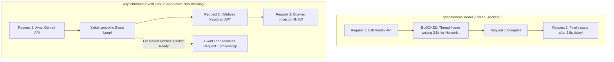
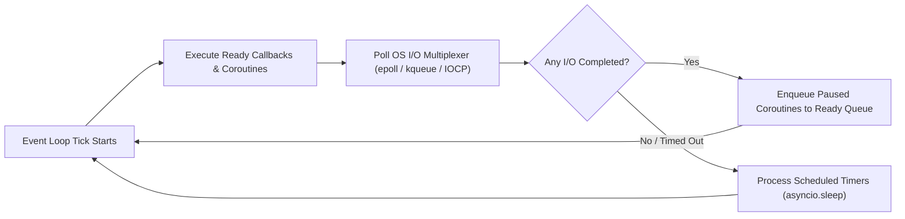
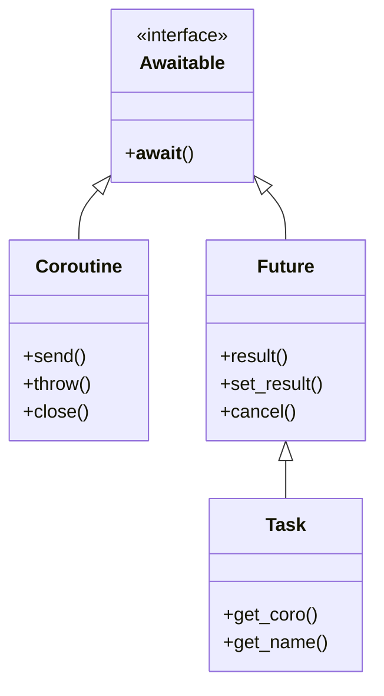
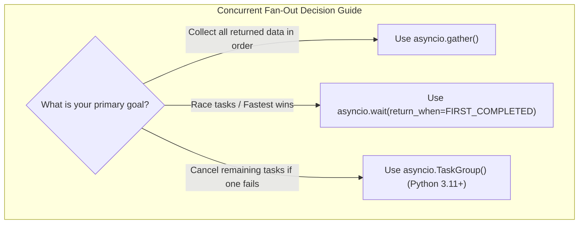
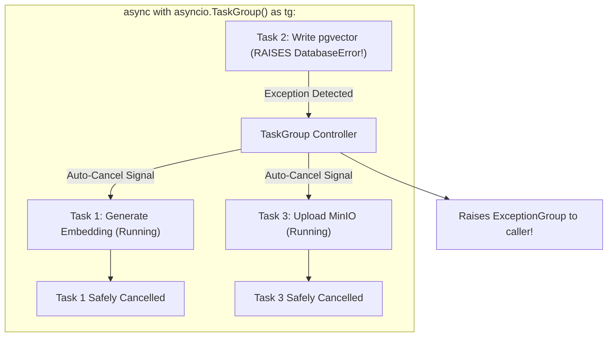
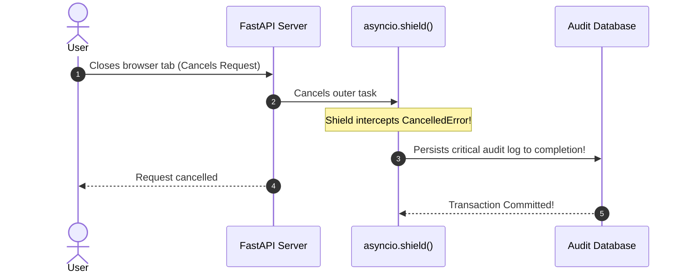
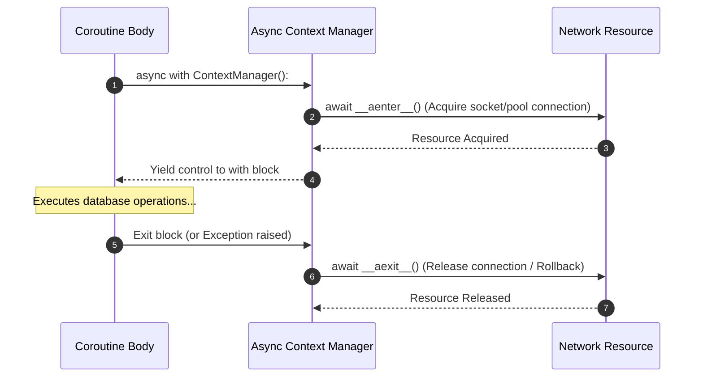
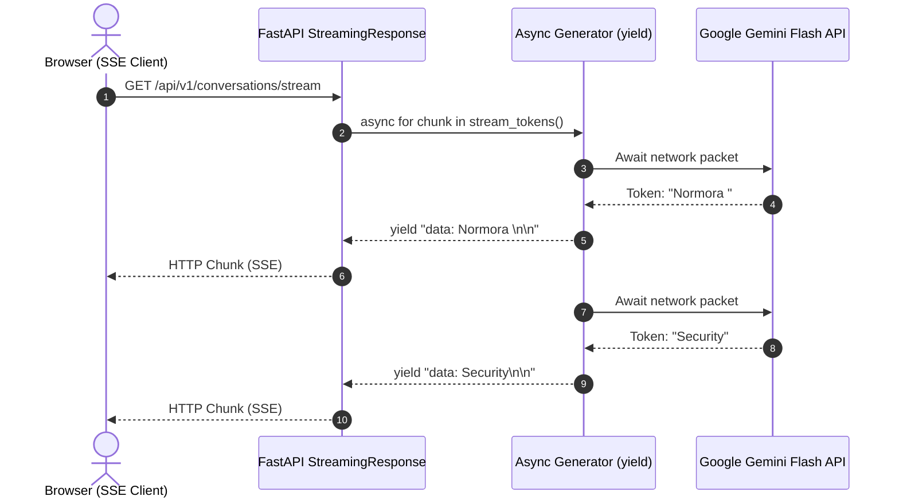
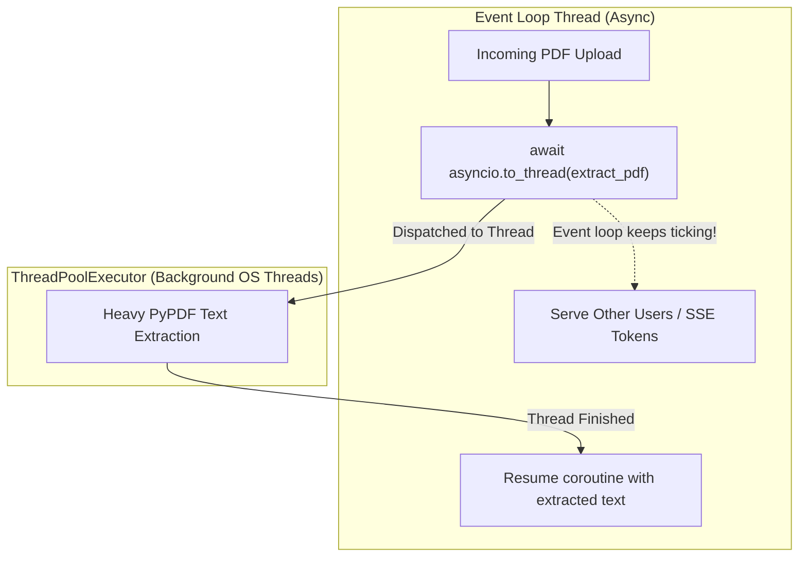

# Module 10: Asynchronous Python & Concurrency Mastery (The Engine of FastAPI)

Welcome to **Module 10** of the Normora Python & AI Masterclass.

If you are coming from a modern .NET background (C# 10–13 on .NET 8/10), you already live and breathe asynchronous programming (`async`/`await`, `Task`, `TaskCompletionSource`, `CancellationToken`, `Channel<T>`). In .NET, asynchronous operations are dispatched to the multi-threaded CLR `ThreadPool`.

In Python and FastAPI, the model is fundamentally different: **Python runs an Asynchronous Single-Threaded Event Loop powered by `asyncio`**.

Understanding this distinction is the single most important architectural milestone for building scalable enterprise AI platforms like **Normora**—our multi-tenant knowledge management and conversational AI system. When thousands of tenant users query Google Gemini Flash, retrieve dense vector embeddings from PostgreSQL (`pgvector`), stream tokens over Server-Sent Events (SSE), or ingest enterprise PDFs into MinIO, a single blocking line of code can freeze the entire web server.

In this module, you will learn asynchronous Python from absolute scratch: from the internal mechanics of coroutines and the event loop, to synchronization primitives, structured concurrency, producer-consumer queues, real-time AI token streaming, and cancellation safety.

---

## 1. Synchronous vs. Asynchronous: The Event Loop Demystified

### 1.1 The Thread-per-Request Trap vs. Cooperative Multitasking

In traditional synchronous web frameworks (like Flask or synchronous Django in Python, or legacy ASP.NET on IIS), every HTTP request is bound to an operating system thread.

When a tenant user submits a RAG query to Normora:
1. The request enters the thread.
2. The thread contacts Google Gemini Flash over HTTPS.
3. The thread waits 2.5 seconds for the remote network socket to receive response tokens.
4. **During those 2.5 seconds, the OS thread is blocked, frozen, and completely idle.**

An OS thread consumes roughly 1 MB to 8 MB of stack memory, plus kernel context-switching overhead. If 500 concurrent users issue AI requests, a synchronous server requires 500 OS threads, consuming gigabytes of RAM and spending more CPU cycles switching kernel contexts than processing tokens.

Python's `asyncio` solves this via **Cooperative Multitasking** on a single thread. When an I/O operation (database query, HTTP call, disk read) begins, the coroutine yields control back to the **Event Loop**. The Event Loop immediately executes another coroutine that is ready to run.



### 1.2 Under the Hood: Epoll, Kqueue, and the Event Loop Tick

How does a single OS thread know when network data arrives without busy-waiting?

Under the hood, `asyncio` registers network sockets with the operating system's native I/O multiplexer:
* **Linux:** `epoll`
* **macOS:** `kqueue`
* **Windows:** I/O Completion Ports (`IOCP` via `ProactorEventLoop`)

The event loop executes a continuous cycle ("ticks"):
1. Checks the ready queue for coroutines that can run immediately.
2. Polls the OS selector (`epoll`/`kqueue`/`IOCP`) for completed socket I/O events with a calculated timeout.
3. Wakes up the coroutines awaiting those specific sockets and resumes their execution at the exact line they paused.



### 1.3 .NET vs. Python Async Architecture Comparison

| Architectural Dimension | .NET 10 / C# | Python 3.11+ / `asyncio` |
| :--- | :--- | :--- |
| **Execution Engine** | Multi-threaded CLR `ThreadPool` | Single-threaded cooperative Event Loop (per thread) |
| **Thread Context Switching** | Kernel and user-mode thread switches across worker threads | Zero thread switches; cooperative user-space frame switches |
| **Concurrency Primitive** | `Task` / `Task<T>` / `ValueTask<T>` | Coroutine object / `asyncio.Task` / `asyncio.Future` |
| **Global Interpreter Lock** | None (true multi-core CPU threading) | GIL present (CPU-bound tasks require processes/threads) |
| **Synchronization Context** | `SynchronizationContext` / `TaskScheduler` | Single running `AbstractEventLoop` |
| **Race Conditions on Data** | Requires thread synchronization (`lock`, `Monitor`, `Interlocked`) | No thread contention, but race conditions across `await` points still exist! |

> [!NOTE]
> Even though Python's event loop runs on a single thread, **race conditions can still occur**. Whenever code yields control at an `await` statement, another coroutine can mutate shared in-memory dictionaries or cache states before execution returns!

---

### 5 Real-World Normora Examples: Event Loop & Fundamentals

#### Example 1.1: Bootstrapping the Normora Platform with `asyncio.run()`
In Python, `async def` code cannot be executed directly from top-level script scope. You must use `asyncio.run()`, which creates a new event loop, sets it as the current loop, executes the entry coroutine, and closes the loop upon completion.

```python
import asyncio
import logging

logging.basicConfig(level=logging.INFO, format="%(asctime)s [%(levelname)s] %(message)s")
logger = logging.getLogger("normora.bootstrap")

async def initialize_normora_runtime() -> dict[str, str]:
    """Initializes multi-tenant database connection pools and MinIO storage."""
    logger.info("Initializing Normora Modular Monolith runtime...")
    # Simulate non-blocking connection pool initialization
    await asyncio.sleep(0.05)
    logger.info("Connected to PostgreSQL pgvector (HNSW indexing active).")
    await asyncio.sleep(0.05)
    logger.info("Connected to MinIO Object Storage bucket: 'normora-tenant-docs'.")
    return {"status": "HEALTHY", "tenants_loaded": "3"}

async def main() -> None:
    system_status = await initialize_normora_runtime()
    logger.info("System Ready: %s", system_status)

if __name__ == "__main__":
    # asyncio.run is the production entry point (equivalent to ASP.NET Program.cs host runner)
    asyncio.run(main())
```

#### Example 1.2: Inspecting the Running Event Loop and Scheduling Callbacks
In low-level middleware and telemetry, you often need direct access to the running loop to schedule low-priority maintenance or check loop health.

```python
import asyncio
import time

def log_tenant_heartbeat(tenant_id: str, scheduled_time: float) -> None:
    latency_ms = (time.time() - scheduled_time) * 1000
    print(f"[Loop Telemetry] Heartbeat executed for tenant '{tenant_id}' (Lag: {latency_ms:.2f}ms)")

async def monitor_event_loop_lag() -> None:
    loop = asyncio.get_running_loop()
    print(f"Current Event Loop: {type(loop).__name__} | Running: {loop.is_running()}")
    
    # Schedule non-coroutine standard Python callbacks to run on the very next tick:
    now = time.time()
    loop.call_soon(log_tenant_heartbeat, "tenant-acme-corp", now)
    loop.call_soon(log_tenant_heartbeat, "tenant-stark-ind", now)
    
    # Yield control to let call_soon callbacks execute
    await asyncio.sleep(0.01)

asyncio.run(monitor_event_loop_lag())
```

#### Example 1.3: Simulating Non-Blocking Cloud LLM Call (Google Gemini Flash)
Unlike synchronous HTTP clients like `requests` (which freeze the OS thread), non-blocking network calls await socket state changes while other tenant operations continue.

```python
import asyncio
import time

async def request_gemini_flash_completion(tenant_id: str, prompt: str) -> str:
    print(f"[{tenant_id}] Dispatching prompt to Gemini Flash API: '{prompt[:35]}...'")
    start_time = time.time()
    # Simulates remote HTTP/2 connection wait (200ms latency)
    await asyncio.sleep(0.2)
    elapsed = time.time() - start_time
    print(f"[{tenant_id}] Received response from Gemini Flash in {elapsed:.2f}s")
    return f"Response for {tenant_id}: Normora requires MFA for all admin accounts."

async def run_ai_request():
    response = await request_gemini_flash_completion(
        tenant_id="tenant-healthcare-partners",
        prompt="Summarize the patient data retention policy."
    )
    print(f"Result: {response}")

asyncio.run(run_ai_request())
```

#### Example 1.4: Non-Blocking MinIO Object Storage Polling
When a tenant user uploads a 50MB PDF, a background ingestion worker periodically polls MinIO object availability without blocking other tenants.

```python
import asyncio

async def poll_minio_document_ready(tenant_id: str, document_id: str, max_retries: int = 3) -> bool:
    for attempt in range(1, max_retries + 1):
        print(f"[{tenant_id}] Polling MinIO bucket for {document_id} (Attempt {attempt}/{max_retries})...")
        await asyncio.sleep(0.05)  # Non-blocking network check
        if attempt == 2:
            print(f"[{tenant_id}] Document {document_id} verified in MinIO object storage!")
            return True
    return False

async def verify_upload():
    success = await poll_minio_document_ready("tenant-legal-group", "doc-contract-901.pdf")
    print(f"Upload verification status: {success}")

asyncio.run(verify_upload())
```

#### Example 1.5: Non-Blocking Keycloak OIDC Discovery Config Refresh
In an enterprise architecture, fetching OIDC endpoints (`.well-known/openid-configuration`) must never stall request processing.

```python
import asyncio

async def refresh_keycloak_oidc_endpoints(realm: str) -> dict[str, str]:
    print(f"[Keycloak] Fetching OIDC discovery document for realm: '{realm}'")
    await asyncio.sleep(0.08)  # Simulated HTTPS GET
    return {
        "issuer": f"https://auth.normora.internal/realms/{realm}",
        "jwks_uri": f"https://auth.normora.internal/realms/{realm}/protocol/openid-connect/certs",
        "token_endpoint": f"https://auth.normora.internal/realms/{realm}/protocol/openid-connect/token"
    }

async def load_auth():
    config = await refresh_keycloak_oidc_endpoints("normora-enterprise")
    print(f"[Keycloak] Loaded JWKS URI: {config['jwks_uri']}")

asyncio.run(load_auth())
```

---

## 2. Coroutines (`async def`), Coroutine Objects, and the `await` Keyword

### 2.1 The Mechanics of Coroutines: Definition vs. Invocation

In Python:
* A function declared with **`async def`** is a **coroutine function**.
* **Calling** a coroutine function does **NOT** execute the code inside its body! It returns a **coroutine object**.
* A coroutine object sits dormant in memory until it is explicitly driven by the event loop, typically via the **`await`** keyword or by scheduling it as a `Task`.

```python
async def query_tenant_quota(tenant_id: str) -> int:
    await asyncio.sleep(0.01)
    return 50000

# WRONG: Calling the function does NOT run it:
result = query_tenant_quota("tenant-finance")
print(result)
# Output: <coroutine object query_tenant_quota at 0x0000019C8B5F0>
# RuntimeWarning: coroutine 'query_tenant_quota' was never awaited!

# RIGHT: Inside an async function, await the coroutine object:
# quota = await query_tenant_quota("tenant-finance")
```

### 2.2 What Can Be Awaited? (The Awaitable Protocol)

You can only use `await` on an object that implements the **Awaitable** protocol (`__await__()` method). In Python, there are three primary awaitable types:
1. **Coroutines:** Native coroutine objects created by calling `async def` functions.
2. **Tasks:** Scheduled coroutines wrapped in an `asyncio.Task` object (used for concurrent execution).
3. **Futures:** Low-level objects representing an eventual result of an asynchronous operation (similar to `TaskCompletionSource<T>` in C#).



### 2.3 C# Task vs. Python Coroutine Comparison

| Concept | C# (.NET 10) | Python 3.11+ |
| :--- | :--- | :--- |
| **Method Declaration** | `public async Task<string> FetchDataAsync()` | `async def fetch_data() -> str:` |
| **Invocation Behavior** | Invocation **starts execution immediately** until the first `await`. | Invocation **does not start execution**. It only creates a dormant coroutine object. |
| **Awaiting** | `string data = await FetchDataAsync();` | `data = await fetch_data()` |
| **State Machine Implementation** | Roslyn compiler generates a struct state machine implementing `IAsyncStateMachine`. | CPython compiler generates generator-like frame objects with suspension bytecodes (`YIELD_VALUE`). |
| **Void Coroutine** | `async Task` (or `async void` for UI events) | `async def` with return type `None` |

---

### 5 Real-World Normora Examples: Coroutines & Await

#### Example 2.1: Tenant Subscription Verification & Quota Check
Verifies whether a tenant has enough remaining token quota before dispatching an AI conversation request.

```python
import asyncio
from typing import NamedTuple

class TenantQuota(NamedTuple):
    tenant_id: str
    tokens_remaining: int
    is_active: bool

async def get_tenant_quota(tenant_id: str) -> TenantQuota:
    # Simulates querying PostgreSQL tenant memberships table
    await asyncio.sleep(0.03)
    if tenant_id == "tenant-delinquent":
        return TenantQuota(tenant_id=tenant_id, tokens_remaining=0, is_active=False)
    return TenantQuota(tenant_id=tenant_id, tokens_remaining=850000, is_active=True)

async def authorize_tenant_ai_request(tenant_id: str, requested_tokens: int) -> bool:
    quota = await get_tenant_quota(tenant_id)
    if not quota.is_active:
        print(f"[RBAC Denied] Tenant '{tenant_id}' account is deactivated.")
        return False
    if quota.tokens_remaining < requested_tokens:
        print(f"[Quota Exceeded] Tenant '{tenant_id}' has {quota.tokens_remaining} tokens, needed {requested_tokens}.")
        return False
    print(f"[Authorized] Tenant '{tenant_id}' approved for {requested_tokens} tokens.")
    return True

async def run_auth_check():
    allowed = await authorize_tenant_ai_request("tenant-enterprise-bank", 4000)
    print(f"Authorization result: {allowed}")

asyncio.run(run_auth_check())
```

#### Example 2.2: pgvector HNSW Cosine Similarity Query
Simulates searching Normora's `document_embeddings` table using the pgvector extension with an HNSW index.

```python
import asyncio
from typing import Any

async def query_pgvector_hnsw(
    tenant_id: str, 
    query_vector: list[float], 
    top_k: int = 3
) -> list[dict[str, Any]]:
    print(f"Executing pgvector search for tenant '{tenant_id}' with {len(query_vector)}-dim vector...")
    # Simulates asyncpg socket query execution
    await asyncio.sleep(0.04)
    return [
        {"chunk_id": "chk-001", "similarity": 0.942, "content": "MFA is enforced across all VPN endpoints."},
        {"chunk_id": "chk-042", "similarity": 0.891, "content": "Session tokens expire after 15 minutes of inactivity."},
        {"chunk_id": "chk-108", "similarity": 0.825, "content": "Password history maintains the last 12 hashes."}
    ]

async def run_vector_search():
    simulated_vector = [0.015] * 768  # 768-dimensional text-embedding-004 vector
    matches = await query_pgvector_hnsw("tenant-acme", simulated_vector, top_k=3)
    for m in matches:
        print(f"Match [{m['chunk_id']}] Similarity: {m['similarity']:.3f} | Text: {m['content']}")

asyncio.run(run_vector_search())
```

#### Example 2.3: MinIO S3 Document Metadata Retrieval
Reads S3 metadata tags from MinIO before streaming the PDF binary to the chunking pipeline.

```python
import asyncio

async def fetch_minio_metadata(tenant_id: str, object_key: str) -> dict[str, str]:
    print(f"Fetching MinIO S3 metadata for: s3://normora-{tenant_id}/{object_key}")
    await asyncio.sleep(0.03)  # Async network call to MinIO
    return {
        "content-type": "application/pdf",
        "x-amz-meta-uploader-id": "usr-security-officer-99",
        "x-amz-meta-classification": "RESTRICTED",
        "content-length": "4194304"  # 4 MB
    }

async def run_metadata_read():
    meta = await fetch_minio_metadata("tenant-defense", "policies/2026-crypto-standards.pdf")
    print(f"Classification: {meta['x-amz-meta-classification']} | Size: {meta['content-length']} bytes")

asyncio.run(run_metadata_read())
```

#### Example 2.4: BOLA (Broken Object Level Authorization) Tenant Guard
In Normora, multi-tenancy security mandates that attempting to access another tenant's resource must return a `404 Not Found` rather than a `403 Forbidden` to prevent object enumeration.

```python
import asyncio

class EntityNotFoundError(Exception):
    """Raised when an entity is not found in the tenant's bounded context (prevents BOLA enumeration)."""

async def get_tenant_document_secure(tenant_id: str, document_id: str) -> dict[str, str]:
    await asyncio.sleep(0.02)
    # Simulated database lookup scoped strictly by (tenant_id, document_id)
    known_documents = {
        ("tenant-alpha", "doc-100"): {"title": "Alpha Q3 Financials"},
        ("tenant-beta", "doc-200"): {"title": "Beta Product Roadmap"}
    }
    doc = known_documents.get((tenant_id, document_id))
    if not doc:
        # Crucial BOLA prevention: Never tell the user if the document exists in another tenant!
        raise EntityNotFoundError(f"Document '{document_id}' not found for tenant '{tenant_id}'")
    return doc

async def run_security_check():
    try:
        # Tenant Alpha tries to access Tenant Beta's document
        await get_tenant_document_secure("tenant-alpha", "doc-200")
    except EntityNotFoundError as ex:
        print(f"[Security Enforced] HTTP 404 Returned: {ex}")

asyncio.run(run_security_check())
```

#### Example 2.5: Multi-Step Sequential Pipeline Chaining
Chaining coroutines where the output of each step feeds the next, simulating MediatR CQRS handler flow.

```python
import asyncio

async def authenticate_session(bearer_token: str) -> dict[str, str]:
    await asyncio.sleep(0.02)
    return {"user_id": "usr-501", "tenant_id": "tenant-biotech"}

async def verify_user_roles(user_id: str, required_role: str) -> bool:
    await asyncio.sleep(0.02)
    return True

async def retrieve_conversation_summary(conversation_id: str) -> str:
    await asyncio.sleep(0.03)
    return "User previously asked about HIPAA compliance standards."

async def execute_rag_pipeline(token: str, conv_id: str) -> None:
    session = await authenticate_session(token)
    has_role = await verify_user_roles(session["user_id"], "KnowledgeBaseReader")
    
    if not has_role:
        print("[BFLA Check Failed] User lacks KnowledgeBaseReader role.")
        return
        
    summary = await retrieve_conversation_summary(conv_id)
    print(f"Pipeline Succeeded for {session['tenant_id']}! Context: '{summary}'")

asyncio.run(execute_rag_pipeline("eyJh...mock.jwt", "conv-8871"))
```

---

## 3. Managing Concurrent Execution: `asyncio.create_task` & Background Tasks

### 3.1 What is an `asyncio.Task`?

While `await some_coroutine()` pauses the current execution flow until that coroutine finishes, **`asyncio.create_task(coroutine)` schedules the coroutine to run concurrently on the event loop immediately**, returning a `Task` object.

A `Task` is a subclass of `Future` that wraps a coroutine and manages its execution lifecycle on the event loop.

```mermaid
sequenceDiagram
    autonumber
    actor Client
    participant Handler as FastAPI Endpoint
    participant Loop as Event Loop
    participant BgTask as Background Audit Worker

    Client->>Handler: POST /api/v1/documents (Upload)
    Handler->>Loop: asyncio.create_task(audit_log())
    Note over Loop: Task scheduled on loop queue
    Handler-->>Client: HTTP 200 OK (Immediate Response)
    Loop->>BgTask: Runs concurrently on next tick
    BgTask->>BgTask: Persists audit entry to PostgreSQL
```

### 3.2 The Critical Pitfall: Task Garbage Collection Reference Leaks

> [!WARNING]
> **The CPython Garbage Collector Risk:**  
> If you call `asyncio.create_task(...)` without holding a strong reference to the returned `Task` object, **the Python garbage collector may destroy the task mid-execution!**
> 
> According to Python official documentation:
> *"The event loop only keeps weak references to tasks. A task that isn't referenced elsewhere may be garbage collected at any time, even before it's done."*

To run safe fire-and-forget background tasks in Python:
```python
# A global or module-level set to hold strong references:
_background_tasks: set[asyncio.Task] = set()

def run_fire_and_forget(coro):
    task = asyncio.create_task(coro)
    _background_tasks.add(task)
    # Remove the reference automatically when the task completes:
    task.add_done_callback(_background_tasks.discard)
    return task
```

### 3.3 C# `Task.Run` vs. Python `asyncio.create_task`

| Feature | C# (.NET 10) `Task.Run()` | Python `asyncio.create_task()` |
| :--- | :--- | :--- |
| **Execution Thread** | Offloads execution to an OS thread in the CLR `ThreadPool`. | Runs on the **same single OS thread** in the `asyncio` event loop. |
| **Use Case** | CPU-bound or non-async work offloaded from the main/UI thread. | Concurrent async I/O coroutine scheduling. |
| **Thread Affinity** | The task can switch OS threads between `await` points. | Never switches OS threads; always remains on the loop thread. |
| **Cancellation** | Pass a `CancellationToken`. | Call `task.cancel()` (raises `asyncio.CancelledError`). |

---

### 5 Real-World Normora Examples: `asyncio.create_task`

#### Example 3.1: Fire-and-Forget Tenant Audit Log Dispatcher
Logs security events to the audit table without adding latency to the client's HTTP response.

```python
import asyncio
from typing import Any

# Strong reference retention set to prevent CPython GC from killing running tasks:
active_audit_tasks: set[asyncio.Task] = set()

async def persist_audit_log(tenant_id: str, action: str, metadata: dict[str, Any]) -> None:
    # Simulate DB insert to normora_audit_logs table
    await asyncio.sleep(0.05)
    print(f"[Audit Log Persisted] Tenant: {tenant_id} | Action: {action} | Details: {metadata}")

def dispatch_audit_event(tenant_id: str, action: str, metadata: dict[str, Any]) -> None:
    task = asyncio.create_task(persist_audit_log(tenant_id, action, metadata))
    active_audit_tasks.add(task)
    task.add_done_callback(active_audit_tasks.discard)

async def handle_document_download(tenant_id: str, user_id: str, doc_id: str) -> dict[str, str]:
    # 1. Dispatch background audit task:
    dispatch_audit_event(tenant_id, "DOCUMENT_DOWNLOAD", {"user_id": user_id, "doc_id": doc_id})
    # 2. Return HTTP response immediately:
    return {"status": "SUCCESS", "download_url": f"https://minio.normora.internal/{doc_id}"}

async def run_audit_demo():
    response = await handle_document_download("tenant-acme", "usr-10", "doc-legal-review.pdf")
    print(f"HTTP Response: {response}")
    # Allow event loop ticks to complete background tasks before exiting:
    await asyncio.gather(*active_audit_tasks)

asyncio.run(run_audit_demo())
```

#### Example 3.2: Background Document Virus and MIME-Type Scanning
When a document is uploaded, a background task scans the payload while the user receives an `INGESTION_PENDING` status.

```python
import asyncio

async def scan_document_for_threats(tenant_id: str, document_id: str) -> None:
    print(f"[Scanner Task] Initiating malware signature scan for {document_id}...")
    await asyncio.sleep(0.1)  # Simulates ClamAV scan over socket
    print(f"[Scanner Task] Document {document_id} marked CLEAN. Ready for chunking.")

async def upload_document_endpoint(tenant_id: str, document_id: str) -> dict[str, str]:
    # Schedule background scan:
    scan_task = asyncio.create_task(
        scan_document_for_threats(tenant_id, document_id),
        name=f"scan_{tenant_id}_{document_id}"
    )
    print(f"Scheduled task: {scan_task.get_name()}")
    return {"document_id": document_id, "status": "INGESTION_PENDING"}

async def run_upload():
    res = await upload_document_endpoint("tenant-fintech", "doc-irs-w9.pdf")
    print(f"Client Result: {res}")
    await asyncio.sleep(0.15)  # Wait for background task to finish

asyncio.run(run_upload())
```

#### Example 3.3: Async OpenTelemetry Telemetry Exporter
Dispatches tracing spans to an OpenTelemetry collector in the background so that tracing never degrades API latency.

```python
import asyncio

async def export_telemetry_span(span_name: str, duration_ms: float, tenant_id: str) -> None:
    await asyncio.sleep(0.04)  # Export to OTel Collector via gRPC/HTTP
    print(f"[OTel Exported] Span: '{span_name}' | Duration: {duration_ms:.1f}ms | Tenant: {tenant_id}")

async def search_endpoint_with_telemetry(tenant_id: str, query: str):
    import time
    start = time.time()
    # Simulated search
    await asyncio.sleep(0.06)
    duration = (time.time() - start) * 1000
    
    # Schedule background telemetry export:
    asyncio.create_task(export_telemetry_span("rag_similarity_search", duration, tenant_id))
    return {"results": ["chunk_1", "chunk_2"]}

async def run_telemetry():
    await search_endpoint_with_telemetry("tenant-gov", "security clearance policy")
    await asyncio.sleep(0.05)

asyncio.run(run_telemetry())
```

#### Example 3.4: Pre-Fetching Tenant Feature Flags during Keycloak JWT Verification
While verifying the cryptographic signature of a JWT, concurrently pre-fetch tenant feature flags from Redis.

```python
import asyncio

async def verify_keycloak_jwt(token: str) -> dict[str, str]:
    await asyncio.sleep(0.05)
    return {"sub": "usr-88", "tenant_id": "tenant-saas", "role": "TenantAdmin"}

async def prefetch_tenant_feature_flags(tenant_id: str) -> dict[str, bool]:
    await asyncio.sleep(0.05)
    return {"enable_gemini_flash_streaming": True, "enable_deep_search": False}

async def authenticate_and_load_context(token: str):
    # Start pre-fetching flags concurrently as a task:
    # Notice we don't know the tenant_id yet, but let's assume we extract it from unverified claims:
    flags_task = asyncio.create_task(prefetch_tenant_feature_flags("tenant-saas"))
    
    # Verify the JWT cryptographic signature concurrently:
    user_claims = await verify_keycloak_jwt(token)
    
    # Await the pre-fetched feature flags:
    feature_flags = await flags_task
    
    print(f"Auth Success: User {user_claims['sub']} | Gemini Streaming: {feature_flags['enable_gemini_flash_streaming']}")

asyncio.run(authenticate_and_load_context("dummy-jwt-token"))
```

#### Example 3.5: Asynchronous Cache Invalidation After Document Deletion
When a document is deleted from PostgreSQL, invalidate Redis cache entries in the background.

```python
import asyncio

async def invalidate_tenant_vector_cache(tenant_id: str, document_id: str) -> None:
    print(f"[Cache Invalidation] Purging Redis cache keys for tenant '{tenant_id}' / doc '{document_id}'...")
    await asyncio.sleep(0.03)
    print(f"[Cache Invalidation] Cache purged successfully.")

async def delete_document_handler(tenant_id: str, document_id: str) -> dict[str, str]:
    # 1. Synchronously delete from DB in primary transaction
    await asyncio.sleep(0.02)
    print(f"[PostgreSQL] Document {document_id} deleted from DB.")
    
    # 2. Fire-and-forget cache purge:
    asyncio.create_task(invalidate_tenant_vector_cache(tenant_id, document_id))
    
    return {"message": "Document deleted successfully"}

async def run_deletion():
    res = await delete_document_handler("tenant-retail", "doc-pricing-catalog.pdf")
    print(f"Response: {res}")
    await asyncio.sleep(0.05)

asyncio.run(run_deletion())
```

---

## 4. Concurrent Fan-Out: `asyncio.gather()` vs. `asyncio.wait()`

### 4.1 When to Use `asyncio.gather()` vs. `asyncio.wait()`

When you have a collection of independent I/O operations, executing them sequentially is an anti-pattern. You must fan-out concurrently!

Python provides two primary primitives for concurrent fan-out:
* **`asyncio.gather(*awaitables, return_exceptions=False)`**:
  * Focuses on **aggregating results**.
  * Returns a list containing the results of all coroutines in the **exact order** they were passed.
  * If `return_exceptions=False` (default), the first exception immediately propagates to the caller (though other tasks continue running in the background!).
  * If `return_exceptions=True`, exceptions are treated as valid return values and placed directly in the results list alongside normal data.
* **`asyncio.wait(fs, return_when=ALL_COMPLETED)`**:
  * Focuses on **lifecycle control and monitoring**.
  * Accepts a collection of `Task` objects (or coroutines wrapped in tasks).
  * Returns a 2-tuple of sets: `(done_tasks, pending_tasks)`.
  * Allows early termination via `return_when` conditions:
    * `asyncio.ALL_COMPLETED` (default)
    * `asyncio.FIRST_COMPLETED` (race condition / fastest provider wins)
    * `asyncio.FIRST_EXCEPTION` (stop waiting when any task fails)



### 4.2 C# `Task.WhenAll` / `Task.WhenAny` Comparison

| C# (.NET 10) | Python `asyncio` Equivalent | Behavioral Difference |
| :--- | :--- | :--- |
| `await Task.WhenAll(t1, t2, t3)` | `await asyncio.gather(c1, c2, c3)` | `WhenAll` throws `AggregateException` if multiple fail. `gather` throws the first exception unless `return_exceptions=True`. |
| `Task completed = await Task.WhenAny(t1, t2)` | `done, pending = await asyncio.wait([t1, t2], return_when=FIRST_COMPLETED)` | `WhenAny` returns the single winning `Task`. `wait` returns two sets (`done` and `pending`), allowing you to cancel `pending` explicitly! |

---

### 5 Real-World Normora Examples: `gather()` & `wait()`

#### Example 4.1: Parallel Chunk Embeddings Generation with `asyncio.gather`
Generating embeddings for multiple document chunks simultaneously via Google Gemini Flash embedding API:

```python
import asyncio
import time

async def generate_chunk_embedding(chunk_id: str, text: str) -> dict[str, Any]:
    # Simulate API call latency (150ms per chunk)
    await asyncio.sleep(0.15)
    return {"chunk_id": chunk_id, "dimensions": 768, "token_count": len(text.split())}

async def embed_document_chunks():
    chunks = [
        ("chk-1", "Normora utilizes PostgreSQL with pgvector for HNSW indexing."),
        ("chk-2", "Keycloak provides OpenID Connect and SAML 2.0 federation."),
        ("chk-3", "MinIO stores multi-tenant unstructured binary files."),
        ("chk-4", "FastAPI serves as the high-throughput asynchronous AI gateway.")
    ]
    
    start = time.time()
    # Fan out: All 4 chunks process in parallel in ~150ms total instead of 600ms!
    results = await asyncio.gather(*[
        generate_chunk_embedding(cid, txt) for cid, txt in chunks
    ])
    
    elapsed = time.time() - start
    print(f"Generated {len(results)} embeddings concurrently in {elapsed:.2f}s:")
    for r in results:
        print(f" -> [{r['chunk_id']}] Tokens: {r['token_count']}")

asyncio.run(embed_document_chunks())
```

#### Example 4.2: Hybrid RAG Search (Dense Vector + Sparse Keyword Search in Parallel)
Combines semantic dense vector search (pgvector) and sparse BM25 keyword search concurrently, then merges and deduplicates results.

```python
import asyncio

async def search_pgvector_dense(tenant_id: str, query: str) -> list[str]:
    await asyncio.sleep(0.08)  # Vector similarity search
    return ["doc-security-policy#chunk-1", "doc-vpn-guidelines#chunk-4"]

async def search_bm25_sparse(tenant_id: str, query: str) -> list[str]:
    await asyncio.sleep(0.07)  # Full-text inverted index search
    return ["doc-vpn-guidelines#chunk-4", "doc-network-firewall#chunk-9"]

async def hybrid_rag_retrieval(tenant_id: str, query: str) -> list[str]:
    # Fan-out both queries concurrently:
    dense_matches, sparse_matches = await asyncio.gather(
        search_pgvector_dense(tenant_id, query),
        search_bm25_sparse(tenant_id, query)
    )
    
    # Reciprocal Rank Fusion / Deduplication
    combined = list(dict.fromkeys(dense_matches + sparse_matches))
    return combined

async def run_hybrid():
    results = await hybrid_rag_retrieval("tenant-tech", "VPN multi-factor authentication")
    print(f"Hybrid Search Results: {results}")

asyncio.run(run_hybrid())
```

#### Example 4.3: Resilient Multi-Tenant Permission Aggregation (`return_exceptions=True`)
When querying multiple authorization subsystems, one subsystem failing must not crash the entire request.

```python
import asyncio

async def check_department_membership(user_id: str) -> str:
    await asyncio.sleep(0.04)
    return "ENGINEERING_DEPT"

async def check_keycloak_groups(user_id: str) -> list[str]:
    await asyncio.sleep(0.03)
    return ["admin-group", "developer-group"]

async def check_external_ldap(user_id: str) -> str:
    await asyncio.sleep(0.05)
    # Simulate third-party LDAP timeout/failure
    raise ConnectionResetError("External LDAP server unreachable")

async def aggregate_security_context(user_id: str) -> dict[str, Any]:
    # return_exceptions=True captures exceptions as return items instead of raising!
    results = await asyncio.gather(
        check_department_membership(user_id),
        check_keycloak_groups(user_id),
        check_external_ldap(user_id),
        return_exceptions=True
    )
    
    dept, groups, ldap = results
    
    context: dict[str, Any] = {"user_id": user_id}
    context["department"] = dept if not isinstance(dept, Exception) else "UNKNOWN"
    context["groups"] = groups if not isinstance(groups, Exception) else []
    context["ldap_status"] = "OFFLINE" if isinstance(ldap, Exception) else "ONLINE"
    
    return context

async def run_resilient_auth():
    auth_ctx = await aggregate_security_context("usr-992")
    print(f"Aggregated Auth Context: {auth_ctx}")

asyncio.run(run_resilient_auth())
```

#### Example 4.4: Primary vs. Fallback Cloud LLM Race (`FIRST_COMPLETED`)
Sends an AI prompt to Google Gemini Flash (Primary). If a secondary provider (OpenAI GPT-4o) responds faster or Gemini is under load, take the first response and cancel the remaining call.

```python
import asyncio

async def call_gemini_flash_primary(prompt: str) -> str:
    # Simulates primary cloud AI
    await asyncio.sleep(0.12)
    return "[Google Gemini Flash] Answer: Enterprise encryption uses AES-GCM-256."

async def call_openai_gpt4o_fallback(prompt: str) -> str:
    # Simulates fallback cloud AI
    await asyncio.sleep(0.18)
    return "[OpenAI GPT-4o] Answer: Enterprise encryption uses AES-256."

async def race_ai_providers(prompt: str) -> str:
    # Wrap in tasks for asyncio.wait:
    task_gemini = asyncio.create_task(call_gemini_flash_primary(prompt))
    task_openai = asyncio.create_task(call_openai_gpt4o_fallback(prompt))
    
    # Wait for the first model to complete:
    done, pending = await asyncio.wait(
        [task_gemini, task_openai],
        return_when=asyncio.FIRST_COMPLETED
    )
    
    # Cancel the slower task immediately to avoid unnecessary cloud token billing:
    for task in pending:
        task.cancel()
        print(f"Cancelled slower provider task: {task}")
        
    fastest_task = done.pop()
    return fastest_task.result()

async def run_race():
    winner = await race_ai_providers("What encryption algorithm does Normora use?")
    print(f"Fastest Provider Winner:\n{winner}")

asyncio.run(run_race())
```

#### Example 4.5: Batch Document Validation with `FIRST_EXCEPTION`
Validates 5 document schemas. If any document schema violates Normora contracts, immediately halt waiting and notify the user.

```python
import asyncio

async def validate_document_schema(doc_id: str) -> str:
    await asyncio.sleep(0.03)
    if doc_id == "doc-corrupted":
        raise ValueError(f"Document {doc_id} has invalid PDF header.")
    return f"Validated {doc_id}"

async def batch_validate(doc_ids: list[str]) -> None:
    tasks = [asyncio.create_task(validate_document_schema(did)) for did in doc_ids]
    
    done, pending = await asyncio.wait(tasks, return_when=asyncio.FIRST_EXCEPTION)
    
    # Check if any task failed:
    for task in done:
        if task.exception():
            print(f"[Validation Halt] Fast-failing batch due to error: {task.exception()}")
            # Cancel all remaining validations:
            for p in pending:
                p.cancel()
            return
            
    print("All documents validated successfully!")

async def run_batch():
    await batch_validate(["doc-1", "doc-corrupted", "doc-3", "doc-4"])

asyncio.run(run_batch())
```

---

## 5. Modern Structured Concurrency: `asyncio.TaskGroup` (Python 3.11+)

### 5.1 What is Structured Concurrency?

In traditional concurrency (like raw `create_task()` or `asyncio.gather()`), if an asynchronous task fails, child tasks can be left running indefinitely in the background ("orphan tasks"), leaking network sockets, database connections, and memory.

Python 3.11 introduced **Structured Concurrency** via **`asyncio.TaskGroup`**:
* Encapsulated in an `async with` block.
* Guarantees that **all child tasks finish before the context manager exits**.
* If **ANY** child task raises an unhandled exception:
  1. The TaskGroup **automatically cancels all other sibling tasks** inside the group!
  2. The TaskGroup waits for all cancelled tasks to finish their cleanup.
  3. All collected exceptions are bundled into an **`ExceptionGroup`** and raised!



### 5.2 Exception Handling with `except*` (Python 3.11+)

To handle exceptions raised by a `TaskGroup`, Python 3.11 introduced the **`except*`** syntax (pronounced "except-star"). Unlike standard `except`, `except*` can match and handle individual exception types within an `ExceptionGroup`.

```python
try:
    async with asyncio.TaskGroup() as tg:
        tg.create_task(faulty_task())
        tg.create_task(another_faulty_task())
except* ValueError as eg:
    # Handles only ValueErrors inside the group:
    for exc in eg.exceptions:
        print(f"Caught ValueError: {exc}")
except* ConnectionError as eg:
    # Handles ConnectionErrors inside the group:
    for exc in eg.exceptions:
        print(f"Caught ConnectionError: {exc}")
```

---

### 5 Real-World Normora Examples: `TaskGroup` & Structured Concurrency

#### Example 5.1: Synchronizing Multi-Tenant Vector Indices with Atomic Rollback
Updates three vector indexes. If one fails, the remaining updates are automatically cancelled.

```python
import asyncio

async def update_tenant_hnsw_index(tenant_id: str, index_name: str) -> None:
    print(f"[{tenant_id}] Updating HNSW index '{index_name}'...")
    await asyncio.sleep(0.05)
    print(f"[{tenant_id}] HNSW index '{index_name}' updated.")

async def sync_all_indices(tenant_id: str) -> None:
    async with asyncio.TaskGroup() as tg:
        tg.create_task(update_tenant_hnsw_index(tenant_id, "idx_conversations_hnsw"))
        tg.create_task(update_tenant_hnsw_index(tenant_id, "idx_documents_hnsw"))
        tg.create_task(update_tenant_hnsw_index(tenant_id, "idx_citations_hnsw"))
    print(f"All vector indexes for {tenant_id} synchronized atomically!")

asyncio.run(sync_all_indices("tenant-financial"))
```

#### Example 5.2: Ingestion Pipeline Structured Execution
Executes the document ingestion sub-tasks (PDF text parsing, metadata extraction, thumbnail generation).

```python
import asyncio

async def extract_pdf_metadata(doc_id: str) -> dict[str, str]:
    await asyncio.sleep(0.04)
    return {"pages": "45", "author": "Legal Dept"}

async def generate_document_thumbnail(doc_id: str) -> str:
    await asyncio.sleep(0.06)
    return f"s3://normora-thumbnails/{doc_id}.png"

async def process_document_ingestion_group(doc_id: str) -> None:
    meta_task: asyncio.Task | None = None
    thumb_task: asyncio.Task | None = None
    
    async with asyncio.TaskGroup() as tg:
        meta_task = tg.create_task(extract_pdf_metadata(doc_id))
        thumb_task = tg.create_task(generate_document_thumbnail(doc_id))
    
    # Both tasks are guaranteed to be complete here:
    print(f"Metadata: {meta_task.result()}")
    print(f"Thumbnail: {thumb_task.result()}")

asyncio.run(process_document_ingestion_group("doc-compliance-2026.pdf"))
```

#### Example 5.3: Handling Multiple Simultaneous Failures with `except*`
Demonstrates how `TaskGroup` cancels siblings when a task crashes, and how to catch specific exception types cleanly.

```python
import asyncio

async def write_pgvector_record() -> None:
    await asyncio.sleep(0.02)
    raise ConnectionRefusedError("PostgreSQL connection refused on port 5432")

async def upload_minio_payload() -> None:
    await asyncio.sleep(0.05)
    print("MinIO payload upload completed (should not reach here if cancelled!)")

async def run_failing_group():
    try:
        async with asyncio.TaskGroup() as tg:
            tg.create_task(write_pgvector_record())
            tg.create_task(upload_minio_payload())
    except* ConnectionRefusedError as eg:
        print(f"[Handled DB Failure] Caught {len(eg.exceptions)} database connection error(s):")
        for exc in eg.exceptions:
            print(f" -> {exc}")

asyncio.run(run_failing_group())
```

#### Example 5.4: MediatR Cross-Module Event Dispatch Simulation
When a conversation concludes in the `Conversations` module, dispatches domain events to `Tenants` and `Audit` concurrently.

```python
import asyncio

async def on_conversation_finished_update_tokens(tenant_id: str, tokens_used: int) -> None:
    await asyncio.sleep(0.03)
    print(f"[Tenants Module] Deducted {tokens_used} tokens from {tenant_id} billing balance.")

async def on_conversation_finished_log_metrics(tenant_id: str, conv_id: str) -> None:
    await asyncio.sleep(0.02)
    print(f"[Telemetry Module] Logged conversation duration metrics for {conv_id}.")

async def dispatch_domain_events(tenant_id: str, conv_id: str, tokens: int) -> None:
    async with asyncio.TaskGroup() as tg:
        tg.create_task(on_conversation_finished_update_tokens(tenant_id, tokens))
        tg.create_task(on_conversation_finished_log_metrics(tenant_id, conv_id))
    print("Domain events dispatched cleanly across bounded contexts!")

asyncio.run(dispatch_domain_events("tenant-insurance", "conv-4412", 1250))
```

#### Example 5.5: Multi-Agent Tool Execution Fan-Out in Conversational AI
The AI agent decides to call three tools simultaneously: `search_tenant_docs`, `lookup_user_permissions`, and `get_system_time`.

```python
import asyncio
from typing import Any

async def tool_search_tenant_docs(query: str) -> list[str]:
    await asyncio.sleep(0.06)
    return ["Doc: Standard Operating Procedures v4"]

async def tool_lookup_user_permissions(user_id: str) -> list[str]:
    await asyncio.sleep(0.04)
    return ["READ_DOCUMENTS", "EXPORT_CITATIONS"]

async def tool_get_system_time() -> str:
    await asyncio.sleep(0.01)
    return "2026-11-18T22:30:00Z"

async def execute_agent_tools() -> dict[str, Any]:
    tool_outputs: dict[str, Any] = {}
    
    async with asyncio.TaskGroup() as tg:
        t_docs = tg.create_task(tool_search_tenant_docs("SOP rules"))
        t_perms = tg.create_task(tool_lookup_user_permissions("usr-412"))
        t_time = tg.create_task(tool_get_system_time())
        
    tool_outputs["docs"] = t_docs.result()
    tool_outputs["permissions"] = t_perms.result()
    tool_outputs["server_time"] = t_time.result()
    return tool_outputs

async def run_agent_tools():
    results = await execute_agent_tools()
    print("Agent Tools Output:")
    for k, v in results.items():
        print(f" -> {k}: {v}")

asyncio.run(run_agent_tools())
```

---

## 6. Task Cancellation, Timeouts, and Shielding: `asyncio.timeout`, `asyncio.wait_for`, & `asyncio.shield`

### 6.1 How Cancellation Works in Python

In .NET, cancellation is cooperative and explicit via `CancellationToken.ThrowIfCancellationRequested()`.

In Python, cancellation is **injected into the coroutine as an exception**:
1. When `task.cancel()` is called (or a timeout fires), the event loop raises **`asyncio.CancelledError`** at the current `await` suspension point inside that coroutine!
2. The coroutine can catch `asyncio.CancelledError` to perform cleanup, but it must almost always re-raise it (or let it exit) so the event loop knows the task was successfully cancelled.

### 6.2 Python 3.11+ `asyncio.timeout()` vs. Legacy `asyncio.wait_for()`

* **`asyncio.wait_for(coro, timeout=seconds)`**:
  * Wraps the coroutine in a task and enforces a timeout.
  * Disadvantage: Cancelling the wrapper can lead to subtle race conditions if the coroutine finishes right as the timeout expires.
* **`asyncio.timeout(delay)` (Python 3.11+ Context Manager)**:
  * Recommended modern approach.
  * Reusable, structured, and raises standard `TimeoutError`.

### 6.3 Protecting Critical Sections with `asyncio.shield()`

What if a user closes their browser tab (cancelling the HTTP request), but the server is in the middle of committing an audit log entry or releasing a distributed lock?

If you do NOT protect that coroutine, the cancellation will terminate it mid-write!

**`asyncio.shield(awaitable)`** protects a coroutine from being cancelled by its caller. If the caller times out or is cancelled, the shielded task **continues running in the background until completion**.



---

### 5 Real-World Normora Examples: Cancellation, Timeouts, & Shielding

#### Example 6.1: Strict SLA Timeout on Google Gemini Flash with `asyncio.timeout`
Normora guarantees conversational response generation will not block the user beyond 2.0 seconds.

```python
import asyncio

async def query_gemini_flash_sla(prompt: str) -> str:
    # Simulate a delayed model response
    await asyncio.sleep(0.5)
    return "Normora supports pgvector HNSW indexing for sub-10ms retrieval."

async def execute_conversational_turn(prompt: str) -> str:
    try:
        # Python 3.11+ async timeout context manager
        async with asyncio.timeout(0.2):  # Enforce 200ms limit
            return await query_gemini_flash_sla(prompt)
    except TimeoutError:
        print("[SLA Violation] Gemini Flash API exceeded 200ms SLA. Returning cached response.")
        return "Normora Knowledge Assistant (Fallback): Service is currently experiencing high load."

async def run_timeout_demo():
    answer = await execute_conversational_turn("How fast is pgvector?")
    print(f"Answer: {answer}")

asyncio.run(run_timeout_demo())
```

#### Example 6.2: `asyncio.shield()` Protecting Critical Audit Log Persistence
Even if an HTTP request is aborted by the client, the audit log must be persisted to disk.

```python
import asyncio

async def critical_security_audit_commit(tenant_id: str, user_id: str, action: str) -> None:
    print(f"[AUDIT] Starting critical write: {action} for {tenant_id}...")
    await asyncio.sleep(0.1)  # Simulates disk/DB write
    print(f"[AUDIT] COMMITTED: Security log successfully recorded for {tenant_id}.")

async def handle_sensitive_admin_action(tenant_id: str, user_id: str) -> None:
    # Schedule the critical write
    audit_coro = critical_security_audit_commit(tenant_id, user_id, "REVOKE_TENANT_ACCESS")
    
    # Shield the coroutine from being cancelled:
    shielded_task = asyncio.shield(audit_coro)
    
    try:
        # Simulate an operation that gets cancelled after 0.03s:
        async with asyncio.timeout(0.03):
            await shielded_task
    except TimeoutError:
        print("[Handler Aborted] Client request timed out! But the shielded audit continues...")
        # Await the shielded task to ensure it finishes before the test script exits:
        await shielded_task

asyncio.run(handle_sensitive_admin_action("tenant-defense", "usr-admin-1"))
```

#### Example 6.3: Shielded PostgreSQL Transaction Commit During Document Deletion
Guarantees that a document deletion transaction is never left in an uncommitted, dirty state.

```python
import asyncio

async def commit_document_soft_delete(tenant_id: str, doc_id: str) -> None:
    await asyncio.sleep(0.08)
    print(f"[DB] Transaction committed: Document {doc_id} flagged as deleted.")

async def delete_document_flow(tenant_id: str, doc_id: str) -> None:
    task = asyncio.create_task(delete_worker(tenant_id, doc_id))
    await asyncio.sleep(0.02)
    print("[Cancellation Trigger] User pressed 'Cancel' in UI!")
    task.cancel()
    try:
        await task
    except asyncio.CancelledError:
        print("[Task Cancelled] Outer delete worker was successfully stopped.")

async def delete_worker(tenant_id: str, doc_id: str) -> None:
    print("[Delete Worker] Processing preliminary checks...")
    await asyncio.sleep(0.01)
    # Critical commit section:
    await asyncio.shield(commit_document_soft_delete(tenant_id, doc_id))

asyncio.run(delete_document_flow("tenant-law", "doc-99"))
```

#### Example 6.4: Graceful Cleanup of Temporary MinIO Files on Cancellation
Demonstrates using `try ... finally` to clean up temporary scratch buffers when a download task is cancelled.

```python
import asyncio

async def download_minio_to_temp_buffer(tenant_id: str, object_name: str) -> None:
    print(f"[MinIO] Allocated temporary buffer for {object_name}...")
    try:
        # Simulates long chunk download
        for chunk_idx in range(1, 10):
            await asyncio.sleep(0.02)
            print(f"[MinIO] Downloaded block {chunk_idx}/10")
    except asyncio.CancelledError:
        print("[Cancellation Intercepted] Download cancelled by user!")
        raise  # Re-raise to finalize task cancellation!
    finally:
        # Guaranteed cleanup code:
        print(f"[Cleanup] Deallocated temporary buffer for {object_name}. Zero leaks!")

async def run_cancellation_cleanup():
    task = asyncio.create_task(download_minio_to_temp_buffer("tenant-alpha", "large_archive.tar.gz"))
    await asyncio.sleep(0.05)  # Let it download 2 blocks
    task.cancel()
    try:
        await task
    except asyncio.CancelledError:
        print("Task confirmed cancelled in main loop.")

asyncio.run(run_cancellation_cleanup())
```

#### Example 6.5: Resilient Vector Search Timeout with Fallback to Cached Documents
Uses legacy `asyncio.wait_for` to show backward-compatible timeout patterns for older libraries.

```python
import asyncio

async def long_vector_search(query: str) -> list[str]:
    await asyncio.sleep(0.2)
    return ["chk-10", "chk-20"]

async def execute_search_with_fallback(query: str) -> list[str]:
    try:
        # Legacy wait_for syntax:
        return await asyncio.wait_for(long_vector_search(query), timeout=0.05)
    except asyncio.TimeoutError:
        print("[Timeout] Vector search timed out. Serving top cached documents.")
        return ["cached-chk-pinned-rules"]

async def run_legacy_timeout():
    results = await execute_search_with_fallback("company holiday schedule")
    print(f"Retrieved: {results}")

asyncio.run(run_legacy_timeout())
```

---

## 7. Synchronization Primitives: `asyncio.Lock`, `asyncio.Semaphore`, and `asyncio.Event`

### 7.1 Why Do We Need Locks in Single-Threaded Async Code?

A common misconception among developers new to Python is:  
*"Python asyncio is single-threaded, so I don't need locks!"*

> [!CAUTION]
> **The Async Concurrency Illusion:**  
> While two coroutines cannot execute Python bytecode simultaneously on the same CPU core, **coroutine interleaving occurs at every `await` statement!**
> 
> If Coroutine A reads an in-memory dictionary, calls `await asyncio.sleep()`, and then updates the dictionary, Coroutine B can execute during that `await` and mutate the dictionary. This leads to **data corruption and lost updates**!

### 7.2 Core Synchronization Primitives

1. **`asyncio.Lock()` (Mutual Exclusion):**
   * Ensures that only one coroutine can execute a critical section at a time.
   * Acquired via `async with lock:`.
2. **`asyncio.Semaphore(value)` (Concurrency Limiter):**
   * Maintains an internal counter decremented by `acquire()` and incremented by `release()`.
   * Ideal for rate limiting cloud API quotas (e.g. limiting simultaneous Google Gemini Flash calls to 5) or preventing PostgreSQL connection pool starvation.
3. **`asyncio.Event()` (Cooperative Signaling):**
   * Allows one coroutine to signal other waiting coroutines that a condition has been met (e.g., "Ingestion finished", "Index loaded").
   * Methods: `wait()`, `set()`, `clear()`, `is_set()`.

### 7.3 .NET vs. Python Synchronization Primitives

| Primitive | C# (.NET 10) | Python `asyncio` Equivalent |
| :--- | :--- | :--- |
| **Mutual Exclusion** | `SemaphoreSlim(1, 1)` or `lock` (threads only) | `asyncio.Lock()` |
| **Rate Limiter / Pool** | `SemaphoreSlim(initialCount, maxCount)` | `asyncio.Semaphore(value)` |
| **Manual Signal** | `ManualResetEventSlim` / `TaskCompletionSource` | `asyncio.Event()` |
| **Auto-Reset Signal** | `AutoResetEvent` | No direct equivalent (built with `Queue` or custom) |

---

### 5 Real-World Normora Examples: Synchronization Primitives

#### Example 7.1: `asyncio.Semaphore` Rate Limiting Cloud AI Calls (Google Gemini Flash)
Ensures that Normora never exceeds the cloud provider's concurrency tier (e.g., maximum 3 concurrent calls).

```python
import asyncio
import time

# Rate limiter allowing at most 3 simultaneous active AI calls:
gemini_rate_limiter = asyncio.Semaphore(3)

async def call_gemini_throttled(request_id: int, prompt: str) -> str:
    async with gemini_rate_limiter:
        print(f"[Slot Acquired] Processing AI request #{request_id}...")
        start = time.time()
        # Simulates 100ms LLM processing time:
        await asyncio.sleep(0.1)
        print(f"[Slot Released] Finished AI request #{request_id} ({time.time() - start:.2f}s)")
        return f"Response for request #{request_id}"

async def run_semaphore_throttling():
    # Dispatch 7 requests concurrently:
    tasks = [call_gemini_throttled(i, f"Prompt {i}") for i in range(1, 8)]
    results = await asyncio.gather(*tasks)
    print(f"Successfully processed {len(results)} throttled requests.")

asyncio.run(run_semaphore_throttling())
```

#### Example 7.2: `asyncio.Lock` Protecting In-Memory Tenant Token Quotas
Demonstrates avoiding race conditions when updating shared in-memory tenant state.

```python
import asyncio

class TenantQuotaTracker:
    def __init__(self, tenant_id: str, initial_tokens: int) -> None:
        self.tenant_id = tenant_id
        self.tokens_remaining = initial_tokens
        self._lock = asyncio.Lock()

    async def deduct_tokens(self, amount: int) -> bool:
        async with self._lock:
            # Critical Section: Interleaving without a lock would cause lost updates!
            print(f"[{self.tenant_id}] Current balance: {self.tokens_remaining}. Deducting: {amount}...")
            await asyncio.sleep(0.01)  # Simulates async validation or I/O
            if self.tokens_remaining >= amount:
                self.tokens_remaining -= amount
                print(f"[{self.tenant_id}] New balance: {self.tokens_remaining}")
                return True
            print(f"[{self.tenant_id}] INSUFFICIENT BALANCE!")
            return False

async def simulate_concurrent_requests():
    tracker = TenantQuotaTracker("tenant-acme", 1000)
    # Run 3 concurrent token deductions of 400 each:
    results = await asyncio.gather(
        tracker.deduct_tokens(400),
        tracker.deduct_tokens(400),
        tracker.deduct_tokens(400)
    )
    print(f"Deduction outcomes: {results} | Final Balance: {tracker.tokens_remaining}")

asyncio.run(simulate_concurrent_requests())
```

#### Example 7.3: `asyncio.Event` Signaling Completion of Ingestion to Waiting RAG Queries
When a document is being re-indexed, conversations waiting for that document pause until the indexer fires the event.

```python
import asyncio

index_ready_event = asyncio.Event()

async def background_reindexing_worker(tenant_id: str) -> None:
    print(f"[Re-Indexer] Rebuilding HNSW index for tenant {tenant_id}...")
    await asyncio.sleep(0.1)  # Heavy index build simulation
    print(f"[Re-Indexer] Index build complete! Signaling waiting queries...")
    index_ready_event.set()

async def user_rag_query_listener(query_id: int) -> None:
    print(f"[Query #{query_id}] Waiting for vector index to become ready...")
    # Waits until index_ready_event.set() is called:
    await index_ready_event.wait()
    print(f"[Query #{query_id}] Index is ready! Executing cosine similarity search...")

async def run_event_signaling():
    index_ready_event.clear()
    
    # Start 3 waiting queries and 1 indexer:
    await asyncio.gather(
        user_rag_query_listener(1),
        user_rag_query_listener(2),
        background_reindexing_worker("tenant-law"),
    )

asyncio.run(run_event_signaling())
```

#### Example 7.4: `asyncio.Semaphore` Restricting Concurrent Database Index Rebuilds
Prevents multiple tenants from overloading the PostgreSQL CPU by capping concurrent HNSW maintenance tasks to 1 at a time.

```python
import asyncio

maintenance_gate = asyncio.Semaphore(1)

async def rebuild_hnsw_maintenance(tenant_id: str) -> None:
    async with maintenance_gate:
        print(f"[HNSW Maintenance] Starting VACUUM & REINDEX for {tenant_id}...")
        await asyncio.sleep(0.08)
        print(f"[HNSW Maintenance] Finished index optimization for {tenant_id}.")

async def run_maintenance():
    tenants = ["tenant-1", "tenant-2", "tenant-3"]
    await asyncio.gather(*[rebuild_hnsw_maintenance(t) for t in tenants])

asyncio.run(run_maintenance())
```

#### Example 7.5: `asyncio.Event` System Readiness Barrier for Keycloak OIDC Discovery
Guarantees that no incoming HTTP requests attempt to validate JWTs until the OIDC discovery document has been successfully fetched and parsed.

```python
import asyncio

keycloak_ready_event = asyncio.Event()

async def initialize_keycloak_discovery():
    print("[Keycloak Init] Contacting Keycloak at https://auth.normora.internal...")
    await asyncio.sleep(0.06)
    print("[Keycloak Init] Public keys and JWKS cached successfully.")
    keycloak_ready_event.set()

async def handle_incoming_api_request(request_id: str):
    if not keycloak_ready_event.is_set():
        print(f"[Request {request_id}] Gateway warming up. Waiting for Keycloak discovery barrier...")
        await keycloak_ready_event.wait()
    print(f"[Request {request_id}] JWT validated against cached JWKS keys.")

async def run_readiness_barrier():
    keycloak_ready_event.clear()
    await asyncio.gather(
        handle_incoming_api_request("REQ-101"),
        initialize_keycloak_discovery(),
        handle_incoming_api_request("REQ-102")
    )

asyncio.run(run_readiness_barrier())
```

---

## 8. Asynchronous Context Managers (`async with`)

### 8.1 The Protocol: `__aenter__` and `__aexit__`

In synchronous Python, a context manager implements `__enter__` and `__exit__`.

In asynchronous Python, when entering or exiting a context requires non-blocking I/O (such as acquiring a database connection from a pool or closing a network stream), you implement the **Asynchronous Context Manager** protocol:
* **`async def __aenter__(self)`**: Executes asynchronous setup code.
* **`async def __aexit__(self, exc_type, exc_val, exc_tb)`**: Executes asynchronous teardown code, even if an unhandled exception occurred inside the block.

You invoke it using **`async with`**.



### 8.2 Using `@contextlib.asynccontextmanager`

Writing a class with `__aenter__` and `__aexit__` can be verbose. Python provides the `@contextlib.asynccontextmanager` decorator, which allows you to define an async context manager using a generator function with a single `yield`!

```python
from contextlib import asynccontextmanager

@asynccontextmanager
async def tenant_db_session(tenant_id: str):
    # Setup phase:
    print(f"Connecting to database for {tenant_id}...")
    await asyncio.sleep(0.01)
    session = {"tenant": tenant_id, "active": True}
    try:
        yield session
    finally:
        # Teardown phase:
        print(f"Closing database connection for {tenant_id}...")
        await asyncio.sleep(0.01)
```

### 8.3 C# `IAsyncDisposable` / `await using` Comparison

| C# (.NET 10) | Python 3.11+ |
| :--- | :--- |
| `public interface IAsyncDisposable { ValueTask DisposeAsync(); }` | `__aenter__(self)` and `__aexit__(self, exc_type, exc_val, exc_tb)` |
| `await using var session = await pool.GetSessionAsync();` | `async with pool.get_session() as session:` |
| Disposed automatically at scope exit. | `__aexit__` invoked at `async with` block exit. |

---

### 5 Real-World Normora Examples: Async Context Managers

#### Example 8.1: Async PostgreSQL Connection Checkout & Transaction Manager
Simulates checking out a database connection from a connection pool and managing an atomic database transaction.

```python
import asyncio
from typing import Any

class AsyncDbTransaction:
    def __init__(self, tenant_id: str) -> None:
        self.tenant_id = tenant_id
        self.tx_id: str = f"tx_{tenant_id}_901"

    async def __aenter__(self) -> "AsyncDbTransaction":
        print(f"[{self.tx_id}] BEGIN TRANSACTION for tenant '{self.tenant_id}'")
        await asyncio.sleep(0.02)
        return self

    async def __aexit__(self, exc_type: Any, exc_val: Any, exc_tb: Any) -> bool:
        if exc_type is not None:
            print(f"[{self.tx_id}] ROLLBACK TRANSACTION due to error: {exc_val}")
            await asyncio.sleep(0.02)
            return False  # Propagate exception
        print(f"[{self.tx_id}] COMMIT TRANSACTION successfully.")
        await asyncio.sleep(0.02)
        return True

async def execute_document_metadata_save(tenant_id: str, should_fail: bool = False):
    try:
        async with AsyncDbTransaction(tenant_id) as tx:
            print(f"[{tx.tx_id}] Inserting document record into pgvector table...")
            await asyncio.sleep(0.03)
            if should_fail:
                raise ValueError("Foreign key violation: tenant_id does not exist!")
    except ValueError as e:
        print(f"Handled transaction failure: {e}")

async def run_tx_demo():
    print("--- Successful Transaction ---")
    await execute_document_metadata_save("tenant-acme", should_fail=False)
    print("\n--- Failed Transaction (Rollback) ---")
    await execute_document_metadata_save("tenant-unknown", should_fail=True)

asyncio.run(run_tx_demo())
```

#### Example 8.2: MinIO S3 Object Download Session with Auto-Cleanup
Guarantees that streaming HTTP connection handles to MinIO are closed immediately after reading.

```python
import asyncio
from contextlib import asynccontextmanager
from typing import AsyncIterator

@asynccontextmanager
async def minio_stream_session(bucket: str, object_key: str) -> AsyncIterator[dict[str, str]]:
    print(f"[MinIO S3] Opening HTTP/2 stream for s3://{bucket}/{object_key}...")
    await asyncio.sleep(0.03)
    stream_handle = {"bucket": bucket, "key": object_key, "status": "OPEN"}
    try:
        yield stream_handle
    finally:
        print(f"[MinIO S3] Closing stream handle for {object_key}...")
        await asyncio.sleep(0.01)
        stream_handle["status"] = "CLOSED"

async def read_policy_document():
    async with minio_stream_session("normora-docs", "legal/2026_terms.pdf") as s:
        print(f"Reading byte stream from object: {s['key']} (Status: {s['status']})")
        await asyncio.sleep(0.02)

asyncio.run(read_policy_document())
```

#### Example 8.3: Tenant Execution Context Scope Manager (`contextvars`)
Sets the current `tenant_id` in Python's thread-safe / coroutine-safe `contextvars` and cleans it up when leaving the scope.

```python
import asyncio
import contextvars

# ContextVar is Python's AsyncLocal<T> (coroutine-safe thread-local equivalent):
current_tenant_cv: contextvars.ContextVar[str] = contextvars.ContextVar("current_tenant", default="GLOBAL")

class TenantContextScope:
    def __init__(self, tenant_id: str) -> None:
        self.tenant_id = tenant_id
        self._token: contextvars.Token | None = None

    async def __aenter__(self) -> str:
        await asyncio.sleep(0.005)  # Async context switch check
        self._token = current_tenant_cv.set(self.tenant_id)
        print(f"[Context Scope] Set active tenant to: {current_tenant_cv.get()}")
        return self.tenant_id

    async def __aexit__(self, exc_type: Any, exc_val: Any, exc_tb: Any) -> None:
        await asyncio.sleep(0.005)
        if self._token:
            current_tenant_cv.reset(self._token)
        print(f"[Context Scope] Reset active tenant. Current: {current_tenant_cv.get()}")

async def run_tenant_scope():
    print(f"Initial context: {current_tenant_cv.get()}")
    async with TenantContextScope("tenant-biotech-corp"):
        print(f"Inside bounded block: {current_tenant_cv.get()}")
    print(f"After block exit: {current_tenant_cv.get()}")

asyncio.run(run_tenant_scope())
```

#### Example 8.4: OpenTelemetry Async Span Timer Context Manager
Measures execution duration and logs tracing spans automatically.

```python
import asyncio
import time
from contextlib import asynccontextmanager
from typing import AsyncIterator

@asynccontextmanager
async def trace_async_span(span_name: str, attributes: dict[str, str]) -> AsyncIterator[None]:
    start_time = time.time()
    print(f"[Trace Start] Span: '{span_name}' | Attrs: {attributes}")
    try:
        yield
    finally:
        duration_ms = (time.time() - start_time) * 1000
        print(f"[Trace End] Span: '{span_name}' completed in {duration_ms:.2f}ms")

async def run_traced_retrieval():
    async with trace_async_span("pgvector_query", {"tenant": "tenant-saas", "table": "embeddings"}):
        await asyncio.sleep(0.05)  # Simulates work

asyncio.run(run_traced_retrieval())
```

#### Example 8.5: Google Gemini Streaming Client Lifecycle Manager
Manages the lifecycle of an authenticated HTTPS/gRPC streaming channel to Google AI.

```python
import asyncio
from contextlib import asynccontextmanager
from typing import AsyncIterator

@asynccontextmanager
async def gemini_flash_channel(api_key: str) -> AsyncIterator[str]:
    print("[Gemini Client] Initializing gRPC client channel with API key...")
    await asyncio.sleep(0.02)
    channel = "ACTIVE_GRPC_CHANNEL_GEMINI_FLASH"
    try:
        yield channel
    finally:
        print("[Gemini Client] Draining and terminating gRPC connection cleanly.")
        await asyncio.sleep(0.01)

async def run_gemini_client():
    async with gemini_flash_channel("AIzaSyFakeKey123") as channel:
        print(f"Ready to stream tokens over {channel}!")

asyncio.run(run_gemini_client())
```

---

## 9. Asynchronous Generators & Real-Time Streaming (`yield` in `async def`)

### 9.1 The Mechanics of Async Generators

An **Asynchronous Generator** is defined using `async def` and contains one or more `yield` statements.

* Calling it returns an **asynchronous generator iterator** implementing `__aiter__()` and `__anext__()`.
* It is consumed using the **`async for`** loop:
  * Each iteration of `async for item in generator():` calls `await generator.__anext__()`.
  * The generator executes until it encounters `yield item`, which delivers `item` to the consumer and pauses the generator's state.



### 9.2 The Engine Behind FastAPI AI Token Streaming

This is the exact mechanism FastAPI uses for AI streaming:
```python
# In FastAPI (Module 15 preview):
# from fastapi.responses import StreamingResponse
# return StreamingResponse(stream_gemini_tokens(prompt), media_type="text/event-stream")
```

Because the generator yields tokens as they arrive across the network socket:
* Memory consumption remains **constant ($O(1)$ RAM)** regardless of whether the AI generates 50 tokens or 50,000 tokens!
* The user experiences instantaneous interactivity with single-digit millisecond Time-to-First-Token (TTFT).

### 9.3 C# `IAsyncEnumerable<T>` vs. Python Async Generator

| Concept | C# (.NET 10) | Python 3.11+ |
| :--- | :--- | :--- |
| **Return Type** | `IAsyncEnumerable<T>` | `AsyncIterator[T]` / `AsyncGenerator[T, None]` |
| **Declaration** | `async IAsyncEnumerable<string> StreamDataAsync()` | `async def stream_data() -> AsyncIterator[str]:` |
| **Yielding** | `yield return token;` | `yield token` |
| **Consumption** | `await foreach (var token in StreamDataAsync())` | `async for token in stream_data():` |

---

### 5 Real-World Normora Examples: Async Generators

#### Example 9.1: Real-Time Token Streaming from Google Gemini Flash
Simulates token streaming latency (~30ms per token) and consumer processing.

```python
import asyncio
from typing import AsyncIterator

async def stream_gemini_tokens(prompt: str) -> AsyncIterator[str]:
    simulated_tokens = [
        "Normora ", "Knowledge ", "Management ", "enforces ", 
        "strict ", "tenant ", "isolation ", "via ", "pgvector."
    ]
    for token in simulated_tokens:
        await asyncio.sleep(0.04)  # 40ms network arrival delay
        yield token

async def consume_ai_stream():
    print("[AI Stream Output]: ", end="", flush=True)
    async for token in stream_gemini_tokens("Explain Normora multi-tenancy."):
        print(token, end="", flush=True)
    print("\n[Stream Complete]")

asyncio.run(consume_ai_stream())
```

#### Example 9.2: Memory-Efficient Document Chunk Paginator
Queries 100,000 vector chunks from PostgreSQL in batches of 2 without loading all chunks into server RAM at once.

```python
import asyncio
from typing import AsyncIterator

async def paginate_document_chunks(doc_id: str, batch_size: int = 2) -> AsyncIterator[list[str]]:
    total_batches = 3
    for b in range(1, total_batches + 1):
        await asyncio.sleep(0.03)  # Fetching batch from database
        yield [f"chk_{doc_id}_b{b}_item1", f"chk_{doc_id}_b{b}_item2"]

async def process_all_chunks():
    total_processed = 0
    async for batch in paginate_document_chunks("doc-hr-manual"):
        print(f"Processing chunk batch in memory: {batch}")
        total_processed += len(batch)
    print(f"Total processed: {total_processed} chunks with constant memory overhead!")

asyncio.run(process_all_chunks())
```

#### Example 9.3: SSE Event Packager for Vercel AI SDK Protocol
Formats streaming AI output to adhere to the standard Vercel AI SDK protocol (`0:"text_token"\n`).

```python
import asyncio
from typing import AsyncIterator

async def stream_vercel_ai_sdk_protocol(prompt: str) -> AsyncIterator[str]:
    tokens = ["Normora", " uses", " Angular", " 22", " Signals", "."]
    for t in tokens:
        await asyncio.sleep(0.03)
        # Format: 0:"<content>"\n for text tokens in Vercel protocol:
        yield f'0:"{t}"\n'
    # Final data finish packet:
    yield 'd:{"finishReason":"stop","usage":{"promptTokens":12,"completionTokens":6}}\n'

async def client_listener():
    print("Incoming wire packets:")
    async for packet in stream_vercel_ai_sdk_protocol("Frontend tech stack?"):
        print(f"WIRE: {packet.strip()}")

asyncio.run(client_listener())
```

#### Example 9.4: Multi-Tenant Audit Trail Event Streamer
Streams real-time audit log notifications to an administrative compliance dashboard.

```python
import asyncio
from typing import AsyncIterator

async def stream_live_tenant_audit_events(tenant_id: str) -> AsyncIterator[dict[str, str]]:
    simulated_events = [
        {"action": "USER_LOGIN", "user": "usr-1"},
        {"action": "DOCUMENT_INDEXED", "doc": "handbook.pdf"},
        {"action": "RAG_QUERY_EXECUTED", "query": "mfa rules"}
    ]
    for event in simulated_events:
        await asyncio.sleep(0.04)
        yield event

async def admin_dashboard_feed():
    print("[Admin Dashboard] Subscribing to live event stream...")
    async for ev in stream_live_tenant_audit_events("tenant-acme"):
        print(f" [ALERT] Event: {ev['action']}")

asyncio.run(admin_dashboard_feed())
```

#### Example 9.5: Heartbeat Keep-Alive Generator for Long-Running RAG Queries
Sends SSE comment heartbeats (`: ping\n\n`) every 30ms to prevent corporate firewalls from closing idle connections while vector indexes compute.

```python
import asyncio
from typing import AsyncIterator

async def rag_query_with_heartbeat(query: str) -> AsyncIterator[str]:
    # Yield initial heartbeat
    yield ": keep-alive heartbeat\n\n"
    await asyncio.sleep(0.03)
    yield "data: Query analysis started...\n\n"
    await asyncio.sleep(0.03)
    yield ": keep-alive heartbeat\n\n"
    await asyncio.sleep(0.03)
    yield "data: Answer: Access granted.\n\n"

async def test_heartbeat_stream():
    async for frame in rag_query_with_heartbeat("Check access"):
        print(f"FRAME: {repr(frame)}")

asyncio.run(test_heartbeat_stream())
```

---

## 10. Producer-Consumer Patterns with `asyncio.Queue`

### 10.1 Why `asyncio.Queue`?

When building high-volume document ingestion and AI pipelines, **producers** (such as HTTP request handlers receiving PDF uploads) often operate at a different speed than **consumers** (such as workers extracting text and generating vector embeddings).

`asyncio.Queue` provides:
* **Thread-safe, coroutine-safe FIFO buffering.**
* **Backpressure Management:** By setting `maxsize`, producers calling `await queue.put()` pause when the queue is full, preventing out-of-memory (OOM) crashes.
* **Worker Coordination:** Consumers calling `await queue.get()` pause when the queue is empty, without busy-waiting.
* **Completion Tracking:** `queue.task_done()` and `await queue.join()`.

```mermaid
flowchart LR
    P1["Producer: Upload Endpoint"] -->|put()| Q["asyncio.Queue(maxsize=10)"]
    P2["Producer: S3 Webhook"] -->|put()| Q
    Q -->|get()| W1["Worker 1: Embedding Generator"]
    Q -->|get()| W2["Worker 2: Embedding Generator"]
    W1 -->|task_done()| J["await queue.join()"]
    W2 -->|task_done()| J
```

### 10.2 C# `System.Threading.Channels.Channel<T>` vs. Python `asyncio.Queue`

| Feature | C# (.NET 10) `Channel<T>` | Python `asyncio.Queue` |
| :--- | :--- | :--- |
| **Instantiation** | `Channel.CreateBounded<T>(10)` | `asyncio.Queue(maxsize=10)` |
| **Write** | `await channel.Writer.WriteAsync(item);` | `await queue.put(item)` |
| **Read** | `await channel.Reader.ReadAsync();` | `item = await queue.get()` |
| **Backpressure** | `BoundedChannelFullMode.Wait` | Built-in via `await queue.put()` |
| **Completion** | `channel.Writer.Complete();` | Poison pill (`None`) or `await queue.join()` |

---

### 5 Real-World Normora Examples: `asyncio.Queue`

#### Example 10.1: Document Ingestion Worker Pool with Backpressure
Multi-tenant document upload endpoint enqueues documents for a pool of 2 embedding worker coroutines.

```python
import asyncio

async def ingestion_worker(worker_id: int, queue: asyncio.Queue) -> None:
    print(f"[Worker-{worker_id}] Started and listening for ingestion jobs...")
    while True:
        job = await queue.get()
        if job is None:  # Graceful poison pill termination signal
            queue.task_done()
            print(f"[Worker-{worker_id}] Received shutdown signal. Exiting.")
            break
            
        print(f"[Worker-{worker_id}] Generating embeddings for {job['doc_id']} (Tenant: {job['tenant_id']})...")
        await asyncio.sleep(0.05)  # Simulated chunk embedding
        print(f"[Worker-{worker_id}] Finished {job['doc_id']}.")
        queue.task_done()

async def run_producer_consumer_pool():
    queue: asyncio.Queue = asyncio.Queue(maxsize=3)
    
    # Start 2 worker consumers:
    workers = [
        asyncio.create_task(ingestion_worker(1, queue)),
        asyncio.create_task(ingestion_worker(2, queue))
    ]
    
    # Producer pushes 5 document jobs:
    for i in range(1, 6):
        job_data = {"doc_id": f"doc-legal-{i}.pdf", "tenant_id": "tenant-corp"}
        print(f"[Producer] Enqueueing {job_data['doc_id']}...")
        await queue.put(job_data)
        
    # Wait until all jobs in the queue have been processed:
    await queue.join()
    print("[Pipeline] All 5 documents successfully embedded and committed!")
    
    # Send poison pill to stop workers cleanly:
    for _ in range(len(workers)):
        await queue.put(None)
    await asyncio.gather(*workers)

asyncio.run(run_producer_consumer_pool())
```

#### Example 10.2: Asynchronous Audit Event Batch Writer
Collects individual audit events in a queue and flushes them to PostgreSQL in batches of 3.

```python
import asyncio

audit_queue: asyncio.Queue = asyncio.Queue()

async def batch_audit_writer(queue: asyncio.Queue, batch_size: int = 3):
    buffer = []
    while True:
        event = await queue.get()
        if event is None:
            queue.task_done()
            break
        buffer.append(event)
        if len(buffer) >= batch_size:
            print(f"[Batch Writer] Committing batch of {len(buffer)} audit records to DB: {buffer}")
            await asyncio.sleep(0.02)
            buffer.clear()
        queue.task_done()

async def test_audit_writer():
    writer_task = asyncio.create_task(batch_audit_writer(audit_queue, batch_size=3))
    
    # Produce 6 audit events:
    for i in range(1, 7):
        await audit_queue.put(f"EVENT_{i}")
        
    await audit_queue.join()
    await audit_queue.put(None)
    await writer_task

asyncio.run(test_audit_writer())
```

#### Example 10.3: Dead-Letter Queue (DLQ) with Retry Mechanism
If embedding generation fails, retries up to 2 times before moving the item to a Dead-Letter Queue.

```python
import asyncio

async def resilient_consumer(main_q: asyncio.Queue, dlq: asyncio.Queue):
    while not main_q.empty():
        item = await main_q.get()
        doc_id, attempts = item
        print(f"[Processor] Processing {doc_id} (Attempt {attempts})...")
        await asyncio.sleep(0.01)
        
        # Simulate failure for doc-corrupt
        if doc_id == "doc-corrupt" and attempts < 2:
            print(f"[Failure] Retrying {doc_id}...")
            await main_q.put((doc_id, attempts + 1))
        elif doc_id == "doc-corrupt" and attempts >= 2:
            print(f"[DLQ Alert] Moving {doc_id} to Dead-Letter Queue after {attempts} failures!")
            await dlq.put(doc_id)
        else:
            print(f"[Success] {doc_id} processed successfully.")
            
        main_q.task_done()

async def run_dlq():
    main_q: asyncio.Queue = asyncio.Queue()
    dlq: asyncio.Queue = asyncio.Queue()
    
    await main_q.put(("doc-good", 1))
    await main_q.put(("doc-corrupt", 1))
    
    await resilient_consumer(main_q, dlq)
    print(f"Items in DLQ: {dlq.qsize()}")

asyncio.run(run_dlq())
```

#### Example 10.4: Token-Bucket Paced Dispatcher for Google Gemini API
Uses a queue to throttle requests to the exact rate limit allowed by the AI provider tier.

```python
import asyncio

async def paced_api_dispatcher(dispatch_q: asyncio.Queue, interval_sec: float):
    while not dispatch_q.empty():
        prompt = await dispatch_q.get()
        print(f"[Paced Dispatcher] Sending prompt to Gemini: '{prompt}'")
        await asyncio.sleep(interval_sec)  # Enforce minimum interval between calls
        dispatch_q.task_done()

async def run_paced_dispatcher():
    q: asyncio.Queue = asyncio.Queue()
    for i in range(1, 4):
        await q.put(f"User Query {i}")
        
    await paced_api_dispatcher(q, interval_sec=0.05)

asyncio.run(run_paced_dispatcher())
```

#### Example 10.5: In-Memory Real-Time Notification Broadcast Queue
Simulates a SignalR / WebSocket real-time broadcast hub where client notifications are queued and dispatched.

```python
import asyncio

async def broadcast_hub_listener(hub_queue: asyncio.Queue, subscriber_name: str):
    while True:
        msg = await hub_queue.get()
        if msg == "QUIT":
            hub_queue.task_done()
            break
        print(f"[{subscriber_name} Hub] Received broadcast: {msg}")
        hub_queue.task_done()

async def run_broadcast_demo():
    hub_q: asyncio.Queue = asyncio.Queue()
    listener = asyncio.create_task(broadcast_hub_listener(hub_q, "Angular Client"))
    
    await hub_q.put("Doc 'handbook.pdf' has finished processing.")
    await hub_q.put("Your export is ready for download.")
    await hub_q.join()
    
    await hub_q.put("QUIT")
    await listener

asyncio.run(run_broadcast_demo())
```

---

## 11. The Fatal Async Anti-Pattern: Blocking the Event Loop & Running CPU/Legacy Code

### 11.1 The Cardinal Rule of Asynchronous Python

> [!CAUTION]
> **The Architect's Cardinal Rule:**  
> **NEVER execute a blocking synchronous operation inside an `async def` function!**
> 
> Because Python's `asyncio` event loop runs on a **single OS thread**, any blocking synchronous call (like `time.sleep()`, synchronous `requests.get()`, or heavy CPU parsing) blocks the **ENTIRE loop thread**.  
> 
> When the event loop is blocked, **ALL concurrent users, all streaming SSE connections, all database queries, and all background tasks across the entire server completely freeze!**

### 11.2 Common Blocking Functions vs. Async Counterparts

| Blocking Synchronous Call (DO NOT USE) | Non-Blocking Async Replacement |
| :--- | :--- |
| `time.sleep(2)` | `await asyncio.sleep(2)` |
| `requests.get(url)` | `httpx.AsyncClient().get(url)` or `aiohttp` |
| `open(path).read()` | `aiofiles.open(path)` or `asyncio.to_thread(open, ...)` |
| `psycopg2.connect()` | `asyncpg.connect()` |
| `urllib.request.urlopen()` | `httpx.AsyncClient()` |
| Heavy CPU loops (PDF parsing, bcrypt) | `await asyncio.to_thread(cpu_func)` or `ProcessPoolExecutor` |

### 11.3 Offloading Blocking Code with `asyncio.to_thread()`

What should you do when you must use a third-party library that only provides synchronous blocking APIs (e.g. `pypdf`, `reportlab`, `bcrypt`, legacy MinIO SDKs)?

Python 3.9+ provides **`asyncio.to_thread(func, *args, **kwargs)`**:
* Offloads execution to a background OS thread in Python's default `ThreadPoolExecutor`.
* Yields control of the event loop while waiting for the thread to complete.
* **The event loop remains 100% responsive to other users while the thread executes!**



### 11.4 `asyncio.to_thread()` vs. `ProcessPoolExecutor` (Bypassing the GIL)

* **`asyncio.to_thread()`**:
  * Uses an OS thread.
  * Subject to the Python **Global Interpreter Lock (GIL)**.
  * Excellent for **I/O-blocking libraries** (e.g. synchronous database calls, network requests, disk reads).
* **`ProcessPoolExecutor`**:
  * Spawns separate Python processes, completely bypassing the GIL.
  * Necessary for **heavy CPU-bound computation** (e.g. computing cosine similarities on 1,000,000 NumPy vectors or running image transformations).

---

### 5 Real-World Normora Examples: Offloading Blocking & CPU Tasks

#### Example 11.1: Offloading Synchronous PDF Text Extraction to `asyncio.to_thread`
Uses `asyncio.to_thread` to prevent a CPU-heavy PDF parsing library from freezing the event loop.

```python
import asyncio
import time

# Synchronous blocking CPU function (simulating PyPDF text extraction):
def extract_pdf_pages_blocking(file_path: str) -> str:
    print(f"[Worker Thread] Starting synchronous CPU text extraction on '{file_path}'...")
    time.sleep(0.1)  # Simulates 100ms CPU-bound parsing
    return "Normora Enterprise Security Architecture: AES-256 and Keycloak OIDC."

async def handle_document_upload(file_path: str) -> str:
    print("[Event Loop] Received upload request. Offloading to worker thread pool...")
    # Offload to thread: The event loop continues running smoothly!
    extracted_text = await asyncio.to_thread(extract_pdf_pages_blocking, file_path)
    print("[Event Loop] Resumed with extracted text.")
    return extracted_text

asyncio.run(handle_document_upload("c:/normora/uploads/security_doc.pdf"))
```

#### Example 11.2: Offloading Argon2 / Bcrypt Password Hashing
Password hashing is intentionally designed to be CPU-intensive to resist brute-force attacks. Hashing on the async event loop would cause severe latency spikes for all users.

```python
import asyncio
import time

def compute_argon2_hash_blocking(password: str, salt: str) -> str:
    time.sleep(0.08)  # Simulates 80ms CPU-heavy hashing computation
    return f"$argon2id$v=19$m=65536,t=3,p=4${salt}$mockedhash9921"

async def register_tenant_user(username: str, plain_password: str) -> dict[str, str]:
    print(f"Registering user '{username}'. Offloading hashing to thread...")
    # Safe non-blocking execution:
    pwd_hash = await asyncio.to_thread(compute_argon2_hash_blocking, plain_password, "salt-901")
    return {"user": username, "password_hash": pwd_hash}

asyncio.run(register_tenant_user("admin@acme.com", "SuperSecretP@ssw0rd!"))
```

#### Example 11.3: Offloading TikToken Token Counting for 1,000 Document Chunks
Tokenizing large volumes of text using regex and BPE algorithms is CPU-bound.

```python
import asyncio
import time

def tokenize_corpus_blocking(corpus: list[str]) -> int:
    time.sleep(0.06)  # CPU tokenization simulation
    return sum(len(text.split()) for text in corpus)

async def calculate_ingestion_cost(chunks: list[str]) -> float:
    total_tokens = await asyncio.to_thread(tokenize_corpus_blocking, chunks)
    cost = (total_tokens / 1000) * 0.00015  # Gemini Flash pricing tier
    print(f"Counted {total_tokens} tokens across {len(chunks)} chunks. Estimated cost: ${cost:.6f}")
    return cost

async def run_token_count():
    chunks = ["Enterprise document chunk text"] * 500
    await calculate_ingestion_cost(chunks)

asyncio.run(run_token_count())
```

#### Example 11.4: Offloading Heavy Vector Math to `ProcessPoolExecutor` (Bypassing GIL)
When computing cross-encoder re-ranking or cosine similarity across thousands of vectors without GPU acceleration, use `ProcessPoolExecutor` to utilize all CPU cores.

```python
import asyncio
from concurrent.futures import ProcessPoolExecutor

# Must be top-level function for multiprocessing pickle serialization:
def compute_vector_rerank_cpu(query_embedding: list[float], doc_embeddings: list[list[float]]) -> list[int]:
    # Heavy CPU math:
    scores = []
    for idx, doc_vec in enumerate(doc_embeddings):
        dot_product = sum(q * d for q, d in zip(query_embedding, doc_vec))
        scores.append((dot_product, idx))
    scores.sort(reverse=True)
    return [idx for _, idx in scores]

async def execute_heavy_reranking():
    loop = asyncio.get_running_loop()
    sim_query = [0.1] * 128
    sim_docs = [[0.1 + (i * 0.001)] * 128 for i in range(100)]
    
    # Run in separate OS process to bypass Python GIL:
    with ProcessPoolExecutor(max_workers=2) as process_pool:
        ranked_indices = await loop.run_in_executor(
            process_pool, 
            compute_vector_rerank_cpu, 
            sim_query, 
            sim_docs
        )
        print(f"Top 3 ranked document indices: {ranked_indices[:3]}")

if __name__ == "__main__":
    asyncio.run(execute_heavy_reranking())
```

#### Example 11.5: Safely Calling Legacy Synchronous MinIO / AWS S3 SDK
When using a legacy synchronous SDK that lacks an `async` interface, wrap calls in `asyncio.to_thread()`.

```python
import asyncio
import time

class LegacyMinioClient:
    def get_object_blocking(self, bucket: str, object_name: str) -> bytes:
        time.sleep(0.04)  # Blocking socket read
        return b"%PDF-1.7 ...binary content..."

async def download_file_safely(bucket: str, key: str) -> bytes:
    client = LegacyMinioClient()
    print(f"Calling legacy MinIO SDK for {key} via asyncio.to_thread()...")
    data = await asyncio.to_thread(client.get_object_blocking, bucket, key)
    print(f"Retrieved {len(data)} bytes without blocking the event loop.")
    return data

asyncio.run(download_file_safely("normora-vault", "audit_report.pdf"))
```

---

## 12. C#/.NET Developer Deep-Dive: Comprehensive Async Comparison Guide

As an enterprise developer transitioning from .NET (C# 10–13) to Python (3.11+ / FastAPI), keep this reference guide handy.

| Concept | C# (.NET 10 / ASP.NET Core) | Python (3.11+ / FastAPI / asyncio) |
| :--- | :--- | :--- |
| **Execution Architecture** | Multi-threaded OS worker threads managed by CLR `ThreadPool`. | Single-threaded cooperative Event Loop (per thread). |
| **Coroutine Creation** | Calling `MethodAsync()` immediately starts execution until first `await`. | Calling `coro()` does **NOT** run code; returns a dormant coroutine object. |
| **Awaiting** | `await task;` | `await coro` |
| **Concurrent Execution** | `Task.WhenAll(tasks)` | `asyncio.gather(*coros)` or `async with asyncio.TaskGroup()` |
| **Race/Fastest Wins** | `Task.WhenAny(tasks)` | `asyncio.wait(tasks, return_when=FIRST_COMPLETED)` |
| **Background Dispatch** | `Task.Run(...)` (runs on worker thread) | `asyncio.create_task(...)` (runs on current loop) |
| **Structured Concurrency** | Custom cancellation tokens / external libraries | `async with asyncio.TaskGroup() as tg:` |
| **Cancellation Model** | Cooperative via `CancellationToken` passing | Injected exception: `asyncio.CancelledError` |
| **Cancellation Protection** | Not needed (cancellation is explicit) | `asyncio.shield(coroutine)` |
| **Timeout Enforcement** | `CancellationTokenSource(delay)` or `Task.WaitAsync(timeout)` | `async with asyncio.timeout(delay):` |
| **Mutual Exclusion** | `SemaphoreSlim(1, 1)` or `lock` | `asyncio.Lock()` |
| **Concurrency Throttling** | `SemaphoreSlim(n, n)` | `asyncio.Semaphore(n)` |
| **Cross-Coroutine Signals** | `ManualResetEventSlim` / `TaskCompletionSource` | `asyncio.Event()` |
| **Producer-Consumer** | `System.Threading.Channels.Channel<T>` | `asyncio.Queue` |
| **Real-Time Streaming** | `IAsyncEnumerable<T>` / `yield return` | `AsyncIterator[T]` / `yield` inside `async def` |
| **Async Scope/Disposal** | `await using var x = ...;` (`IAsyncDisposable`) | `async with x as ...:` (`__aenter__` / `__aexit__`) |
| **Thread-Safe Context** | `AsyncLocal<T>` | `contextvars.ContextVar[T]` |
| **CPU Offloading** | `Task.Run(cpuBoundAction)` | `asyncio.to_thread()` or `ProcessPoolExecutor` (for GIL bypass) |

---

## 13. Common Mistakes & Anti-Patterns

> [!CAUTION]
> ### 1. Forgetting to `await` a Coroutine
> **The Bug:**
> ```python
> async def verify_tenant(tenant_id: str) -> bool:
>     await asyncio.sleep(0.01)
>     return True
> 
> # WRONG:
> is_valid = verify_tenant("tenant-1")  # Returns coroutine object, evaluates to True in if-statements!
> if is_valid:  # Bug! Coroutine object is truthy, but check never actually ran!
>     print("Allowed!")
> ```
> **The Fix:**
> ```python
> is_valid = await verify_tenant("tenant-1")
> if is_valid:
>     print("Allowed!")
> ```

> [!CAUTION]
> ### 2. Calling Synchronous Blocking Libraries inside `async def`
> **The Bug:**
> Calling `requests.get()`, `time.sleep()`, or synchronous database drivers inside a FastAPI route:
> ```python
> async def get_gemini_info():
>     import requests
>     # Fatal! Freezes the entire event loop for all users on the server for 2 seconds!
>     res = requests.get("https://api.gemini.google.com/v1/models")
>     return res.json()
> ```
> **The Fix:**
> Use non-blocking async HTTP clients like `httpx.AsyncClient` or offload to `asyncio.to_thread()`:
> ```python
> import httpx
> async def get_gemini_info():
>     async with httpx.AsyncClient() as client:
>         res = await client.get("https://api.gemini.google.com/v1/models")
>         return res.json()
> ```

> [!CAUTION]
> ### 3. Fire-and-Forget `create_task()` Garbage Collection Loss
> **The Bug:**
> Calling `asyncio.create_task(send_audit_log())` without saving a reference. The CPython garbage collector can collect and terminate the task mid-execution.
> **The Fix:**
> Always maintain a strong reference in a module-level `set` and discard it via `task.add_done_callback(tasks_set.discard)`.

> [!CAUTION]
> ### 4. Swallowing `asyncio.CancelledError` with Bare `except Exception:`
> **The Bug:**
> In Python, `asyncio.CancelledError` inherits from `BaseException` (Python 3.8+), but catching `BaseException` or incorrectly swallowing cancellation prevents tasks from terminating:
> ```python
> async def long_stream():
>     try:
>         await asyncio.sleep(10)
>     except BaseException:  # Swallows CancelledError!
>         print("Ignoring cancellation!")
> ```
> **The Fix:**
> Always let `asyncio.CancelledError` bubble up, or explicitly re-raise it after running cleanup code.

> [!CAUTION]
> ### 5. Unbounded Concurrency in `asyncio.gather()`
> **The Bug:**
> Passing 10,000 tasks directly to `asyncio.gather(*tasks)`. This attempts to open 10,000 simultaneous sockets, crashing PostgreSQL (`too many clients`) or hitting Google Gemini API 429 quota exhaustion.
> **The Fix:**
> Guard concurrent fan-out with an `asyncio.Semaphore(20)` or process jobs via `asyncio.Queue` with a bounded worker pool.

---

## 14. Interview Questions & Architectural Mastery

### Q1: How does Python's `asyncio` handle 10,000 concurrent I/O connections without multi-threading?
**Answer:**  
Python's `asyncio` uses an event loop built on top of OS-level I/O multiplexing primitives (`epoll` on Linux, `kqueue` on macOS, `IOCP` on Windows). When a coroutine awaits a network socket (such as waiting for Google Gemini tokens or PostgreSQL query results), the socket descriptor is registered with the OS multiplexer, and the coroutine yields control back to the event loop. The single OS thread executes other ready coroutines. When network packets arrive, the OS wakes the event loop, which resumes the paused coroutine. Because no OS threads are blocked, memory is conserved (no 1MB+ thread stacks per connection) and kernel context-switching overhead is eliminated.

### Q2: What is the difference between `asyncio.gather()` and `asyncio.TaskGroup` in Python 3.11+?
**Answer:**  
`asyncio.gather()` is an older, unstructured concurrency primitive focused on collecting results in order; if one task fails, remaining sibling tasks continue running in the background unless manually cancelled, which can cause orphan tasks and resource leaks. `asyncio.TaskGroup` implements modern **Structured Concurrency**: all tasks are bound to an `async with` context. If any task inside the group fails, the TaskGroup automatically cancels all remaining running sibling tasks, waits for their clean termination, and bundles all raised errors into an `ExceptionGroup`.

### Q3: Why does single-threaded `asyncio` code still require `asyncio.Lock`?
**Answer:**  
While Python code between `await` expressions executes sequentially on a single thread without CPU-level data races, coroutine execution is interleaved across `await` suspension points. If Coroutine A reads shared state, yields control at an `await` statement, and then updates that state, Coroutine B can run during that suspension and mutate the state. This causes classic race conditions, lost updates, and corrupted data. `asyncio.Lock` guarantees that only one coroutine can enter the critical section across suspension points.

### Q4: What happens if a coroutine catches `Exception` vs. `BaseException` during task cancellation?
**Answer:**  
In Python 3.8+, `asyncio.CancelledError` inherits directly from `BaseException` rather than `Exception`. Therefore, a standard `except Exception:` block will **not** catch or swallow cancellation, allowing the cancellation to bubble up cleanly. However, if a developer writes `except BaseException:` or a bare `except:`, the `CancelledError` is intercepted; if it is not re-raised, the task fails to cancel, hanging the event loop or shutdown sequence.

### Q5: How does `asyncio.shield()` work under the hood, and does it prevent the underlying task from running if the outer caller times out?
**Answer:**  
`asyncio.shield(coro)` wraps the awaitable in a protective `Future`. When the outer caller is cancelled (for example, due to an `asyncio.timeout`), the cancellation exception is delivered to the outer wrapper, not the inner task. The inner task continues executing on the event loop to completion. However, note that if the inner task itself raises an error, that error still propagates to the caller if awaited.

### Q6: Explain how asynchronous generators (`yield` in `async def`) enable memory-constant AI streaming in FastAPI.
**Answer:**  
An asynchronous generator produces data lazily on demand. When FastAPI wraps an async generator in a `StreamingResponse`, it consumes tokens one by one using `__anext__()`. As each token chunk arrives from Google Gemini Flash, it is immediately written to the HTTP response socket buffer and flushed to the client over Server-Sent Events (SSE). Because tokens are not accumulated in an in-memory string or list, memory consumption is $O(1)$ constant, regardless of the length of the LLM response.

### Q7: If you have a CPU-heavy document parsing task, why is `asyncio.to_thread()` insufficient on CPython, and when must you use `ProcessPoolExecutor`?
**Answer:**  
`asyncio.to_thread()` dispatches work to Python's `ThreadPoolExecutor`. Because of CPython's Global Interpreter Lock (GIL), only one thread can execute Python bytecode at any given moment. For pure Python CPU-bound computation (e.g. vector math, tokenization, regex), worker threads will contend for the GIL and block each other, failing to scale across multiple CPU cores. In such scenarios, `ProcessPoolExecutor` must be used to spawn separate operating system processes, each with its own independent Python interpreter and GIL, achieving true multi-core parallel computation.

### Q8: Compare C#'s `Channel<T>` with Python's `asyncio.Queue`.
**Answer:**  
Both provide thread-safe / coroutine-safe FIFO queues for producer-consumer workflows with backpressure. In C#, `Channel<T>` is split into distinct `Writer` and `Reader` endpoints and supports completion signaling via `channel.Writer.Complete()`. In Python, `asyncio.Queue` combines reading and writing in one class (`put()`, `get()`), enforces backpressure when `maxsize` is reached by suspending `put()`, and coordinates completion using `task_done()` and `await queue.join()`.

---

## Summary & Next Step

You have mastered the asynchronous execution engine of Python and FastAPI:
1. **The Event Loop:** Non-blocking single-threaded cooperative multitasking via OS multiplexing (`epoll`/`IOCP`).
2. **Coroutines & Tasks:** Creating, scheduling (`create_task`), and protecting background tasks from garbage collection.
3. **Concurrent Fan-Out:** Results aggregation with `gather()` vs. lifecycle control with `wait()`.
4. **Structured Concurrency:** Python 3.11+ `TaskGroup` and `ExceptionGroup` (`except*`).
5. **Synchronization Primitives:** Protecting shared memory with `Lock`, rate limiting with `Semaphore`, and signaling with `Event`.
6. **Streaming & Queues:** Real-time AI token streaming with async generators and producer-consumer architectures with `asyncio.Queue`.
7. **Safe CPU Offloading:** Using `asyncio.to_thread()` for blocking I/O and `ProcessPoolExecutor` for GIL-bypassing CPU tasks.

In **Module 11**, we explore **CPython Internals & High-Throughput Memory Architecture (`__slots__`, bytecode, and memory optimization)**!
