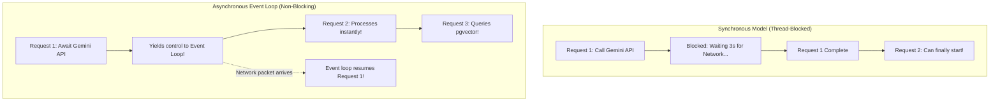

# Module 10: Asynchronous Python & Concurrency Mastery (The Engine of FastAPI)

Welcome to **Module 10** of the Normora Python & AI Masterclass.

This is the most critical architectural module in the entire course. In traditional web backends (like Flask or synchronous Django), every request occupies an entire operating system thread. If a request calls an AI model (like Google Gemini Flash) and waits 2 to 5 seconds for tokens to stream over the network, **that entire OS thread is blocked and frozen**. With 200 concurrent users, a server running 200 threads exhausts its memory and crashes.

FastAPI solves this by running on an **Asynchronous Single-Threaded Event Loop (`asyncio`)**. 

In this module, you will master the mechanics of coroutines, non-blocking sockets, structured concurrency, asynchronous generators (the secret behind token streaming), and how to avoid blocking the event loop.

Every concept is followed by **at least 5 real-world Normora examples**.

---

## 1. Synchronous vs. Asynchronous: The Event Loop Demystified

* **Synchronous (Blocking):** Code runs sequentially. While waiting for a database response or cloud LLM completion, the CPU sits idle, unable to do anything else.
* **Asynchronous (Non-Blocking Cooperative Multitasking):** When a task initiates an I/O operation (e.g. waiting for a network socket), it yields control back to the **Event Loop**. The Event Loop immediately switches CPU execution to another user's request!



---

## 2. Coroutines (`async def`) and the `await` Keyword

* A function defined with **`async def`** is a **Coroutine Function**. Calling it does not execute it immediately; it returns a **Coroutine Object**.
* The **`await`** keyword can only be used inside an `async def` function. It pauses the current coroutine until the awaited operation finishes, allowing other coroutines to run on the event loop.

### 5 Real-World Normora Examples:

#### Example 2.1: Non-Blocking Simulated Call to Google Gemini Flash
```python
import asyncio

async def fetch_gemini_completion(prompt: str) -> str:
    print(f"--> [Gemini] Dispatching prompt: '{prompt[:30]}...'")
    # asyncio.sleep simulates waiting for remote network I/O without blocking the thread:
    await asyncio.sleep(0.1)
    print("<-- [Gemini] Response tokens received!")
    return "Normora policies mandate AES-256 encryption."

# To run a top-level coroutine in Python:
async def main():
    result = await fetch_gemini_completion("What is our encryption standard?")
    print(f"Result: {result}")

asyncio.run(main())
```

#### Example 2.2: Async pgvector Database Query
```python
async def query_pgvector(tenant_id: str, query_embedding: list[float], limit: int = 3) -> list[str]:
    print(f"Querying pgvector HNSW index for tenant {tenant_id}...")
    await asyncio.sleep(0.05)  # Simulates asyncpg database network wait
    return ["chunk-101", "chunk-104", "chunk-108"]

async def search_flow():
    chunks = await query_pgvector("T-1", [0.1] * 768)
    print(f"Retrieved chunks: {chunks}")

asyncio.run(search_flow())
```

#### Example 2.3: Async Tenant Subscription Verification
```python
async def verify_tenant_active(tenant_id: str) -> bool:
    await asyncio.sleep(0.02)
    return True

async def gatekeeper():
    if await verify_tenant_active("T-99"):
        print("Tenant verified asynchronously.")

asyncio.run(gatekeeper())
```

#### Example 2.4: Async Document Ingestion Status Poller
```python
async def check_ingestion_job_status(job_id: str) -> str:
    await asyncio.sleep(0.03)
    return "INDEXED"

async def monitor():
    status = await check_ingestion_job_status("job-441")
    print(f"Ingestion status: {status}")

asyncio.run(monitor())
```

#### Example 2.5: Chaining Async Functions (The Pipeline)
```python
async def get_user_tenant(user_id: str) -> str:
    await asyncio.sleep(0.01)
    return "TENANT-ACME"

async def get_tenant_docs(tenant_id: str) -> list[str]:
    await asyncio.sleep(0.02)
    return ["Handbook.pdf", "Security.pdf"]

async def run_pipeline():
    tenant = await get_user_tenant("USR-1")
    docs = await get_tenant_docs(tenant)
    print(f"User docs in {tenant}: {docs}")

asyncio.run(run_pipeline())
```

---

## 3. Concurrent Execution: `asyncio.gather()` & `asyncio.TaskGroup`

When you have multiple independent I/O tasks, you should never await them sequentially. Run them **concurrently in parallel**!

* **`asyncio.gather(*tasks)`**: Runs multiple coroutines concurrently and collects their results.
* **`asyncio.TaskGroup` (Python 3.11+)**: Modern **Structured Concurrency**. If one task in the group raises an exception, all other running tasks are safely cancelled immediately!

### 5 Real-World Normora Examples:

#### Example 3.1: Parallel Embeddings Generation with `asyncio.gather`
Generating embeddings for 3 document chunks concurrently:
```python
import time

async def embed_chunk(chunk_id: str) -> dict:
    print(f"Starting embedding for {chunk_id}...")
    await asyncio.sleep(0.2)  # Simulates 200ms API call
    return {"id": chunk_id, "dimension": 768}

async def embed_all():
    start = time.time()
    # Runs all 3 concurrently in ~200ms instead of 600ms sequentially!
    results = await asyncio.gather(
        embed_chunk("chk-1"),
        embed_chunk("chk-2"),
        embed_chunk("chk-3")
    )
    print(f"Embedded {len(results)} chunks in {time.time() - start:.2f} seconds.")

asyncio.run(embed_all())
```

#### Example 3.2: Hybrid Retrieval (Dense Vector + Sparse Keyword Search in Parallel)
```python
async def search_dense_pgvector(query: str) -> list[str]:
    await asyncio.sleep(0.1)
    return ["chk-10", "chk-20"]

async def search_sparse_bm25(query: str) -> list[str]:
    await asyncio.sleep(0.1)
    return ["chk-20", "chk-30"]

async def hybrid_search(query: str):
    # Both searches run simultaneously:
    dense_results, sparse_results = await asyncio.gather(
        search_dense_pgvector(query),
        search_sparse_bm25(query)
    )
    # Combine & deduplicate:
    combined = list(set(dense_results + sparse_results))
    print(f"Hybrid matches: {combined}")

asyncio.run(hybrid_search("remote policy"))
```

#### Example 3.3: Modern Structured Concurrency with `asyncio.TaskGroup`
```python
async def sync_tenant_cache(tenant_id: str):
    await asyncio.sleep(0.05)
    print(f"Cache synced for {tenant_id}")

async def sync_all_tenants():
    # Python 3.11+ TaskGroup ensures safe cancellation if any task fails:
    async with asyncio.TaskGroup() as tg:
        t1 = tg.create_task(sync_tenant_cache("T-1"))
        t2 = tg.create_task(sync_tenant_cache("T-2"))
        t3 = tg.create_task(sync_tenant_cache("T-3"))
    print("All tenant caches updated successfully!")

asyncio.run(sync_all_tenants())
```

#### Example 3.4: Fetching Multi-Department Permissions Simultaneously
```python
async def fetch_dept_access(user_id: str, dept: str) -> tuple[str, bool]:
    await asyncio.sleep(0.03)
    return dept, True

async def evaluate_access():
    departments = ["Legal", "HR", "Engineering"]
    tasks = [fetch_dept_access("USR-9", d) for d in departments]
    results = await asyncio.gather(*tasks)
    print(f"User permissions: {dict(results)}")

asyncio.run(evaluate_access())
```

#### Example 3.5: Concurrent Fan-Out for Multi-Agent Tool Execution
```python
async def tool_search_docs(q: str):
    await asyncio.sleep(0.08)
    return {"tool": "search", "count": 2}

async def tool_check_subscription(t_id: str):
    await asyncio.sleep(0.05)
    return {"tool": "subscription", "active": True}

async def execute_agent_tools():
    results = await asyncio.gather(
        tool_search_docs("mfa rules"),
        tool_check_subscription("T-10")
    )
    print(f"Agent tool outputs: {results}")

asyncio.run(execute_agent_tools())
```

---

## 4. Async Generators & Real-Time Streaming (`yield` in `async def`)

An **Asynchronous Generator** is defined with `async def` and uses `yield`. It yields items one by one as they become available asynchronously, consumed using **`async for`**.

This is the **exact underlying mechanism used by FastAPI to stream AI tokens** from Google Gemini to the browser via Server-Sent Events (SSE)!

### 5 Real-World Normora Examples:

#### Example 4.1: Simulating Streaming AI Tokens from Google Gemini
```python
async def stream_gemini_tokens(prompt: str):
    simulated_tokens = ["According ", "to ", "Normora ", "company ", "policy, ", "MFA ", "is ", "mandatory."]
    for token in simulated_tokens:
        await asyncio.sleep(0.05)  # Simulates token arrival latency (~50ms/token)
        yield token

async def consume_stream():
    print("AI Response: ", end="", flush=True)
    async for token in stream_gemini_tokens("What are the MFA rules?"):
        print(token, end="", flush=True)
    print("\n[Stream Finished]")

asyncio.run(consume_stream())
```

#### Example 4.2: Asynchronous Document Chunk Paginator
Streaming chunks from a large database query in batches without loading all 10,000 chunks into RAM at once:
```python
async def stream_document_chunks(document_id: str):
    for batch_num in range(1, 4):
        await asyncio.sleep(0.05)  # Fetching batch from Postgres
        yield [f"chunk_{batch_num}_A", f"chunk_{batch_num}_B"]

async def process_chunks():
    async for batch in stream_document_chunks("DOC-99"):
        print(f"Received batch: {batch}")

asyncio.run(process_chunks())
```

#### Example 4.3: Streaming Vercel AI SDK Data Packets
```python
async def stream_vercel_sdk_packets():
    # 0: represents a text token packet in Vercel AI SDK protocol:
    packets = ['0:"Normora "\n', '0:"AI "\n', '0:"Assistant"\n']
    for p in packets:
        await asyncio.sleep(0.03)
        yield p

async def client_listener():
    async for packet in stream_vercel_sdk_packets():
        print(f"Wire packet: {packet.strip()}")

asyncio.run(client_listener())
```

#### Example 4.4: Streaming Event Heartbeats (Keep-Alive)
Keep SSE streaming connections alive across proxies:
```python
async def event_heartbeat_stream(max_ticks: int = 3):
    for tick in range(1, max_ticks + 1):
        await asyncio.sleep(0.05)
        yield f": ping {tick}\n\n"

async def test_heartbeat():
    async for ping in event_heartbeat_stream():
        print(f"Heartbeat sent: {ping.strip()}")

asyncio.run(test_heartbeat())
```

#### Example 4.5: Streaming Progress of Ingestion Pipeline
```python
async def stream_ingestion_progress(filename: str):
    stages = ["Text Extracted", "Tables Parsed", "Embeddings Generated", "HNSW Indexed"]
    for stage in stages:
        await asyncio.sleep(0.04)
        yield {"file": filename, "stage": stage}

async def track_upload():
    async for status in stream_ingestion_progress("Handbook.pdf"):
        print(f"Progress update: {status['stage']}")

asyncio.run(track_upload())
```

---

## 5. The #1 Fatal Async Anti-Pattern: Blocking the Event Loop

> [!CAUTION]
> **The Architect's Cardinal Rule:**  
> **NEVER execute a blocking synchronous operation inside an `async def` function!**

If you call synchronous functions like `time.sleep()`, synchronous `requests.get()`, or heavy CPU-bound loops inside an `async def` function, **you block the entire Event Loop thread**. All other concurrent users and streaming connections on the server freeze!

### The Solution: `asyncio.to_thread()`
To safely run a blocking or CPU-heavy library (e.g. PyPDF text extraction, password hashing) without blocking the async event loop, offload it to a background worker thread using **`asyncio.to_thread()`**:

### 5 Real-World Normora Examples:

#### Example 5.1: Offloading Blocking PDF Text Extraction to a Thread
```python
# A blocking, synchronous CPU function:
def extract_pdf_cpu_blocking(file_path: str) -> str:
    time.sleep(0.1)  # Simulating heavy CPU text extraction
    return "Extracted policy text."

async def async_upload_handler(file_path: str):
    print("Initiating non-blocking upload handler...")
    # ✅ Offload to thread pool: The event loop remains 100% responsive!
    extracted_text = await asyncio.to_thread(extract_pdf_cpu_blocking, file_path)
    print(f"Extraction complete: '{extracted_text}'")

asyncio.run(async_upload_handler("large_policy.pdf"))
```

#### Example 5.2: Rate Limiting Cloud AI Calls with `asyncio.Semaphore`
Prevent overwhelming Google Gemini API quotas by limiting concurrency to at most 2 simultaneous calls:
```python
rate_limiter = asyncio.Semaphore(2)

async def throttled_gemini_call(call_id: int):
    async with rate_limiter:
        print(f"[Slot Acquired] Processing call #{call_id}")
        await asyncio.sleep(0.1)
        print(f"[Slot Released] Finished call #{call_id}")

async def run_throttled():
    tasks = [throttled_gemini_call(i) for i in range(1, 5)]
    await asyncio.gather(*tasks)

asyncio.run(run_throttled())
```

#### Example 5.3: Handling Request Timeouts with `asyncio.timeout`
Ensure an unresponsive AI call does not hang indefinitely:
```python
async def slow_rag_query():
    await asyncio.sleep(0.5)
    return "Answer"

async def test_timeout():
    try:
        # Python 3.11+ async timeout context manager:
        async with asyncio.timeout(0.1):  # Limit to 100ms
            await slow_rag_query()
    except TimeoutError:
        print("Timeout Error: Gemini API took too long to reply. Returning fallback.")

asyncio.run(test_timeout())
```

#### Example 5.4: Background Task Fire-and-Forget with `asyncio.create_task`
Dispatch an audit log task without waiting for it to finish:
```python
async def write_audit_log_background(tenant_id: str, action: str):
    await asyncio.sleep(0.05)
    print(f"[BACKGROUND TASK] Audit log persisted for {tenant_id}: {action}")

async def handle_user_request():
    # Fire and forget:
    asyncio.create_task(write_audit_log_background("T-1", "LOGIN_SUCCESS"))
    print("HTTP 200 OK returned to client immediately!")
    await asyncio.sleep(0.06)  # Give event loop time to run background task

asyncio.run(handle_user_request())
```

#### Example 5.5: Producer-Consumer Pipeline with `asyncio.Queue`
Decouple document ingestion uploads from vector embedding generation:
```python
queue = asyncio.Queue(maxsize=5)

async def document_producer():
    for i in range(1, 4):
        await queue.put(f"document_{i}.pdf")
        print(f"[Producer] Queued document_{i}.pdf")

async def embedding_consumer():
    while not queue.empty():
        doc = await queue.get()
        print(f"[Consumer] Generating embeddings for {doc}...")
        await asyncio.sleep(0.05)
        queue.task_done()

async def run_queue_pipeline():
    await document_producer()
    await embedding_consumer()

asyncio.run(run_queue_pipeline())
```

---

## Summary & Next Step

You have mastered the engine that powers high-scale AI systems:
1. Understanding the non-blocking single-threaded Event Loop.
2. Writing coroutines (`async def`) and pausing cleanly with `await`.
3. Running operations concurrently with `asyncio.gather()` and `asyncio.TaskGroup`.
4. Streaming real-time AI tokens using **Asynchronous Generators (`yield` + `async for`)**.
5. Offloading blocking CPU tasks using `asyncio.to_thread()` and throttling traffic with `asyncio.Semaphore`.

In **Module 11**, we explore **CPython Internals & High-Throughput Memory Architecture (`__slots__`, bytecode, and memory optimization)**!
