# Module 11: CPython Internals & High-Throughput Memory Architecture

Welcome to **Module 11** of the Normora Python & AI Masterclass.

As an engineer with a background in .NET, C#, and high-performance server architectures, you are accustomed to the deterministic behavior of the Common Language Runtime (CLR), value types, garbage collection generations, and JIT compilation. When building an enterprise platform like **Normora**—where multi-tenant RAG pipelines stream thousands of tokens per second, process gigabytes of vector embeddings, and enforce strict cross-tenant isolation—you cannot treat Python as an opaque scripting tool. 

An AI systems architect must understand the physical reality of the machine:
* How the **CPython virtual machine** compiles and executes bytecode instructions.
* Why there are **no value types** in Python and how the `PyObject` structure dictates heap allocations.
* How to cut memory consumption by **60% to 70%** across millions of vector chunks using **`__slots__`**.
* Why **`sys.intern()`** is critical for eliminating duplicate strings across high-throughput tenant operations.
* How the dual-layer memory reclamation engine (**Reference Counting + Generational Cyclic Garbage Collection**) works under the hood.
* How to use **`weakref`** to decouple parent-child document relationships and prevent circular reference leaks.
* The critical mechanics of **`copy` vs. `deepcopy`** to guarantee tenant state isolation.
* How to diagnose and eliminate memory leaks using production-grade profiling tools: **`tracemalloc`**, **`objgraph`**, and **`sys.getsizeof()`**.
* The true architectural reality of the **Global Interpreter Lock (GIL)** and why it does **not** impede hosted cloud AI services like **Google Gemini Flash**.

Every architectural concept in this module is explained from first principles and reinforced with **at least 5 real-world Normora examples**.

---

## 1. The CPython Compilation & Stack-Based Execution Pipeline

### The Myth of the "Interpreted" Language

A pervasive misconception among developers transitioning from .NET or Java is that Python is purely interpreted line-by-line. In reality, **Python is a compiled language**. 

CPython (the standard, reference implementation written in C) does not execute raw Python source text. It compiles Python code into an intermediate format called **bytecode** before feeding it into the virtual machine evaluation loop.

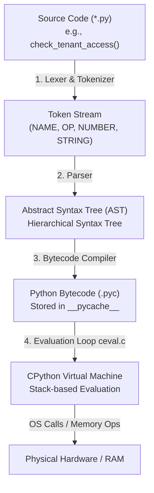

#### The 4 Stages of CPython Execution:
1. **Tokenization (Lexing):** The tokenizer converts the source code into atomic lexical tokens (keywords, identifiers, literals, operators).
2. **Parsing (AST Generation):** The token stream is transformed into an **Abstract Syntax Tree (AST)**, validating syntax and establishing structural hierarchy.
3. **Bytecode Compilation:** The AST is compiled into low-level virtual machine instructions. These bytecode instructions are cached in `__pycache__/*.pyc` files on disk, avoiding recompilation when unchanged.
4. **Virtual Machine Evaluation Loop (`ceval.c`):** The bytecode instructions are executed inside CPython's main runtime loop located in `Python/ceval.c`. This loop fetches an opcode, pops operands from an evaluation stack, executes corresponding C functions, and pushes the result back onto the stack.

### Stack-Based Virtual Machine Mechanics

Like the .NET CLR Intermediate Language (IL) and the Java Virtual Machine (JVM), CPython is an **evaluation-stack machine**:
* `LOAD_FAST`: Pushes a local variable pointer onto the evaluation stack.
* `LOAD_CONST`: Pushes a constant literal pointer onto the evaluation stack.
* `COMPARE_OP` / `BINARY_OP`: Pops operands from the stack, executes the operator via C routines, and pushes the result.
* `STORE_FAST`: Pops the top of the stack and stores it in the local frame slot.
* `RETURN_VALUE`: Pops the top of the stack and returns it to the caller.

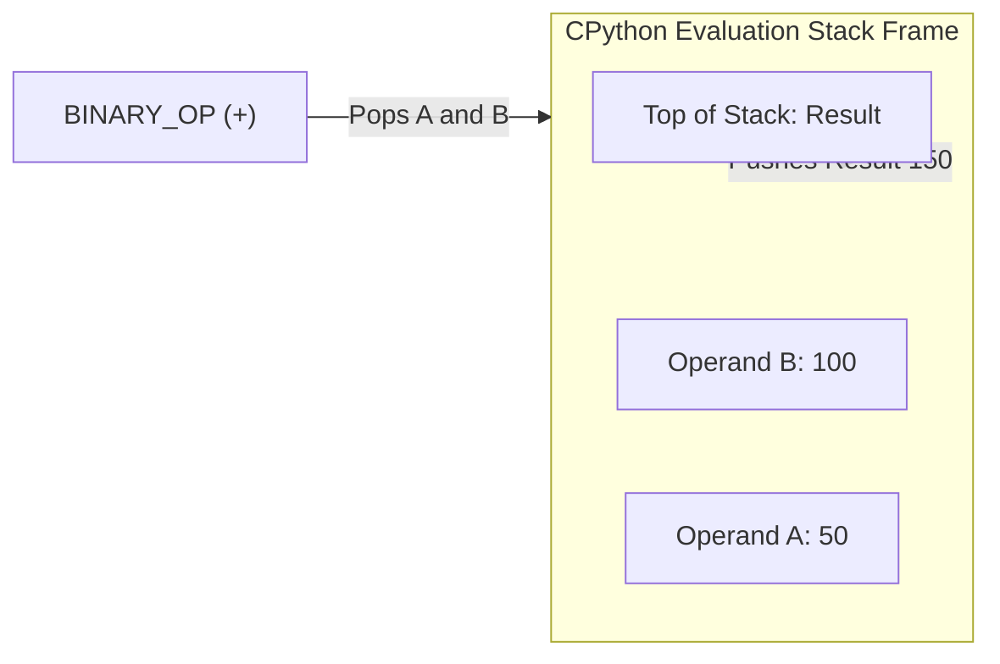

### C# / .NET CLR vs. CPython Execution Model

| Architectural Dimension | .NET 10 CLR | CPython 3.12 / 3.13 |
|---|---|---|
| **Compilation Model** | C# -> Roslyn compiler -> CIL (.dll) -> RyuJIT to native machine code | Python source -> AST -> Python Bytecode (`.pyc`) -> Interpreted via `ceval.c` loop |
| **Execution Engine** | Native machine instructions (CPU registers & hardware instructions) | Virtual Machine evaluation loop in C |
| **JIT Compilation** | Comprehensive Tiered JIT (Tier 0, Tier 1, Native PGO) | Experimental Copy-on-Write JIT (Python 3.13+) |
| **VM Architecture** | Stack-based Intermediate Language (IL) | Stack-based Bytecode |
| **File Artifacts** | Portable Executable `.dll` / `.exe` | Bytecode cache `.pyc` inside `__pycache__` |

---

### 5 Real-World Normora Examples: Bytecode Inspection with `dis`

The built-in `dis` module allows us to disassemble Python functions and inspect the exact bytecode instructions generated by the compiler.

#### Example 1.1: Disassembling Tenant Access & RBAC Policy Check
In Normora's `Tenants` module, tenant access must be validated against the caller's JWT claims. Let's disassemble a fast RBAC role check:

```python
import dis

def check_tenant_access(user_role: str, target_tenant: str, user_tenant: str) -> bool:
    # BOLA protection: If user is not SuperAdmin and tenant does not match, reject
    if user_role != "SuperAdmin" and target_tenant != user_tenant:
        return False
    return True

print("=== Bytecode: check_tenant_access ===")
dis.dis(check_tenant_access)
```

**Bytecode Output:**
```text
  4           0 LOAD_FAST                0 (user_role)
              2 LOAD_CONST               1 ('SuperAdmin')
              4 COMPARE_OP              56 (!=)
              8 POP_JUMP_IF_FALSE        9 (to 18)
             10 LOAD_FAST                1 (target_tenant)
             12 LOAD_FAST                2 (user_tenant)
             14 COMPARE_OP              56 (!=)
             18 POP_JUMP_IF_FALSE        2 (to 24)

  5          20 LOAD_CONST               2 (False)
             22 RETURN_VALUE

  6     >>   24 LOAD_CONST               3 (True)
             26 RETURN_VALUE
```
> [!NOTE]
> Notice the short-circuit evaluation: `POP_JUMP_IF_FALSE` skips the second comparison if `user_role != "SuperAdmin"` is false, mirroring the high-performance IL branching in C#.

#### Example 1.2: Disassembling Vector Re-ranking Score Filter
In Normora's `Documents` module, background workers filter vector cosine similarity scores returned from pgvector:

```python
import dis

def filter_top_chunks(scores: list[float], threshold: float = 0.82) -> list[float]:
    # List comprehension filtering for high-confidence RAG contexts
    return [score for score in scores if score >= threshold]

print("=== Bytecode: filter_top_chunks ===")
dis.dis(filter_top_chunks)
```

**Bytecode Output:**
```text
  4           0 LOAD_CLOSURE             0 (threshold)
              2 BUILD_LIST               0
              4 LOAD_FAST                0 (scores)
              6 GET_ITER
        >>    8 FOR_ITER                 9 (to 28)
             10 STORE_FAST               2 (score)
             12 LOAD_FAST                2 (score)
             14 LOAD_DEREF               0 (threshold)
             16 COMPARE_OP             116 (>=)
             20 POP_JUMP_IF_FALSE        3 (to 26)
             22 LOAD_FAST                2 (score)
             24 LIST_APPEND              2
        >>   26 JUMP_BACKWARD           10 (to 8)
        >>   28 RETURN_VALUE
```
> [!TIP]
> The `LIST_APPEND` instruction is executed directly in optimized C without calling `list.append()` via attribute lookup, making list comprehensions up to 35% faster than explicit Python `for` loops.

#### Example 1.3: Compile-Time Constant Folding in Token Quota Calculation
When calculating daily token quotas for tenant subscription tiers, CPython evaluates constant math at compile time:

```python
import dis

def calculate_daily_token_quota(tier_multiplier: int) -> int:
    # 24 hours * 60 minutes * 60 seconds * 10 tokens/sec
    base_quota = 24 * 60 * 60 * 10
    return base_quota * tier_multiplier

print("=== Bytecode: calculate_daily_token_quota ===")
dis.dis(calculate_daily_token_quota)
```

**Bytecode Output:**
```text
  3           0 LOAD_CONST               1 (864000)
              2 STORE_FAST               1 (base_quota)

  4           4 LOAD_FAST                1 (base_quota)
              6 LOAD_FAST                0 (tier_multiplier)
              8 BINARY_OP                5 (*)
             12 RETURN_VALUE
```
> [!IMPORTANT]
> Notice `LOAD_CONST 1 (864000)`: CPython's AST optimizer evaluates `24 * 60 * 60 * 10` during compilation. There is zero runtime arithmetic overhead for static constants.

#### Example 1.4: Bytecode of List Comprehension vs. Explicit `for` Loop
Comparing metadata sanitization for documents ingested into MinIO:

```python
import dis

def sanitize_with_loop(raw_tags: list[str]) -> list[str]:
    sanitized = []
    for tag in raw_tags:
        sanitized.append(tag.strip().lower())
    return sanitized

def sanitize_with_comprehension(raw_tags: list[str]) -> list[str]:
    return [tag.strip().lower() for tag in raw_tags]

print("=== Loop Bytecode (inspecting overhead) ===")
dis.dis(sanitize_with_loop)
```
In `sanitize_with_loop`, each iteration executes `LOAD_METHOD (append)` and `CALL_METHOD`, incurring dynamic attribute lookups in Python's evaluation loop. In `sanitize_with_comprehension`, the VM emits the specialized `LIST_APPEND` instruction, completely bypassing method resolution.

#### Example 1.5: String Formatting Bytecode (f-strings vs. `.format()` vs. `%`)
In Normora's `Conversations` module, token deltas are pushed to Angular 22 via SignalR hubs:

```python
import dis

def format_signalr_chunk_event(tenant_id: str, message_id: str, chunk_index: int) -> str:
    # Modern Python f-string
    return f"event:token|tenant:{tenant_id}|msg:{message_id}|idx:{chunk_index}"

print("=== Bytecode: format_signalr_chunk_event ===")
dis.dis(format_signalr_chunk_event)
```

**Bytecode Output:**
```text
  3           0 LOAD_CONST               1 ('event:token|tenant:')
              2 LOAD_FAST                0 (tenant_id)
              4 FORMAT_VALUE             0
              6 LOAD_CONST               2 ('|msg:')
              8 LOAD_FAST                1 (message_id)
             10 FORMAT_VALUE             0
             12 LOAD_CONST               3 ('|idx:')
             14 LOAD_FAST                2 (chunk_index)
             16 FORMAT_VALUE             0
             18 BUILD_STRING             6
             20 RETURN_VALUE
```
> [!NOTE]
> `BUILD_STRING` pre-allocates the exact required buffer in C and concatenates strings in one pass. It is drastically more efficient than `+` concatenation or `.format()`.

---

## 2. The `PyObject` Architecture & Object Memory Layout

### Everything is a Pointer: There Are NO Value Types

In C# and the .NET CLR, memory is split into:
* **Value Types (`struct`, `int`, `double`, `bool`):** Stored inline directly on the stack or inlined inside array memory blocks. Zero pointer dereferencing.
* **Reference Types (`class`, `string`, `object`):** Stored on the managed heap with an 8-byte object header (SyncBlock + TypeHandle).

In CPython, **there are NO value types**. Every single variable is an 8-byte pointer on the stack pointing to a heap-allocated C struct called **`PyObject`**.

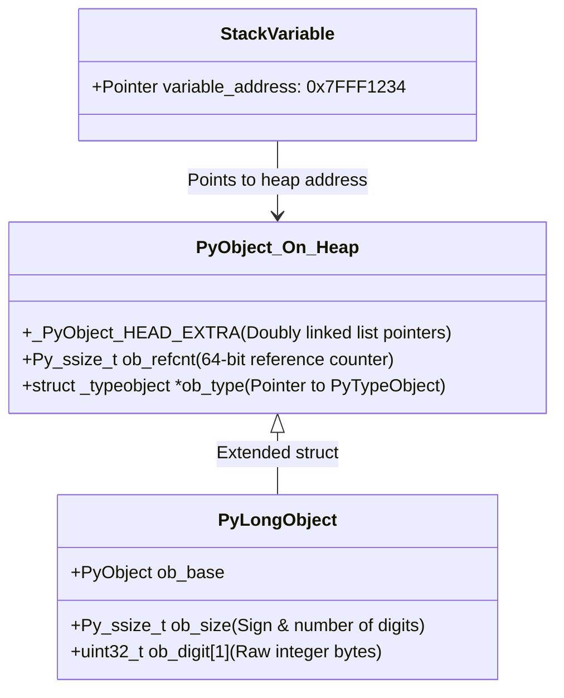

### The C Source Header (`Include/object.h`)

```c
typedef struct _object {
    _PyObject_HEAD_EXTRA         // Doubly-linked list pointers for cyclic GC tracking
    Py_ssize_t ob_refcnt;        // 64-bit integer tracking active references
    struct _typeobject *ob_type; // Pointer to type descriptor (provides methods & vtable)
} PyObject;
```

When you define an integer in Normora (`token_count = 42`):
1. CPython allocates a `PyLongObject` struct on the heap (28 bytes on 64-bit architecture!).
2. It sets `ob_refcnt = 1`.
3. It sets `ob_type` to `&PyLong_Type`.
4. It sets `ob_size = 1` and `ob_digit[0] = 42`.
5. The variable `token_count` inside your function frame is simply an 8-byte memory address pointing to this 28-byte structure.

### CPython Memory Allocator: PyMalloc, Arenas, Pools, and Blocks

CPython does not directly call the operating system's `malloc()` for every small object. Because Python creates and destroys millions of small objects every second, calling OS `malloc()` would cause severe memory fragmentation and kernel lock contention.

Instead, CPython employs **PyMalloc**:
* **Arenas (256 KB):** Allocated via OS `malloc()`. Holds 64 Pools.
* **Pools (4 KB):** Divides memory into fixed-size blocks for a specific allocation size class (multiples of 8 bytes up to 512 bytes).
* **Blocks (8 to 512 bytes):** The exact memory slots handed out to `PyObject` instances.
* For objects larger than 512 bytes, CPython falls back directly to the standard system allocator (`malloc`).

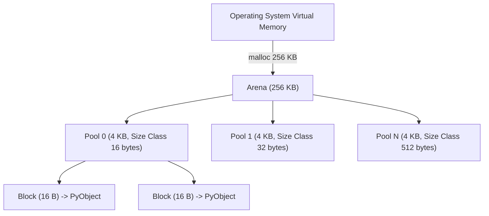

### C# / .NET CLR vs. CPython Memory Layout

| Memory Feature | .NET 10 CLR | CPython 3.12+ |
|---|---|---|
| **Primitive Integer (`int32`)** | 4 bytes on stack or inlined | 28 bytes `PyLongObject` on heap |
| **Float (`double`)** | 8 bytes IEEE 754 on stack/inlined | 24 bytes `PyFloatObject` on heap |
| **Boolean (`bool`)** | 1 byte on stack/inlined | 28 bytes singleton `PyBoolObject` on heap |
| **Memory Allocation Overhead** | Zero overhead for value types | 16-byte base header minimum for EVERY object |
| **Small Object Heap** | Gen 0 / Gen 1 managed garbage collected heap | PyMalloc (Arenas -> Pools -> Blocks) |
| **Large Object Handling** | Large Object Heap (LOH, >85,000 bytes) | Direct OS `malloc()` (>512 bytes) |

---

### 5 Real-World Normora Examples: Memory Layout & `__sizeof__`

#### Example 2.1: Inspecting Base Memory Overhead with `sys.getsizeof()`
Let's measure the raw memory footprints of standard types in Normora's metadata pipeline:

```python
import sys

# Integer token count
tokens = 100
print(f"Size of int(100): {sys.getsizeof(tokens)} bytes")  # 28 bytes!

# Float vector component
vector_component = 0.94125
print(f"Size of float: {sys.getsizeof(vector_component)} bytes")  # 24 bytes!

# Empty string vs Tenant ID string
empty_str = ""
tenant_id = "tenant-prod-us-east-9412"
print(f"Size of empty string: {sys.getsizeof(empty_str)} bytes")  # 49 to 51 bytes!
print(f"Size of tenant_id string: {sys.getsizeof(tenant_id)} bytes")  # ~75-80 bytes!

# Empty dict (hash table overhead)
empty_dict = {}
print(f"Size of empty dictionary: {sys.getsizeof(empty_dict)} bytes")  # 64 bytes!
```

#### Example 2.2: Implementing Custom Memory Calculation with `__sizeof__()`
In Normora's `Documents` module, background workers process PDF extractions. We implement `__sizeof__()` to accurately report memory consumption:

```python
import sys

class DocumentChunk:
    def __init__(self, chunk_id: str, content: str, embedding: list[float]):
        self.chunk_id = chunk_id
        self.content = content
        self.embedding = embedding

    def __sizeof__(self) -> int:
        # Base object size via parent descriptor
        size = super().__sizeof__()
        # Include dynamic attribute dictionary and __dict__ overhead
        if hasattr(self, "__dict__"):
            size += sys.getsizeof(self.__dict__)
        # Add deep size of strings and vector payload
        size += sys.getsizeof(self.chunk_id)
        size += sys.getsizeof(self.content)
        size += sys.getsizeof(self.embedding)
        # Vector floats in Python list
        size += sum(sys.getsizeof(val) for val in self.embedding)
        return size

chunk = DocumentChunk(
    chunk_id="chk_90124",
    content="Normora tenant data retention policy guarantees zero cross-tenant contamination.",
    embedding=[0.0125] * 768  # 768-dimensional embedding from Google Gemini Flash
)

print(f"Shallow sys.getsizeof: {sys.getsizeof(chunk)} bytes")
print(f"Deep custom __sizeof__: {chunk.__sizeof__()} bytes")
```

#### Example 2.3: Recursive Deep Memory Inspection for Ingestion Payloads
`sys.getsizeof()` is non-recursive (shallow). It reports only the container pointer array, not the elements inside! Let's build a deep memory calculator:

```python
import sys

def get_deep_size(obj: object, seen: set | None = None) -> int:
    """Recursively computes total memory of nested Python objects."""
    if seen is None:
        seen = set()

    obj_id = id(obj)
    if obj_id in seen:
        return 0
    seen.add(obj_id)

    size = sys.getsizeof(obj)

    if isinstance(obj, dict):
        size += sum(get_deep_size(k, seen) + get_deep_size(v, seen) for k, v in obj.items())
    elif isinstance(obj, (list, tuple, set, frozenset)):
        size += sum(get_deep_size(item, seen) for item in obj)
    elif hasattr(obj, "__dict__"):
        size += get_deep_size(obj.__dict__, seen)
    elif hasattr(obj, "__slots__"):
        size += sum(get_deep_size(getattr(obj, s), seen) for s in obj.__slots__ if hasattr(obj, s))

    return size

raw_rag_payload = {
    "tenant_id": "T-ACME-01",
    "chunks": [
        {"id": "c1", "vector": [0.12] * 768},
        {"id": "c2", "vector": [0.34] * 768},
    ]
}

print(f"Shallow size: {sys.getsizeof(raw_rag_payload)} bytes")
print(f"Actual deep memory footprint: {get_deep_size(raw_rag_payload)} bytes")
```

#### Example 2.4: Mutability vs. Immutability in Tenant Context Pointers
In Python, variables are labels bound to objects. Re-assigning a variable does not mutate the object; it rebinds the pointer to a new heap address:

```python
# Tenant context configuration (Immutable string vs Mutable list)
current_tenant_id = "tenant-alpha"
initial_address = id(current_tenant_id)

# Reassignment creates a NEW PyUnicodeObject on the heap:
current_tenant_id = "tenant-beta"
new_address = id(current_tenant_id)
print(f"Address changed: {initial_address != new_address}")  # True

# Mutable list: Mutating modifies the underlying PyListObject in-place
active_tenants = ["tenant-alpha"]
list_address_before = id(active_tenants)
active_tenants.append("tenant-beta")
list_address_after = id(active_tenants)
print(f"List address preserved in-place: {list_address_before == list_address_after}")  # True
```

#### Example 2.5: Pointer Re-assignment and Object Replacement in Conversation State
When updating a conversation state machine in Normora, you must understand whether you are modifying an existing object or replacing its pointer:

```python
class ConversationSession:
    def __init__(self, session_id: str, tenant_id: str):
        self.session_id = session_id
        self.tenant_id = tenant_id
        self.token_budget = 100_000

session = ConversationSession("sess_001", "T-100")
initial_token_id = id(session.token_budget)

# Integers are immutable: Subtraction produces a BRAND NEW PyLongObject on the heap
session.token_budget -= 450
updated_token_id = id(session.token_budget)

print(f"Integer token_budget object was replaced: {initial_token_id != updated_token_id}")
```

---

## 3. Object Identity, Equality, and Singleton Caching

### Identity (`is`) vs. Equality (`==`) in Depth

Because all Python variables are pointers holding 64-bit heap addresses, Python provides two distinct comparison operators:

1. **`==` (Value Equality):** Compares the *contents* of two objects by invoking the dunder method `__eq__()`.
2. **`is` (Referential Identity):** Compares whether two pointers point to the **exact same physical memory address** (`id(a) == id(b)`).

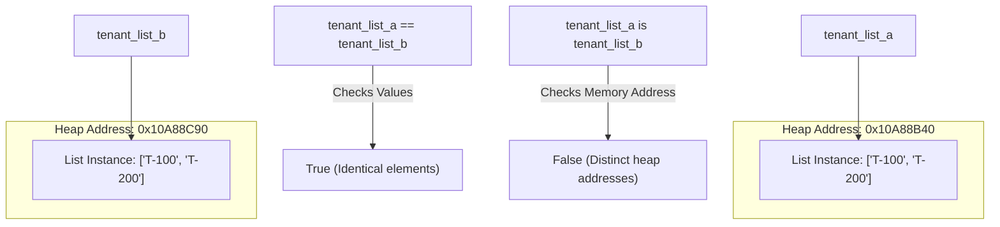

### Small Integer Caching (-5 to 256)

During startup, CPython initializes an internal static array of `PyLongObject` singletons for all integers from `-5` through `256` inclusive (`Include/internal/pycore_global_objects.h`).
* Any arithmetic or assignment that produces an integer in this range returns a pointer to the **pre-existing singleton**.
* Any integer outside this range allocates a brand-new heap object (in interactive/dynamic code).

```python
x = 256
y = 256
print(x is y)  # True: Both share the pre-allocated CPython singleton

x = 257
y = 257
print(x is y)  # False (in REPL / dynamic execution): Two distinct PyLongObjects!
```

### String Interning Mechanics & `sys.intern()`

String interning ensures that only **one copy** of an immutable string is stored in memory. When strings are interned:
1. All identical strings point to the same `PyUnicodeObject` in heap memory.
2. Checking equality between interned strings changes from an $O(N)$ character-by-character comparison to an $O(1)$ single-CPU-instruction pointer comparison (`is`).

#### What CPython Interns Automatically:
* Python identifiers (variable names, function names, class names, method names).
* Dictionary keys in class definitions.
* String literals that resemble valid identifiers (ASCII alphanumeric characters and underscores) during compilation.

#### What CPython Does NOT Intern Automatically:
* Dynamic strings read from HTTP request headers, MinIO object keys, PostgreSQL query results, or JSON payloads.
* Strings containing spaces, hyphens, or non-ASCII characters.

#### High-Throughput Memory Deduplication with `sys.intern()`:
In Normora, when ingesting 500,000 document chunks, each chunk might have the metadata string `"tenant_id": "tenant-enterprise-financial-services-emea-2026"`. Without interning, CPython allocates 500,000 distinct `PyUnicodeObject` instances—wasting tens of megabytes of RAM.

By calling `sys.intern(tenant_id)`, CPython places the string into an internal global dictionary of interned strings. Subsequent calls return the existing pointer, immediately deduplicating memory!

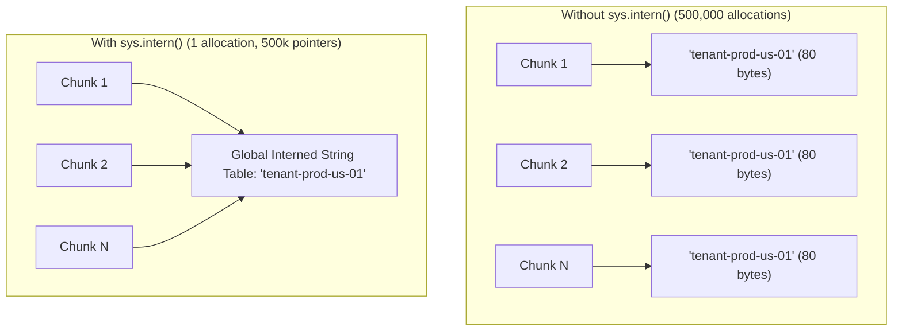

### C# / .NET Equivalent: String Interning

| Feature | .NET 10 CLR | CPython 3.12+ |
|---|---|---|
| **Interning Mechanism** | `string.Intern(str)` / `string.IsInterned(str)` | `sys.intern(str)` |
| **Storage Location** | CLR AppDomain String Intern Pool | CPython global interned string dictionary |
| **Automatic Interning** | String literals in assemblies compiled into metadata | Compile-time identifier-like ASCII string literals |
| **Pointer Comparison** | `object.ReferenceEquals(a, b)` | `a is b` |
| **Dynamic Interning Cost** | Concurrent hash table lookup on global intern table | Hash table lookup in `PyInterpreterState` interned dict |

---

### 5 Real-World Normora Examples: Identity, Equality & Interning

#### Example 3.1: Referential Identity (`is`) vs. Value Equality (`==`) in BOLA Defense
In Normora's BOLA security checks, we must verify tenant ownership. Confusing `is` and `==` on dynamically generated UUIDs creates severe vulnerabilities:

```python
# Simulated dynamic tenant retrieval from Keycloak JWT and Database
jwt_tenant_claim = "".join(["tenant", "-", "corp", "-", "99"])  # Dynamically constructed
db_tenant_record = "tenant-corp-99"

# Value comparison checks string contents:
print(f"Value Equality (==): {jwt_tenant_claim == db_tenant_record}")  # True!

# Identity comparison checks pointer addresses:
print(f"Referential Identity (is): {jwt_tenant_claim is db_tenant_record}")  # False!
```
> [!WARNING]
> NEVER use `is` for business logic comparisons like tenant verification or user authentication! Dynamic strings reside at different heap addresses, causing legitimate requests to fail with unauthorized errors.

#### Example 3.2: Small Integer Caching in HTTP Pagination & Chunk Limits
Observing the singleton threshold on pagination parameters:

```python
def get_pagination_limit(requested_size: int) -> int:
    return min(max(requested_size, 10), 250)

limit_a = get_pagination_limit(50)
limit_b = get_pagination_limit(50)
print(f"Limit 50 shares CPython singleton: {limit_a is limit_b}")  # True (<= 256)

limit_large_a = 500  # Batch vector processing window
limit_large_b = 500
print(f"Limit 500 shares singleton: {limit_large_a is limit_large_b}")  # False (in dynamic code)
```

#### Example 3.3: High-Throughput Memory Deduplication with `sys.intern()`
When ingesting 100,000 vector records with repeated department and role labels:

```python
import sys

raw_departments = ["Legal", "Compliance", "Finance", "HumanResources", "Engineering"]

# Simulating 100,000 incoming metadata records from MinIO extraction
records = []
for i in range(100_000):
    dept_str = raw_departments[i % len(raw_departments)]
    # Without sys.intern(), this would allocate 100,000 separate string objects
    # With sys.intern(), all 100,000 records share exactly 5 pointers!
    interned_dept = sys.intern(dept_str)
    records.append({"chunk_id": f"chk_{i}", "department": interned_dept})

# Proof: Pointers for "Legal" across all records are identical:
first_legal = records[0]["department"]
sixth_legal = records[5]["department"]
print(f"Deduplicated to single memory address: {first_legal is sixth_legal}")  # True!
```

#### Example 3.4: String Interning on JSON Metadata Keys from MinIO Documents
Normora's Document ingestion worker extracts JSON frontmatter from PDFs:

```python
import sys
import json

def parse_document_metadata_optimized(raw_json: str) -> dict[str, str]:
    data = json.loads(raw_json)
    # Intern all dictionary keys to save RAM across millions of documents:
    return {sys.intern(k): sys.intern(v) if isinstance(v, str) else v for k, v in data.items()}

json_payload = '{"tenant_id": "T-ACME", "access_level": "Restricted", "module": "Documents"}'
meta1 = parse_document_metadata_optimized(json_payload)
meta2 = parse_document_metadata_optimized(json_payload)

for key in meta1:
    print(f"Key '{key}' interned identity: {key is list(meta2.keys())[list(meta1.keys()).index(key)]}")
```

#### Example 3.5: Singleton Checks on `None`, `True`, and `False`
In Python, `None`, `True`, and `False` are guaranteed to be singletons. Identity comparison (`is`) is the only canonical and performant way to test for them:

```python
class RetrievalContext:
    def __init__(self, tenant_id: str, cached_embedding: list[float] | None = None):
        self.tenant_id = tenant_id
        self.cached_embedding = cached_embedding

context = RetrievalContext("T-882")

# Correct: Compares pointer to the NoneType singleton:
if context.cached_embedding is None:
    print("Embedding cache miss. Fetching from pgvector...")

# Anti-pattern: context.cached_embedding == None
# Calling == invokes __eq__ which may execute arbitrary user code or fail on NumPy arrays!
```

---

## 4. Memory Optimization with `__slots__` (Saving 60% RAM)

### The Hidden Cost of Dynamic Objects: `__dict__`

By default, every custom class instance in Python stores its attributes in an internal dictionary called **`__dict__`**.
* This dictionary provides total dynamic flexibility: you can attach new attributes to an instance at any time (`obj.new_attribute = "value"`).
* However, a Python dictionary is a **sparse hash table** requiring:
  * A table header (`PyDictObject` ~64 bytes).
  * An array of hash keys, pointers, and hash values (~100 to 150 bytes minimum).
* This means every single object instance in Python carries approximately **150 to 200 bytes of pure dictionary overhead** before storing any actual data!

In Normora, when an enterprise tenant ingests a 1,000-page compliance manual resulting in **200,000 document chunks**, that dictionary overhead wastes **30 to 40 MB of RAM** purely on empty hash tables and string keys!

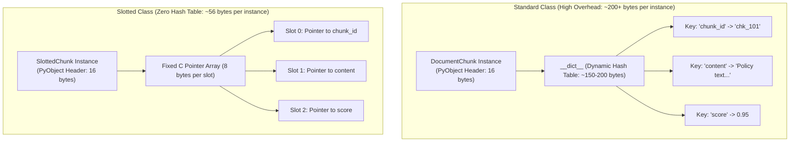

### The Architect's Solution: `__slots__`

By declaring `__slots__ = ("attr1", "attr2")` inside your class definition:
1. You instruct CPython to **suppress the creation of `__dict__` and `__weakref__`**.
2. CPython allocates a fixed-size C array of pointers directly inside the object's struct header.
3. Memory consumption per instance drops by **60% to 70%**!
4. Attribute access becomes noticeably faster because CPython looks up attributes via direct array indexing (offset) rather than hashing keys in a dictionary.

### `__slots__` Architectural Trade-Offs

| Advantage | Limitation / Caveat |
|---|---|
| **60-70% RAM reduction** per instance | Cannot add arbitrary new attributes at runtime (raises `AttributeError`) |
| **Faster attribute access** (direct pointer offset) | Subclasses must also define `__slots__`; otherwise, the subclass creates a `__dict__` |
| **Prevents typo bugs** (e.g. `obj.conntent = "x"`) | Multiple inheritance of slotted classes with non-empty slots is forbidden |
| Eliminates dictionary memory fragmentation | Cannot use `weakref` unless `"__weakref__"` is explicitly declared in `__slots__` |

### C# / .NET Equivalent: Structs vs. Classes

| Dimension | .NET 10 CLR | CPython with `__slots__` |
|---|---|---|
| **Memory Allocation** | `struct` / `readonly struct` allocated inline on stack or in contiguous array | `__slots__` object allocated on heap, but fixed C pointer array (no `__dict__`) |
| **Attribute Overhead** | Zero overhead (fields packed according to layout) | 16-byte `PyObject` header + 8 bytes per slot pointer |
| **Dynamic Fields** | Strictly forbidden (static typing) | Forbidden (raises `AttributeError`) |
| **Contiguous Arrays** | Array of structs (`Vector3[]`) stored flat in 1 continuous memory buffer | Python list is still an array of 8-byte pointers pointing to individual objects |

---

### 5 Real-World Normora Examples: Memory Optimization with `__slots__`

#### Example 4.1: High-Density `DocumentChunk` Memory Benchmark
Let's benchmark 100,000 document chunks comparing a standard class against a slotted class:

```python
import sys

class StandardDocumentChunk:
    def __init__(self, chunk_id: str, content: str, score: float):
        self.chunk_id = chunk_id
        self.content = content
        self.score = score

class SlottedDocumentChunk:
    __slots__ = ("chunk_id", "content", "score")

    def __init__(self, chunk_id: str, content: str, score: float):
        self.chunk_id = chunk_id
        self.content = content
        self.score = score

standard_obj = StandardDocumentChunk("chk_1", "Normora RBAC Policy", 0.96)
slotted_obj = SlottedDocumentChunk("chk_1", "Normora RBAC Policy", 0.96)

# Standard object has __dict__:
print(f"Standard object size: {sys.getsizeof(standard_obj) + sys.getsizeof(standard_obj.__dict__)} bytes")
# Slotted object has NO __dict__:
print(f"Slotted object size:  {sys.getsizeof(slotted_obj)} bytes")
print(f"Has __dict__: {hasattr(slotted_obj, '__dict__')}")  # False
```

#### Example 4.2: Slotted `VectorEmbeddingRecord` for pgvector Bulk Ingestion
In Normora's background ingestion worker, vector embeddings extracted from documents are held in memory before batch insertion into PostgreSQL:

```python
class VectorEmbeddingRecord:
    __slots__ = ("chunk_id", "tenant_id", "vector", "dimension")

    def __init__(self, chunk_id: str, tenant_id: str, vector: list[float]):
        self.chunk_id = chunk_id
        self.tenant_id = tenant_id
        self.vector = vector
        self.dimension = len(vector)

# Fast, memory-compact representation of 768-dim embedding:
record = VectorEmbeddingRecord("c-901", "T-FinServ", [0.01] * 768)
print(f"Vector record initialized for tenant: {record.tenant_id}")
```

#### Example 4.3: Slotted `StreamingDeltaPacket` for Low-Latency SignalR/SSE Token Delivery
When Google Gemini Flash streams tokens to the client via SignalR or SSE, creating thousands of dynamic packets causes unnecessary garbage collection pressure:

```python
class StreamingDeltaPacket:
    __slots__ = ("session_id", "token_index", "token_delta", "is_final")

    def __init__(self, session_id: str, token_index: int, token_delta: str, is_final: bool = False):
        self.session_id = session_id
        self.token_index = token_index
        self.token_delta = token_delta
        self.is_final = is_final

packet = StreamingDeltaPacket("sess_4421", 0, "Enterprise", False)
print(f"Emitted delta packet: index={packet.token_index}, token='{packet.token_delta}'")
```

#### Example 4.4: Slotted `CitationFootnote` for RAG Grounding
When synthesizing answers with Google Gemini Flash, citations link claims back to source documents:

```python
class CitationFootnote:
    __slots__ = ("citation_index", "document_name", "page_number", "relevance_score")

    def __init__(self, citation_index: int, document_name: str, page_number: int, relevance_score: float):
        self.citation_index = citation_index
        self.document_name = document_name
        self.page_number = page_number
        self.relevance_score = relevance_score

citation = CitationFootnote(1, "Normora_Security_Whitepaper.pdf", 42, 0.985)
print(f"[{citation.citation_index}] Source: {citation.document_name} (Page {citation.page_number})")
```

#### Example 4.5: Catching Attribute Typos at Runtime with `__slots__`
Because slotted classes have no `__dict__`, attempting to assign an unlisted attribute raises an immediate `AttributeError`. This catches silent bugs in tenant security assignments:

```python
class TenantSecurityContext:
    __slots__ = ("tenant_id", "user_role", "is_authenticated")

    def __init__(self, tenant_id: str, user_role: str):
        self.tenant_id = tenant_id
        self.user_role = user_role
        self.is_authenticated = True

context = TenantSecurityContext("T-CORP", "TenantAdmin")

try:
    # Bug: Accidental typo 'is_authenticatd' instead of 'is_authenticated'
    context.is_authenticatd = False
except AttributeError as err:
    print(f"Slotted guard caught typo instantly: {err}")
    # Output: 'TenantSecurityContext' object has no attribute 'is_authenticatd'
```

---

## 5. Shallow Copy (`copy`) vs. Deep Copy (`deepcopy`) in Multi-Tenant Architectures

### The Danger of Shared Mutable State Across Tenants

In Python, assignment never copies an object. Writing `b = a` merely copies the 8-byte pointer, binding `b` to the identical heap address as `a`.

When handling tenant configurations, conversation histories, and RAG prompt templates, an architect must understand the exact semantics of copying:

1. **Reference Assignment (`b = a`):** Copies the pointer. Both variables reference the exact same object. Mutating one mutates the other.
2. **Shallow Copy (`copy.copy(a)` or `a.copy()`):** Allocates a **new outer container**, but copies the **pointers** to the elements inside. If elements are mutable objects, they remain shared!
3. **Deep Copy (`copy.deepcopy(a)`):** Recursively traverses the entire object graph, allocating brand-new instances for every container and every nested mutable object.

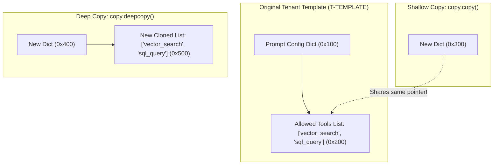

### C# / .NET Equivalent: MemberwiseClone vs. Deep Serialization

| Feature | .NET 10 CLR | CPython 3.12+ |
|---|---|---|
| **Pointer Alias** | `var b = a;` | `b = a` |
| **Shallow Copy** | `object.MemberwiseClone()` or record `with { }` | `copy.copy(obj)` or `dict.copy()` |
| **Deep Copy** | System.Text.Json serialize/deserialize or custom `ICloneable` | `copy.deepcopy(obj)` |
| **Circular Reference Support** | JSON serializer throws cycle exception unless configured | `copy.deepcopy()` automatically tracks memo dict to handle cycles |
| **Performance Overhead** | Fast bitwise copy for structs; moderate for deep clone | `deepcopy` is CPU-heavy (recursively traverses AST/graph with memo table) |

---

### 5 Real-World Normora Examples: Copy Semantics

#### Example 5.1: Tenant System Prompt Template Cloning (Preventing Prompt Leakage)
In Normora, each tenant customizes a master RAG prompt template. A shallow copy causes cross-tenant configuration contamination:

```python
import copy

# Master base configuration
master_rag_config = {
    "model": "google-gemini-flash",
    "temperature": 0.2,
    "system_instructions": ["Ground answers strictly in provided citations."],
    "metadata": {"version": "2.0"}
}

# Flawed shallow copy:
tenant_a_config = copy.copy(master_rag_config)
# Correct deep copy:
tenant_b_config = copy.deepcopy(master_rag_config)

# Tenant A modifies instructions:
tenant_a_config["system_instructions"].append("Special instruction for Tenant A.")

# Because system_instructions is a mutable list, shallow copy mutated the master template!
print(f"Master contaminated by Tenant A: {len(master_rag_config['system_instructions'])}")  # 2!
print(f"Tenant B safely isolated: {len(tenant_b_config['system_instructions'])}")            # 1!
```
> [!CAUTION]
> Shallow copying nested dictionaries or lists containing tenant-specific instructions creates critical cross-tenant data leakage vulnerabilities! Always use `copy.deepcopy()` for template inheritance.

#### Example 5.2: Shallow Copy vs. Deep Copy in Document Ingestion Pipelines
When extracting chunks from a document, each chunk inherits the document's base metadata tags:

```python
import copy

base_metadata = {
    "source_file": "Annual_Report.pdf",
    "tags": ["finance", "audit"],
    "tenant_id": "T-CORP"
}

# Shallow copy is safe ONLY for top-level scalar overrides:
chunk_1_meta = copy.copy(base_metadata)
chunk_1_meta["chunk_index"] = 0

# But mutating nested 'tags' corrupts all siblings:
chunk_1_meta["tags"].append("executive_summary")

print(f"Base metadata tags contaminated: {base_metadata['tags']}")
# Output: ['finance', 'audit', 'executive_summary']
```

#### Example 5.3: Conversation Message History Branching in Multi-Turn RAG
When a user edits a previous question in an active chat session, Normora creates a branched conversation turn:

```python
import copy

original_history = [
    {"role": "user", "content": "What is our leave policy?"},
    {"role": "assistant", "content": "You receive 20 days annual leave.", "citations": [1, 2]}
]

# Deep copy ensures modifying citations in the branched turn does not rewrite history:
branched_history = copy.deepcopy(original_history)
branched_history[1]["citations"].append(3)

print(f"Original citations unchanged: {original_history[1]['citations']}")  # [1, 2]
print(f"Branched citations updated: {branched_history[1]['citations']}")    # [1, 2, 3]
```

#### Example 5.4: RBAC Role & Permission Set Inheritance Cloning
Tenants in Normora can create custom roles inheriting from default roles (e.g. `Analyst` inheriting from `Reader`):

```python
import copy

default_role_permissions = {
    "Reader": {
        "actions": ["documents:read", "conversations:start"],
        "restrictions": {"max_tokens_per_day": 50_000}
    }
}

# Clone for tenant-specific custom role:
tenant_custom_role = copy.deepcopy(default_role_permissions["Reader"])
tenant_custom_role["actions"].append("documents:export")
tenant_custom_role["restrictions"]["max_tokens_per_day"] = 100_000

print(f"Default role preserved: {default_role_permissions['Reader']['restrictions']['max_tokens_per_day']}")  # 50000
```

#### Example 5.5: Copying Hosted Cloud AI Request Configurations
When sending concurrent generation requests to Google Gemini Flash, each request needs an isolated options object:

```python
import copy

base_gemini_request = {
    "contents": [],
    "generation_config": {
        "temperature": 0.0,
        "top_p": 0.95,
        "max_output_tokens": 2048,
        "safety_settings": [{"category": "HARM_CATEGORY_HARASSMENT", "threshold": "BLOCK_LOW_AND_ABOVE"}]
    }
}

def create_tenant_generation_request(tenant_prompt: str) -> dict:
    req = copy.deepcopy(base_gemini_request)
    req["contents"].append({"role": "user", "parts": [{"text": tenant_prompt}]})
    return req

req_1 = create_tenant_generation_request("Query A")
req_2 = create_tenant_generation_request("Query B")
print(f"Request 1 prompt: {req_1['contents'][0]['parts'][0]['text']}")
print(f"Request 2 prompt: {req_2['contents'][0]['parts'][0]['text']}")
```

---

## 6. Reference Counting, Circular References, and Generational Cyclic GC

### CPython's Dual-Layer Memory Reclamation Engine

How does Python free memory when objects are no longer required?
CPython uses two complementary systems:
1. **Primary Layer:** Reference Counting (Immediate & Deterministic).
2. **Secondary Layer:** Generational Cyclic Garbage Collector (Periodic & Non-Deterministic).

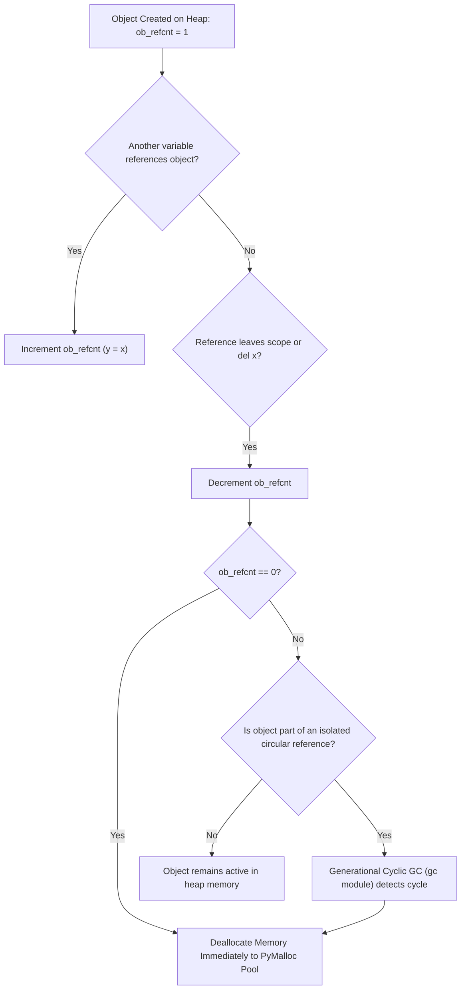

### Layer 1: Reference Counting (`ob_refcnt`)

Every `PyObject` carries a 64-bit reference counter:
* When an object is bound to a variable, passed into a function, or placed in a list: `ob_refcnt++`.
* When a variable goes out of scope, is reassigned, or deleted with `del`: `ob_refcnt--`.
* **The moment `ob_refcnt == 0`, CPython immediately frees the memory.** There is no delay, no mark-and-sweep pause, and no background thread required!

```python
import sys

# Note: sys.getrefcount(obj) temporarily creates 1 additional reference as an argument
doc_title = "Normora Architecture Guide"
print(sys.getrefcount(doc_title) - 1)  # 1

alias = doc_title
print(sys.getrefcount(doc_title) - 1)  # 2

del alias
print(sys.getrefcount(doc_title) - 1)  # 1
```

### Layer 2: The Fatal Flaw of Reference Counting (Circular References)

Reference counting has one fatal limitation: **it cannot detect cycles**.

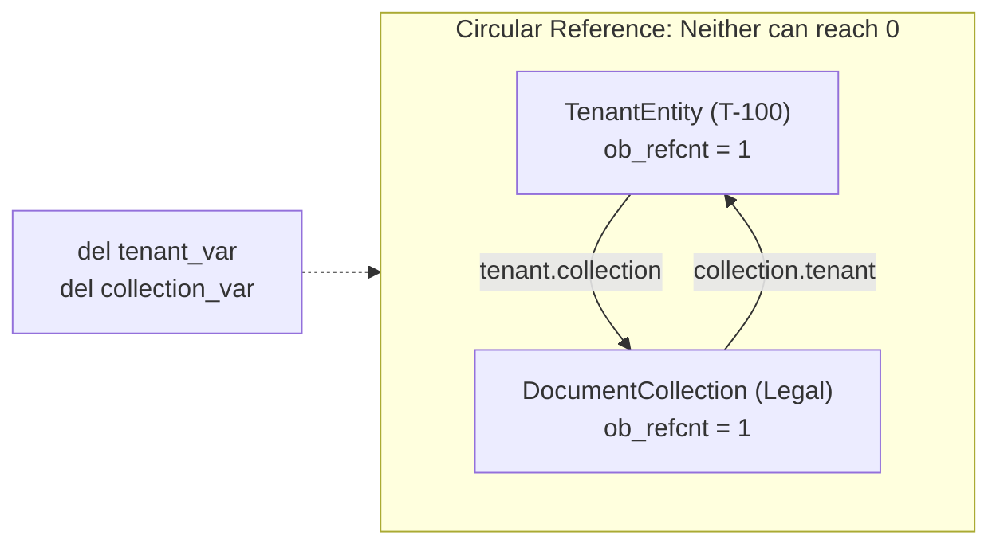

If a `TenantEntity` holds a reference to a `DocumentCollection`, and that `DocumentCollection` holds a reference back to the `TenantEntity`:
* When the local variables are deleted, both objects still have `ob_refcnt = 1`.
* Neither object can ever reach zero.
* The objects are completely unreachable by your application code, yet pure reference counting will **never deallocate them**, causing a permanent memory leak!

### The Generational Cyclic Garbage Collector (`gc` module)

To resolve circular reference leaks, CPython runs a cyclic garbage collector that tracks container objects (`list`, `dict`, `set`, custom class instances).

The collector categorizes objects into **3 Generations**:
* **Generation 0 (Youngest):** Newly created container objects. Collected frequently (e.g., when allocations exceed deallocations by 700).
* **Generation 1:** Objects that survived a Gen 0 collection pass.
* **Generation 2 (Oldest):** Long-lived objects (app singletons, database connection pools, module-level state). Collected rarely.

The GC uses a "trial deletion" algorithm:
1. It copies the reference counts of all tracked container objects into temporary counters.
2. For each container, it traverses pointers and decrements the counters of referenced objects.
3. If an isolated group of objects ends up with a temporary count of zero, those objects are only referencing each other and are unreachable from outside.
4. The collector breaks the cycles and deallocates the objects.

### Breaking Cycles with Weak References (`weakref` module)

The best way to handle circular references is to **prevent them from forming** using **weak references** (`weakref`).
* A `weakref.ref(obj)` creates a pointer to `obj` **without incrementing its `ob_refcnt`**.
* If all strong references to `obj` are deleted, `obj` is immediately deallocated by reference counting, and the weak reference cleanly evaluates to `None`.

```mermaid
flowchart LR
    ParentDoc["Parent Document (Strong Ref)"]
    ChildChunk["Child Chunk"]
    ParentDoc -->|Strong Ref: holds chunks in list| ChildChunk
    ChildChunk -.->|Weakref: weakref.ref(parent)| ParentDoc
```

### C# / .NET CLR vs. CPython Garbage Collection

| Feature | .NET 10 CLR GC | CPython 3.12+ GC |
|---|---|---|
| **Primary Reclamation** | Tracing Mark-and-Sweep across all objects | Deterministic Reference Counting (`ob_refcnt == 0`) |
| **Cycle Resolution** | Built into primary tracing GC (cycles are handled naturally) | Secondary Generational Cyclic GC (`gc` module) |
| **Generations** | Gen 0, Gen 1, Gen 2 + LOH (Large Object Heap) | Gen 0, Gen 1, Gen 2 (for container objects only) |
| **Stop-the-World Pauses** | Minimal (Background GC, Non-concurrent server GC) | Small Gen 0/1/2 pauses in evaluation loop |
| **Weak References** | `WeakReference<T>` | `weakref.ref()`, `WeakValueDictionary`, `WeakKeyDictionary` |
| **Manual Trigger** | `GC.Collect()` | `gc.collect()` |

---

### 5 Real-World Normora Examples: GC & Weak References

#### Example 6.1: Creating and Detecting a Circular Reference Leak
In Normora's data model, linking a `Tenant` and an `AuditLogStream`:

```python
import gc

class AuditLogStream:
    def __init__(self, tenant):
        self.tenant = tenant  # References Tenant

class Tenant:
    def __init__(self, tenant_id: str):
        self.tenant_id = tenant_id
        self.audit_stream = None

# Create circular relationship
tenant = Tenant("T-CYBER")
stream = AuditLogStream(tenant)
tenant.audit_stream = stream  # Circular reference created!

# Delete outer pointers
del tenant
del stream

# Pure reference counting cannot free them!
# Force cyclic GC run:
freed_objects = gc.collect()
print(f"Cyclic GC collected unreachable cycle: {freed_objects} objects freed.")
```

#### Example 6.2: Using `weakref.ref` in Parent-Child Document Hierarchies
A `Document` owns many `DocumentChunk` instances, but each chunk needs to access its parent document's title:

```python
import weakref

class Document:
    def __init__(self, title: str):
        self.title = title
        self.chunks = []

class DocumentChunk:
    def __init__(self, content: str, parent_doc: Document):
        self.content = content
        # Weak reference avoids circular reference leak:
        self._parent_ref = weakref.ref(parent_doc)

    @property
    def parent(self) -> Document | None:
        # Dereference weak reference:
        return self._parent_ref()

doc = Document("Normora_Compliance_2026.pdf")
chunk = DocumentChunk("Section 1: Data Sovereignity", doc)
doc.chunks.append(chunk)

print(f"Parent title accessible: {chunk.parent.title}")

# When doc is deleted:
del doc
# Chunk no longer prevents parent from being freed:
print(f"Parent after deletion: {chunk.parent}")  # None! Freeing was immediate!
```

#### Example 6.3: Auto-Evicting In-Memory Tenant Cache with `WeakValueDictionary`
When caching active `TenantContext` objects, keeping strong references causes memory leaks. A `WeakValueDictionary` automatically evicts entries when they are no longer in use:

```python
import weakref

class TenantContext:
    def __init__(self, tenant_id: str):
        self.tenant_id = tenant_id

# Cache that does not keep objects alive:
tenant_cache = weakref.WeakValueDictionary()

def get_tenant_session(tenant_id: str) -> TenantContext:
    if tenant_id in tenant_cache:
        return tenant_cache[tenant_id]
    ctx = TenantContext(tenant_id)
    tenant_cache[tenant_id] = ctx
    return ctx

session = get_tenant_session("T-HEALTHCARE")
print(f"Active in cache: {'T-HEALTHCARE' in tenant_cache}")  # True

# When session leaves scope or is deleted:
del session
print(f"Evicted from cache automatically: {'T-HEALTHCARE' in tenant_cache}")  # False!
```

#### Example 6.4: Monitoring GC Generation Collections and Threshold Tuning
Inspecting GC behavior in high-throughput document processing:

```python
import gc

# Default thresholds: (700, 10, 10)
# Gen 0 runs every 700 net allocations.
# Gen 1 runs every 10 Gen 0 collections.
# Gen 2 runs every 10 Gen 1 collections.
print(f"Current GC thresholds: {gc.get_threshold()}")

# Inspect collection counts across generations:
print(f"Collections since startup: Gen0={gc.get_count()[0]}, Gen1={gc.get_count()[1]}, Gen2={gc.get_count()[2]}")

# Tune for large batch ingestion (reduce Gen 0 thrashing):
gc.set_threshold(5000, 25, 25)
print(f"Tuned GC thresholds: {gc.get_threshold()}")
```

#### Example 6.5: Temporarily Disabling Cyclic GC During Vector Batch Ingestion
When ingesting 100,000 vector records, running cyclic GC checks on millions of transient list items causes latency spikes (jitter). Because vector records contain no cycles, we temporarily disable cyclic GC:

```python
import gc

def bulk_ingest_vectors(raw_vectors: list[list[float]]) -> None:
    # Disable cyclic GC during pure array ingestion:
    gc.disable()
    try:
        # Ingestion logic...
        pass
    finally:
        # Always re-enable and run a cleanup pass:
        gc.enable()
        gc.collect()

print("Cyclic GC safely managed during batch insertion.")
```

---

## 7. Memory Profiling & Leak Detection in Production Services

### Why Memory Leaks Occur in Python

Developers often ask: *"If Python has reference counting and a cyclic garbage collector, how can a memory leak happen?"*

In Python, a "memory leak" is rarely an unmanaged pointer loss. Instead, it is an **unintentional strong reference** that keeps objects alive:
1. **Unbounded Module-Level Dictionaries/Lists:** Storing tenant session data in global structures without an eviction policy (TTL/LRU).
2. **Event Listeners / Callbacks:** Subscribing to an event on a long-lived publisher and never unsubscribing.
3. **Closure Scope Capture:** An async background task capturing a large outer scope variable.
4. **Circular References with Custom `__del__` Methods:** In older Python versions, objects with `__del__` in cycles were marked uncollectable (`gc.garbage`).

### Production Profiling Toolset

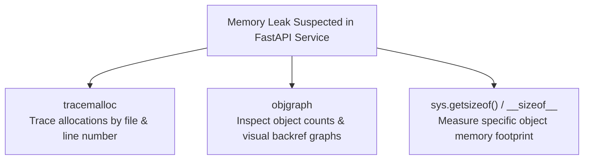

1. **`tracemalloc` (Built-in):** Traces every memory allocation back to the exact Python file and line number. Allows taking snapshots at point A and point B and computing a `diff` to find leaking lines.
2. **`objgraph`:** Visualizes object references, shows which object types are growing most rapidly, and generates Graphviz diagrams showing who is holding a reference to a leaking instance.
3. **`sys.getsizeof()` & `__sizeof__()`:** Inspects shallow and deep memory allocations for individual objects.

---

### 5 Real-World Normora Examples: Memory Profiling & Leak Diagnostics

#### Example 7.1: Pinpointing Memory Leaks with `tracemalloc`
Simulating an unbounded tenant cache leak and diagnosing the exact line of code:

```python
import tracemalloc

# Start tracking memory allocations:
tracemalloc.start()

# Baseline snapshot:
snapshot_before = tracemalloc.take_snapshot()

# Simulated leak: Ingestion worker inadvertently caches raw document chunks in a global list
leaking_chunk_store = []
for i in range(10_000):
    leaking_chunk_store.append(f"Document Chunk Payload #{i} for Tenant-100" * 10)

# Snapshot after workload:
snapshot_after = tracemalloc.take_snapshot()

# Compare snapshots to identify top allocating lines:
top_stats = snapshot_after.compare_to(snapshot_before, "lineno")

print("=== Top 3 Allocations by Line Number ===")
for stat in top_stats[:3]:
    print(stat)

tracemalloc.stop()
```

#### Example 7.2: Comparing Snapshot Diffs in Long-Running Background Workers
In Normora's background document processing workers, we take snapshots before and after processing a 1,000-page document:

```python
import tracemalloc

tracemalloc.start()
snap1 = tracemalloc.take_snapshot()

# Simulated document extraction:
extracted_tokens = [f"token_{i}" for i in range(50_000)]

snap2 = tracemalloc.take_snapshot()
stats = snap2.compare_to(snap1, "traceback")

# Filter allocations exceeding 1 MB:
for stat in stats:
    if stat.size_diff > 1024 * 1024:
        print(f"Heavy allocation diff: {stat.size_diff / (1024*1024):.2f} MB")
        for line in stat.traceback.format():
            print(f"  {line}")

tracemalloc.stop()
```

#### Example 7.3: Visualizing Circular Object Reference Graphs with `objgraph`
When an object refuses to be garbage collected, `objgraph.show_backrefs` reveals every object in memory pointing to it:

```python
# Note: Requires 'pip install objgraph'
import objgraph

class LeakingTenantSession:
    def __init__(self, tenant_id: str):
        self.tenant_id = tenant_id
        self.sub_handlers = []

class EventHandler:
    def __init__(self, session):
        self.session = session

session = LeakingTenantSession("T-CORP")
handler = EventHandler(session)
session.sub_handlers.append(handler)

# Inspect references holding 'session' alive:
# objgraph.show_backrefs([session], max_depth=3, filename="session_backrefs.png")
# This outputs a visual graph showing the circular reference chain!
print("objgraph backref analysis configured.")
```

#### Example 7.4: Counting Growing Object Types in Active Tenant Sessions
Using `objgraph.most_common_types` to see which types dominate heap memory:

```python
import objgraph

# Inspect top 5 most common object types in memory:
print("=== Top Object Types Currently in Memory ===")
for type_name, count in objgraph.most_common_types(limit=5):
    print(f"Type: {type_name:<20} Count: {count}")
```

#### Example 7.5: Building an In-Memory Telemetry Health Endpoint (`/health/memory`)
In Normora's FastAPI backend, we expose an internal health check reporting runtime heap telemetry:

```python
import os
import psutil
import tracemalloc

def get_system_memory_metrics() -> dict[str, float]:
    process = psutil.Process(os.getpid())
    memory_info = process.memory_info()
    
    metrics = {
        "rss_memory_mb": round(memory_info.rss / (1024 * 1024), 2),
        "vms_memory_mb": round(memory_info.vms / (1024 * 1024), 2),
    }
    
    if tracemalloc.is_tracing():
        current, peak = tracemalloc.get_traced_memory()
        metrics["traced_current_mb"] = round(current / (1024 * 1024), 2)
        metrics["traced_peak_mb"] = round(peak / (1024 * 1024), 2)
        
    return metrics

print(f"Runtime Memory Metrics: {get_system_memory_metrics()}")
```

---

## 8. The Global Interpreter Lock (GIL) & High-Throughput AI Workloads

### What is the GIL?

The **Global Interpreter Lock (GIL)** is a mutual-exclusion lock (mutex) used by CPython to ensure that **only one native OS thread executes Python bytecode at any given moment**, even on a server equipped with 64 CPU cores.

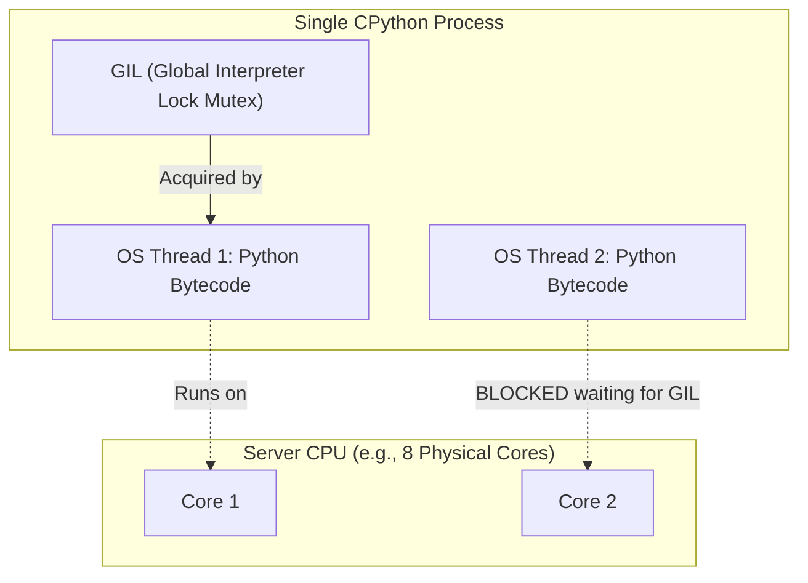

### Why Was the GIL Introduced?

In CPython, memory management relies directly on `ob_refcnt`. Every time an object is passed, copied, or freed, its counter is modified. 
* If multiple native threads executed Python bytecode simultaneously without a global lock, modifying `ob_refcnt` would create severe **race conditions**, leading to memory leaks and memory corruption.
* Implementing fine-grained locks around every single object would introduce catastrophic locking overhead, making single-threaded execution significantly slower.
* The GIL provided a simple, fast solution for single-threaded code and simplified writing C-extensions.

### Why the GIL Does NOT Slow Down Normora's Hosted Cloud AI Services

A common misconception among .NET architects is that the GIL prevents Python from being a viable enterprise web backend. 

**This is completely false for modern AI architectures.**

To understand why, you must categorize backend workloads into two types:

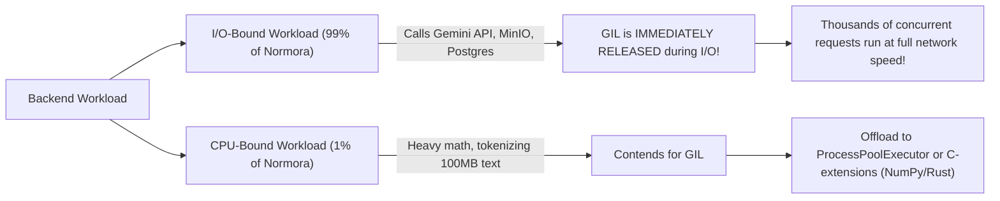

#### The I/O-Bound Reality of Normora:
* When a Normora worker calls **Google Gemini Flash** (`await client.post(...)`), fetches an object from **MinIO**, or queries **PostgreSQL+pgvector**, the thread or coroutine initiates a socket I/O system call.
* In CPython, **any socket or disk I/O operation immediately releases the GIL**!
* While Thread 1 is waiting 800 milliseconds for Google Gemini Flash to stream tokens back over HTTPS, the GIL is completely released. Hundreds of other threads and coroutines execute at full speed.
* Therefore, for I/O-bound enterprise AI workloads, Python delivers world-class concurrency.

### CPU-Bound Workloads: The Multi-Process Architecture

For true CPU-bound tasks (e.g. running heavy text splitting or regex parsing on 500 MB files in pure Python), threads will contend for the GIL and slow each other down. The architect's solution is **Multiprocessing**:
* Spin up separate OS processes using `ProcessPoolExecutor`.
* Each process has its own independent CPython interpreter and its own GIL, achieving **100% true parallel execution across all CPU cores**.

### Python 3.13+ Free-Threading Revolution (PEP 703)

In Python 3.13+, CPython introduced an experimental **free-threaded build** (`--disable-gil` or `nogil`):
* Replaces the GIL with **mimalloc-based thread-safe allocation** and **biased reference counting**.
* Allows multiple native OS threads to execute Python bytecode simultaneously across multiple CPU cores.
* For AI engineers, this means CPU-bound tasks like local vector normalization and JSON parsing can scale across threads in the future without multiprocessing overhead.

### C# / .NET CLR Threading vs. CPython Threading

| Concurrency Dimension | .NET 10 CLR | CPython 3.12+ |
|---|---|---|
| **Native OS Threads** | True parallel execution across CPU cores (`System.Threading.Thread`) | Native OS threads created, but serialized by the GIL |
| **I/O Concurrency** | `async` / `await` over ThreadPool I/O Completion Ports (IOCP) | `asyncio` event loop / epoll / kqueue (GIL released during I/O) |
| **CPU Concurrency** | `Parallel.ForEach`, `Task.Run` runs across all cores | `ProcessPoolExecutor` (separate OS processes) |
| **Thread Safety** | Programmer must use `lock`, `Monitor`, `ConcurrentDictionary` | GIL protects internal VM structures; user code still needs locks for data structures |
| **Free-Threading** | Default since .NET Framework 1.0 | Experimental preview in Python 3.13+ (`--disable-gil`) |

---

### 5 Real-World Normora Examples: The GIL & Concurrency

#### Example 8.1: Concurrent Cloud AI Calls with `ThreadPoolExecutor` (Observing GIL Release)
Demonstrating that concurrent I/O calls to Google Gemini Flash release the GIL and run concurrently:

```python
import time
import concurrent.futures

def simulate_gemini_flash_call(tenant_id: str, prompt: str) -> str:
    # time.sleep() releases the GIL, precisely like an HTTPS socket call to Gemini!
    time.sleep(0.2)
    return f"Response for {tenant_id}: Synthesized answer."

start_time = time.perf_counter()
tenants = [f"Tenant-{i}" for i in range(10)]

# Run 10 requests concurrently across 10 threads:
with concurrent.futures.ThreadPoolExecutor(max_workers=10) as executor:
    futures = [executor.submit(simulate_gemini_flash_call, t, "Summary") for t in tenants]
    results = [f.result() for f in futures]

elapsed = time.perf_counter() - start_time
print(f"Completed 10 hosted AI calls in {elapsed:.2f} seconds!")
# Output: ~0.20 seconds (NOT 2.0 seconds!) The GIL was completely released!
```

#### Example 8.2: CPU-Bound Chunk Tokenization Offloaded to `ProcessPoolExecutor`
For intensive text splitting and tokenization that does not release the GIL, we use multi-processing:

```python
from concurrent.futures import ProcessPoolExecutor

def heavy_cpu_text_tokenizer(raw_text: str) -> int:
    # Pure Python CPU work: Tokenizing and counting
    words = raw_text.split()
    return sum(len(word) for word in words)

if __name__ == "__main__":
    large_documents = ["Normora compliance clause..." * 50_000] * 4

    # Bypasses the GIL: Runs across 4 independent OS processes
    with ProcessPoolExecutor(max_workers=4) as executor:
        token_lengths = list(executor.map(heavy_cpu_text_tokenizer, large_documents))
        print(f"Token counts processed in parallel: {token_lengths}")
```

#### Example 8.3: C-Extension GIL Release in Vector Similarity Computations
Libraries written in C, C++, or Rust (like NumPy, PyTorch, and `asyncpg`) release the GIL during heavy computation:

```python
import numpy as np

# Create two 100,000-element vector arrays:
v1 = np.random.rand(100_000).astype(np.float32)
v2 = np.random.rand(100_000).astype(np.float32)

# NumPy executes dot product in compiled C / BLAS assembly.
# During this execution, the GIL is RELEASED, allowing other threads to run!
similarity = np.dot(v1, v2)
print(f"Cosine dot similarity: {similarity:.4f}")
```

#### Example 8.4: GIL Contention Benchmark: CPU Loop vs. I/O Loop
Visualizing why multi-threading fails for CPU tasks but shines for I/O tasks:

```python
import time
import threading

def cpu_heavy_task():
    count = 0
    for _ in range(5_000_000):
        count += 1

# Running sequentially:
t0 = time.perf_counter()
cpu_heavy_task()
cpu_heavy_task()
print(f"Sequential CPU time: {time.perf_counter() - t0:.2f}s")

# Running with two threads (fighting over the GIL):
t0 = time.perf_counter()
t1 = threading.Thread(target=cpu_heavy_task)
t2 = threading.Thread(target=cpu_heavy_task)
t1.start(); t2.start()
t1.join(); t2.join()
print(f"Threaded CPU time (GIL lock contention overhead): {time.perf_counter() - t0:.2f}s")
# Notice: Threaded CPU is SLOWER due to context switching and GIL contention!
```

#### Example 8.5: Inspecting Python 3.13 Free-Threading Status in Production Containers
In Normora's containerized deployment, we verify whether the runtime has the GIL enabled or disabled:

```python
import sys

def check_gil_status() -> dict[str, str | bool]:
    # Python 3.13+ exposes sys._is_gil_enabled()
    is_gil_active = getattr(sys, "_is_gil_enabled", lambda: True)()
    return {
        "python_version": sys.version.split()[0],
        "gil_active": is_gil_active,
        "runtime_mode": "Standard CPython (GIL)" if is_gil_active else "Free-Threaded CPython (No-GIL)"
    }

print(f"Runtime Concurrency State: {check_gil_status()}")
```

---

## 9. Common Mistakes & Anti-Patterns

> [!CAUTION]
> ### Anti-Pattern 1: Using `is` for Value Equality on Strings and Integers
> **The Mistake:** Writing `if tenant_role is "TenantAdmin":` or `if token_count is 500:`.
> **Why it fails:** `is` checks whether two variables point to the exact same 64-bit memory address. Small integers (`-5` to `256`) and some compile-time string literals share singletons, so the code might accidentally pass in unit tests. But in production, dynamically allocated strings from HTTP headers or large integers reside at different heap addresses, causing silent authentication failures and BOLA bypass bugs!
> **The Fix:** Always use `==` for value comparison. Reserve `is` strictly for singletons like `None`, `True`, and `False`.

> [!CAUTION]
> ### Anti-Pattern 2: Unbounded Module-Level Dictionaries as In-Memory Caches
> **The Mistake:** Defining `TENANT_CACHE = {}` at the module level and populating it with document chunks or session states on every request.
> **Why it fails:** Module-level dictionaries live for the entire lifetime of the process. Objects stored in them have active strong references, meaning reference counting will never deallocate them and cyclic GC will never collect them. Over days of operation, the process steadily consumes memory until killed by the OS Out-Of-Memory (OOM) killer.
> **The Fix:** Use bounded LRU caches (`cachetools.TTLCache`) or `weakref.WeakValueDictionary()`.

> [!CAUTION]
> ### Anti-Pattern 3: Omitting `__slots__` in High-Volume Ingestion Models
> **The Mistake:** Using standard Python classes for `DocumentChunk`, `VectorRecord`, or `StreamingDelta` when processing hundreds of thousands of items.
> **Why it fails:** Every standard class instance allocates an unnecessary `__dict__` hash table, consuming an extra 150-200 bytes per instance. Ingesting 500,000 chunks wastes over 80 MB of RAM on empty hash tables.
> **The Fix:** Always declare `__slots__ = ("id", "content", ...)` on classes instantiated by the thousands.

> [!CAUTION]
> ### Anti-Pattern 4: Mutating Shared Default Configuration Templates Across Tenants
> **The Mistake:** Creating a default prompt dictionary or list of permissions and shallow-copying it (`tenant_cfg = default_cfg.copy()`) before appending tenant-specific tools.
> **Why it fails:** A shallow copy only duplicates the outer container. Nested lists and dictionaries (e.g. `allowed_tools` or `system_instructions`) remain shared pointers. Modifying Tenant A's configuration contaminates the template for all other tenants in the system!
> **The Fix:** Use `copy.deepcopy()` whenever cloning hierarchical configuration templates.

> [!CAUTION]
> ### Anti-Pattern 5: Implementing `__del__` Destructors on Objects in Circular Graphs
> **The Mistake:** Defining `def __del__(self):` on objects that participate in parent-child relationships (e.g. `ParentDocument` and `ChildChunk`) to clean up resources.
> **Why it fails:** When objects with `__del__` methods are caught in circular references, CPython cannot determine a safe order of destruction. In Python versions prior to 3.4, they were placed in `gc.garbage` and leaked permanently. Even in modern Python, `__del__` makes destruction non-deterministic and can resurrect dead objects.
> **The Fix:** Never use `__del__` for resource cleanup. Use context managers (`__enter__` and `__exit__`) and `weakref`.

> [!CAUTION]
> ### Anti-Pattern 6: Running Heavy CPU-Bound Parsing in the Async Event Loop
> **The Mistake:** Running heavy regex operations or PDF document tokenization directly inside a FastAPI `async def` endpoint.
> **Why it fails:** The async event loop runs on a single thread. CPU-bound code holds the GIL and blocks the event loop thread from running. All other concurrent HTTP requests, token streams, and database queries are frozen until the CPU task finishes.
> **The Fix:** Offload CPU-bound workloads to `ProcessPoolExecutor` via `asyncio.get_running_loop().run_in_executor()`.

> [!CAUTION]
> ### Anti-Pattern 7: Assuming `sys.getsizeof()` Reports Total Container Memory
> **The Mistake:** Calling `sys.getsizeof(document_chunks_list)` and assuming the resulting number reflects the total RAM consumed by the chunks.
> **Why it fails:** `sys.getsizeof()` is shallow. For a list of 10,000 document chunks, it only returns the size of the 8-byte pointer array (~80 KB), completely ignoring the megabytes of text strings, float vectors, and object headers pointed to by those pointers!
> **The Fix:** Use custom recursive deep memory inspection functions or `tracemalloc`.

---

## 10. C# / .NET vs. Python CPython Architecture Reference Table

As a .NET architect, use this comprehensive reference table to map familiar CLR runtime concepts directly to their CPython equivalents:

| Architectural Concept | .NET 10 CLR | Python 3.12+ (CPython) |
|---|---|---|
| **Compilation Output** | Intermediate Language (IL) packed in `.dll` | Bytecode instructions cached in `__pycache__/*.pyc` |
| **Execution Engine** | RyuJIT compiles IL to native machine assembly | `Python/ceval.c` virtual machine loop evaluates bytecode |
| **Value Types vs Reference Types** | `struct`, `int`, `double` (stack/inlined) vs `class`, `string` (heap) | **No value types**. Every variable is an 8-byte pointer to a heap `PyObject` |
| **Primitive Integer Overhead** | 4 bytes (`int32`) on stack | 28 bytes (`PyLongObject`) on heap |
| **Primary Memory Reclamation** | Generational Tracing Garbage Collector (Gen 0, 1, 2) | Deterministic Reference Counting (`ob_refcnt == 0`) |
| **Secondary Memory Reclamation** | Large Object Heap (LOH) compaction | Generational Cyclic Garbage Collector (`gc` module) |
| **Small Object Memory Allocator** | Managed GC Heap segments | PyMalloc (Arenas -> Pools -> Blocks) |
| **String Interning** | `string.Intern(str)` / `string.IsInterned(str)` | `sys.intern(str)` |
| **Memory Optimization for Classes** | `struct` / `readonly struct` | Slotted classes via `__slots__ = (...)` |
| **Referential Equality** | `object.ReferenceEquals(a, b)` | `a is b` |
| **Value Equality** | `a.Equals(b)` or `a == b` (via operator overload) | `a == b` (invokes `__eq__`) |
| **Non-Owning References** | `WeakReference<T>` | `weakref.ref(obj)` |
| **Multi-Threading Concurrency** | True multi-core execution via OS threads | Serialized by the Global Interpreter Lock (GIL) |
| **I/O Concurrency** | `async` / `await` over IO Completion Ports (IOCP) | `asyncio` event loop (GIL automatically released during I/O) |
| **CPU Concurrency** | `Parallel.ForEach`, `Task.Run` across CPU cores | `ProcessPoolExecutor` across separate OS processes |
| **Deterministic Destruction** | `IDisposable` pattern and `using` statements | Context managers (`with` statement: `__enter__` / `__exit__`) |
| **Memory Allocation Profiling** | `dotnet-dump`, `dotnet-trace`, PerfView | `tracemalloc`, `objgraph`, `sys.getsizeof()` |

---

## 11. Enterprise Interview Questions & Architectural Answers

### Q1: How does CPython's memory management differ fundamentally from the .NET CLR, and why does Python require both reference counting and a cyclic garbage collector?
**Answer:** The .NET CLR uses a tracing garbage collector that periodically traverses root references to mark alive objects and sweep/compact dead ones. CPython primarily uses **deterministic reference counting**: every `PyObject` has an `ob_refcnt` field; the moment it reaches zero, memory is freed immediately back to PyMalloc pools. 

However, reference counting cannot resolve **circular references** (e.g. Object A points to B, and B points to A). Even when both lose all external references, their counts remain at 1, leaking memory. To solve this, CPython includes a secondary **Generational Cyclic Garbage Collector** (`gc` module). It runs periodically across three generations (Gen 0, Gen 1, Gen 2) using a trial deletion algorithm to identify isolated reference islands and reclaim them.

### Q2: What is the physical memory layout difference between a standard Python class and a slotted class (`__slots__`), and what are the quantitative benefits in a high-throughput RAG pipeline?
**Answer:** A standard Python class instance allocates a 16-byte `PyObject` header and an 8-byte pointer to an internal `__dict__`. The `__dict__` is a dynamic hash table consuming 150 to 200 bytes of memory overhead, regardless of how few attributes the object has. 

A slotted class declares `__slots__ = ("attr1", "attr2")`, which instructs CPython to **suppress the creation of `__dict__`**. Instead, CPython allocates a fixed-size C array of pointers directly inside the object's struct. This reduces instance overhead from ~200 bytes down to ~56 bytes—a **65%+ reduction in RAM**. In Normora, when loading 500,000 document chunks into memory during vector re-ranking, `__slots__` saves over 75 MB of RAM and accelerates attribute access by replacing hash lookups with direct array offset indexing.

### Q3: Why is `sys.intern()` critical for enterprise multi-tenant systems handling millions of ingestion records, and how does it affect `is` vs `==` checks?
**Answer:** In multi-tenant systems, repetitive strings like tenant UUIDs, role names, and metadata keys are instantiated millions of times across document chunks. Normally, each dynamic string allocated from JSON or a database creates a separate `PyUnicodeObject` on the heap. Calling `sys.intern(string)` registers the string in CPython's global interned string table, ensuring all identical strings share the **exact same pointer address**. 

This achieves two architectural wins:
1. Massive RAM reduction through string deduplication.
2. Equality comparisons can be performed using referential identity (`a is b`) in $O(1)$ single-CPU-cycle pointer comparisons rather than $O(N)$ character-by-character scans.

### Q4: In an AI platform using Google Gemini Flash, explain why the CPython Global Interpreter Lock (GIL) is or isn't a bottleneck, and when you would need `ProcessPoolExecutor`.
**Answer:** The GIL is **not** a bottleneck for Normora's hosted cloud AI operations. 99% of time in an AI API service is spent waiting on network sockets (streaming token responses from Google Gemini Flash, querying MinIO object storage, or fetching vectors from PostgreSQL). In CPython, **any socket or disk I/O operation immediately releases the GIL**. While an async coroutine or thread waits for HTTPS response bytes, other threads and coroutines execute unhindered. 

The GIL only becomes a bottleneck for **CPU-bound workloads** executed in pure Python, such as tokenizing a 500 MB document with complex regex or calculating matrix math without C-extensions. For those tasks, threads fight over the GIL, and an architect must use `ProcessPoolExecutor` to distribute work across separate OS processes, each with its own independent GIL.

### Q5: What is the architectural difference between a shallow copy and a deep copy, and what security risk does improper copying pose in a multi-tenant platform?
**Answer:** A shallow copy (`copy.copy()` or `dict.copy()`) creates a new outer container, but populates it with references (pointers) to the identical nested objects. A deep copy (`copy.deepcopy()`) recursively traverses the entire object graph, constructing brand-new duplicates for every nested list, dictionary, and custom object. 

In a multi-tenant system like Normora, base configuration templates often include nested mutable structures, such as `allowed_tools: ["vector_search"]` or `system_instructions: [...]`. If Tenant A's configuration is created via a shallow copy of the base template and modifies its tools list, that modification mutates the shared underlying list in the template. Subsequent tenants inherit Tenant A's modified permissions or instructions, resulting in a **catastrophic cross-tenant security and prompt contamination vulnerability**.

### Q6: How do you detect, isolate, and resolve a memory leak in a long-running Python document ingestion worker using `tracemalloc` and `objgraph`?
**Answer:**
1. **Detection:** Enable `tracemalloc.start()` at worker startup. Take a baseline memory snapshot before processing a batch of documents, and a second snapshot after processing.
2. **Isolation:** Call `snapshot_after.compare_to(snapshot_before, "lineno")`. This outputs the exact Python file and line number responsible for the largest net increase in allocated bytes, pinpointing leaking caches or uncollected buffers.
3. **Graph Inspection:** If the leak is caused by circular references or lingering references in global state, use `objgraph.most_common_types()` to see which objects are accumulating. Then invoke `objgraph.show_backrefs([leaking_object], max_depth=3)` to render a visual graph showing which active objects are holding strong references to the leaking instance.
4. **Resolution:** Replace unbounded dictionaries with `weakref.WeakValueDictionary` or bounded LRU caches, and replace cyclic parent references with `weakref.ref()`.

### Q7: What are small integer caching and string interning, and why should you never rely on `is` for general equality checks in production code?
**Answer:** CPython pre-allocates singletons for small integers between `-5` and `256` at runtime startup, and automatically interns compile-time string literals that resemble identifiers. Because of this, `x = 100; y = 100; x is y` evaluates to `True` because both point to the same singleton. 

However, relying on `is` for business equality is an anti-pattern: numbers outside the range `-5` to `256` and dynamic strings constructed at runtime (such as UUIDs read from HTTP headers or databases) allocate distinct `PyObject` instances at different heap addresses. In those cases, `is` returns `False` even when the values are identical, causing subtle, environment-dependent bugs. `==` must always be used for value equality.

### Q8: How does Python's `weakref` module prevent circular references, and where would you apply it in a document-chunk parent-child data model?
**Answer:** A `weakref.ref(obj)` creates a non-owning pointer to an object without incrementing its `ob_refcnt`. If all strong references to that object are deleted, the object is immediately deallocated by reference counting, and calling the weak reference callable subsequently returns `None`. 

In a document processing system, a `Document` maintains a strong list of its `DocumentChunk` children, and each `DocumentChunk` needs a reference back to its parent `Document`. If the chunk holds a strong reference (`self.parent = doc`), a circular reference is created. If the application deletes the document variable, neither the document nor the chunks reach zero reference count. By implementing `self._parent_ref = weakref.ref(doc)` inside `DocumentChunk`, the cycle is broken: when the parent document is deleted, both the document and its chunks are freed instantly without waiting for a cyclic GC sweep.

---

## 12. Summary & Architectural Next Steps

In this module, you mastered the underlying execution engine and memory architecture of CPython:
* **The Compilation Pipeline:** Python source compiles to AST and stack-based bytecode (`.pyc`) executed inside `ceval.c`.
* **The Object Reality:** Everything in Python is a heap-allocated pointer to a `PyObject` struct; there are no primitive value types.
* **Memory Optimization:** Declaring `__slots__` eliminates `__dict__` overhead, reducing memory by up to 65% across millions of document chunks.
* **String Interning:** Using `sys.intern()` deduplicates strings across high-throughput tenant operations and accelerates equality checks.
* **Two-Tier Memory Reclamation:** Deterministic Reference Counting frees memory immediately, while the Generational Cyclic Garbage Collector resolves isolated circular reference graphs.
* **Reference Decoupling:** Using `weakref` breaks parent-child reference cycles and enables auto-evicting caches.
* **Copy Semantics:** Understanding shallow copy vs. deep copy prevents dangerous cross-tenant data leakage in prompt templates.
* **Profiling Diagnostics:** Using `tracemalloc`, `objgraph`, and `sys.getsizeof()` provides production observability into memory consumption and leaks.
* **The GIL Boundary:** The GIL protects internal interpreter state, but is released during all socket I/O—making Python an exceptionally performant runtime for hosted cloud AI services like **Google Gemini Flash**.

---

### Transition to Part III: Enterprise Data Contracts & Web Architecture

You have now completed **Part I & Part II** of the curriculum! You understand:
1. Python syntax and programming fundamentals from scratch.
2. Collections, functions, classes, and exceptions.
3. Async event loops, coroutines, and streaming generators.
4. CPython memory architecture, `__slots__` optimization, GC mechanics, and the GIL.

Now, we enter **Part III: Data Contracts & Web Architecture with FastAPI**!

In **Module 12**, we dive into **Data Validation with Pydantic v2 (The Rust-Backed Data Engine)**, exploring how CPython delegates validation to compiled Rust routines (`pydantic-core`) to achieve bare-metal performance while guaranteeing bulletproof type safety for Normora's multi-tenant APIs!
