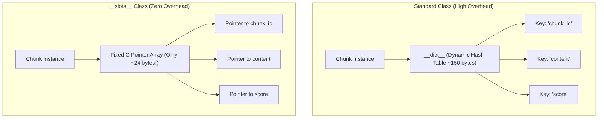

# Module 11: CPython Internals & High-Throughput Memory Architecture

Welcome to **Module 11** of the Normora Python & AI Masterclass.

Now that you are fluent in Python's syntax, object model, and async runtime, we take an architectural deep dive into **CPython's internal execution engine**.

In an enterprise multi-tenant platform like **Normora**, thousands of document chunks, vector embeddings, and session states pass through memory every second. An architect cannot treat memory as an infinite, magical box. You must understand:
* What a Python variable physically is at the C structure level (`PyObject`).
* How to save 60%+ of server RAM when storing millions of document chunks using **`__slots__`**.
* How CPython cleans up memory using Reference Counting and Generational Cyclic Garbage Collection.
* Why the Global Interpreter Lock (GIL) does **not** slow down our hosted cloud AI services.
* How to inspect Python bytecode using the `dis` module.

Every concept is followed by **at least 5 real-world Normora examples**.

---

## 1. The `PyObject` Structure & Pointer Architecture

In C# or C++, primitive numbers (`int`, `float`) are value types stored on the stack or inlined directly into arrays.  
In CPython, **there are NO value types**. Every single integer, string, boolean, and custom object is a pointer to a heap-allocated C struct called **`PyObject`**.

### The C Source Header (`Include/object.h`):
```c
typedef struct _object {
    _PyObject_HEAD_EXTRA         // Double-linked list pointers for cyclic GC
    Py_ssize_t ob_refcnt;        // Reference counter (64-bit int)
    struct _typeobject *ob_type; // Pointer to type metadata descriptor
} PyObject;
```

When you define an integer in Normora (`tokens = 42`), CPython allocates a 28-byte `PyLongObject` struct on the heap, sets `ob_refcnt = 1`, points `ob_type` to `&PyLong_Type`, and the variable `tokens` is simply an 8-byte pointer holding the heap memory address.

### 5 Real-World Normora Examples:

#### Example 1.1: Inspecting Heap Memory Addresses with `id()`
```python
tenant_a_id = "TENANT-101"
tenant_b_id = "TENANT-101"

print(f"Memory Address of tenant_a_id: {hex(id(tenant_a_id))}")
# String interning causes identical short strings to share the same heap memory address:
print(f"Are they identical in memory: {tenant_a_id is tenant_b_id}")  # True
```

#### Example 1.2: Observing Object Memory Footprint with `sys.getsizeof()`
```python
import sys

raw_int = 0
print(f"Size of integer 0 in CPython: {sys.getsizeof(raw_int)} bytes")  # 24 to 28 bytes!

empty_dict = {}
print(f"Size of empty dictionary: {sys.getsizeof(empty_dict)} bytes")   # ~64 bytes!
```

#### Example 1.3: Reference Count Inspection with `sys.getrefcount()`
```python
# Notice: sys.getrefcount(obj) temporarily creates 1 additional reference as an argument!
shared_document_title = "Normora Global Employee Handbook 2026.pdf"
print(f"Initial references: {sys.getrefcount(shared_document_title) - 1}")  # 1

alias_1 = shared_document_title
alias_2 = shared_document_title
print(f"After aliasing: {sys.getrefcount(shared_document_title) - 1}")       # 3

del alias_1
print(f"After deleting alias: {sys.getrefcount(shared_document_title) - 1}") # 2
```

#### Example 1.4: Small Integer Singleton Cache (-5 to 256)
CPython pre-allocates small integers at startup to avoid heap thrashing:
```python
quota_a = 100
quota_b = 100
print(f"Small integers share singleton: {quota_a is quota_b}")  # True!

tokens_a = 500_000
tokens_b = 500_000
print(f"Large numbers allocate distinct objects: {tokens_a is tokens_b}")  # False (in REPL/dynamic code)
```

#### Example 1.5: Mutable Object Heap Mutation
```python
active_tenants = ["T-1"]
reference_pointer = active_tenants

# Both point to the same PyListObject on the heap:
reference_pointer.append("T-2")
print(active_tenants)  # ['T-1', 'T-2']
```

---

## 2. Memory Optimization with `__slots__` (Saving 60% RAM)

By default, every custom Python object stores its attributes inside a dynamic dictionary called **`__dict__`**.  
This dictionary provides great flexibility, but each `__dict__` consumes around **150 to 200 bytes of memory overhead per object**!

If Normora loads **100,000 document chunks** into memory for indexing or vector re-ranking, that dictionary overhead wastes **15 to 20 MB of RAM** on dictionary keys alone!

### The Architect's Solution: `__slots__`
By defining `__slots__ = ("attr1", "attr2")`, you tell CPython to allocate a fixed-size array of pointers inside the C struct, **completely eliminating the `__dict__`** and reducing object memory consumption by up to **65%**!



### 5 Real-World Normora Examples:

#### Example 2.1: Memory Footprint Comparison on `DocumentChunk`
```python
class StandardChunk:
    def __init__(self, chunk_id: str, content: str, score: float):
        self.chunk_id = chunk_id
        self.content = content
        self.score = score

class SlottedChunk:
    # Explicitly allocate fixed slots:
    __slots__ = ("chunk_id", "content", "score")

    def __init__(self, chunk_id: str, content: str, score: float):
        self.chunk_id = chunk_id
        self.content = content
        self.score = score

normal = StandardChunk("c1", "Policy text", 0.95)
slotted = SlottedChunk("c1", "Policy text", 0.95)

# Slotted class has NO __dict__:
print(f"Standard object has __dict__: {hasattr(normal, '__dict__')}")   # True
print(f"Slotted object has __dict__:  {hasattr(slotted, '__dict__')}")  # False
```

#### Example 2.2: Slotted Vector Point Class
```python
class VectorPoint:
    __slots__ = ("id", "tenant_id", "vector", "department")

    def __init__(self, id: str, tenant_id: str, vector: list[float], department: str):
        self.id = id
        self.tenant_id = tenant_id
        self.vector = vector
        self.department = department

point = VectorPoint("v-1", "T-10", [0.1] * 768, "Legal")
print(f"Created slotted vector point for {point.department}")
```

#### Example 2.3: Slotted Citation Footnote Class
```python
class CitationFootnote:
    __slots__ = ("index", "doc_name", "page", "confidence")

    def __init__(self, index: int, doc_name: str, page: int, confidence: float):
        self.index = index
        self.doc_name = doc_name
        self.page = page
        self.confidence = confidence

cite = CitationFootnote(1, "Handbook.pdf", 12, 0.94)
print(f"[{cite.index}] {cite.doc_name} (Page {cite.page})")
```

#### Example 2.4: Slotted Token Stream Delta Packet
For high-frequency streaming packets sent over WebSockets or SSE:
```python
class StreamDelta:
    __slots__ = ("token", "index", "is_final")

    def __init__(self, token: str, index: int, is_final: bool = False):
        self.token = token
        self.index = index
        self.is_final = is_final

delta = StreamDelta("Normora", 0)
print(f"Delta: {delta.token} (Index: {delta.index})")
```

#### Example 2.5: Preventing Accidental Attribute Typos
Because slotted classes have no `__dict__`, attempting to assign an unlisted attribute raises an `AttributeError` immediately, catching typos at runtime!
```python
try:
    # Typo: 'conntent' instead of 'content'
    slotted.conntent = "Typo text"
except AttributeError as err:
    print(f"Slotted guard caught typo: {err}")
    # Output: 'SlottedChunk' object has no attribute 'conntent'
```

---

## 3. Generational Garbage Collection & Cyclic References

CPython reclaims memory in two ways:
1. **Reference Counting (Immediate):** The moment `ob_refcnt == 0`, memory is freed instantly.
2. **Generational Cyclic GC (`gc` module):** Handles circular references where objects reference each other.

### 5 Real-World Normora Examples:

#### Example 3.1: Creating a Circular Reference (Tenant <-> Department)
```python
import gc

class DepartmentEntity:
    def __init__(self, name: str):
        self.name = name
        self.tenant = None  # Points to Tenant

class TenantEntity:
    def __init__(self, name: str):
        self.name = name
        self.departments: list[DepartmentEntity] = []

# Create circular reference:
t = TenantEntity("Acme Corp")
d = DepartmentEntity("Legal")

t.departments.append(d)
d.tenant = t  # d points to t, t points to d!

# Delete local variables:
del t
del d
# Reference counts do NOT drop to 0! Only the cyclic GC can free them.
```

#### Example 3.2: Inspecting and Manually Triggering Cyclic GC
```python
# Force a garbage collection pass:
unreachable_objects = gc.collect()
print(f"Cyclic GC collected {unreachable_objects} unreachable circular objects.")
```

#### Example 3.3: Inspecting GC Thresholds
```python
# Thresholds for Gen 0, Gen 1, and Gen 2 collections:
thresholds = gc.get_threshold()
print(f"GC Thresholds: Gen0={thresholds[0]}, Gen1={thresholds[1]}, Gen2={thresholds[2]}")
# Default typically: (700, 10, 10)
```

#### Example 3.4: Weak References with `weakref` to Break Cycles
A **weak reference** (`weakref.ref()`) allows an object to reference another without incrementing its `ob_refcnt`, preventing cycles entirely:
```python
import weakref

class ChildChunk:
    def __init__(self, parent_document):
        # Store a weak reference to the parent:
        self.parent_doc_ref = weakref.ref(parent_document)

    @property
    def parent_document(self):
        return self.parent_doc_ref()

class ParentDoc:
    def __init__(self, title: str):
        self.title = title

doc = ParentDoc("Security.pdf")
chunk = ChildChunk(doc)

print(f"Parent title via weakref: {chunk.parent_document.title}")
del doc
print(f"Parent after deletion: {chunk.parent_document}")  # None! (Safely freed!)
```

#### Example 3.5: Disabling GC During Heavy Batch Embedding Ingestion
In high-throughput batch vector ingestion pipelines, architects sometimes temporarily disable the cyclic GC to avoid collection jitter during streaming:
```python
# Disable GC during 100,000 batch insert:
gc.disable()
print("GC paused during intensive vector bulk insertion...")

# Re-enable and collect once batch finishes:
gc.enable()
gc.collect()
print("GC resumed.")
```

---

## 4. The Global Interpreter Lock (GIL) Reality

The **Global Interpreter Lock (GIL)** ensures only one native OS thread executes Python bytecode at any given moment.

### Why the GIL Doesn't Matter for Normora:
* **Hosted Cloud AI (Google Gemini / OpenAI):** 99% of our application time is spent waiting on network sockets (`await client.post(...)`).
* In Python, **any network or disk I/O operation immediately releases the GIL**!
* While Thread 1 or Coroutine 1 is waiting for Google Gemini tokens to stream over the HTTPS socket, the GIL is free, allowing other users to run at full CPU speed.

### 5 Real-World Normora Examples:

#### Example 4.1: Observing I/O Concurrency with ThreadPoolExecutor
```python
import concurrent.futures

def blocking_io_simulated_call(tenant_id: str) -> str:
    # During sleep / network I/O, the GIL is RELEASED:
    time.sleep(0.05)
    return f"Response for {tenant_id}"

with concurrent.futures.ThreadPoolExecutor(max_workers=3) as executor:
    results = list(executor.map(blocking_io_simulated_call, ["T-1", "T-2", "T-3"]))
    print(f"ThreadPool results (GIL released during I/O): {results}")
```

#### Example 4.2: When CPU-Bound Code Contends for the GIL
```python
def heavy_cpu_math(n: int) -> int:
    # Pure Python loops hold the GIL continuously:
    count = 0
    for i in range(n):
        count += 1
    return count

# For CPU-bound tasks in AI, always offload to multiprocessing or C-extensions (NumPy/PyTorch)!
```

#### Example 4.3: Using `ProcessPoolExecutor` for True Multi-Core CPU Parallelism
```python
from concurrent.futures import ProcessPoolExecutor

# Runs in separate OS processes with independent Python interpreters (bypassing GIL completely):
def tokenize_heavy_text(text: str) -> int:
    return len(text.split())

if __name__ == "__main__":
    with ProcessPoolExecutor() as executor:
        token_counts = list(executor.map(tokenize_heavy_text, ["Doc A text...", "Doc B text..."]))
        print(f"Multiprocessing token counts: {token_counts}")
```

#### Example 4.4: Checking if Python 3.13 Free-Threading is Active
In Python 3.13+, CPython supports the experimental `--disable-gil` build:
```python
import sys

has_gil_disabled = getattr(sys, "_is_gil_enabled", lambda: True)()
print(f"Is GIL actively running: {has_gil_disabled}")
```

#### Example 4.5: Native C/Rust Acceleration (Pydantic v2 & pgvector)
Libraries like `pydantic-core` (written in Rust) and `asyncpg` (written in Cython/C) release the GIL during parsing and network socket communication, executing at bare-metal native C speeds!

---

## 5. Bytecode Inspection with `dis`

The built-in `dis` module lets you inspect the raw virtual machine instructions generated by the Python compiler.

### 5 Real-World Normora Examples:

#### Example 5.1: Disassembling a Tenant Access Check Function
```python
import dis

def check_access(role: str) -> bool:
    return role == "Admin"

print("--- Bytecode for check_access ---")
dis.dis(check_access)
```
**Output Bytecode:**
```text
  2           0 LOAD_FAST                0 (role)
              2 LOAD_CONST               1 ('Admin')
              4 COMPARE_OP               40 (==)
             10 RETURN_VALUE
```

#### Example 5.2: Comparing List Comprehension vs `for` Loop Bytecode
List comprehensions run in optimized C bytecode routines:
```python
def comp(scores):
    return [s for s in scores if s > 0.8]

print("--- Bytecode for List Comprehension ---")
dis.dis(comp)
```

#### Example 5.3: Disassembling String Concatenation vs f-strings
```python
def with_fstring(name: str) -> str:
    return f"Tenant: {name}"

print("--- Bytecode for f-string ---")
dis.dis(with_fstring)  # Uses FORMAT_VALUE and BUILD_STRING bytecode instructions!
```

#### Example 5.4: Observing Constant Folding Optimization
CPython's compiler automatically calculates constant arithmetic at compile time:
```python
def get_daily_token_budget():
    return 24 * 60 * 60  # 86400

dis.dis(get_daily_token_budget)
# Notice: In bytecode, 24 * 60 * 60 is already pre-computed into LOAD_CONST 86400!
```

#### Example 5.5: Disassembling Dictionary Access vs `.get()`
```python
def direct_access(d: dict):
    return d["key"]

def safe_access(d: dict):
    return d.get("key")

print("--- Direct Access Bytecode ---")
dis.dis(direct_access)  # Uses BINARY_SUBSCR
```

---

## Summary & Next Step

You have now completed **Part I & Part II** of the curriculum! You understand:
1. Python fundamentals from scratch.
2. Collections, functions, classes, and exceptions.
3. Async event loops, coroutines, and streaming generators.
4. CPython memory architecture, `__slots__` optimization, and the GIL.

Now, we enter **Part III: Data Contracts & Web Architecture with FastAPI**!

In **Module 12**, we dive into **Data Validation with Pydantic v2 (The Rust-Backed Data Engine)**!
