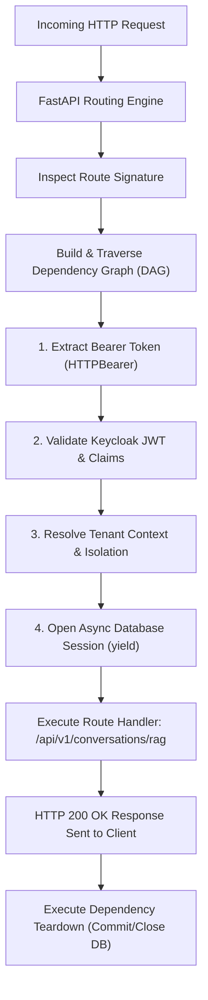
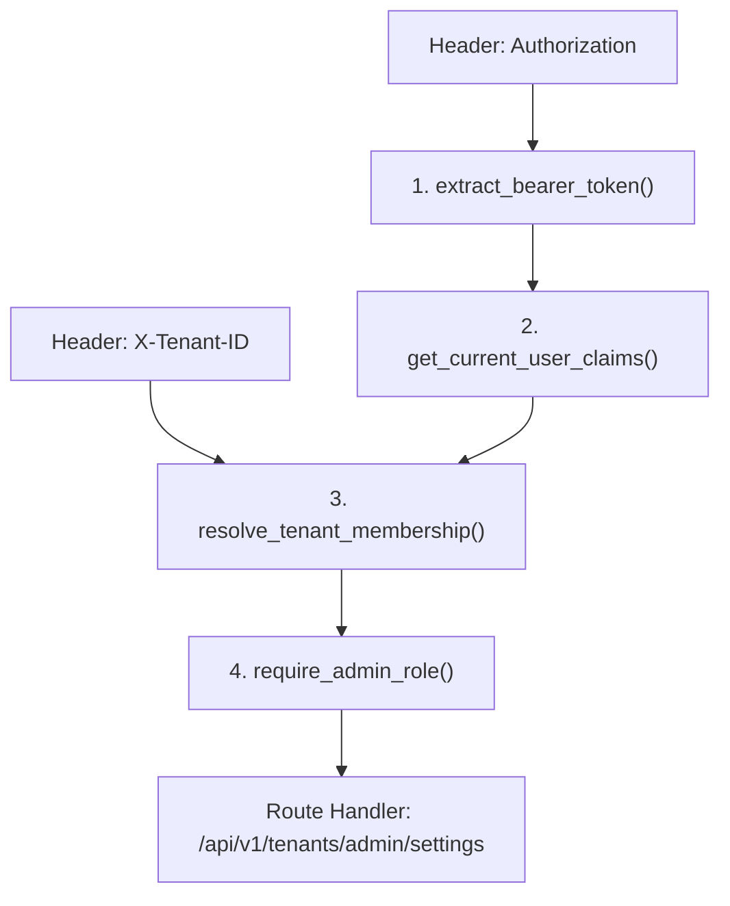
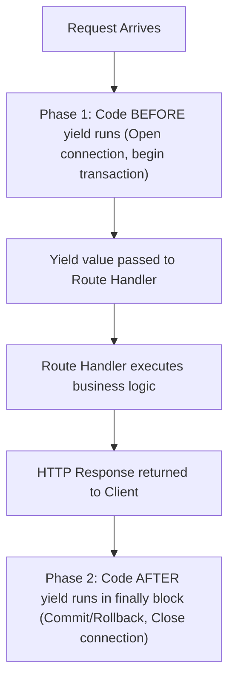
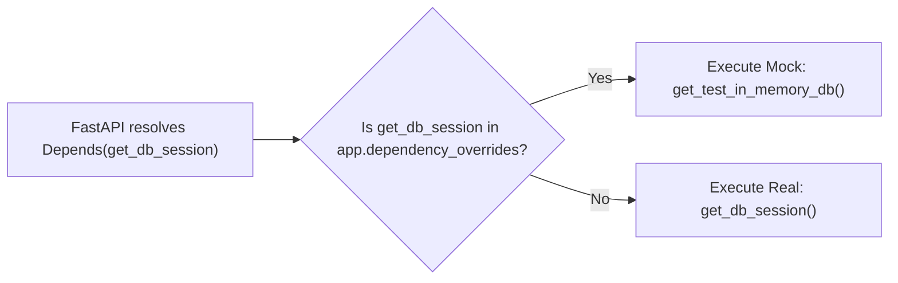
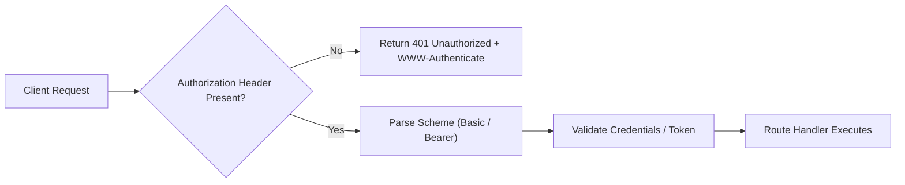
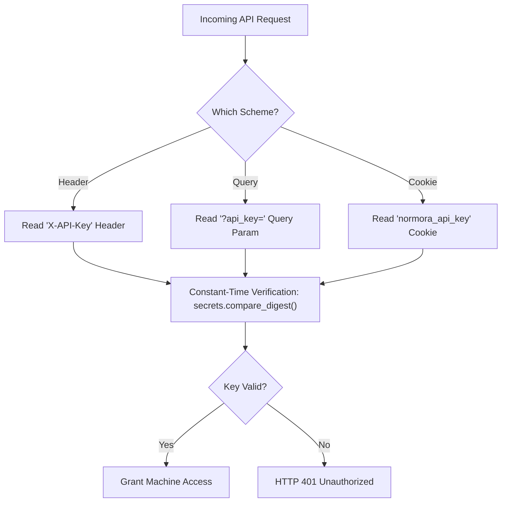
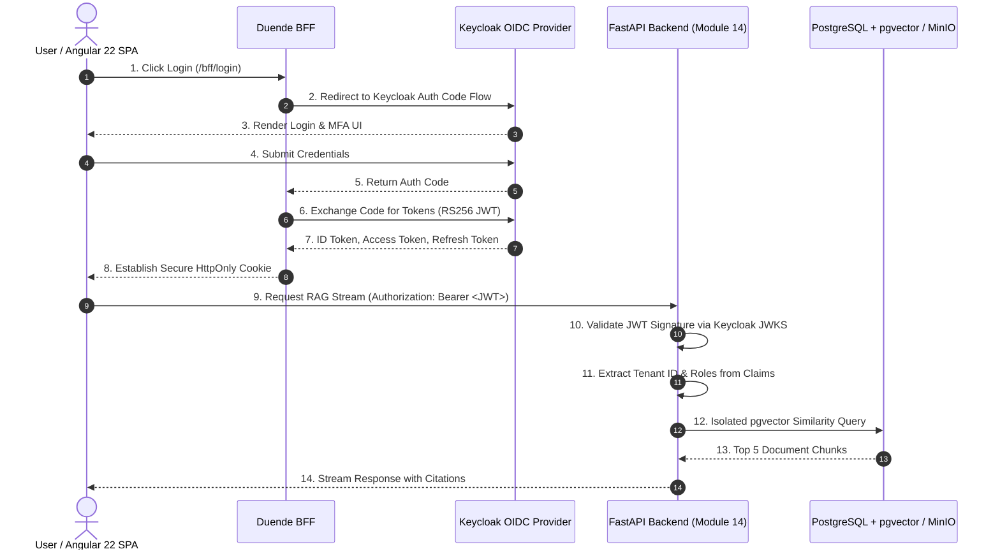
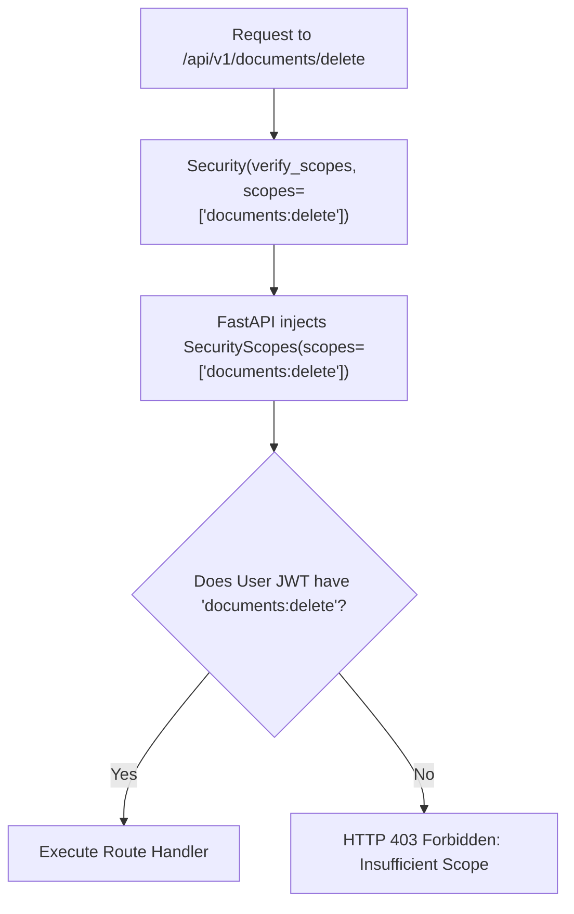

# Module 14: FastAPI Dependency Injection (`Depends`) & Security Architecture

Welcome to **Module 14** of the Normora Python & AI Masterclass. 

In enterprise software engineering, **Dependency Injection (DI)** is the foundational architectural pattern that decouples components, facilitates isolated unit testing, enforces cross-cutting concerns (authentication, tenant isolation, telemetry), and manages resource lifecycles.

If you are coming from a **C# and .NET 10** background, you are deeply familiar with `Microsoft.Extensions.DependencyInjection`, registering interfaces in `IServiceCollection` with lifetimes like `Transient`, `Scoped`, and `Singleton`, injecting services into Primary Constructors, and writing ASP.NET Core Middleware or Action Filters for security.

In **FastAPI**, Dependency Injection is radically elegant, lightweight, and expressive. Rather than configuring a centralized reflection-based IoC container, FastAPI uses a declarative parameter-driven system centered on **`Depends()`** and **`Security()`**.

FastAPI's DI system:
- Operates as a **Directed Acyclic Graph (DAG)** where dependencies can depend on sub-dependencies to arbitrary depths.
- Manages request-scoped resource lifecycles automatically via **Generator Dependencies (`yield`)**.
- Resolves dependencies concurrently where possible, caching results within the same request lifecycle (`use_cache=True`).
- Integrates directly with the OpenAPI (Swagger) specification, rendering interactive authorization dialogs for OAuth2, JWT Bearer tokens, and API Keys.
- Allows zero-friction testing through runtime dictionary overrides (`app.dependency_overrides`) without cumbersome mocking libraries.

In this module, you will build an enterprise-grade security and dependency architecture for **Normora**—our multi-tenant knowledge management and conversational AI platform.

---

## 1. Architectural Overview & The Dependency Injection Philosophy

### 1.1 What is Dependency Injection in Python?

To understand FastAPI's DI, we must first understand how Python handles function parameters and "callables" from absolute scratch.

In Python:
1. **Functions are first-class citizens**: Functions can be passed as arguments, assigned to variables, and returned from other functions.
2. **A "Callable" is any object you can put parentheses `()` after**: This includes standard functions (`def`), asynchronous functions (`async def`), and classes that implement the special `__call__` method.
3. **Default parameter evaluation**: In Python, a function signature can specify default values:
   ```python
   def search_documents(query: str, limit: int = 10):
       pass
   ```
   FastAPI leverages this syntax! When FastAPI inspects a route handler signature, any parameter with a default value of `Depends(some_callable)` is treated as a dependency to resolve before executing the route.



### 1.2 Comparison: FastAPI DI vs. ASP.NET Core DI

As a .NET architect, you will find FastAPI's approach refreshing. Here is the conceptual translation between the two ecosystems:

| Architectural Concept | ASP.NET Core (.NET 10) | FastAPI (Python 3.12+) |
| :--- | :--- | :--- |
| **Registration Mechanism** | `builder.Services.AddScoped<TInterface, TImpl>()` | No container registration needed; declared directly in route signatures via `Depends(callable)` |
| **Resolution Mechanism** | Primary Constructor parameter injection via `IServiceProvider` | Route parameter injection via `param: Type = Depends(callable)` |
| **Scoped Lifetime (Per Request)** | `services.AddScoped<T>()` | Default behavior of `Depends(callable)` (`use_cache=True` per HTTP request) |
| **Transient Lifetime (Fresh Every Time)** | `services.AddTransient<T>()` | `Depends(callable, use_cache=False)` |
| **Singleton Lifetime (App-wide)** | `services.AddSingleton<T>()` | Application `lifespan` context manager or module-level singleton objects |
| **Resource Cleanup (`IDisposable`)** | `using var scope = ...` / `DisposeAsync()` | Generator dependencies using `yield` inside `try...finally` |
| **Action Filters / Guards** | `[Authorize]`, `IAsyncActionFilter` | Sub-dependencies or route-level `dependencies=[Depends(...)]` |
| **Testing Overrides** | `WebApplicationFactory<Program>.WithWebHostBuilder(builder => builder.ConfigureTestServices(...))` | `app.dependency_overrides[original_callable] = mock_callable` |
| **Request Context Propagation** | `IHttpContextAccessor` / `AsyncLocal<T>` | `contextvars.ContextVar[T]` or cascading dependency arguments |

> [!NOTE]
> In ASP.NET Core, services must be registered upfront in `Program.cs`. In FastAPI, dependencies are resolved dynamically by inspecting the abstract syntax tree and call signatures of the route handlers. If an endpoint does not declare a dependency, that dependency is never instantiated.

---

### 1.3 Five Real-World Normora Examples: `Depends()` Basics

Let's explore five foundational dependency patterns within Normora.

#### Example 1.1: Reusable Query Pagination Dependency (Class-Based)
In Normora, document listings, audit trails, and conversation histories all require standardized pagination. Instead of repeating `page: int` and `page_size: int` in dozens of endpoints, we encapsulate them in a class:

```python
from fastapi import FastAPI, Depends, Query

app = FastAPI(title="Normora Knowledge API")

class PaginationParams:
    """Encapsulates pagination parameters and calculates SQL offsets.
    
    FastAPI detects the Query parameters in __init__ and resolves them automatically!
    """
    def __init__(
        self,
        page: int = Query(default=1, ge=1, description="Page number (1-based index)"),
        page_size: int = Query(default=20, ge=1, le=100, description="Items per page (max 100)")
    ):
        self.page = page
        self.page_size = page_size
        self.skip = (page - 1) * page_size
        self.limit = page_size

@app.get("/api/v1/documents")
async def list_documents(pagination: PaginationParams = Depends()):
    # When Depends() has no argument, FastAPI automatically inspects PaginationParams.__init__!
    return {
        "page": pagination.page,
        "page_size": pagination.page_size,
        "skip": pagination.skip,
        "limit": pagination.limit,
        "items": []
    }
```

#### Example 1.2: Tenant Subdomain Resolution from Host Header
Normora supports dedicated tenant subdomains (e.g., `acme.normora.ai`, `megacorp.normora.ai`). We extract the tenant slug before any routing occurs:

```python
from fastapi import Header, HTTPException, status

async def resolve_tenant_subdomain(host: str = Header(..., description="HTTP Host header")) -> str:
    """Extracts the tenant identifier from the incoming Host header."""
    # Split 'acme.normora.ai:8000' or 'acme.normora.ai'
    clean_host = host.split(":")[0].strip().lower()
    host_parts = clean_host.split(".")
    
    # Check if host matches '<tenant>.normora.ai' or localhost testing
    if len(host_parts) >= 3 and host_parts[-2] == "normora" and host_parts[-1] == "ai":
        return host_parts[0]
    
    # Fallback for local development (e.g. acme.localhost)
    if len(host_parts) >= 2 and host_parts[-1] == "localhost":
        return host_parts[0]
        
    raise HTTPException(
        status_code=status.HTTP_400_BAD_REQUEST,
        detail="Missing or invalid tenant subdomain in Host header."
    )

@app.get("/api/v1/tenant/branding")
async def get_tenant_branding(tenant_slug: str = Depends(resolve_tenant_subdomain)):
    return {
        "tenant_slug": tenant_slug,
        "primary_color": "#1E3A8A",
        "logo_url": f"https://cdn.normora.ai/logos/{tenant_slug}.png"
    }
```

#### Example 1.3: Injecting Google Gemini Cloud AI Settings
Normora uses Google Gemini Flash (`gemini-1.5-flash`) for streaming RAG completions. We inject strongly-typed configuration settings using Pydantic:

```python
from pydantic_settings import BaseSettings, SettingsConfigDict
from functools import lru_cache

class GeminiFlashSettings(BaseSettings):
    """Google Gemini AI cloud settings loaded from environment variables."""
    api_key: str = "mock-gemini-cloud-key-normora"
    model_name: str = "gemini-1.5-flash"
    temperature: float = 0.2
    max_output_tokens: int = 2048
    top_p: float = 0.95
    
    model_config = SettingsConfigDict(env_prefix="NORMORA_GEMINI_")

@lru_cache(maxsize=1)
def get_gemini_settings() -> GeminiFlashSettings:
    """Returns a singleton instance of GeminiFlashSettings (memoized via lru_cache)."""
    return GeminiFlashSettings()

@app.post("/api/v1/ai/summary")
async def summarize_chunk(
    chunk_text: str,
    settings: GeminiFlashSettings = Depends(get_gemini_settings)
):
    return {
        "model": settings.model_name,
        "temperature": settings.temperature,
        "summary": f"Summary generated by {settings.model_name} for text: {chunk_text[:30]}..."
    }
```

#### Example 1.4: Injecting Distributed Tracing Correlation ID (OpenTelemetry)
Enterprise compliance requires distributed tracing across the Angular 22 frontend, Duende BFF, FastAPI, and background workers:

```python
import uuid
from fastapi import Header

async def get_or_create_correlation_id(
    x_correlation_id: str | None = Header(
        default=None, 
        description="W3C Correlation ID / Trace ID passed from Duende BFF or API Gateway"
    )
) -> str:
    """Extracts existing correlation ID or issues a new UUID v4 trace identifier."""
    if x_correlation_id and x_correlation_id.strip():
        return x_correlation_id.strip()
    return str(uuid.uuid4())

@app.get("/api/v1/audit/logs")
async def get_audit_trail(correlation_id: str = Depends(get_or_create_correlation_id)):
    return {
        "correlation_id": correlation_id,
        "entries": [
            {"action": "DOCUMENT_INDEXED", "timestamp": "2026-11-18T12:00:00Z"}
        ]
    }
```

#### Example 1.5: Reusable Document Semantic Search Filter
In Normora's vector search engine (pgvector), users filter by minimum cosine similarity and document classification:

```python
from fastapi import Query

class VectorSearchFilters:
    """Encapsulates pgvector cosine similarity search filters."""
    def __init__(
        self,
        query: str = Query(..., min_length=2, max_length=500, description="Natural language prompt"),
        min_score: float = Query(default=0.70, ge=0.0, le=1.0, description="Minimum cosine similarity"),
        department: str | None = Query(default=None, description="Filter by business department"),
        include_archived: bool = Query(default=False, description="Include soft-deleted documents")
    ):
        self.query = query
        self.min_score = min_score
        self.department = department
        self.include_archived = include_archived

@app.get("/api/v1/documents/vector-search")
async def search_vectors(filters: VectorSearchFilters = Depends()):
    return {
        "query": filters.query,
        "threshold": filters.min_score,
        "department_filter": filters.department,
        "results": []
    }
```

---

## 2. Hierarchical Dependencies & The Sub-Dependency Graph

A dependency can itself depend on other dependencies. FastAPI builds a **Directed Acyclic Graph (DAG)** of all dependencies, discovers the execution order, executes them, and passes the resolved outputs down the tree.



### 2.1 Intra-Request Caching (`use_cache=True` vs `use_cache=False`)

By default, every `Depends(func)` in FastAPI has `use_cache=True`. 
- **What this means**: If three different sub-dependencies all require `get_current_user`, FastAPI will execute `get_current_user` **only once** for that HTTP request. The resolved value is stored in an internal request-scoped cache and reused for the other two consumers.
- **When to disable caching (`use_cache=False`)**: When a dependency must generate a distinct, non-cached instance every time it is injected (e.g., generating distinct cryptographic salts, fresh unique span IDs, or random nonces).

---

### 2.2 Five Real-World Normora Examples: Hierarchical Dependencies

#### Example 2.1: Multi-Tier Authentication & Tenant Membership Resolution
Here, the endpoint requires a resolved `TenantMembership`. To get it, FastAPI first validates the bearer token, decodes the user claims, and checks the user's membership in the specified tenant:

```python
from fastapi import FastAPI, Depends, Header, HTTPException, status
from pydantic import BaseModel

app = FastAPI()

class UserClaims(BaseModel):
    user_id: str
    email: str
    full_name: str

class TenantMembership(BaseModel):
    user_id: str
    tenant_id: str
    role: str
    permissions: list[str]

# Level 1: Extract raw token
async def extract_token_from_header(authorization: str = Header(...)) -> str:
    parts = authorization.split()
    if len(parts) != 2 or parts[0].lower() != "bearer":
        raise HTTPException(
            status_code=status.HTTP_401_UNAUTHORIZED,
            detail="Invalid Authorization header format. Expected 'Bearer <token>'."
        )
    return parts[1]

# Level 2: Decode token into UserClaims (Depends on Level 1)
async def get_current_user_claims(token: str = Depends(extract_token_from_header)) -> UserClaims:
    # Simulated Keycloak OIDC JWT decoding & verification
    if token == "invalid-token":
        raise HTTPException(status_code=status.HTTP_401_UNAUTHORIZED, detail="Token signature expired.")
    return UserClaims(user_id="usr_9918", email="sanjeev@normora.ai", full_name="Sanjeev Kumar")

# Level 3: Resolve Tenant Membership (Depends on Level 2 + X-Tenant-ID header)
async def get_current_membership(
    user: UserClaims = Depends(get_current_user_claims),
    x_tenant_id: str = Header(..., description="Target Tenant GUID")
) -> TenantMembership:
    # Simulated query against Normora Tenants module database
    return TenantMembership(
        user_id=user.user_id,
        tenant_id=x_tenant_id,
        role="Admin",
        permissions=["documents:read", "documents:write", "ai:chat"]
    )

# Endpoint consumes Level 3: FastAPI traverses Level 1 -> Level 2 -> Level 3 automatically!
@app.get("/api/v1/me/context")
async def get_my_context(membership: TenantMembership = Depends(get_current_membership)):
    return {
        "user_id": membership.user_id,
        "tenant_id": membership.tenant_id,
        "role": membership.role,
        "permissions": membership.permissions
    }
```

#### Example 2.2: Reusable Role Guard (BFLA Defense via Callable Class)
Normora strictly enforces Broken Function Level Authorization (BFLA) defense, returning `403 Forbidden` if an authenticated user attempts an administrative action:

```python
class RequireRole:
    """Callable class dependency that verifies if the caller holds one of the required roles."""
    def __init__(self, allowed_roles: list[str]):
        self.allowed_roles = allowed_roles

    def __call__(self, membership: TenantMembership = Depends(get_current_membership)) -> TenantMembership:
        if membership.role not in self.allowed_roles:
            raise HTTPException(
                status_code=status.HTTP_403_FORBIDDEN,
                detail=f"Forbidden: Action requires one of the following roles: {self.allowed_roles}"
            )
        return membership

# Only 'Owner' or 'Admin' can access this route:
@app.post("/api/v1/tenant/billing-plan", dependencies=[Depends(RequireRole(["Owner", "Admin"]))])
async def update_billing_plan():
    return {"status": "Billing plan updated successfully."}
```

#### Example 2.3: Tenant AI Token Quota Guard
Prevents tenants from exceeding their monthly Google Gemini Flash API token limits:

```python
class TenantQuota(BaseModel):
    tenant_id: str
    tokens_remaining: int
    tier: str

async def check_tenant_ai_quota(
    membership: TenantMembership = Depends(get_current_membership)
) -> TenantQuota:
    # Simulated Redis lookup for current tenant token consumption
    tenant_tokens_left = 750_000
    if tenant_tokens_left <= 0:
        raise HTTPException(
            status_code=status.HTTP_429_TOO_MANY_REQUESTS,
            detail="Monthly AI token quota exhausted. Upgrade your Normora subscription."
        )
    return TenantQuota(
        tenant_id=membership.tenant_id,
        tokens_remaining=tenant_tokens_left,
        tier="Enterprise"
    )

@app.post("/api/v1/conversations/stream")
async def stream_conversation(
    prompt: str,
    quota: TenantQuota = Depends(check_tenant_ai_quota)
):
    return {
        "status": "Token balance verified",
        "tokens_remaining": quota.tokens_remaining,
        "prompt": prompt
    }
```

#### Example 2.4: Departmental BOLA Filter Sub-Dependency
Normora guards against Broken Object Level Authorization (BOLA). To prevent tenant enumeration attacks, if a document does not exist within the tenant or the user does not have department access, we return `404 Not Found` (never `403`):

```python
class DepartmentContext(BaseModel):
    tenant_id: str
    department: str

async def get_department_context(
    membership: TenantMembership = Depends(get_current_membership),
    x_department: str = Header(default="General", description="Active Department Scope")
) -> DepartmentContext:
    # Validate department exists within tenant
    valid_departments = ["Engineering", "Legal", "Executive", "General"]
    if x_department not in valid_departments:
        # BOLA Defense: Return 404 rather than revealing internal structural details
        raise HTTPException(
            status_code=status.HTTP_404_NOT_FOUND,
            detail="Requested department workspace does not exist."
        )
    return DepartmentContext(tenant_id=membership.tenant_id, department=x_department)

@app.get("/api/v1/documents/by-department")
async def list_dept_documents(dept_ctx: DepartmentContext = Depends(get_department_context)):
    return {
        "tenant_id": dept_ctx.tenant_id,
        "department": dept_ctx.department,
        "documents": [f"Q3_{dept_ctx.department}_Overview.pdf"]
    }
```

#### Example 2.5: Composite RAG Execution Bundle
When preparing a RAG completion, the route needs settings, user claims, tenant membership, and a correlation ID. We bundle these into a single composite dependency:

```python
class RagExecutionBundle:
    """Aggregates all execution context required for a RAG completion."""
    def __init__(
        self,
        membership: TenantMembership = Depends(get_current_membership),
        ai_settings: GeminiFlashSettings = Depends(get_gemini_settings),
        correlation_id: str = Depends(get_or_create_correlation_id)
    ):
        self.membership = membership
        self.ai_settings = ai_settings
        self.correlation_id = correlation_id

@app.post("/api/v1/conversations/query")
async def execute_rag_pipeline(query: str, bundle: RagExecutionBundle = Depends()):
    return {
        "tenant_id": bundle.membership.tenant_id,
        "user_id": bundle.membership.user_id,
        "model": bundle.ai_settings.model_name,
        "trace_id": bundle.correlation_id,
        "status": "Ready for vector search & generation"
    }
```

---

## 3. Dependency Scopes & Generator Dependencies (`yield`)

### 3.1 Understanding Scopes: App-Scoped vs Request-Scoped vs Transient

In ASP.NET Core, you explicitly register lifetimes:
- `AddSingleton<T>()`: One instance for the entire application lifetime.
- `AddScoped<T>()`: One instance per incoming HTTP request.
- `AddTransient<T>()`: A brand-new instance every time requested.

Here is how FastAPI implements these three scopes:

1. **App-Scoped (Singleton)**: Implemented using FastAPI's `@asynccontextmanager` **Lifespan** feature or module-level initialized singletons. Created once on server startup; destroyed on shutdown. (e.g., SQLAlchemy Async Engine, MinIO client instance, OpenTelemetry tracer).
2. **Request-Scoped (`Scoped`)**: The default behavior of `Depends(dependency_func)` with `use_cache=True`. Executed on the first injection during an HTTP request; reused for all subsequent injections in that same request; cleaned up when the response is returned. (e.g., SQLAlchemy `AsyncSession`, tenant context).
3. **Transient**: Implemented using `Depends(dependency_func, use_cache=False)`. Re-executed on every single parameter injection, even within the same HTTP request. (e.g., unique cryptographic nonces, execution timers).

---

### 3.2 Generator Dependencies with `yield`

In Python, a function containing the `yield` keyword is a **Generator**. When used as a FastAPI dependency, `yield` divides the function into two execution phases:



> [!IMPORTANT]
> The code after `yield` is guaranteed to execute **even if an unhandled exception or HTTPException was raised inside your route handler**! Always wrap the post-yield cleanup in a `finally:` block to prevent connection leaks.

---

### 3.3 Five Real-World Normora Examples: Scoped `yield` Lifecycles

#### Example 3.1: Scoped Async Database Session (SQLAlchemy 2.0 Pattern)
Manages the PostgreSQL + pgvector database session lifecycle: opens connection, yields session, commits on success, rolls back on error, and closes:

```python
from collections.abc import AsyncGenerator
from fastapi import FastAPI, Depends

app = FastAPI()

class MockAsyncSession:
    """Simulates an async SQLAlchemy database session."""
    def __init__(self):
        self.is_active = True
        
    async def commit(self):
        print("[DB] Transaction COMMITTED.")
        
    async def rollback(self):
        print("[DB] Transaction ROLLED BACK due to error.")
        
    async def close(self):
        self.is_active = False
        print("[DB] Connection returned to connection pool.")

async def get_db_session() -> AsyncGenerator[MockAsyncSession, None]:
    """Request-scoped database session dependency.
    
    Equivalent to ASP.NET Core: services.AddScoped<DbContext>()
    """
    session = MockAsyncSession()
    print("--> [SETUP] Acquired database connection from pool.")
    try:
        yield session
        await session.commit()
    except Exception as exc:
        await session.rollback()
        raise exc
    finally:
        await session.close()
        print("<-- [TEARDOWN] Database session closed.")

@app.post("/api/v1/documents")
async def create_document_record(session: MockAsyncSession = Depends(get_db_session)):
    print("[ROUTE] Inserting document into pgvector database...")
    return {"message": "Document record created."}
```

#### Example 3.2: Scoped MinIO S3 Temp File Upload Buffer
When users upload large PDF files for chunking, Normora buffers the stream to a temporary file on disk, streams it to MinIO, and ensures the temporary file is deleted in the cleanup phase:

```python
import os
import tempfile
from collections.abc import AsyncGenerator

async def get_temp_upload_file() -> AsyncGenerator[str, None]:
    """Allocates a secure temporary file on disk and guarantees its deletion."""
    fd, temp_path = tempfile.mkstemp(prefix="normora_upload_", suffix=".pdf")
    os.close(fd)
    print(f"--> [BUFFER] Created temporary disk buffer: {temp_path}")
    try:
        yield temp_path
    finally:
        if os.path.exists(temp_path):
            os.remove(temp_path)
            print(f"<-- [BUFFER] Cleaned up temporary disk buffer: {temp_path}")

@app.post("/api/v1/documents/upload-raw")
async def upload_raw_document(temp_file: str = Depends(get_temp_upload_file)):
    # Write incoming chunks to temp_file, then push to MinIO bucket
    return {"status": "Uploaded to MinIO", "buffer_path": temp_file}
```

#### Example 3.3: Scoped PostgreSQL Tenant Schema Search Path
In a multi-tenant PostgreSQL architecture, each tenant has their own PostgreSQL schema (`tenant_acme`, `tenant_megacorp`). We set the schema search path for the duration of the request and reset it afterward:

```python
async def get_tenant_isolated_session(
    membership: TenantMembership = Depends(get_current_membership),
    session: MockAsyncSession = Depends(get_db_session)
) -> AsyncGenerator[MockAsyncSession, None]:
    """Sets PostgreSQL search_path to isolated tenant schema and resets on exit."""
    schema_name = f"tenant_{membership.tenant_id}"
    print(f"--> [ISOLATION] SET LOCAL search_path TO {schema_name}, public;")
    try:
        yield session
    finally:
        print("<-- [ISOLATION] RESET search_path;")

@app.get("/api/v1/tenant/tables")
async def query_tenant_tables(db: MockAsyncSession = Depends(get_tenant_isolated_session)):
    return {"status": "Isolated tenant query executed"}
```

#### Example 3.4: Scoped OpenTelemetry Distributed Trace Span
Ensures that each HTTP request is bounded within an OpenTelemetry span that captures exceptions and records latency:

```python
import time
from collections.abc import AsyncGenerator

class SpanRecorder:
    def __init__(self, trace_id: str):
        self.trace_id = trace_id
        self.tags = {}

    def set_tag(self, key: str, value: str):
        self.tags[key] = value

async def get_trace_span(
    correlation_id: str = Depends(get_or_create_correlation_id)
) -> AsyncGenerator[SpanRecorder, None]:
    span = SpanRecorder(trace_id=correlation_id)
    start_time = time.perf_counter()
    print(f"--> [TELEMETRY] Span started: {correlation_id}")
    try:
        yield span
    except Exception as exc:
        span.set_tag("error", str(exc))
        print(f"[TELEMETRY] Span recorded error: {exc}")
        raise exc
    finally:
        duration_ms = (time.perf_counter() - start_time) * 1000
        print(f"<-- [TELEMETRY] Span ended: {correlation_id} (Duration: {duration_ms:.2f}ms)")

@app.get("/api/v1/health/ping")
async def ping(span: SpanRecorder = Depends(get_trace_span)):
    span.set_tag("endpoint", "ping")
    return {"status": "pong"}
```

#### Example 3.5: Scoped Reusable HTTPX Async Client for Outbound Keycloak Calls
Avoid creating new TCP/SSL handshakes on every call by sharing a scoped HTTP client with connection pooling:

```python
class MockHttpClient:
    async def get(self, url: str) -> dict:
        return {"status": 200, "data": "keycloak_public_keys"}
    async def close(self):
        print("[HTTP] Scoped HTTP connection pool closed.")

async def get_scoped_http_client() -> AsyncGenerator[MockHttpClient, None]:
    client = MockHttpClient()
    try:
        yield client
    finally:
        await client.close()

@app.get("/api/v1/auth/openid-config")
async def get_openid_config(client: MockHttpClient = Depends(get_scoped_http_client)):
    data = await client.get("https://auth.normora.ai/auth/realms/normora/.well-known/openid-configuration")
    return {"config": data}
```

---

## 4. Testing & Dependency Overrides: `app.dependency_overrides`

In ASP.NET Core, overriding dependencies for integration tests requires configuring a `WebApplicationFactory` and replacing registrations in `ConfigureTestServices`:

```csharp
// C# ASP.NET Core Equivalent
var factory = new WebApplicationFactory<Program>().WithWebHostBuilder(builder => {
    builder.ConfigureTestServices(services => {
        services.AddScoped<IDbSession, MockTestDbSession>();
    });
});
```

In FastAPI, testing overrides are built right into the `FastAPI` application instance via a simple Python dictionary: **`app.dependency_overrides`**!

When an endpoint executes under test, FastAPI checks `app.dependency_overrides`. If a dependency callable exists as a key in that dictionary, FastAPI executes the override callable instead!



> [!TIP]
> Always clear overrides in your test teardown (e.g. `app.dependency_overrides.clear()`) or use a pytest fixture to prevent test pollution.

---

### 4.1 Five Real-World Normora Examples: Dependency Overrides

#### Example 4.1: Overriding Google Gemini Flash AI Client for Deterministic Unit Tests
Avoid burning real API tokens or encountering rate limits during automated CI/CD builds:

```python
from fastapi.testclient import TestClient

# Real dependency (defined earlier): get_gemini_settings

# 1. Define the test mock dependency:
def get_mock_gemini_settings() -> GeminiFlashSettings:
    return GeminiFlashSettings(
        api_key="test-mock-key",
        model_name="mock-gemini-test-engine",
        temperature=0.0
    )

# 2. Configure override in test fixture:
def test_ai_summary_endpoint():
    app.dependency_overrides[get_gemini_settings] = get_mock_gemini_settings
    
    client = TestClient(app)
    response = client.post("/api/v1/ai/summary", params={"chunk_text": "Sample text"})
    
    assert response.status_code == 200
    data = response.json()
    assert data["model"] == "mock-gemini-test-engine"
    
    # 3. Clean up overrides:
    app.dependency_overrides.clear()
```

#### Example 4.2: Overriding Authentication to Inject a Test Tenant Owner
Bypass Keycloak token decoding in unit tests and inject a mock `TenantMembership` directly:

```python
async def override_tenant_membership() -> TenantMembership:
    return TenantMembership(
        user_id="test_admin_001",
        tenant_id="tenant_integration_test",
        role="Owner",
        permissions=["*"]
    )

def test_billing_plan_update():
    app.dependency_overrides[get_current_membership] = override_tenant_membership
    
    client = TestClient(app)
    # No Authorization header or Keycloak running required!
    response = client.post("/api/v1/tenant/billing-plan")
    
    assert response.status_code == 200
    assert response.json()["status"] == "Billing plan updated successfully."
    
    app.dependency_overrides.clear()
```

#### Example 4.3: Overriding Database Session with In-Memory Test State
Replace production PostgreSQL connections with an in-memory test double:

```python
class TestInMemorySession:
    def __init__(self):
        self.records = []
    async def commit(self):
        pass
    async def rollback(self):
        pass
    async def close(self):
        pass

async def override_get_db_session():
    test_session = TestInMemorySession()
    try:
        yield test_session
    finally:
        await test_session.close()

def test_document_creation():
    app.dependency_overrides[get_db_session] = override_get_db_session
    
    client = TestClient(app)
    response = client.post("/api/v1/documents")
    assert response.status_code == 200
    
    app.dependency_overrides.clear()
```

#### Example 4.4: Simulating AI Quota Exhaustion (429 Rate Limit Test)
Verify that our endpoint returns HTTP 429 when quota is depleted:

```python
async def override_quota_exhausted():
    raise HTTPException(
        status_code=status.HTTP_429_TOO_MANY_REQUESTS,
        detail="Monthly AI token quota exhausted. Upgrade your Normora subscription."
    )

def test_quota_exhaustion_behavior():
    app.dependency_overrides[check_tenant_ai_quota] = override_quota_exhausted
    
    client = TestClient(app)
    response = client.post("/api/v1/conversations/stream", params={"prompt": "Hello"})
    
    assert response.status_code == 429
    assert "quota exhausted" in response.json()["detail"].lower()
    
    app.dependency_overrides.clear()
```

#### Example 4.5: Pytest Autouse Fixture for Automatic Override Cleanup
In professional Python enterprise codebases, use a pytest fixture with `yield` to ensure `app.dependency_overrides` is always wiped clean after every test:

```python
import pytest

@pytest.fixture(autouse=True)
def reset_dependency_overrides():
    """Guarantees a clean dependency injection state before and after each test."""
    app.dependency_overrides.clear()
    yield
    app.dependency_overrides.clear()
```

---

## 5. Transport Security Schemes: `HTTPBasic` & `HTTPBearer`

FastAPI provides ready-to-use security schemes in `fastapi.security`. When you use these dependencies:
1. FastAPI extracts and parses the standard HTTP `Authorization` headers.
2. If the header is missing, FastAPI automatically returns an HTTP `401 Unauthorized` response with the appropriate `WWW-Authenticate` challenge header.
3. FastAPI documents the authentication scheme in the OpenAPI JSON schema, adding the "Authorize" padlock button in the Swagger UI (`/docs`).



---

### 5.1 Five Real-World Normora Examples: `HTTPBasic` & `HTTPBearer`

#### Example 5.1: Prometheus Scraper Metrics Authentication with `HTTPBasic`
Prometheus or Datadog agents scrape Normora's internal `/metrics` endpoint using HTTP Basic Authentication:

```python
import secrets
from fastapi import FastAPI, Depends, HTTPException, status
from fastapi.security import HTTPBasic, HTTPBasicCredentials

app = FastAPI()
security_basic = HTTPBasic()

def authenticate_metrics_scraper(credentials: HTTPBasicCredentials = Depends(security_basic)) -> str:
    """Validates Prometheus scrape credentials using constant-time comparison."""
    # Expected service credentials from environment:
    correct_username = secrets.compare_digest(credentials.username, "prometheus_scraper")
    correct_password = secrets.compare_digest(credentials.password, "NormoraSecureMetricsScrape2026!")
    
    if not (correct_username and correct_password):
        raise HTTPException(
            status_code=status.HTTP_401_UNAUTHORIZED,
            detail="Invalid scraper credentials.",
            headers={"WWW-Authenticate": "Basic"}
        )
    return credentials.username

@app.get("/metrics")
async def get_system_metrics(user: str = Depends(authenticate_metrics_scraper)):
    return {
        "normora_active_conversations": 42,
        "normora_pgvector_index_size_mb": 1024,
        "normora_gemini_tokens_used_today": 184500
    }
```

#### Example 5.2: Raw Bearer Token Extraction with `HTTPBearer`
Extract the raw JWT Bearer token passed from the Duende BFF:

```python
from fastapi.security import HTTPBearer, HTTPAuthorizationCredentials

bearer_scheme = HTTPBearer(
    scheme_name="KeycloakBearerAuth",
    description="Pass Keycloak OIDC JWT token: 'Bearer <token>'"
)

async def validate_raw_bearer(
    credentials: HTTPAuthorizationCredentials = Depends(bearer_scheme)
) -> str:
    token = credentials.credentials
    if not token or len(token) < 20:
        raise HTTPException(
            status_code=status.HTTP_401_UNAUTHORIZED,
            detail="Malformed or missing Bearer token."
        )
    return token

@app.get("/api/v1/auth/token-inspect")
async def inspect_token(token: str = Depends(validate_raw_bearer)):
    return {"token_preview": f"{token[:10]}...{token[-5:]}"}
```

#### Example 5.3: BOLA vs BFLA Security Guard with Centralized `ApiMessages`
In Normora, we enforce a strict separation between Broken Function Level Authorization (BFLA -> `403 Forbidden`) and Broken Object Level Authorization (BOLA -> `404 Not Found` to prevent tenant enumeration):

```python
class ApiMessages:
    """Centralized security error messages to prevent information disclosure."""
    UNAUTHORIZED = "Authentication credentials were not provided or are invalid."
    FORBIDDEN_BFLA = "Forbidden: Caller lacks permission to invoke this operation."
    NOT_FOUND_BOLA = "The requested resource does not exist in the active tenant workspace."

async def require_tenant_document_owner(
    document_id: str,
    membership: TenantMembership = Depends(get_current_membership)
) -> dict:
    # Simulated document lookup in tenant database
    doc_database = {
        "doc_101": {"tenant_id": "tenant_acme", "owner_id": "usr_9918", "title": "Architecture.pdf"},
        "doc_202": {"tenant_id": "tenant_megacorp", "owner_id": "usr_7777", "title": "Secret_M&A.pdf"}
    }
    
    doc = doc_database.get(document_id)
    
    # 1. BOLA Check: If document doesn't exist OR belongs to another tenant, ALWAYS return 404!
    # NEVER return 403 here: Returning 403 would confirm to attackers that doc_202 exists!
    if not doc or doc["tenant_id"] != membership.tenant_id:
        raise HTTPException(
            status_code=status.HTTP_404_NOT_FOUND,
            detail=ApiMessages.NOT_FOUND_BOLA
        )
        
    # 2. BFLA Check: User is in the right tenant, but does not have permission to delete
    if membership.role not in ["Owner", "Admin"] and doc["owner_id"] != membership.user_id:
        raise HTTPException(
            status_code=status.HTTP_403_FORBIDDEN,
            detail=ApiMessages.FORBIDDEN_BFLA
        )
        
    return doc

@app.delete("/api/v1/documents/{document_id}")
async def delete_document(
    document_id: str,
    doc: dict = Depends(require_tenant_document_owner)
):
    return {"status": f"Document '{doc['title']}' deleted successfully."}
```

#### Example 5.4: Optional Bearer Authentication (Public vs Authenticated Documents)
Normora allows public knowledge base articles to be viewed anonymously, but enriches the response with private notes if a valid token is provided:

```python
bearer_optional = HTTPBearer(auto_error=False)

async def get_optional_user(
    credentials: HTTPAuthorizationCredentials | None = Depends(bearer_optional)
) -> UserClaims | None:
    if credentials is None:
        return None
    # Decode token if present
    return UserClaims(user_id="usr_guest", email="guest@domain.com", full_name="Guest User")

@app.get("/api/v1/articles/{article_id}")
async def read_article(article_id: str, user: UserClaims | None = Depends(get_optional_user)):
    is_authenticated = user is not None
    return {
        "article_id": article_id,
        "is_authenticated": is_authenticated,
        "user_email": user.email if user else None,
        "content": "Public knowledge base content..."
    }
```

#### Example 5.5: Webhook Ingest Basic Authentication
For legacy third-party webhook push integrations (e.g. Jira Server / Confluence Webhooks):

```python
def verify_webhook_basic_auth(credentials: HTTPBasicCredentials = Depends(security_basic)) -> str:
    is_valid_user = secrets.compare_digest(credentials.username, "jira_webhook_service")
    is_valid_pass = secrets.compare_digest(credentials.password, "WebhookSharedSecret_XYZ_999")
    if not (is_valid_user and is_valid_pass):
        raise HTTPException(status_code=status.HTTP_401_UNAUTHORIZED, detail="Invalid webhook basic auth.")
    return credentials.username

@app.post("/api/v1/webhooks/jira-sync")
async def ingest_jira_webhook(payload: dict, service: str = Depends(verify_webhook_basic_auth)):
    return {"status": "Webhook accepted", "service": service}
```

---

## 6. API Key Security Schemes: Header, Query, & Cookie

While human users authenticate via Keycloak OIDC JWT tokens, **automated background workers**, **Python SDKs**, and **batch ingestion pipelines** use dedicated API keys.

FastAPI provides three specialized schemes:
- `APIKeyHeader`: Reads from a custom header (e.g., `X-API-Key`).
- `APIKeyQuery`: Reads from a query string parameter (e.g., `?api_key=...`). Useful for WebSockets or temporary file download URLs.
- `APIKeyCookie`: Reads from an HTTP-only cookie (e.g., `normora_session_api_key`).



---

### 6.1 Five Real-World Normora Examples: API Key Schemes

#### Example 6.1: Header-Based API Key for Python Ingestion Worker (`APIKeyHeader`)
```python
import secrets
from fastapi import FastAPI, Depends, HTTPException, status
from fastapi.security import APIKeyHeader

app = FastAPI()

api_key_header_scheme = APIKeyHeader(
    name="X-Normora-API-Key",
    auto_error=True,
    description="Enterprise API Key for automated background workers"
)

# Simulated in-memory database of active API keys:
ACTIVE_API_KEYS = {
    "normora_live_worker_key_8841a": {"tenant_id": "tenant_acme", "service": "DocumentIngestionWorker"},
    "normora_live_worker_key_1192b": {"tenant_id": "tenant_megacorp", "service": "AuditExporterWorker"}
}

async def validate_api_key_header(api_key: str = Depends(api_key_header_scheme)) -> dict:
    for stored_key, metadata in ACTIVE_API_KEYS.items():
        # secrets.compare_digest prevents timing attacks!
        if secrets.compare_digest(api_key, stored_key):
            return metadata
            
    raise HTTPException(
        status_code=status.HTTP_401_UNAUTHORIZED,
        detail="Invalid or deactivated API Key."
    )

@app.post("/api/v1/documents/batch-ingest")
async def batch_ingest(
    documents: list[dict],
    worker_meta: dict = Depends(validate_api_key_header)
):
    return {
        "status": "Accepted",
        "tenant_id": worker_meta["tenant_id"],
        "worker": worker_meta["service"],
        "count": len(documents)
    }
```

#### Example 6.2: Query-Based API Key for MinIO Pre-Signed Document Downloads (`APIKeyQuery`)
Browsers opening PDF files in new tabs cannot set custom HTTP headers. A signed query string parameter authenticates the download:

```python
from fastapi.security import APIKeyQuery

api_key_query_scheme = APIKeyQuery(
    name="download_token",
    auto_error=True,
    description="Short-lived one-time download token"
)

async def validate_download_token(token: str = Depends(api_key_query_scheme)) -> str:
    # Simulated validation of a signed HMAC download token
    if not token.startswith("dln_"):
        raise HTTPException(
            status_code=status.HTTP_403_FORBIDDEN,
            detail="Invalid or expired document download token."
        )
    return token

@app.get("/api/v1/documents/download/{doc_id}")
async def download_document(doc_id: str, token: str = Depends(validate_download_token)):
    return {
        "document_id": doc_id,
        "content_disposition": f"attachment; filename={doc_id}.pdf",
        "download_url": f"https://minio.normora.internal/documents/{doc_id}.pdf"
    }
```

#### Example 6.3: Cookie-Based API Key for Duende BFF Session Handoff (`APIKeyCookie`)
When Duende BFF manages cookies for the Angular 22 frontend:

```python
from fastapi.security import APIKeyCookie

api_key_cookie_scheme = APIKeyCookie(
    name="normora_bff_session",
    auto_error=True,
    description="Encrypted session cookie issued by Duende BFF"
)

async def validate_session_cookie(session_id: str = Depends(api_key_cookie_scheme)) -> str:
    if not session_id or len(session_id) < 32:
        raise HTTPException(
            status_code=status.HTTP_401_UNAUTHORIZED,
            detail="Invalid or expired session cookie. Re-authenticate via Duende BFF."
        )
    return session_id

@app.get("/api/v1/conversations/active-session")
async def get_active_session(session_id: str = Depends(validate_session_cookie)):
    return {"session_id": session_id, "status": "Active"}
```

#### Example 6.4: Fallback Key Resolver (Header OR Query Parameter)
Accept either `X-Normora-API-Key` in the header or `?api_key=` in the query string:

```python
api_key_header_optional = APIKeyHeader(name="X-Normora-API-Key", auto_error=False)
api_key_query_optional = APIKeyQuery(name="api_key", auto_error=False)

async def resolve_api_key_flexible(
    header_key: str | None = Depends(api_key_header_optional),
    query_key: str | None = Depends(api_key_query_optional)
) -> str:
    key = header_key or query_key
    if not key:
        raise HTTPException(
            status_code=status.HTTP_401_UNAUTHORIZED,
            detail="API Key must be supplied in 'X-Normora-API-Key' header or 'api_key' query parameter."
        )
    if not key.startswith("normora_"):
        raise HTTPException(status_code=status.HTTP_401_UNAUTHORIZED, detail="Invalid API Key format.")
    return key

@app.get("/api/v1/tools/search")
async def tool_search(key: str = Depends(resolve_api_key_flexible)):
    return {"authenticated_via": key[:12]}
```

#### Example 6.5: Rotatable API Keys with Expiration & Scopes
Enterprise multi-tenant clients need to inspect which capabilities an API key grants:

```python
class ApiKeyDetails(BaseModel):
    key_id: str
    tenant_id: str
    is_active: bool
    scopes: list[str]

async def get_api_key_details(
    raw_key: str = Depends(api_key_header_scheme)
) -> ApiKeyDetails:
    # Look up in PostgreSQL
    return ApiKeyDetails(
        key_id="key_prod_994",
        tenant_id="tenant_acme",
        is_active=True,
        scopes=["documents:read", "conversations:stream"]
    )

@app.get("/api/v1/keys/me")
async def inspect_current_key(details: ApiKeyDetails = Depends(get_api_key_details)):
    return details
```

---

## 7. OAuth2 Password Bearer Flow & Keycloak OIDC Integration

### 7.1 Architecture of Normora Authentication

Normora uses **Keycloak** as its OpenID Connect (OIDC) identity provider. 
- In development/testing, FastAPI provides a full **OAuth2 Password Flow** endpoint (`/api/v1/auth/token`) so frontend developers and Swagger UI can log in directly.
- In production, the **Duende BFF (Backend-for-Frontend)** handles the OpenID Connect authorization code flow with Keycloak, validates the ID token, and forwards the standard JWT Bearer token to FastAPI.



---

### 7.2 Five Real-World Normora Examples: OAuth2 & Keycloak

#### Example 7.1: Full OAuth2 Password Flow Implementation (`OAuth2PasswordRequestForm`)
FastAPI provides `OAuth2PasswordBearer` and `OAuth2PasswordRequestForm` to implement standard OAuth2 token exchange conforming to RFC 6749:

```python
from datetime import datetime, timedelta, timezone
from fastapi import FastAPI, Depends, HTTPException, status
from fastapi.security import OAuth2PasswordBearer, OAuth2PasswordRequestForm
from pydantic import BaseModel
import jwt  # PyJWT library

app = FastAPI()

# Token URL specifies where Swagger UI sends username & password when clicking 'Authorize':
oauth2_scheme = OAuth2PasswordBearer(
    tokenUrl="/api/v1/auth/token",
    description="OAuth2 Password Flow for Normora local testing"
)

SECRET_KEY = "normora-development-super-secret-jwt-signing-key"
ALGORITHM = "HS256"

class TokenResponse(BaseModel):
    access_token: str
    token_type: str
    expires_in: int

# Mock user database for testing:
USERS_DB = {
    "sanjeev@normora.ai": {
        "password": "Password123!",
        "user_id": "usr_sanjeev",
        "tenant_id": "tenant_acme",
        "roles": ["Admin"]
    }
}

@app.post("/api/v1/auth/token", response_model=TokenResponse)
async def login_for_access_token(form_data: OAuth2PasswordRequestForm = Depends()):
    """Standard OAuth2 token issuance endpoint used by Swagger UI and API clients."""
    user = USERS_DB.get(form_data.username)
    if not user or user["password"] != form_data.password:
        raise HTTPException(
            status_code=status.HTTP_401_UNAUTHORIZED,
            detail="Incorrect username or password",
            headers={"WWW-Authenticate": "Bearer"}
        )
        
    expires_delta = timedelta(hours=2)
    expire_time = datetime.now(timezone.utc) + expires_delta
    
    # Pack claims:
    token_payload = {
        "sub": user["user_id"],
        "email": form_data.username,
        "tenant_id": user["tenant_id"],
        "roles": user["roles"],
        "exp": expire_time
    }
    
    encoded_jwt = jwt.encode(token_payload, SECRET_KEY, algorithm=ALGORITHM)
    
    return TokenResponse(
        access_token=encoded_jwt,
        token_type="bearer",
        expires_in=int(expires_delta.total_seconds())
    )
```

#### Example 7.2: Keycloak JWKS Verification Dependency (Production Pattern)
In production, Keycloak signs JWTs with asymmetric **RS256** keys. FastAPI fetches Keycloak's public keys from the JWKS endpoint:

```python
class KeycloakJwtValidator:
    """Validates RS256 JWT tokens issued by Keycloak."""
    def __init__(self, keycloak_issuer: str, audience: str):
        self.issuer = keycloak_issuer
        self.audience = audience
        # In production: Fetch JWKS from f"{keycloak_issuer}/protocol/openid-connect/certs"

    def __call__(self, token: str = Depends(oauth2_scheme)) -> dict:
        try:
            # Decode token (simulated for demonstration; in production pass PyJWKClient key)
            payload = jwt.decode(
                token, 
                SECRET_KEY, 
                algorithms=["HS256"], 
                options={"verify_aud": False}
            )
            return payload
        except jwt.ExpiredSignatureError:
            raise HTTPException(status_code=status.HTTP_401_UNAUTHORIZED, detail="Token expired.")
        except jwt.InvalidTokenError:
            raise HTTPException(status_code=status.HTTP_401_UNAUTHORIZED, detail="Invalid token signature.")

validate_keycloak_token = KeycloakJwtValidator(
    keycloak_issuer="https://auth.normora.ai/auth/realms/normora",
    audience="normora-api"
)

@app.get("/api/v1/auth/claims")
async def read_claims(claims: dict = Depends(validate_keycloak_token)):
    return {"claims": claims}
```

#### Example 7.3: Extracting Strongly-Typed Current User from OAuth2 Token
Convert the raw claims dictionary into a validated Pydantic model:

```python
class CurrentUser(BaseModel):
    user_id: str
    email: str
    tenant_id: str
    roles: list[str]

async def get_current_authenticated_user(
    claims: dict = Depends(validate_keycloak_token)
) -> CurrentUser:
    return CurrentUser(
        user_id=claims["sub"],
        email=claims["email"],
        tenant_id=claims["tenant_id"],
        roles=claims.get("roles", [])
    )

@app.get("/api/v1/users/me")
async def get_my_profile(user: CurrentUser = Depends(get_current_authenticated_user)):
    return user
```

#### Example 7.4: Refreshing Expired Tokens via Refresh Token Pattern
```python
class RefreshTokenRequest(BaseModel):
    refresh_token: str

@app.post("/api/v1/auth/refresh")
async def refresh_access_token(req: RefreshTokenRequest):
    # Simulated exchange against Keycloak /protocol/openid-connect/token
    if not req.refresh_token.startswith("rfr_"):
        raise HTTPException(status_code=status.HTTP_401_UNAUTHORIZED, detail="Invalid refresh token.")
    return {
        "access_token": "new_refreshed_access_token_xyz",
        "token_type": "bearer",
        "expires_in": 7200
    }
```

#### Example 7.5: Tenant Matching Verification (JWT Claim vs Route Path)
Ensure a user cannot access another tenant's route by tampering with the URL path:

```python
async def verify_tenant_url_access(
    tenant_id: str,
    user: CurrentUser = Depends(get_current_authenticated_user)
) -> CurrentUser:
    if user.tenant_id != tenant_id:
        # BOLA Defense: Return 404 to hide the target tenant's existence!
        raise HTTPException(
            status_code=status.HTTP_404_NOT_FOUND,
            detail=ApiMessages.NOT_FOUND_BOLA
        )
    return user

@app.get("/api/v1/tenants/{tenant_id}/summary")
async def get_tenant_summary(
    tenant_id: str,
    user: CurrentUser = Depends(verify_tenant_url_access)
):
    return {"tenant_id": tenant_id, "status": "Active", "user": user.email}
```

---

## 8. Fine-Grained Authorization: Scopes (`Security`) & Enterprise RBAC

### 8.1 `Depends()` vs `Security(scopes=[...])`

FastAPI provides **`Security()`** as an enhanced version of `Depends()`. 

- `Depends(func)`: Simply resolves the dependency.
- `Security(func, scopes=["documents:read", "documents:write"])`:
  1. Resolves `func`, but also passes an injected **`SecurityScopes`** object containing the requested scopes.
  2. Publishes the required scopes into the OpenAPI (Swagger) schema, allowing documentation of exact permissions.



---

### 8.2 Five Real-World Normora Examples: Scopes & RBAC

#### Example 8.1: OAuth2 Scope Enforcement with `SecurityScopes`
```python
from fastapi import FastAPI, Security, HTTPException, status
from fastapi.security import SecurityScopes, OAuth2PasswordBearer

app = FastAPI()

oauth2_scoped_scheme = OAuth2PasswordBearer(
    tokenUrl="/api/v1/auth/token",
    scopes={
        "documents:read": "Read tenant knowledge documents",
        "documents:write": "Upload and modify tenant knowledge documents",
        "conversations:stream": "Stream AI conversations with Google Gemini Flash",
        "admin:billing": "Manage tenant subscription and billing"
    }
)

async def verify_oauth2_scopes(
    security_scopes: SecurityScopes,
    token: str = Security(oauth2_scoped_scheme)
) -> dict:
    """Verifies that the JWT contains all scopes required by the endpoint."""
    # Decode token:
    payload = jwt.decode(token, SECRET_KEY, algorithms=[ALGORITHM], options={"verify_signature": False})
    user_scopes: list[str] = payload.get("scopes", [])
    
    # Check if all required scopes are present:
    for required_scope in security_scopes.scopes:
        if required_scope not in user_scopes:
            raise HTTPException(
                status_code=status.HTTP_403_FORBIDDEN,
                detail=f"Not enough permissions. Required scope: '{required_scope}'",
                headers={"WWW-Authenticate": f'Bearer scope="{security_scopes.scope_str}"'}
            )
            
    return payload

@app.get(
    "/api/v1/documents/sensitive",
    dependencies=[Security(verify_oauth2_scopes, scopes=["documents:read", "documents:write"])]
)
async def read_sensitive_documents():
    return {"message": "Access granted to sensitive documents"}
```

#### Example 8.2: Dynamic Permission Matrix Guard for Conversational AI Tools
Normora conversational agents can execute tools (e.g. searching documents, drafting emails). Tool execution is gated by specific permissions:

```python
class RequireToolPermission:
    def __init__(self, tool_name: str):
        self.tool_name = tool_name

    def __call__(self, user: CurrentUser = Depends(get_current_authenticated_user)) -> CurrentUser:
        required_perm = f"tools:{self.tool_name}:execute"
        # Admin has all permissions wildcard
        if "Admin" in user.roles:
            return user
            
        raise HTTPException(
            status_code=status.HTTP_403_FORBIDDEN,
            detail=f"Forbidden: Execution of tool '{self.tool_name}' requires '{required_perm}'."
        )

@app.post("/api/v1/tools/email-draft", dependencies=[Depends(RequireToolPermission("email_sender"))])
async def draft_email(recipient: str, subject: str):
    return {"status": "Draft prepared", "to": recipient}
```

#### Example 8.3: BOLA Prevention on Conversation Sessions
Ensure a user cannot access another tenant's or another user's conversation session:

```python
async def get_authorized_conversation(
    conversation_id: str,
    user: CurrentUser = Depends(get_current_authenticated_user)
) -> dict:
    # Simulated database lookup
    conversations_db = {
        "conv_1": {"tenant_id": "tenant_acme", "user_id": "usr_sanjeev", "title": "RAG on Q3 Sales"},
        "conv_2": {"tenant_id": "tenant_other", "user_id": "usr_hacker", "title": "Secret Plans"}
    }
    conv = conversations_db.get(conversation_id)
    
    # BOLA Defense: If conversation not found OR belongs to another tenant/user, return 404!
    if not conv or conv["tenant_id"] != user.tenant_id or conv["user_id"] != user.user_id:
        raise HTTPException(
            status_code=status.HTTP_404_NOT_FOUND,
            detail="Conversation not found."
        )
    return conv

@app.get("/api/v1/conversations/{conversation_id}/history")
async def get_conv_history(conv: dict = Depends(get_authorized_conversation)):
    return {"title": conv["title"], "messages": []}
```

#### Example 8.4: Combined Scopes and Tenant Tier Guard
Grant access only if the client has the scope AND the tenant is on an Enterprise plan:

```python
async def require_enterprise_streaming(
    scopes_data: dict = Security(verify_oauth2_scopes, scopes=["conversations:stream"]),
    user: CurrentUser = Depends(get_current_authenticated_user)
):
    # Check tenant plan
    if user.tenant_id != "tenant_acme":  # Simulated plan check
        raise HTTPException(
            status_code=status.HTTP_403_FORBIDDEN,
            detail="Streaming AI completions requires an Enterprise tenant tier."
        )
    return user

@app.get("/api/v1/conversations/stream-live", dependencies=[Depends(require_enterprise_streaming)])
async def stream_live():
    return {"status": "Streaming initialized"}
```

#### Example 8.5: Hierarchical Role Assignment Guard
Ensure that an Admin cannot assign the 'Owner' role, only existing Owners can:

```python
class RoleAssignmentRequest(BaseModel):
    target_user_id: str
    new_role: str

@app.post("/api/v1/memberships/assign-role")
async def assign_role(
    req: RoleAssignmentRequest,
    caller: CurrentUser = Depends(get_current_authenticated_user)
):
    if req.new_role == "Owner" and "Owner" not in caller.roles:
        raise HTTPException(
            status_code=status.HTTP_403_FORBIDDEN,
            detail="Forbidden: Only an existing workspace Owner can promote members to Owner."
        )
    return {"status": f"User {req.target_user_id} promoted to {req.new_role}"}
```

---

## 9. Multi-Tenancy Architecture, Middleware, CORS, & Rate Limiting

### 9.1 Middleware vs. Dependency Injection in FastAPI

A frequent question for .NET architects is: **Should I use Middleware or Dependencies for multi-tenancy and security?**

| Feature | FastAPI Middleware (`BaseHTTPMiddleware`) | FastAPI Dependencies (`Depends`) |
| :--- | :--- | :--- |
| **Execution Point** | Runs around the entire request/response pipeline | Runs after routing matches, before the endpoint handler |
| **Route Access** | Does **not** know which route or endpoint matched | Has full access to endpoint parameters and type hints |
| **OpenAPI / Swagger** | Invisible in Swagger UI docs | Automatically renders security schemes and parameter docs |
| **Dependency Injection** | Cannot use `Depends()` inside middleware | Can chain sub-dependencies to arbitrary depths |
| **Best Used For** | Low-level HTTP concerns: CORS, GZip, global headers, raw request timers | Domain logic: Tenant extraction, authentication, database sessions, RBAC |

> [!TIP]
> Use **Middleware** for cross-cutting HTTP wire protocols (CORS, Request-ID header assignment, GZip compression). Use **Dependencies** for domain-level authorization and tenant resolution.

---

### 9.2 Request Isolation with Python's `contextvars.ContextVar`

In ASP.NET Core, `IHttpContextAccessor` uses `AsyncLocal<T>` to track request context across async tasks. In Python, the exact equivalent is **`contextvars.ContextVar`**:

```python
from contextvars import ContextVar

# Application-wide thread-safe / async-task-safe tenant context:
active_tenant_context: ContextVar[str] = ContextVar("active_tenant_context", default="unknown")
```

---

### 9.3 Five Real-World Normora Examples: Middleware, CORS, & Rate Limiting

#### Example 9.1: Multi-Tenancy Resolution Middleware with `ContextVar`
Extracts `X-Tenant-ID` or parses the host subdomain and populates the `ContextVar`:

```python
from starlette.middleware.base import BaseHTTPMiddleware
from starlette.requests import Request
from starlette.responses import Response

class TenantResolutionMiddleware(BaseHTTPMiddleware):
    async def dispatch(self, request: Request, call_next) -> Response:
        # Extract from header or fallback
        tenant_id = request.headers.get("X-Tenant-ID", "public_workspace")
        
        # Set into Python contextvars:
        token = active_tenant_context.set(tenant_id)
        try:
            response = await call_next(request)
            response.headers["X-Tenant-ID"] = tenant_id
            return response
        finally:
            active_tenant_context.reset(token)

app.add_middleware(TenantResolutionMiddleware)
```

#### Example 9.2: Production CORS Middleware Configuration for Angular 22 SPA
Normora's Angular 22 SPA runs on `https://app.normora.ai` and communicates with the FastAPI backend at `https://api.normora.ai`:

```python
from fastapi.middleware.cors import CORSMiddleware

# Define explicitly allowed origins (never allow "*" in production with credentials!):
ORIGINS = [
    "https://app.normora.ai",
    "https://admin.normora.ai",
    "http://localhost:4200",      # Angular 22 local development dev server
    "http://127.0.0.1:4200"
]

app.add_middleware(
    CORSMiddleware,
    allow_origins=ORIGINS,
    allow_credentials=True,       # Required for Duende BFF cookies & Authorization headers!
    allow_methods=["GET", "POST", "PUT", "PATCH", "DELETE", "OPTIONS"],
    allow_headers=[
        "Authorization",
        "Content-Type",
        "X-Tenant-ID",
        "X-Correlation-ID",
        "X-Department",
        "X-Normora-API-Key"
    ],
    expose_headers=["X-Correlation-ID", "X-Tenant-ID", "Content-Disposition"],
    max_age=3600                  # Cache preflight OPTIONS responses for 1 hour
)
```

#### Example 9.3: Sliding Window Rate Limiting Dependency (Redis / In-Memory Pattern)
Protects against API abuse by tracking request counts per tenant:

```python
import time
from collections import defaultdict

class TenantRateLimiter:
    """Sliding-window rate limiter per tenant."""
    def __init__(self, max_requests: int, window_seconds: int):
        self.max_requests = max_requests
        self.window_seconds = window_seconds
        # In-memory storage: tenant_id -> list of timestamps
        self.history: dict[str, list[float]] = defaultdict(list)

    def __call__(self, x_tenant_id: str = Header(..., description="Target Tenant GUID")):
        now = time.time()
        timestamps = self.history[x_tenant_id]
        
        # Purge timestamps outside the sliding window:
        self.history[x_tenant_id] = [ts for ts in timestamps if now - ts < self.window_seconds]
        
        if len(self.history[x_tenant_id]) >= self.max_requests:
            raise HTTPException(
                status_code=status.HTTP_429_TOO_MANY_REQUESTS,
                detail=f"Rate limit exceeded: Max {self.max_requests} requests per {self.window_seconds}s for tenant."
            )
            
        self.history[x_tenant_id].append(now)

# Limit to 5 requests per 10 seconds:
tenant_limiter = TenantRateLimiter(max_requests=5, window_seconds=10)

@app.post("/api/v1/ai/embeddings/generate", dependencies=[Depends(tenant_limiter)])
async def generate_embeddings(text: str):
    return {"status": "Generated", "length": len(text)}
```

#### Example 9.4: Tenant Context Injection Dependency
Allows route handlers to easily consume the validated tenant context populated by the middleware:

```python
def get_current_tenant_id() -> str:
    """Dependency that reads the active tenant from the current async ContextVar."""
    tenant = active_tenant_context.get()
    if tenant == "unknown":
        raise HTTPException(status_code=status.HTTP_400_BAD_REQUEST, detail="No active tenant context.")
    return tenant

@app.get("/api/v1/tenant/whoami")
async def whoami(tenant_id: str = Depends(get_current_tenant_id)):
    return {"active_tenant": tenant_id}
```

#### Example 9.5: Global Exception Shielding Middleware
Ensures unhandled exceptions do not leak internal Python stack traces, returning RFC 7807 problem details:

```python
from starlette.responses import JSONResponse

class GlobalExceptionShieldMiddleware(BaseHTTPMiddleware):
    async def dispatch(self, request: Request, call_next) -> Response:
        try:
            return await call_next(request)
        except HTTPException:
            # Let FastAPI's built-in HTTPException handler process standard HTTP errors
            raise
        except Exception as exc:
            # Shield internal stack traces from external callers
            correlation_id = request.headers.get("X-Correlation-ID", "unknown")
            print(f"[UNHANDLED EXCEPTION] Trace: {correlation_id} - Error: {str(exc)}")
            return JSONResponse(
                status_code=500,
                content={
                    "type": "https://errors.normora.ai/internal-server-error",
                    "title": "An unexpected error occurred processing your request.",
                    "status": 500,
                    "correlation_id": correlation_id
                }
            )

app.add_middleware(GlobalExceptionShieldMiddleware)
```

---

## 10. Common Mistakes & Anti-Patterns

When building dependency injection and security architectures in FastAPI, developers coming from other languages frequently stumble into subtle enterprise traps. Below are the six most critical anti-patterns.

> [!CAUTION]
> ### Anti-Pattern 1: Leaking Tenant Data via Shared Global Mutable State
> **The Mistake:** Using global variables or class-level lists/dictionaries to hold tenant or user information across requests:
> ```python
> # DANGEROUS ANTI-PATTERN:
> current_tenant_id = None  # Global variable!
> 
> @app.get("/api/v1/tenant-leak")
> async def leak_data(x_tenant: str = Header(...)):
>     global current_tenant_id
>     current_tenant_id = x_tenant
>     await asyncio.sleep(0.1)  # Context switch! Another request changes current_tenant_id!
>     return {"tenant": current_tenant_id}  # Returns another tenant's data!
> ```
> **The Remedy:** Never use global mutable state for request context. Always use `Depends()` or Python's `contextvars.ContextVar` which are bound to the specific asynchronous execution task.

> [!CAUTION]
> ### Anti-Pattern 2: Returning 403 Forbidden on Tenant Mismatch (BOLA Vulnerability)
> **The Mistake:** When a user requests a resource (e.g. `GET /api/v1/documents/doc_4491`) that belongs to another tenant, returning `403 Forbidden`:
> ```python
> # VULNERABLE TO BOLA (Broken Object Level Authorization):
> if doc.tenant_id != current_user.tenant_id:
>     raise HTTPException(status_code=403, detail="Forbidden: You do not own this document.")
> ```
> **Why this is catastrophic:** Returning `403` informs an attacker that `doc_4491` exists in the system! Attackers can iterate through numeric IDs or GUIDs to enumerate documents across all tenants.
> **The Remedy:** Always return `404 Not Found` using centralized constants (`ApiMessages.NOT_FOUND_BOLA`). If the resource does not belong to the caller's tenant, it simply "does not exist."

> [!CAUTION]
> ### Anti-Pattern 3: Blocking I/O Inside `async def` Dependencies
> **The Mistake:** Calling synchronous, blocking libraries (such as `requests.get()`, `time.sleep()`, or synchronous database drivers) inside an `async def` dependency:
> ```python
> # BOTTLENECK ANTI-PATTERN:
> async def get_auth_claims(token: str = Depends(oauth2_scheme)):
>     import requests  # Blocking library!
>     resp = requests.get("https://auth.normora.ai/jwks")  # Blocks the entire event loop!
>     return resp.json()
> ```
> **The Remedy:** Either use an async library (like `httpx.AsyncClient`) with `await`, or define the dependency as a plain synchronous function (`def get_auth_claims(...)`). When FastAPI encounters a regular `def` dependency, it automatically offloads it to an external thread pool!

> [!CAUTION]
> ### Anti-Pattern 4: Failing to Clean Up Resources in `yield` Dependencies
> **The Mistake:** Writing code after `yield` without a `try...finally` block:
> ```python
> # LEAKING ANTI-PATTERN:
> async def get_db():
>     session = DatabaseSession()
>     yield session
>     session.close()  # NEVER RUNS IF ROUTE HANDLER RAISES AN EXCEPTION!
> ```
> **The Remedy:** Always wrap the code around `yield` in `try...finally`:
> ```python
> async def get_db():
>     session = DatabaseSession()
>     try:
>         yield session
>     finally:
>         await session.close()  # Guaranteed to run even if an exception occurs!
> ```

> [!CAUTION]
> ### Anti-Pattern 5: Storing Secrets or JWT Keys in Route Files
> **The Mistake:** Hardcoding JWT secret keys, Keycloak client secrets, or MinIO passwords directly into Python route files.
> **The Remedy:** Always use Pydantic `BaseSettings` (`pydantic-settings`) to read secrets from environment variables, Azure Key Vault, or Kubernetes Secrets at application startup.

> [!CAUTION]
> ### Anti-Pattern 6: Forgetting `use_cache=False` on Stateful Dependencies
> **The Mistake:** Expecting `Depends(generate_uuid)` or `Depends(get_timestamp)` to generate unique values when injected multiple times in the same route handler:
> ```python
> # ACCIDENTAL CACHING:
> def get_unique_nonce():
>     return uuid.uuid4()
> 
> @app.get("/test")
> async def test(n1 = Depends(get_unique_nonce), n2 = Depends(get_unique_nonce)):
>     # n1 and n2 are IDENTICAL because use_cache=True by default!
> ```
> **The Remedy:** Explicitly pass `use_cache=False`: `Depends(get_unique_nonce, use_cache=False)`.

---

## 11. C# / .NET Developer Quick-Reference Comparison

For the enterprise .NET 10 developer transitioning to FastAPI, keep this reference card handy:

| Architecture Pattern | C# / ASP.NET Core (.NET 10) | Python / FastAPI (Python 3.12+) |
| :--- | :--- | :--- |
| **Dependency Lifetime Registration** | `builder.Services.AddScoped<IOrderService, OrderService>();` | None! Just define `async def get_order_service(...): yield service` |
| **Constructor Injection** | `public class OrderController(IOrderService service)` | Def in route: `async def route(service = Depends(get_order_service))` |
| **Clean-up / Teardown** | Implement `IAsyncDisposable` / `DisposeAsync()` | Code placed in `finally:` block after `yield` |
| **Authentication Filter** | `[Authorize(Roles = "Admin")]` | `dependencies=[Depends(RequireRole(["Admin"]))]` |
| **Fine-Grained Scopes** | `[Authorize(Policy = "DocumentsRead")]` | `dependencies=[Security(verify_scopes, scopes=["documents:read"])]` |
| **Sub-Dependencies / Composition** | Constructor injecting multiple registered services | Dependency functions taking other dependencies as parameters |
| **Transient Services** | `builder.Services.AddTransient<ITokenGen, TokenGen>();` | `param = Depends(token_generator, use_cache=False)` |
| **Application Singleton** | `builder.Services.AddSingleton<ICloudAi, GeminiClient>();` | Global variable or `@asynccontextmanager` application lifespan state |
| **Unit Test Mock Substitution** | `builder.ConfigureTestServices(s => s.AddScoped<...>())` | `app.dependency_overrides[original_func] = mock_func` |
| **Async Request Context** | `AsyncLocal<TenantContext>` / `IHttpContextAccessor` | `contextvars.ContextVar[TenantContext]` |
| **CORS Setup** | `app.UseCors(policy => policy.WithOrigins(...))` | `app.add_middleware(CORSMiddleware, allow_origins=...)` |
| **Bearer Token Extraction** | `options.DefaultAuthenticateScheme = JwtBearerDefaults...` | `credentials: HTTPAuthorizationCredentials = Depends(HTTPBearer())` |

---

## 12. Architecture & Interview Q&A

### Q1: What is the primary difference between `Depends()` and `Security()` in FastAPI?
**Answer:** Both `Depends()` and `Security()` accept callables to resolve dependencies. However, `Security()` accepts an optional `scopes: list[str]` parameter and injects a `SecurityScopes` object into the underlying security callable. Furthermore, `Security()` publishes these scopes directly into the OpenAPI (Swagger) documentation, generating interactive security dialogs. `Depends()` does not inspect or expose scopes to OpenAPI.

### Q2: How does FastAPI resolve a Directed Acyclic Graph (DAG) of dependencies with shared sub-dependencies?
**Answer:** When an incoming request arrives, FastAPI inspects the route's dependency tree. If multiple dependencies rely on the same sub-dependency (for example, `get_current_user`), FastAPI's built-in intra-request cache (`use_cache=True`) executes the shared sub-dependency exactly **once**. It then passes that identical resolved value to all consumers within that request, eliminating redundant database queries or JWT decodings.

### Q3: Why is returning HTTP 403 Forbidden on tenant resource mismatch considered an enterprise security vulnerability?
**Answer:** Returning `403 Forbidden` confirms to an attacker that the requested resource ID exists in the database, even though they lack permission to access it. This vulnerability—known as Broken Object Level Authorization (BOLA / OWASP API #1)—enables attackers to enumerate valid tenant IDs, document GUIDs, or user IDs. Enterprise architectures return `404 Not Found` to completely obscure the existence of other tenants' records.

### Q4: How do generator dependencies (`yield`) guarantee database connection cleanup when an unhandled exception occurs in a route handler?
**Answer:** FastAPI wraps the execution of the route handler inside the generator's context. If the route handler raises an unhandled exception (or an `HTTPException`), the exception is re-thrown into the generator at the point of the `yield`. If the developer has wrapped the `yield` statement in a `try...finally` block, the Python runtime guarantees that the `finally:` block executes, closing or rolling back the database session before the error response is serialized to the client.

### Q5: How do you mock or override dependencies during automated integration testing in FastAPI?
**Answer:** You use the `app.dependency_overrides` dictionary. By mapping the original dependency function to a mock function (e.g. `app.dependency_overrides[get_db_session] = override_get_test_db`), FastAPI substitutes the mock during test execution without altering production route code. Overrides can be cleared at any time with `app.dependency_overrides.clear()`.

### Q6: When should you use FastAPI Middleware versus FastAPI Dependency Injection?
**Answer:** Middleware operates at the raw HTTP transport level around the entire request pipeline, before routing occurs. It is ideal for protocol-level concerns like CORS, GZip compression, request-ID header generation, and raw performance timers. Dependencies execute after routing has matched an endpoint and have access to route parameters, type hints, and OpenAPI integration. Domain concerns like authentication, tenant resolution, RBAC, and database sessions should always be implemented as dependencies.

### Q7: What is the purpose of `secrets.compare_digest` when verifying API keys?
**Answer:** Standard string equality (`key == stored_key`) returns `False` immediately upon encountering the first non-matching character. This allows attackers to perform a **timing attack**, measuring sub-microsecond response time variations to guess the secret key character by character. `secrets.compare_digest` performs a constant-time comparison, executing in the exact same duration regardless of where or whether characters match.

### Q8: What is Python's equivalent to .NET's `AsyncLocal<T>` for cross-cutting async request isolation?
**Answer:** Python's `contextvars.ContextVar`. In an asynchronous event loop (where many concurrent requests run on a single thread), `ContextVar` maintains isolated state per asynchronous task execution context. Middleware can store tenant IDs or correlation IDs in a `ContextVar`, and downstream dependencies or services can read them without risk of cross-request race conditions.

---

## Summary & Next Step

In **Module 14**, you mastered:
1. The **Dependency Injection philosophy** in FastAPI and how it maps to ASP.NET Core `IServiceCollection`.
2. Hierarchical sub-dependencies and the **Directed Acyclic Graph (DAG)** resolution engine.
3. Managing resource lifecycles with **Generator Dependencies (`yield`)** for scoped database sessions and connection pools.
4. Testing without mocking frameworks using **`app.dependency_overrides`**.
5. Implementing **HTTPBasic**, **HTTPBearer**, and **API Key** security schemes.
6. The complete **OAuth2 Password Bearer Flow** and enterprise **Keycloak OIDC JWT** validation.
7. Fine-grained authorization using **OAuth2 Scopes with `Security()`** and defending against BFLA and BOLA.
8. Multi-tenant middleware architecture, **CORS**, and rate limiting patterns.

In **Module 15**, we will delve into the persistent storage engine: **Async Database Persistence with SQLAlchemy 2.0, PostgreSQL & pgvector HNSW Indexing**!
