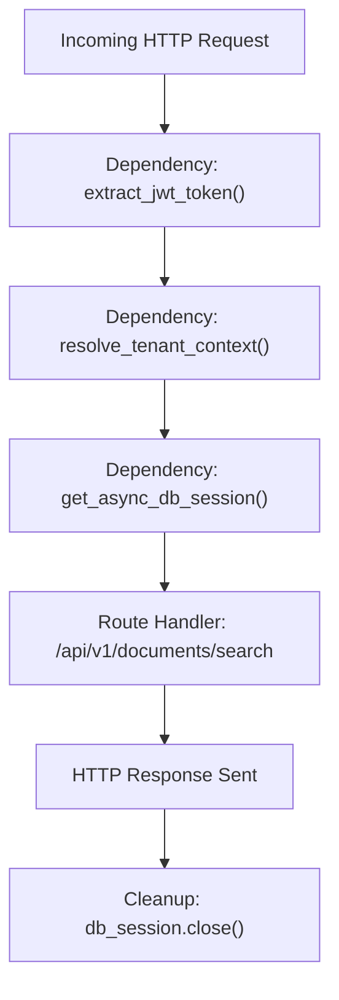
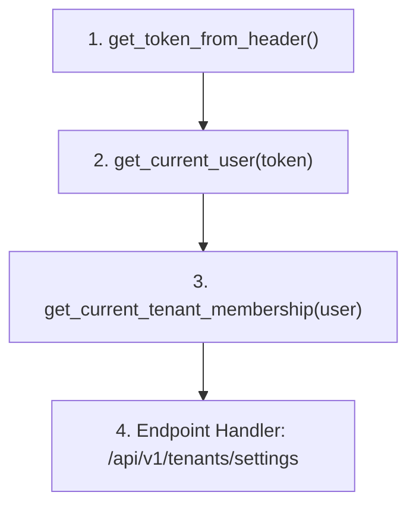
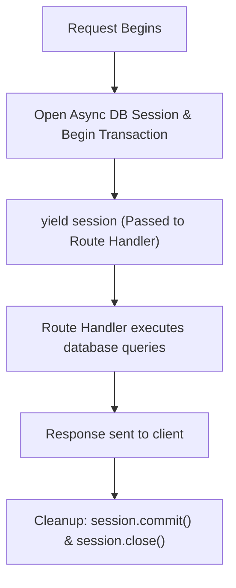

# Module 14: FastAPI Dependency Injection (`Depends`) & Security Architecture

Welcome to **Module 14** of the Normora Python & AI Masterclass.

Dependency Injection (DI) is the architectural backbone of enterprise software. In C# ASP.NET Core, DI is managed via `IServiceCollection` using lifetimes (`Transient`, `Scoped`, `Singleton`).

In **FastAPI**, Dependency Injection is implemented via **`Depends()`**. FastAPI's DI system is extraordinarily powerful:
* It does not require a rigid, verbose container registration configuration.
* It operates as a **Directed Acyclic Graph (DAG)**: dependencies can themselves depend on other sub-dependencies.
* It supports **Generator Dependencies (`yield`)** to automatically manage request-scoped lifecycles (opening a database transaction before the endpoint runs, and committing/closing it when the endpoint finishes).
* It provides compile-time safety and automatic integration with Swagger/OpenAPI authorization schemas.

In this module, you will master FastAPI's DI system to implement zero-trust multi-tenancy, JWT Bearer validation, and scoped database session lifecycles.

Every concept is followed by **at least 5 real-world Normora examples**.

---

## 1. The Dependency Injection Philosophy: `Depends()`

A **Dependency** in FastAPI is simply any callable (a function or a class) that provides data or services to a route handler. You declare it in your route signature using `Depends(dependency_callable)`.

When an HTTP request arrives:
1. FastAPI inspects the route's parameters.
2. If it sees `Depends(func)`, it runs `func` first.
3. It passes the return value of `func` into your route handler!



### 5 Real-World Normora Examples:

#### Example 1.1: Extracting Query Pagination Parameters via a Dependency Class
```python
from fastapi import FastAPI, Depends, Query

app = FastAPI()

class PaginationParams:
    def __init__(
        self,
        page: int = Query(default=1, ge=1, description="Page number"),
        page_size: int = Query(default=10, ge=1, le=100, description="Items per page")
    ):
        self.page = page
        self.page_size = page_size
        self.skip = (page - 1) * page_size

@app.get("/api/v1/documents")
async def list_documents(pagination: PaginationParams = Depends()):
    # FastAPI automatically instantiates PaginationParams from query params!
    return {
        "page": pagination.page,
        "page_size": pagination.page_size,
        "skip": pagination.skip,
        "items": []
    }
```

#### Example 1.2: Tenant Slug Resolution from Host Header
Resolves the workspace based on the request domain (e.g. `acme.normora.ai`):
```python
from fastapi import Header, HTTPException

async def resolve_tenant_slug(host: str = Header(...)) -> str:
    # Extract subdomain from 'acme.normora.ai':
    parts = host.split(".")
    if len(parts) >= 3:
        return parts[0].lower()
    return "default"

@app.get("/api/v1/workspace/info")
async def get_workspace_info(slug: str = Depends(resolve_tenant_slug)):
    return {"workspace_slug": slug}
```

#### Example 1.3: Injecting Google Gemini AI Client Settings
```python
from pydantic_settings import BaseSettings

class GeminiSettings(BaseSettings):
    api_key: str = "mock_gemini_api_key"
    model: str = "gemini-1.5-flash"

def get_gemini_settings() -> GeminiSettings:
    # Reads environment variables once:
    return GeminiSettings()

@app.post("/api/v1/ai/generate")
async def generate_completion(
    prompt: str,
    ai_config: GeminiSettings = Depends(get_gemini_settings)
):
    return {
        "model_used": ai_config.model,
        "completion": f"Response to: {prompt}"
    }
```

#### Example 1.4: Injecting Correlation ID for Distributed Tracing
```python
import uuid

async def get_or_create_correlation_id(
    x_correlation_id: str | None = Header(default=None)
) -> str:
    return x_correlation_id if x_correlation_id else str(uuid.uuid4())

@app.get("/api/v1/audit/events")
async def get_audit_events(correlation_id: str = Depends(get_or_create_correlation_id)):
    return {"correlation_id": correlation_id, "events": []}
```

#### Example 1.5: Reusable Document Search Filter Dependency
```python
class SearchFilters:
    def __init__(
        self,
        q: str = Query(..., min_length=2),
        dept: str | None = Query(default=None),
        min_relevance: float = Query(default=0.75, ge=0.0, le=1.0)
    ):
        self.query = q
        self.department = dept
        self.min_relevance = min_relevance

@app.get("/api/v1/knowledge/search")
async def search_knowledge(filters: SearchFilters = Depends()):
    return {"searching_for": filters.query, "min_score": filters.min_relevance}
```

---

## 2. Hierarchical Dependencies (The Sub-Dependency Graph)

A dependency can itself declare other dependencies in its parameters! FastAPI traverses and resolves the entire tree automatically.



### 5 Real-World Normora Examples:

#### Example 2.1: Multi-Tier Authentication & Tenant Verification
```python
from fastapi.security import HTTPBearer, HTTPAuthorizationCredentials

security = HTTPBearer()

# Dependency 1: Extract and validate raw JWT token string
async def get_raw_token(credentials: HTTPAuthorizationCredentials = Depends(security)) -> str:
    token = credentials.credentials
    if not token or len(token) < 10:
        raise HTTPException(status_code=401, detail="Invalid bearer token.")
    return token

# Dependency 2: Decodes token to extract user ID (Depends on 1)
async def get_current_user_id(token: str = Depends(get_raw_token)) -> str:
    # Simulated JWT decode:
    return "USR-4021"

# Dependency 3: Resolves tenant membership (Depends on 2)
async def get_tenant_membership(
    user_id: str = Depends(get_current_user_id),
    x_tenant_id: str = Header(...)
) -> dict:
    return {
        "user_id": user_id,
        "tenant_id": x_tenant_id,
        "role": "Admin",
        "department": "Engineering"
    }

# Endpoint consumes the final resolved membership object:
@app.get("/api/v1/me/membership")
async def get_my_membership(membership: dict = Depends(get_tenant_membership)):
    return {"membership": membership}
```

#### Example 2.2: Reusable Permission Guard Sub-Dependency (BFLA Defense)
```python
class RequireRole:
    def __init__(self, allowed_roles: list[str]):
        self.allowed_roles = allowed_roles

    def __call__(self, membership: dict = Depends(get_tenant_membership)) -> dict:
        user_role = membership["role"]
        if user_role not in self.allowed_roles:
            raise HTTPException(status_code=403, detail="Forbidden: Insufficient privileges.")
        return membership

# Protecting admin endpoint:
@app.post("/api/v1/workspace/billing", dependencies=[Depends(RequireRole(["Owner", "Admin"]))])
async def update_billing():
    return {"message": "Billing settings updated."}
```

#### Example 2.3: Tenant AI Token Quota Guard
```python
async def verify_token_allowance(
    membership: dict = Depends(get_tenant_membership)
) -> dict:
    tenant_id = membership["tenant_id"]
    # Simulated check:
    tokens_left = 500_000
    if tokens_left <= 0:
        raise HTTPException(status_code=429, detail="Monthly AI token budget exhausted.")
    return membership

@app.post("/api/v1/chat/stream", dependencies=[Depends(verify_token_allowance)])
async def chat_stream():
    return {"status": "Stream initialized"}
```

#### Example 2.4: Departmental BOLA Filter Sub-Dependency
```python
async def get_departmental_context(
    membership: dict = Depends(get_tenant_membership)
) -> str:
    # Returns the user's authorized department:
    return membership["department"]

@app.get("/api/v1/documents/departmental")
async def get_dept_docs(dept: str = Depends(get_departmental_context)):
    return {"department": dept, "documents": [f"{dept}_Policy.pdf"]}
```

#### Example 2.5: Composite AI Context Packager
```python
class AiExecutionBundle:
    def __init__(
        self,
        membership: dict = Depends(get_tenant_membership),
        ai_cfg: GeminiSettings = Depends(get_gemini_settings),
        correlation_id: str = Depends(get_or_create_correlation_id)
    ):
        self.membership = membership
        self.ai_cfg = ai_cfg
        self.correlation_id = correlation_id

@app.post("/api/v1/ai/ask")
async def ask_agent(prompt: str, bundle: AiExecutionBundle = Depends()):
    return {
        "tenant": bundle.membership["tenant_id"],
        "model": bundle.ai_cfg.model,
        "trace": bundle.correlation_id
    }
```

---

## 3. Scoped Lifecycles: Generator Dependencies (`yield`)

In ASP.NET Core, database sessions have a **Scoped Lifetime**: created when the HTTP request starts, and disposed when the HTTP response completes.

In FastAPI, this is accomplished using **Generator Dependencies with `yield`**:
1. Code **before** `yield` runs *before* the route handler.
2. The value in `yield x` is injected into the route handler.
3. Code **after** `yield` runs *after* the response has been sent to the client (guaranteed cleanup, even if an exception was raised!).



### 5 Real-World Normora Examples:

#### Example 3.1: Scoped Database Session Lifecycle
```python
from collections.abc import AsyncGenerator

class AsyncDbSession:
    async def commit(self):
        print("[DB] Commit transaction.")
    async def rollback(self):
        print("[DB] Rollback transaction.")
    async def close(self):
        print("[DB] Return connection back to connection pool.")

async def get_db_session() -> AsyncGenerator[AsyncDbSession, None]:
    session = AsyncDbSession()
    print("--> [SCOPED] Opened database session for request.")
    try:
        # yield passes the session to the route handler:
        yield session
        await session.commit()
    except Exception:
        await session.rollback()
        raise
    finally:
        # Guarantees session is returned to pool:
        await session.close()
        print("<-- [SCOPED] Closed database session.")

@app.post("/api/v1/documents/new")
async def create_document(db: AsyncDbSession = Depends(get_db_session)):
    print("Executing: INSERT INTO documents ...")
    return {"status": "created"}
```

#### Example 3.2: Scoped HTTP Client Session (`httpx.AsyncClient`)
Avoid opening a new TCP connection on every external call. Share one client for the lifetime of the request:
```python
class MockHttpClient:
    async def close(self):
        print("[HTTP] Closed connection pool sockets.")

async def get_http_client() -> AsyncGenerator[MockHttpClient, None]:
    client = MockHttpClient()
    try:
        yield client
    finally:
        await client.close()

@app.get("/api/v1/remote-sync")
async def sync_remote_data(client: MockHttpClient = Depends(get_http_client)):
    return {"synced": True}
```

#### Example 3.3: Scoped Multi-Tenant Schema Search Path
Set PostgreSQL `search_path` to the tenant's isolated schema, and reset it after the request:
```python
async def get_tenant_isolated_db(
    tenant_id: str = Header(...),
    db: AsyncDbSession = Depends(get_db_session)
) -> AsyncGenerator[AsyncDbSession, None]:
    print(f"--> [SCHEMA] SET search_path TO tenant_{tenant_id}, public;")
    try:
        yield db
    finally:
        print("<-- [SCHEMA] RESET search_path;")

@app.get("/api/v1/tenant/data")
async def query_tenant_data(db: AsyncDbSession = Depends(get_tenant_isolated_db)):
    return {"data": "isolated_records"}
```

#### Example 3.4: Scoped MinIO S3 Temp File Upload Manager
```python
import os

async def get_temp_upload_buffer() -> AsyncGenerator[str, None]:
    temp_file = "temp_upload_buffer.bin"
    print(f"Allocated buffer: {temp_file}")
    try:
        yield temp_file
    finally:
        if os.path.exists(temp_file):
            os.remove(temp_file)
            print("Purged temp upload buffer from disk.")

@app.post("/api/v1/upload")
async def upload_file(buffer: str = Depends(get_temp_upload_buffer)):
    return {"buffer": buffer}
```

#### Example 3.5: Scoped Performance Metrics Timer
```python
import time

async def profile_request_lifecycle() -> AsyncGenerator[None, None]:
    start_time = time.time()
    try:
        yield
    finally:
        duration = time.time() - start_time
        print(f"[METRIC] Total request pipeline duration: {duration:.4f}s")

@app.get("/api/v1/fast-ping", dependencies=[Depends(profile_request_lifecycle)])
async def fast_ping():
    return {"pong": True}
```

---

## 4. Dependency Caching: `use_cache=True` vs `use_cache=False`

By default, FastAPI caches the result of a dependency call **within a single HTTP request** (`use_cache=True`).

If 5 different sub-dependencies or routes in the same request ask for `get_current_user`, **FastAPI executes `get_current_user` only once**, caches the result, and distributes that exact cached object to all 5 consumers!

### 5 Real-World Normora Examples:

#### Example 4.1: Observing the Default Request-Level Cache
```python
call_count = 0

async def resolve_expensive_tenant_profile(x_tenant_id: str = Header(...)) -> dict:
    global call_count
    call_count += 1
    print(f"[FETCH] Querying database for tenant '{x_tenant_id}' (Call #{call_count})")
    return {"tenant_id": x_tenant_id, "plan": "Enterprise"}

async def sub_dep_a(tenant: dict = Depends(resolve_expensive_tenant_profile)):
    return tenant["plan"]

async def sub_dep_b(tenant: dict = Depends(resolve_expensive_tenant_profile)):
    return tenant["tenant_id"]

# Both sub_dep_a and sub_dep_b depend on resolve_expensive_tenant_profile:
@app.get("/api/v1/multi-dep-test")
async def test_cache(
    plan: str = Depends(sub_dep_a),
    t_id: str = Depends(sub_dep_b)
):
    # Notice: resolve_expensive_tenant_profile runs ONLY ONCE per request!
    return {"plan": plan, "tenant_id": t_id}
```

#### Example 4.2: Disabling Cache with `use_cache=False` for Unique UUIDs
When you want a fresh, unique value on every injection:
```python
def generate_unique_span_id() -> str:
    return str(uuid.uuid4())

@app.get("/api/v1/spans")
async def trace_spans(
    span_1: str = Depends(generate_unique_span_id, use_cache=False),
    span_2: str = Depends(generate_unique_span_id, use_cache=False)
):
    # Generates two distinct UUIDs because use_cache=False:
    return {"span_1": span_1, "span_2": span_2}
```

#### Example 4.3: Fresh Random Seed Generator for Vector Shuffling
```python
import random

def get_random_nonce() -> int:
    return random.randint(1000, 9999)

@app.get("/api/v1/nonces")
async def get_nonces(
    n1: int = Depends(get_random_nonce, use_cache=False),
    n2: int = Depends(get_random_nonce, use_cache=False)
):
    return {"nonce_a": n1, "nonce_b": n2}
```

#### Example 4.4: Shared Cache for Database Connection Pool Singleton
```python
# Caches the shared database engine singleton across all routes:
def get_shared_engine():
    return "ENGINE_SINGLETON"

@app.get("/api/v1/db-check")
async def check_engine(eng: str = Depends(get_shared_engine)):
    return {"engine": eng}
```

#### Example 4.5: Fresh Timestamp on Multiple Checkpoints
```python
def get_timestamp() -> float:
    return time.time()

@app.get("/api/v1/checkpoints")
async def checkpoints(
    t1: float = Depends(get_timestamp, use_cache=False),
    t2: float = Depends(get_timestamp, use_cache=False)
):
    return {"checkpoint_1": t1, "checkpoint_2": t2}
```

---

## Summary & Next Step

You have mastered:
1. The Dependency Injection philosophy in FastAPI.
2. Building multi-tiered dependency graphs (Authentication -> User -> Tenant -> Permissions).
3. Scoped resource lifecycles using Generator Dependencies (`yield`) for database sessions and HTTP client pools.
4. Managing intra-request caching with `use_cache=True` vs `use_cache=False`.

In **Module 15**, we enter the persistence layer: **Async Database Persistence with SQLAlchemy 2.0 & pgvector**!
