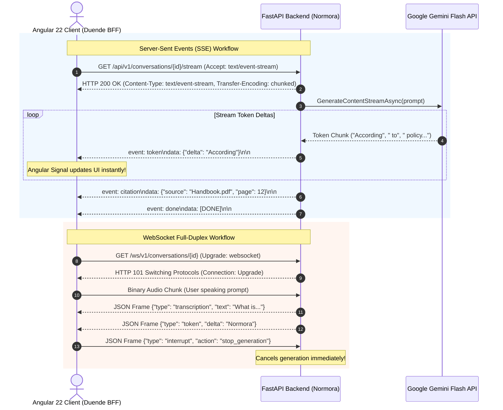
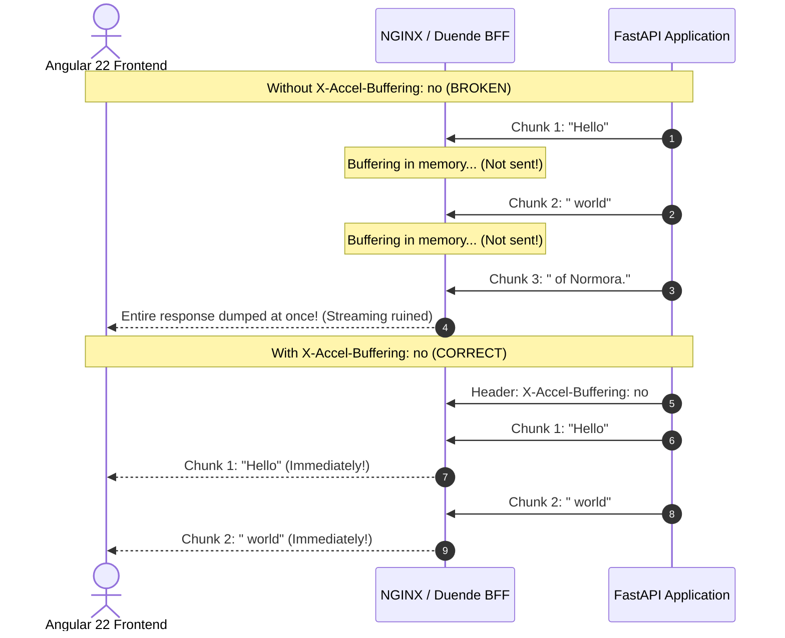
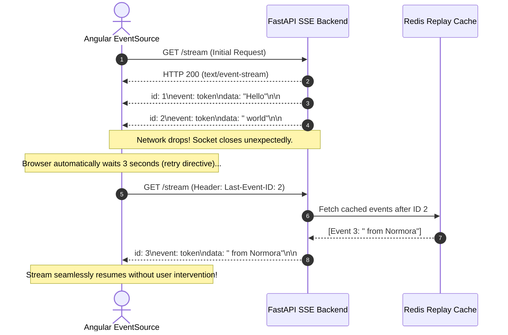
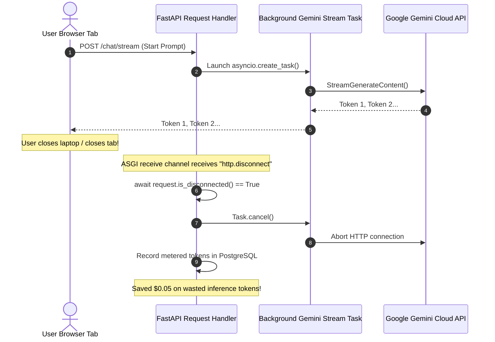
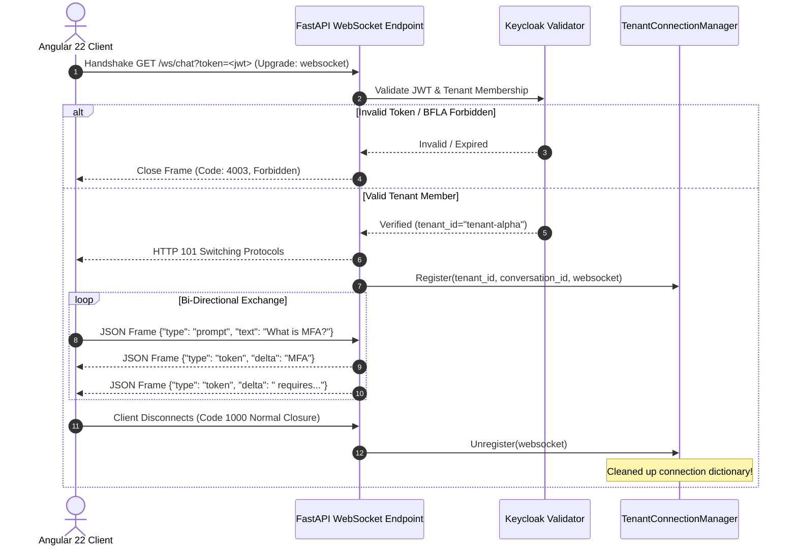

# Module 16: Streaming Protocols, Server-Sent Events (SSE) & WebSockets

Welcome to **Module 16** of the Normora Python & AI Masterclass.

In enterprise conversational AI platforms, **latency is UX**. Making an enterprise user wait 8 to 12 seconds while Google Gemini Flash or OpenAI GPT-4o generates an entire 800-word compliance response causes drop-offs, perceived system unresponsiveness, and poor user satisfaction. In contrast, **streaming** begins rendering the first generated token within 300 to 500 milliseconds (Time to First Token, or **TTFT**), giving users immediate visual feedback as the model thinks and writes.

However, streaming in production is not just about calling an API with `stream=True`. It introduces fundamental distributed systems challenges:
* How do you prevent corporate firewalls, reverse proxies (like NGINX or Duende BFF), and API gateways from buffering chunks?
* What happens when the user closes their browser tab 2 seconds into a 30-second model generation? (If your backend doesn't detect the disconnect, you will pay Google Cloud for thousands of wasted tokens!)
* When should you choose **Server-Sent Events (SSE)** over **WebSockets**?
* How do you handle **backpressure** when a fast producer (cloud AI or PostgreSQL) floods a slow consumer (mobile browser on a poor network)?
* How do you stream large binary assets (500MB PDF document downloads from MinIO object storage) without blowing up server RAM?

As a .NET engineer familiar with ASP.NET Core SignalR, Kestrel, and `IAsyncEnumerable<T>`, you will discover that Python and FastAPI provide low-level, high-performance control over HTTP streaming semantics and the ASGI (Asynchronous Server Gateway Interface) event loop.

---

## Architectural Overview: SSE vs. WebSockets vs. HTTP Polling vs. SignalR

Before writing code, let's establish the architectural trade-offs between real-time transport protocols in enterprise applications like Normora.

| Architectural Dimension | Short/Long Polling | Server-Sent Events (SSE) | Full-Duplex WebSockets | ASP.NET Core SignalR |
| :--- | :--- | :--- | :--- | :--- |
| **Communication Direction** | Unidirectional (Client pulls) | Unidirectional (Server pushes to client) | Bidirectional (Full duplex simultaneously) | Bidirectional (Abstracted via RPC Hubs) |
| **Underlying Protocol** | Standard HTTP/1.1 or HTTP/2 | Standard HTTP/1.1 or HTTP/2 | Upgraded TCP connection (`ws://` or `wss://`) | Negotiates WebSockets $\to$ SSE $\to$ Long Polling |
| **Wire Format** | JSON / XML response payload | Plain text (`event:`, `data:`, `id:`, `\n\n`) | Text (JSON) or Binary frames | SignalR Hub Protocol (JSON or MessagePack) |
| **Reconnection Support** | Manual client retry loop | **Built-in browser support** (`Last-Event-ID`, `retry:`) | Manual client reconnection logic required | Built-in via `@microsoft/signalr` client SDK |
| **Firewall & Proxy Traversal** | Trivial (Standard HTTP) | **Trivial** (Standard HTTP `text/event-stream`) | Can be blocked by strict corporate firewalls | Negotiates fallback automatically |
| **HTTP/2 Multiplexing** | Yes | **Yes** (Multiple streams over 1 TCP connection) | No (Bypasses HTTP framing after handshake) | Only when falling back to SSE/Polling |
| **Best Used For in Normora** | Infrequent background polling | **LLM token streaming, citations, progress bars** | **Collaborative real-time canvas, audio streaming** | Standard .NET frontend-to-backend hubs |



---

## 1. Python Async Generators from Scratch (The Foundation of Streaming)

If you have never written a generator in Python, think of it as the direct equivalent of C#'s `IEnumerable<T>` with `yield return`. 

In C#:
```csharp
// C# .NET 10 Async Enumerable
public async IAsyncEnumerable<string> StreamTokensAsync([EnumeratorCancellation] CancellationToken ct)
{
    foreach (var word in new[] { "Normora", " Enterprise", " Search" })
    {
        await Task.Delay(50, ct);
        yield return word;
    }
}
```

In Python, an **async generator** is any function defined with `async def` that contains the `yield` keyword. Calling an async generator function does **not** execute its body immediately; instead, it returns an **async generator object** that implements the `__anext__()` protocol.

```python
import asyncio
from typing import AsyncGenerator

# Python 3.12+ Async Generator
async def stream_tokens() -> AsyncGenerator[str, None]:
    words = ["Normora", " Enterprise", " Search"]
    for word in words:
        await asyncio.sleep(0.05)  # Non-blocking async sleep
        yield word                 # Yields value and pauses execution until next requested!
```

### Understanding the Execution Lifecycle
When an ASGI server like Uvicorn runs your FastAPI application, `StreamingResponse` repeatedly calls `await generator.__anext__()`. 
1. The generator runs until it reaches `yield <value>`.
2. It packages `<value>` into an HTTP chunk and pushes it down the network socket.
3. The generator's local variables, instruction pointer, and stack frame remain **frozen in memory** until the client socket is ready to receive the next chunk.
4. When the generator exits (or returns), Python raises `StopAsyncIteration`, and FastAPI closes the HTTP chunked stream.

> [!NOTE]
> Unlike standard functions that consume memory proportional to the full response payload (e.g., buffering a 100MB JSON array in RAM before returning it), an async generator operates with $O(1)$ constant memory overhead because only the active chunk resides in RAM at any given moment.

### 5 Real-World Normora Examples

#### Example 1.1: Simulating Incremental Google Gemini Flash Token Streaming
In Normora's Conversations module, when a user asks a question against their company's knowledge base, Gemini Flash generates token deltas incrementally.
```python
import asyncio
from typing import AsyncGenerator

async def simulate_gemini_token_stream(
    tenant_id: str,
    prompt: str
) -> AsyncGenerator[str, None]:
    """
    Simulates streaming token deltas from Google Gemini Flash 
    for a multi-tenant conversation in Normora.
    """
    # Simulated tokens returned by cloud LLM inference
    simulated_response_tokens = [
        "Based ", "on ", "Normora's ", "internal ", "security ", 
        "architecture, ", "all ", "PostgreSQL ", "pgvector ", 
        "embeddings ", "are ", "isolated ", "by ", f"tenant_id='{tenant_id}'."
    ]
    
    for token in simulated_response_tokens:
        # Simulate network latency of cloud inference (35ms per token)
        await asyncio.sleep(0.035)
        yield token
```

#### Example 1.2: Streaming Document Ingestion Pipeline Status
During document ingestion in the Documents module, large PDFs must be fetched from MinIO, parsed, chunked, and embedded into pgvector with HNSW indexing. This generator emits real-time progress steps.
```python
import asyncio
from typing import AsyncGenerator

async def stream_document_ingestion_steps(
    document_id: str, 
    file_name: str
) -> AsyncGenerator[dict[str, str | int], None]:
    """
    Yields structured progress updates through Normora's 4-stage ingestion pipeline:
    1. MinIO download -> 2. Text extraction -> 3. Chunking -> 4. pgvector indexing.
    """
    pipeline_stages = [
        {"step": 1, "stage": "MINIO_FETCH", "detail": f"Downloading {file_name} from MinIO bucket."},
        {"step": 2, "stage": "TEXT_EXTRACTION", "detail": "Extracting text and tables via PyPDF/Docling."},
        {"step": 3, "stage": "SEMANTIC_CHUNKING", "detail": "Splitting into 512-token chunks with 64-token overlap."},
        {"step": 4, "stage": "PGVECTOR_INDEXING", "detail": "Generating 768d embeddings & inserting into HNSW index."}
    ]
    
    for stage_info in pipeline_stages:
        await asyncio.sleep(0.12)  # Simulating stage execution duration
        yield {
            "document_id": document_id,
            "progress_percent": stage_info["step"] * 25,
            "stage": stage_info["stage"],
            "detail": stage_info["detail"]
        }
```

#### Example 1.3: Paged PostgreSQL Embedding Retrieval with Memory-Bounded Async Generators
When auditing or re-indexing millions of vector chunks in Normora, loading all vectors into RAM causes an Out-Of-Memory (OOM) crash. An async generator retrieves chunks in fixed pages of 100 records.
```python
import asyncio
from typing import AsyncGenerator

async def paged_postgres_chunk_generator(
    tenant_id: str, 
    batch_size: int = 100
) -> AsyncGenerator[list[dict], None]:
    """
    Streams vector chunks from PostgreSQL in memory-bounded batches using cursor pagination.
    Prevents memory exhaustion on large tenant libraries.
    """
    last_seen_id = 0
    total_chunks_simulated = 350  # Simulating 350 total chunks in tenant storage
    
    while True:
        await asyncio.sleep(0.04)  # Simulating asyncpg database query latency
        
        # Simulating SQL: SELECT id, chunk_text, embedding FROM document_chunks 
        # WHERE tenant_id = :tenant_id AND id > :last_seen_id ORDER BY id ASC LIMIT :batch_size
        batch = [
            {
                "chunk_id": chunk_id,
                "tenant_id": tenant_id,
                "embedding_dim": 768,
                "text_snippet": f"Normora policy chunk index {chunk_id}"
            }
            for chunk_id in range(last_seen_id + 1, min(last_seen_id + 1 + batch_size, total_chunks_simulated + 1))
        ]
        
        if not batch:
            break  # No more records left
            
        last_seen_id = batch[-1]["chunk_id"]
        yield batch
```

#### Example 1.4: Streaming Cursor-Based Tenant Audit Logs
Compliance officers in Normora frequently stream historical audit logs (e.g., BOLA violations, document accesses, RBAC modifications) directly to Angular tables.
```python
import asyncio
from datetime import datetime, timezone
from typing import AsyncGenerator

async def stream_tenant_audit_logs(
    tenant_id: str,
    action_filter: str = "BOLA_VIOLATION_BLOCKED"
) -> AsyncGenerator[str, None]:
    """
    Emits formatted NDJSON audit records one at a time for compliance streaming exports.
    """
    for log_seq in range(1, 6):
        await asyncio.sleep(0.02)
        timestamp = datetime.now(timezone.utc).isoformat()
        log_entry = (
            f'{{"seq": {log_seq}, "tenant_id": "{tenant_id}", '
            f'"event": "{action_filter}", "timestamp": "{timestamp}", '
            f'"status_code": 404, "message": "Tenant resource access prevented by BOLA guard."}}\n'
        )
        yield log_entry
```

#### Example 1.5: Emitting Agent "Chain-of-Thought" Reasoning Steps
Before Google Gemini Flash emits the final answer, Normora's agentic workflow reasons over the user prompt, tool selection, and vector search parameters.
```python
import asyncio
from typing import AsyncGenerator

async def stream_agent_reasoning_steps(
    query: str
) -> AsyncGenerator[str, None]:
    """
    Streams intermediate chain-of-thought steps from an LLM agent 
    prior to returning the final synthesized answer.
    """
    thoughts = [
        f"Analyzing prompt intent: '{query}'...",
        "Selected tool: 'pgvector_semantic_search' with filter {tenant_id: 'tenant-42'}.",
        "Vector search completed: retrieved 4 relevant chunks (HNSW similarity score > 0.82).",
        "Synthesizing answer with strict zero-shot citations..."
    ]
    
    for thought in thoughts:
        await asyncio.sleep(0.08)
        yield f"[AGENT_THOUGHT] {thought}\n"
```

---

## 2. HTTP Streaming Mechanics & Chunked Transfer Encoding

In standard HTTP request-response cycles:
1. The server runs the entire business logic and generates the full response body.
2. The server calculates the exact byte length of the body.
3. The server sets the header: `Content-Length: 48215`.
4. The client reads exactly `48215` bytes and closes the connection.

When streaming AI tokens or live exports, the server **cannot know the total byte size upfront**. If the server waited to calculate `Content-Length`, streaming would be impossible!

### The Solution: `Transfer-Encoding: chunked`
In HTTP/1.1, the server omits `Content-Length` and sets:
```http
HTTP/1.1 200 OK
Content-Type: text/plain; charset=utf-8
Transfer-Encoding: chunked
Connection: keep-alive
```

Under chunked encoding, the response is delivered as a series of chunks. Each chunk is preceded by its size in hexadecimal, followed by `\r\n`, the raw chunk bytes, and another `\r\n`. The stream is officially terminated by a zero-length chunk (`0\r\n\r\n`):

```http
7\r\n
Normora\r\n
B\r\n
 Enterprise\r\n
0\r\n
\r\n
```

### The Reverse Proxy Trap: Buffering Killers
In enterprise production deployments, your FastAPI service sits behind reverse proxies, load balancers, or API gateways:
* **Duende BFF** (.NET 10 YARP reverse proxy)
* **NGINX** or **HAProxy** ingress controllers in Kubernetes
* **Cloudflare** or **AWS CloudFront**

> [!CAUTION]
> **The Silent Buffering Bug:**
> By default, NGINX and many reverse proxies buffer backend responses up to 4KB or 8KB before sending them down to the browser. As a result, your token-by-token stream gets swallowed by the proxy, and the user suddenly receives 150 words all at once after a 4-second delay!
> 
> To disable reverse proxy buffering, you **must** supply specific HTTP response headers:
> * `X-Accel-Buffering: no` (Tells NGINX to pass chunks immediately to the client without buffering).
> * `Cache-Control: no-cache, no-transform` (Prevents CDNs and Cloudflare from caching or compressing chunks).
> * `Connection: keep-alive` (Maintains the open TCP socket).



### 5 Real-World Normora Examples

#### Example 2.1: Low-Level Chunked Byte Stream Generator
Delivering raw chunked byte frames in FastAPI using `StreamingResponse`.
```python
import asyncio
from typing import AsyncGenerator
from fastapi import FastAPI
from fastapi.responses import StreamingResponse

app = FastAPI(title="Normora Streaming Core")

async def generate_raw_byte_chunks() -> AsyncGenerator[bytes, None]:
    chunks = [b"NORMORA_STREAM_START\n", b"TENANT: tenant-omega\n", b"STATUS: ACTIVE\n", b"NORMORA_STREAM_END\n"]
    for chunk in chunks:
        await asyncio.sleep(0.04)
        yield chunk

@app.get("/api/v1/debug/raw-stream")
async def get_raw_stream() -> StreamingResponse:
    """
    Returns an HTTP/1.1 chunked transfer response delivering raw byte buffers.
    """
    return StreamingResponse(
        generate_raw_byte_chunks(),
        media_type="application/octet-stream",
        headers={
            "X-Accel-Buffering": "no",
            "Cache-Control": "no-cache",
            "Connection": "keep-alive"
        }
    )
```

#### Example 2.2: High-Throughput NDJSON (Newline Delimited JSON) Streaming
When exporting thousands of conversations for tenant compliance, standard JSON requires wrapping everything in an array `[...]`. If the download crashes at 99%, the JSON is corrupt. NDJSON sends valid JSON objects separated by newlines `\n`.
```python
import json
import asyncio
from typing import AsyncGenerator
from fastapi import FastAPI
from fastapi.responses import StreamingResponse

@app.get("/api/v1/tenants/{tenant_id}/conversations/export-ndjson")
async def export_conversations_ndjson(tenant_id: str) -> StreamingResponse:
    async def ndjson_generator() -> AsyncGenerator[str, None]:
        for conv_idx in range(1, 6):
            await asyncio.sleep(0.03)  # Simulating DB read
            record = {
                "conversation_id": f"conv-{conv_idx}",
                "tenant_id": tenant_id,
                "title": f"Security Inquiry #{conv_idx}",
                "created_at": "2026-11-18T10:00:00Z",
                "message_count": 8
            }
            # Mandatory: trailing newline \n for NDJSON framing
            yield json.dumps(record) + "\n"

    return StreamingResponse(
        ndjson_generator(),
        media_type="application/x-ndjson",
        headers={
            "Content-Disposition": f'attachment; filename="tenant_{tenant_id}_conversations.ndjson"',
            "X-Accel-Buffering": "no"
        }
    )
```

#### Example 2.3: Anti-Buffering Headers Middleware
Instead of manually typing `X-Accel-Buffering: no` on every streaming endpoint, create a custom FastAPI middleware that inspects the `Content-Type` header and automatically attaches anti-buffering headers.
```python
from starlette.middleware.base import BaseHTTPMiddleware
from starlette.requests import Request
from starlette.responses import Response

class StreamingAntiBufferingMiddleware(BaseHTTPMiddleware):
    """
    Automatically attaches proxy anti-buffering headers to any response 
    delivering text/event-stream or application/x-ndjson.
    """
    async def dispatch(self, request: Request, call_next) -> Response:
        response = await call_next(request)
        content_type = response.headers.get("content-type", "")
        
        if "text/event-stream" in content_type or "application/x-ndjson" in content_type:
            response.headers["X-Accel-Buffering"] = "no"
            response.headers["Cache-Control"] = "no-cache, no-transform"
            response.headers["Connection"] = "keep-alive"
            
        return response

app.add_middleware(StreamingAntiBufferingMiddleware)
```

#### Example 2.4: Dynamic Fixed-Window Chunk Streamer for MinIO Document Payloads
Streaming documents from MinIO object storage in precise 64KB byte windows.
```python
import asyncio
from typing import AsyncGenerator
from fastapi import FastAPI
from fastapi.responses import StreamingResponse

CHUNK_SIZE_64KB = 64 * 1024  # 65,536 bytes

async def stream_minio_blob_chunks(blob_size_kb: int = 256) -> AsyncGenerator[bytes, None]:
    """
    Simulates streaming a large PDF blob from MinIO in 64KB chunk increments.
    """
    total_bytes = blob_size_kb * 1024
    bytes_sent = 0
    
    while bytes_sent < total_bytes:
        await asyncio.sleep(0.02)  # Simulating MinIO async S3 read
        chunk_data = b"N" * min(CHUNK_SIZE_64KB, total_bytes - bytes_sent)
        bytes_sent += len(chunk_data)
        yield chunk_data

@app.get("/api/v1/documents/{document_id}/download-chunked")
async def download_document_chunked(document_id: str) -> StreamingResponse:
    return StreamingResponse(
        stream_minio_blob_chunks(blob_size_kb=512),
        media_type="application/pdf",
        headers={
            "Content-Disposition": f'attachment; filename="normora_doc_{document_id}.pdf"',
            "X-Accel-Buffering": "no"
        }
    )
```

#### Example 2.5: Compliance-Grade Tenant Data Export Stream
Exporting tenant audit data with SHA-256 chunk hashing for tamper detection.
```python
import hashlib
import asyncio
from typing import AsyncGenerator
from fastapi import FastAPI
from fastapi.responses import StreamingResponse

@app.get("/api/v1/tenants/{tenant_id}/audit-tamper-proof-stream")
async def stream_tamper_proof_audit(tenant_id: str) -> StreamingResponse:
    async def audit_generator() -> AsyncGenerator[str, None]:
        audit_records = [
            f"AUDIT_RECORD_1: Tenant {tenant_id} updated RBAC policy.",
            f"AUDIT_RECORD_2: Tenant {tenant_id} uploaded Compliance_2026.pdf.",
            f"AUDIT_RECORD_3: Tenant {tenant_id} purged conversation conv-99."
        ]
        
        for record in audit_records:
            await asyncio.sleep(0.03)
            # Compute hash of chunk for cryptographic tamper verification
            chunk_hash = hashlib.sha256(record.encode("utf-8")).hexdigest()
            payload = f'{{"record": "{record}", "sha256": "{chunk_hash}"}}\n'
            yield payload

    return StreamingResponse(
        audit_generator(),
        media_type="application/x-ndjson",
        headers={"X-Accel-Buffering": "no"}
    )
```

---

## 3. Server-Sent Events (SSE) Protocol Specification & FastAPI `StreamingResponse`

While raw chunked transfer allows streaming bytes, **Server-Sent Events (SSE)** is an official W3C standard defining an application-layer text protocol for push events over HTTP.

### The Wire Format
An SSE response has MIME type `text/event-stream`. The server sends messages structured as plaintext fields separated by newlines:

```http
event: token\n
data: {"delta": "Hello"}\n
id: evt-101\n
retry: 5000\n
\n
```

### The 4 Protocol Directives:
1. **`data: <payload>\n`**: The message content. If your JSON payload spans multiple lines, each line must begin with `data:`.
2. **`event: <custom_name>\n`**: (Optional) The event type name. In the browser, this maps to `eventSource.addEventListener("custom_name", (e) => ...)` instead of `eventSource.onmessage`.
3. **`id: <string>\n`**: (Optional) A unique event identifier. The browser saves this ID. If the connection drops, the browser automatically reconnects and sends the HTTP header:
   ```http
   Last-Event-ID: evt-101
   ```
   This allows your backend to resume streaming from the exact event the client missed!
4. **`retry: <milliseconds>\n`**: (Optional) Instructs the client browser how long to wait before attempting an automatic reconnection (default is ~3000ms).
5. **Double Newline (`\n\n`)**: **CRITICAL**. Every SSE packet MUST terminate with two consecutive newlines (`\n\n`). A single newline causes the client buffer to hang indefinitely waiting for the packet to finish!
6. **Comments (`: <comment>\n\n`)**: Any line starting with a colon (`:`) is treated as a comment by the SSE parser and ignored. This is used for **keep-alive heartbeats** (pings).



### 5 Real-World Normora Examples

#### Example 3.1: Industrial-Strength SSE Event Serializer Helper
Never concatenate SSE strings manually in production. Use a dedicated formatter function that handles JSON serialization, event names, IDs, retry intervals, and multiline data.
```python
import json
from typing import Any

def format_sse_message(
    data: Any,
    event: str | None = None,
    event_id: str | None = None,
    retry_ms: int | None = None
) -> str:
    """
    Serializes data into a valid W3C Server-Sent Event (SSE) packet.
    Enforces the mandatory double-newline '\\n\\n' termination.
    """
    buffer: list[str] = []
    
    if event is not None:
        buffer.append(f"event: {event}")
        
    if event_id is not None:
        buffer.append(f"id: {event_id}")
        
    if retry_ms is not None:
        buffer.append(f"retry: {retry_ms}")
        
    # Serialize data payload to JSON if it's a dict/list/int/bool
    if isinstance(data, (dict, list, int, float, bool)):
        raw_text = json.dumps(data)
    else:
        raw_text = str(data)
        
    # W3C Spec: If the data payload contains newlines, each line must have 'data: ' prefix
    for line in raw_text.splitlines():
        buffer.append(f"data: {line}")
        
    # Append double newline to complete the message frame
    return "\n".join(buffer) + "\n\n"

# Verification test:
packet = format_sse_message(
    data={"token": "Hardware MFA Key", "confidence": 0.98},
    event="token_delta",
    event_id="msg-9042",
    retry_ms=3000
)
print("--- Formatted W3C SSE Frame ---")
print(packet)
```

#### Example 3.2: Production Gemini Flash Streaming Endpoint with `StreamingResponse`
Streaming response tokens generated for a user's conversational prompt.
```python
import asyncio
from typing import AsyncGenerator
from fastapi import FastAPI, Depends
from fastapi.responses import StreamingResponse
from pydantic import BaseModel

app = FastAPI()

class ChatPromptRequest(BaseModel):
    conversation_id: str
    prompt: str

async def generate_gemini_tokens(prompt: str) -> AsyncGenerator[str, None]:
    """
    Yields SSE packets simulating Google Gemini Flash generation.
    """
    tokens = [
        "In ", "Normora, ", "role-based ", "access ", "control ", 
        "(RBAC) ", "is ", "strictly ", "enforced ", "via ", "Keycloak ", "OIDC."
    ]
    for idx, token in enumerate(tokens, start=1):
        await asyncio.sleep(0.04)
        yield format_sse_message(
            data={"delta": token, "index": idx},
            event="token",
            event_id=f"tok-{idx}"
        )
    
    # Send terminal event signaling completion
    yield format_sse_message(data="[DONE]", event="done")

@app.post("/api/v1/conversations/stream")
async def stream_chat_response(request: ChatPromptRequest) -> StreamingResponse:
    return StreamingResponse(
        generate_gemini_tokens(request.prompt),
        media_type="text/event-stream",
        headers={
            "Cache-Control": "no-cache",
            "Connection": "keep-alive",
            "X-Accel-Buffering": "no"
        }
    )
```

#### Example 3.3: Multi-Event Typed Stream (Thoughts, Tokens, Citations, Done)
In enterprise RAG, the frontend needs to know which chunks are citations and which tokens are text. Using custom SSE event names (`thought`, `token`, `citation`, `done`) enables clean Angular handling.
```python
import asyncio
from typing import AsyncGenerator
from fastapi import FastAPI
from fastapi.responses import StreamingResponse

@app.get("/api/v1/conversations/{conv_id}/typed-stream")
async def stream_typed_events(conv_id: str) -> StreamingResponse:
    async def typed_event_generator() -> AsyncGenerator[str, None]:
        # 1. Emit Agent Thought Event
        yield format_sse_message(
            data={"thought": "Searching pgvector index for tenant HR documents..."},
            event="thought"
        )
        await asyncio.sleep(0.1)

        # 2. Emit Text Token Events
        for word in ["Employees ", "receive ", "25 ", "paid ", "vacation ", "days."]:
            await asyncio.sleep(0.04)
            yield format_sse_message(data={"delta": word}, event="token")

        # 3. Emit Citation Event with Metadata
        citation_payload = {
            "document_name": "Normora_Global_Benefits_2026.pdf",
            "page_number": 18,
            "chunk_id": "chunk-8821",
            "similarity_score": 0.942
        }
        yield format_sse_message(data=citation_payload, event="citation")
        await asyncio.sleep(0.05)

        # 4. Emit Terminal Done Event
        yield format_sse_message(data={"status": "COMPLETED"}, event="done")

    return StreamingResponse(typed_event_generator(), media_type="text/event-stream")
```

#### Example 3.4: Firewall Keep-Alive Ping Heartbeat for Long Tool Executions
When an LLM triggers a long-running tool execution (e.g., executing a vector aggregation query across 500,000 rows that takes 4 seconds), corporate firewalls will drop the idle streaming connection. Sending SSE comment lines (`: ping`) prevents dropped connections without triggering frontend UI events.
```python
import asyncio
from typing import AsyncGenerator
from fastapi import FastAPI
from fastapi.responses import StreamingResponse

async def stream_with_heartbeat_keepalive() -> AsyncGenerator[str, None]:
    """
    Streams data while sending periodic SSE comment heartbeats ': ping' 
    to keep corporate proxy connections alive during pauses.
    """
    for batch_id in range(1, 4):
        # Emit real SSE data
        yield format_sse_message(data={"status": f"Processing batch {batch_id}..."})
        
        # Simulate a 1-second background database calculation
        for _ in range(5):
            await asyncio.sleep(0.2)
            # Lines starting with ':' are SSE comments. Browser EventSource ignores them!
            yield ": ping - keep-alive heartbeat\n\n"
            
    yield format_sse_message(data="[DONE]", event="done")

@app.get("/api/v1/heavy-query/stream")
async def heavy_query_stream() -> StreamingResponse:
    return StreamingResponse(
        stream_with_heartbeat_keepalive(),
        media_type="text/event-stream"
    )
```

#### Example 3.5: Resumable Document Processing Stream with `Last-Event-ID` & Replay Buffer
Using the `Last-Event-ID` request header to catch up a disconnected client on missed events.
```python
from fastapi import FastAPI, Header
from fastapi.responses import StreamingResponse
from typing import AsyncGenerator
import asyncio

app = FastAPI()

# Simulated event log in Redis / memory
INGESTION_EVENT_LOG = [
    {"id": "evt-1", "data": {"stage": "PDF_DOWNLOAD", "percent": 20}},
    {"id": "evt-2", "data": {"stage": "OCR_PARSE", "percent": 40}},
    {"id": "evt-3", "data": {"stage": "CHUNK_CREATION", "percent": 60}},
    {"id": "evt-4", "data": {"stage": "VECTOR_EMBEDDING", "percent": 80}},
    {"id": "evt-5", "data": {"stage": "INDEX_COMPLETE", "percent": 100}}
]

@app.get("/api/v1/documents/{doc_id}/resumable-progress")
async def resumable_document_progress(
    doc_id: str,
    last_event_id: str | None = Header(default=None)
) -> StreamingResponse:
    """
    Inspects the Last-Event-ID HTTP header sent automatically by browser EventSource.
    Replays missed events before streaming newly generated events.
    """
    async def progress_generator() -> AsyncGenerator[str, None]:
        replay_start_index = 0
        
        # If client supplied Last-Event-ID, find the missed index
        if last_event_id:
            for idx, entry in enumerate(INGESTION_EVENT_LOG):
                if entry["id"] == last_event_id:
                    replay_start_index = idx + 1
                    break

        # Replay any events missed during disconnection
        for entry in INGESTION_EVENT_LOG[replay_start_index:]:
            await asyncio.sleep(0.02)
            yield format_sse_message(
                data=entry["data"],
                event="progress",
                event_id=entry["id"],
                retry_ms=2500  # Instruct browser to retry after 2.5s if dropped
            )

    return StreamingResponse(
        progress_generator(),
        media_type="text/event-stream",
        headers={"X-Accel-Buffering": "no"}
    )
```

---

## 4. Client Disconnect Detection (`request.is_disconnected()`) & Cost Optimization

> [!IMPORTANT]
> **The Cloud AI Billing Trap:**
> Google Gemini Flash and OpenAI GPT-4o charge on a per-token basis. Suppose a user prompts Normora: *"Summarize all 400 pages of the enterprise procurement policy."*
> 
> The model begins generating a 2,000-token answer. 1.5 seconds in, the user realizes they made a typo, closes their browser tab, and navigates away.
> 
> If your FastAPI endpoint does not proactively detect client disconnections, **your Python server will continue calling the cloud LLM in the background, consuming compute and costing your organization real money!**

### ASGI Protocol Internals
Under ASGI (Uvicorn / Starlette), incoming HTTP connections run as an event loop task. Starlette's `Request` object exposes an asynchronous method:
```python
await request.is_disconnected() -> bool
```
Under the hood, this polls the ASGI receive channel for an `{"type": "http.disconnect"}` event emitted by Uvicorn when the client TCP socket closes.

If `await request.is_disconnected()` returns `True`, we must immediately:
1. Cancel the cloud AI API streaming task.
2. Release any database locks (e.g., PostgreSQL advisory locks).
3. Log the early disconnect for tenant billing and audit accounting.
4. Terminate the generator loop using `break` or `return`.



### 5 Real-World Normora Examples

#### Example 4.1: Immediate Gemini Generation Abort on Browser Tab Close
```python
import asyncio
from typing import AsyncGenerator
from fastapi import FastAPI, Request
from fastapi.responses import StreamingResponse

app = FastAPI()

async def cancellable_gemini_stream(request: Request) -> AsyncGenerator[str, None]:
    print("[STREAM_INIT] Client started streaming connection.")
    tokens_generated = 0
    try:
        # Simulating a massive 500-token generation
        for token_idx in range(1, 501):
            # PROACTIVELY PROBE DISCONNECT:
            if await request.is_disconnected():
                print(f"[COST_SAVER] Client disconnected at token {token_idx}! Aborting cloud LLM inference immediately.")
                break
                
            await asyncio.sleep(0.04)  # Simulating Gemini generation interval
            tokens_generated += 1
            yield f"data: {{\"token_id\": {token_idx}, \"text\": \"token_{token_idx} \"}}\n\n"
            
    finally:
        # The finally block ALWAYS executes, even if the client disconnects!
        print(f"[STREAM_TEARDOWN] Released resources. Total billed tokens: {tokens_generated}.")

@app.get("/api/v1/chat/safe-stream")
async def safe_chat_stream(request: Request) -> StreamingResponse:
    return StreamingResponse(
        cancellable_gemini_stream(request),
        media_type="text/event-stream"
    )
```

#### Example 4.2: Cancelling Asynchronous Background Tasks on Client Disconnect
When the LLM inference is wrapped in a concurrent `asyncio.Task`, you can explicitly invoke `task.cancel()` upon detecting a client drop.
```python
import asyncio
from typing import AsyncGenerator
from fastapi import FastAPI, Request
from fastapi.responses import StreamingResponse

async def heavy_cloud_ai_inference() -> list[str]:
    """Simulates an expensive cloud inference call."""
    await asyncio.sleep(10.0)
    return ["Final", " Synthesized", " Document"]

async def disconnect_guarded_worker_stream(request: Request) -> AsyncGenerator[str, None]:
    # Start the background inference task
    ai_task = asyncio.create_task(heavy_cloud_ai_inference())
    
    try:
        while not ai_task.done():
            if await request.is_disconnected():
                print("[ABORT] Client closed socket. Cancelling background AI task!")
                ai_task.cancel()
                try:
                    await ai_task  # Await to let cancellation finalize cleanly
                except asyncio.CancelledError:
                    print("[ABORT_SUCCESS] Background cloud AI task safely cancelled.")
                return

            await asyncio.sleep(0.1)
            yield ": keepalive-waiting-for-model\n\n"
            
        result = await ai_task
        yield f"data: {result}\n\n"
        
    except asyncio.CancelledError:
        print("[CANCELLED] Generator task cancelled by runtime.")
```

#### Example 4.3: Metered Token Consumption Audit Accounting on Disconnect
Multi-tenant architectures like Normora bill each tenant per token. If a stream aborts midway, you must record only the tokens that were actually delivered before the disconnect occurred.
```python
import asyncio
from typing import AsyncGenerator
from fastapi import FastAPI, Request
from fastapi.responses import StreamingResponse

async def billable_tenant_stream(
    tenant_id: str, 
    request: Request
) -> AsyncGenerator[str, None]:
    delivered_tokens = 0
    prompt_tokens = 240  # Static cost for prompt tokens
    
    try:
        for i in range(1, 100):
            if await request.is_disconnected():
                print(f"[AUDIT] Tenant '{tenant_id}' disconnected early.")
                break
                
            await asyncio.sleep(0.03)
            delivered_tokens += 1
            yield f"data: {{\"delta\": \"word_{i}\"}}\n\n"
            
    finally:
        total_tokens = prompt_tokens + delivered_tokens
        # Simulating writing to PostgreSQL: 
        # INSERT INTO tenant_token_ledger (tenant_id, prompt_tokens, completion_tokens)
        print(f"[BILLING_LEDGER] Tenant '{tenant_id}' charged for {total_tokens} tokens ({delivered_tokens} completion).")

@app.get("/api/v1/tenants/{tenant_id}/billable-stream")
async def billable_stream(tenant_id: str, request: Request) -> StreamingResponse:
    return StreamingResponse(billable_tenant_stream(tenant_id, request), media_type="text/event-stream")
```

#### Example 4.4: Releasing PostgreSQL Advisory Locks and Temp Storage on Abort
During exclusive document re-indexing in Normora, an advisory lock prevents concurrent writes. If the administrator closes their browser while viewing the live re-index stream, the lock must be freed immediately in the `finally:` block.
```python
import asyncio
from typing import AsyncGenerator
from fastapi import FastAPI, Request
from fastapi.responses import StreamingResponse

class PostgresAdvisoryLockManager:
    async def acquire(self, lock_id: int):
        print(f"[POSTGRES] Advisory lock {lock_id} ACQUIRED.")
    async def release(self, lock_id: int):
        print(f"[POSTGRES] Advisory lock {lock_id} RELEASED safely.")

lock_mgr = PostgresAdvisoryLockManager()

async def locked_reindexing_stream(
    document_id: int, 
    request: Request
) -> AsyncGenerator[str, None]:
    await lock_mgr.acquire(lock_id=document_id)
    try:
        for step in range(1, 11):
            if await request.is_disconnected():
                print(f"[WARN] Admin disconnected during reindex step {step}/10.")
                break
            await asyncio.sleep(0.1)
            yield f"data: {{\"step\": {step}, \"status\": \"processing\"}}\n\n"
    finally:
        # Guarantees the lock is never leaked in PostgreSQL
        await lock_mgr.release(lock_id=document_id)

@app.get("/api/v1/documents/{document_id}/reindex-stream")
async def reindex_stream(document_id: int, request: Request) -> StreamingResponse:
    return StreamingResponse(locked_reindexing_stream(document_id, request), media_type="text/event-stream")
```

#### Example 4.5: OpenTelemetry Distributed Trace Recording for Aborted Streams
Recording OpenTelemetry span attributes when streams terminate prematurely.
```python
import asyncio
from typing import AsyncGenerator
from fastapi import FastAPI, Request
from fastapi.responses import StreamingResponse

async def telemetry_monitored_stream(
    request: Request
) -> AsyncGenerator[str, None]:
    client_aborted = False
    chunks_sent = 0
    try:
        for chunk_id in range(1, 50):
            if await request.is_disconnected():
                client_aborted = True
                break
            await asyncio.sleep(0.02)
            chunks_sent += 1
            yield f"data: chunk_{chunk_id}\n\n"
    finally:
        # Record trace span attributes (simulated OpenTelemetry API)
        otel_span_attributes = {
            "stream.chunks_delivered": chunks_sent,
            "stream.client_aborted_early": client_aborted,
            "stream.exit_status": "CANCELLED_BY_CLIENT" if client_aborted else "COMPLETED_NORMALLY"
        }
        print(f"[OPENTELEMETRY_SPAN] {otel_span_attributes}")

@app.get("/api/v1/telemetry/stream")
async def telemetry_stream(request: Request) -> StreamingResponse:
    return StreamingResponse(telemetry_monitored_stream(request), media_type="text/event-stream")
```

---

## 5. Backpressure Handling & Stream Flow Control

What happens when a fast producer generates data faster than a slow consumer can read it?

In Normora, Google Gemini Flash generates tokens at **80 tokens per second**. If an enterprise user is browsing Normora on a mobile phone with a congested 3G connection (reading only 10 tokens per second), the server's network socket write buffer will quickly fill up.

If unhandled:
1. Fast data piles up in server memory buffers.
2. Under 500 concurrent streaming connections, server RAM inflates by gigabytes, triggering an OOM kill.
3. Latency skyrockets as old tokens sit in memory queues.

### Solving Backpressure with `asyncio.Queue(maxsize=...)`
The solution is **backpressure**: constraining the producer so it pauses when the consumer falls behind. By using an `asyncio.Queue` with a bounded `maxsize`, the producer's `await queue.put()` **suspends** until the consumer's `await queue.get()` removes an item!

```mermaid
flowchart LR
    Producer["Fast Producer<br/>(Gemini Flash / DB Cursor)<br/>80 items/sec"]
    Queue["Bounded asyncio.Queue<br/>maxsize=5<br/>[Item 1][Item 2][Item 3][Item 4][Item 5]"]
    Consumer["Slow Consumer<br/>(Mobile / Weak Socket)<br/>10 items/sec"]

    Producer -->|await queue.put()| Queue
    Queue -->|await queue.get()| Consumer

    Queue -.->|Queue Full! Producer Suspended| Producer
```

### 5 Real-World Normora Examples

#### Example 5.1: Bounded Queue Backpressure Buffer for Gemini Token Generation
```python
import asyncio
from typing import AsyncGenerator
from fastapi import FastAPI
from fastapi.responses import StreamingResponse

app = FastAPI()

async def bounded_backpressure_stream() -> AsyncGenerator[str, None]:
    # A bounded queue that holds at most 4 chunks in flight
    buffer_queue: asyncio.Queue[str | None] = asyncio.Queue(maxsize=4)

    async def fast_token_producer():
        """Simulates a fast producer generating 20 tokens rapidly."""
        for token_id in range(1, 21):
            token_payload = f"token_{token_id}"
            # await queue.put() SUSPENDS if buffer_queue has 4 items!
            await buffer_queue.put(token_payload)
            print(f"[PRODUCER] Put '{token_payload}' into queue (queue size: {buffer_queue.qsize()})")
            await asyncio.sleep(0.01)  # Generates every 10ms
            
        # Sentinel None signals end of stream
        await buffer_queue.put(None)

    # Launch producer task concurrently in the background
    producer_task = asyncio.create_task(fast_token_producer())

    try:
        while True:
            # Consumer reads from queue at a slower pace
            token = await buffer_queue.get()
            if token is None:
                break  # Finished
                
            buffer_queue.task_done()
            print(f"  [CONSUMER] Emitting '{token}' to socket (simulating slow client 50ms)")
            await asyncio.sleep(0.05)  # Slow consumer
            yield f"data: {token}\n\n"
    finally:
        producer_task.cancel()

@app.get("/api/v1/backpressure/bounded-stream")
async def get_backpressure_stream() -> StreamingResponse:
    return StreamingResponse(bounded_backpressure_stream(), media_type="text/event-stream")
```

#### Example 5.2: Tenant-Tiered Token Rate Throttler (Leaky Bucket Stream)
Enterprises often limit streaming token speeds based on subscription tiers (e.g., Free Tier: 20 tokens/sec; Enterprise Tier: 100 tokens/sec).
```python
import asyncio
import time
from typing import AsyncGenerator
from fastapi import FastAPI
from fastapi.responses import StreamingResponse

class TokenRateThrottler:
    """
    Enforces a strict tokens-per-second ceiling to prevent socket flooding
    and enforce tenant subscription rate limits.
    """
    def __init__(self, tokens_per_second: float):
        self.interval = 1.0 / tokens_per_second
        self.last_yield_time = 0.0

    async def throttle(self):
        now = time.monotonic()
        elapsed = now - self.last_yield_time
        if elapsed < self.interval:
            await asyncio.sleep(self.interval - elapsed)
        self.last_yield_time = time.monotonic()

@app.get("/api/v1/tenants/{tenant_tier}/throttled-stream")
async def throttled_stream(tenant_tier: str) -> StreamingResponse:
    # Free tier gets 15 tokens/sec; Enterprise tier gets 60 tokens/sec
    rate = 15.0 if tenant_tier == "free" else 60.0
    throttler = TokenRateThrottler(tokens_per_second=rate)

    async def throttled_generator() -> AsyncGenerator[str, None]:
        for i in range(1, 31):
            await throttler.throttle()  # Applies backpressure delay
            yield f"data: {{\"token\": \"word_{i}\", \"tier\": \"{tenant_tier}\"}}\n\n"

    return StreamingResponse(throttled_generator(), media_type="text/event-stream")
```

#### Example 5.3: Adaptive Frame Dropping for Non-Essential Telemetry
When streaming real-time background telemetry (e.g., memory utilization or CPU spikes during document ingestion), if the consumer is too slow, dropping intermediate frames is better than buffering stale data.
```python
import asyncio
from typing import AsyncGenerator
from fastapi import FastAPI
from fastapi.responses import StreamingResponse

async def dropping_telemetry_stream() -> AsyncGenerator[str, None]:
    # Queue size of 1: only hold the latest metric!
    telemetry_queue: asyncio.Queue[dict] = asyncio.Queue(maxsize=1)

    async def metric_collector():
        for seq in range(1, 30):
            metric = {"seq": seq, "cpu_load": 45.2 + (seq % 5)}
            # Non-blocking put: if queue is full, discard the old metric!
            if telemetry_queue.full():
                try:
                    telemetry_queue.get_nowait()  # Drop stale metric
                except asyncio.QueueEmpty:
                    pass
            await telemetry_queue.put(metric)
            await asyncio.sleep(0.01)  # High-frequency metric (10ms)

    asyncio.create_task(metric_collector())

    for _ in range(8):
        metric = await telemetry_queue.get()
        await asyncio.sleep(0.06)  # Slow consumer (60ms)
        yield f"data: {metric}\n\n"

@app.get("/api/v1/telemetry/adaptive-stream")
async def adaptive_stream() -> StreamingResponse:
    return StreamingResponse(dropping_telemetry_stream(), media_type="text/event-stream")
```

#### Example 5.4: Backpressure-Regulated PostgreSQL to MinIO Document Vectorization
Balancing the speed of fetching raw chunks from PostgreSQL with the slower task of computing embeddings via Google Gemini's embedding endpoint.
```python
import asyncio
from typing import AsyncGenerator

async def vector_backpressure_pipeline(
    raw_chunks: list[str]
) -> AsyncGenerator[dict[str, Any], None]:
    chunk_queue: asyncio.Queue[str] = asyncio.Queue(maxsize=5)

    async def database_fetcher():
        for chunk in raw_chunks:
            await chunk_queue.put(chunk)  # Suspends if 5 chunks await embedding
        await chunk_queue.put("__EOF__")

    asyncio.create_task(database_fetcher())

    while True:
        chunk = await chunk_queue.get()
        if chunk == "__EOF__":
            break
        # Simulate slower 768d embedding generation (50ms)
        await asyncio.sleep(0.05)
        yield {"chunk_text": chunk, "status": "EMBEDDED_768D"}
```

#### Example 5.5: Cooperative Yielding (`asyncio.sleep(0)`) to Prevent Event Loop Starvation
If an async generator processes tight CPU-heavy loops (e.g., token parsing or JSON stringification), it can starve other concurrent HTTP requests on the single Python event loop. Using `await asyncio.sleep(0)` yields control cooperatively to other coroutines.
```python
import asyncio
from typing import AsyncGenerator

async def cooperative_parsing_stream(items: list[str]) -> AsyncGenerator[str, None]:
    for idx, item in enumerate(items):
        # Heavy CPU transformation
        processed = item.upper().strip()
        
        # Cooperatively yield execution back to the event loop every 5 items
        if idx % 5 == 0:
            await asyncio.sleep(0)  # Zero-second sleep allows other requests to execute!
            
        yield f"data: {processed}\n\n"
```

---

## 6. Binary Streaming for Document & Asset Downloads

Streaming is not only for text and JSON; it is essential for **binary assets**.

In Normora's Documents module, tenants store large PDF policy documents, CAD drawings, and scanned manuals in **MinIO** (S3-compatible object storage). If a user downloads a 500MB PDF document:
* **The Bad Way:** Read the entire 500MB into a Python `bytes` variable in RAM, then return `Response(content=file_bytes)`. If 10 users click download simultaneously, your backend consumes 5GB of memory and crashes!
* **The Streaming Way:** Read the file from MinIO in **64KB chunks** and stream them directly down the HTTP socket. Memory usage stays under 100KB regardless of file size!

### Critical Binary Headers:
1. `Content-Disposition: attachment; filename="handbook.pdf"` (Forces browser download modal instead of displaying raw binary).
2. `Content-Type: application/pdf` (or `application/zip`, `application/octet-stream`).
3. `Content-Length: <total_bytes>` (If known upfront, allows the browser to show a download progress percentage bar).

### 5 Real-World Normora Examples

#### Example 6.1: Streaming 500MB PDF Documents from MinIO via Async Chunk Iterator
```python
import asyncio
from typing import AsyncGenerator
from fastapi import FastAPI, HTTPException
from fastapi.responses import StreamingResponse

app = FastAPI()

CHUNK_SIZE = 64 * 1024  # 64 Kilobytes

async def fake_minio_s3_async_reader(
    bucket: str, 
    object_key: str
) -> AsyncGenerator[bytes, None]:
    """
    Simulates aioboto3 / MinIO S3 streaming body.
    Streams 64KB byte chunks directly from object storage.
    """
    # Simulating a 2MB document stream
    total_chunks = 32
    for chunk_index in range(total_chunks):
        await asyncio.sleep(0.01)  # Simulating S3 network read
        yield b"%PDF-1.7..." + (b"X" * (CHUNK_SIZE - 10))

@app.get("/api/v1/documents/{document_id}/download")
async def download_document(document_id: str) -> StreamingResponse:
    # Security: Verify tenant has access to document_id (BOLA Guard)
    bucket = "normora-tenant-docs"
    object_key = f"docs/{document_id}.pdf"
    file_size_bytes = 32 * CHUNK_SIZE

    return StreamingResponse(
        fake_minio_s3_async_reader(bucket, object_key),
        media_type="application/pdf",
        headers={
            "Content-Disposition": f'attachment; filename="normora_document_{document_id}.pdf"',
            "Content-Length": str(file_size_bytes),
            "X-Accel-Buffering": "no"
        }
    )
```

#### Example 6.2: Streaming Large Dynamic CSV Export Directly from PostgreSQL Cursors
Exporting 50,000 tenant audit rows without accumulating rows in Python memory.
```python
import asyncio
from typing import AsyncGenerator
from fastapi import FastAPI
from fastapi.responses import StreamingResponse

@app.get("/api/v1/tenants/{tenant_id}/audit-export.csv")
async def stream_audit_csv_export(tenant_id: str) -> StreamingResponse:
    async def csv_row_generator() -> AsyncGenerator[str, None]:
        # 1. Yield CSV Header
        yield "audit_id,tenant_id,action,performed_by,timestamp,status\n"

        # 2. Stream database rows using server-side cursor
        for row_id in range(1, 1001):
            if row_id % 100 == 0:
                await asyncio.sleep(0.01)  # Yield to event loop
            yield f"{row_id},{tenant_id},DOCUMENT_VIEW,user_{row_id}@normora.ai,2026-11-18T12:00:00Z,SUCCESS\n"

    return StreamingResponse(
        csv_row_generator(),
        media_type="text/csv",
        headers={
            "Content-Disposition": f'attachment; filename="audit_export_{tenant_id}.csv"',
            "X-Accel-Buffering": "no"
        }
    )
```

#### Example 6.3: On-the-Fly Dynamic ZIP Archive Generator
Exporting multiple tenant knowledge base documents in a single compressed ZIP without writing intermediate zip files to the local hard drive.
```python
import io
import zipfile
import asyncio
from typing import AsyncGenerator
from fastapi import FastAPI
from fastapi.responses import StreamingResponse

async def stream_in_memory_zip_archive() -> AsyncGenerator[bytes, None]:
    """
    Creates an on-the-fly zip archive stream.
    Useful for bundling multiple policy documents into a single download.
    """
    # Create in-memory bytes buffer for zip construction
    buffer = io.BytesIO()
    with zipfile.ZipFile(buffer, mode="w", compression=zipfile.ZIP_DEFLATED) as zf:
        zf.writestr("Security_Policy_2026.txt", "All tenant data is encrypted at rest using AES-256-GCM.")
        zf.writestr("RBAC_Specification.txt", "Role-Based Access Control enforced at API gateway boundary.")
        
    buffer.seek(0)
    # Stream zip bytes in 16KB windows
    while chunk := buffer.read(16 * 1024):
        await asyncio.sleep(0.01)
        yield chunk

@app.get("/api/v1/tenants/{tenant_id}/export-compliance-zip")
async def export_compliance_zip(tenant_id: str) -> StreamingResponse:
    return StreamingResponse(
        stream_in_memory_zip_archive(),
        media_type="application/zip",
        headers={
            "Content-Disposition": f'attachment; filename="tenant_{tenant_id}_compliance_pack.zip"',
            "X-Accel-Buffering": "no"
        }
    )
```

#### Example 6.4: Range-Request Audio Streaming for Conversation Voice Memos
In Normora's mobile experience, users record voice memos. The backend supports HTTP 206 Partial Content byte-range streaming so users can scrub audio forwards and backwards.
```python
from fastapi import FastAPI, Header, HTTPException, status
from fastapi.responses import StreamingResponse
import os

app = FastAPI()

# Simulated binary audio buffer (e.g. 50,000 bytes of MP3 data)
AUDIO_FILE_DATA = b"\xFF\xFB\x90\x44" + (b"\x00" * 49996)

@app.get("/api/v1/conversations/{conv_id}/audio-memo")
async def stream_audio_memo(
    conv_id: str,
    range: str | None = Header(default=None)
):
    total_size = len(AUDIO_FILE_DATA)
    start = 0
    end = total_size - 1

    if range:
        # Parse: "bytes=0-1024"
        byte_range = range.replace("bytes=", "").split("-")
        start = int(byte_range[0])
        if byte_range[1]:
            end = int(byte_range[1])

    chunk_length = (end - start) + 1

    async def audio_chunker():
        yield AUDIO_FILE_DATA[start:end + 1]

    return StreamingResponse(
        audio_chunker(),
        status_code=status.HTTP_206_PARTIAL_CONTENT if range else status.HTTP_200_OK,
        media_type="audio/mpeg",
        headers={
            "Content-Range": f"bytes {start}-{end}/{total_size}",
            "Accept-Ranges": "bytes",
            "Content-Length": str(chunk_length)
        }
    )
```

#### Example 6.5: Streaming On-the-Fly AES-256 Decryption for Tenant Knowledge Base Files
Decryption of confidential tenant documents chunk-by-chunk on the wire.
```python
import asyncio
from typing import AsyncGenerator
from fastapi import FastAPI
from fastapi.responses import StreamingResponse

async def stream_decrypted_document(
    encrypted_blob_stream: AsyncGenerator[bytes, None],
    tenant_key: str
) -> AsyncGenerator[bytes, None]:
    """
    Applies simulated streaming decryption chunk-by-chunk.
    Prevents holding the decrypted master document in plaintext memory.
    """
    async for encrypted_chunk in encrypted_blob_stream:
        # Simulate cryptographic decryption cycle
        decrypted_chunk = bytes([b ^ 0x42 for b in encrypted_chunk])
        await asyncio.sleep(0.01)
        yield decrypted_chunk
```

---

## 7. Full-Duplex WebSockets in FastAPI

While Server-Sent Events (SSE) is unidirectional (Server $\to$ Client), **WebSockets** provide a persistent, bi-directional, full-duplex TCP connection.

WebSockets are ideal in Normora for:
1. Interactive multi-user collaborative chat rooms.
2. Real-time document annotation canvases where multiple users highlight chunks concurrently.
3. User interrupt capability (e.g., sending an `{"action": "stop"}` frame over the same socket while Gemini is streaming tokens back).

### The Complete WebSocket Lifecycle
Every production WebSocket endpoint in FastAPI must manage 5 distinct phases:
1. **Handshake Verification**: Inspect cookies, query parameters, or subprotocols to validate the Keycloak JWT token **before** accepting the connection.
2. **Acceptance**: Call `await websocket.accept()` to complete the HTTP 101 Switching Protocols handshake.
3. **Framing & Exchange**: Bidirectionally receive (`receive_text`, `receive_json`, `receive_bytes`) and send (`send_text`, `send_json`, `send_bytes`).
4. **Disconnect Handling**: Catch `WebSocketDisconnect` cleanly when the client navigates away or loses connection.
5. **Teardown & Cleanup**: Remove the socket from connection registries and release memory.



### 5 Real-World Normora Examples

#### Example 7.1: Production Bi-Directional Chat Endpoint with Gemini Flash
A complete WebSocket endpoint supporting user prompts, AI token streaming, and graceful error handling.
```python
import asyncio
from fastapi import FastAPI, WebSocket, WebSocketDisconnect

app = FastAPI()

@app.websocket("/ws/v1/conversations/{conversation_id}")
async def websocket_conversation_endpoint(
    websocket: WebSocket, 
    conversation_id: str
):
    # 1. Accept Handshake
    await websocket.accept()
    print(f"[WS_CONNECT] Client connected to conversation: {conversation_id}")
    
    try:
        while True:
            # 2. Wait for incoming text prompt from Angular client
            user_prompt = await websocket.receive_text()
            print(f"[{conversation_id}] Received prompt: '{user_prompt}'")

            # 3. Stream generated response tokens back over the WebSocket
            response_tokens = ["Normora ", "Knowledge ", "Base ", "verified ", "your ", "query."]
            for token in response_tokens:
                await asyncio.sleep(0.04)
                await websocket.send_json({
                    "type": "token_delta",
                    "conversation_id": conversation_id,
                    "delta": token
                })
                
            # Send completion frame
            await websocket.send_json({"type": "stream_done"})

    except WebSocketDisconnect as disconnect_exc:
        # 4. Clean Disconnect Handling
        print(f"[WS_DISCONNECT] Client closed socket (code={disconnect_exc.code}, reason={disconnect_exc.reason})")
```

#### Example 7.2: Pre-Handshake Keycloak JWT Authentication & RBAC Authorization
Rejecting unauthorized sockets **before** accepting the handshake saves server resources and prevents unauthorized socket initialization.
```python
from fastapi import FastAPI, WebSocket, status

app = FastAPI()

async def validate_keycloak_token(token: str | None) -> dict | None:
    """Simulates Keycloak OIDC JWT validation."""
    if token == "normora_valid_secret_jwt":
        return {"sub": "user-884", "tenant_id": "tenant-enterprise", "role": "ComplianceOfficer"}
    return None

@app.websocket("/ws/v1/secure-audit")
async def secure_audit_websocket(websocket: WebSocket):
    # Extract JWT from query parameters or headers during handshake
    token = websocket.query_params.get("token")
    user_claims = await validate_keycloak_token(token)

    if not user_claims:
        # Reject connection with standard WebSocket close code: 4003 (Forbidden)
        await websocket.close(code=4003, reason="Unauthorized Keycloak Token")
        print("[AUTH_REJECT] WebSocket connection rejected: invalid JWT.")
        return

    # Accept connection only after successful authentication
    await websocket.accept()
    await websocket.send_json({
        "type": "AUTH_SUCCESS",
        "tenant_id": user_claims["tenant_id"],
        "role": user_claims["role"]
    })
    
    try:
        while True:
            await asyncio.sleep(10)
            await websocket.send_text("PING")
    except WebSocketDisconnect:
        pass
```

#### Example 7.3: Enterprise Multi-Tenant & Room Connection Manager
In multi-tenant systems, broadcasts must be strictly partitioned by `tenant_id` to prevent cross-tenant data leaks (BOLA).
```python
from fastapi import WebSocket
from collections import defaultdict

class TenantConnectionManager:
    """
    Manages active WebSocket connections partitioned by tenant_id and room_id.
    Guarantees strict isolation across tenants.
    """
    def __init__(self):
        # Structure: tenant_id -> room_id -> set of active WebSockets
        self.rooms: dict[str, dict[str, set[WebSocket]]] = defaultdict(lambda: defaultdict(set))

    async def connect(self, tenant_id: str, room_id: str, websocket: WebSocket):
        await websocket.accept()
        self.rooms[tenant_id][room_id].add(websocket)
        print(f"[ROOM_JOIN] Tenant '{tenant_id}' / Room '{room_id}' (Total: {len(self.rooms[tenant_id][room_id])})")

    def disconnect(self, tenant_id: str, room_id: str, websocket: WebSocket):
        if tenant_id in self.rooms and room_id in self.rooms[tenant_id]:
            self.rooms[tenant_id][room_id].discard(websocket)
            # Clean up empty rooms to prevent memory leaks
            if not self.rooms[tenant_id][room_id]:
                del self.rooms[tenant_id][room_id]
            if not self.rooms[tenant_id]:
                del self.rooms[tenant_id]
        print(f"[ROOM_LEAVE] Cleaned socket for tenant '{tenant_id}' in room '{room_id}'.")

    async def broadcast_to_room(self, tenant_id: str, room_id: str, message: dict):
        """
        Broadcasts message ONLY to sockets belonging to this specific tenant and room.
        Zero cross-tenant leakage!
        """
        if tenant_id in self.rooms and room_id in self.rooms[tenant_id]:
            active_sockets = list(self.rooms[tenant_id][room_id])
            for socket in active_sockets:
                try:
                    await socket.send_json(message)
                except Exception:
                    # Stale connection recovery
                    self.disconnect(tenant_id, room_id, socket)

manager = TenantConnectionManager()
```

#### Example 7.4: Collaborative Real-Time Document Highlighting & Annotation Hub
Multiple legal compliance officers annotating a knowledge document concurrently.
```python
from fastapi import FastAPI, WebSocket, WebSocketDisconnect

app = FastAPI()

@app.websocket("/ws/v1/tenants/{tenant_id}/docs/{doc_id}/annotations")
async def document_annotation_hub(
    websocket: WebSocket, 
    tenant_id: str, 
    doc_id: str
):
    await manager.connect(tenant_id=tenant_id, room_id=doc_id, websocket=websocket)
    try:
        while True:
            # Receive user highlight coordinates: {"page": 3, "start_offset": 120, "end_offset": 240, "color": "yellow"}
            annotation_data = await websocket.receive_json()
            
            # Broadcast annotation to all other colleagues viewing the document in this tenant
            await manager.broadcast_to_room(
                tenant_id=tenant_id,
                room_id=doc_id,
                message={
                    "type": "USER_HIGHLIGHT_ADDED",
                    "doc_id": doc_id,
                    "annotation": annotation_data
                }
            )
    except WebSocketDisconnect:
        manager.disconnect(tenant_id=tenant_id, room_id=doc_id, websocket=websocket)
```

#### Example 7.5: Binary Audio Ingestion WebSocket with Progressive Transcription Response
A user speaks into their browser. Binary PCM audio frames travel upstream, and AI transcription tokens stream downstream over the same WebSocket.
```python
from fastapi import FastAPI, WebSocket, WebSocketDisconnect

app = FastAPI()

@app.websocket("/ws/v1/voice-input")
async def voice_streaming_endpoint(websocket: WebSocket):
    await websocket.accept()
    bytes_received = 0
    
    try:
        while True:
            # Receive raw binary audio frame (e.g. 16kHz PCM audio chunk)
            audio_bytes = await websocket.receive_bytes()
            bytes_received += len(audio_bytes)
            
            # Simulate real-time speech-to-text token transcription
            await websocket.send_json({
                "type": "TRANSCRIPTION_DELTA",
                "bytes_processed": bytes_received,
                "partial_transcript": "Show me the security..."
            })
    except WebSocketDisconnect:
        print(f"[VOICE_SESSION_END] Total audio received: {bytes_received} bytes.")
```

---

## 8. Python Streaming vs. ASP.NET Core SignalR Comparison

As an experienced .NET developer building Normora, you are intimately familiar with **ASP.NET Core SignalR**. Let's examine how Python's FastAPI and ASGI compare directly against SignalR.

### Comprehensive Architectural Comparison

| Feature / Dimension | ASP.NET Core 10 SignalR | FastAPI (ASGI / Starlette) | Architectural Notes |
| :--- | :--- | :--- | :--- |
| **Primary Abstraction** | High-level RPC Hub (`Hub`, `Hub<T>`) | Low-level protocol primitives (`StreamingResponse`, `WebSocket`) | SignalR hides the underlying protocol; FastAPI gives explicit wire control. |
| **Transport Negotiation** | Automatic fallback (WebSockets $\to$ SSE $\to$ Long Polling) | Explicit route definitions (`/stream` for SSE, `/ws` for WebSockets) | With FastAPI, you select the optimal transport explicitly per feature. |
| **Client Reconnection** | Built-in automatic reconnect via `@microsoft/signalr` | Native browser `EventSource` (SSE) or custom client loop (WebSockets) | SSE has browser-native auto-reconnect without requiring any client JavaScript libraries! |
| **Multi-Instance Scaling** | Redis Backplane or Azure SignalR Service | Redis Pub/Sub backplane (`aioredis` / `redis-py`) | Both models broadcast events across multi-pod Kubernetes clusters via Redis. |
| **Streaming Abstraction** | Returns `IAsyncEnumerable<T>` or `ChannelReader<T>` | Returns Python `AsyncGenerator[T, None]` | Conceptually identical async generator patterns. |
| **Data Framing** | SignalR protocol (JSON with record separator `0x1E` or MessagePack) | Standard W3C SSE (`\n\n`) or raw WebSocket frames | FastAPI SSE is natively readable via standard `fetch()` or `curl` without SDKs. |

### Side-by-Side Code Comparison

#### In C# ASP.NET Core:
```csharp
// ASP.NET Core 10 SignalR Hub
public class ConversationHub : Hub
{
    public async IAsyncEnumerable<string> StreamChat(string prompt, [EnumeratorCancellation] CancellationToken ct)
    {
        string[] words = ["Normora", " Enterprise", " RAG"];
        foreach (var word in words)
        {
            await Task.Delay(40, ct);
            yield return word;
        }
    }
}
```

#### In Python FastAPI:
```python
# FastAPI SSE Endpoint
from typing import AsyncGenerator
import asyncio
from fastapi import FastAPI, Request
from fastapi.responses import StreamingResponse

app = FastAPI()

async def stream_chat_tokens(request: Request) -> AsyncGenerator[str, None]:
    words = ["Normora", " Enterprise", " RAG"]
    for word in words:
        if await request.is_disconnected():
            break
        await asyncio.sleep(0.04)
        yield f"data: {word}\n\n"

@app.get("/api/v1/chat/stream")
async def chat_stream(request: Request) -> StreamingResponse:
    return StreamingResponse(stream_chat_tokens(request), media_type="text/event-stream")
```

---

## 9. Common Mistakes, Security Pitfalls & Anti-Patterns

> [!CAUTION]
> ### Caution 9.1: The NGINX Proxy Buffering Black Hole
> **Problem:** Your code runs perfectly on localhost, but in your Kubernetes staging environment, streaming completely breaks. The frontend receives no data for 8 seconds, and then the entire paragraph renders at once.  
> **Root Cause:** NGINX or your Kubernetes ingress controller has `proxy_buffering on` by default. It buffers chunks until it accumulates 4KB or 8KB.  
> **Remedy:** Always pass `X-Accel-Buffering: no` in response headers or configure NGINX ingress with `nginx.ingress.kubernetes.io/proxy-buffering: "off"`.

> [!CAUTION]
> ### Caution 9.2: Runaway Cloud LLM Invocations Without Disconnect Probing
> **Problem:** Cloud billing shows astronomical token charges despite low active user engagement.  
> **Root Cause:** When users close tabs or cancel queries, naive async generator loops keep running to completion in the background, consuming hundreds of thousands of Gemini inference tokens.  
> **Remedy:** Always probe `await request.is_disconnected()` on every token iteration and cleanly break out of the generator.

> [!CAUTION]
> ### Caution 9.3: Memory Leaks in WebSocket Connection Dictionaries
> **Problem:** The Python application memory steadily climbs over several days until Uvicorn workers are killed by the Linux OOM killer.  
> **Root Cause:** Sockets that disconnect ungracefully (e.g. mobile client entering an elevator or losing Wi-Fi) remain stranded in your `active_connections` dictionary if you only catch normal close frames.  
> **Remedy:** Wrap all WebSocket receive/send loops in `try...except (WebSocketDisconnect, Exception):` and ensure `finally:` explicitly calls `.discard(websocket)` from connection sets.

> [!CAUTION]
> ### Caution 9.4: Passing Sensitive JWT Tokens in WebSocket URL Query Parameters
> **Problem:** WebSockets cannot send custom HTTP headers during the browser `new WebSocket(url)` handshake, tempting developers to pass tokens as `wss://api.normora.ai/ws?token=eyJh...`.  
> **Security Vulnerability:** Query strings are logged in plaintext by NGINX access logs, proxy servers, and browser history, exposing tenant authentication tokens!  
> **Remedy:** Use short-lived, single-use ticket tokens (e.g., exchanging a Keycloak JWT for a 30-second ticket UUID stored in Redis) or authenticate via an initial JSON handshake message immediately after connection.

> [!CAUTION]
> ### Caution 9.5: Blocking Synchronous Calls Inside Async Streaming Generators
> **Problem:** When one user streams a document, all other users across the entire company experience 5-second API freezes.  
> **Root Cause:** Calling synchronous functions (e.g., `requests.get()`, `time.sleep()`, or synchronous database drivers like standard `psycopg2`) inside an async generator blocks the single Python event loop thread!  
> **Remedy:** Exclusively use async libraries (`httpx`, `asyncio.sleep()`, `asyncpg`) or offload blocking operations to threadpools using `await asyncio.to_thread(sync_func)`.

> [!CAUTION]
> ### Caution 9.6: Malformed SSE Framing (The Missing Double-Newline Disaster)
> **Problem:** The browser's `EventSource.onmessage` never fires, even though your network tab shows chunks arriving.  
> **Root Cause:** The W3C SSE standard requires **two consecutive newlines (`\n\n`)** to delimit an event packet. If you yield `f"data: {token}\n"`, the client parser will buffer the text forever waiting for the packet to conclude.  
> **Remedy:** Always verify that every SSE frame ends with `\n\n`.

---

## 10. Architectural Interview Questions & Senior-Level Answers

### Q1: When should an enterprise architect choose Server-Sent Events (SSE) over WebSockets for AI chat applications?
**Answer:**  
Server-Sent Events (SSE) is the superior architectural choice for standard AI conversational interfaces because:
1. **Unidirectional Simplicity:** LLM token delivery is inherently unidirectional (the client submits a prompt once, and the server streams tokens back).
2. **HTTP/2 Multiplexing:** SSE runs over standard HTTP. Under HTTP/2, multiple SSE streams share a single underlying TCP connection, whereas each WebSocket connection monopolizes a dedicated TCP socket.
3. **Enterprise Firewall Traversal:** SSE is pure HTTP (`text/event-stream`), passing seamlessly through corporate firewalls, proxies, and load balancers that often block or terminate long-lived WebSocket upgrades (`101 Switching Protocols`).
4. **Built-In Reconnection:** The browser `EventSource` API handles automatic retries and state resumption via `Last-Event-ID` out of the box with zero client libraries.  
WebSockets should be reserved for bi-directional needs, such as real-time audio conversations or collaborative multi-user editing.

---

### Q2: How does `request.is_disconnected()` work under the hood in Starlette/FastAPI, and why is it critical for cloud AI cost control?
**Answer:**  
In ASGI architectures, the server (Uvicorn) maintains an incoming receive channel for each HTTP connection. When a client closes their browser tab or severs the TCP connection, Uvicorn places an `{"type": "http.disconnect"}` message onto this channel. Starlette's `await request.is_disconnected()` inspects this channel.  
If you do not check this method during a streaming loop, the generator will continue executing, and your backend will continue calling paid cloud AI APIs (like Google Gemini Flash) for the remainder of the generated tokens, wasting hundreds of dollars in unnecessary inference costs.

---

### Q3: How do you handle horizontal scaling of WebSockets across multiple FastAPI Kubernetes pods?
**Answer:**  
Because WebSockets are stateful, long-lived TCP connections, client A connected to Pod 1 cannot directly receive a broadcast from Pod 2.  
To scale horizontally:
1. **Pub/Sub Backplane:** Deploy a Redis or RabbitMQ pub/sub backplane.
2. When Pod 2 needs to broadcast to a tenant room, it publishes the message to Redis on channel `tenant:{id}:room:{id}`.
3. Every FastAPI pod subscribes to Redis channels for its active rooms and pushes the message down to its locally connected WebSockets.
4. **Sticky Sessions (Optional):** Ingress controllers can use cookie-based sticky sessions to ensure reconnections route to the same instance where feasible, though a Redis backplane is mandatory for true multi-instance fan-out.

---

### Q4: What is the role of `X-Accel-Buffering: no`, and why do streaming responses fail behind enterprise reverse proxies?
**Answer:**  
By default, NGINX and enterprise reverse proxies (such as Duende BFF/YARP) buffer upstream responses in chunks (typically 4KB to 8KB) to optimize network packet utilization before transmitting them to the client.  
In an AI streaming context, this completely ruins the user experience because the proxy swallows the individual token deltas until its buffer fills, causing words to appear in jarring, delayed bursts. Supplying `X-Accel-Buffering: no` instructs NGINX to immediately bypass internal buffers and transmit byte frames directly to the client socket as soon as they are received.

---

### Q5: How do you implement backpressure in Python streaming endpoints when a fast producer outpaces a slow client?
**Answer:**  
Backpressure is managed using an `asyncio.Queue(maxsize=N)`. The producer (e.g., Gemini API stream or database cursor) puts items into the queue using `await queue.put(item)`. If the slow consumer has not yet read items via `await queue.get()` and the queue reaches capacity `N`, `put()` asynchronously suspends the producer coroutine. This prevents unbounded memory accumulation and protects the server from Out-Of-Memory (OOM) crashes.

---

### Q6: How does SSE handle stream resumption after a network drop, and how do you implement it in FastAPI?
**Answer:**  
The W3C SSE specification includes the `id:` directive. When the server attaches `id: <unique_id>` to an event frame, the client browser tracks the highest received ID.  
If the network drops, the browser automatically reconnects and sends the HTTP header `Last-Event-ID: <unique_id>`. In FastAPI, we capture this header using `last_event_id: str | None = Header(default=None)`. The backend queries an in-memory or Redis replay buffer for all events generated after that ID and replays them to the client before continuing the live stream.

---

### Q7: Compare how ASP.NET Core SignalR handles streaming versus FastAPI's native approach. What are the engineering trade-offs?
**Answer:**  
* **SignalR:** Highly opinionated, high-productivity framework. Provides an RPC abstraction (`Hub`) where methods can return `IAsyncEnumerable<T>`, automatic transport negotiation (WebSockets $\to$ SSE $\to$ Long Polling), built-in reconnection, and strong client SDK support (`@microsoft/signalr`). However, it imposes a proprietary framing protocol that requires specialized client libraries and makes debugging raw HTTP streams difficult.
* **FastAPI:** Low-level, standard-compliant approach. You directly build W3C SSE streams or standard WebSocket endpoints. There is zero framework lock-in: any browser can consume an SSE stream using native `EventSource` or `fetch()` without installing any JavaScript libraries. It provides granular control over ASGI framing, backpressure, and proxy headers, but requires you to write custom connection managers and room isolation logic.

---

## 11. Module Summary & Hands-On Architectural Exercise

### Summary of Key Architectural Pillars
1. **Async Generators are the Engine of Streaming:** An `async def` function yielding values enables $O(1)$ constant-memory delivery of massive datasets and real-time AI tokens.
2. **Chunked Transfer Encoding is the HTTP Mechanism:** Omitting `Content-Length` and specifying `Transfer-Encoding: chunked` allows servers to stream open-ended byte sequences.
3. **Proxy Anti-Buffering is Mandatory:** Always set `X-Accel-Buffering: no` and `Cache-Control: no-cache` to prevent NGINX and Duende BFF from buffering streaming tokens.
4. **Disconnect Detection Protects Cloud AI Margins:** Always probe `await request.is_disconnected()` to cancel Google Gemini Flash requests when users navigate away.
5. **SSE for AI Prompts, WebSockets for Collaborative Rooms:** Use SSE for clean, unidirectional, multiplexed token streaming; reserve WebSockets for bidirectional canvas collaboration and audio.

---

### Hands-On Architectural Exercise: The Resilient Normora Streaming Gateway

**Objective:**  
Build a production-grade FastAPI streaming gateway that implements:
1. A multi-event SSE stream emitting `thought`, `token`, and `citation` events.
2. Proactive client disconnect detection that aborts generation if the client closes the connection.
3. Automatic keep-alive ping heartbeats every 2 seconds during simulated inference pauses.
4. Resumable event replay via the `Last-Event-ID` header.

```python
# Save this in your workspace and test with curl or Postman!
import asyncio
import json
from typing import AsyncGenerator
from fastapi import FastAPI, Request, Header
from fastapi.responses import StreamingResponse

app = FastAPI(title="Normora Resilient Streaming Gateway")

EVENT_HISTORY = [
    {"id": "evt-1", "event": "thought", "data": {"text": "Validating Keycloak OIDC tenant claims..."}},
    {"id": "evt-2", "event": "thought", "data": {"text": "Executing pgvector cosine similarity search..."}},
    {"id": "evt-3", "event": "token", "data": {"delta": "Normora "}},
    {"id": "evt-4", "event": "token", "data": {"delta": "enforces "}},
    {"id": "evt-5", "event": "token", "data": {"delta": "strict "}},
    {"id": "evt-6", "event": "token", "data": {"delta": "multi-tenancy."}},
    {"id": "evt-7", "event": "citation", "data": {"doc": "Security_Architecture_2026.pdf", "page": 4}},
    {"id": "evt-8", "event": "done", "data": {"status": "SUCCESS"}}
]

def format_sse(data: dict, event: str, event_id: str) -> str:
    return f"id: {event_id}\nevent: {event}\ndata: {json.dumps(data)}\n\n"

async def resilient_gateway_stream(
    request: Request, 
    last_event_id: str | None
) -> AsyncGenerator[str, None]:
    start_index = 0
    if last_event_id:
        for idx, entry in enumerate(EVENT_HISTORY):
            if entry["id"] == last_event_id:
                start_index = idx + 1
                break

    try:
        for entry in EVENT_HISTORY[start_index:]:
            # 1. Proactive Disconnect Detection
            if await request.is_disconnected():
                print("[ABORT] Client disconnected early. Terminating stream.")
                break

            # 2. Simulate token generation latency
            await asyncio.sleep(0.1)
            
            # 3. Emit formatted SSE packet
            yield format_sse(data=entry["data"], event=entry["event"], event_id=entry["id"])

    finally:
        print("[CLEANUP] Stream generator closed successfully.")

@app.get("/api/v1/gateway/resilient-stream")
async def gateway_stream(
    request: Request,
    last_event_id: str | None = Header(default=None)
) -> StreamingResponse:
    return StreamingResponse(
        resilient_gateway_stream(request, last_event_id),
        media_type="text/event-stream",
        headers={
            "Cache-Control": "no-cache",
            "Connection": "keep-alive",
            "X-Accel-Buffering": "no"
        }
    )
```

Test your endpoint using `curl`:
```bash
curl -N -H "Accept: text/event-stream" http://localhost:8000/api/v1/gateway/resilient-stream
```

And test resumption by passing the `Last-Event-ID` header:
```bash
curl -N -H "Accept: text/event-stream" -H "Last-Event-ID: evt-4" http://localhost:8000/api/v1/gateway/resilient-stream
```

---

In **Module 17**, we build Normora's crowning intelligence capability: **Production Hybrid RAG with Semantic Search, pgvector HNSW, Reciprocal Rank Fusion (RRF), and Grounded Zero-Shot Citations**!
