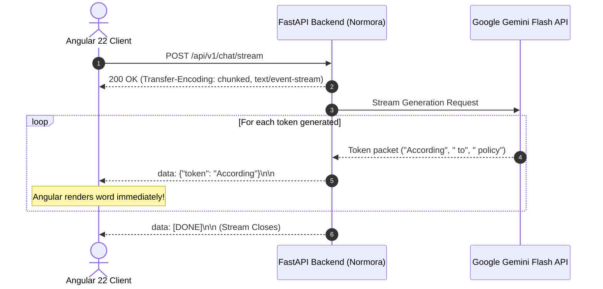

# Module 16: Streaming Protocols, Server-Sent Events (SSE) & WebSockets

Welcome to **Module 16** of the Normora Python & AI Masterclass.

In modern AI applications, you cannot make users stare at a blank screen for 8 seconds waiting for a 500-word response to generate all at once. Users expect **instant token-by-token streaming**—words appearing progressively on the screen the millisecond they are generated by the model.

In this module, you will master real-time streaming architectures:
* The mechanics of HTTP **Chunked Transfer Encoding**.
* The **Server-Sent Events (SSE)** standard specification.
* Delivering streaming AI responses in FastAPI using **`StreamingResponse`**.
* **Client Disconnect Detection (`request.is_disconnected()`)**—the vital architectural pattern that saves thousands of dollars by cancelling expensive Google Gemini generation when a user closes their browser tab.
* Full-duplex **WebSockets** for interactive conversational turn-taking.

Every concept is followed by **at least 5 real-world Normora examples**.

---

## 1. HTTP Streaming Mechanics & Chunked Transfer Encoding

In a standard HTTP response, the server calculates the full response body, sets the `Content-Length: 1240` header, and transmits the payload.  
When streaming tokens from an AI model, the server **does not know how long the response will be upfront**.

Instead, HTTP uses **Chunked Transfer Encoding**:
* Header: `Transfer-Encoding: chunked`
* The server sends an open stream of byte chunks.
* The connection remains open until the server sends an empty chunk (`0\r\n\r\n`), signaling the end of the stream.



---

## 2. Server-Sent Events (SSE) Protocol Specification

**Server-Sent Events (SSE)** is a W3C standard protocol for unidirectional, server-to-client streaming over a standard HTTP connection.

### The Wire Format
An SSE message is plain text formatted with specific fields separated by newlines:
* `event: <event_name>\n`: (Optional) Custom event type (e.g. `citation`, `token`, `error`).
* `data: <payload>\n`: The actual data payload (often a JSON string).
* `id: <message_id>\n`: (Optional) Message identifier for automatic client reconnection.
* `\n\n`: **Two consecutive newlines signify the end of the event packet.**

### 5 Real-World Normora Examples:

#### Example 2.1: Formatting Raw SSE Event Packets
```python
import json

def format_sse_event(data: dict, event: str | None = None) -> str:
    # Double newlines at the end are mandatory according to the W3C SSE specification!
    buffer = ""
    if event:
        buffer += f"event: {event}\n"
    buffer += f"data: {json.dumps(data)}\n\n"
    return buffer

packet = format_sse_event({"token": "MFA"}, event="token_delta")
print("--- Raw Wire SSE Packet ---")
print(repr(packet))
print(packet)
```

#### Example 2.2: Delivering AI Text Streaming in FastAPI with `StreamingResponse`
```python
import asyncio
from fastapi import FastAPI
from fastapi.responses import StreamingResponse

app = FastAPI()

async def gemini_token_generator():
    simulated_tokens = [
        "Normora's ", "security ", "policy ", "requires ", "all ",
        "engineers ", "to ", "enable ", "hardware ", "MFA ", "keys."
    ]
    for token in simulated_tokens:
        await asyncio.sleep(0.04)  # 40ms token generation interval
        # Deliver formatted SSE message:
        yield f"data: {json.dumps({'token': token})}\n\n"

    # Send termination sentinel:
    yield "data: [DONE]\n\n"

@app.get("/api/v1/chat/stream")
async def stream_chat():
    return StreamingResponse(
        gemini_token_generator(),
        media_type="text/event-stream",
        headers={
            "Cache-Control": "no-cache",
            "Connection": "keep-alive",
            "X-Accel-Buffering": "no"  # Disables proxy buffering in NGINX!
        }
    )
```

#### Example 2.3: Multi-Event Streaming (Streaming Text + Citation Footnotes)
```python
async def multi_event_generator():
    # 1. Stream text tokens:
    yield "event: token\ndata: \"Normora vacation days: 20 days annually.\"\n\n"
    await asyncio.sleep(0.05)

    # 2. Stream structured citation metadata event:
    citation = {"doc": "Handbook_2026.pdf", "page": 14, "relevance": 0.96}
    yield f"event: citation\ndata: {json.dumps(citation)}\n\n"
    await asyncio.sleep(0.05)

    # 3. Stream completion event:
    yield "event: done\ndata: {}\n\n"

@app.get("/api/v1/chat/multi-stream")
async def multi_stream():
    return StreamingResponse(multi_event_generator(), media_type="text/event-stream")
```

#### Example 2.4: Sending Keep-Alive Ping Heartbeats
To prevent aggressive firewalls, load balancers, or proxies (like AWS CloudFront or Cloudflare) from closing idle streaming connections during tool execution pauses, stream periodic comment lines (`: ping`):
```python
async def streaming_with_heartbeat():
    for i in range(3):
        await asyncio.sleep(0.1)
        yield ": ping - keep-alive\n\n"  # Lines starting with ':' are SSE comments!
        yield f"data: {json.dumps({'status': f'Searching pgvector batch {i+1}'})}\n\n"

@app.get("/api/v1/status/stream")
async def status_stream():
    return StreamingResponse(streaming_with_heartbeat(), media_type="text/event-stream")
```

#### Example 2.5: Streaming Ingestion Progress Updates
```python
async def ingestion_progress_stream(doc_id: str):
    stages = ["Uploaded", "Parsing PDF", "Generating 768d Embeddings", "HNSW Indexed"]
    for idx, stage in enumerate(stages, start=1):
        await asyncio.sleep(0.05)
        payload = {"step": idx, "total": 4, "description": stage}
        yield f"event: progress\ndata: {json.dumps(payload)}\n\n"

@app.get("/api/v1/documents/{doc_id}/progress")
async def document_progress(doc_id: str):
    return StreamingResponse(ingestion_progress_stream(doc_id), media_type="text/event-stream")
```

---

## 3. The Money-Saving Pattern: Client Disconnect Detection

> [!IMPORTANT]
> **Why Disconnect Detection is Vital:**
> Google Gemini Flash charges for every generated token. If a user asks a question, waits 1 second, and navigates away or closes their laptop, a naive server continues generating the entire 1,000-token answer in the background!
> 
> In FastAPI, you can probe **`request.is_disconnected()`** during the streaming loop. If the client aborted the connection, **we immediately break the generator loop and cancel the cloud LLM inference task!**

### 5 Real-World Normora Examples:

#### Example 3.1: Aborting Gemini Generation on Disconnect
```python
from fastapi import Request

async def safe_token_stream(request: Request):
    print("--> Stream started for client.")
    try:
        for i in range(1, 100):
            # Check if client closed the browser tab:
            if await request.is_disconnected():
                print(f"[CLIENT DISCONNECTED] Halting Gemini API generation at token {i}!")
                break

            await asyncio.sleep(0.05)  # Generating token...
            yield f"data: Token {i}\n\n"
    finally:
        print("<-- Generator exited. Releasing memory resources.")

@app.get("/api/v1/safe-stream")
async def safe_stream(request: Request):
    return StreamingResponse(safe_token_stream(request), media_type="text/event-stream")
```

#### Example 3.2: Disconnect Detection with Background Cancellation Tasks
```python
async def cancellable_ai_stream(request: Request):
    # Spin up background generation task:
    ai_task = asyncio.create_task(asyncio.sleep(10))  # Simulating heavy generation

    try:
        while not ai_task.done():
            if await request.is_disconnected():
                print("[ABORT] Cancelling background AI task to save API billing costs!")
                ai_task.cancel()
                break
            await asyncio.sleep(0.05)
            yield "data: streaming...\n\n"
    except asyncio.CancelledError:
        pass
```

#### Example 3.3: Logging Disconnect Metrics for Observability
```python
async def metered_stream(request: Request):
    tokens_delivered = 0
    try:
        for _ in range(50):
            if await request.is_disconnected():
                print(f"[METRIC] Client dropped connection early after {tokens_delivered} tokens.")
                return
            tokens_delivered += 1
            await asyncio.sleep(0.02)
            yield f"data: token\n\n"
    finally:
        print(f"[AUDIT] Total tokens billed to tenant: {tokens_delivered}")
```

#### Example 3.4: Releasing PostgreSQL Locks on Disconnect
```python
async def locked_ingestion_stream(request: Request):
    print("Acquired ingestion lock in Postgres.")
    try:
        for step in range(10):
            if await request.is_disconnected():
                print("Client disconnected mid-ingestion.")
                break
            await asyncio.sleep(0.02)
            yield f"data: step {step}\n\n"
    finally:
        print("Safely released PostgreSQL advisory lock.")
```

#### Example 3.5: Disconnect Signal in Vercel AI SDK Protocols
```python
async def vercel_sdk_disconnect_guarded_stream(request: Request):
    tokens = ["Welcome ", "to ", "Normora ", "Conversations."]
    for t in tokens:
        if await request.is_disconnected():
            return
        yield f"0:{json.dumps(t)}\n"
        await asyncio.sleep(0.03)
```

---

## 4. Full-Duplex WebSockets in FastAPI

While SSE is unidirectional (server -> client), **WebSockets** provide a persistent, bidirectional, full-duplex TCP connection.

WebSockets are ideal when:
* The client sends audio packets or real-time typing events while simultaneously receiving AI responses.
* Building interactive real-time multi-user collaborative chat rooms.

### 5 Real-World Normora Examples:

#### Example 4.1: The Standard FastAPI WebSocket Endpoint
```python
from fastapi import WebSocket, WebSocketDisconnect

@app.websocket("/ws/chat/{session_id}")
async def websocket_chat_endpoint(websocket: WebSocket, session_id: str):
    # 1. Accept the WebSocket handshake:
    await websocket.accept()
    print(f"WebSocket client connected to session: {session_id}")
    try:
        while True:
            # 2. Receive incoming message from Angular client:
            user_message = await websocket.receive_text()
            print(f"[{session_id}] Received prompt: '{user_message}'")

            # 3. Stream response tokens back over WebSocket:
            for word in ["Normora", " AI", " response", " over", " WebSocket."]:
                await asyncio.sleep(0.05)
                await websocket.send_text(word)

    except WebSocketDisconnect:
        print(f"WebSocket client disconnected from session: {session_id}")
```

#### Example 4.2: Receiving and Sending Structured JSON Frames
```python
@app.websocket("/ws/agent")
async def websocket_agent_channel(websocket: WebSocket):
    await websocket.accept()
    try:
        while True:
            # Receive structured JSON frame:
            data = await websocket.receive_json()
            query = data.get("prompt")
            
            # Send back structured frame:
            await websocket.send_json({
                "type": "agent_thought",
                "thought": f"Querying vector database for '{query}'"
            })
    except WebSocketDisconnect:
        pass
```

#### Example 4.3: WebSocket Connection Manager (Broadcasting to Multiple Users)
```python
class ConnectionManager:
    def __init__(self):
        # tenant_id -> list of active WebSockets
        self.active_connections: dict[str, list[WebSocket]] = {}

    async def connect(self, tenant_id: str, websocket: WebSocket):
        await websocket.accept()
        if tenant_id not in self.active_connections:
            self.active_connections[tenant_id] = []
        self.active_connections[tenant_id].append(websocket)

    def disconnect(self, tenant_id: str, websocket: WebSocket):
        if tenant_id in self.active_connections:
            self.active_connections[tenant_id].remove(websocket)

    async def broadcast_to_tenant(self, tenant_id: str, message: dict):
        if tenant_id in self.active_connections:
            for connection in self.active_connections[tenant_id]:
                await connection.send_json(message)

manager = ConnectionManager()
```

#### Example 4.4: Enforcing Authentication During WebSocket Handshake
You can inspect query parameters or headers during the handshake and reject unauthorized connections before accepting:
```python
@app.websocket("/ws/secure")
async def secure_websocket(websocket: WebSocket):
    token = websocket.query_params.get("token")
    if token != "valid_secret_token":
        # Close connection with custom error code (4003 = Forbidden):
        await websocket.close(code=4003, reason="Unauthorized")
        return

    await websocket.accept()
    await websocket.send_text("Authenticated connection established.")
    await websocket.close()
```

#### Example 4.5: WebSocket Ping/Pong Heartbeat Protocol
```python
@app.websocket("/ws/heartbeat")
async def heartbeat_ws(websocket: WebSocket):
    await websocket.accept()
    try:
        while True:
            msg = await websocket.receive_text()
            if msg == "ping":
                await websocket.send_text("pong")
    except WebSocketDisconnect:
        pass
```

---

## Summary & Next Step

You have mastered real-time protocols:
1. HTTP Chunked Transfer Encoding and streaming mechanics.
2. The W3C Server-Sent Events (SSE) standard and FastAPI `StreamingResponse`.
3. Client disconnect detection (`request.is_disconnected()`) to cancel cloud LLM inference immediately and save costs.
4. Bidirectional full-duplex WebSockets and multi-user connection managers.

In **Module 17**, we construct Normora's core intelligence: **Production Hybrid RAG (Ingestion, Chunking, Embeddings, Reciprocal Rank Fusion & Citations)**!
