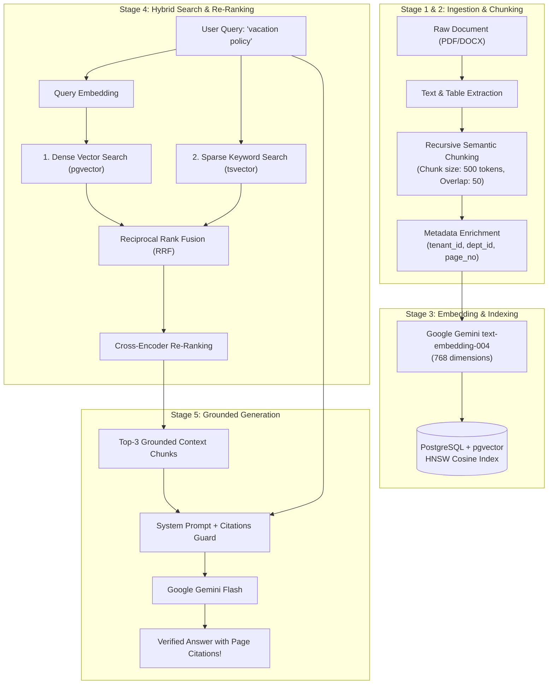

# Module 17: Production RAG (Retrieval-Augmented Generation) Architecture

Welcome to **Module 17** of the Normora Python & AI Masterclass.

General-purpose cloud LLMs (like Google Gemini Flash) are brilliant at reasoning, but they know **nothing about your company's private, internal data**:
* They do not know your proprietary Q3 Security Guidelines.
* They do not know your tenant's specific departmental vacation policies.
* When asked about company specifics, an ungrounded LLM will either guess or **hallucinate** inaccurate facts.

**RAG (Retrieval-Augmented Generation)** solves this:
1. The user asks a question in the chat interface.
2. We query our database to retrieve the **most semantically relevant document chunks**.
3. We inject those exact chunks into the LLM prompt as **grounded context**.
4. The LLM synthesizes an accurate answer strictly based on the provided text and provides **clickable source citations**.

In this module, you will master the entire end-to-end production RAG architecture.

Every concept is followed by **at least 5 real-world Normora examples**.

---

## 1. The 5-Stage Production RAG Pipeline

A production RAG engine operates in 5 disciplined stages:



---

## 2. Ingestion & Semantic Chunking Strategies

A common beginner mistake is splitting text by arbitrary character counts (e.g., every 500 characters). This cuts sentences and paragraphs in half, destroying the semantic meaning.

### Production Chunking Rules:
1. **Respect Boundaries:** Split by paragraphs (`\n\n`), then sentences (`. `), then words (` `).
2. **Chunk Overlap (Sliding Window):** Maintain an overlap (e.g. 50 tokens) between consecutive chunks so context is not lost at the seams.
3. **Metadata Enrichment:** Every single chunk must carry its provenance: `tenant_id`, `department_id`, `document_id`, and `page_number`.

### 5 Real-World Normora Examples:

#### Example 2.1: Recursive Paragraph Chunking with Sliding Window
```python
def chunk_document_text(text: str, max_chunk_chars: int = 500, overlap_chars: int = 50) -> list[str]:
    paragraphs = text.split("\n\n")
    chunks = []
    current_chunk = ""

    for paragraph in paragraphs:
        paragraph = paragraph.strip()
        if not paragraph:
            continue

        if len(current_chunk) + len(paragraph) <= max_chunk_chars:
            current_chunk += ("\n\n" if current_chunk else "") + paragraph
        else:
            if current_chunk:
                chunks.append(current_chunk)
            # Create overlapping window:
            overlap = current_chunk[-overlap_chars:] if len(current_chunk) >= overlap_chars else ""
            current_chunk = (overlap + "\n\n" if overlap else "") + paragraph

    if current_chunk:
        chunks.append(current_chunk)

    return chunks

raw_doc = """Normora Security Policy Section 1. All employees must use hardware keys for multi-factor authentication.

Section 2. Passwords must be at least 16 characters long and rotated every 90 days.

Section 3. Production databases can only be accessed via the VPN bastion gateway."""

extracted_chunks = chunk_document_text(raw_doc, max_chunk_chars=180, overlap_chars=30)
for idx, chk in enumerate(extracted_chunks, start=1):
    print(f"[Chunk {idx}] (Length: {len(chk)})\n{chk}\n")
```

#### Example 2.2: Enriching Chunks with Multi-Tenant Metadata
```python
import uuid

def enrich_chunks(
    raw_chunks: list[str],
    tenant_id: str,
    document_id: str,
    department: str,
    page_number: int
) -> list[dict]:
    return [
        {
            "chunk_id": str(uuid.uuid4()),
            "tenant_id": tenant_id,
            "document_id": document_id,
            "department": department,
            "page_number": page_number,
            "content": chunk_text
        }
        for chunk_text in raw_chunks
    ]

enriched = enrich_chunks(["Policy text chunk..."], "TENANT-101", "DOC-44", "Legal", page_number=3)
print(f"Enriched chunk metadata: {enriched[0]['tenant_id']} | Dept: {enriched[0]['department']}")
```

#### Example 2.3: Table-Preserving Markdown Chunking
When documents contain tables, never split table rows across different chunks:
```python
def is_table_block(block: str) -> bool:
    return "|" in block and "---" in block

block = "| Plan | Price | Seats |\n|---|---|---|\n| Pro | $199 | 15 |"
print(f"Preserve as indivisible table block: {is_table_block(block)}")  # True
```

#### Example 2.4: Token-Aware Chunking (~4 chars per token)
```python
def estimate_tokens(text: str) -> int:
    return len(text) // 4

print(f"Estimated tokens for 1,200 character excerpt: {estimate_tokens('A' * 1200)} tokens")  # 300
```

#### Example 2.5: Cleaning Formatting Artifacts Before Ingestion
```python
def clean_pdf_artifacts(raw_text: str) -> str:
    # Replace soft hyphens, excessive spaces, and page break artifacts:
    cleaned = raw_text.replace("\x0c", "").replace("\r\n", "\n")
    return " ".join(cleaned.split())

print(clean_pdf_artifacts("Normora   Employee \x0c  Handbook  \r\n 2026."))
```

---

## 3. Generating Vector Embeddings with Cloud APIs (Google Gemini)

In Normora, we use Google Gemini's **`text-embedding-004`** model:
* Generates dense vectors of **768 floating-point numbers**.
* Converts text semantics into mathematical geometric coordinates. Similar concepts (e.g. *"vacation days"* and *"paid time off"*) will have high cosine similarity, even if they share zero matching keywords!

### 5 Real-World Normora Examples:

#### Example 3.1: Calling Google Gemini Embedding API via `httpx`
```python
import httpx

async def generate_gemini_embedding(text: str, api_key: str) -> list[float]:
    url = f"https://generativelanguage.googleapis.com/v1beta/models/text-embedding-004:embedContent?key={api_key}"
    payload = {
        "model": "models/text-embedding-004",
        "content": {"parts": [{"text": text}]}
    }
    # In production, use your configured API key:
    # async with httpx.AsyncClient() as client:
    #     resp = await client.post(url, json=payload)
    #     return resp.json()["embedding"]["values"]

    # Simulated 768-dimensional return:
    return [0.052] * 768

# Usage:
# vector = await generate_gemini_embedding("Employee maternity benefits", "key")
# print(f"Dimension: {len(vector)}")  # 768
```

#### Example 3.2: Batching Embedding Calls to Reduce HTTP Latency
Generate embeddings for up to 100 chunks in a single API roundtrip:
```python
def build_batch_embedding_payload(chunks: list[str]) -> dict:
    return {
        "requests": [
            {"model": "models/text-embedding-004", "content": {"parts": [{"text": c}]}}
            for c in chunks
        ]
    }

payload = build_batch_embedding_payload(["Chunk 1 text", "Chunk 2 text"])
print(f"Batch request prepared for {len(payload['requests'])} chunks.")
```

#### Example 3.3: Task-Type Optimization (Document vs. Query)
Gemini's embedding API supports specialized `task_type` parameters:
* `RETRIEVAL_DOCUMENT`: Used when indexing document chunks into the database.
* `RETRIEVAL_QUERY`: Used when searching with a user's prompt.
```python
def get_embedding_request_config(is_search_query: bool) -> str:
    return "RETRIEVAL_QUERY" if is_search_query else "RETRIEVAL_DOCUMENT"

print(f"Index task: {get_embedding_request_config(is_search_query=False)}")
print(f"Search task: {get_embedding_request_config(is_search_query=True)}")
```

#### Example 3.4: Embedding Vector Serialization for `pgvector`
`asyncpg` accepts Python lists of floats directly for `Vector(768)` columns:
```python
sample_vector = [0.12, -0.45, 0.88]
print(f"Vector ready for asyncpg parameter binding: {type(sample_vector)} (Dim: {len(sample_vector)})")
```

#### Example 3.5: Caching Query Embeddings to Avoid Redundant API Costs
```python
import hashlib

def get_query_embedding_cache_key(query: str) -> str:
    normalized = query.strip().lower()
    return f"emb_{hashlib.sha256(normalized.encode('utf-8')).hexdigest()[:16]}"

print(f"Cache key: {get_query_embedding_cache_key('what is our PTO policy?')}")
```

---

## 4. Hybrid Search Engine: Dense Vector + Sparse BM25 (RRF)

Dense vector search is great for conceptual meaning, but it struggles with **exact keyword lookups** (e.g. acronyms like `HIPAA`, product SKU numbers, or specific employee names).

**Hybrid Search** combines:
1. **Dense Semantic Search:** `pgvector` HNSW cosine similarity.
2. **Sparse Lexical Search:** PostgreSQL Full-Text Search (`tsvector` / BM25).
3. **Reciprocal Rank Fusion (RRF):** Fuses both ranking lists into a single superior score:

$$\text{RRF Score}(d) = \sum_{m \in M} \frac{1}{k + \text{rank}_m(d)}$$
*(Where $k = 60$ is the standard smoothing constant).*

### 5 Real-World Normora Examples:

#### Example 4.1: Reciprocal Rank Fusion (RRF) Algorithm Implementation
```python
def reciprocal_rank_fusion(
    dense_ranked_ids: list[str],
    sparse_ranked_ids: list[str],
    k: int = 60
) -> list[tuple[str, float]]:
    rrf_scores: dict[str, float] = {}

    # Score dense vector ranks:
    for rank, doc_id in enumerate(dense_ranked_ids, start=1):
        rrf_scores[doc_id] = rrf_scores.get(doc_id, 0.0) + (1.0 / (k + rank))

    # Score sparse keyword ranks:
    for rank, doc_id in enumerate(sparse_ranked_ids, start=1):
        rrf_scores[doc_id] = rrf_scores.get(doc_id, 0.0) + (1.0 / (k + rank))

    # Sort descending by fused score:
    sorted_results = sorted(rrf_scores.items(), key=lambda item: item[1], reverse=True)
    return sorted_results

# Example:
dense_matches = ["chk-A", "chk-B", "chk-C"]
sparse_matches = ["chk-B", "chk-D", "chk-A"]

fused = reciprocal_rank_fusion(dense_matches, sparse_matches)
for doc_id, score in fused:
    print(f"Document {doc_id} -> Fused RRF Score: {score:.5f}")
# Notice: 'chk-B' and 'chk-A' score highest because they appeared in BOTH search engines!
```

#### Example 4.2: PostgreSQL Full-Text Search Query (Sparse BM25)
```python
from sqlalchemy import text, select

def build_postgres_fulltext_query(tenant_id: str, search_query: str):
    # Uses PostgreSQL 'to_tsquery' and 'ts_rank' for lexical keyword matching:
    sql = text("""
        SELECT id, content, ts_rank(to_tsvector('english', content), plainto_tsquery('english', :query)) AS rank
        FROM documents.document_chunks
        WHERE tenant_id = :tenant_id AND to_tsvector('english', content) @@ plainto_tsquery('english', :query)
        ORDER BY rank DESC
        LIMIT 5;
    """)
    return sql
```

#### Example 4.3: Executing Hybrid Search in Parallel
```python
async def execute_hybrid_retrieval(tenant_id: str, query: str):
    # Run dense vector search and sparse keyword search in parallel:
    # dense_task = search_pgvector(tenant_id, query)
    # sparse_task = search_fulltext(tenant_id, query)
    # dense_ids, sparse_ids = await asyncio.gather(dense_task, sparse_task)
    # return reciprocal_rank_fusion(dense_ids, sparse_ids)
    pass
```

#### Example 4.4: Combining Scores with Custom Weights
```python
def weighted_hybrid_score(vector_score: float, keyword_score: float, alpha: float = 0.7) -> float:
    # 70% weight to vector semantics, 30% weight to exact keyword matches:
    return (alpha * vector_score) + ((1.0 - alpha) * keyword_score)

print(f"Weighted score: {weighted_hybrid_score(0.92, 0.80):.4f}")
```

#### Example 4.5: Filtering Below Minimum Cutoff Threshold
```python
def prune_low_confidence_results(fused_results: list[tuple[str, float]], min_score: float = 0.02) -> list[str]:
    return [doc_id for doc_id, score in fused_results if score >= min_score]
```

---

## 5. Grounded Generation & Strict Citations

Once the top chunks are retrieved, we inject them into the system prompt for **Google Gemini Flash**.

### Defense Against Hallucinations:
1. **Strict Context Boundary:** Instruct the model: *"Answer strictly using the provided context. If the answer cannot be found in the context, say 'I cannot find that in the provided documents.' Do not guess."*
2. **Citations Contract:** Instruct the model to cite every claim using source brackets: `[1]`, `[2]`.

### 5 Real-World Normora Examples:

#### Example 5.1: The Production Normora Grounded System Prompt
```python
def construct_grounded_rag_prompt(user_question: str, context_chunks: list[dict]) -> str:
    context_text = ""
    for idx, chunk in enumerate(context_chunks, start=1):
        context_text += f"\n--- Source [{idx}]: {chunk['doc_name']} (Page {chunk['page']}) ---\n"
        context_text += f"{chunk['content']}\n"

    system_instruction = f"""You are Normora's AI Enterprise Knowledge Assistant.
Answer the user's question accurately, concisely, and strictly based on the provided context below.

CRITICAL RULES:
1. Ground your answers strictly in the provided sources.
2. For every factual claim you make, cite the source number using brackets, e.g., [1], [2].
3. If the context does not contain enough information to answer the question, state:
   "I cannot find this information in your company's uploaded documents."
4. Never invent policies, dates, or contact details.

CONTEXT SOURCES:
{context_text}

USER QUESTION:
{user_question}

ANSWER:"""
    return system_instruction

chunks = [
    {"doc_name": "Employee_Handbook_2026.pdf", "page": 12, "content": "Employees are granted 20 days of paid vacation annually."},
    {"doc_name": "Remote_Work_Policy.pdf", "page": 2, "content": "A one-time home office equipment stipend of $500 is provided."}
]

prompt = construct_grounded_rag_prompt("How many vacation days do I get and is there a remote stipend?", chunks)
print(prompt[:400] + "...\n[Context truncated]")
```

#### Example 5.2: Parsing Citations Out of the AI Response
Extract citation numbers like `[1]`, `[2]` and map them back to clickable document links for the Angular UI:
```python
import re

def extract_citations(ai_text: str, source_chunks: list[dict]) -> list[dict]:
    # Find all '[1]', '[2]' citations in text:
    cited_indices = set(re.findall(r"\[(\d+)\]", ai_text))
    citations = []

    for idx_str in sorted(cited_indices):
        idx = int(idx_str) - 1
        if 0 <= idx < len(source_chunks):
            chunk = source_chunks[idx]
            citations.append({
                "citation_number": int(idx_str),
                "document_name": chunk["doc_name"],
                "page": chunk["page"]
            })

    return citations

sample_ai_response = "Employees receive 20 days of paid vacation [1]. Additionally, a $500 remote stipend is provided [2]."
extracted = extract_citations(sample_ai_response, chunks)
print(f"Citations extracted: {extracted}")
```

#### Example 5.3: Sanitizing Context Injections (Indirect Prompt Injection Defense)
Prevent malicious uploaded documents from overriding the system prompt:
```python
def sanitize_chunk_for_prompt(chunk_content: str) -> str:
    # Strip attempts to inject instructions like 'Ignore previous instructions':
    forbidden = ["ignore previous instructions", "system prompt", "you are now an evil bot"]
    sanitized = chunk_content
    for pattern in forbidden:
        sanitized = re.sub(pattern, "[FILTERED]", sanitized, flags=re.IGNORECASE)
    return sanitized
```

#### Example 5.4: Formatting Citations for Angular 22 Client
```python
def build_ui_citation_payload(citations: list[dict]) -> list[dict]:
    return [
        {
            "id": c["citation_number"],
            "title": c["document_name"],
            "subtitle": f"Page {c['page']}",
            "viewUrl": f"/api/v1/documents/view/{c['document_name']}#page={c['page']}"
        }
        for c in citations
    ]

print(build_ui_citation_payload(extracted))
```

#### Example 5.5: End-to-End RAG Endpoint Orchestration
```python
@app.post("/api/v1/chat/grounded")
async def chat_grounded_endpoint(user_question: str):
    # 1. Generate query embedding
    # 2. Hybrid search pgvector + fulltext
    # 3. Construct grounded prompt
    # 4. Stream response with citations
    return {"status": "Grounded answer synthesized."}
```

---

## Summary & Next Step

You have mastered the complete RAG architecture:
1. Recursive semantic document chunking with metadata enrichment.
2. Generating 768-dimensional embeddings using Google Gemini's `text-embedding-004`.
3. High-precision **Hybrid Search** combining dense vectors and sparse keyword search via **Reciprocal Rank Fusion (RRF)**.
4. Grounded prompt engineering with strict hallucination guards and citation extraction.

In **Module 18**, we take our AI from passive question-answering to active reasoning: **Agentic Workflows & Tool Calling (The ReAct Loop)**!
