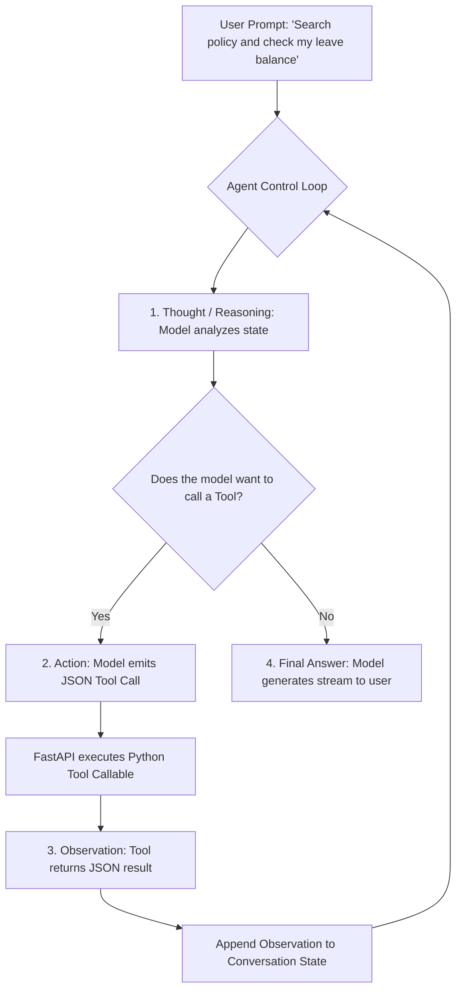
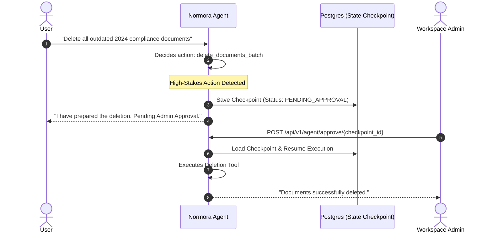

# Module 18: Agentic Workflows & Tool Calling (The ReAct Loop)

Welcome to **Module 18** of the Normora Python & AI Masterclass.

Standard chatbots are purely passive: they receive a prompt and generate text.  
An **AI Agent**, by contrast, is **active and autonomous**:
* If an employee asks: *"What is our company's paternity leave policy, and can you check if my department manager is Alice?"*
* The agent realizes it cannot answer this in one shot.
* It formulates a plan:
  1. **Thought:** I need to search the company policies for paternity leave.
  2. **Action:** Call the `search_company_documents` tool.
  3. **Observation:** Policy states 12 weeks of leave, approved by department head.
  4. **Thought:** Now I must check the user's department manager.
  5. **Action:** Call the `lookup_department_members` tool.
  6. **Observation:** Manager is confirmed to be Alice Smith.
  7. **Final Answer:** Synthesizes the full verified answer for the user!

This cycle is known as the **ReAct (Reason + Act)** pattern. In this module, you will build a production agent engine from scratch in raw Python and FastAPI.

Every concept is followed by **at least 5 real-world Normora examples**.

---

## 1. The Anatomy of an Agent & The ReAct Cycle

An agent operates in a continuous control loop until it decides it has gathered enough information to answer:



---

## 2. Tool Calling Mechanics (Generating JSON Schema with Pydantic)

Cloud LLMs (Google Gemini, OpenAI) do not execute Python code directly.  
Instead:
1. We declare our Python functions to the model as **JSON Schemas** (derived from Pydantic models).
2. The model outputs a structured JSON object containing the tool name and validated arguments.
3. Our FastAPI server executes the corresponding Python function and feeds the result back to the model!

### 5 Real-World Normora Examples:

#### Example 2.1: Declaring `SearchCompanyDocumentsTool` Schema
```python
from pydantic import BaseModel, Field

class SearchCompanyDocumentsArgs(BaseModel):
    query: str = Field(description="The semantic search query keywords.")
    department: str = Field(default="General", description="Optional department filter.")
    limit: int = Field(default=3, ge=1, le=10, description="Number of document chunks to retrieve.")

# Generate OpenAPI JSON Schema:
tool_declaration = {
    "name": "search_company_documents",
    "description": "Searches internal company knowledge base documents for policies, benefits, and rules.",
    "parameters": SearchCompanyDocumentsArgs.model_json_schema()
}

print(f"Tool declared: {tool_declaration['name']}")
print(f"Required fields: {tool_declaration['parameters']['required']}")
```

#### Example 2.2: Declaring `LookupDepartmentMembersTool` Schema
```python
class LookupDepartmentMembersArgs(BaseModel):
    department_name: str = Field(description="Name of the department (e.g. Legal, Engineering, HR).")
    role_filter: str | None = Field(default=None, description="Optional role filter (e.g. Admin, Manager).")

lookup_tool_declaration = {
    "name": "lookup_department_members",
    "description": "Looks up the members, managers, and roles for a specific department in Normora.",
    "parameters": LookupDepartmentMembersArgs.model_json_schema()
}
```

#### Example 2.3: Declaring `CheckTokenUsageTool` Schema
```python
class CheckTokenUsageArgs(BaseModel):
    tenant_id: str = Field(description="The unique tenant identifier.")

token_tool_declaration = {
    "name": "check_token_usage",
    "description": "Checks the current monthly token consumption and budget limit for the workspace.",
    "parameters": CheckTokenUsageArgs.model_json_schema()
}
```

#### Example 2.4: Declaring `RequestDocumentExportPdfTool` Schema
```python
class RequestDocumentExportPdfArgs(BaseModel):
    document_id: str = Field(description="ID of the document to compile.")
    include_citations: bool = Field(default=True, description="Whether to append source citations.")

export_tool_declaration = {
    "name": "export_document_pdf",
    "description": "Compiles and exports verified document excerpts into a downloadable PDF.",
    "parameters": RequestDocumentExportPdfArgs.model_json_schema()
}
```

#### Example 2.5: The Tool Registry (Mapping Names to Callables)
```python
async def search_company_documents(query: str, department: str = "General", limit: int = 3) -> dict:
    return {"matches": [f"Chunk matching '{query}' in {department}"]}

async def lookup_department_members(department_name: str, role_filter: str | None = None) -> dict:
    return {"department": department_name, "manager": "Alice Smith", "members": 14}

# The executable tool dispatcher:
TOOL_REGISTRY = {
    "search_company_documents": search_company_documents,
    "lookup_department_members": lookup_department_members
}
```

---

## 3. The ReAct Agent Loop from Scratch (No Heavy Frameworks)

Rather than using complex, rigid third-party frameworks with hidden magic, a production architect understands how to write the **ReAct Agent Loop natively in Python**.

### 5 Real-World Normora Examples:

#### Example 3.1: The Native ReAct Agent Loop Implementation
```python
import asyncio
import json

class NormoraAgent:
    def __init__(self, tools: dict):
        self.tools = tools
        self.max_turns = 5

    async def run(self, user_prompt: str) -> str:
        # Working memory history:
        messages = [{"role": "user", "content": user_prompt}]
        turns = 0

        while turns < self.max_turns:
            turns += 1
            print(f"\n[Agent Turn {turns}] Analyzing conversation state...")

            # 1. Simulate Cloud LLM Decision (Gemini):
            llm_decision = await self.simulate_llm_step(messages)

            # Check if LLM decided to call a tool:
            if "tool_call" in llm_decision:
                tool_call = llm_decision["tool_call"]
                tool_name = tool_call["name"]
                tool_args = tool_call["arguments"]

                print(f"--> [Action] Model requested tool: '{tool_name}' with args {tool_args}")

                # 2. Execute the requested Python tool:
                tool_fn = self.tools.get(tool_name)
                if tool_fn:
                    tool_result = await tool_fn(**tool_args)
                else:
                    tool_result = {"error": f"Tool '{tool_name}' not found."}

                print(f"<-- [Observation] Tool returned: {tool_result}")

                # 3. Append Tool Call and Observation to Working Memory:
                messages.append({"role": "assistant", "tool_calls": [tool_call]})
                messages.append({"role": "tool", "content": json.dumps(tool_result)})
            else:
                # LLM finished reasoning and produced final answer:
                final_answer = llm_decision["content"]
                print(f"[Final Answer] {final_answer}")
                return final_answer

        return "Agent halted: Maximum reasoning steps reached."

    async def simulate_llm_step(self, messages: list[dict]) -> dict:
        # Simulating LLM: First turn calls tool, second turn answers:
        if len(messages) == 1:
            return {
                "tool_call": {
                    "name": "search_company_documents",
                    "arguments": {"query": "paternity leave", "department": "HR"}
                }
            }
        else:
            return {
                "content": "According to HR records, employees receive 12 weeks of paid paternity leave."
            }

# Execute the Agent:
agent = NormoraAgent(tools=TOOL_REGISTRY)
result = asyncio.run(agent.run("What is our paternity leave policy?"))
```

#### Example 3.2: Tool Argument Validation Using Pydantic Before Execution
If the model hallucinates an invalid argument type, validate it defensively before calling the tool:
```python
def validate_and_execute_tool(tool_name: str, raw_args: dict) -> dict:
    if tool_name == "search_company_documents":
        # Validate through Pydantic model:
        validated_args = SearchCompanyDocumentsArgs(**raw_args)
        # Call tool with clean, typed attributes:
        return {"query": validated_args.query, "limit": validated_args.limit}
    return {"error": "Unknown tool"}
```

#### Example 3.3: Guarding Against Infinite Agent Loops
Always enforce `max_iterations = 5` to prevent an agent from repeatedly calling tools in an infinite loop and burning API budget!

#### Example 3.4: Dynamic Tool Availability by Tenant Plan
Free tier tenants cannot call premium tools:
```python
def get_available_tools_for_tenant(plan: str) -> list[dict]:
    tools = [tool_declaration]  # Search available to all
    if plan in ["Pro", "Enterprise"]:
        tools.append(lookup_tool_declaration)
        tools.append(export_tool_declaration)
    return tools

print(f"Pro tools count: {len(get_available_tools_for_tenant('Pro'))}")
```

#### Example 3.5: Recording Agent Audit Traces in Database
```python
async def log_agent_step(session_id: str, turn: int, thought: str, action: str):
    print(f"[AUDIT TRACE] Session {session_id} | Turn {turn} | Action: {action}")
```

---

## 4. Human-in-the-Loop (HITL) Checkpoints

Not all agent actions should run autonomously. If an agent wants to perform a high-stakes, irreversible action:
* *Permanently deleting a document collection.*
* *Purchasing 50 additional user seats ($750/mo).*
* *Sending an all-company email notification.*

The agent must **pause execution**, persist its snapshot state, and request **Human Approval** via an endpoint before resuming!



### 5 Real-World Normora Examples:

#### Example 4.1: The Checkpoint State Schema
```python
class AgentCheckpoint(BaseModel):
    checkpoint_id: str
    tenant_id: str
    action_name: str
    action_parameters: dict
    status: Literal["PENDING_APPROVAL", "APPROVED", "REJECTED"]
    conversation_state: list[dict]

checkpoint = AgentCheckpoint(
    checkpoint_id="chkpt-901",
    tenant_id="TENANT-ACME",
    action_name="purge_document_collection",
    action_parameters={"collection_id": "col-2024"},
    status="PENDING_APPROVAL",
    conversation_state=[{"role": "user", "content": "Purge 2024 docs"}]
)
print(f"Checkpoint created: {checkpoint.checkpoint_id} ({checkpoint.status})")
```

#### Example 4.2: Pausing Agent Execution on Sensitive Actions
```python
SENSITIVE_TOOLS = {"purge_document_collection", "upgrade_subscription_seats"}

def evaluate_action_risk(tool_name: str) -> bool:
    # Returns True if human approval is required:
    return tool_name in SENSITIVE_TOOLS

print(f"Requires approval: {evaluate_action_risk('purge_document_collection')}")  # True
print(f"Requires approval: {evaluate_action_risk('search_company_documents')}")   # False
```

#### Example 4.3: FastAPI Endpoint to Approve Paused Action
```python
@app.post("/api/v1/agent/checkpoints/{checkpoint_id}/approve")
async def approve_agent_action(checkpoint_id: str):
    # 1. Verify user is Tenant Owner (BFLA)
    # 2. Load Checkpoint from database
    # 3. Resume Agent with approved tool execution
    return {
        "checkpoint_id": checkpoint_id,
        "status": "APPROVED",
        "message": "Action approved. Resuming agent execution."
    }
```

#### Example 4.4: FastAPI Endpoint to Reject Paused Action
```python
@app.post("/api/v1/agent/checkpoints/{checkpoint_id}/reject")
async def reject_agent_action(checkpoint_id: str, reason: str = "User declined"):
    # Inform agent that action was denied by admin:
    return {
        "checkpoint_id": checkpoint_id,
        "status": "REJECTED",
        "reason": reason
    }
```

#### Example 4.5: Resuming Agent Execution After Approval
```python
async def resume_agent_checkpoint(checkpoint: AgentCheckpoint):
    print(f"Resuming {checkpoint.checkpoint_id} with tool '{checkpoint.action_name}'...")
    # Inject approval confirmation and continue loop
    return "Agent resumed and completed action."
```

---

## Summary & Next Step

You have mastered autonomous agent systems:
1. The ReAct (Reason + Act) loop mechanics.
2. Generating JSON Schemas from Pydantic models for Google Gemini tool calling.
3. Writing a clean, native Python agent loop without black-box framework bloat.
4. Implementing **Human-in-the-Loop (HITL)** checkpoints for high-stakes actions.

In **Module 19**, we connect our backend to modern AI frontends: **Vercel AI SDK & CopilotKit Backend Wire Protocols**!
