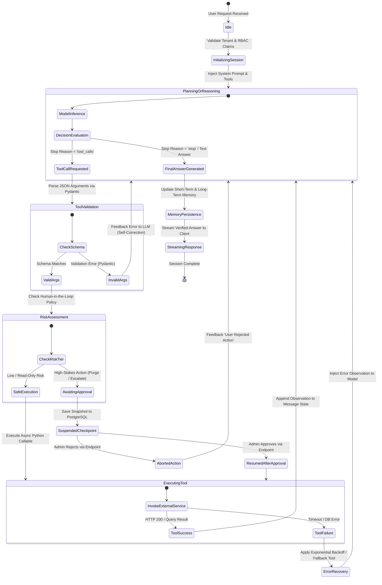
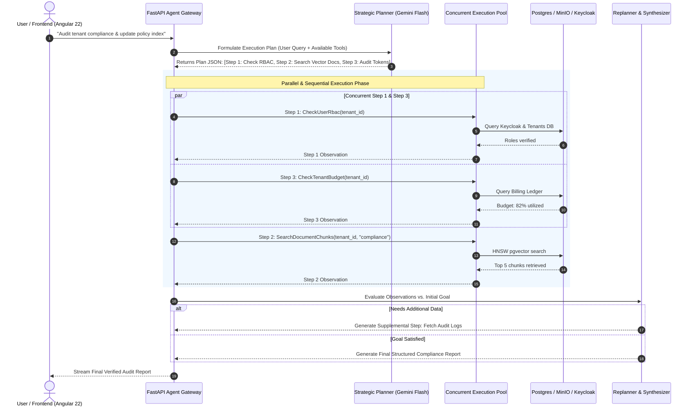
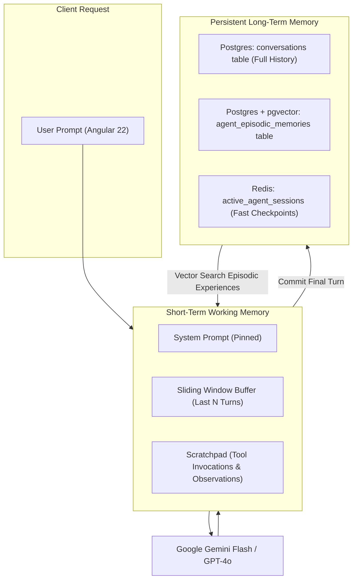
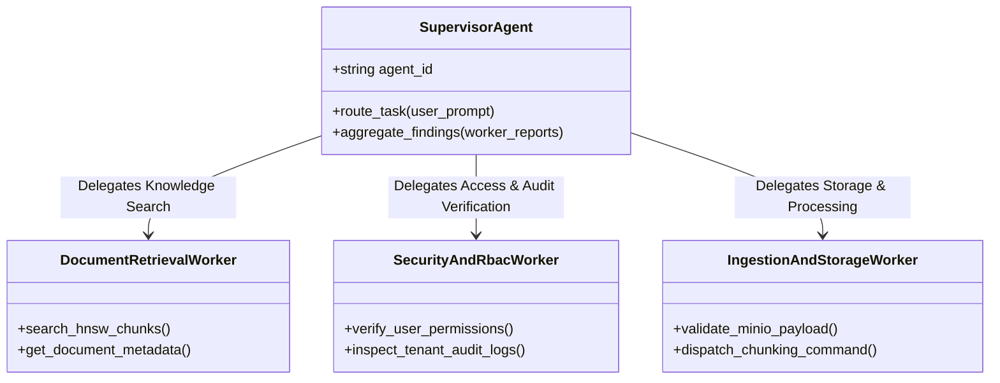
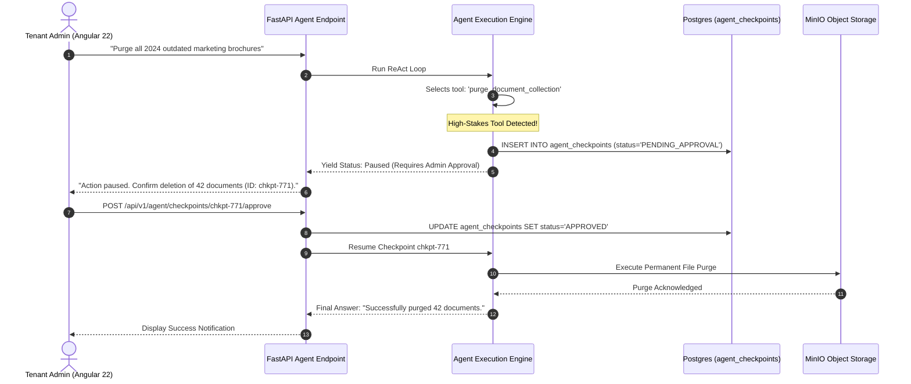

# Module 18: Agentic Workflows, Tool Calling & Multi-Agent Architecture

Welcome to **Module 18** of the Normora Python & AI Masterclass.

In earlier modules, you built deterministic APIs, executed vector similarity searches with PostgreSQL and pgvector, and streamed token completions from cloud Large Language Models. Those systems were **passive**: given an input, they executed a fixed, single-step procedure.

An **AI Agent**, by contrast, is an **autonomous, goal-driven control loop**. When faced with a complex enterprise request, an agent:
1. Evaluates the conversation history and user intent.
2. Deconstructs the problem into logical sub-tasks.
3. Decides which external systems or tools to invoke (e.g., querying vector databases, validating RBAC roles in Keycloak, checking tenant rate limits, or dispatching background workers).
4. Inspects the results of its actions (observations).
5. Self-corrects when errors arise.
6. Iterates until it can formulate a verified, grounded answer.

In this module, you will master production agent architecture from absolute scratch using raw Python, Pydantic, and FastAPI—leveraging enterprise cloud models (**Google Gemini Flash** and **OpenAI GPT-4o**)—without reliance on bloated, black-box frameworks.

---

## 1. The Anatomy of an Agent & The Agent Lifecycle State Machine

### 1.1 From Deterministic Code to Agentic Loops

As a .NET architect, you are accustomed to deterministic execution paths: a controller receives a command, dispatches it through a MediatR pipeline, executes a database query via Entity Framework Core, and maps an entity to a DTO. The sequence of steps is hardcoded at compile time.

In an **Agentic Workflow**, the execution path is dynamically decided at runtime by a reasoning model. The application code provides:
- A set of **Tools** (executable functions exposed via OpenAPI/JSON Schema).
- A **Working Memory** (conversation message history).
- A **Control Loop** (a state machine governing reasoning iterations, safety guards, token budgets, and human approval checkpoints).

> [!NOTE]
> ### Python Syntax Primer for the C#/.NET Architect
> If you are coming from C# 12 / .NET 10, keep these foundational Python rules in mind:
> - **Indentation is Syntax**: Python uses 4 spaces instead of curly braces `{}` to define code blocks (methods, classes, loops).
> - **Type Annotations**: In Python 3.12, types like `def my_func(query: str) -> dict[str, Any]:` are hints. They do not crash at compile time, but tools like **Pydantic** validate them strictly at runtime.
> - **Async/Await**: Python's `async def` defines a coroutine that runs on `asyncio`'s event loop, conceptually identical to C#'s `async Task<T>` running on the thread pool.
> - **Dictionaries**: `dict[str, Any]` is Python's native `Dictionary<string, object>`. Literal syntax is `{"key": "value"}`.
> - **Pydantic `BaseModel`**: The Python equivalent of a C# `record` with built-in FluentValidation and `System.Text.Json` serialization!



### 1.2 The ReAct Loop (Reasoning + Acting)

The prevailing architectural paradigm for single-agent systems is **ReAct (Reason + Act)**:
1. **Thought (Reasoning)**: The LLM articulates its current mental model and plans its immediate next move based on current conversation state.
2. **Action (Act)**: The LLM outputs a structured invocation payload requesting that the runtime execute a specific tool with concrete arguments.
3. **Observation (Result)**: The runtime executes the tool, captures the output (or error), appends it to the message buffer as a `tool` role message, and invokes the model again.

This loop repeats until the model determines that it possesses sufficient context to fulfill the user's objective.

---

## 2. Tool & Function Calling Mechanics

### 2.1 How Cloud LLMs Call Tools

Cloud models like Google Gemini Flash and OpenAI GPT-4o **do not execute code inside their neural weights**. They operate via structured protocol negotiation:
1. **Declaration Phase**: The backend sends the user query alongside an array of tool definitions described as JSON Schemas (specifying function names, descriptions, input parameters, required fields, and types).
2. **Decision Phase**: If the model requires an external action, it responds with an empty message body and an array of `tool_calls`, each containing a `call_id`, a `function_name`, and a JSON-encoded string of arguments.
3. **Execution Phase**: The backend parses the arguments, validates them through a Pydantic model, executes the native Python async function, and returns the output wrapped in a `role: tool` message.
4. **Synthesis Phase**: The model consumes the tool's output and incorporates it into its final natural language answer.

### 2.2 Python vs C#/.NET Tool Definitions

| Feature | C# / .NET 10 Enterprise Pattern | Python 3.12 / FastAPI Pattern |
| :--- | :--- | :--- |
| **Contract Definition** | `IRequest<TResponse>`, MediatR Handlers | Pydantic `BaseModel` schema generation |
| **Validation** | `AbstractValidator<T>` (FluentValidation) | Pydantic Field constraints (`ge`, `le`, `pattern`) |
| **JSON Schema Generation** | `System.Text.Json` Schema Exporter / NSwag | `MyPydanticModel.model_json_schema()` |
| **Tool Execution** | `IMediator.Send(command, cancellationToken)` | `await TOOL_REGISTRY[tool_name](**validated_args)` |
| **Error Handling** | `ValidationException` -> Exception Filter | `ValidationError` -> Formatted feedback string to LLM |

> [!IMPORTANT]
> ### Strict BOLA Enforcement in Multi-Tenant Tool Calling
> In Normora, tenant isolation is non-negotiable. While the tool's JSON Schema allows the LLM to provide search queries and limits, the `tenant_id` must **NEVER** be trusted from the LLM prompt. The backend gateway injects the cryptographically validated `tenant_id` from Keycloak's JWT claims into the tool call arguments server-side. If a tenant tries to access an unauthorized chunk or document, Normora returns a 404 (not a 403) to prevent resource enumeration.

> [!TIP]
> ### Pydantic Field Constraints for Model Grounding
> Using Pydantic constraints like `ge=1, le=10` or regex `pattern=r"^..."` does double-duty: it generates JSON Schema limits that guide the cloud model during inference, and it defensively rejects out-of-range arguments at runtime before your database handler is invoked.

### 2.3 Five Real-World Normora Tool Declarations & Dispatchers

#### Example 2.1: Semantic Chunk Retrieval Tool with Tenant Isolation
This tool queries PostgreSQL pgvector using HNSW indexing. Notice how `tenant_id` is enforced to ensure cross-tenant data isolation (preventing BOLA vulnerabilities).

```python
from typing import Any
from pydantic import BaseModel, Field

class SearchDocumentChunksArgs(BaseModel):
    """Input parameters for searching verified company knowledge base chunks."""
    tenant_id: str = Field(
        description="The unique identifier of the tenant workspace (UUID format)."
    )
    query: str = Field(
        description="The natural language semantic search query for vector retrieval.",
        min_length=3,
        max_length=500
    )
    department_filter: str | None = Field(
        default=None,
        description="Optional department scope such as 'Engineering', 'HR', or 'Legal'."
    )
    similarity_threshold: float = Field(
        default=0.72,
        ge=0.0,
        le=1.0,
        description="Minimum cosine similarity score (0.0 to 1.0) required to include a chunk."
    )
    limit: int = Field(
        default=4,
        ge=1,
        le=10,
        description="Maximum number of document chunks to retrieve."
    )

# Tool Schema representation for cloud LLMs (Gemini / OpenAI compatible):
search_document_chunks_tool_def = {
    "type": "function",
    "function": {
        "name": "search_document_chunks",
        "description": "Performs an HNSW pgvector semantic search over ingested tenant document chunks.",
        "parameters": SearchDocumentChunksArgs.model_json_schema()
    }
}
```

#### Example 2.2: RBAC Membership & User Permission Verification Tool
An agent tasked with modifying user permissions or retrieving confidential reports must verify role claims against Keycloak or the Tenants module.

```python
class CheckUserRbacPermissionsArgs(BaseModel):
    """Input parameters for checking a user's RBAC role within a tenant."""
    tenant_id: str = Field(description="Target tenant ID.")
    user_id: str = Field(description="Keycloak subject ID (sub claim) of the target user.")
    required_permission: str = Field(
        description="Permission string to verify, e.g., 'documents:delete', 'tenant:billing:view'."
    )

check_user_rbac_permissions_tool_def = {
    "type": "function",
    "function": {
        "name": "check_user_rbac_permissions",
        "description": "Validates whether a user holds specific role permissions in the Normora Tenants module.",
        "parameters": CheckUserRbacPermissionsArgs.model_json_schema()
    }
}
```

#### Example 2.3: Document Ingestion Pipeline Trigger Tool
An agent assisting an administrator can trigger background document processing in the Documents module (chunking and generating embeddings).

```python
class TriggerDocumentIngestionArgs(BaseModel):
    """Input parameters to trigger background parsing and embedding for an uploaded document."""
    tenant_id: str = Field(description="Tenant ID owning the document.")
    document_id: str = Field(description="UUID of the uploaded document in MinIO storage.")
    chunking_strategy: str = Field(
        default="recursive_token",
        pattern="^(recursive_token|semantic_boundary|sliding_window)$",
        description="Chunking strategy to apply during document transformation."
    )
    chunk_size_tokens: int = Field(
        default=512,
        ge=128,
        le=2048,
        description="Target token count for each chunk."
    )

trigger_document_ingestion_tool_def = {
    "type": "function",
    "function": {
        "name": "trigger_document_ingestion",
        "description": "Dispatches a CQRS command to the background worker to chunk and embed a document.",
        "parameters": TriggerDocumentIngestionArgs.model_json_schema()
    }
}
```

#### Example 2.4: Token Consumption and Budget Tool
Allows an agent to verify whether a workspace has remaining monthly LLM token quotas before running expensive workflows.

```python
class CheckTenantTokenBudgetArgs(BaseModel):
    """Input parameters for inspecting tenant billing and token usage."""
    tenant_id: str = Field(description="Tenant UUID.")

check_tenant_token_budget_tool_def = {
    "type": "function",
    "function": {
        "name": "check_tenant_token_budget",
        "description": "Retrieves the current billing cycle token consumption, limit, and tier status for a tenant.",
        "parameters": CheckTenantTokenBudgetArgs.model_json_schema()
    }
}
```

#### Example 2.5: The Unified Tool Registry with Type-Safe Dispatch
In Python, functions are first-class citizens. We register asynchronous handler functions in a dictionary and execute them dynamically after Pydantic validation:

```python
import json
from typing import Callable, Awaitable
from pydantic import ValidationError

# Realistic mock implementations matching Normora business logic:
async def execute_search_document_chunks(args: SearchDocumentChunksArgs) -> dict[str, Any]:
    # In production, this executes: SELECT chunk_id, content, 1 - (embedding <=> $query) FROM chunks ...
    return {
        "tenant_id": args.tenant_id,
        "query": args.query,
        "results_count": 2,
        "chunks": [
            {
                "chunk_id": "chk-a918e-4921",
                "document_title": "Employee_Handbook_2026.pdf",
                "content": "Employees in full-time roles receive 16 weeks of paid parental leave.",
                "similarity": 0.89
            },
            {
                "chunk_id": "chk-b827f-1104",
                "document_title": "Benefits_Summary_Addendum.pdf",
                "content": "Parental leave must be requested 30 days in advance via HR portal.",
                "similarity": 0.81
            }
        ]
    }

async def execute_check_user_rbac(args: CheckUserRbacPermissionsArgs) -> dict[str, Any]:
    # In production, queries Keycloak / Tenants DB
    return {
        "tenant_id": args.tenant_id,
        "user_id": args.user_id,
        "has_permission": True,
        "assigned_roles": ["DepartmentManager", "DocumentViewer"]
    }

# Mapping schema names to validation models and execution callables:
TOOL_REGISTRY: dict[str, dict[str, Any]] = {
    "search_document_chunks": {
        "validator": SearchDocumentChunksArgs,
        "callable": execute_search_document_chunks,
        "definition": search_document_chunks_tool_def
    },
    "check_user_rbac_permissions": {
        "validator": CheckUserRbacPermissionsArgs,
        "callable": execute_check_user_rbac,
        "definition": check_user_rbac_permissions_tool_def
    }
}

async def dispatch_tool_call(tool_name: str, raw_arguments_json: str) -> dict[str, Any]:
    """Validates raw JSON arguments against the registered Pydantic schema and executes the tool."""
    if tool_name not in TOOL_REGISTRY:
        return {"error": f"Tool '{tool_name}' is not recognized in the Normora registry."}

    tool_entry = TOOL_REGISTRY[tool_name]
    validator_cls = tool_entry["validator"]
    handler_fn = tool_entry["callable"]

    try:
        # Step 1: Parse string JSON into Python dict
        parsed_dict = json.loads(raw_arguments_json)
        # Step 2: Validate against Pydantic schema
        validated_args = validator_cls(**parsed_dict)
        # Step 3: Execute asynchronous tool callable
        return await handler_fn(validated_args)
    except json.JSONDecodeError as json_err:
        return {"error": f"Malformed JSON arguments: {str(json_err)}"}
    except ValidationError as val_err:
        return {
            "error": "Argument schema validation failed.",
            "details": val_err.errors(include_url=False)
        }
```

---

## 3. Planning vs. Execution Separation (ReAct vs. Plan-and-Execute)

### 3.1 Why ReAct Fails on Deep Multi-Step Tasks

While ReAct works well for simple questions requiring 1 or 2 tool lookups, it suffers from severe degradation when tackling complex enterprise problems (e.g., *"Perform a full tenant compliance audit across all 14 ingested legal contracts, verify user permission matrices, and generate an executive risk summary"*):
- **Premature Convergence**: The model gets distracted by intermediate search results and stops searching before gathering all necessary facts.
- **Context Pollution**: Each turn adds thought, action, and observation tokens, diluting the original prompt's constraints.
- **High Latency & Cost**: Linear roundtrips back and forth to the cloud LLM take 1.5–3 seconds per turn.

> [!WARNING]
> ### Context Drift in Long-Running ReAct Loops
> As a ReAct loop runs past 4–5 turns, intermediate tool observations consume thousands of context tokens. The model can suffer from "attention dilution" where it loses track of the original system prompt constraints or begins repeating prior tool calls. When a task requires more than 3 distinct stages, transition from ReAct to a **Plan-and-Execute** architecture.

### 3.2 The Plan-and-Execute Architecture

In **Plan-and-Execute**, we decouple **strategic planning** from **tactical execution**:
1. **The Planner Agent**: Uses a reasoning model (such as OpenAI GPT-4o or Google Gemini Flash with high reasoning effort) to break the user query into a clean Directed Acyclic Graph (DAG) or sequential list of sub-tasks.
2. **The Execution Engine**: Runs the scheduled tasks. Independent tasks are executed concurrently via `asyncio.gather()`.
3. **The Replanner / Synthesizer**: After tasks finish, an evaluator determines whether the plan was fulfilled or whether new sub-tasks must be added to handle unexpected observations.

> [!NOTE]
> ### Parallelism: `asyncio.gather` vs C# `Task.WhenAll`
> In Python, `await asyncio.gather(task_one(), task_two())` concurrently schedules multiple coroutines on the `asyncio` event loop without blocking the main thread, identical in concept and performance to `await Task.WhenAll(taskOne, taskTwo)` in .NET!



### 3.3 Five Real-World Normora Examples: Planning & Execution

#### Example 3.1: Defining the Structured Plan Schema
```python
from pydantic import BaseModel, Field
from typing import Literal

class PlanStep(BaseModel):
    step_id: int = Field(description="Step index starting from 1.")
    tool_name: str = Field(description="The exact name of the tool to execute.")
    tool_arguments: dict[str, Any] = Field(description="Arguments to pass to the tool.")
    dependency_step_id: int | None = Field(
        default=None,
        description="ID of a prior step whose output is required before this step can execute."
    )
    rationale: str = Field(description="Why this step is necessary to fulfill the request.")

class ExecutionPlan(BaseModel):
    objective: str = Field(description="The synthesized understanding of the user request.")
    steps: list[PlanStep] = Field(description="Ordered list of steps to execute.")
```

#### Example 3.2: The Plan-and-Execute Orchestrator
```python
import asyncio

class PlanAndExecuteOrchestrator:
    def __init__(self, tenant_id: str):
        self.tenant_id = tenant_id

    async def execute_plan(self, plan: ExecutionPlan) -> dict[str, Any]:
        execution_results: dict[int, Any] = {}

        for step in plan.steps:
            # Check dependency resolution:
            if step.dependency_step_id and step.dependency_step_id not in execution_results:
                raise RuntimeError(
                    f"Step {step.step_id} depends on Step {step.dependency_step_id}, which failed or was skipped."
                )

            # Inject tenant context to enforce BOLA protection:
            step.tool_arguments["tenant_id"] = self.tenant_id

            # Execute tool:
            raw_args_json = json.dumps(step.tool_arguments)
            result = await dispatch_tool_call(step.tool_name, raw_args_json)
            execution_results[step.step_id] = result

        return execution_results
```

#### Example 3.3: Cross-Document Compliance Gap Analysis Plan
When an enterprise user asks: *"Compare our IT Security Policy against ISO 27001 requirements for password complexity and backup retention"*, the planner generates a multi-step search plan targeting both policies:

```python
compliance_plan = ExecutionPlan(
    objective="Analyze compliance gaps between internal IT Security Policy and ISO 27001 standards.",
    steps=[
        PlanStep(
            step_id=1,
            tool_name="search_document_chunks",
            tool_arguments={"query": "internal password complexity minimum length MFA", "limit": 3},
            rationale="Retrieve internal IT security requirements for password policies."
        ),
        PlanStep(
            step_id=2,
            tool_name="search_document_chunks",
            tool_arguments={"query": "ISO 27001 password management access control standard", "limit": 3},
            rationale="Retrieve ISO 27001 baseline password requirements."
        ),
        PlanStep(
            step_id=3,
            tool_name="search_document_chunks",
            tool_arguments={"query": "backup retention snapshot frequency RPO RTO", "limit": 3},
            rationale="Retrieve data backup retention standards from internal docs."
        )
    ]
)
```

#### Example 3.4: Dynamic Replanning on Stale or Incomplete Chunks
If Step 1 yields 0 results (e.g., the document was not found under that phrase), the Replanner modifies the plan rather than hallucinating:

```python
def replan_on_empty_results(current_plan: ExecutionPlan, step_id: int) -> ExecutionPlan:
    """Modifies the plan if a step produced empty search results."""
    fallback_step = PlanStep(
        step_id=len(current_plan.steps) + 1,
        tool_name="search_document_chunks",
        tool_arguments={"query": "general security guidelines access management", "similarity_threshold": 0.50},
        rationale="Fallback search with broader terminology and lower cosine threshold due to zero results in prior step."
    )
    current_plan.steps.append(fallback_step)
    return current_plan
```

#### Example 3.5: Concurrent Tool Execution for Independent Plan Steps
```python
async def execute_independent_steps_concurrently(steps: list[PlanStep], tenant_id: str) -> list[Any]:
    """Runs all steps that have no dependencies concurrently using asyncio.gather."""
    async def run_single_step(s: PlanStep):
        s.tool_arguments["tenant_id"] = tenant_id
        return await dispatch_tool_call(s.tool_name, json.dumps(s.tool_arguments))

    # All independent steps run concurrently:
    return await asyncio.gather(*(run_single_step(step) for step in steps if step.dependency_step_id is None))
```

---

## 4. Tool Result Validation, Type Safety & Structured Outputs

### 4.1 Enforcing Strict Structured Outputs from Cloud LLMs

In an enterprise application like Normora, an agent cannot simply return an unpredictable paragraph of text. Upstream Angular 22 frontends and downstream .NET microservices demand **strictly typed DTOs** (e.g., citations, confidence scores, risk categories).

Both **Google Gemini Flash** and **OpenAI GPT-4o** natively support structured JSON outputs through JSON Schema constraints:
- **OpenAI**: `response_format={"type": "json_schema", "json_schema": {"name": "...", "strict": True, "schema": ...}}`
- **Google Gemini**: `generation_config={"response_mime_type": "application/json", "response_schema": PydanticClass}`

> [!TIP]
> ### Deterministic JSON Generation via Temperature Tuning
> When requesting structured outputs or JSON schema completions from Google Gemini Flash or OpenAI GPT-4o, set `temperature=0.0` or `0.1`. High temperatures (e.g., `0.7+`) increase creativity but lead to schema non-conformance, missing keys, and hallucinated fields in structured DTOs.

### 4.2 Five Real-World Normora Structured Output Schemas & Examples

#### Example 4.1: Verified Citation & Answer Contract
```python
from pydantic import BaseModel, Field

class DocumentCitation(BaseModel):
    chunk_id: str = Field(description="Unique UUID of the retrieved chunk in pgvector.")
    document_title: str = Field(description="Name of the source document.")
    page_number: int | None = Field(default=None, description="Page number if document is PDF.")
    exact_quoted_text: str = Field(description="Verbatim excerpt from the document backing the assertion.")
    similarity_score: float = Field(description="Cosine similarity score.")

class VerifiedAgentAnswer(BaseModel):
    summary: str = Field(description="Executive answer synthesized for the user.")
    citations: list[DocumentCitation] = Field(
        description="List of verified citations. Every factual claim MUST link to a citation."
    )
    confidence_level: Literal["HIGH", "MEDIUM", "LOW", "INSUFFICIENT_DATA"] = Field(
        description="Assessed confidence based on citation relevance."
    )
    recommended_follow_ups: list[str] = Field(
        default_factory=list,
        description="Suggested follow-up queries for the user."
    )
```

#### Example 4.2: Structured Tenant Security Audit Report
```python
class SecurityAnomaly(BaseModel):
    severity: Literal["CRITICAL", "HIGH", "MEDIUM", "LOW"]
    anomaly_type: str = Field(description="e.g., 'BOLA_ATTEMPT', 'EXCESSIVE_RATE_LIMIT', 'STALE_SESSION'")
    description: str
    recommended_remediation: str

class TenantSecurityAuditReport(BaseModel):
    tenant_id: str
    audit_timestamp: str
    anomalies_detected: list[SecurityAnomaly]
    compliance_score: int = Field(ge=0, le=100, description="Overall compliance score from 0 to 100.")
```

#### Example 4.3: Requesting Structured Output from Google Gemini Flash
```python
from google import genai
from google.genai import types

def generate_verified_answer_gemini(user_prompt: str, context_chunks: list[dict]) -> VerifiedAgentAnswer:
    client = genai.Client() # Reads GEMINI_API_KEY from environment

    system_instruction = (
        "You are Normora's verified knowledge agent. Synthesize answers ONLY using provided citations. "
        "Return output strictly conforming to the requested JSON schema."
    )

    response = client.models.generate_content(
        model="gemini-2.5-flash",
        contents=[
            f"Context: {json.dumps(context_chunks)}",
            f"User Question: {user_prompt}"
        ],
        config=types.GenerateContentConfig(
            system_instruction=system_instruction,
            response_mime_type="application/json",
            response_schema=VerifiedAgentAnswer,
            temperature=0.1 # Low temperature for factual precision
        )
    )

    # Gemini guarantees the response string parses cleanly into the Pydantic model:
    return VerifiedAgentAnswer.model_validate_json(response.text)
```

#### Example 4.4: Requesting Structured Output from OpenAI GPT-4o
```python
from openai import OpenAI

def generate_verified_answer_openai(user_prompt: str, context_chunks: list[dict]) -> VerifiedAgentAnswer:
    client = OpenAI() # Reads OPENAI_API_KEY from environment

    response = client.beta.chat.completions.parse(
        model="gpt-4o",
        messages=[
            {"role": "system", "content": "You are Normora's knowledge agent. Provide verified citations."},
            {"role": "user", "content": f"Context: {json.dumps(context_chunks)}\nQuestion: {user_prompt}"}
        ],
        response_format=VerifiedAgentAnswer,
        temperature=0.1
    )

    # Native SDK parsing directly into Pydantic model:
    return response.choices[0].message.parsed
```

#### Example 4.5: Tool Result Sanitization and Guardrails
Before tool execution outputs are fed back into the agent conversation buffer, sensitive data must be scrubbed and payload size must be restricted to prevent context blowup:

```python
def sanitize_tool_observation_for_model(raw_output: dict[str, Any], max_characters: int = 4000) -> str:
    """Sanitizes tool output: scrubs PII / auth tokens and caps total string length."""
    dumped = json.dumps(raw_output)
    
    # Mask common sensitive fields:
    for sensitive_key in ["password", "api_key", "secret", "bearer_token"]:
        if sensitive_key in dumped:
            dumped = dumped.replace(sensitive_key, "REDACTED")

    # Enforce maximum character boundary:
    if len(dumped) > max_characters:
        return dumped[:max_characters] + "... [TRUNCATED: Output exceeded character budget]"
    
    return dumped
```

---

## 5. Agent Memory Architecture: Short-Term vs. Long-Term Memory

### 5.1 The Memory Hierarchy in Normora

Human brains separate immediate sensory scratchpads from long-term autobiographical memory. Enterprise agents must do the same:



- **Short-Term Memory (Working Context)**: The immediate list of messages submitted to the model API on every turn. Constrained by the context window limit and billing costs.
- **Long-Term Memory (Episodic & Semantic)**: Past conversations, user preferences, and previous agent tool outcomes stored in PostgreSQL with pgvector embeddings. When a user asks: *"Remember the custom chunking size we used for HR docs last month?"*, semantic retrieval loads that memory into the working context.

> [!IMPORTANT]
> ### Context Window Economics & Token Budgets
> While Google Gemini 2.5 Flash offers a 1M+ token context window, sending massive chat histories on every single turn incurs substantial latency (1–3 seconds per turn) and linear cost accumulation. Always combine a compact sliding buffer (last 6–8 turns) with semantic vector recall in PostgreSQL + pgvector for cost-efficient long-term memory.

### 5.2 Five Real-World Normora Examples: Memory Systems

#### Example 5.1: Sliding Window Conversation Buffer with System Prompt Pinning
```python
class ShortTermConversationBuffer:
    def __init__(self, system_instruction: str, max_turns: int = 8):
        self.system_instruction = system_instruction
        self.max_turns = max_turns
        self.history: list[dict[str, str]] = []

    def add_message(self, role: str, content: str):
        self.history.append({"role": role, "content": content})

    def get_messages_for_llm(self) -> list[dict[str, str]]:
        # Always retain the system instruction at index 0:
        messages = [{"role": "system", "content": self.system_instruction}]
        
        # Take the most recent N turns:
        recent_turns = self.history[-(self.max_turns * 2):]
        messages.extend(recent_turns)
        return messages
```

#### Example 5.2: Dynamic Context Compaction via Summarization
When conversation history approaches 80% of the token budget, the agent summarizes older turns into an executive synopsis:

```python
async def compact_conversation_history(history: list[dict[str, str]], client: OpenAI) -> list[dict[str, str]]:
    """Compacts older messages into a single concise summary turn to free context space."""
    if len(history) < 12:
        return history

    older_messages = history[:-6] # Keep the last 6 messages intact
    recent_messages = history[-6:]

    compaction_prompt = (
        "Summarize the following conversation segment into a factual, bulleted summary. "
        "Retain all tenant IDs, document names, and numerical parameters:\n"
        f"{json.dumps(older_messages)}"
    )

    response = client.chat.completions.create(
        model="gpt-4o",
        messages=[{"role": "user", "content": compaction_prompt}],
        temperature=0.2
    )

    summary_content = response.choices[0].message.content
    compacted_history = [
        {"role": "system", "content": f"Prior Conversation Summary: {summary_content}"}
    ]
    compacted_history.extend(recent_messages)
    return compacted_history
```

#### Example 5.3: Long-Term Episodic Memory Ingestion (pgvector)
```python
from datetime import datetime
import uuid

class EpisodicMemoryRecord(BaseModel):
    memory_id: str = Field(default_factory=lambda: str(uuid.uuid4()))
    tenant_id: str
    user_id: str
    memory_content: str
    topic_category: str
    created_at: str = Field(default_factory=lambda: datetime.utcnow().isoformat())

async def persist_episodic_memory(record: EpisodicMemoryRecord, db_connection: Any):
    """Stores episodic knowledge into PostgreSQL with pgvector embeddings."""
    # In production: embedding = await generate_embedding(record.memory_content)
    # INSERT INTO agent_episodic_memories (id, tenant_id, user_id, content, embedding, created_at) ...
    print(f"[MEMORY PERSISTED] Tenant: {record.tenant_id} | Category: {record.topic_category}")
```

#### Example 5.4: Retrieving Relevant Long-Term Memories on Session Init
```python
async def recall_relevant_memories(tenant_id: str, current_query: str, db_connection: Any) -> list[str]:
    """Queries pgvector for relevant past user preferences or historical decisions."""
    # Simulating pgvector query: SELECT content FROM agent_episodic_memories ORDER BY embedding <=> query LIMIT 2
    return [
        "User prefers responses formatted in bullet points with citation references.",
        "HR document collection was re-indexed with 512-token chunk boundaries on 2026-03-01."
    ]
```

#### Example 5.5: Unified Memory Manager Injecting Context into Agent
```python
class NormoraMemoryManager:
    def __init__(self, tenant_id: str, user_id: str, system_prompt: str):
        self.tenant_id = tenant_id
        self.user_id = user_id
        self.buffer = ShortTermConversationBuffer(system_instruction=system_prompt)

    async def prepare_context(self, new_user_message: str, db: Any) -> list[dict[str, str]]:
        # 1. Recall episodic memories relevant to this prompt:
        memories = await recall_relevant_memories(self.tenant_id, new_user_message, db)
        
        # 2. Add memories to system context if found:
        if memories:
            memory_context = "Relevant long-term memories for this workspace:\n" + "\n".join(f"- {m}" for m in memories)
            self.buffer.add_message("system", memory_context)

        # 3. Add the active user message:
        self.buffer.add_message("user", new_user_message)
        return self.buffer.get_messages_for_llm()
```

---

## 6. Multi-Agent Architectures: Supervisor/Worker & Hierarchical Agents

### 6.1 Why Single Agents Fail in Enterprise Platforms

Attempting to build a "god agent" with 40 different tools fails because:
1. **Tool Confusion**: As the number of tools grows, LLMs struggle to select the correct tool or hallucinate arguments.
2. **Conflicting System Instructions**: Instructions for high-speed document retrieval contradict instructions for rigorous, slow legal compliance analysis.
3. **Lack of Specialization**: Different tasks benefit from different models (e.g., fast, low-cost Gemini Flash for document extraction vs. GPT-4o for complex legal synthesis).

### 6.2 The Supervisor/Worker Topology

In a **Supervisor/Worker** architecture:
- The **Supervisor Agent** acts as an orchestrator. It receives user prompts, interprets high-level intent, delegates work to specialized sub-agents via structured JSON messages, and aggregates their findings into a cohesive response.
- **Worker Agents** are domain specialists. Each has a tightly scoped system prompt and access to only 2–4 domain-specific tools.

> [!TIP]
> ### Cost & Latency Optimization via Model Tiering
> In a Supervisor/Worker topology, match model capability to task complexity:
> - Use fast, economical models (**Google Gemini 2.5 Flash**) for worker agents executing routine document search and parameter extraction.
> - Reserve high-reasoning models (**OpenAI GPT-4o** or Gemini with thinking budgets) for the Supervisor who performs strategic routing and executive answer synthesis.



### 6.3 Five Real-World Normora Examples: Multi-Agent Teams

#### Example 6.1: The Worker Agent Protocol
```python
class WorkerTaskRequest(BaseModel):
    task_id: str
    tenant_id: str
    instructions: str
    input_data: dict[str, Any]

class WorkerTaskResponse(BaseModel):
    task_id: str
    status: Literal["SUCCESS", "FAILED", "BLOCKED"]
    findings: dict[str, Any]
    error_message: str | None = None
```

#### Example 6.2: Specialized Document Retrieval Worker Agent
```python
class DocumentRetrievalWorker:
    def __init__(self):
        self.system_prompt = (
            "You are Normora's Document Retrieval Specialist. Your sole role is to execute vector "
            "searches and return accurate, verified excerpts. Do not answer general questions."
        )

    async def execute(self, request: WorkerTaskRequest) -> WorkerTaskResponse:
        query = request.input_data.get("query", "")
        # Execute tool via registry:
        result = await dispatch_tool_call(
            "search_document_chunks",
            json.dumps({"tenant_id": request.tenant_id, "query": query, "limit": 4})
        )
        return WorkerTaskResponse(
            task_id=request.task_id,
            status="SUCCESS" if "chunks" in result else "FAILED",
            findings=result
        )
```

#### Example 6.3: Specialized Security & RBAC Worker Agent
```python
class SecurityAndRbacWorker:
    def __init__(self):
        self.system_prompt = (
            "You are Normora's SecOps & RBAC Specialist. Your role is to inspect user permissions "
            "and tenant audit logs to ensure security boundaries are respected."
        )

    async def execute(self, request: WorkerTaskRequest) -> WorkerTaskResponse:
        user_id = request.input_data.get("user_id", "")
        perm = request.input_data.get("permission", "")
        result = await dispatch_tool_call(
            "check_user_rbac_permissions",
            json.dumps({"tenant_id": request.tenant_id, "user_id": user_id, "required_permission": perm})
        )
        return WorkerTaskResponse(
            task_id=request.task_id,
            status="SUCCESS",
            findings=result
        )
```

#### Example 6.4: The Supervisor Routing Engine
```python
class SupervisorRoutingDecision(BaseModel):
    selected_workers: list[Literal["DOCUMENT_WORKER", "SECURITY_WORKER", "INGESTION_WORKER"]]
    task_breakdown: list[WorkerTaskRequest]
    reasoning: str

class NormoraSupervisorAgent:
    def __init__(self, tenant_id: str):
        self.tenant_id = tenant_id
        self.doc_worker = DocumentRetrievalWorker()
        self.sec_worker = SecurityAndRbacWorker()

    async def handle_user_query(self, user_query: str, user_id: str) -> str:
        # Step 1: Supervisor analyzes intent and determines which sub-agents to trigger
        # (In production, this is a fast Gemini Flash inference step with SupervisorRoutingDecision schema)
        
        # Step 2: Dispatch tasks to specialized sub-agents
        doc_task = WorkerTaskRequest(
            task_id="task-01",
            tenant_id=self.tenant_id,
            instructions="Retrieve parental leave policy chunks",
            input_data={"query": "parental leave policy"}
        )
        sec_task = WorkerTaskRequest(
            task_id="task-02",
            tenant_id=self.tenant_id,
            instructions="Verify user can view HR policies",
            input_data={"user_id": user_id, "permission": "documents:view"}
        )

        # Execute worker tasks concurrently:
        doc_res, sec_res = await asyncio.gather(
            self.doc_worker.execute(doc_task),
            self.sec_worker.execute(sec_task)
        )

        # Step 3: Synthesize worker findings into final verified response:
        if not sec_res.findings.get("has_permission"):
            return "Access Denied: You do not possess the required RBAC role to view HR documents."

        return f"Verified Policy Results: Found {len(doc_res.findings.get('chunks', []))} matching policy chunks."
```

#### Example 6.5: Hierarchical Multi-Tier Delegation (Team Lead Pattern)
For massive operations, the Supervisor delegates to an **Ingestion Team Lead**, who in turn commands a **Parsing Sub-Agent**, a **Chunking Sub-Agent**, and an **Embedding Sub-Agent**:

```python
class IngestionTeamLead:
    """Sub-orchestrator coordinating low-level document processing agents."""
    async def process_batch(self, tenant_id: str, document_ids: list[str]) -> dict[str, Any]:
        results = []
        for doc_id in document_ids:
            # 1. Coordinate parsing
            # 2. Coordinate chunking
            # 3. Coordinate embedding generation
            results.append({"document_id": doc_id, "status": "COMPLETED", "chunks_indexed": 38})
        return {"batch_status": "SUCCESS", "processed_docs": results}
```

---

## 7. Error Recovery, Retries, Fallbacks & Human-in-the-Loop (HITL)

### 7.1 Resilience in Non-Deterministic Workflows

When code is written in C# or Python, functions fail predictably with typed exceptions. When an LLM drives tool execution, errors fall into three distinct classes:
1. **Schema Mismatches**: The model hallucinations generate arguments that violate Pydantic validation rules.
2. **Downstream Infrastructure Errors**: PostgreSQL connection drops, MinIO S3 timeouts, or Google Gemini HTTP 429 rate limits.
3. **Irreversible High-Stakes Actions**: Deleting documents, purchasing token tiers, or altering security permissions.

> [!WARNING]
> ### The Thundering Herd & Rate Limit Retries
> When Google Gemini or OpenAI returns an HTTP 429 (`ResourceExhausted`), never retry immediately or with fixed intervals. Retrying without randomized jitter causes multiple concurrent background workers to hammer the API in lockstep, prolonging the outage. Always add full randomized jitter (`random.uniform(0.1, 0.5)`) to exponential backoff delays.

### 7.2 The Human-in-the-Loop (HITL) Pattern

High-stakes actions cannot execute autonomously. When an agent decides to invoke an irreversible tool, it **suspends execution**, creates a persistent **Checkpoint** in PostgreSQL, and yields an approval request to the client.



### 7.3 Five Real-World Normora Examples: Recovery & HITL

#### Example 7.1: Self-Correcting LLM Feedback Loop on Pydantic Errors
Instead of crashing when the model outputs invalid parameters, feed the Pydantic validation error directly back to the LLM so it can repair its mistake:

```python
async def execute_tool_with_self_correction(
    tool_name: str, 
    raw_args_json: str, 
    client: OpenAI, 
    history: list[dict]
) -> dict[str, Any]:
    """Catches Pydantic validation errors and re-prompts the model for an immediate fix."""
    result = await dispatch_tool_call(tool_name, raw_args_json)
    
    if "error" in result and "validation failed" in result.get("error", ""):
        # Feed error back to model:
        history.append({
            "role": "tool",
            "content": f"ERROR: Your input failed validation: {json.dumps(result['details'])}. Fix the parameters and try again."
        })
        # Re-invoke model to repair its arguments:
        repair_completion = client.chat.completions.create(
            model="gpt-4o",
            messages=history,
            temperature=0.0
        )
        return {"repaired_by_model": repair_completion.choices[0].message.content}

    return result
```

#### Example 7.2: Vector Search Fallback to Keyword Search
When pgvector latency exceeds a deadline or returns zero results due to specialized jargon, the agent falls back to PostgreSQL Full-Text Search (tsvector):

```python
async def search_with_fallback(tenant_id: str, query: str) -> dict[str, Any]:
    try:
        # Primary: pgvector HNSW semantic search
        return await dispatch_tool_call(
            "search_document_chunks",
            json.dumps({"tenant_id": tenant_id, "query": query, "similarity_threshold": 0.70})
        )
    except Exception as vector_err:
        print(f"[FALLBACK TRIGGERED] pgvector error: {vector_err}. Falling back to PostgreSQL tsvector search.")
        # Secondary: Full-text search
        return {
            "source": "postgres_tsvector_fallback",
            "chunks": [
                {"chunk_id": "chk-fallback-01", "content": "Fallback keyword match from documents."}
            ]
        }
```

#### Example 7.3: Exponential Backoff with Jitter for Cloud LLM Rate Limits
```python
import random

async def call_cloud_llm_with_retry(invoke_fn: Callable[[], Awaitable[Any]], max_retries: int = 3) -> Any:
    """Executes a cloud LLM call with exponential backoff and randomized jitter to handle HTTP 429s."""
    delay = 1.0
    for attempt in range(1, max_retries + 1):
        try:
            return await invoke_fn()
        except Exception as exc:
            if "429" in str(exc) or "ResourceExhausted" in str(exc):
                if attempt == max_retries:
                    raise
                jitter = random.uniform(0.1, 0.5)
                sleep_time = delay + jitter
                print(f"[RATE LIMIT] HTTP 429 encountered. Backing off for {sleep_time:.2f}s (Attempt {attempt}/{max_retries})...")
                await asyncio.sleep(sleep_time)
                delay *= 2.0
            else:
                raise
```

#### Example 7.4: The HITL Agent Checkpoint Schema
```python
from pydantic import BaseModel, Field

class AgentCheckpoint(BaseModel):
    checkpoint_id: str
    tenant_id: str
    initiated_by_user_id: str
    tool_name: str
    proposed_arguments: dict[str, Any]
    status: Literal["PENDING_APPROVAL", "APPROVED", "REJECTED"]
    created_at: str
    conversation_state: list[dict[str, Any]]
```

#### Example 7.5: FastAPI Checkpoint Approval & Rejection Endpoints
```python
from fastapi import APIRouter, HTTPException, status

router = APIRouter(prefix="/api/v1/agent/checkpoints", tags=["Agent Checkpoints"])

# In-memory storage mock (in production: PostgreSQL table 'agent_checkpoints'):
CHECKPOINT_DB: dict[str, AgentCheckpoint] = {}

@router.post("/{checkpoint_id}/approve", status_code=status.HTTP_200_OK)
async def approve_checkpoint(checkpoint_id: str):
    """Admin approves a paused high-stakes action."""
    checkpoint = CHECKPOINT_DB.get(checkpoint_id)
    if not checkpoint:
        raise HTTPException(status_code=404, detail="Checkpoint not found.")

    if checkpoint.status != "PENDING_APPROVAL":
        raise HTTPException(status_code=400, detail=f"Checkpoint is already {checkpoint.status}.")

    checkpoint.status = "APPROVED"
    
    # Resume the agent execution with approved arguments:
    execution_result = await dispatch_tool_call(
        checkpoint.tool_name, 
        json.dumps(checkpoint.proposed_arguments)
    )
    
    return {
        "checkpoint_id": checkpoint_id,
        "status": "APPROVED",
        "tool_executed": checkpoint.tool_name,
        "result": execution_result
    }

@router.post("/{checkpoint_id}/reject", status_code=status.HTTP_200_OK)
async def reject_checkpoint(checkpoint_id: str, reason: str = "Rejected by tenant admin."):
    """Admin rejects a proposed action."""
    checkpoint = CHECKPOINT_DB.get(checkpoint_id)
    if not checkpoint:
        raise HTTPException(status_code=404, detail="Checkpoint not found.")

    checkpoint.status = "REJECTED"
    return {"checkpoint_id": checkpoint_id, "status": "REJECTED", "reason": reason}
```

---

## 8. Streaming Tool Calls, Partial Results & Real-Time Agent State Machines

### 8.1 Why Real-Time Streaming is Essential for Agents

In a traditional web application, users tolerate 200ms latency. Because agent workflows involve multiple LLM inference passes, tool executions, and data synthesis, total runtimes can reach **4 to 12 seconds**.

Without real-time streaming, the user experiences a frozen UI. By streaming intermediate states via **Server-Sent Events (SSE)** or **SignalR**, the Angular 22 frontend displays:
- *Thinking indicator ("Agent analyzing tenant documents...")*
- *Tool execution badge ("Executing pgvector search for query 'parental leave'...")*
- *Observation preview ("Found 2 matching policy documents")*
- *Token-by-token final answer streaming*

> [!NOTE]
> ### Server-Sent Events (SSE) vs. SignalR for AI Streaming
> In Normora's .NET backend, real-time bidirectional communication uses SignalR hubs. In the Python AI agent microservice, Server-Sent Events (`text/event-stream`) provide lightweight, unidirectional streaming over standard HTTP/1.1 or HTTP/2 without persistent socket state management. Angular 22's native `fetch()` API with `ReadableStreamDefaultReader` consumes SSE effortlessly, updating Signal primitives directly!

### 8.2 Five Real-World Normora Examples: Streaming & State Machines

#### Example 8.1: The Agent Event Stream DTO
```python
from pydantic import BaseModel
from typing import Literal

class AgentStreamEvent(BaseModel):
    event_type: Literal[
        "AGENT_THINKING",
        "TOOL_EXECUTION_START",
        "TOOL_EXECUTION_COMPLETE",
        "CHECKPOINT_PAUSED",
        "TOKEN_DELTA",
        "AGENT_COMPLETE",
        "AGENT_ERROR"
    ]
    payload: dict[str, Any]
```

#### Example 8.2: Agent Finite State Machine (FSM) Implementation
```python
from enum import Enum

class AgentState(str, Enum):
    IDLE = "IDLE"
    REASONING = "REASONING"
    EXECUTING_TOOL = "EXECUTING_TOOL"
    AWAITING_APPROVAL = "AWAITING_APPROVAL"
    STREAMING_ANSWER = "STREAMING_ANSWER"
    COMPLETED = "COMPLETED"
    FAILED = "FAILED"

class AgentStateMachine:
    def __init__(self):
        self.current_state: AgentState = AgentState.IDLE

    def transition_to(self, new_state: AgentState):
        valid_transitions = {
            AgentState.IDLE: [AgentState.REASONING],
            AgentState.REASONING: [AgentState.EXECUTING_TOOL, AgentState.STREAMING_ANSWER, AgentState.FAILED],
            AgentState.EXECUTING_TOOL: [AgentState.REASONING, AgentState.AWAITING_APPROVAL, AgentState.FAILED],
            AgentState.AWAITING_APPROVAL: [AgentState.EXECUTING_TOOL, AgentState.REASONING, AgentState.FAILED],
            AgentState.STREAMING_ANSWER: [AgentState.COMPLETED, AgentState.FAILED],
            AgentState.COMPLETED: [AgentState.IDLE],
            AgentState.FAILED: [AgentState.IDLE]
        }
        if new_state not in valid_transitions[self.current_state]:
            raise InvalidStateTransition(f"Illegal transition: {self.current_state} -> {new_state}")
        self.current_state = new_state
```

#### Example 8.3: Accumulating Delta Tool Call Chunks in an SSE Stream
When cloud models stream their responses, tool call arguments arrive in small text chunks. The server must accumulate these partial JSON fragments before parsing:

```python
class ToolCallAccumulator:
    """Accumulates streamed delta chunks of a tool call until JSON is complete."""
    def __init__(self):
        self.call_id: str = ""
        self.function_name: str = ""
        self.arguments_buffer: str = ""

    def append_delta(self, delta_call: Any):
        if delta_call.id:
            self.call_id = delta_call.id
        if delta_call.function and delta_call.function.name:
            self.function_name = delta_call.function.name
        if delta_call.function and delta_call.function.arguments:
            self.arguments_buffer += delta_call.function.arguments

    def is_complete(self) -> bool:
        if not self.arguments_buffer:
            return False
        try:
            json.loads(self.arguments_buffer)
            return True
        except json.JSONDecodeError:
            return False
```

#### Example 8.4: FastAPI Streaming SSE Agent Generator
```python
from fastapi.responses import StreamingResponse
import asyncio

async def stream_agent_events(prompt: str, tenant_id: str):
    """Asynchronous generator streaming AgentStreamEvents formatted as standard SSE."""
    # Step 1: Yield Thinking
    yield f"data: {AgentStreamEvent(event_type='AGENT_THINKING', payload={'message': 'Analyzing tenant knowledge base...'}).model_dump_json()}\n\n"
    await asyncio.sleep(0.4)

    # Step 2: Yield Tool Execution Start
    yield f"data: {AgentStreamEvent(event_type='TOOL_EXECUTION_START', payload={'tool': 'search_document_chunks', 'query': prompt}).model_dump_json()}\n\n"
    
    # Execute tool:
    tool_result = await dispatch_tool_call(
        "search_document_chunks",
        json.dumps({"tenant_id": tenant_id, "query": prompt})
    )
    
    # Step 3: Yield Tool Complete
    yield f"data: {AgentStreamEvent(event_type='TOOL_EXECUTION_COMPLETE', payload={'results_count': tool_result.get('results_count', 0)}).model_dump_json()}\n\n"

    # Step 4: Stream final answer token deltas:
    answer_tokens = ["According ", "to ", "your ", "tenant ", "documents, ", "parental ", "leave ", "is ", "16 ", "weeks."]
    for token in answer_tokens:
        yield f"data: {AgentStreamEvent(event_type='TOKEN_DELTA', payload={'token': token}).model_dump_json()}\n\n"
        await asyncio.sleep(0.05)

    # Step 5: Complete
    yield f"data: {AgentStreamEvent(event_type='AGENT_COMPLETE', payload={'status': 'SUCCESS'}).model_dump_json()}\n\n"
```

#### Example 8.5: Graceful Agent Cancellation via `asyncio.Event`
If an Angular user clicks "Stop Generating" or closes the tab, the agent must immediately abort active background requests and tool calls:

```python
class CancellableAgentExecution:
    def __init__(self):
        self._cancel_token = asyncio.Event()

    def cancel(self):
        self._cancel_token.set()

    async def execute_step(self, step_fn: Callable[[], Awaitable[Any]]) -> Any:
        if self._cancel_token.is_set():
            raise asyncio.CancelledError("Agent execution was cancelled by client.")
        return await step_fn()
```

---

## 9. Common Mistakes & Anti-Patterns in Agentic Workflows

> [!CAUTION]
> ### Anti-Pattern 1: Unbounded Reasoning Loops (Financial & Compute Exhaustion)
> **The Flaw**: Writing a `while True:` loop without a strict maximum iteration counter or token ceiling. If the model encounters an unexpected tool error or contradictory context, it will call tools in an infinite loop, racking up thousands of dollars in cloud API bills in hours.  
> **The Fix**: Enforce `max_iterations = 5` and record token counts across all turns. Halt and alert the user when the threshold is hit.

> [!CAUTION]
> ### Anti-Pattern 2: Multi-Tenant Context Bleed (BOLA Security Hole)
> **The Flaw**: Relying on the cloud LLM to decide what `tenant_id` to pass to tools, or failing to bind the authenticated user's verified JWT claims to the execution context. A malicious user prompt (*"Search documents for tenant ACME-CORP"*) could trick the agent into exfiltrating another tenant's proprietary documents.  
> **The Fix**: Never allow the LLM to supply `tenant_id`. Overwrite or inject `tenant_id` server-side from the verified Keycloak/Duende BFF token before any tool is executed.

> [!CAUTION]
> ### Anti-Pattern 3: Passing Raw Database Exception Stack Traces to the LLM
> **The Flaw**: When a SQL query or MinIO S3 tool fails, feeding the raw `psycopg2.OperationalError` or Postgres schema back into the LLM conversation buffer. This exposes internal table schemas, connection strings, or internal IP addresses.  
> **The Fix**: Sanitize all tool exceptions through an enterprise mapper. Return structured, scrubbed error messages (`"Database query timed out after 3000ms. Please refine search filters."`).

> [!CAUTION]
> ### Anti-Pattern 4: Tool Overloading (Exposing 30+ Tools in a Single Prompt)
> **The Flaw**: Registering all enterprise microservice endpoints as tools in a single agent prompt. LLM reasoning quality degrades exponentially as tool count increases, resulting in hallucinated arguments and sluggish latency.  
> **The Fix**: Adopt the Supervisor/Worker pattern. Route requests through a lightweight supervisor to specialized domain workers equipped with no more than 3 to 5 focused tools.

> [!CAUTION]
> ### Anti-Pattern 5: Lack of Idempotency on Mutating Tools
> **The Flaw**: Providing agents with tools that mutate state (e.g., `charge_tenant_credits`, `send_email_notification`) without idempotency keys. If the agent loop self-corrects or re-evaluates, it may invoke the tool multiple times.  
> **The Fix**: Every mutating tool must accept a deterministic `idempotency_key` generated from `session_id + turn_index + step_id`.

---

## 10. Complete End-to-End Enterprise Agent Implementation

Below is a production-grade, complete FastAPI implementation showcasing the unified architecture: multi-tenant authentication, Pydantic tool validation, ReAct loop execution, error recovery, and streaming SSE responses.

```python
"""
Normora Production Agent Gateway
Module: Conversations & Agentic Tool Execution
Integrates: FastAPI, Pydantic, Google Gemini Flash / OpenAI GPT-4o, and pgvector
"""

import asyncio
import json
import logging
from typing import Any, AsyncGenerator, Literal
from fastapi import FastAPI, Depends, Header, HTTPException, status
from fastapi.responses import StreamingResponse
from pydantic import BaseModel, Field, ValidationError
from google import genai
from google.genai import types

# ---------------------------------------------------------------------------
# Logging & Setup
# ---------------------------------------------------------------------------
logging.basicConfig(level=logging.INFO)
logger = logging.getLogger("normora.agent")

app = FastAPI(
    title="Normora Enterprise Agent Engine",
    version="1.0.0",
    description="Multi-tenant agentic workflow engine for knowledge retrieval and tool execution."
)

# ---------------------------------------------------------------------------
# Security & Tenant Verification (BOLA/BFLA Protection)
# ---------------------------------------------------------------------------
class TenantContext(BaseModel):
    tenant_id: str
    user_id: str
    roles: list[str]

async def get_current_tenant_context(
    x_tenant_id: str = Header(..., alias="X-Tenant-Id"),
    x_user_id: str = Header(..., alias="X-User-Id"),
    x_roles: str = Header(default="DocumentViewer", alias="X-User-Roles")
) -> TenantContext:
    """Extracts and validates verified tenant claims forwarded by the Duende BFF Gateway."""
    if not x_tenant_id or not x_user_id:
        raise HTTPException(
            status_code=status.HTTP_401_UNAUTHORIZED,
            detail="Missing required tenant authentication headers."
        )
    return TenantContext(
        tenant_id=x_tenant_id,
        user_id=x_user_id,
        roles=[r.strip() for r in x_roles.split(",")]
    )

# ---------------------------------------------------------------------------
# Tool Schemas & Executable Registry
# ---------------------------------------------------------------------------
class SearchDocumentsArgs(BaseModel):
    query: str = Field(description="Semantic search query keywords.")
    similarity_threshold: float = Field(default=0.70, ge=0.0, le=1.0)
    limit: int = Field(default=3, ge=1, le=10)

class CheckCompliancePolicyArgs(BaseModel):
    policy_category: Literal["DATA_PRIVACY", "RETENTION", "ACCESS_CONTROL"]

async def execute_search_documents(args: SearchDocumentsArgs, tenant: TenantContext) -> dict[str, Any]:
    logger.info(f"Executing pgvector search for tenant={tenant.tenant_id}, query='{args.query}'")
    # Simulating pgvector HNSW search:
    return {
        "tenant_id": tenant.tenant_id,
        "matches": [
            {
                "chunk_id": "chk-9021",
                "title": "Corporate_Security_Policy.pdf",
                "content": "All customer PII must be encrypted at rest using AES-256 and retained for 7 years.",
                "similarity": 0.88
            }
        ]
    }

async def execute_check_compliance(args: CheckCompliancePolicyArgs, tenant: TenantContext) -> dict[str, Any]:
    logger.info(f"Checking compliance policy '{args.policy_category}' for tenant={tenant.tenant_id}")
    return {
        "tenant_id": tenant.tenant_id,
        "policy": args.policy_category,
        "status": "COMPLIANT",
        "last_audit_date": "2026-01-15"
    }

# ---------------------------------------------------------------------------
# Native ReAct Agent Loop
# ---------------------------------------------------------------------------
class NormoraReActAgent:
    def __init__(self, tenant: TenantContext, max_iterations: int = 4):
        self.tenant = tenant
        self.max_iterations = max_iterations
        self.client = genai.Client() # Automatically reads GEMINI_API_KEY

    async def run(self, user_prompt: str) -> AsyncGenerator[str, None]:
        """Runs the ReAct loop and streams SSE events to the client."""
        # Yield start event:
        yield self._sse_pack("AGENT_START", {"user_prompt": user_prompt, "tenant_id": self.tenant.tenant_id})

        # Define tools in Gemini format:
        search_tool = types.Tool(
            function_declarations=[
                types.FunctionDeclaration(
                    name="search_documents",
                    description="Searches company knowledge base documents using pgvector semantic retrieval.",
                    parameters=SearchDocumentsArgs.model_json_schema()
                ),
                types.FunctionDeclaration(
                    name="check_compliance",
                    description="Checks enterprise compliance posture for specific policy categories.",
                    parameters=CheckCompliancePolicyArgs.model_json_schema()
                )
            ]
        )

        chat = self.client.chats.create(
            model="gemini-2.5-flash",
            config=types.GenerateContentConfig(
                system_instruction=(
                    "You are Normora's Knowledge & Compliance Agent. "
                    "Use provided tools to verify facts before answering. "
                    "Never hallucinate policy rules."
                ),
                tools=[search_tool],
                temperature=0.1
            )
        )

        iteration = 0
        current_input = user_prompt

        while iteration < self.max_iterations:
            iteration += 1
            yield self._sse_pack("AGENT_THINKING", {"iteration": iteration, "status": "Analyzing state..."})

            response = chat.send_message(current_input)

            # Check if Gemini wants to call tools:
            if response.function_calls:
                for function_call in response.function_calls:
                    tool_name = function_call.name
                    tool_args_raw = function_call.args

                    yield self._sse_pack("TOOL_EXECUTION_START", {"tool": tool_name, "args": tool_args_raw})

                    # Execute with server-side tenant injection:
                    tool_observation = await self._dispatch_tool(tool_name, tool_args_raw)

                    yield self._sse_pack("TOOL_EXECUTION_COMPLETE", {"tool": tool_name, "observation": tool_observation})

                    # Feed observation back as next input:
                    current_input = types.Part.from_function_response(
                        name=tool_name,
                        response={"result": tool_observation}
                    )
            else:
                # Agent has produced the final answer:
                yield self._sse_pack("TOKEN_DELTA", {"content": response.text})
                yield self._sse_pack("AGENT_COMPLETE", {"iterations_used": iteration})
                return

        yield self._sse_pack("AGENT_ERROR", {"detail": "Halted: Maximum reasoning iterations reached."})

    async def _dispatch_tool(self, name: str, args: dict[str, Any]) -> dict[str, Any]:
        try:
            if name == "search_documents":
                validated = SearchDocumentsArgs(**args)
                return await execute_search_documents(validated, self.tenant)
            elif name == "check_compliance":
                validated = CheckCompliancePolicyArgs(**args)
                return await execute_check_compliance(validated, self.tenant)
            else:
                return {"error": f"Unknown tool: '{name}'"}
        except ValidationError as val_err:
            return {"error": "Validation failed", "details": val_err.errors(include_url=False)}
        except Exception as exc:
            logger.error(f"Tool execution exception: {exc}")
            return {"error": "Tool execution encountered an internal error."}

    def _sse_pack(self, event_type: str, data: dict[str, Any]) -> str:
        return f"event: {event_type}\ndata: {json.dumps(data)}\n\n"

# ---------------------------------------------------------------------------
# FastAPI Streaming Endpoint
# ---------------------------------------------------------------------------
class AgentChatRequest(BaseModel):
    prompt: str = Field(min_length=2, max_length=1000)

@app.post("/api/v1/agent/stream", response_class=StreamingResponse)
async def stream_agent_conversation(
    request: AgentChatRequest,
    tenant: TenantContext = Depends(get_current_tenant_context)
):
    """
    Initiates an agentic ReAct session and streams events (SSE) to the Angular frontend.
    Guarantees strict tenant isolation and server-side RBAC validation.
    """
    agent = NormoraReActAgent(tenant=tenant)
    return StreamingResponse(
        agent.run(request.prompt),
        media_type="text/event-stream"
    )

if __name__ == "__main__":
    import uvicorn
    uvicorn.run(app, host="0.0.0.0", port=8000)
```

---

## 11. C#/.NET vs. Python AI Architect Comparison Reference

| Architectural Concept | C# / .NET 10 Enterprise Pattern | Python 3.12 / FastAPI AI Pattern |
| :--- | :--- | :--- |
| **Tool Registry & Contracts** | MediatR `IRequest<T>`, Handler registration in DI container (`AddMediatR`) | Dictionaries mapping string names to Pydantic models & async callables |
| **Schema Declaration** | `System.Text.Json` Schema Generator / OpenAPI contracts | `BaseModel.model_json_schema()` |
| **Workflow Orchestration** | Temporal.io / MassTransit Saga State Machine | ReAct while-loop or Plan-and-Execute DAG |
| **Async Execution** | `Task.WhenAll(tasks)` | `asyncio.gather(*coros)` |
| **Real-Time Streaming** | SignalR Hubs (`Clients.Group(tenantId).SendAsync(...)`) | FastAPI `StreamingResponse(generator, media_type="text/event-stream")` |
| **Memory Buffer** | `IMemoryCache` / Redis distributed cache (`IDistributedCache`) | ShortTermBuffer list + Redis / Postgres vector retrieval |
| **Checkpoints & HITL** | Entity Framework Core state machine saved to SQL Server | Pydantic model saved to PostgreSQL `agent_checkpoints` table |
| **Dynamic Method Dispatch** | Reflection / `IServiceProvider.GetRequiredService()` | `TOOL_REGISTRY[name]["callable"](**args)` |

---

## 12. Enterprise Interview Questions & In-Depth Answers

### Question 1: How do you prevent BOLA (Broken Object Level Authorization) attacks when giving an AI agent tool-calling access to enterprise databases?
**Answer**: Never permit the LLM to supply or choose the `tenant_id` parameter. While the tool's JSON Schema exposed to the model can define search queries and filters, the `tenant_id` must be extracted exclusively from verified cryptographically signed identity tokens (Keycloak JWT or Duende BFF session) on the server side. During tool dispatch, the server overrides or injects the authenticated `tenant_id` into the tool argument dictionary before calling database or object storage drivers.

### Question 2: What is the fundamental difference between the ReAct pattern and the Plan-and-Execute pattern, and when should you choose one over the other?
**Answer**: The ReAct pattern interleaves thought, action, and observation in a step-by-step linear loop. It is optimal for quick, single-intent inquiries (1–2 tool calls) where the next action depends strictly on the outcome of the immediate previous action. However, ReAct fails on deep multi-step tasks due to context pollution and latency. Plan-and-Execute separates strategic planning from tactical execution: an orchestrator generates a full execution graph up front, independent steps run concurrently via `asyncio.gather()`, and a synthesizer reviews findings at the end. Plan-and-Execute is chosen for deep compliance audits, cross-document syntheses, and data migration workflows.

### Question 3: How do you handle schema hallucinations when an LLM supplies invalid arguments to a tool?
**Answer**: Implement self-correcting feedback loops. When the raw JSON from the model is parsed through a Pydantic model and raises a `ValidationError`, capture the specific validation errors (`err.errors()`). Rather than terminating the session, append the error description as a `tool` role message in the conversation history and immediately prompt the model to self-correct its arguments. Empirical benchmarks show that state-of-the-art models like Gemini 2.5 Flash and GPT-4o repair parameter mistakes in over 95% of cases on the second turn.

### Question 4: Why are multi-agent architectures (Supervisor/Worker) superior to single monolithic agents in large enterprise platforms?
**Answer**: Single monolithic agents suffer from context window saturation and tool confusion when exposed to dozens of tools. In a Supervisor/Worker topology, the Supervisor possesses no direct system tools—only routing intelligence. Specialized workers maintain strict, concise system prompts and hold only 2–4 tools specific to their domain (e.g., Documents Worker, Billing Worker, RBAC Worker). This separation reduces token overhead, minimizes hallucination rates, and allows using different underlying LLMs (e.g., low-cost Gemini Flash for document extraction and GPT-4o for legal compliance synthesis).

### Question 5: How do Human-in-the-Loop (HITL) checkpoints work in an asynchronous distributed web architecture?
**Answer**: When an agent selects a sensitive, irreversible action (e.g., `purge_documents`, `escalate_rbac_role`), the control loop halts execution. It serializes the entire current conversation state, the proposed tool name, and the arguments into an `AgentCheckpoint` record persisted in PostgreSQL with status `PENDING_APPROVAL`. The endpoint yields a paused status to the client. When an authorized tenant administrator reviews and approves the checkpoint via a dedicated REST endpoint, the backend loads the checkpoint, validates admin credentials, executes the tool, and resumes the agent loop.

### Question 6: How do you prevent an AI agent from entering an infinite tool execution loop?
**Answer**: Enforce multi-layered guardrails:
1. **Turn Bounds**: Hardcode a maximum iteration counter (typically 5 turns).
2. **Token Budget Bounds**: Track cumulative input/output token usage; abort if the session exceeds a predetermined budget (e.g., 20,000 tokens).
3. **Loop Detection**: Calculate a hash of `(tool_name, arguments)`. If the exact same tool call is invoked 3 times consecutively with identical arguments, terminate the loop and prompt the model: *"You have called this tool repeatedly with identical inputs. Halt and synthesize an answer based on available observations."*

### Question 7: How do you stream tool executions and token generation to an Angular frontend in real time?
**Answer**: Utilize Server-Sent Events (SSE) via FastAPI's `StreamingResponse`. The agent loop is written as an asynchronous Python generator (`async def run() -> AsyncGenerator[str, None]`). As the agent transitions states, it yields typed JSON events (`AGENT_THINKING`, `TOOL_EXECUTION_START`, `TOOL_EXECUTION_COMPLETE`, `TOKEN_DELTA`, `AGENT_COMPLETE`). The Angular 22 frontend consumes this stream via an `EventSource` or `fetch()` readable stream, updating Angular Signals to render real-time progress indicators and streaming text.

---

## Summary & Next Step

You have mastered enterprise agent architectures:
1. **The ReAct Control Loop**: Building autonomous reasoning loops natively in Python.
2. **Pydantic Tool Calling**: Declaring OpenAPI schemas and executing type-safe tool dispatchers.
3. **Plan-and-Execute Separation**: Decoupling strategic planning from parallel task execution.
4. **Memory Tiering**: Managing short-term sliding context buffers and long-term vector episodic memory.
5. **Supervisor/Worker Topologies**: Orchestrating specialized domain sub-agents.
6. **Resilience & HITL**: Implementing self-correction, rate limit backoff, and checkpoint approvals.
7. **Real-Time Streaming**: Emitting SSE event streams and managing finite state machines.

In **Module 19**, we connect our backend agent engine to modern enterprise frontends: **Vercel AI SDK & CopilotKit Backend Wire Protocols**!
